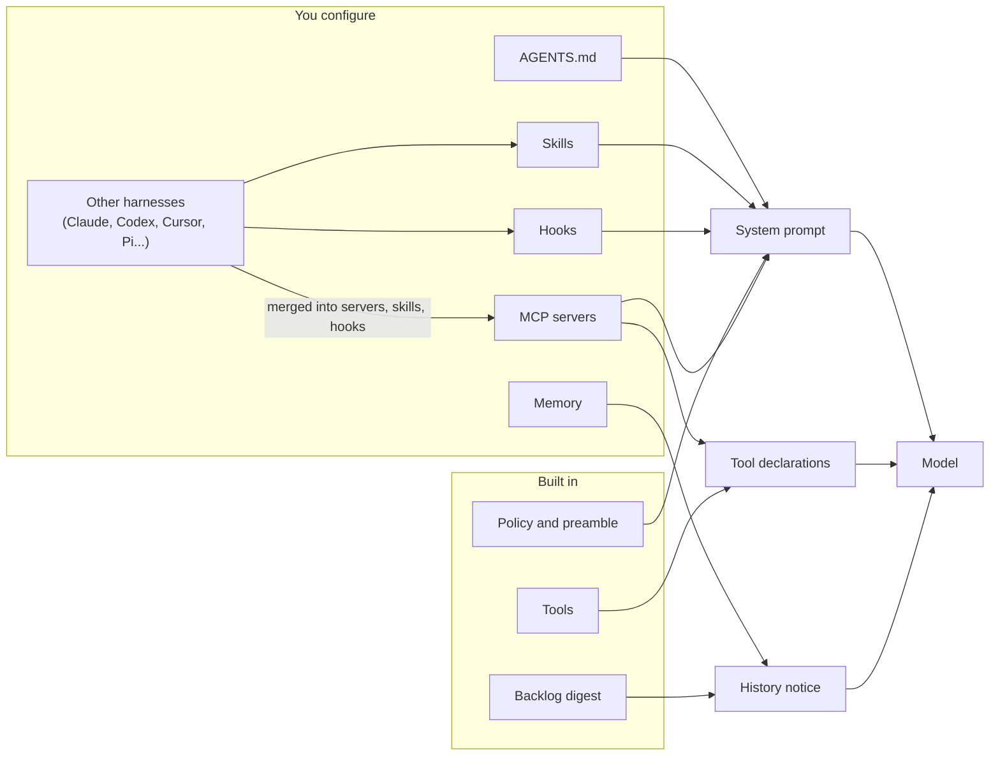

# What an agent reads, and where each part comes from

Why something is in an agent's context, how to turn it off, how to measure it. Request layout, sections, update delivery and compaction: [Context management](../../../docs/CONTEXT.md). Cache behavior: [prompt caching](prompt-caching.md).

## Sources

| Source               | Reaches the model as                                                                       | Switch                                                                                                                                           |
| -------------------- | ------------------------------------------------------------------------------------------ | ------------------------------------------------------------------------------------------------------------------------------------------------ |
| Core prompt          | `preamble`, `tools`, `rules`, `docs`, the policy sections or `lean`                        | `SYSTEM.md` or `--system-prompt` replaces `preamble`; the policy follows the declared tools ([prompts](prompts.md))                    |
| Native tools         | Tool declarations (description and schema)                                                 | The agent's profile (`tools:`), `/configuration enable` or `disable` `tool:<name>` ([native features](native-features.md))                       |
| MCP servers          | The `mcps` block and one declaration per `mcp__<server>__<tool>`                           | `/configuration enable` or `disable` `mcp:<name>`, the server's `defaultActive` ([MCP](mcp.md))                                                  |
| Project instructions | `project_context` ([files and limits](../../../docs/CONTEXT.md#project-context))           | `--no-context-files`                                                                                                                             |
| Skills               | `skills`: name and description; the body loads when the agent calls `skill`                | `/harness` (per skill or harness); rewrite descriptions with `octocode context` ([skills](skills.md))                                            |
| Hooks                | `hooks`: one line per event and matcher, never the command; plus hook output as context    | `/configuration enable` or `disable` `hook:<id>`; `disableAllHooks` ([hooks](hooks.md))                                                          |
| Other harnesses      | Their MCP servers, skills, hooks and Claude Code's auto memory, merged into the rows above | `/configuration enable` or `disable` `harness:<name>` for `claude`, `codex`, `cursor`, `pi`, `agents`, `mcp-json` (`--local` for one repository) |
| Memory               | A hidden notice with pinned notes and notes matching the user's prompt                     | `/memory`; Claude auto memory: `/harness` row `claude:memory`, off by default ([memory](memory.md))                                              |
| Backlog digest       | A hidden notice with counts and the top open items                                         | The repository's backlog                                                                                                                         |
| Child task           | The coordinator's brief, then `## You` and `## Report`                                     | The `agent` call                                                                                                                                 |

An agent sees only what its session loaded. A subagent gets its profile's tools, skills and MCP servers, not the coordinator's whole set.

## How other harnesses merge in

A harness adds no block of its own: its items join Octocode's lists, so their cost lands in the tool declarations and the skills listing.

| Item        | Merge rule                                                                                                                                                                                                                                                                                                                                                                             |
| ----------- | -------------------------------------------------------------------------------------------------------------------------------------------------------------------------------------------------------------------------------------------------------------------------------------------------------------------------------------------------------------------------------------- |
| MCP servers | Merged by name. A foreign server never replaces an Octocode server of the same name (`/harness config` lists it as shadowed). One that launches the same program (same command and arguments, or same URL) as a loaded default or Octocode server is dropped under any name; of identical foreign servers the first stays                                                              |
| Skills      | Merged by real path, so a folder symlinked into several harnesses is listed once; two different folders with one name are reported as a collision                                                                                                                                                                                                                                      |
| Hooks       | Keep their source profile: `.claude` files use the Claude profile, `.codex` the Codex profile, `.octocode/hooks.json` the native contract. Identical commands merge within a profile and run once per profile. Project hook files load only in a trusted folder; a subagent runs none unless its profile or its task turns them on ([hooks in subagents](hooks.md#hooks-in-subagents)) |

Before turning a harness on, `/harness list` shows what it supplies, `/harness config` what loaded and from where, `/mcp list` the session's servers.

## What a hook adds to the context

| Hook output                                                           | Becomes                                                                                 |
| --------------------------------------------------------------------- | --------------------------------------------------------------------------------------- |
| Plain text from `SessionStart`, `SubagentStart` or `UserPromptSubmit` | A hidden `Context from <event> hooks:` message                                          |
| JSON `additionalContext` on events that accept it                     | The same message                                                                        |
| Plain text from a Claude-profile `PreToolUse` hook                    | Nothing                                                                                 |
| Plain text from a Codex-profile `PreToolUse` hook                     | A hook failure (`Codex PreToolUse output must be a JSON object`) on every matching call |
| A refusal (exit 2 or a deny decision)                                 | The tool result, with the hook's reason                                                 |

Hook text over 16 KB is saved to a file and shown as head and tail with the path. Each matching hook spawns a process, so a hook on every tool adds its latency to every call.

## Measure it

| Question                                            | How                                                                                                                                                                      |
| --------------------------------------------------- | ------------------------------------------------------------------------------------------------------------------------------------------------------------------------ |
| The exact prompt and tools each built-in agent gets | Contributors: `yarn workspace @octocodeai/octocodecode run generate:prompts`, then read `.octocode/tmp/agent-prompts/<agent>/` (`system.md`, `tools.md`, `request.json`) |
| Tokens per layer in a real session                  | `/context` in the terminal; an agent's `archive` call with `source: profile` and a request number                                                                        |
| Skill description and MCP file sizes                | `octocode context list`                                                                                                                                                  |
| Which hooks act and how long they take              | `/harness hooks`                                                                                                                                                         |

The captured prompts use an empty user MCP configuration and a fixture `AGENTS.md`, so they show Octocode's own text; a real session adds your servers, skills, harnesses and project files. Measure the real session before claiming a size.
