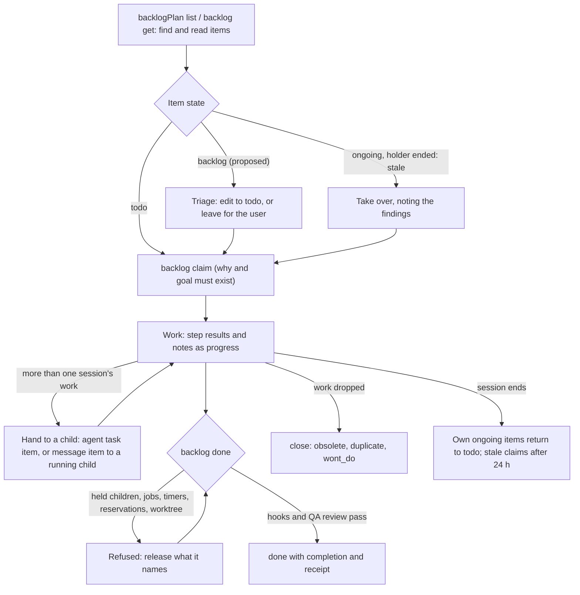
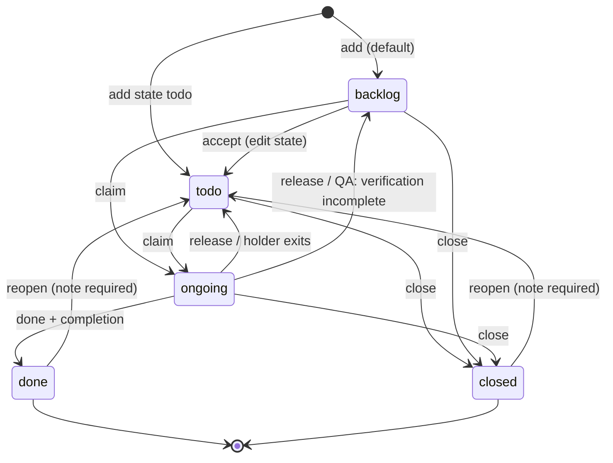
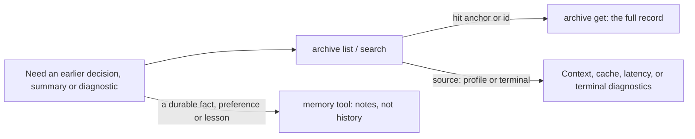

# Backlog and archive

Two stores outlive a single conversation. The **backlog** holds durable work: what to do, who holds it, what finished and how it was checked. The **archive** holds history: earlier sessions, compaction summaries and diagnostics about how a session ran. Agents reach them through the native tools `backlog`, `backlogPlan` and `archive`; you reach the backlog through `/backlog`, the `/web` board and `octocode backlog`.

## Backlog

### How an agent works an item



| Step | Tool call | Detail |
| --- | --- | --- |
| Find | `backlogPlan` `list` (filters, `blocked`, `touchingPaths`), `backlog` `get` | [versus `backlogPlan`](#backlog-versus-backlogplan) |
| Claim | `backlog` `claim` | Claim in its own call; others' live claims take notes only. [Claims and stale claims](#claims-and-stale-claims) |
| Progress | `backlog` `step`, `note` | [Steps](#steps-tasks) |
| Delegate | `agent` `task` with `item`, or `message` with `item` | The child updates only its item. [Children and the board](#children-notifications-and-the-board) and [handing an item to a running child](subagents.md#handing-an-item-to-a-running-child) |
| Finish | `backlog` `done` or `close` | [Completion](#completion-and-receipts) and [the `done` check](#the-done-check-and-the-state-change-line) |
| Release | session end, `/new`, resume, fork | [States and lifecycle](#states-and-lifecycle) |

Every state change adds one dim line to the transcript and the web activity; it never reaches the model.

### Items

An item is a numbered record (`B12`; numbers are per repository and never reused, even after the newest item is deleted). It carries:

| Field | Meaning |
| --- | --- |
| `title`, `goal`, `why` | One-line summary, the checkable Definition of Done, why it matters. An agent's `add` needs `goal` and `why`; a person may jot a bare title. Claiming or finishing an item needs both. |
| `type` | `epic`, `feature` (default), `bug`, `research`. |
| `parentId` | The epic the item belongs to. Depth is epic → item → step; an epic has no parent. |
| `dependsOn` | Prerequisite items; an item with an open prerequisite is *blocked*. |
| `priority` | `p0` urgent … `p3` someday (default `p2`). |
| `state` | See below. |
| `paths`, `evidence`, `plan`, `tags` | Affected files, observations with their source (`path:line`, command), approach, labels. |
| `from` | The item this one was derived from. |
| `links` | References with a relation `related`, `derived_from`, `evidence` or `output`; a target is a repository path, URL or item id, or a stored record (`sessions`, `messages`, `reports`, `memories`, `artifacts`). |
| `version` | Bumped on every change; a write that passes a stale `version` is refused, so a board holding an old copy never overwrites another session. |

Items, notes, comments and completions are never deleted by age; there is no delete operation. A write that carries text that looks like a secret is refused. Every change is audited with its actor and surface (`tool`, `web`, `command`).

### States and lifecycle

| State | Meaning |
| --- | --- |
| `backlog` | Proposed, not accepted. A subagent's proposals always land here. |
| `todo` | Accepted, unclaimed. |
| `ongoing` | Claimed by one session (the assignee); the claim starts the cycle clock. |
| `done` | Finished with a completion. |
| `closed` | Ended without doing the work: stored as `done` with a close record and no completion. Kinds: `obsolete`, `duplicate` (with `of`, the original), `wont_do`. |

`closed` is a list filter and a display state, not a fourth stored state: the stored states are `backlog`, `todo`, `ongoing` and `done`.



Rules enforced in the store:

- **Claim.** `claim` moves the item to `ongoing` for the caller. It is refused while another *live* session holds it; there is no steal. Others may only add a note.
- **Release.** Moving an `ongoing` item to `todo` or `backlog` clears the claim. A session that ends gracefully returns its own ongoing items to `todo` (except those a child run is working on); resuming that session restores the ones nobody touched since.
- **Reopen.** From `done` or `closed` back to an open state needs a note. A closed item must be reopened (state `todo`, with a note) before it can be completed.
- **Done.** Needs a completion (below). Refused while the item has open steps or this session still holds resources made for it ([the `done` check](#the-done-check-and-the-state-change-line)), or while an isolated child's saved change for it is unmerged. `close` is never held by these: it ends dropped work.
- **Epics.** An epic with items takes its state from them (no items keeps the stored state; all done is `done`; any ongoing is `ongoing`; any todo is `todo`; else `backlog`), so moving it directly is refused. Finish it with `backlog done` once its items are done or closed; with no completion given, the record names its items.
- **Subagents** update only the item their task names (see [children](#children-notifications-and-the-board)), add notes, never finish or close an item and never set `parentId` or `dependsOn`.

### Claims and stale claims

A claim names its holder session. A claim is *stale* when the holder is no longer a live session, was not a parent of the viewer, and the item is still `ongoing`; the board and lists mark it `(stale: holder ended)` and the digest offers it for takeover ("Take over a claim marked stale, with its findings"). A stale claim with no child run working on the item and idle for 24 hours (`RELEASE_AFTER_MS`) is returned to `todo` by the next session start; one still inside the window, or with a child running, is only flagged. The board lists any item untouched for 7 days under **Attention**.

### Steps (tasks)

A step is a small checklist unit (`T12`): `goal`, optional `reason`, state `todo`, `ongoing`, `done` or `dropped`, an order, an assignee while ongoing and a `result` written when it closes. A step belongs to one item or to one session (session steps can be promoted to an item). Steps have no triage or completion record. A holder may have only one ongoing step per owner. Open steps block `done` and `close`.

Steps are created and dropped on the board (`/backlog`, `/web backlogs`); the agent finishes one with `backlog` `op: step`, `id: "T12"` and `note` (the result and check evidence). A dropped step must be reopened on the board first. Finishing a step leaves its item open.

### Completion and receipts

`backlog` `op: done` takes `completion`:

| Field | Meaning |
| --- | --- |
| `summary` | What changed (required). |
| `verification` | Required: a sentence ("passed …", "n/a …"), or an object `{status, summary}` with `status` one of `passed`, `failed`, `not_run`, `not_applicable`, `not_stated`. |
| `files` | Paths, each stored with role `changed` unless given as objects (`changed`, `reviewed`, `produced`). |
| `lesson` | Optional takeaway. |
| `receipt` | A shell receipt id, or `latest`, from a `bash` call run with `verify: true`. A receipt from another session is refused. |
| `operationKey` | Retry key: a retry with the same key and content replays; different content under the same key is refused. |
| `replaces` | On a done item, the completion id to correct; omitted means the latest. |

A receipt records the command, state, exit code and whether it is *stale* (a later edit or another process moved the workspace on). The item shows **Recorded check** (exit 0, nothing changed since), **Reported** (no receipt or a nonzero exit), **Skipped** (QA did not run), **QA owed** or **Stale**. A zero exit proves the command succeeded, not that the goal is met.

Before the write, `done` runs, in order: the held-resource check, the unmerged-change check, the `TaskCompleted` hooks (see [hooks](hooks.md)) and the [QA review](#qa-review); the open-step check runs inside the write itself. `backlog.qa` (`important` default, `all`, `off`) picks which items a small reviewer model checks: *Ready* completes the item; *Changes required* keeps it `ongoing` with findings noted and refuses the call; *Verification incomplete* returns it to `backlog` and releases the claim. With no reviewer available the item completes with `qa: skipped` or `qa: owed`. Subagents do not run reviews; the coordinating session does.

### The `done` check and the state-change line

The `backlog` tool's `done` runs Octocode's own check first, in the process that writes, then the [`TaskCompleted`](hook-events.md) hooks. It refuses `done`, and names what to release, while this session still has any of these for the item:

| Held                                                                                                                    | Release it by                                                |
| ----------------------------------------------------------------------------------------------------------------------- | ------------------------------------------------------------ |
| A running child started on the item, or on an item derived from it (a sub-item, or one that came from it, at any depth) | waiting for its report, or `coordinate` action `stop`        |
| A background bash job started for the item (`item` on the call)                                                         | letting it end, or stopping it                               |
| A timer whose note names the item (a request on the item's own state is not counted: the item ending wakes it)          | `notify` op `off`                                            |
| A reservation covering the item's paths                                                                                 | `coordinate` action `unlock`                                 |
| An isolated worktree made for the item                                                                                  | `coordinate` action `merge`, or the user's `/agents discard` |

`close` as `obsolete`, `duplicate` or `wont_do` is never blocked: it ends an item whose work is dropped. Each process checks only its own resources: a child marking its own item done is not held by its parent's children, jobs or reservations, and the paths its parent reserved for it do not count (the parent releases them when the run ends). Changes from the web board, `/backlog` or another process are not checked.

Every state change (claim, release, done, close, reopen, a state edit), from the tool, the web board or `/backlog`, adds one dim line to the transcript and the web activity, such as `Backlog B12 done · Fix search · web board` (the writer is named when it was not this session). The line is a display-only session entry: it never reaches the model's context and starts no turn. New items, notes, steps and path edits add none.

### QA review

When an agent marks an important item done, a small reviewer model checks the work first: it gets the item's goal, the completion summary, the verification, the reported files and their diff, and runs read-only with the `octocode-code-review` skill. It needs a connected small model with known pricing; with none, or when the reviewer cannot start, the item still completes but its completion is marked `qa: owed` and the note says why. Each such item records a `qa.unavailable` event (`item`, `cause`; one per item version) that hooks, the web view and `wait` with `on` can follow. The owed reviews run by themselves, oldest first and at most five per start, the next time a reviewer starts for a later `done`; a Ready verdict records the review on the item, any other verdict reopens it like an ordinary failed review. A review whose reviewer answers off its format or schema twice is owed the same way, and the `qa.unavailable` cause then carries the rejection reason and where in the answer it failed (shortened). The `backlog.qa` setting chooses the items:

| Value                 | Reviewed before `done`                                                       |
| --------------------- | ---------------------------------------------------------------------------- |
| `important` (default) | p0 and p1 features and bugs; never research items, epics, or p2 and p3 items |
| `all`                 | every item except epics                                                      |
| `off`                 | none                                                                         |

| Verdict                 | Result                                                                                                        |
| ----------------------- | ------------------------------------------------------------------------------------------------------------- |
| Ready                   | The item completes, with the verdict, model and cost noted on it.                                             |
| Changes required        | The item stays ongoing with the findings noted, and the call that asked for `done` is refused with them.      |
| Verification incomplete | The item returns to the backlog, its claim released and the findings noted, until the missing checks are run. |

Each review is a small-model run; its cost is in the note and counts toward the session's spend. Subagents do not run reviews: the session that coordinates them does, when it completes the item. Headless and print runs review the same way, since the gate sits in the `backlog` tool, not in the interface.

### `backlog` versus `backlogPlan`

`backlog` works the one item you hold; `backlogPlan` plans and triages. Both are active in the main session. A subagent declares `backlog` only when its task names an item; it does not declare `backlogPlan`, and a read-only role that may list items reports follow-ups to its coordinator instead.

| Tool | `op` | Does |
| --- | --- | --- |
| `backlog` | `get` | Read `id`, or several with `ids`; `limit`, `offset`, `changes` page the history. |
| | `claim` | Start: `id`, plus `why` and `goal` if unset. |
| | `note` | Record progress on an item. |
| | `step` | Finish step `T…` with a result `note`. |
| | `done` | Finish the item with `completion`. |
| | `close` | End an unneeded item with `close: {kind, text, of?}`. |
| `backlogPlan` | `add` | Propose items: `items: [{title, goal, why, …}]`. |
| | `edit` | Change fields: `items: [{id, version?, …}]`. |
| | `list` | Find items. |
| | `stat` | Counts by state, priority and type. |

Both tools take `version` (refused if stale) and a `reason` (the purpose of the call, never the item's `why`). Details:

- `backlog` also accepts `items`, a batch of entries each carrying its own op fields; entries run in order. An old-shape call (`list`, `add`, `update`) is refused with the tool and op to use instead. `backlog` writes run alone in their message.
- `backlogPlan` `add` and `edit` entries take `title`, `goal`, `why`, `type`, `parentId`, `dependsOn`, `paths`, `evidence`, `plan`, `priority`, `tags`, `from`, `links`, `state` (`backlog`, `todo`, `ongoing`) and `note`; `edit` adds `id` and `version`. In `parentId` and `dependsOn`, an earlier entry's title in the same batch stands for its id. A refused entry does not stop the rest. `backlogPlan` never finishes an item (use `done`) and refuses `completion` and `close`.
- `list` filters: `states` (`backlog`, `todo`, `ongoing`, `done`, `closed`; default the first three), `query` (text in any field, or a whole tag), `ids`, `inTitle`, `ofType`, `underEpic`, `dependingOn`, `touchingPaths`, `priorityAtLeast`, `anyTag`, `derivedFrom`, `blocked`, `since` (ISO time or age such as `2h`, `7d`), `sort` (`board`, `updated`, `created`), `limit` (up to 200; without `states`, `ids` or `limit`, 15 open items), `offset`. A reply ends with a *Next* line to continue.

### Per-repository storage

The backlog lives in the database package (`packages/db`): the `backlog` table with `backlog_notes`, `backlog_comments`, `backlog_links`, `backlog_completions`, `backlog_tasks` and `backlog_audits`, written through `db/src/queries/backlog*.ts`. Each repository has its own file, `<agent state>/workspaces/<key>.db`, shared by its linked worktrees (the number counters live there too); a repository's board is never mixed with another's. See [configuration](configuration.md#runtime-storage) for the paths, `OCTOCODE_AGENT_DB` and the first-run move out of `workspaces.db`. After a schema upgrade older builds can read but not write the backlog: upgrade every process that shares the database.

Retention: items, notes, comments and completions are never deleted by age. Audit rows older than `retention.archiveAfterDays` (default 14) move to gzip files in the [history archive](#retention); archived rows older than `retention.days` (default 30) are dropped. Settings: [settings](settings.md).

### The board and commands

`/backlog` (or `/web backlogs`) opens the board: columns Backlog, To do, In progress and Done, plus Backlog (queue), Table, Tree (epic → item → step) and Attention views, search and filters, drag-and-drop, item sheets, audit, comments, **Implement** and exports. All of it is documented in [web workspace](web-workspace.md#backlog-board). A drop on **In progress** checks goal and why and claims as you; **Done** opens the completion editor; reopening needs a note; an epic does not move.

Commands: `/backlog tui` (terminal board), `/backlog add <title>`, `/backlog <id> <backlog|todo|ongoing|done>`, `/backlog <id> close`, `/backlog do <id>`, `/backlog export` (`.octocode/agent/backlog.md`), `/backlog html` (`.octocode/agent/backlog.html`). See [commands](commands.md). From a shell, `octocode backlog get|list|export|groom|graph` reads without changing anything; this is how a subagent without a board tool reads items.

### Children, notifications and the board

- **Delegation.** `agent` `task` with `item: B12` makes the parent claim the item (a claimable `todo`/`backlog` item with goal and why and no open prerequisite; epics, items held elsewhere or finished are refused) and lets the child update only that item. The child's report is noted on the item. The child reports results; the parent reviews, merges isolated changes and marks it done. A queued child (`after`) starts when the item it waits for is done.
- **Digest.** A fresh session gets a short notice: open counts, the items it holds or whose holder ended, and the most urgent open titles, ready ones first.
- **Change feed.** While a session works, other writers' changes to items it holds are read from the audit log. A held item closed, finished, released or reassigned elsewhere is delivered right after the current tool result; the rest wait for the next user turn. A session's own writes are never echoed.
- **Peer wakes.** A finished prerequisite wakes the holders of its dependents; an overlapping claim on the same paths wakes the holder (`subagents.peerOverlapWake`, default on). At most one wake per item per 5 minutes; other changes are FYI lines.
- **Footer and board.** Every state change adds a dim transcript line and repaints the footer counts of every attached session of that repository.

### Related-agent pings

An agent hears of backlog changes to items related to the ones it holds or waits on, without polling. When a prerequisite of an item you hold is done or closed, or an item you wait on ends, you are woken. When another agent claims an item whose paths overlap the paths of an item you hold, or paths you reserve, you are woken once for that pair. Other changes (an epic sibling claimed or finished, a note on an item you wait on) join your next turn as a short line. A change is never reported to the agent that made it, and the same item wakes a session at most once in five minutes.

`subagents.peerOverlapWake` (default `true`) controls the overlap wake; with `false` an overlapping claim is only a line at your next turn.

```json
{ "subagents": { "peerOverlapWake": false } }
```

### Grooming

`octocode backlog groom` prints the checks that need no model and only what they flag: claims to release, claims whose holder ended, epics whose items are all finished, items whose every path is gone, likely duplicate titles (title word overlap of at least 60%), blocked items and idle ones (untouched `backlog` 14 days, `todo` 21, `ongoing` 3). A model then judges only those rows: reassign, close with a kind, reprioritize. Guidance for agents: groom other people's items only as a small-model task. The core `octocode-backlog` skill carries the full procedure ([skills](skills.md)).

## Archive

### What is stored

| Data | Where |
| --- | --- |
| Session transcripts (messages, tool calls and results, branches, child reports, compaction entries) | JSONL files, by default `.octocode/agent/sessions/`; the record of every session |
| Mirror of transcripts and compaction summaries | `<agent state>/transcripts.db`, a derived index rebuilt from the JSONL files |
| Compaction detail (the full messages a compaction replaced) | `.octocode/agent/session-data/<session>/archive/` (Markdown segments) |
| Search index over archive passages | `<agent state>/archive-index.db`, disposable, rebuilt in the background |
| Agent records and lifecycle events | The repository's workspace file |
| Aged history rows (backlog audits, configuration audits, workspace commands) | Gzip JSONL files per family and UTC month in `<octocode home>/archive/` |

See [configuration](configuration.md#runtime-storage) for the full table and [how it works](how-it-works.md) for what compaction replaces.

### How an agent reads history



`archive` is read-only history: sessions, compaction summaries, agent records, lifecycle events and profile data; the sources and ids are in [the `archive` tool](#the-archive-tool). Saved notes, scopes and the `memory` tool are in [memory](memory.md).

### The `archive` tool

Call it when the answer is in earlier history, not in the code. Every call needs `reason` (why history is needed). `op` is `list` (newest first), `search` or `get` (a full record by `id`, or a `file`). `source` picks the collection; default `all`.

| `source` | Reads |
| --- | --- |
| `all` | Overview: a few records of each source (5 per source; up to 50 with `limit`). |
| `sessions` | Sessions in scope, session history and transcripts (calls, results, tool-call ids). |
| `compactions` | Compaction summaries. |
| `agents` | Agent records of the repository. |
| `events` | Agent lifecycle events; main session only. Filter with `agentId`, `eventType`, `since`, `until`. |
| `profile` | Context, cache and latency profile of a stored session: findings by cost and every agent (`sessionId`, default current); `agentId` lists that agent's requests; with `request` one request's prompt layers. |
| `terminal` | UI-lag diagnostics of the terminal renderer; main session only, and only where a terminal renderer runs (not print, RPC or web). Pair with the `octocode-debugging` skill. |

Search fields: `query` (case-insensitive regular expression) or `keywords` (ranked topic words), `sessionId` (one session; `current` is this one), `file` (a history file or folder; relative paths start in this session's archive folder, absolute paths must be readable history) with `line` to read from, `errors: true` (tool errors from full transcripts, grouped, with rates by tool, model and day; main session only), `since` (ISO time), `limit` (1–50, default 10), and `cursor`. A reply with more results ends with a continuation line; send that `cursor` to go on. A hit's anchor (`archive:<session>/<segment>/<entry>` or `transcript:…`) is a `get` id; record ids are `session:<id>`, `compaction:<session>:<entry>`, `event:<id>` and `agent:<name>`.

Scope: a session reads its own history, the sessions it was forked from and its parent's, and other sessions of the same repository without asking; another repository's history asks first. A subagent reads history, summaries and its own request profile, but not events or errors. Memories have their own `memory` tool: an `archive` call that names them is refused with the `memory` call to make. The newest records of the running session reach the database a moment after its file; a read waits briefly for them and says when they may be missing.

### Retention

Settings are global (a project file cannot set them): `retention.days` (30; output, logs, session data, compaction detail copies, database history), `retention.sessionDays` (90; transcripts, with their session data and rows; the current and running sessions are kept) and `retention.archiveAfterDays` (14, minimum 1). `0` keeps a class forever. Environment: `OCTOCODE_CLEANUP_DAYS`, `OCTOCODE_SESSION_RETENTION_DAYS`. Details in [settings](settings.md) and [configuration](configuration.md#runtime-storage).

- A housekeeping pass moves aged backlog audits, configuration audits and workspace commands into the monthly gzip files, writing each batch before deleting it, and drops archived rows older than `days`. Agent runs and events older than `days` are dropped with no archive (each workspace keeps its newest event). Backlog items are not touched.
- A compaction's detail copy expires after `days`; the summary stays, and the record then reads `Detail: expired`. A detail file is deleted only after the transcript is indexed.
- `/purge workspace` removes the workspace's transcripts, session data, scratch and their rows.

### Resume

`octocode --continue` opens the latest session of the folder; `/resume` or `octocode --resume` picks one; `octocode --resume <id>` opens a specific session. `/resume B346` lists sessions that held or hold that backlog item (`/resume all B346` searches every repository). Resuming reads the JSONL file; if the database is unavailable after a write, Octocode reports the pending mirror and retries on the next open or write. A resumed session restores the backlog claims its exit released, if nobody touched them since. See [how-to](how-to.md#resume-a-session-or-find-the-one-that-worked-on-a-backlog-item).
