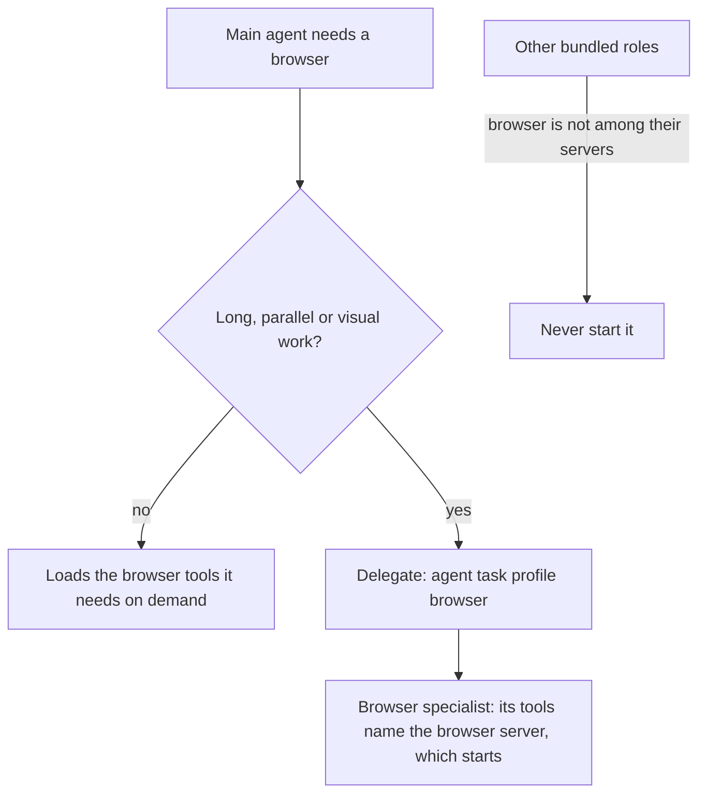
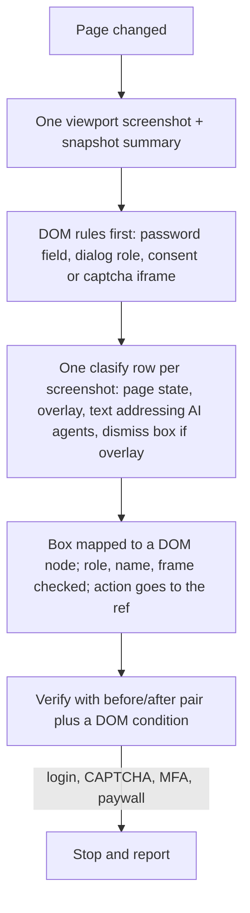
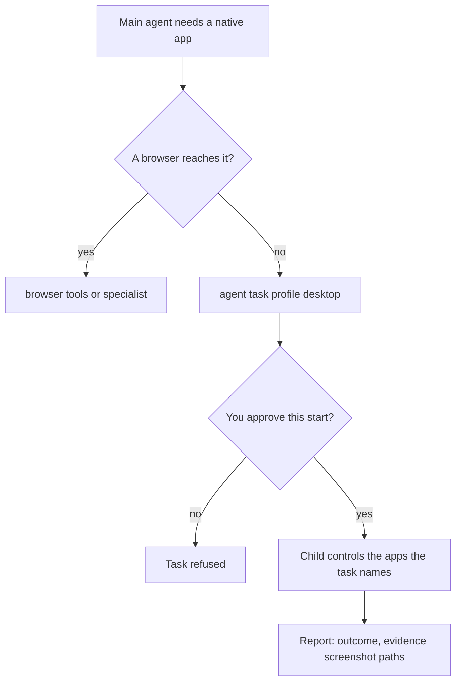

# Browser and desktop control

Two ways to work beyond text: a browser for web pages and native desktop apps. Both are MCP servers (`mcp__browser__*`, `mcp__desktop__*`) with a bundled specialist [subagent profile](subagents.md#profiles); plain search and fetch is the [`web` tool](tools.md#web). Permissions for both: [permissions](permissions.md#desktop-control).

## Browser

Browsing uses the built-in `browser` MCP server (`mcp__browser__*`, powered by `@octocodeai/octocode-chrome-devtools`); the native `browser` tool was retired. Its own instructions and the bundled `octocode-chrome-devtools` skill say how to use it; launch and exposure are in the [MCP reference](mcp-reference.md#configuration-and-precedence).



| Topic                  | Behavior                                                                                                                                                                                                                                                                                                                                                                                                                                                                                                                                                                                                          |
| ---------------------- | ----------------------------------------------------------------------------------------------------------------------------------------------------------------------------------------------------------------------------------------------------------------------------------------------------------------------------------------------------------------------------------------------------------------------------------------------------------------------------------------------------------------------------------------------------------------------------------------------------------------- |
| Default                | The main session gets every browser tool on demand: each is listed in its MCP block and declared when first loaded or called. A subagent starts the server as the `browser` or `desktop` specialist, when its profile's `tools:` names `mcp__browser__*`, or when its task's `mcp` list names `browser`; every bundled role except `lean` runs the research server, and your own servers stay with the main session ([MCP](mcp.md#default-servers))                                                                                                                                                               |
| Declare tools up front | Name tools in `defaultTools` (or `--tools` for one run): `+mcp__browser__open`, `+mcp__browser__run`, `+mcp__browser__cleanup`; the rest of the catalog stays on demand and the main agent is told to use these instead of delegating                                                                                                                                                                                                                                                                                                                                                                             |
| Other ways             | A profile `tools:` entry naming `mcp__browser__*` gives a subagent direct access; a `browser` server defined in full in `mcp.json` replaces the preset; children that do not name it are still excluded. A `defaultTools` entry `browser` has no effect (reported in settings warnings) and `--tools +browser` selects nothing. `-web` omits retrieval                                                                                                                                                                                                                                                            |
| Permissions            | A private/local or unresolved page address asks `net.private`. Page scripts (`evaluate` steps, a flow's `trigger`), `open` with `attach` and `launch.chromePath` ask `browser.control`. All raw CDP commands (the `cdp` tool and `cdp` plan steps) ask `browser.cookies`: opaque browser programs can access cookies. No profile grants it; one answer can cover the session. Typed DOM actions, extraction, snapshots, saved-file reads and protocol/schema discovery keep their normal permissions. Page requests pass the private-address filtering proxy, which `open` starts Chrome behind (`launch.proxy`). |
| Chrome                 | `open` takes `headless`. A visible Chrome on an explicit `port` keeps its profile under the workspace's browser state between opens, so a login persists (logins saved earlier under `browser-profile` in the Octocode home are not reused: sign in again). A headless Chrome a browser subagent leaves running stays for follow-ups and stops when the top session shuts down; a visible one stays open. Calls reach the server in the order made, and a command without a port uses the browser `open` last made ready in the workspace                                                                         |

Start the specialist with `background: true` and give it the task, URL, required evidence and `headless` choice:

```json
{
	"type": "task",
	"profile": "browser",
	"headless": false,
	"goal": "Check the signed-in dashboard",
	"task": "Open https://example.com/dashboard and report what is visible.",
	"reason": "Check the dashboard as the signed-in user"
}
```

`headless` defaults to `true`; `false` selects visible Chrome with its persistent login profile. Both modes share role instructions, so the mode belongs in the task and the cached role text stays identical. The profile sets `linger: 900`: after a successful report it stays reachable for 15 minutes and `message` to its id resumes the same conversation (page map and decisions included). A resumed run is a new process but Chrome outlives it: when follow-ups may come, the specialist leaves the browser running and reports its port, and `open` on that port reuses the browser and tabs; Octocode records the private-address filter port beside the browser state and restores the filter (approvals of private hosts start empty). Tell the specialist to close the browser when done. Foreground runs need an explicit `task` resume; an isolated run resumes in a worktree recreated from its saved ref, while that ref exists. Replace the former `webHeadless` and `webLive` profiles with `profile: "browser"` and `headless`.

The specialist's page-awareness loop:



It reuses saved captures, skips classification when URL, title and DOM digest are unchanged, and keeps a page map in its scratch folder. A box is never clicked.

## Desktop control

Native apps (a desktop app, a simulator, system settings, a window you must see) are driven with [Cua Driver](https://github.com/trycua/cua) ([install guide](https://cua.ai/docs/cua-driver/quickstart)), which Octocode neither installs nor bundles. Install it yourself; while Octocode finds `cua-driver` (on `PATH` or at `OCTOCODE_CUA_DRIVER_PATH`) the built-in `desktop` MCP server and the bundled `desktop` profile exist, and without it both stay out of the way: the server is listed disabled with the install pointer, and the profile is not offered, so the main prompt is unchanged. `OCTOCODE_MCP_DESKTOP=0` keeps both off.

Which route does a task take? The first match wins, and the agent applies the same rule when it chooses.

| The task is                                                                                                                                                          | Route                                                                                       | Why                                                                                         |
| -------------------------------------------------------------------------------------------------------------------------------------------------------------------- | ------------------------------------------------------------------------------------------- | ------------------------------------------------------------------------------------------- |
| Doable without a screen: code, files, a CLI or API, a public page `web` can fetch                                                                                    | `bash`, `file`, `web`                                                                       | Exact and cheapest                                                                          |
| A web page: read, fill, click, log in, upload, download, screenshots, console, network                                                                               | The `browser` server and specialist, with `clasify` and the local search tools for evidence | It reads the DOM, so it is exact and cheaper than the desktop route                         |
| A native app or OS window: a desktop app you name (even when its service has a website), System Settings, a simulator, a native dialog the browser route cannot pass | The `desktop` specialist                                                                    | Only it sees a native accessibility tree and acts on your real apps; you approve each start |

For a site that needs your account, the `browser` specialist runs visible and stops at the login or MFA step; you complete it once and the profile persists. Pure page content goes to the browser specialist; the desktop specialist carries both Chrome and desktop MCPs for mixed native/page work. Neither route sends, pays, submits or deletes unless the task says so.



| Topic           | Behavior                                                                                                                                                                                                                                                                                                                                                                                                                                                                                                                                                                                                                                                                                                                                                                                                                                                                                                                                                                                                                                                                                                                                                                                                                                                                                                                                                                                                                                                                                                                                                                                                    |
| --------------- | ----------------------------------------------------------------------------------------------------------------------------------------------------------------------------------------------------------------------------------------------------------------------------------------------------------------------------------------------------------------------------------------------------------------------------------------------------------------------------------------------------------------------------------------------------------------------------------------------------------------------------------------------------------------------------------------------------------------------------------------------------------------------------------------------------------------------------------------------------------------------------------------------------------------------------------------------------------------------------------------------------------------------------------------------------------------------------------------------------------------------------------------------------------------------------------------------------------------------------------------------------------------------------------------------------------------------------------------------------------------------------------------------------------------------------------------------------------------------------------------------------------------------------------------------------------------------------------------------------------- |
| When it is used | The main agent reads the delegation rule only while the `desktop` profile exists: native and mixed native/page work can go to it; pure page work goes to the browser route. The `desktop` profile's description says the same where the profile list is shown                                                                                                                                                                                                                                                                                                                                                                                                                                                                                                                                                                                                                                                                                                                                                                                                                                                                                                                                                                                                                                                                                                                                                                                                                                                                                                                                               |
| Approval        | Starting the profile asks you in every mode but `bypass`, `full` included, every time (`desktop.control`; [permissions](permissions.md#desktop-control)). Your approval is the child's consent for that run; its desktop calls then run without a prompt each                                                                                                                                                                                                                                                                                                                                                                                                                                                                                                                                                                                                                                                                                                                                                                                                                                                                                                                                                                                                                                                                                                                                                                                                                                                                                                                                               |
| Where Driver is | Octocode looks for `cua-driver` on `PATH`. To use another copy, set `OCTOCODE_CUA_DRIVER_PATH` to its absolute path (`~` works); a wrong path leaves the server disabled and names the problem, and Octocode does not fall back to `PATH`. Octocode never installs Cua Driver At startup Octocode tells you, once, when Cua Driver is older than the oldest version it was recorded against (`cua-driver update`), and on macOS when Cua Driver has no Accessibility or Screen Recording permission (`cua-driver permissions grant`). A missing daemon is not reported, because the Driver starts one on first use.                                                                                                                                                                                                                                                                                                                                                                                                                                                                                                                                                                                                                                                                                                                                                                                                                                                                                                                                                                                         |
| Who can use it  | Only a session where someone can answer: the terminal, a web workspace or an editor over ACP. A print or JSON run has nobody to ask, so it has no `desktop` server and no `desktop` specialist, and the subagents it starts inherit that. Starting the specialist asks you every time, in every mode but `bypass`                                                                                                                                                                                                                                                                                                                                                                                                                                                                                                                                                                                                                                                                                                                                                                                                                                                                                                                                                                                                                                                                                                                                                                                                                                                                                           |
| App list        | A task can pass `apps` (names such as `["Calculator"]`) to name the only apps its child may control. The start dialog shows them, and the child's desktop calls that target another app (by launch name, bundle id or the process a call targets) are refused in every mode, naming the app and the list. Matching ignores case and `.app`, and a bundle id matches the app's full whitespace-separated name at its dot-separated suffix (`com.google.Chrome` matches `Google Chrome`). Only the `desktop` profile (or one that declares `desktop.control`) takes `apps`. The list never lifts the terminal, editor and password-manager refusal above. Omit it and the child may control any app that is not refused                                                                                                                                                                                                                                                                                                                                                                                                                                                                                                                                                                                                                                                                                                                                                                                                                                                                                       |
| Isolation       | The work runs in a child session, so window trees and screenshots stay out of the main context. The child has no shell and is `readOnly`: it cannot change the repository. Every specialist still carries the shared tools (`file`, `agent`, `notify`, `archive`, `memory`, local research), so a child with only desktop tools is not possible Octocode refuses in every mode to launch or drive a terminal, code editor, password manager or Keychain app (by name, bundle id or the process a call targets), and the clipboard, `kill_app`, recording, replay and session-escalation tools ask you on every call even inside an approved child (they ask `desktop.sensitive`, which no start approval answers). A `screenshot_out_file` outside the workspace, or inside it but outside the folders a read-only role may write (its scratch folder, `.octocode/agent/temp/` and `tmp/`; not `MEMORY.md`, state or session transcripts), asks `file.outside`, and Octocode creates the missing folder of an allowed path before the call.                                                                                                                                                                                                                                                                                                                                                                                                                                                                                                                                                                 |
| Tools           | The everyday tools are declared (`list_windows`, `get_window_state`, `verify_state`, `launch_app`, `invoke_menu`, `click`, `type_text`, `press_key`, `hotkey`); the rest (`list_apps`, `scroll`, `set_value`, `invoke_menu`, and so on) load on demand. `install_extension`, `install_ffmpeg` and `set_config` are removed                                                                                                                                                                                                                                                                                                                                                                                                                                                                                                                                                                                                                                                                                                                                                                                                                                                                                                                                                                                                                                                                                                                                                                                                                                                                                  |
| Results         | Driver returns a one-line text and keeps window ids, `snapshot_id` and the accessibility tree in `structuredContent`. Octocode keeps Driver's readable text and adds only what the next call needs (a token is `<snapshot_id>:<element index>`), dropping the copy of the tree the text already lists. A window read also carries no screenshot unless asked: the evidence screenshot is saved with `screenshot_out_file`, and a report that cites an image has each path opened by Octocode, which notes a file that is missing, older than the run or identical to another                                                                                                                                                                                                                                                                                                                                                                                                                                                                                                                                                                                                                                                                                                                                                                                                                                                                                                                                                                                                                                |
| Cost            | Driver serves many tools with long descriptions and schemas, so only the child pays for them, and most are on demand. A desktop run grows with what it reads: window trees, screenshots and guide pages stay in every later request. Window reads are therefore bounded and carry no screenshot by default, results keep only what the next call needs, and a child that reads more should read a window once and act on it. The profile has a request budget                                                                                                                                                                                                                                                                                                                                                                                                                                                                                                                                                                                                                                                                                                                                                                                                                                                                                                                                                                                                                                                                                                                                               |
| Guide           | Driver serves its own guide as MCP resources (`skill://cua-driver/SKILL.md`, plus per-platform pages). The child reads it on demand with the `mcp` tool, so it always matches the installed version and adds nothing to any prompt until read                                                                                                                                                                                                                                                                                                                                                                                                                                                                                                                                                                                                                                                                                                                                                                                                                                                                                                                                                                                                                                                                                                                                                                                                                                                                                                                                                               |
| Browsers        | The desktop profile carries both the `browser` and `desktop` servers: use Chrome MCP for page DOM and desktop tools for native windows. Besides the `browser` server, Driver has typed browser tools (`get_browser_state`, `browser_navigate`, `browser_click`, `browser_type`, `browser_set_input_files`, `browser_download`, `browser_dialog`) that bind an exact browser window and work in Chrome, Edge, Chromium and Electron apps. Use them for a browser's own windows (file pickers, permission prompts, downloads) and Electron apps; page content a browser can reach goes to the `browser` server. The child prepares an isolated Chrome profile with no cookies. Octocode adds the checks the `browser` server has: a cloud metadata address is refused in every mode, a private, local or unresolved address asks `net.private`, a file from outside the workspace sent to a page asks `upload.outside`, a download saved outside it asks `file.outside`, both also ask `desktop.sensitive`, and attaching to your own signed-in profile asks `browser.cookies` (which no start approval answers). A browser launched with debugging, profile or security flags is refused, and the legacy `page` tool (script in a page) is removed. Driver also refuses to attach to your profile unless it was started with its own grant, which Octocode never passes Driver does not report where an isolated profile lives, and it can be left in the system temporary folder after the browser quits; Octocode cannot tell which folder is a run's, so remove stale temporary Chrome profiles yourself. |
| Telemetry       | Cua Driver sends content-free telemetry by default. Octocode leaves your setting alone: `cua-driver telemetry status`, `cua-driver telemetry disable`                                                                                                                                                                                                                                                                                                                                                                                                                                                                                                                                                                                                                                                                                                                                                                                                                                                                                                                                                                                                                                                                                                                                                                                                                                                                                                                                                                                                                                                       |
| Your own server | A `desktop` server in `mcp.json` replaces the preset. The bundled profile then stays hidden unless the preset is enabled, so give your server a profile of your own. Octocode never passes `--grant existing-profile`; adding it attaches Driver to your signed-in Chromium profile                                                                                                                                                                                                                                                                                                                                                                                                                                                                                                                                                                                                                                                                                                                                                                                                                                                                                                                                                                                                                                                                                                                                                                                                                                                                                                                         |

Ask for it in plain words ("open Calculator and compute 6 × 7, then show me the screenshot"), or start it yourself:

```json
{
	"type": "task",
	"profile": "desktop",
	"goal": "Check the Calculator result",
	"task": "Open Calculator, compute 6 x 7, verify the display shows 42, save a screenshot after the last action, then quit it.",
	"reason": "Check the desktop feature"
}
```
