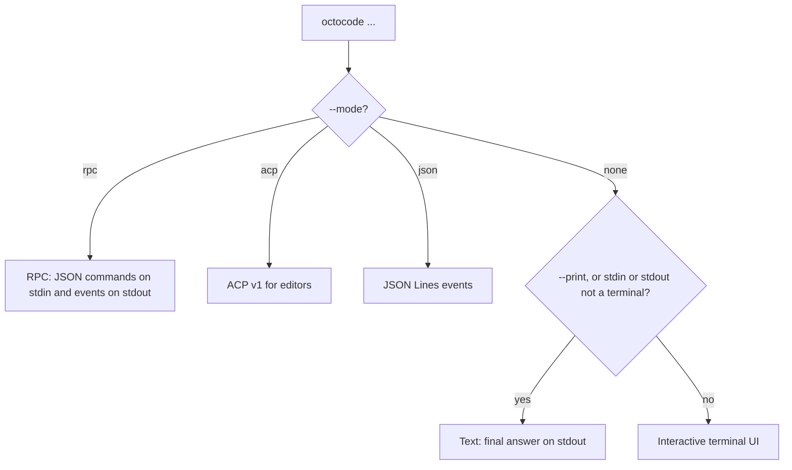
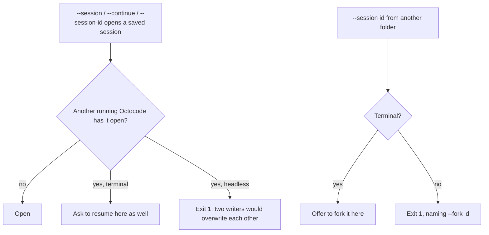

# CLI modes and flags

`octocode [options] [--] [@files...] [messages...]` starts Octocode. `octocode --help` lists every flag; `octocode completion bash|zsh|fish` prints shell completion. Subcommands (`install`, `configuration`, `mcp`, `trust`, ...) are in [commands](commands.md#shell-entry-points).

For another agent, script or CI job, start with the [external-agent guide](external-agents.md): setup, safe subprocess invocation, permissions and completion handling.

## Choose a mode



| Mode        | Start with                      | Output                                           | Page          |
| ----------- | ------------------------------- | ------------------------------------------------ | ------------- |
| Interactive | `octocode` in a terminal        | The terminal UI                                  | [TUI](tui.md) |
| Text        | `octocode -p "prompt"`          | Final assistant text on stdout, errors on stderr | below         |
| JSON        | `octocode --mode json "prompt"` | Session header, then one JSON event per line     | below         |
| RPC         | `octocode --mode rpc`           | JSON commands in, responses and events out       | [RPC](rpc.md) |
| ACP         | `octocode --mode acp`           | Agent Client Protocol v1                         | [ACP](acp.md) |

`--mode rpc` and `--mode json` win over `--print`. Piped stdin is added to the first message and turns an interactive start into text mode. Octocode reads the pipe to its end before starting; a parent that leaves it open holds the run, and after a few seconds one stderr line says so. `--no-stdin` skips the read. RPC reads stdin for commands, so it ignores piped content and refuses `@file` arguments.

```bash
octocode -p "List the TypeScript files in src/"
git diff | octocode -p "Review this diff"
octocode --mode json --no-session "Summarize README.md" > events.jsonl
```

### Text mode

Sends the first message and any further positional messages as separate prompts, then prints the text of the last assistant message. Exit code `1` when a prompt ends in an error or abort or the reply was cut at the model's output limit; the reason goes to stderr (including an unrecoverable context overflow). Exit code `2` when text or JSON mode gets no prompt (no message, `@file` or piped stdin). A provider retry writes one stderr line with the wait.

### JSON mode

Same prompts, JSON Lines on stdout: the session header, then each event as it happens (`agent_start`, `message_update`, `tool_execution_end`, `agent_end`, `agent_settled` with the run's `outcome`, ...). `message_update` carries the delta and cumulative `usage`; `message_end` holds the finished message. Exit codes follow text mode, and other stdout writes go to stderr so the stream stays parseable. RPC mode uses the same event shape ([RPC](rpc.md)).

If a write to stdout fails in text, JSON or RPC mode (`octocode --mode json "..." | head -1`), Octocode releases the session and exits `1` with one stderr line.

## Flags

Every flag has one long name; the only short forms are `-p -c -r -n -t -h -v`. An unknown flag fails with `Unknown option: --flag`. `--` ends option parsing. Settings supply defaults for most of these ([settings](settings.md)); environment variables are in [environment variables](environment-variables.md).

### Model

| Flag                            | Does                                                                                                                                                                                                                   |
| ------------------------------- | ---------------------------------------------------------------------------------------------------------------------------------------------------------------------------------------------------------------------- |
| `--model <pattern>`             | Model pattern or id: `provider/id`, optional `:<thinking>` suffix (`sonnet:high`)                                                                                                                                      |
| `--provider <name>`             | Provider for a bare `--model` id and the `auth` commands                                                                                                                                                               |
| `--models <patterns>`           | Comma-separated patterns for Ctrl+P cycling; globs (`anthropic/*`) and fuzzy match; `sonnet:high,haiku:low` fixes levels                                                                                               |
| `--thinking <level>`            | Thinking level (the accepted levels print in an error for a bad value)                                                                                                                                                 |
| `--list-models [search]`        | List available models and exit                                                                                                                                                                                         |
| `--api-key <key>`               | API key for this run; a key on the command line shows in `ps` and shell history, so prefer `--api-key-env` or `auth.json`                                                                                              |
| `--api-key-env <name>`          | API key for this run, read from the environment variable `<name>` so the key stays out of the command line, `ps` and shell history; an unset or empty variable is an error, and it cannot be combined with `--api-key` |
| `--system-prompt <text>`        | Replace the system prompt                                                                                                                                                                                              |
| `--append-system-prompt <text>` | Append text or file contents to it (repeatable)                                                                                                                                                                        |

### Sessions

| Flag                       | Does                                                                                         |
| -------------------------- | -------------------------------------------------------------------------------------------- |
| `--continue`, `-c`         | Continue the previous session of this folder                                                 |
| `--resume [id]`, `-r`      | With an id (id, unique prefix or file path) same as `--session <id>`; alone opens the picker |
| `--session <path\|id>`     | Open a session file or id                                                                    |
| `--session-id <id>`        | Use this exact project session id, creating it if missing                                    |
| `--fork <path\|id>`        | Copy a session into a new one (also continues a cut-off file)                                |
| `--session-dir <dir>`      | Directory for session storage and lookup                                                     |
| `--no-session`             | Keep the conversation in memory only                                                         |
| `--name <name>`, `-n`      | Session display name                                                                         |
| `--export <file> [output]` | Export a session file to HTML and exit                                                       |
| `--worktree <name>`        | Start in git worktree `<name>` ([worktrees](native-features.md#worktrees))                   |



`--fork` copies the session and is never refused. `--session-id <id>` and `--fork --session-id <id>` refuse an id saved in another folder and name its file. A prefix matching several sessions exits `1` and lists them; a match in this project wins over others. After `--resume`, a bare word is read as the id only when it looks like one (four or more hex digits and dashes, or a path); otherwise it is the prompt, so `octocode -r "fix the build"` opens the picker with that prompt. Use `--resume=<id>` or `--session <id>` for other ids. Octocode prints `octocode --resume <id>` when a session ends.

### Permissions, trust and planning

| Flag                                        | Does                                                                                                                                                   |
| ------------------------------------------- | ------------------------------------------------------------------------------------------------------------------------------------------------------ |
| `--permission-mode manual\|workspace\|full` | Start mode (default `full`); subagents inherit it ([permissions](permissions.md#modes))                                                                |
| `--dangerously-skip-permissions`            | Start in `bypass`: nothing asks, every call is still recorded, hook denies and invariants still refuse. Conflicts with a different `--permission-mode` |
| `--trust`                                   | Record your trust of this folder, then run. A text, JSON or RPC run in an untrusted folder exits with an error without it (not for `--mode acp`)       |
| `--plan`                                    | Start with the planning constraint on ([planning](native-features.md#native-planning-constraint))                                                      |
| `--offline`                                 | Skip startup network operations (same as `OCTOCODE_OFFLINE=1`)                                                                                         |

### Tools and configuration

| Flag                     | Does                                                                                                                                                       |
| ------------------------ | ---------------------------------------------------------------------------------------------------------------------------------------------------------- |
| `--tools <list>`, `-t`   | Allowlist of tool names or patterns (`*`); keeps MCP tools unless an entry starts with `mcp__`; `+name`/`-name` entries adjust the defaults instead        |
| `--exclude-tools <list>` | Denylist; applies to all tools, MCP included, and to subagents                                                                                             |
| `--no-tools`             | No tools by default (native and MCP)                                                                                                                       |
| `--no-builtin-tools`     | No native tools; MCP tools stay                                                                                                                            |
| `--no-mcp`               | No MCP servers or tools; also binds subagents                                                                                                              |
| `--enable <id>`          | Enable a tool, MCP server, skill, harness or boolean setting for this run (repeatable; ids as in [configuration](configuration.md#changing-configuration)) |
| `--disable <id>`         | Disable one for this run (repeatable)                                                                                                                      |
| `--set <key>=<value>`    | Set a settings key for this run (repeatable)                                                                                                               |

`--tools` is this session's allowlist; a subagent keeps its profile's tools. Tool selection: [native features](native-features.md#tool-selection-and-migration). Octocode has no extensions: `--extension`, `-e` and `--no-extensions` are unknown. MCP is always on unless `--no-mcp`.

### Resources and interface

| Flag                                                 | Does                                                            |
| ---------------------------------------------------- | --------------------------------------------------------------- |
| `--skill <path>` / `--no-skills`                     | Load a skill file or directory (repeatable) / disable skills    |
| `--prompt-template <path>` / `--no-prompt-templates` | Same for [prompt templates](prompt-templates.md)                |
| `--theme <path>` / `--no-themes`                     | Same for [themes](themes.md)                                    |
| `--use-theme <name[/name]>`                          | Initial theme for this run                                      |
| `--no-context-files`                                 | Skip `AGENTS.md` discovery                                      |
| `--tui-mode fullscreen\|regular`                     | Terminal UI mode (default `fullscreen`)                         |
| `--no-color`                                         | Turn off ANSI color, like `NO_COLOR` (also `OCTOCODE_NO_COLOR`) |
| `--verbose`                                          | Verbose startup, overriding `quietStartup`                      |
| `--help`, `-h` / `--version`, `-v`                   | Help / version                                                  |

### Headless

| Flag                | Does                                                                                                                                               |
| ------------------- | -------------------------------------------------------------------------------------------------------------------------------------------------- |
| `--no-stdin`        | Do not read piped stdin                                                                                                                            |
| `--no-dialogs`      | RPC: nobody answers dialogs; asks are refused as in a text run ([RPC](rpc.md#protocol))                                                            |
| `--rpc-ask`         | RPC: the client answers `ask` requests (typed question batches) instead of `select`, `confirm` and `input` dialogs; a subagent always runs with it |
| `--rpc-lean-events` | RPC: each message and tool result is sent whole once; later events refer to it ([RPC](rpc.md#protocol)); a subagent always runs with it            |
