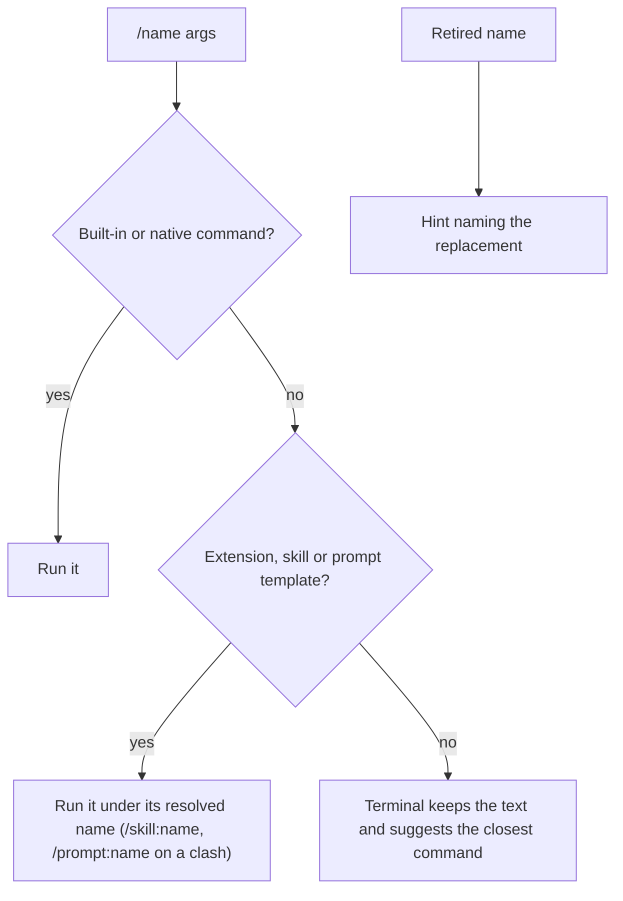

# Commands

The shipped inventory is 51 slash commands (34 core, 15 native, 2 bundled-extension); each has one name and there are no aliases, except `/clear` and `/reset`, which run `/new`. `/help [search]` shows what the current host offers, skill commands included. Loaded skills, prompt templates and extensions add commands of their own. In the syntax, `[x]` is optional and `<x>` required.

Shell entry points are at the end; flags and output modes are in [CLI](cli.md).

## Session

| Command                                     | Does                                                                                                                    |
| ------------------------------------------- | ----------------------------------------------------------------------------------------------------------------------- |
| `/new [previous-name]`                      | Start a fresh session; names the previous one after a successful switch                                                 |
| `/clear [previous-name]`                    | Same as `/new`                                                                                                          |
| `/reset [previous-name]`                    | Same as `/new`                                                                                                          |
| `/resume [all] [query\|B<n>]`               | Browse saved sessions. `all` spans folders; `B<n>` lists sessions that held or hold that backlog item                   |
| `/rename <name>`                            | Name the current session                                                                                                |
| `/fork [pane [right\|down]\|window]`        | Fork from a chosen user message; `pane`/`window` opens the fork in tmux ([tmux](tmux.md))                               |
| `/clone`                                    | Duplicate the session at its current position                                                                           |
| `/tree`                                     | Navigate the session's branches (`Ctrl+X` copies an entry's original text)                                              |
| `/queue`                                    | Edit queued messages (also Up in an empty editor): remove, reorder, next turn or after run                              |
| `/compact [instructions]`                   | Compact context; the instructions focus this one summary                                                                |
| `/archive [<n>]`                            | List compacted-history segments; `<n>` prints segment `n`'s file path, not its content                                  |
| `/rewind [turns]`                           | Restore checkpointed file changes of the last N turns (default 1) on this branch; the conversation stays                |
| `/context [all\|size\|reset\|full\|tokens]` | Show context usage; `size` picks a budget, `32k` sets one, `full` uses model capacity, `reset` restores `contextBudget` |
| `/export [path]`                            | Export to HTML, or JSONL when the path ends in `.jsonl`                                                                 |
| `/import <path>`                            | Import and resume a JSONL session                                                                                       |
| `/share`                                    | Upload the session to a secret GitHub gist after confirmation; the reply says how to delete it                          |
| `/copy`                                     | Copy the last assistant message                                                                                         |
| `/btw [question\|--cancel\|--clear]`        | Tool-free side question kept out of the conversation; no argument shows the side thread                                 |
| `/quit`                                     | Shut down; asks first while a reply, bash job, background subagent or external prompt runs                              |

`/resume` details: with `--session-dir` both scopes list only that folder; Ctrl+X marks rows, Ctrl+D deletes the marked (or selected) rows after one confirmation, refusing the current session and sessions another process runs; Ctrl+R renames. Without native features it opens the basic selector. Task recipes: [how-to](how-to.md). Side-question privacy, compaction limits and reports: [native features](native-features.md#session-workflow-commands).

## Model and provider

| Command                     | Does                                                                                                                                       |
| --------------------------- | ------------------------------------------------------------------------------------------------------------------------------------------ |
| `/providers [provider\|pi]` | Sign in, enable or disable providers and sources; `pi` imports saved Pi sign-ins. See [providers](providers.md)                            |
| `/logout [provider]`        | Sign-out picker for saved credentials, search prefilled with the provider                                                                  |
| `/model [provider/model]`   | Choose this chat's model; Ctrl+S saves a default                                                                                           |
| `/modelsettings [check]`    | Shortcuts, native catalog, prices and agent routing; `check` tests provider credentials. Headless it prints the catalog and routing report |
| `/effort [level]`           | Show or set the coordinator's reasoning effort                                                                                             |
| `/optimize [on\|off]`       | Rewrite each submitted prompt with a helper model, shown before it is sent; no argument shows the state                                    |
| `/llama`                    | llama.cpp model manager (`builtin:llama.cpp`; interactive terminal only). See [models](models.md)                                          |

A headless run selects a model with `--model` or the RPC `set_model` command.

## Configuration and extension

| Command                                                                                                                                                                               | Does                                                                                                                                                                                                         |
| ------------------------------------------------------------------------------------------------------------------------------------------------------------------------------------- | ------------------------------------------------------------------------------------------------------------------------------------------------------------------------------------------------------------ |
| `/configuration [list [kind\|text]\|get <id>\|enable <id>...\|disable <id>... [--force]\|set <key> <value>\|unset <key>\|add mcp <name> ...\|remove <id>] [--local]`                  | The one place to enable, disable, set and add configuration. See below                                                                                                                                       |
| `/harness [list [section]\|hooks [events]\|config\|install\|update\|remove <plugin@marketplace>]`                                                                                     | Inspect other agents' harnesses, plugins, hooks, skills, MCP servers and extensions; install plugins. See below                                                                                              |
| `/mcp [list\|config\|tools [server] [tool]\|exposure <server> <direct\|deferred\|hidden>\|assign <server> <all\|selected>\|login [server]\|logout [server]\|reconnect [server\|all]]` | MCP (`builtin:mcp`). No argument opens the manager in a terminal, or reports status elsewhere. `exposure` and `assign` take `--local`. See [MCP](mcp.md)                                                     |
| `/memory [list\|search <words>\|add [title — body]\|auto on\|auto off\|last\|review [days]]`                                                                                          | Browse and edit durable memories; `review` lists those unused or not updated for 30 days (or `days`). See [memory](memory.md)                                                                                |
| `/reload`                                                                                                                                                                             | Reload keybindings, extensions, skills, prompts, themes, context files and hooks                                                                                                                                   |
| `/keys`                                                                                                                                                                               | Keyboard shortcuts ([keybindings](keybindings.md))                                                                                                                                                           |
| `/changelog`                                                                                                                                                                          | Show the changelog                                                                                                                                                                                           |
| `/trust [list\|add [path] [--scope folder\|parent\|grandparent]\|remove <number\|path>]`                                                                                              | Folder trust. No argument opens a page of decisions; `add` and `remove` confirm (outside a terminal they need `--yes`). Same operations as `octocode trust`. See [permissions](permissions.md#project-trust) |

`/configuration` enables, disables, sets and adds tools, MCP servers, harnesses, plugins, hooks, skills, prompts, themes, providers, sources and settings keys. With no argument it opens a selector grouped by kind (Space or Enter toggles, Tab switches global and project, type to search). Ids are `kind:name` (`tool:backlog`, `mcp:docs`, `harness:claude`, `hook:<id>`, `skill:<name>`) or a bare settings key. Each result says when it applies: now, after `/reload`, or next session. `--local` (`-l`) writes the project scope and needs a trusted folder. Reference: [configuration](configuration.md#changing-configuration). MCP is always on; servers switch here, never through `extensions`.

`/harness` lists one row per harness; switch a whole harness with `/configuration enable|disable harness:<name>` (`claude`, `codex`, `cursor`, `pi`, `agents`, `mcp-json`). `hooks` inspects loaded hooks and `hooks events` the events each profile accepts; `config` shows the loaded context and where each item came from. `/harness` and `/mcp` keep their pickers.

## Agents and work

| Command                                                                                                                | Does                                                                                                                                                                                                                                                      |
| ---------------------------------------------------------------------------------------------------------------------- | --------------------------------------------------------------------------------------------------------------------------------------------------------------------------------------------------------------------------------------------------------- |
| `/agents [tell\|interrupt\|kill\|merge\|stats\|history\|external]`                                                     | List and control local and external agents (native). See below                                                                                                                                                                                            |
| `/plan [description\|--show\|--off\|--approve <revision>]`                                                             | Enter or leave the read-only planning constraint (native); a description also submits it; `--approve` approves that revision and requests implementation. See [native planning](native-features.md#native-planning-constraint)                            |
| `/permissions [manual\|workspace\|full\|grants [clear [messages]]\|log\|plan [off]]`                                   | Show or change the permission mode (native); `grants` lists session grants, `log` the recorded calls. See [permissions](permissions.md#modes)                                                                                                             |
| `/backlog [web\|tui\|add <title>\|do <id>\|export\|html\|<id> [<state>\|close]]`                                       | Backlog board and items. See below                                                                                                                                                                                                                        |
| `/worktree [list\|new <name>\|open <name> [pane [right\|down]\|window]\|switch <name\|main>\|remove <name> [--force]]` | Git worktrees for parallel sessions. See [worktrees](native-features.md#worktrees)                                                                                                                                                                        |
| `/jobs [kill <id>]`                                                                                                    | List background bash jobs; `kill <id>` stops one                                                                                                                                                                                                          |
| `/processes [stop]`                                                                                                    | List this machine's Octocode processes (sessions, subagents, RPC hosts, ACP brokers) with pid, memory, age, owned MCP servers and jobs; flags orphans. `stop` confirms, then ends only recorded orphans (SIGTERM, then SIGKILL). Needs `ps` (not Windows) |

`/agents`: `tell <agent\|all> [#<message to answer>] <message>` (`#n` answers that question and closes it), `interrupt <id> <message>`, `kill <id>` (asks first), `merge <id>`, `stats`, `history`. `external` takes `list` (includes ACP adapters on PATH), `connect octocode <instance id or process name>`, `connect acp <vendor> <command> [args...]`, `prompt <id> <text>`, `cancel <id>`, `disconnect <id>`; a JSON object can add options such as `model`.

`/backlog`: no argument opens the web board in a UI and prints the board as text headless; `web` is `/web backlogs`; `tui` opens the terminal board. `<id> <backlog\|todo\|ongoing\|done>` transitions (normal metadata still required). `<id> close` asks for a kind (obsolete, duplicate of another item, won't do) and a reason, records you as the actor and never deletes; reopen with a note. `add` takes a title only (epics and parents come from the `backlog` tool or the web board). `do <id>` sends the item's saved context for implementation; saved text grants no permissions. See [backlog view](web-workspace.md#backlog-board).

## Workspace, diagnostics and data

| Command                        | Does                                                                                                                     |
| ------------------------------ | ------------------------------------------------------------------------------------------------------------------------ |
| `/web [backlogs\|item <id>]`   | Open the live workspace (Activity), its task board, or one item (`/web item B90`). See [web workspace](web-workspace.md) |
| `/remote [view\|status\|stop]` | Publish a link to this machine's web daemon for another device. See [remote access](remote.md)                           |
| `/api [on [http]\|off]`        | Show the local session API; `on` starts it, `off` stops it                                                               |
| `/status`                      | One report: statistics (messages, tokens, cache, cost), native activity, skills and MCP; not subscription quotas         |
| `/diff [path]`                 | Staged, unstaged and untracked repository changes                                                                        |
| `/debug`                       | Save a diagnostics file (secrets redacted)                                                                               |
| `/bug [description]`           | Bug-report flow with consent steps; credential-looking text in every report file is replaced by `[redacted]`             |
| `/purge workspace\|all`        | Delete Octocode data after a preview and a typed confirmation. See below                                                 |
| `/octocode [arguments]`        | Proxy to the external `octocode` research CLI (main session only). See below                                             |
| `/help [search]`               | Find commands                                                                                                            |

`/purge workspace` removes this workspace's transcripts, `.octocode/code/session-data`, `.octocode/code/temp`, `.octocode/tmp` and their database rows; `all` does the same for every registered workspace, the global sessions, legacy transcripts and the old `agent/octocode.db`. The current session stays. It is refused while another live Octocode process holds a session or team seat in scope (it names them), and headless. Settings, `auth.json`, `mcp-auth.json`, `child-credentials/`, MCP configuration, trusted folders, other `.octocode/<topic>/` folders and your own files are kept. RPC: `purge` with an explicit `confirm`.

`/octocode` runs the CLI with the arguments as typed. A first word that is not a CLI command or option sends the line to the agent as a prompt. In the terminal the CLI takes the terminal and the UI resumes after a key; elsewhere output is the command result, cut at 20 KB, and Esc cancels. It is not the `/octocode-*` skills. Octocode is the default MCP server, configured like any other with `/configuration`; its tools and usage belong to that package.

## Skills, prompts and extensions

| Resource                               | Invocation                                                                                                    |
| -------------------------------------- | ------------------------------------------------------------------------------------------------------------- |
| [Skill](skills.md)                     | `/name [arguments]`, or `/skill:name`; collisions use qualified names. `user-invocable: false` has no command |
| [Prompt template](prompt-templates.md) | `/name [arguments]`; reserved or duplicate names get `/prompt:name` or a numbered form                        |
| Extension                              | Its registered name; conflicts get resolved names such as `/new:1`; `aliases` are refused                     |

`/help`, `/harness list skills` and `/status` show what is loaded. In the terminal a `/name` no command owns is not sent to the model: the editor keeps it and a warning names the closest command. `!<command>` runs a shell command and adds its result to context (header with exit status, time and size, then up to `bashOutputMaxBytes`, the full output saved to a file); `!!<command>` excludes the result from context. Neither is a slash command and both pass the normal execution checks.

Hosts: `octocode.getCommands()` and RPC `get_commands` list registered commands, prompts and skills under their resolved names. A terminal-only command sent through `prompt` returns an unavailable-command error. `/agents`, `/permissions` and `/plan` need native features.

## Retired names

| Retired                                                | Use                                             |
| ------------------------------------------------------ | ----------------------------------------------- |
| `/settings`, `/config`, `octocode config`              | `/configuration`, `octocode configuration`      |
| `/mcp enable\|disable`, `octocode mcp enable\|disable` | `/configuration enable\|disable mcp:<server>`   |
| `/harness enable\|disable`                             | `/configuration enable\|disable harness:<name>` |
| `/plugins`, `/hooks`                                   | `/harness`, `/harness hooks`                    |
| `/login`                                               | `/providers` ("+ Add a provider")               |

Each prints a hint naming its replacement. There is no `/tools`; tools switch with `/configuration enable|disable tool:<name>` or `--tools`.

## Shell entry points

`octocode [options] [@files...] [messages...]` starts the agent ([CLI](cli.md)). The subcommands below run outside a conversation; `octocode <command> --help` prints options.

| Command                                                                                                              | Does                                                                                                                                                     |
| -------------------------------------------------------------------------------------------------------------------- | -------------------------------------------------------------------------------------------------------------------------------------------------------- |
| `install <source> [-l] [--trust]`                                                                                    | Install a package source and record it in settings ([packages](packages.md))                                                                             |
| `remove <source> [-l] [--trust]`                                                                                     | Remove a source from settings                                                                                                                            |
| `update [source\|self] [--self\|--extensions\|--models\|--all] [--extension <source>] [--force] [--trust]`           | Update Octocode (default), packages or model catalogs                                                                                                    |
| `list [--trust]`                                                                                                     | List installed sources                                                                                                                                   |
| `configuration [verb] [args] [-l] [--trust] [--json]`                                                                | Same verbs as `/configuration`; no verb opens the selector on a terminal. A refused change exits 1                                                       |
| `auth print-api-key\|print-bearer-token\|check --provider <id>`                                                      | Print a credential or check provider readiness; `check` takes `--json`, `--credentials`, `--no-refresh`; `print-bearer-token` takes `--min-expiry <30m>` |
| `models discover [--provider <id>] [--offline] [--json]`                                                             | Compare vendor model IDs with the local catalog ([model discovery](models.md#discover-vendor-models))                                                    |
| `mcp add\|remove\|exposure\|list\|tools\|compact\|config\|login\|logout`                                             | Configure MCP, inspect it, sign in. Forms and flags: [MCP reference](mcp-reference.md)                                                                   |
| `context list\|check\|apply --overrides <file>`                                                                      | Show and store the skill descriptions agents read ([skills](skills.md))                                                                                  |
| `marketplace add\|list\|update\|remove`                                                                              | Manage plugin marketplaces ([plugins](plugins.md#marketplaces))                                                                                          |
| `plugin install\|update\|remove\|list <plugin@marketplace> [--yes]`                                                  | Manage plugins; without a terminal `--yes` approves the hooks and MCP servers they declare                                                               |
| `trust list [--json]\|add [path] [--scope ...] [--yes]\|remove <number\|path> [--yes]`                               | Folder trust from your own terminal; refused inside a session's shell                                                                                    |
| `profile [--session <id>] [--json\|--insights\|--agent <id> [--request <n>] [--detail]\|--timeline\|--trace <file>]` | Read-only profile of a stored session (default: latest of this folder); `--json` is what the `/web` profiler serves                                      |
| `remote list [--json]\|link [view] [--relay <url>]\|stop`                                                            | Sessions the web daemon reaches, publish a control or view link, stop publishing ([remote](remote.md))                                                   |
| `completion bash\|zsh\|fish`                                                                                         | Print shell-completion setup                                                                                                                             |

`octocode-api` is a separate executable for the [session API](session-api.md): `completion`, `list`, `status`, `send`, `watch`, `abort`, `external`; session operations take `--to <id>`; no arguments prints usage.

## Examples

| Goal                                      | Command                                                                                                       |
| ----------------------------------------- | ------------------------------------------------------------------------------------------------------------- |
| Turn a tool off for this project          | `/configuration disable tool:backlog --local` (add `--force` to switch off one that is kept on)               |
| Turn a tool on for one run                | `octocode --enable tool:backlog`                                                                              |
| Set a settings key                        | `/configuration set retry.maxRetries 5`                                                                       |
| Add an MCP server                         | `/configuration add mcp docs -- npx -y some-mcp-server`, or `octocode mcp add docs -- npx -y some-mcp-server` |
| Find yesterday's work on item B12         | `/resume B12`                                                                                                 |
| Plan before editing                       | `/plan add a retry to the uploader`, then `/plan --approve 1`                                                 |
| Ask something without disturbing the chat | `/btw what does this flag do?`                                                                                |

## How `/name` resolves

