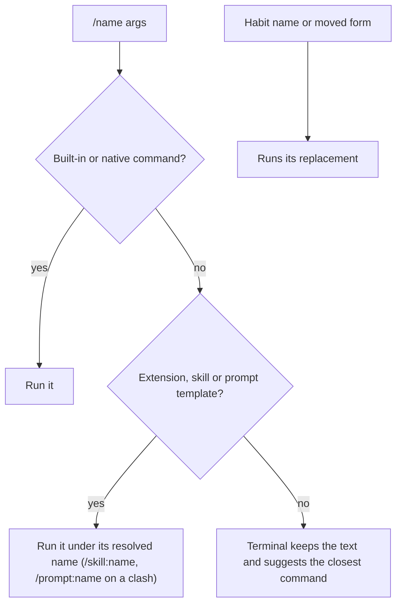

# Commands

Each command has one name; `/clear` and `/reset` run `/new`, and the names under [Habit names and moved forms](#habit-names-and-moved-forms) run their replacement. In the terminal each command's result ends with at most one dim next-step hint, such as `/jobs kill <id>  stop one`; a command that opens a page or picker shows its own key bar instead. `/help [search]` shows what the current host offers, skill commands included. Loaded skills, prompt templates and extensions add commands of their own. In the syntax, `[x]` is optional and `<x>` required.

Shell entry points are at the end; flags and output modes are in [CLI](cli.md).

## Session

| Command                                                 | Does                                                                                                                                                                                                                                                          |
| ------------------------------------------------------- | ------------------------------------------------------------------------------------------------------------------------------------------------------------------------------------------------------------------------------------------------------------- |
| `/new [previous-name]`                                  | Start a fresh session; names the previous one after a successful switch. A session with no message is never saved, so its name goes with it, and the reply says so                                                                                            |
| `/clear [previous-name]`                                | Same as `/new`                                                                                                                                                                                                                                                |
| `/reset [previous-name]`                                | Same as `/new`                                                                                                                                                                                                                                                |
| `/resume [all] [query\|B<n>]`                           | Browse saved sessions. `all` spans folders; `B<n>` lists sessions that held or hold that backlog item; a session another process runs shows its activity light. With a search typed, Esc clears it and the next Esc closes the picker; the key bar says which |
| `/rename <name>`                                        | Name the current session; before its first message the reply says the name is kept once a message is sent                                                                                                                                                     |
| `/fork [pane [right\|down]\|window]`                    | Fork from a chosen user message; `pane`/`window` opens the fork in tmux ([tmux](tmux.md))                                                                                                                                                                     |
| `/clone`                                                | Duplicate the session at its current position                                                                                                                                                                                                                 |
| `/tree`                                                 | Navigate the session's branches (`Ctrl+X` copies an entry's original text)                                                                                                                                                                                    |
| `/queue`                                                | Edit queued messages (also Up in an empty editor): remove, reorder, next turn or after run                                                                                                                                                                    |
| `/compact [instructions]`                               | Compact context; the instructions focus this one summary                                                                                                                                                                                                      |
| `/archive [<n> \| search <words>]`                      | List compacted-history segments; `<n>` prints segment `n`'s file path; `search` ranks passages                                                                                                                                                                |
| `/archive open <anchor> [<cursor>]`                     | Print the recorded message a search hit's `archive:…` or `transcript:…` anchor names; a long one prints the command for its next page                                                                                                                         |
| `/rewind [turns]`                                       | Restore checkpointed file changes of the last N turns (default 1) on this branch; the conversation stays                                                                                                                                                      |
| `/context [all\|size\|reset\|full\|tokens]`             | Show context usage; `size` picks a budget, `32k` sets one, `full` uses model capacity, `reset` restores `contextBudget`                                                                                                                                       |
| `/export [path]`                                        | Export to HTML, or JSONL when the path ends in `.jsonl`; without a path, `octocode-session-<session file name>.html` in the current folder. Before the first message there is nothing to export                                                               |
| `/import <path>`                                        | Import and resume a JSONL session: a copy goes into this folder's sessions, and the current session is replaced after you confirm. A file that is not a session is refused first, naming its bad line                                                         |
| `/share`                                                | Upload the session to a secret GitHub gist after confirmation; needs the GitHub CLI (`gh`) signed in (`gh auth login`); the reply says how to delete it                                                                                                       |
| `/copy [message\|markdown\|references\|code\|location]` | Copy the last answer as plain text, original Markdown, text with destinations, literal code, or an exact file location. No argument keeps the original full-source copy.                                                                                      |
| `/links [message\|all] [query]`                         | Search references in the last answer, a chosen answer, or the current session; open, inspect, copy or reveal a file's parent folder                                                                                                                           |
| `/btw [question\|--cancel\|--clear]`                    | Tool-free side question kept out of the conversation; no argument shows the side thread                                                                                                                                                                       |
| `/quit`                                                 | Shut down; asks first while a reply, bash job, background subagent or external prompt runs                                                                                                                                                                    |

`/resume` details: with `--session-dir` both scopes list only that folder; Ctrl+X marks rows, Ctrl+D deletes the marked (or selected) rows after one confirmation, refusing the current session and sessions another process runs; Ctrl+R renames. Without native features it opens the basic selector. Task recipes: [how-to](how-to.md). Side-question privacy, compaction limits and reports: [native features](native-features.md#session-workflow-commands).

## Model and provider

| Command                                  | Does                                                                                                                                       |
| ---------------------------------------- | ------------------------------------------------------------------------------------------------------------------------------------------ |
| `/providers [provider\|pi\|runner:<id>]` | Sign in, enable or disable providers and sources; `pi` imports saved Pi sign-ins. See [providers](providers.md)                            |
| `/logout [provider]`                     | Sign-out picker for saved credentials, search prefilled with the provider                                                                  |
| `/model [provider/model]`                | Choose this chat's model; Ctrl+S saves a global or project default                                                                         |
| `/models`                                | Turn models on or off per provider and set a default; `/model` stays the quick picker                                                      |
| `/modelsettings [check]`                 | Shortcuts, native catalog, prices and agent routing; `check` tests provider credentials. Headless it prints the catalog and routing report |
| `/effort [level]`                        | Show or set the coordinator's reasoning effort                                                                                             |
| `/optimize [on\|off]`                    | Rewrite each submitted prompt with a helper model, shown before it is sent; no argument shows the state                                    |

A headless run selects a model with `--model` or the RPC `set_model` command. One whose messages are all commands needs none: `octocode -p "/backlog"` prints the board on stderr with no provider connected.

## Configuration and extension

| Command                                                                                                                                                         | Does                                                                                                                                                                                                                                                            |
| --------------------------------------------------------------------------------------------------------------------------------------------------------------- | --------------------------------------------------------------------------------------------------------------------------------------------------------------------------------------------------------------------------------------------------------------- |
| `/settings [list [kind\|text]\|get <id>\|enable <id>...\|disable <id>... [--force]\|set <key> <value>\|unset <key>\|add mcp <name> ...\|remove <id>] [--local]` | The one place to enable, disable, set and add configuration. See below                                                                                                                                                                                          |
| `/harness [overview\|skills\|mcp\|hooks\|sources\|list [section]\|hooks [events]\|config\|install\|update\|remove <plugin@marketplace>]`                        | Opens on an Overview of Skills, MCPs, Hooks and Sources; switch items, set which agents get an MCP server and its tool exposure; install plugins. See [harness controls](configuration.md#harnesses)                                                            |
| `/mcp [list\|config\|add\|tools [server] [tool]\|login [server]\|logout [server]\|reconnect [server\|all]]`                                                     | MCP (`builtin:mcp`). Connections only: list, tools, config, sign in and out, reconnect, Add MCP. No argument opens the manager in a terminal, or reports status elsewhere. Server on/off, "Available to" and exposure live in `/harness mcp`. See [MCP](mcp.md) |
| `/memory [list\|search <words>\|add [title — body]\|auto\|last\|review [days]]`                                                                                 | Browse and edit durable memories; `auto` says whether automatic recall is on (the `memory.recall` setting: `off`, `main` by default, or `all`); `review` lists those unused or not updated for 30 days (or `days`). See [memory](memory.md)                     |
| `/security [list [text]\|show <id>\|check\|approve <id>\|approve --all [--kind hooks,mcp,skills]\|deny <id>\|forget <id>]`                                      | Review hooks, MCP servers and skills. Approvals apply to the exact reviewed content; changed content needs another decision.                                                                                                                                    |
| `/reload`                                                                                                                                                       | Reload keybindings, extensions, skills, prompts, themes, context files and hooks                                                                                                                                                                                |
| `/keys`                                                                                                                                                         | Keyboard shortcuts ([keybindings](keybindings.md))                                                                                                                                                                                                              |
| `/find`                                                                                                                                                         | Search the transcript; needs fullscreen mode ([keybindings](keybindings.md))                                                                                                                                                                                    |
| `/mouse [on\|off]`                                                                                                                                              | Fullscreen mode: hand the mouse to your terminal's own selection, copy and scrollback (`off`), or take it back (`on`); bare, it toggles, like `alt+m`. In regular mode the terminal already owns the mouse                                                      |
| `/changelog`                                                                                                                                                    | Show the changelog                                                                                                                                                                                                                                              |
| `/trust [list\|add [path] [--scope folder\|parent\|grandparent]\|remove <number\|path>]`                                                                        | Folder trust. No argument opens a page of decisions; `add` and `remove` confirm (outside a terminal they need `--yes`). Same operations as `octocode trust`. See [permissions](permissions.md#project-trust)                                                    |

`/settings` enables, disables, sets and adds tools, MCP servers, harnesses, plugins, hooks, skills, prompts, themes, providers, sources and settings keys. With no argument it opens a selector grouped by kind (Space or Enter toggles, Tab switches global and project, type to search). Ids are `kind:name` (`tool:backlog`, `mcp:docs`, `harness:claude`, `hook:<id>`, `skill:<name>`) or a bare settings key. Each result says when it applies: now, after `/reload`, or next session. `--local` (`-l`) writes the project scope and needs a trusted folder. Reference: [configuration](configuration.md#changing-configuration). MCP is always on; servers switch here, never through `extensions`.

`/harness` opens on an Overview with one row per section; `/harness list sources` lists one row per harness. Switch a whole harness with `/settings enable|disable harness:<name>` (`claude`, `codex`, `cursor`, `pi`, `agents`, `mcp-json`). `hooks` inspects loaded hooks and `hooks events` the events each profile accepts; `config` shows the loaded context and where each item came from. `/harness` and `/mcp` keep their pickers.

## Agents and work

| Command                                                                                                                                | Does                                                                                                                                                                                                                                                                                            |
| -------------------------------------------------------------------------------------------------------------------------------------- | ----------------------------------------------------------------------------------------------------------------------------------------------------------------------------------------------------------------------------------------------------------------------------------------------- |
| `/agents [tell\|interrupt\|kill\|merge\|stats\|history\|external]`                                                                     | List and control local and external agents (native). See below                                                                                                                                                                                                                                  |
| `/messages [internal]`                                                                                                                 | Every agent's mail, newest first: sender → recipient with roles, worktree and tmux marks; Enter shows the whole text and the sender's thinking and output; `i` shows or hides internal notices (native). See [Team mail](native-features.md#reading-all-team-mail)                              |
| `/plan [description\|--show\|--off\|--approve <revision>]`                                                                             | Enter or leave the read-only planning constraint (native); a description also submits it; `--approve` approves that revision and requests implementation. See [native planning](native-features.md#native-planning-constraint)                                                                  |
| `/permissions [manual\|workspace\|full\|grants [clear [messages]]\|log\|plan [off]]`                                                   | Show or change the permission mode (native); `grants` lists session grants, `log` the recorded calls. See [permissions](permissions.md#modes)                                                                                                                                                   |
| `/backlog [web\|tui\|add <title>\|do <id>\|export\|html\|<id> [<state>\|close]]`                                                       | Backlog board and items. See below                                                                                                                                                                                                                                                              |
| `/worktree [list\|new <name>\|open <name> [pane [right\|down]\|window]\|switch <name\|main>\|merge <branch>\|remove <name> [--force]]` | Git worktrees for parallel sessions. See [worktrees](native-features.md#worktrees)                                                                                                                                                                                                              |
| `/realm [places [<name> [switch\|resume]]]`                                                                                            | This session, its place and its live child agents with the isolated results to merge; `places` lists the repository's checkout, worktrees and sessions, where `switch` and `resume` act on one place. See [realms](native-features.md#roles-and-realms) and [places](native-features.md#places) |
| `/jobs [kill <id>]`                                                                                                                    | Lists this session's background bash jobs, crons and waits with ids and time left; `kill <id>` stops one (`bash-1`, or `#4` for a cron or wait)                                                                                                                                                 |
| `/loop <interval> <prompt>`                                                                                                            | Run a prompt on a repeating schedule (native). The interval is a number and `m`, `h` or `d`; it runs at least 5 minutes apart on a step that divides the hour or day evenly, and the reply says when it rounded. Ends with the session or after 7 days; asks no question, since you typed it    |
| `/cron [list\|delete <id>]`                                                                                                            | List this session's scheduled tasks, or delete one (native)                                                                                                                                                                                                                                     |
| `/monitor [text]`                                                                                                                      | Show every monitor rule with its state, last reading against its threshold, trips, alerts, last alert and subject: a page in a terminal, text elsewhere (native)                                                                                                                                |
| `/processes [all\|stop]`                                                                                                               | List this folder's Octocode processes and the web daemon (`all`: the whole machine; sessions, subagents, RPC hosts, ACP brokers) with pid, memory, age, MCP servers and jobs; flags orphans. `stop` confirms, then ends only recorded orphans (SIGTERM, then SIGKILL). Needs `ps` (not Windows) |

`/agents` alone opens a picker of this repository's agents, each row with its [activity light](tui-design.md#activity-light); while this session is the only agent it prints its team instead, ending with **Recent runs**: one line per run, live or past and the main session too, with the agent and profile, its state in the light's words (`idle`, `needs you`) or how it ended, its time, cost and goal. `/agents <name|session|B#|pid>` shows one. Subcommands: `tell <agent\|all> [#<message to answer>] <message>` (`#n` answers that question and closes it), `interrupt <id> <message>`, `kill <id>` (asks first), `merge <id>`, `stats`, `history`. `external` takes `list` (includes ACP adapters on PATH), `connect octocode <instance id or process name>`, `connect acp <vendor> <command> [args...]`, `prompt <id> <text>`, `cancel <id>`, `disconnect <id>`; a JSON object can add options such as `model`.

`/backlog`: no argument opens the web board in any UI (terminal, RPC) and prints the board as text headless; `web` is `/web backlogs`; `tui` opens the board in the terminal (a select list over RPC, text headless). `<id> <backlog\|todo\|ongoing\|done>` transitions. Moving to `ongoing` or `done` asks for what the item still lacks: **Why does this matter?** and **What result means done?**; `done` then asks **What changed?** and **Related files** (comma separated, empty for none) and records the completion as not verified; reopening a done item asks why. An empty answer cancels the move. Without a UI to answer in, set these fields with the `backlog` tool or on the web board. `<id> close` asks for a kind (obsolete, duplicate of another item, won't do) and a reason, records you as the actor and never deletes; reopen with a note. `add` takes a title only (epics and parents come from the `backlog` tool or the web board). `do <id>` sends the item's saved context for implementation; saved text grants no permissions. See [backlog view](web-workspace.md#backlog-board).

## Workspace, diagnostics and data

| Command                        | Does                                                                                                                                                                                                                                                                                    |
| ------------------------------ | --------------------------------------------------------------------------------------------------------------------------------------------------------------------------------------------------------------------------------------------------------------------------------------- |
| `/web [backlogs\|item\|stop]`  | Open the live workspace (Activity), its task board, or one item (`/web item B90`); `stop` ends the web daemon (sessions keep running). See [web workspace](web-workspace.md)                                                                                                            |
| `/remote [view\|status\|stop]` | Publish a link to this machine's web daemon for another device; asks first, for a read-only `view` link too, and refuses where nobody can answer. `stop` stops publishing; the daemon keeps running. See [remote access](remote.md)                                                     |
| `/api [on [http]\|off]`        | Show the local session API; `on` starts it, `off` stops it                                                                                                                                                                                                                              |
| `/status`                      | One report: statistics (messages, tokens, cache, cost), native activity, skills and MCP, and a Quota section when a provider reported plan windows or rate limits                                                                                                                       |
| `/usage [today\|7d\|30d]`      | Spend by provider and model: money and plan estimate in separate columns, split total, then current quota windows. A bare `/usage` shows today and the last 7 days; `today`, `7d` or `30d` shows that one window. History starts at the upgrade that added it; `/cost` runs it (native) |
| `/diff [path]`                 | Staged, unstaged and untracked repository changes; `/diff --editor <before> <after>` compares two existing files in the configured editor                                                                                                                                               |
| `/debug [terminal]`            | Save redacted diagnostics; `terminal` prints capabilities, output queue, frame submission, CPU, memory, GC and event-loop counters; terminal display/GPU work is outside those measurements                                                                                             |
| `/bug [description]`           | Bug-report flow with consent steps; credential-looking text in every report file is replaced by `[redacted]`                                                                                                                                                                            |
| `/purge workspace\|all`        | Delete Octocode data after a preview and a typed confirmation. See below                                                                                                                                                                                                                |
| `/octocode [arguments]`        | Proxy to the external `octocode` research CLI (main session only). See below                                                                                                                                                                                                            |
| `/help [command\|search]`      | `/help <command>` shows that command's usage and arguments; anything else opens the command picker, filtered by the text                                                                                                                                                                |

`/purge workspace` removes this workspace's transcripts, `.octocode/agent/session-data`, `.octocode/agent/temp`, `.octocode/agent/tmp` and their database rows; `all` does the same for every registered workspace, the global sessions, legacy transcripts and the old `agent/octocode.db`. The current session stays. It is refused while another live Octocode process holds a session or team seat in scope (it names them), and headless. `/purge workspace` also clears the child handoffs of this workspace's backlog items; `all` also clears provider quota readings and rate-limit cool-downs (the next response records them again). Settings, `auth.json`, `mcp-auth.json`, `child-credentials/`, MCP configuration, trusted folders, other `.octocode/agent/<topic>/` folders and your own files are kept. The preview counts each kind it would remove, says which it found none of, and names the database it shrinks afterwards; type the scope word (`workspace` or `all`) to delete. RPC: `purge` with an explicit `confirm`.

`/octocode` runs the CLI with the arguments as typed. A first word that is not a CLI command or option sends the line to the agent as a prompt. In the terminal the CLI takes the terminal and the UI resumes after a key; elsewhere output is the command result, cut at 20 KB, and Esc cancels. It is not the `/octocode-*` skills. Octocode is the default MCP server, configured like any other with `/settings`; its tools and usage belong to that package.

## Skills, prompts and extensions

| Resource                               | Invocation                                                                                                    |
| -------------------------------------- | ------------------------------------------------------------------------------------------------------------- |
| [Skill](skills.md)                     | `/name [arguments]`, or `/skill:name`; collisions use qualified names. `user-invocable: false` has no command |
| [Prompt template](prompt-templates.md) | `/name [arguments]`; reserved or duplicate names get `/prompt:name` or a numbered form                        |
| Extension                              | Its registered name; conflicts get resolved names such as `/new:1`; `aliases` are refused                     |

`/help`, `/harness list skills` and `/status` show what is loaded. In the terminal, typed text starting with `/` that no command accepts is not sent: the editor keeps it with the reason and says **Enter again sends it as a message**. A doubled slash before a command name (`//status`) counts as such text; a path (`/tmp/notes.txt explain this`) is sent as typed. Pressing Enter again sends it as a plain message, with no command or template expansion. In the `/` menu, Enter on a command name runs it. Enter on an argument suggestion (`/help com`) only completes the argument, so you can read the full command before the second Enter runs it. `!<command>` runs a shell command and adds its result to context (header with exit status, time and size, then up to `bashOutputMaxBytes`, the full output saved to a file); `!!<command>` excludes the result from context. Neither is a slash command and both pass the normal execution checks.

Hosts: `octocode.getCommands()` and RPC `get_commands` list registered commands, prompts and skills under their resolved names. A terminal-only command sent through `prompt` returns an unavailable-command error. `/agents`, `/permissions` and `/plan` need native features.

## Habit names and moved forms

Names Claude Code and Pi users type from habit run the Octocode command they map to. The `/` menu shows only the target. Other names are refused with the closest command (`/name` says **Did you mean /rename?**).

| Typed                                     | Runs                                     |
| ----------------------------------------- | ---------------------------------------- |
| `/configuration`, `/config`               | `/settings`                              |
| `/mcp enable\|disable <server> [--local]` | `/settings enable\|disable mcp:<server>` |
| `/plugins`, `/hooks [args]`               | `/harness`, `/harness hooks [args]`      |
| `/login`                                  | `/providers`                             |
| `/exit`                                   | `/quit`                                  |
| `/continue`                               | `/resume`                                |
| `/release-notes`                          | `/changelog`                             |
| `/feedback`                               | `/bug`                                   |
| `/doctor`                                 | `/debug`                                 |
| `/allowed-tools`                          | `/permissions`                           |
| `/checkpoint`                             | `/rewind`                                |
| `/todos`                                  | `/backlog`                               |
| `/bashes`                                 | `/processes`                             |
| `/hotkeys`                                | `/keys`                                  |

These moved forms print one message naming their replacement and run nothing:

| Moved                          | Use                                                   |
| ------------------------------ | ----------------------------------------------------- |
| `octocode config`              | `octocode configuration`                              |
| `octocode mcp enable\|disable` | `octocode configuration enable\|disable mcp:<server>` |
| `/mcp assign`                  | `/mcp` → the server → Tools › Available to            |
| `/mcp exposure`                | `/mcp` → the server → Tools › Default for tools       |
| `/harness enable\|disable`     | `/settings enable\|disable harness:<name>`            |

There is no `/tools`; tools switch with `/settings enable|disable tool:<name>` or `--tools`.

## Shell entry points

`octocode [options] [@files...] [messages...]` starts the agent ([CLI](cli.md)). The subcommands below run outside a conversation; `octocode <command> --help` prints options. The command name comes first: session options before it (`octocode --offline mcp list`) are refused with exit `2` and the corrected line, and a word after `--` is always a message.

| Command                                                                                                                                                                                                                                                                     | Does                                                                                                                                                                                                                                                                                                                                                                                                                                                                                                                                                                                                                                                                                                                                                                                                                                                                                                    |
| --------------------------------------------------------------------------------------------------------------------------------------------------------------------------------------------------------------------------------------------------------------------------- | ------------------------------------------------------------------------------------------------------------------------------------------------------------------------------------------------------------------------------------------------------------------------------------------------------------------------------------------------------------------------------------------------------------------------------------------------------------------------------------------------------------------------------------------------------------------------------------------------------------------------------------------------------------------------------------------------------------------------------------------------------------------------------------------------------------------------------------------------------------------------------------------------------- |
| `install <source> [-l] [--trust]`                                                                                                                                                                                                                                           | Install a package source and record it in settings ([packages](packages.md))                                                                                                                                                                                                                                                                                                                                                                                                                                                                                                                                                                                                                                                                                                                                                                                                                            |
| `remove <source> [-l] [--trust]`                                                                                                                                                                                                                                            | Remove a source from settings                                                                                                                                                                                                                                                                                                                                                                                                                                                                                                                                                                                                                                                                                                                                                                                                                                                                           |
| `update [source\|self] [--self\|--packages\|--models\|--all] [--package <source>] [--force] [--trust]`                                                                                                                                                                      | Update Octocode (default), packages or model catalogs                                                                                                                                                                                                                                                                                                                                                                                                                                                                                                                                                                                                                                                                                                                                                                                                                                                   |
| `list [--trust]`                                                                                                                                                                                                                                                            | List installed sources                                                                                                                                                                                                                                                                                                                                                                                                                                                                                                                                                                                                                                                                                                                                                                                                                                                                                  |
| `configuration [verb] [args] [-l] [--trust] [--json]`                                                                                                                                                                                                                       | Same verbs as `/settings`; no verb opens the selector on a terminal. A refused change exits 1                                                                                                                                                                                                                                                                                                                                                                                                                                                                                                                                                                                                                                                                                                                                                                                                           |
| `auth print-api-key\|print-bearer-token\|check --provider <id>`                                                                                                                                                                                                             | Print a credential or check provider readiness; `check` takes `--json`, `--credentials`, `--no-refresh`; `print-bearer-token` takes `--min-expiry <30m>`                                                                                                                                                                                                                                                                                                                                                                                                                                                                                                                                                                                                                                                                                                                                                |
| `models discover [--provider <id>] [--offline] [--json]`                                                                                                                                                                                                                    | Compare vendor model IDs with the local catalog ([model discovery](models.md#discover-vendor-models))                                                                                                                                                                                                                                                                                                                                                                                                                                                                                                                                                                                                                                                                                                                                                                                                   |
| `mcp add\|remove\|exposure\|list\|tools\|compact\|config\|login\|logout`                                                                                                                                                                                                    | Configure MCP, inspect it, sign in. Forms and flags: [MCP reference](mcp-reference.md)                                                                                                                                                                                                                                                                                                                                                                                                                                                                                                                                                                                                                                                                                                                                                                                                                  |
| `context list\|check\|apply --overrides <file>`                                                                                                                                                                                                                             | Show and store the skill descriptions agents read ([skills](skills.md))                                                                                                                                                                                                                                                                                                                                                                                                                                                                                                                                                                                                                                                                                                                                                                                                                                 |
| `marketplace add\|list\|update\|remove`                                                                                                                                                                                                                                     | Manage plugin marketplaces ([plugins](plugins.md#marketplaces))                                                                                                                                                                                                                                                                                                                                                                                                                                                                                                                                                                                                                                                                                                                                                                                                                                         |
| `plugin install\|update\|remove\|list <plugin@marketplace> [--yes]`                                                                                                                                                                                                         | Manage plugins; without a terminal `--yes` approves the hooks and MCP servers they declare                                                                                                                                                                                                                                                                                                                                                                                                                                                                                                                                                                                                                                                                                                                                                                                                              |
| `trust list [--json]\|add [path] [--scope ...] [--yes]\|remove <number\|path> [--yes]`                                                                                                                                                                                      | Folder trust from your own terminal; refused inside a session's shell                                                                                                                                                                                                                                                                                                                                                                                                                                                                                                                                                                                                                                                                                                                                                                                                                                   |
| `profile [--session <id>] [--json\|--insights\|--agent <id> [--request <n>] [--detail]\|--timeline\|--trace <file>]`                                                                                                                                                        | Read-only profile of a stored session (default: latest of this folder); `--json` is what the `/web` profiler serves                                                                                                                                                                                                                                                                                                                                                                                                                                                                                                                                                                                                                                                                                                                                                                                     |
| `backlog get <id> [--limit <n>] [--offset <n>] [--changes]\|list [--query <text>] [--states <state,...>] [--ids <id,...>] [--type <type>] [--under <epic>] [--tag <tag>] [--sort <order>] [--limit <n>] [--offset <n>]\|export <file>\|groom\|graph [--json] [--item <id>]` | Read this folder's backlog board without changing it; the way a subagent (which has no board tool unless its task names an item) reads items from its shell. `export` writes the whole board as Markdown. `groom` runs grooming's mechanical checks with no model (claims whose holder ended, epics with every item finished, items whose paths are gone, likely duplicate titles, blocked and idle items) and prints only what they flag. `graph` prints the tree of running work with no model: each open item with its steps, the agents that hold or serve it, their jobs, the resources they hold (`holds full-run`), waits and what blocks it, plus work that serves no item; `--json` prints the nodes (each with its source row) and edges, `--item` one item's tree. A command line sees the database and the full-run lock; the background jobs of a running session show in its `/jobs` view |
| `remote list [--json]\|link [view] [--relay <url>]\|stop`                                                                                                                                                                                                                   | Sessions the web daemon reaches, publish a control or view link, stop publishing ([remote](remote.md))                                                                                                                                                                                                                                                                                                                                                                                                                                                                                                                                                                                                                                                                                                                                                                                                  |
| `completion bash\|zsh\|fish`                                                                                                                                                                                                                                                | Print shell-completion setup                                                                                                                                                                                                                                                                                                                                                                                                                                                                                                                                                                                                                                                                                                                                                                                                                                                                            |

`octocode-api` is a separate executable for the [session API](session-api.md), listed under Commands in `octocode --help`: `completion`, `list`, `status`, `send`, `watch`, `abort`, `external`; session operations take `--to <id>`; no arguments prints usage.

`coordinate` (`coordinate list`, `lock`, `merge`) and `message` are actions of the model's `agent` tool, with no shell command. In a session `/agents` lists the same agents and `/processes all` every Octocode process; from a shell, `octocode-api list` lists the running sessions.

## Examples

| Goal                                      | Command                                                                                                  |
| ----------------------------------------- | -------------------------------------------------------------------------------------------------------- |
| Turn a tool off for this project          | `/settings disable tool:backlog --local` (add `--force` to switch off one that is kept on)               |
| Turn a tool on for one run                | `octocode --enable tool:backlog`                                                                         |
| Set a settings key                        | `/settings set retry.maxRetries 5`                                                                       |
| Add an MCP server                         | `/settings add mcp docs -- npx -y some-mcp-server`, or `octocode mcp add docs -- npx -y some-mcp-server` |
| Find yesterday's work on item B12         | `/resume B12`                                                                                            |
| Plan before editing                       | `/plan add a retry to the uploader`, then `/plan --approve 1`                                            |
| Ask something without disturbing the chat | `/btw what does this flag do?`                                                                           |

## How `/name` resolves

The `/` menu lists commands by task: getting started (`/help`, `/model`, `/providers`, `/effort`, `/new`, `/resume`), then the session, agents and work, configuration, and sharing, diagnostics and data. Extension and prompt commands follow, and skills come last. `/clear` and `/reset` have no rows of their own: `/new`'s row names them, and typing either one runs `/new`. A command name or alias typed in full always heads the list, so Enter runs that command, not a skill whose name happens to match. A tag such as `[u]` or `[p]` marks a command or skill from your user or project folder; Octocode's own entries have none.

