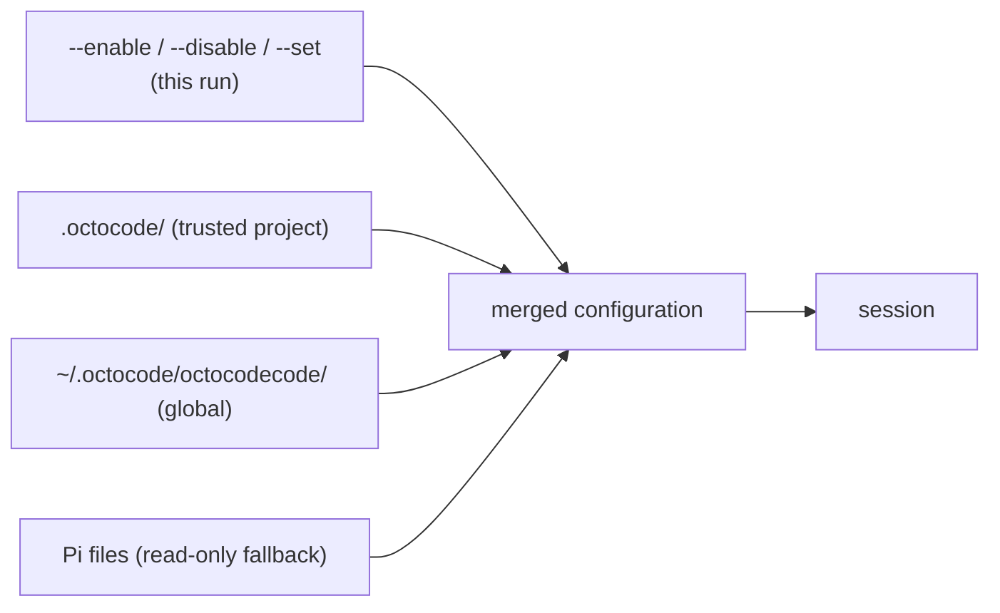
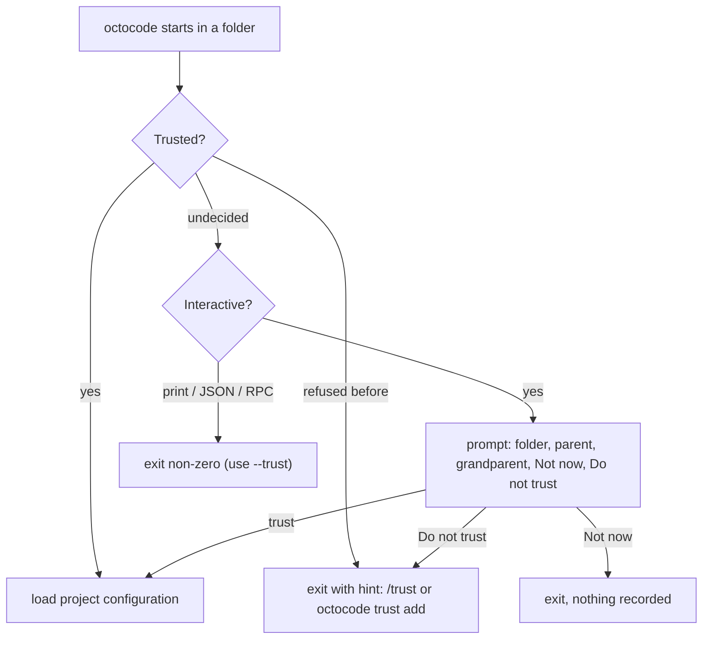
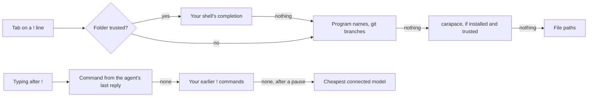
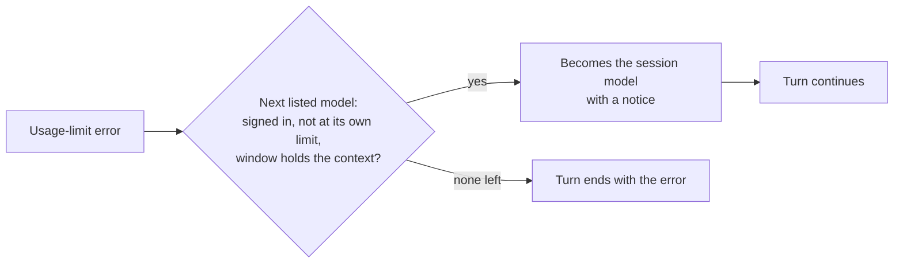

# Configuration

One page for where configuration lives, what wins, what needs trust and how to change it. Field lists: [settings](settings.md), [models.json](models-configuration.md), [environment variables](environment-variables.md).



Left beats right: a run flag beats the project, the project beats global, global beats Pi.

`externalEditor` is shared by Ctrl+G prompt editing, file-reference activation and optional editor diffs. When unset, `VISUAL` wins over `EDITOR`, followed by Notepad on Windows or Nano elsewhere. Configure the editor in the environment running Octocode, including SSH or WSL; no terminal brand is required. See [editor workflows](tui.md#editor-and-vs-code-workflows).

## Agent directory

Global configuration and runtime state live in `~/.octocode/octocodecode/` ("global" below). Project configuration lives in `.octocode/` of the workspace. MCP definitions are the exception: `~/.octocode/mcp.json` and `.octocode/mcp.json`.

| Override                    | Moves                                                                           |
| --------------------------- | ------------------------------------------------------------------------------- |
| `OCTOCODE_HOME`             | The shared configuration and runtime home                                       |
| `OCTOCODE_CODING_AGENT_DIR` | Only the core configuration directory; native runtime files keep their own home |
| `OCTOCODE_AGENT_DB`         | The agent database file (default `<octocode home>/agent/workspaces.db`)         |

An explicit `OCTOCODE_HOME` or `OCTOCODE_CODING_AGENT_DIR` also turns off the [Pi fallback](#pi-configuration-fallback). `/mcp config` prints the exact MCP paths, their read order and trust state without connecting servers.

## Where each configuration belongs

Workspace files are relative to the session's working directory; agent profiles and hooks use the repository root, also when you start in a subdirectory. Workspace files need a trusted folder.

| Configure                 | Global                                                                 | Workspace                                           | Inspect or apply                                                      |
| ------------------------- | ---------------------------------------------------------------------- | --------------------------------------------------- | --------------------------------------------------------------------- |
| Settings, default model   | `settings.json`                                                        | `.octocode/settings.json`                           | `/configuration`; `/reload` after file edits                          |
| MCP servers, exposure     | `~/.octocode/mcp.json`                                                 | `.octocode/mcp.json`                                | `/mcp config`; [MCP](mcp.md)                                          |
| Providers, model defs     | `models.json`                                                          | none; select a model in workspace settings          | `/model` reloads definitions; `/modelsettings`                        |
| Provider sign-in, keys    | `auth.json`                                                            | none                                                | `/providers`, `/logout`                                               |
| MCP OAuth tokens          | `mcp-auth.json`                                                        | none                                                | `/mcp login\|logout <server>`                                         |
| Derived context files     | `context-optimization/` (project ones under `projects/<repo>-<hash>/`) | none in the repository                              | Rewritten on change; `octocode context`, `octocode mcp compact`       |
| Skills                    | `skills/<name>/SKILL.md`, `~/.agents/skills/`                          | `.octocode/skills/`, `.agents/skills/`              | `/harness list skills`; [skills](skills.md)                           |
| Prompt templates          | `prompts/*.md`                                                         | `.octocode/prompts/*.md`                            | [prompt templates](prompt-templates.md)                               |
| Themes                    | `themes/*.json`                                                        | `.octocode/themes/*.json`                           | `/configuration` → Interface and session → Theme; [themes](themes.md) |
| Keyboard shortcuts        | `keybindings.json`                                                     | none                                                | `/keys`, `/reload`; [keybindings](keybindings.md)                     |
| System prompt             | `SYSTEM.md`, `APPEND_SYSTEM.md`                                        | `.octocode/SYSTEM.md`, `.octocode/APPEND_SYSTEM.md` | `/reload`; the workspace file wins                                    |
| Project instructions      | `AGENTS.md` in the agent directory                                     | `AGENTS.md` in the project and its ancestors        | [instructions](instructions.md)                                       |
| Agent profiles            | `agents/*.md`                                                          | `.octocode/agents/*.md` at the repository root      | `/agents`, `/reload`                                                  |
| Hooks                     | `hooks.json` in the runtime home                                       | `.octocode/hooks.json` at the repository root       | `/harness hooks`; [hooks](hooks.md)                                   |
| Plugins                   | `plugins` in `settings.json`                                           | `plugins` in `.octocode/settings.json`              | `/plugins`; [plugins](plugins.md)                                     |
| Plugin marketplaces       | `marketplaces` in `settings.json` (global only)                        | not read                                            | `octocode marketplace add`                                            |
| Extensions                | `extensions/` (ignored with a warning)                                 | `.octocode/extensions/` (ignored)                   | User code extensions are not supported; use plugins and hooks         |
| GitHub sign-in (research) | The Octocode CLI's own store                                           | none                                                | `/octocode auth login\|status\|logout`                                |

## Precedence

| Kind        | Order, lowest to highest                                                                                                                                                                                                                                                                                                                                                                           |
| ----------- | -------------------------------------------------------------------------------------------------------------------------------------------------------------------------------------------------------------------------------------------------------------------------------------------------------------------------------------------------------------------------------------------------- |
| Settings    | Pi files, global, trusted project, `--set`. Objects merge recursively, arrays replace                                                                                                                                                                                                                                                                                                              |
| MCP files   | `~/.pi/mcp.json`, `~/.pi/agent/mcp.json`, `~/.octocode/agent/mcp.json`, `~/.octocode/octocodecode/mcp.json`, `~/.octocode/mcp.json`; then trusted `.pi/mcp.json`, `.mcp.json`, `.agents/mcp.json`, `.octocode/mcp.json`                                                                                                                                                                            |
| Skills      | By harness: Octocode > `.agents` > Pi > Claude Code > Codex > Cursor; then project before global. Losers are listed as shadowed                                                                                                                                                                                                                                                                    |
| Credentials | Environment or ambient cloud credentials, `apiKey` in Pi's `models.json`, Pi's `auth.json`, `apiKey` in Octocode's `models.json`, Octocode's `auth.json`, then runtime `--api-key` (highest). A `models.json` field Octocode does not know (a misspelled `apikey`) or an `api` no built-in serves loads with a warning naming the file and provider, shown on that provider's page in `/providers` |
| Keybindings | Pi's `~/.pi/keybindings.json` and `~/.pi/agent/keybindings.json`, then the agent directory's `keybindings.json`, action by action; no project file                                                                                                                                                                                                                                                 |

- A later MCP definition replaces a server of the same name; a later control-only entry (`enabled`, `exposure`, `toolExposure`, `defaultActive`) changes it without copying credentials. Details: [MCP](mcp.md#configure-servers), [MCP reference](mcp-reference.md#configuration-and-precedence).
- Keys the settings schema does not define still load and are preserved on save, with no effect; startup warns once per load naming each (a removed key says what replaced it).
- Settings, MCP and trust files are saved by atomic replacement, and settings saves lock the read-merge-write step, so concurrent writers keep each other's changes. An empty settings file, or one whose root is not a JSON object, is reported as invalid and never overwritten, also if it turns invalid after startup: repair it, then `/reload`.

## Changing configuration

`/configuration` in a session and `octocode configuration` in a shell are one mechanism over one catalog: tools, MCP servers, harnesses, plugins, hooks, skills, extensions, prompts, themes, providers, sources and every settings key.

```text
/configuration [list|get|enable|disable|set|unset|add mcp|remove] [--local] [--force]
octocode configuration ... [--local] [--trust] [--json]
```

Ids are `kind:name` (`tool:`, `mcp:`, `harness:`, `plugin:`, `hook:`, `skill:`, `extension:`, `prompt:`, `theme:`, `provider:`, `source:`) or a bare settings key such as `retry.maxRetries`.

| Verb                                | Does                                                                   | Example                                                     |
| ----------------------------------- | ---------------------------------------------------------------------- | ----------------------------------------------------------- |
| `list [kind\|text]`, `get <id>`     | Show entries and their state                                           | `/configuration list mcp`                                   |
| `enable\|disable <id>...`           | Switch entries                                                         | `/configuration disable tool:backlog`                       |
| `set <key> <value>`, `unset <key>`  | Change or reset a settings key                                         | `/configuration set retry.maxRetries 4`                     |
| `add mcp <name> ...`, `remove <id>` | Add an MCP server (arguments of `octocode mcp add`) or remove an entry | `/configuration add mcp docs --url https://example.com/mcp` |

Without a verb a terminal opens a selector; otherwise the CLI lists. `--json` prints JSON; a refused change prints its reason with suggested ids and exits 1. Retired, each printing a hint: `/settings`, `/config`, `octocode config`, `/mcp enable|disable`, `/harness enable|disable`, `octocode mcp enable|disable`.

| Scope   | Selected by                                                       | Written to                                                                                        | Lasts         |
| ------- | ----------------------------------------------------------------- | ------------------------------------------------------------------------------------------------- | ------------- |
| global  | default                                                           | `settings.json` (MCP: `mcp.json`)                                                                 | every session |
| project | `--local` (`-l`)                                                  | `.octocode/settings.json` (MCP: `.octocode/mcp.json`); trusted folder only (`--trust` records it) | this project  |
| run     | `octocode --enable <id>`, `--disable <id>`, `--set <key>=<value>` | nothing                                                                                           | this process  |

Each result says when it applies: now (MCP switches, live settings), after `/reload`, or in the next session. Run flags are repeatable, apply before tools and resources load, survive `/reload` and are never written: `octocode --disable tool:backlog --set retry.maxRetries=4`. A refused id or key prints the reason and exits 1; `mcp:` ids have no run form (use `--no-mcp`). `--tools` and `--exclude-tools` still choose tools for one run. Features register no CLI flags, so unknown flags such as `--extension` fail at startup.

MCP is always on and cannot be switched through `extensions`; a `-builtin:mcp` entry is ignored with a warning. Only `builtin:<id>` entries of `extensions` act (`-builtin:llama.cpp` switches the llama.cpp provider off). Octocode is the default MCP server: `/configuration disable mcp:octocode` turns it off and `enable` brings it back (`OCTOCODE_MCP=0` also turns it off, unless configuration overrides it).

### Harnesses

A harness is one source of configuration. `/harness` lists them.

| Harness    | Reads                                   | Default   |
| ---------- | --------------------------------------- | --------- |
| Octocode   | Its own files                           | always on |
| `agents`   | `.agents/skills`, `.agents/mcp.json`    | on        |
| `mcp-json` | root `.mcp.json`                        | on        |
| `pi`       | Pi skills, prompts, themes, MCP         | on        |
| `claude`   | Claude Code skills, MCP, hooks, plugins | off       |
| `codex`    | Codex skills, MCP, hooks, plugins       | off       |
| `cursor`   | Cursor skills, MCP                      | off       |

Switch one with `/configuration enable|disable harness:<id> [--local]` (writes `toggles["harness:<id>"]`, removed when it equals the default), or on the Harness panel of the [web Settings page](web-workspace.md#settings-page).

- A project key reaches only that harness's project items, so a committed file cannot enable your global Claude Code content.
- MCP servers connect or disconnect at once, also in running subagents; skills, hooks and prompts apply after `/reload`.
- A plugin listed in `plugins` is your explicit choice and loads whatever its harness switch says.
- `harness:claude:memory` (off, global only, trusted folders only) adds Claude Code's auto memory for this repository (`~/.claude/projects/<repository>/memory/MEMORY.md`, first 200 lines or 25 KB) as notes; `AGENTS.md` and Octocode memories win; the file is never written.
- Project instructions come only from `AGENTS.override.md` and `AGENTS.md`; `CLAUDE.md` is not read.

The startup screen and read-only `/harness config` show each kind with its count and sources (`octocode global`, `pi project`, `plugin <name>`, `builtin`, `command line`, `settings path`), shadowed copies with their winner, project items in an untrusted folder as "folder not trusted", and Pi code that is not run as "Not loaded". `ctrl+o` expands paths. The view refreshes on `/reload` or a new session; items of a switched-off harness are neither counted nor warned about.

## Trust

Octocode opens no session in a folder you have not trusted. Before the decision nothing is read from the folder (no `AGENTS.md`, settings, MCP, hooks, skills, agents, plugins or `SYSTEM.md`), no model is called and no tool exists.



| Rule          | Behavior                                                                                                                                                                                                                                                                                              |
| ------------- | ----------------------------------------------------------------------------------------------------------------------------------------------------------------------------------------------------------------------------------------------------------------------------------------------------- |
| Grants        | The folder, its parent or its grandparent (a subtree); future contents are covered. A grant follows the folder by file identity (survives rename, move, reboot). `$HOME`, `/` and filesystem roots never get a session or grant; nothing above `$HOME` gets a subtree grant                           |
| ACP           | `session/new` answers a per-session `-31000` error whose `data.command` names the fix                                                                                                                                                                                                                 |
| `--trust`     | Records a grant (source `flag`) and runs; not for `--mode acp`                                                                                                                                                                                                                                        |
| In a session  | `trust add\|remove` and `--trust` refuse when `OCTOCODE_SESSION_ID` is set: trust is your decision, run them in your own terminal                                                                                                                                                                     |
| Moving folder | `/resume`, `/import`, a new session or `/worktree switch` with a `cwd`, and RPC `switch_session` check trust first; declining keeps the old session                                                                                                                                                   |
| Instructions  | `AGENTS.override.md` and `AGENTS.md` load from the grant's folder down to the working folder, never from a parent repository above the working folder's own ([instructions](instructions.md))                                                                                                         |
| Worktrees     | A new one (`/worktree`, `--worktree`, isolated subagents) asks once before creation (headless: `--trust`); yes records a `worktree` grant that removing the worktree revokes. An isolated subagent's worktree is granted without asking when its source repository is trusted. Subagents never prompt |
| Old files     | `trust.json` and `pi-trust.json` from earlier releases are not read: run `octocode trust add <path>`                                                                                                                                                                                                  |

| Command                                                                                             | Does                                               |
| --------------------------------------------------------------------------------------------------- | -------------------------------------------------- |
| `/trust`, `/trust list`                                                                             | Menu; list grants, refusals, ignored grants        |
| `/trust add [path] [--scope folder\|parent\|grandparent]`                                           | Grant                                              |
| `/trust remove <number\|path>`                                                                      | Revoke                                             |
| `octocode trust list [--json]`, `add [path] [--scope ...] [--yes]`, `remove <number\|path> [--yes]` | Same without a session; `--yes` skips confirmation |

Project resources need trust, except `AGENTS.md`-style instruction files, which load as text. Octocode hook files always load; Claude Code and Codex hook files load once that harness is on (`/configuration enable harness:claude`), each under its own profile; `disableAllHooks: true` in a loaded hook file turns them all off; [Claude permission rules](permissions.md#claude-permission-rules) always apply. See [hooks](hooks.md).

## Pi configuration fallback

With the default home, Octocode also reads `~/.pi/agent/` and `~/.pi/` (in that order); Octocode wins.

For providers only, the Octocode Pi extension's folders come first: `models.json` and `auth.json` are read, read only, from `~/.octocode/agent/` and `~/.octocode/`, then from Pi's folders. Nothing else is read there. The order for a provider is Octocode's home, `~/.octocode/agent/`, `~/.octocode/`, `~/.pi/agent/`, `~/.pi/`; the first definition wins. Turning the `pi` provider source off stops all of these.

| Item                    | Behavior                                                                                                                                                                                                                                                                                                                                                                                                                                                                                                                                                                             |
| ----------------------- | ------------------------------------------------------------------------------------------------------------------------------------------------------------------------------------------------------------------------------------------------------------------------------------------------------------------------------------------------------------------------------------------------------------------------------------------------------------------------------------------------------------------------------------------------------------------------------------ |
| `models.json`           | Providers missing from Octocode come from Pi; an Octocode provider replaces the whole Pi provider                                                                                                                                                                                                                                                                                                                                                                                                                                                                                    |
| `settings.json`         | Inherited lowest first: Pi global, trusted `<project>/.pi/settings.json`, Octocode global, trusted `.octocode/settings.json`. Not inherited: resource keys (`packages`, `extensions`, `skills`, `prompts`, `themes`) and per-install keys (`sessionDir`, `deviceId`, `trackingId`, `enableAnalytics`, `defaultProjectTrust`); a project `.pi/settings.json` cannot set `remote.autoStart`. Pi settings are read-only: a save writes only Octocode's values. A Pi file that does not parse is a startup warning                                                                       |
| `mcp.json`              | Inherited under the [MCP order](#precedence); control changes save native overrides                                                                                                                                                                                                                                                                                                                                                                                                                                                                                                  |
| Credentials             | A provider with no Octocode credential and no `apiKey` in Octocode's `models.json` uses Pi's `auth.json` entry, read only. Secret-command keys, entries Octocode does not recognize and account sign-ins Octocode cannot use (Pi's Claude Pro/Max) are skipped; an unreadable file or entry is a startup warning naming the file. Login, logout and refresh write Octocode's file only. `/providers pi` copies a credential after confirmation ([providers](providers.md#use-pi-configuration)). Sessions, trust decisions, device identity and telemetry consent are never imported |
| Skills, prompts, themes | Pi directories are read like Octocode's, under the `pi` harness switch; missing Pi packages are not installed                                                                                                                                                                                                                                                                                                                                                                                                                                                                        |
| Instruction files       | Pi's global `AGENTS.md` loads only when the Octocode directory has none; `SYSTEM.md` and `APPEND_SYSTEM.md` apply when no Octocode file does; project `AGENTS.md` is shared. In a trusted folder `.pi/skills`, `.pi/prompts`, `.pi/themes`, `.pi/SYSTEM.md`, `.pi/APPEND_SYSTEM.md` are read; nothing in `.pi/` is read in an untrusted folder                                                                                                                                                                                                                                       |
| Pi code                 | Never runs. TypeScript in Pi's `extensions/` and `hooks/` folders and Pi extension packages are listed as "Pi extension, not loaded" with a hint to use `hooks.json` or a plugin. A package's `package.json` may declare `octocode` or legacy `pi` resources; `octocode` wins                                                                                                                                                                                                                                                                                                        |
| Switch                  | Pi skills, prompts, themes and MCP follow `harness:pi`; models, settings and keybindings load regardless                                                                                                                                                                                                                                                                                                                                                                                                                                                                             |

Same name in both products:

| Files                                                                | Order, winner first                                                                                         |
| -------------------------------------------------------------------- | ----------------------------------------------------------------------------------------------------------- |
| Collections (skills, prompts, themes)                                | Scope first, then product: project Octocode, project Pi, global Octocode, global Pi (skills: harness first) |
| Single-valued (global context file, `SYSTEM.md`, `APPEND_SYSTEM.md`) | Product first: Octocode project, Octocode global, Pi project, Pi global                                     |

A Pi item in an untrusted folder shadows nothing. The first start that finds Pi items prints a one-line notice once, recorded in `pi-notice.json` in the agent directory (delete it to see it again). `/harness config` lists `models.json`, `settings.json` and `mcp.json`, agent profiles, hooks and plugins with product, scope, source file and shadowing item; layered files (`models.json`, `settings.json`) are read in full, so none shows as shadowed. An MCP `enabled` or `exposure` entry without `command` or `url` is a control-only override, listed apart from definitions.

## Terminal images

Inline images are on when the terminal supports them; `/configuration` (**Interface and session**) exposes **Show images** and **Image width**. Model image input is separate: [models](models.md#describe-model-input-and-caching).

```json
{ "terminal": { "showImages": true, "images": "auto", "imageWidthCells": 60 } }
```

Detection recognizes Kitty (`TERM=xterm-kitty`) and queries interactive terminals at startup; a negative reply falls back to text, silence keeps the environment-based choice. `terminal.images` set to `"kitty"` or `"iterm2"` forces a protocol, `false` disables graphics, and beats `OCTOCODE_IMAGE_PROTOCOL` (`kitty`, `iterm2`, `none`, `auto`). In tmux, Kitty images are enabled only for a Kitty or Ghostty client with `allow-passthrough` on and 24-bit colour reaching the client; other tmux sessions, screen and Rex stay off. iTerm2 images work in regular mode; fullscreen uses text placeholders.

## No color

A non-empty `NO_COLOR` or `TERM=dumb` removes every ANSI color sequence (foreground, background, tints, diff tints, shimmer); bold, dim, underline and inverse stay. An empty `NO_COLOR` is ignored. It does not reduce motion. `terminal.trueColor` and `OCTOCODE_TRUE_COLOR` choose only the color depth. HTML exports made with these set are plain text on the themed page.

## Reduced motion

`terminal.reduceMotion` is `true`, `false` or `"auto"` (default): spinners stay on their first frame and the shimmer is plain; elapsed times and retry countdowns still tick. `"auto"` follows `OCTOCODE_REDUCE_MOTION` (`1` or `true`); an explicit value wins. `/configuration` exposes **Reduce motion** and applies it at once.

```json
{ "terminal": { "reduceMotion": "auto" } }
```

## Shell completion

A line that starts with `!` (or `!!`) is a shell command. **Tab** opens completions from your own shell: subcommands, options with their descriptions, branches, paths, everything your `.zshrc` or `.bashrc` set up. While you type, **ghost text** shows the rest of a likely command; **Right** or **End** accepts it, **Alt+Right** (word right) accepts its next word.



| Setting                        | Default  | Effect                                                                                                                                                                                                                                                                                                         |
| ------------------------------ | -------- | -------------------------------------------------------------------------------------------------------------------------------------------------------------------------------------------------------------------------------------------------------------------------------------------------------------- |
| `terminal.completion.shell`    | `"auto"` | Which shell answers Tab: `"auto"` follows your login shell (`$SHELL`; PowerShell on Windows without it), or `"zsh"`, `"bash"`, `"fish"`, `"pwsh"`. `"none"` starts no shell.                                                                                                                                   |
| `terminal.completion.loadRc`   | `true`   | Start that shell with your startup files, so plugin completions work. `false` loads only the shell's own completion system.                                                                                                                                                                                    |
| `terminal.completion.carapace` | `true`   | Ask [carapace](https://carapace.sh) for a command your shell cannot complete, when `carapace` is on `PATH`.                                                                                                                                                                                                    |
| `terminal.suggestions.history` | `true`   | Ghost text from the agent's last reply and your `!` history.                                                                                                                                                                                                                                                   |
| `terminal.suggestions.model`   | `true`   | When nothing matches, ask the cheapest model among the providers you are signed in to (the `small` tier). Each pause in typing costs one small call, recorded in the session's usage. With no cheaper model connected nothing is asked. Read from the global settings: a project file can turn it off, not on. |

```json
{ "terminal": { "completion": { "shell": "auto", "loadRc": true }, "suggestions": { "model": false } } }
```

- **Trust:** completion functions run programs (git completion runs `git`, which a repository's configuration can turn into running other programs), so the shell and carapace run only in a trusted folder. Elsewhere Tab offers program names, branch names read from `.git` and paths.
- **One shell per session:** it starts on the first Tab, in the session's folder, with the same environment as `!` commands, and stops with the session. A shell that hangs is restarted; one that cannot start (a startup file that waits for input or replaces the shell) is left off for the session and Tab falls back to paths. Nothing it does reaches your shell history.
- **Startup files:** the shell starts with `OCTOCODE_SHELL_COMPLETION=1`, so a startup file can skip work it does not need there, and with oh-my-zsh's update prompt and tmux auto-start turned off (`DISABLE_AUTO_UPDATE`, `DISABLE_UPDATE_PROMPT`, `ZSH_TMUX_AUTOSTART=false`). A startup file that waits for input or `exec`s another program prevents completion for that session.
- **History:** your `!` commands are kept per folder in the agent database (the newest 5,000), ranked by folder, frequency, recency and whether they last succeeded.

## Runtime storage

Session writers keep JSONL transcripts and mirror the header and ordered entries to the agent database, which also holds workspace identities, session metadata, backlogs, history, memories, team coordination and command receipts. Settings and credentials stay in files. One connection is shared per database path. The separate agents-communication database (`~/.octocode/agents-communication/`) is read-only to Octocode.

Each workspace declares its UUID in `.octocode/code/workspace/id`: starting in a subdirectory uses the nearest declaration, a new Git worktree gets its own, names are display labels that may repeat, a same-filesystem rename keeps the id, and copying a marker cannot claim another database's records.

| Location                                                  | Contents                                                                     |
| --------------------------------------------------------- | ---------------------------------------------------------------------------- |
| `<octocode home>/agent/workspaces.db`                     | All registered workspaces                                                    |
| `.octocode/code/sessions/`                                | Default JSONL transcripts (explicit session directories win)                 |
| `.octocode/code/session-data/<session>/`                  | Per-session artifacts: compaction archives, checkpoints                      |
| `.octocode/code/temp/`                                    | Scratch, tool output, child handoffs                                         |
| `.octocode/code/agents.txt`, `backlog.md`, `backlog.html` | Generated activity and exported backlog snapshots                            |
| `<octocode home>/child-credentials/`, `agent/job-owners/` | Child credentials, background process ownership; job output stays in scratch |
| `<octocode home>/archive/`                                | Gzip JSONL history archives (below)                                          |

Sessions written before the move live in `<octocode home>/sessions/--<working directory>--/`; `/resume`, `--continue` and `--session <id>` still list those whose header names the current directory (`/resume all` lists every such folder), and opening one keeps writing beside it. `octocode --fork <full-session-id>` recreates a session in the current workspace from stored entries when its file is gone. Team coordination and project-scoped memories span linked worktrees; backlogs and workspace memories belong to one workspace. The catalog keeps entries after a checkout is removed.

**Database versions.** An older database is migrated in place on open, after a `VACUUM INTO` copy `<file>.v<version>.bak` (delete it after the upgrade); each step commits alone. A newer database opens when its newer versions were additive; otherwise it is refused untouched, the error names the schema version needed, and Octocode does not start (trust lives there): update, or select another file with `OCTOCODE_AGENT_DB`. A pre-versioning file and the former `agent/octocode.db` are never migrated.

**Retention.** `0` keeps a class forever. A project file cannot set either value; the environment wins; a non-whole-number or negative value is ignored (a bad setting is a warning).

| Setting (global)        | Default | Environment                       | Governs                                                                                                                                                                  |
| ----------------------- | ------- | --------------------------------- | ------------------------------------------------------------------------------------------------------------------------------------------------------------------------ |
| `retention.days`        | 30      | `OCTOCODE_CLEANUP_DAYS`           | Output, bash logs, checkpoints, folders of unlisted sessions, subagent scratch and screenshots, `.octocode/tmp` entries, compaction detail copies, database history rows |
| `retention.sessionDays` | 90      | `OCTOCODE_SESSION_RETENTION_DAYS` | Transcripts in `.octocode/code/sessions/` and the legacy folders                                                                                                         |

One sweep runs at session start, off the start path, at most every 6 hours, over every registered workspace whose root exists (`.octocode/code` and `.octocode/tmp` only), the global session folder and the legacy folders. An expired transcript goes with its session folders and rows, as with the delete commands. The current session, a running session, an unreadable directory and a live bash job are never removed; symlinks are not followed; a listing failure removes nothing. One summary line is shown as a warning when something was removed or failed.

**History archive.** Rows of the backlog audit, configuration audit and workspace command histories older than 14 days move to owner-only gzip JSONL files per table family and UTC month in `<octocode home>/archive/`; archived rows older than `retention.days` are dropped. Backlog items, notes and comments are never deleted by age. A main session runs this at most once a day per process, after the first backlog access, in short write transactions; each batch is archived before it is deleted. Every process also stores a memory sample every 5 minutes (deleted after 7 days; `OCTOCODE_PROCESS_SAMPLE_MINUTES`, `0` stops it) for `/processes`.

## Retries

A transient model failure is retried up to `retry.maxRetries` times (default 3), waiting `retry.baseDelayMs` (default 2000) doubled per attempt, never more than `retry.maxAgentDelayMs`. `retry.maxRetries: 0` and `retry.enabled: false` turn retries off; account quota and billing errors fail at once.

| Failure class                                                                                                                                                                                                                                    | Policy                                                                                                                                                                                                                                                                                          |
| ------------------------------------------------------------------------------------------------------------------------------------------------------------------------------------------------------------------------------------------------ | ----------------------------------------------------------------------------------------------------------------------------------------------------------------------------------------------------------------------------------------------------------------------------------------------- |
| Rate limits (`429`, "too many requests") and capacity or transport failures (`overloaded`, `502`, `503`, `504`, `520`, `524`, `529`, `server_busy`, "at capacity", connection reset, closed socket or websocket, `terminated`, early stream end) | At least six retries even if `retry.maxRetries` is lower (those beyond the configured count only within three minutes of the first failure). Wait spreads by up to half again the backoff, is at least the provider's `retry-after` plus up to 1 s, and stays capped by `retry.maxAgentDelayMs` |
| No route to the network (`ENETUNREACH`, `EHOSTUNREACH`, `ENETDOWN`, `EAI_AGAIN`: sleep, VPN drop, network switch)                                                                                                                                | Retried for up to ten minutes from the first failure, at most 30 s apart, so a run continues when the connection returns. `ENOTFOUND` (a host that does not exist) keeps the configured count                                                                                                   |
| Other retryable errors                                                                                                                                                                                                                           | Configured count and exact backoff (some never clear, and each attempt resends the context)                                                                                                                                                                                                     |

### When a usage limit is reached

A usage limit (quota, plan or billing limit, no funds) is not retried: it resets after hours. List models to continue on in `retry.fallbackModels`, in order, as `provider/id` with an optional `:thinking` level:

```json
{ "retry": { "fallbackModels": ["openrouter/some-model", "openai/other-model:high"] } }
```



| Behavior        | Detail                                                                                                                                                                                                               |
| --------------- | -------------------------------------------------------------------------------------------------------------------------------------------------------------------------------------------------------------------- |
| Default         | Empty list: the turn ends with the error                                                                                                                                                                             |
| Stays selected  | The session keeps the fallback model; `/model` switches back. Switching back by itself would pay for a cold prompt cache twice                                                                                       |
| Skipped entries | No credentials, a usage limit in the last 15 minutes, or a context window that cannot hold the conversation plus the room kept free for compaction (compacting first would run on the model that just hit its limit) |
| Virtual models  | The failure goes to the router once per failing model, so it can pick another model; the selection stays virtual and the list is not used                                                                            |
| Subagents       | Use the same list; new subagent routes avoid a provider that just reported a usage limit                                                                                                                             |
| Rate limits     | A plain `429` is not a usage limit: it is retried on the same model as above                                                                                                                                         |

Compaction and branch summaries use the same policy; Esc stops a wait. After a subagent fails on a rate limit, the parent holds new subagent starts for 5 seconds, doubling to 30 for each further failure, and resets after a quiet minute.

## Compaction

Automatic compaction is always on; `/compact` runs the same flow by hand. No setting, CLI flag or RPC command changes it, and legacy `compaction` settings are ignored.

| Part               | Rule                                                                                                                                                                                                                                                      |
| ------------------ | --------------------------------------------------------------------------------------------------------------------------------------------------------------------------------------------------------------------------------------------------------- |
| Kept               | Up to 20,000 recent tokens (a quarter of smaller windows)                                                                                                                                                                                                 |
| Reserve            | The larger of 16,384 tokens (an eighth of smaller windows) and the thinking budget plus 12,288, capped at a sixth of the window. A 200,000-token window compacts at 183,616 tokens with thinking off, 171,328 at `high`                                   |
| Failures           | Automatic compaction stops after three in a row; a successful manual one resets the count; cancelling is not a failure                                                                                                                                    |
| Summary cache      | Reuses the session transcript and cache preferences when the summary model is the session's and it is not an overflow. A cold cache, a physical-model switch since the last reply or an instruction or tool update sends it with `cacheRetention: "none"` |
| Standalone summary | After a downshift, overflow or failed cache-sharing: no cache markers or routing id (OpenCode keeps its required `x-opencode-session` header)                                                                                                             |
| Old tool results   | Cleared only after the known cache lifetime expires, only when enough space is recovered, and only after saving a readable copy                                                                                                                           |
| Transcript         | Every original entry stays on disk; compaction also saves searchable Markdown archives for the `archive` tool                                                                                                                                             |

## Prompt cache warming

Global `cacheWarming`: `"off"`, `"streaming"` (refresh while the agent is active) or `"idle"` (default; also after it settles). Project settings cannot enable paid warming.

```json
{ "cacheWarming": "idle", "cacheRetention": "long" }
```

A refresh replays the request with a one-token cap, needs a known cache lifetime and a replay-safe request, and never runs returned tool calls. It stops when context changes, the deadline is missed, a refresh fails or the provider reports no cache read. Active warming ends one hour after the original request; idle warming after thirty minutes or one cache lifetime, whichever is later. `/status` shows usage. Savings are not guaranteed: [prompt caching](prompt-caching.md).

## Early tool start

`toolExecution.earlyStart` (default `false`) lets a read-only call start while the model's reply is still streaming, as soon as the model has finished writing that call. Only a read that the current permission mode allows without asking qualifies: an MCP tool its server entry declares read-only, or a tool that declares itself read-only. Anything that could write or run a command waits for the reply to end, and so does a call a `PreToolUse` hook matches (the hook then runs once, and never for a call that is thrown away) or a read that turns out to need an answer (a source rule or hook that asks, untrusted text in its arguments, a credential read): no dialog opens while the reply streams, and the call is judged again normally once it ended. A call that was started early but never ran leaves no permission audit entry. If the reply is cut off by the output limit, the early calls are discarded and every call in it gets the output-limit error, so send them again.

```json
{ "toolExecution": { "earlyStart": true } }
```

## Other topics

| Topic                                                          | Page                                                                                                              |
| -------------------------------------------------------------- | ----------------------------------------------------------------------------------------------------------------- |
| Web workspace, daemon, its credential page, `web.*` settings   | [web workspace](web-workspace.md), [remote access](remote.md)                                                     |
| ACP clients (`octocode --mode acp`)                            | [ACP](acp.md)                                                                                                     |
| Session API, `sessionApiTurnPermission`                        | [session API](session-api.md)                                                                                     |
| Worktrees, `.worktreeinclude`, subagent controls, bash limits  | [native features](native-features.md), [settings](settings.md), [environment variables](environment-variables.md) |
| Session titles (`sessions.autoTitle`), `research.allowedPaths` | [settings](settings.md)                                                                                           |
| Provider keys and models                                       | [providers](providers.md), [models](models.md)                                                                    |
