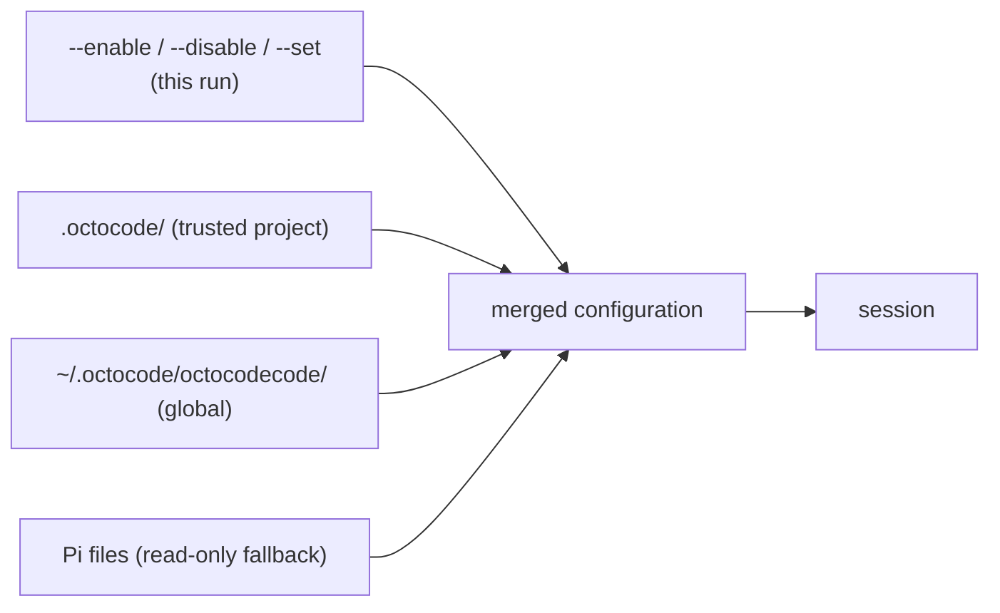
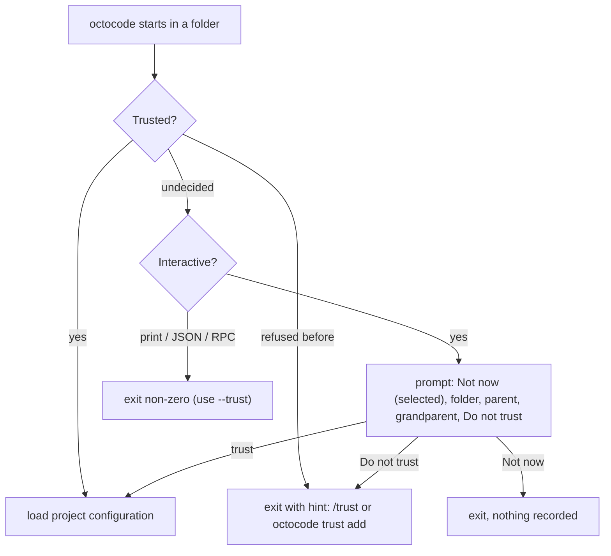
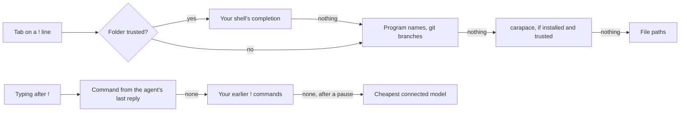
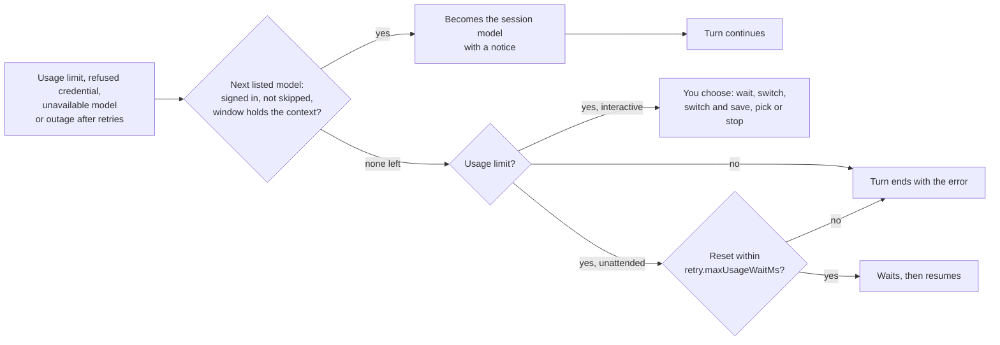

# Configuration

One page for where configuration lives, what wins, what needs trust and how to change it. Field lists: [settings](settings.md), [models.json](models-configuration.md), [environment variables](environment-variables.md).



Left beats right: a run flag beats the project, the project beats global, global beats Pi.

In a live session, open `/web` and choose **Commands → /settings** to use the running terminal’s configuration picker or enter a settings command. [Web workspace](web-workspace.md)

Two settings choose editors. Both are global or trusted-project settings, like any other.

| Setting           | Used by                                                                                                                                   | Default                                                            |
| ----------------- | ----------------------------------------------------------------------------------------------------------------------------------------- | ------------------------------------------------------------------ |
| `externalEditor`  | Ctrl+G prompt editing and editor dialogs: Octocode waits for the editor to exit (a Code-family editor, Zed or Sublime Text gets `--wait`) | `VISUAL`, then `EDITOR`, then Notepad on Windows or Nano elsewhere |
| `referenceOpener` | Opening a file reference (`/links`, a clicked reference) and `/diff --editor`                                                             | `auto`                                                             |

| `referenceOpener` value | Opens with                                                                                                                                                                                                                                                                                                                      |
| ----------------------- | ------------------------------------------------------------------------------------------------------------------------------------------------------------------------------------------------------------------------------------------------------------------------------------------------------------------------------- |
| `auto`                  | The IDE whose integrated terminal runs Octocode (VS Code, Insiders, VSCodium, Cursor), in the current window; else the first of `code`, `cursor`, `code-insiders`, `codium`, `zed`, `subl` on PATH; else the system's default app for the file (`open`, `xdg-open`). Over SSH and on Linux without a display: the prompt editor |
| `editor`                | The prompt editor (`externalEditor`, `VISUAL`, `EDITOR`)                                                                                                                                                                                                                                                                        |
| any other text          | That command, for example `cursor` or `"/opt/My Editor/bin/edit" --flag`                                                                                                                                                                                                                                                        |

Code-family editors, Zed and Sublime Text open beside the session: Octocode keeps the terminal and does not wait. Any other editor, such as Vim or Nano, takes the terminal until it exits. Configure editors in the environment running Octocode, including SSH or WSL. See [editor workflows](tui.md#editor-and-vs-code-workflows).

## Headless and external-agent runs

Text, JSON and RPC runs use the same configuration precedence as terminal sessions. Start the worker in the target project so it finds that project's settings and instructions. Headless startup refuses an untrusted folder; `--trust` explicitly records trust, including permission to load project hooks and MCP configuration.

| Automation choice             | Configure it with                                                                                                                         |
| ----------------------------- | ----------------------------------------------------------------------------------------------------------------------------------------- |
| Model                         | `--model <provider/model-id>`; pick an available model whose plan permits unattended use                                                  |
| Credentials                   | Provider environment variables or preconfigured global sign-in; never committed workspace secrets                                         |
| Permission policy             | `--permission-mode workspace` for routine work with asks refused when nobody can answer; `full` is the broader default, not a sandbox     |
| Per-run settings              | `--set <key>=<value>`, `--enable <id>`, `--disable <id>`; these do not save settings                                                      |
| Tool restrictions             | `--tools`, `--exclude-tools`, `--no-mcp`; check subagent inheritance in [tool selection](tools.md#tool-selection-and-exposure) |
| Conversation storage          | `--no-session` for an in-memory conversation, or a distinct `--session-id` for recoverable work; neither isolates tool side effects       |
| Separate worker configuration | `OCTOCODE_HOME` and, when needed, `OCTOCODE_CODING_AGENT_DIR`; provision credentials and trust for that environment too                   |

Do not change global defaults for every delegated task. Prefer run flags, and keep caller deadlines and output limits in the launching program. The [external-agent guide](external-agents.md) has working invocation patterns and RPC lifecycle requirements; [providers](providers.md) covers authentication.

Octocode configuration and the [Pi fallback](#pi-configuration-fallback) are available by default. Each native child can use a different enabled `provider/model`; it inherits the configuration sources, rather than being limited to the coordinator’s provider. A credential supplied only with `--api-key` is not forwarded to children: configure the provider in the shared user configuration instead.

Installed [external runners](subagents.md#external-runners), including OpenCode, require opt-in. Open `/providers` → **External agents**, select a CLI and choose **Enable this CLI for agent tasks**, then `/reload`. Discovery starts no CLI processes; opening a runner's page or using it checks its own sign-in. Vendor CLIs keep their own configuration and credentials. A runner without its ACP adapter runs headless through its CLI where [a route exists](subagents.md#external-runners), and a Cursor task writes only in its own worktree.

| Global setting                                                         | Meaning                                    |
| ---------------------------------------------------------------------- | ------------------------------------------ |
| `externalAgents: false` (default)                                      | External delegation is off.                |
| `externalAgents: true`, `enabledExternalAgents: ["codex", "opencode"]` | Offer only these installed, runnable CLIs. |
| `externalAgents: true`, `enabledExternalAgents: []` or omitted         | Offer no vendor CLI.                       |

A settings file from an earlier version with `externalAgents: true` and no selection meant every runner; the first load rewrites it with `enabledExternalAgents` naming the runners Octocode had then and the file's own ACP agents (`externalModels` entries of kind `acp`), so nothing changes for you. A selected ACP agent of your own makes external connections available even when no vendor CLI is installed. Octocode converts earlier settings keys like this once per file, global and trusted project files alike, and writes a file only when a key changed.

Project settings cannot change these choices. Pausing external tasks keeps the selection; signing in never enables a CLI or changes the default model. Manual `/agents external` commands remain explicit, permission-checked user actions; a configured selection also constrains their ACP connections.

### External CLIs as models

Built-in CLIs come first in `/model`; your own CLI or ACP agents follow, declared in `externalModels` of `settings.json`. A trusted project's file may add entries; each stays off until you approve it in `/security`, and asks again when its command, arguments or variable names change. Entries are not read from `models.json`.

```json
{
	"externalModels": [
		{
			"id": "my-agent",
			"name": "My agent",
			"kind": "acp",
			"command": "my-agent",
			"args": ["acp"],
			"env": ["MY_AGENT_HOME"],
			"models": ["fast", "deep"]
		},
		{
			"id": "oneshot",
			"kind": "cli",
			"command": "my-cli",
			"args": ["--print", "--model", "{model}"],
			"models": ["small"]
		}
	]
}
```

| Field     | Meaning                                                                                                                        |
| --------- | ------------------------------------------------------------------------------------------------------------------------------ |
| `id`      | Provider id (`my-agent/fast`); not a built-in CLI's id (`claude-code`, `codex-cli`, `gemini-cli`, `opencode-cli`, `agy-cli`)   |
| `kind`    | `acp`: an ACP agent over stdio, given Octocode's tools. `cli`: one process per request, conversation on stdin, stdout as reply |
| `command` | A name on `PATH` or a path; missing, the provider is listed as unavailable                                                     |
| `args`    | Its arguments; `{model}` becomes the chosen model id                                                                           |
| `env`     | Names of variables passed from your environment; other credential variables are removed                                        |
| `models`  | Model ids; `default` (the CLI's own choice) when absent                                                                        |

An ACP agent's own model list is shown after `default` when `models` is absent, once Octocode has seen it: the sign-in check of Gemini CLI and Antigravity CLI reads it, and every connect of a session refreshes it (the other agents show only `default` until their first session). A model takes images when its agent accepts them in a prompt. An agent that takes no MCP server over HTTP cannot reach Octocode's tools, and its models say `no Octocode tools`. A project's entries are read from the session's own folder when the session starts. `/providers` → **+ Add an external agent** → _Your own CLI or ACP agent_ writes an entry here; `/reload` applies it.

## Agent directory

Global configuration and runtime state live in `~/.octocode/octocodecode/` ("global" below), except the agent database and global runtime files, which live in `~/.octocode/agent/` ("agent state" below). Project configuration lives in `.octocode/` of the workspace. MCP definitions are the exception: `~/.octocode/mcp.json` and `.octocode/mcp.json`.

| Override                    | Moves                                                                                                                                                                                                                                                                        |
| --------------------------- | ---------------------------------------------------------------------------------------------------------------------------------------------------------------------------------------------------------------------------------------------------------------------------- |
| `OCTOCODE_HOME`             | The shared configuration and runtime home; agent state moves to `agent/` inside it                                                                                                                                                                                           |
| `OCTOCODE_CODING_AGENT_DIR` | Only the core configuration directory; native runtime files keep their own home                                                                                                                                                                                              |
| `OCTOCODE_AGENT_DB`         | The agent database file (default `<agent state>/workspaces.db`); its transcript mirror sits beside it as `<name>.transcripts.db`, its archive search index as `<name>.archive-index.db`, and its workspace files in `<name>.workspaces/` (`workspaces/` for `workspaces.db`) |

An explicit `OCTOCODE_HOME` or `OCTOCODE_CODING_AGENT_DIR` also turns off the [Pi fallback](#pi-configuration-fallback) and moves the user MCP file to `mcp.json` in that directory. `/mcp config` prints the exact MCP paths, their read order and trust state without connecting servers.

## Where each configuration belongs

Workspace files are relative to the session's working directory; agent profiles and hooks use the repository root, also when you start in a subdirectory. Workspace files need a trusted folder.

| Configure                 | Global                                                                 | Workspace                                           | Inspect or apply                                                 |
| ------------------------- | ---------------------------------------------------------------------- | --------------------------------------------------- | ---------------------------------------------------------------- |
| Settings, default model   | `settings.json`                                                        | `.octocode/settings.json`                           | `/settings`; `/reload` after file edits                          |
| MCP servers, exposure     | `~/.octocode/mcp.json`                                                 | `.octocode/mcp.json`                                | `/mcp config`; [MCP](mcp.md)                                     |
| Providers, model defs     | `models.json`                                                          | `.octocode/models.json` (trusted folder)            | `/providers`; `/reload` after file edits; `/modelsettings`       |
| Provider sign-in, keys    | `auth.json`                                                            | none                                                | `/providers`, `/logout`                                          |
| MCP OAuth tokens          | `mcp-auth.json`                                                        | none                                                | `/mcp login\|logout <server>`                                    |
| Derived context files     | `context-optimization/` (project ones under `projects/<repo>-<hash>/`) | none in the repository                              | Rewritten on change; `octocode context`                          |
| Skills                    | `skills/<name>/SKILL.md`, `~/.agents/skills/`                          | `.octocode/skills/`, `.agents/skills/`              | `/harness list skills`; [skills](skills.md)                      |
| Prompt templates          | `prompts/*.md`                                                         | `.octocode/prompts/*.md`                            | [prompt templates](prompt-templates.md)                          |
| Themes                    | `themes/*.json`                                                        | `.octocode/themes/*.json`                           | `/settings` → Interface and session → Theme; [themes](themes.md) |
| Keyboard shortcuts        | `keybindings.json`                                                     | none                                                | `/keys`, `/reload`; [keybindings](keybindings.md)                |
| System prompt             | `SYSTEM.md`, `APPEND_SYSTEM.md`                                        | `.octocode/SYSTEM.md`, `.octocode/APPEND_SYSTEM.md` | `/reload`; the workspace file wins                               |
| Project instructions      | `AGENTS.md` in the agent directory                                     | `AGENTS.md` in the project and its ancestors        | [instructions](prompts.md)                                       |
| Agent profiles            | `agents/*.md`                                                          | `.octocode/agents/*.md` at the repository root      | `/agents`, `/reload`                                             |
| Hooks                     | `hooks.json` in the runtime home                                       | `.octocode/hooks.json` at the repository root       | `/harness hooks`; [hooks](hooks.md)                              |
| Plugins                   | `plugins` in `settings.json`                                           | `plugins` in `.octocode/settings.json`              | `/harness`; [plugins](plugins.md)                                |
| Plugin marketplaces       | `marketplaces` in `settings.json` (global only)                        | not read                                            | `octocode marketplace add`                                       |
| GitHub sign-in (research) | The Octocode CLI's own store                                           | none                                                | `/octocode auth login\|status\|logout`                           |

Your MCP servers and skills serve the main session. A subagent runs only the built-in servers Octocode assigns its role ([default servers](mcp.md#default-servers)) plus the servers its profile's `tools:` or its task's `mcp` list names ([MCP](mcp.md#assign-servers-to-agents)), and lists only its role's skills; it loads any other skill by name ([child skill catalog](skills.md#child-skill-inheritance)).

## Precedence

| Kind        | Order, lowest to highest                                                                                                                                                                                                                                                                                                                                                                                                                                                                                                                                                        |
| ----------- | ------------------------------------------------------------------------------------------------------------------------------------------------------------------------------------------------------------------------------------------------------------------------------------------------------------------------------------------------------------------------------------------------------------------------------------------------------------------------------------------------------------------------------------------------------------------------------- |
| Settings    | Pi files, global, trusted project, `--set`. Objects merge recursively, arrays replace                                                                                                                                                                                                                                                                                                                                                                                                                                                                                           |
| MCP files   | `~/.pi/mcp.json`, `~/.pi/agent/mcp.json`, `~/.octocode/mcp.json`; then trusted `.pi/mcp.json`, `.mcp.json`, `.agents/mcp.json`, `.octocode/mcp.json`                                                                                                                                                                                                                                                                                                                                                                                                                            |
| Skills      | By harness: Octocode > `.agents` > Pi > Claude Code > Codex > Cursor; then project before global. Losers are listed as shadowed                                                                                                                                                                                                                                                                                                                                                                                                                                                 |
| Credentials | Environment or ambient cloud credentials, `apiKey` in Pi's `models.json`, Pi's `auth.json`, the key in Octocode's `models.json` (`auth` command, then `env` names, then `apiKey`, which also takes `keychain:<name>`; [details](providers.md#a-key-command-variable-names-or-a-keychain-entry-in-modelsjson)), Octocode's `auth.json`, then runtime `--api-key` (highest). A `models.json` field Octocode does not know (a misspelled `apikey`) or an `api` no built-in serves loads with a warning naming the file and provider, shown on that provider's page in `/providers` |
| Keybindings | Pi's `~/.pi/keybindings.json` and `~/.pi/agent/keybindings.json`, then the agent directory's `keybindings.json`, action by action; no project file                                                                                                                                                                                                                                                                                                                                                                                                                              |

- A later MCP definition replaces a server of the same name; a later control-only entry (`enabled`, `exposure`, `toolExposure`, `defaultActive`) changes it without copying credentials. Details: [MCP](mcp.md#configure-servers), [MCP reference](mcp-reference.md#configuration-and-precedence).
- Keys the settings schema does not define still load and are preserved on save, with no effect; startup warns once per load naming each (a removed key says what replaced it).
- Keys read only from the global file (`sandbox`, `retention`, `security`, `cacheWarming`, `externalAgents` and the other keys [settings](settings.md) describes as global) do nothing in a project file: startup warns once, naming that file and every such key it sets.
- Settings, MCP and trust files are saved by atomic replacement, and settings saves lock the read-merge-write step, so concurrent writers keep each other's changes. An empty settings file, or one whose root is not a JSON object, is reported as invalid and never overwritten, also if it turns invalid after startup: repair it, then `/reload`.

### Project `models.json`

In a trusted folder `<project>/.octocode/models.json` (and `<project>/.pi/models.json` while the Pi source is on) is read in full: it can add providers, add models and tune a provider's `defaults`. A provider defined in several files merges field by field: the narrower file wins each field it names, and Octocode's file wins over Pi's at each scope. A project file cannot change `baseUrl`, `api`, `headers`, `apiKey`, `auth` or `env` of a provider a global file also defines; those fields are ignored with a warning ([models.json](models-configuration.md#provider-defaults-and-profiles)). In a folder that is not trusted the file is not read and `/providers` shows a warning naming it. Editing the file takes effect on `/reload` or automatically. Trust is fixed for a running session: after `octocode trust add <folder>`, start a new session. A project file may also set `profile` on a provider a global file defines: it selects cache and request-format facts and moves no key or host. A project provider with the same id as a global one overrides its other fields; `/providers` and startup warn, naming both files. An invalid project file is skipped with a warning; global providers still load. The checks that apply to the global file apply here too: no credential inside a `baseUrl`, and a literal `apiKey` counts as a stored credential.

**Security:** a trusted repository can point a provider at another host, and your key for that provider is then sent there. Trust only repositories you would run code from.

### Provider folders

Providers come from these `models.json` files. Definitions of one provider id merge field by field, the first file in this table winning each field it names.

| Rank | File                                                 | Scope     | Product  | Read when                                            |
| ---- | ---------------------------------------------------- | --------- | -------- | ---------------------------------------------------- |
| 1    | `<workspace>/.octocode/models.json`                  | workspace | Octocode | the folder is trusted                                |
| 2    | `<workspace>/.pi/models.json`                        | workspace | Pi       | the folder is trusted and the Pi source is on        |
| 3    | `~/.octocode/models.json` (the Octocode home folder) | global    | Octocode | the default home (see the CI recipe)                 |
| 4    | `~/.octocode/agent/models.json`                      | global    | Octocode | the default home                                     |
| 5    | `~/.octocode/octocodecode/models.json`               | global    | Octocode | always: Octocode's own file, written by `/providers` |
| 6    | `~/.pi/agent/models.json`                            | global    | Pi       | the default home and the Pi source is on             |
| 7    | `~/.pi/models.json`                                  | global    | Pi       | the default home and the Pi source is on             |

Every override prints one warning naming both files (and the new host when it differs), at startup and in `/providers`. `octocode --list-models` has a `source` column (file, scope, product), and `octocode providers list [--json]` lists every provider with its source and, for each definition that lost, the file that replaced it (`shadowedBy`). `octocode auth check` reports the cause for the provider alone: a secret command's exit status or timeout, the environment variable that is not set, or the unreadable file; never a secret value. A provider or model that only an untrusted workspace file defines is reported with the `octocode trust add <folder>` command that loads it.

Per-provider fields in `models.json` (details: [models.json](models-configuration.md)):

| Field               | Where                            | Effect                                                                                                                                                                                                                                                 |
| ------------------- | -------------------------------- | ------------------------------------------------------------------------------------------------------------------------------------------------------------------------------------------------------------------------------------------------------ |
| `cacheRetention`    | provider, and each model         | `none`, `short` or `long` conversation cache retention                                                                                                                                                                                                 |
| `contextWindow`     | each model, and `modelOverrides` | Context window in tokens; set it on every custom model so compaction runs before the real window fills                                                                                                                                                 |
| `requestsPerMinute` | provider, and each model         | Requests a session sends to the provider per minute: 12 by default, `0` turns the limit off; also on an official provider                                                                                                                              |
| `tokensPerMinute`   | provider, and each model         | Tokens per minute a model may use across all sessions on this machine (uncached input plus output, cache reads not counted; the gate reserves the estimate and settles to actual usage); a request over the budget waits; also on an official provider |
| `auth`              | provider                         | Key command: a program that prints the key; runs without a shell, on first use                                                                                                                                                                         |
| `env`               | provider                         | Variable names that may hold the key; the first one set is used, else `apiKey`                                                                                                                                                                         |
| `apiKey`            | provider                         | Literal key, `$NAME`, `!command` or `keychain:<name>` (system keychain entry of service `octocode`)                                                                                                                                                    |

**CI recipe.** A CI image has no trust grant, so a workspace `models.json` is ignored there. Give the job its own home and grant the checkout once, in the job's shell (not inside an agent session):

```sh
export OCTOCODE_HOME="$RUNNER_TEMP/octocode"   # isolated: ranks 3, 4, 6 and 7 are not read
octocode trust add "$PWD" --yes
octocode providers list --json                 # check which file defines each provider
octocode auth check --provider <id>            # 0 ready, 1 not ready, 2 invalid
```

With `OCTOCODE_HOME` or `OCTOCODE_CODING_AGENT_DIR` set, only rank 5 (inside that home) and the trusted workspace files are read; `~/.pi` and the other `~/.octocode` folders are ignored on purpose, so a CI job never picks up a developer's files. Provide credentials through environment variables or the home's `auth.json`.

## Changing configuration

Provider visibility switches (`disabledProviders`, `hiddenModels`) are global. An invalid `disabledProviders` value is reported as a settings-load error; an edit does not replace the currently loaded switches until the file is valid.

`defaultProvider` and `defaultModel` choose the starting model for new sessions. Saving or clearing them through configuration reports **next session**; `/reload` does not replace the current chat's model. Use `/model` to switch it. In the model picker, **Ctrl+S** saves the highlighted model for new sessions and keeps this chat on its current model. To change both, press Enter and choose **Switch this chat and set the startup default**. In a trusted project it asks whether to save globally or for this project only (the same project settings file as `/settings set --local`); in an untrusted project it saves globally. The picker header shows the startup default and whether it comes from global settings, the project or a run override. A trusted project default takes precedence over a global one, so a global save in such a project says that the project default wins.

The web Settings page saves or clears the startup provider and model as one pair in the chosen global or trusted workspace file. Its source badges show the effective precedence; changing the pair keeps the current chat's model. To follow one provider’s preferred model at startup, open **Choose models** on the provider in web Settings and select **Set as default provider**, or use `/providers`. Choose its preferred model in the same web panel or in `/models`. Octocode stores that choice in the global `providerModels` setting.

`runtime.smartRouting` configures the explicitly selected `octocode/auto-code` virtual model; it does not make that router the startup default. Candidate filters, tier overrides, plan-only mode and cooldowns may come from global or trusted project settings. `allowPlanToMeteredEscalation` is global only: a project or per-run value cannot authorize a switch from a flat-rate plan to per-token spending. See [Smart routing](smart-routing.md).

`/settings` in a session and `octocode configuration` in a shell are one mechanism over one catalog: tools, MCP servers, harnesses, plugins, hooks, skills, extensions, prompts, themes, providers, sources and every settings key. `/configuration` and `/config` open the same panel. The agent changes configuration through its `configuration` tool, which asks you before every change in every permission mode ([native features](tools.md#configuration)).

```text
/settings [list|get|enable|disable|set|unset|add mcp|remove] [--local] [--force]
octocode configuration ... [--local] [--trust] [--json]
```

Ids are `kind:name` (`tool:`, `mcp:`, `harness:`, `plugin:`, `hook:`, `skill:`, `prompt:`, `theme:`, `provider:`, `source:`) or a bare settings key such as `retry.maxRetries`.

| Verb                                | Does                                                                                                                                               | Example                                                |
| ----------------------------------- | -------------------------------------------------------------------------------------------------------------------------------------------------- | ------------------------------------------------------ |
| `list [kind\|text]`, `get <id>`     | Show entries and their state                                                                                                                       | `/settings list mcp`                                   |
| `enable\|disable <id>...`           | Switch entries                                                                                                                                     | `/settings disable tool:backlog`                       |
| `set <key> <value>`, `unset <key>`  | Change or reset a settings key                                                                                                                     | `/settings set retry.maxRetries 4`                     |
| `add mcp <name> ...`, `remove <id>` | Add an MCP server (arguments of `octocode mcp add`; saved off and unassigned until you approve it in `/security` and enable it) or remove an entry | `/settings add mcp docs --url https://example.com/mcp` |

An MCP server the security review holds back reads `not checked: off until you approve it in /security` in `get`, `list`, the selector and the web Harness panel, in place of on or off, whatever its switch; Enter or the panel's button still flips the switch. In a terminal session, `get` and `list` say **applies now** for a key the terminal applies at once (theme and other display settings); `set` and `unset` of such a key apply in this session as soon as the file is written. Without a verb a terminal opens a selector; otherwise the CLI lists. `--json` prints JSON; a refused change prints its reason with suggested ids and exits 1. Retired, each printing a hint: `/settings`, `/config`, `octocode config`, `/mcp enable|disable|assign|exposure`, `/harness enable|disable`, `octocode mcp enable|disable`.

| Scope   | Selected by                                                       | Written to                                                                                        | Lasts         |
| ------- | ----------------------------------------------------------------- | ------------------------------------------------------------------------------------------------- | ------------- |
| global  | default                                                           | `settings.json` (MCP: `mcp.json`)                                                                 | every session |
| project | `--local` (`-l`)                                                  | `.octocode/settings.json` (MCP: `.octocode/mcp.json`); trusted folder only (`--trust` records it) | this project  |
| run     | `octocode --enable <id>`, `--disable <id>`, `--set <key>=<value>` | nothing                                                                                           | this process  |

Some keys are read from the global settings only (the [Settings](settings.md) page says so for each: `sandbox.*`, `bash.inheritProviderKeys`, `security`, `retention`, `research.allowedPaths`, `sessionApi`, `externalAgents`, `cacheWarming`, `httpProxy` and others). For those, `get` shows the global value and notes a project value that is ignored; `--local` and run flags refuse them with the reason, and `unset <key> --local` removes a stray project value.

Each result says when it applies: now (MCP switches, live settings), after `/reload`, or in the next session. Run flags are repeatable, apply before tools and resources load, survive `/reload` and are never written: `octocode --disable tool:backlog --set retry.maxRetries=4`. They belong to a session: a subcommand after them (`octocode --set retry.maxRetries=4 configuration get retry.maxRetries`) is refused with the corrected line. A refused id or key prints the reason and exits 1; `mcp:` ids have no run form (use `--no-mcp`). `--tools` and `--exclude-tools` still choose tools for one run. Features register no CLI flags, so unknown flags such as `--extension` fail at startup.

MCP is always on and has no switch; start with `--no-mcp` to run without it. A leftover `extensions` key in a settings file is ignored with one warning; remove it. Octocode is the default MCP server: `/settings disable mcp:octocode` turns it off and `enable` brings it back (`OCTOCODE_MCP=0` also turns it off, unless configuration overrides it).

### Harnesses

A harness is one source of configuration. `/harness` opens on an **Overview** tab with one row per section (**Skills**, **MCPs**, **Hooks**, **Sources**): how many items are on and off (`N on · M off`) and how many wait for approval in `/security`. Empty sections stay visible. **Sources** contains the harness switches below.

| Command                                | Opens                                                             |
| -------------------------------------- | ----------------------------------------------------------------- |
| `/harness`, `/harness overview`        | The Overview                                                      |
| `/harness skills\|mcp\|hooks\|sources` | That section (outside the terminal it prints the section instead) |
| `/harness list [section]`              | A plain list, for example `/harness list sources`                 |

| Key                               | Action                                                             |
| --------------------------------- | ------------------------------------------------------------------ |
| Enter on the Overview             | Open the selected section.                                         |
| ← / →, Ctrl+← / Ctrl+→            | Change section (plain arrows only while the filter is empty).      |
| Enter; Space with an empty filter | Toggle the selected item, following its approval and trust checks. |
| Tab                               | Change global/project scope.                                       |
| F2                                | Open full details; arrows and PgUp/PgDn scroll.                    |
| Esc                               | Leave details or close the list.                                   |
| Ctrl+R on a load failure          | Retry.                                                             |

Changing section, scope, selection or filter clears an armed disable confirmation. Loading and failures appear in the selector, which remains cancellable.

**Turning on a source.** Switching a source such as Claude Code, Codex or Cursor on first shows **Turn on `<source>`?** with every skill, MCP server and hook it would bring, each scanned by the [security review](permissions.md#security-review) (static: nothing runs), worst rating first. Enter switches the source on; Esc writes nothing. The items stay off until you approve them in `/security`. `/settings enable harness:<id>` prints the same list and then switches.

**MCP servers.** In the **MCPs** section Space switches a server on or off. Enter or → on a server opens its tools:

| Row               | Meaning                                                                                                           | Change with                                                                  |
| ----------------- | ----------------------------------------------------------------------------------------------------------------- | ---------------------------------------------------------------------------- |
| Available to      | `every agent`, or `only agents whose profile tools: names mcp__<server>__` (the server's `defaultActive` setting) | Space                                                                        |
| Default for tools | The server's exposure (`direct`, `deferred`, `onDemand` or `hidden`) for tools without a pin                      | Tab                                                                          |
| Each tool         | The tool's state; a pin overrides the server default                                                              | Space hides or unpins, Tab cycles `direct`, `deferred`, `onDemand`, `hidden` |

← or Esc goes back. A server that is not connected lists its pinned tools and tells you to connect to list the rest. Changes apply from the next session. Details: [MCP tool exposure](mcp.md#control-tool-exposure).

| Harness    | Reads                                   | Default   |
| ---------- | --------------------------------------- | --------- |
| Octocode   | Its own files                           | always on |
| `agents`   | `.agents/skills`, `.agents/mcp.json`    | on        |
| `mcp-json` | root `.mcp.json`                        | on        |
| `pi`       | Pi skills, prompts, themes, MCP         | on        |
| `claude`   | Claude Code skills, MCP, hooks, plugins | off       |
| `codex`    | Codex skills, MCP, hooks, plugins       | off       |
| `cursor`   | Cursor skills, MCP                      | off       |

Switch one with `/settings enable|disable harness:<id> [--local]` (writes `toggles["harness:<id>"]`, removed when it equals the default), or on the Harness panel of the [web Settings page](web-workspace.md#settings-page).

- A project key reaches only that harness's project items, so a committed file cannot enable your global Claude Code content.
- MCP servers connect or disconnect at once, also in running subagents; skills, hooks and prompts apply after `/reload`.
- A plugin listed in `plugins` is your explicit choice and loads whatever its harness switch says.
- `harness:claude:memory` (off, global only, trusted folders only) adds Claude Code's auto memory for this repository (`~/.claude/projects/<repository>/memory/MEMORY.md`, first 200 lines or 25 KB; when the file is longer, the note says so and names the file) as notes; `AGENTS.md` and Octocode memories win; the file is never written.
- Project instructions come from `AGENTS.override.md`, else `AGENTS.md`, in each folder; a folder with neither uses its `CLAUDE.md`, whatever `harness:claude` says. All three follow the same trust rules.
- Project hooks and skills from other harnesses follow the same boundary: they load only from the folder a trust grant is on down to the working folder, so a grant on a subfolder of a repository does not read the repository root's `.octocode`, `.claude`, `.codex`, `.cursor` or `.agents` files. A linked worktree reads the main checkout's `MEMORY.md` only when that checkout is trusted.

The startup screen and read-only `/harness config` show each kind with its count and sources (`octocode global`, `pi project`, `plugin <name>`, `builtin`, `command line`, `settings path`), shadowed copies with their winner, project items in an untrusted folder as "folder not trusted", and Pi code that is not run as "Not loaded". `ctrl+o` expands paths. The view refreshes on `/reload` or a new session; items of a switched-off harness are neither counted nor warned about.

### Tool exposure

Exposure sets a tool’s initial state. For MCP tools, presentation also determines where a direct tool’s full contract appears. A session can load more detail after its cached prefix. See [MCP presentation modes](mcp-reference.md#presentation-modes).

| State      | The model gets                                                                                                                                                                                                                                  |
| ---------- | ----------------------------------------------------------------------------------------------------------------------------------------------------------------------------------------------------------------------------------------------- |
| `direct`   | The tool's full description and parameter schema                                                                                                                                                                                                |
| `deferred` | The description, the field names with their types, the few values a field allows, list bounds and required fields (an MCP tool also names the fields of its objects and lists); the tool stays callable, and a rejected call returns the schema |
| `onDemand` | Only a line in the prompt's tool index; the tool is callable, and its first call or a read with the `mcp` tool declares it from the next request on, after the cached prompt                                                                    |
| `hidden`   | Nothing: the tool cannot be called (MCP tools only)                                                                                                                                                                                             |

What decides the state, first match wins:

| Tools                                               | Decided by                                                                                                   |
| --------------------------------------------------- | ------------------------------------------------------------------------------------------------------------ |
| An MCP tool                                         | Its `toolExposure` entry in `mcp.json` (a pin), then its server's `exposure`, then the `mcpExposure` setting |
| `archive`, `models`, `backlogPlan`, `configuration` | Its `nativeToolExposure` entry in `settings.json` (a pin: `direct` or `deferred`), then `mcpExposure`        |
| `memory`, `notify`                                  | Its `nativeToolExposure` pin, then `mcpExposure` under `"usage"`; `direct` under every other value           |
| Every other native tool                             | Always `direct`                                                                                              |

`mcpExposure` is `"usage"` by default: a tool without a pin is `deferred`, however often sessions use it. Use only decides whether a tool that would be `onDemand` is declared `deferred` from the start instead: the promotion snapshot names the tools that at least 10% of the last 7 days' sessions of the same role used, with 20 or more such sessions, kept while their declarations fit `mcpPromotedBytes` (default 8192 bytes per role: main or subagent). A tool with fewer sessions keeps its default, so a new install gets the same tools as a warm one. The snapshot is computed once per UTC day and installed version. `"recent"` instead declares a tool in full while this working directory called it in the last 24 hours. A resumed session in the same folder keeps the MCP and native tool states it started with ([MCP reference](mcp-reference.md#exposure-and-results)). A pin beats that rule. `"direct"` declares every tool without a pin in full, as earlier versions did.

| `mcpExposure`    | A tool without a pin is                                                              |
| ---------------- | ------------------------------------------------------------------------------------ |
| `"usage"`        | `deferred`; an `onDemand` tool the promotion snapshot names is `deferred` (default)  |
| `"recent"`       | `direct` if this working directory called it in the last 24 hours, else `deferred`   |
| `"direct"`       | `direct`                                                                             |
| `"deferred"`     | `deferred`, and an MCP server's block lists only each tool's name and trigger        |
| `"auto:<bytes>"` | MCP servers `direct` in name order while their text fits the budget, then `deferred` |

```json
{
	"mcpExposure": "direct",
	"nativeToolExposure": { "archive": "direct", "models": "deferred" }
}
```

`onDemand` applies only where the model's provider can add a tool after the cached prompt (Anthropic and OpenAI models that support it); elsewhere such a tool is `deferred`, and a switch to such a model declares the unused ones `deferred`. The bundled Octocode server leaves every tool to `mcpExposure` and its own environment. The FreeLlama server sets it for all its tools (its instructions then wait for the `mcp` tool too); the browser server for its rarely used tools. `archive` and `models`, and `memory` in a subagent, take it whenever they would be `deferred`; a `nativeToolExposure` pin opts one out. A resumed session declares again what it had loaded. The Tools panel shows `onDemand` tools as `deferred`.

Reply size and prompt size trade tokens against re-reads, so each default keeps what recorded sessions showed. `bash` keeps 12 KB (`bashOutputMaxBytes`): 8 KB would shorten about twice as many replies, but test and check runs that already need a ranged read of the saved file would need it more often. An MCP read keeps 20 KB by default and a call may ask for up to 50,000 characters; a lower host ceiling would cut deliberate requests (for `localFetch` a 30 KB ceiling saves under 2% of its reply tokens, 20 KB about 6%) and add re-reads, so the size stays the call's choice. `web` returns 8 KB per page, and `maxChars` continues it. A rarely used MCP tool costs about 250 tokens a prompt as `deferred` and about 25 as `onDemand`: pin the ones you seldom use with `toolExposure` (the GitHub, package-advisory and screenshot-judging tools of the Octocode server are the largest group, near 3,700 tokens together).

See each tool's state and pin it on the Tools panel of the [web Settings page](web-workspace.md#settings-page), or edit the files; `/harness mcp` → the server → **Default for tools** sets a whole server. A pin applies from the next session. Details: [MCP tool exposure](mcp.md#control-tool-exposure).

## Trust

Octocode opens no session in a folder you have not trusted. Before the decision nothing is read from the folder (no `AGENTS.md`, settings, MCP, hooks, skills, agents, plugins or `SYSTEM.md`), no model is called and no tool exists.



| Rule          | Behavior                                                                                                                                                                                                                                                                                                                                                                                                         |
| ------------- | ---------------------------------------------------------------------------------------------------------------------------------------------------------------------------------------------------------------------------------------------------------------------------------------------------------------------------------------------------------------------------------------------------------------- |
| Grants        | The folder, its parent or its grandparent (a subtree); future contents are covered. A grant follows the folder by file identity (survives rename, move, reboot). `$HOME`, `/` and filesystem roots never get a session or grant; nothing above `$HOME` gets a subtree grant                                                                                                                                      |
| ACP           | `session/new` answers a per-session `-31000` error whose `data.command` names the fix                                                                                                                                                                                                                                                                                                                            |
| `--trust`     | Records a grant (source `flag`) that stays until `octocode trust remove`, and runs; not for `--mode acp`. Without it a refused text or JSON run writes nothing in the folder and, when no provider is connected either, names that step too                                                                                                                                                                      |
| In a session  | `trust add\|remove` and `--trust` refuse when `OCTOCODE_SESSION_ID` is set: trust is your decision, run them in your own terminal                                                                                                                                                                                                                                                                                |
| Moving folder | `/resume`, `/import`, a new session or `/worktree switch` with a `cwd`, and RPC `switch_session` check trust first; declining keeps the old session                                                                                                                                                                                                                                                              |
| Instructions  | One instruction file per folder (`AGENTS.override.md`, else `AGENTS.md`, else `CLAUDE.md`) loads from the grant's folder down to the working folder, never from a parent repository above the working folder's own ([instructions](prompts.md))                                                                                                                                                                  |
| Worktrees     | A new one (`/worktree`, `--worktree`, isolated subagents) asks once before creation (headless: `--trust`); yes records a `worktree` grant that removing the worktree revokes. An isolated subagent's worktree whose source repository is trusted is granted without asking; so is a `/worktree new` from a trusted checkout requested in a session. A headless run still needs `--trust`. Subagents never prompt |
| Old files     | `trust.json` and `pi-trust.json` from earlier releases are not read: run `octocode trust add <path>`                                                                                                                                                                                                                                                                                                             |

| Command                                                                                             | Does                                               |
| --------------------------------------------------------------------------------------------------- | -------------------------------------------------- |
| `/trust`, `/trust list`                                                                             | Menu; list grants, refusals, ignored grants        |
| `/trust add [path] [--scope folder\|parent\|grandparent]`                                           | Grant                                              |
| `/trust remove <number\|path>`                                                                      | Revoke                                             |
| `octocode trust list [--json]`, `add [path] [--scope ...] [--yes]`, `remove <number\|path> [--yes]` | Same without a session; `--yes` skips confirmation |

Project resources need trust, except `AGENTS.md`-style instruction files, which load as text. Octocode hook files always load; Claude Code and Codex hook files load once that harness is on (`/settings enable harness:claude`), each under its own profile; `disableAllHooks: true` in a loaded hook file turns them all off; [Claude permission rules](permissions.md#claude-permission-rules) always apply. See [hooks](hooks.md).


## Pi configuration fallback

Octocode and Pi provider sources are enabled by default; no import step is required. With the default home, provider discovery checks the current Octocode folder first, followed by `~/.octocode/agent/`, `~/.octocode/`, `~/.pi/agent/` and `~/.pi/`. The fallback provider files are read-only. An explicit Octocode home or SDK directory isolates provider discovery to that directory.

For providers, `models.json` and `auth.json` are also read, read only, from Pi's folders. Definitions of one provider merge field by field, Octocode's winning. Turning the `pi` provider source off stops all of these.

| Item                    | Behavior                                                                                                                                                                                                                                                                                                                                                                                                                                                                                                                                                                                                    |
| ----------------------- | ----------------------------------------------------------------------------------------------------------------------------------------------------------------------------------------------------------------------------------------------------------------------------------------------------------------------------------------------------------------------------------------------------------------------------------------------------------------------------------------------------------------------------------------------------------------------------------------------------------- |
| `models.json`           | Providers missing from Octocode come from Pi (a Pi entry with an official provider id is skipped with a warning); an Octocode provider overrides the fields of the Pi provider it names                                                                                                                                                                                                                                                                                                                                                                                                                     |
| `settings.json`         | Inherited lowest first: Pi global, trusted `<project>/.pi/settings.json`, Octocode global, trusted `.octocode/settings.json`. Not inherited: resource keys (`packages`, `extensions`, `skills`, `prompts`, `themes`) and per-install keys (`sessionDir`, `deviceId`, `trackingId`, `enableAnalytics`, `defaultProjectTrust`); a project `.pi/settings.json` cannot set `remote.autoStart`. Pi settings are read-only: a save writes only Octocode's values. A Pi file that does not parse is a startup warning                                                                                              |
| `mcp.json`              | Inherited under the [MCP order](#precedence); control changes save native overrides                                                                                                                                                                                                                                                                                                                                                                                                                                                                                                                         |
| Credentials             | A provider with no Octocode credential and no `apiKey` in Octocode's `models.json` uses Pi's `auth.json` entry, read only. Command-based keys and keychain references, entries Octocode does not recognize and account sign-ins Octocode cannot use (Pi's Claude Pro/Max) are skipped; an unreadable file or entry is a startup warning naming the file. Login, logout and refresh write Octocode's file only. `/providers pi` copies a credential after confirmation ([providers](providers.md#use-pi-configuration)). Sessions, trust decisions, device identity and telemetry consent are never imported |
| Skills, prompts, themes | Pi directories are read like Octocode's, under the `pi` harness switch; missing Pi packages are not installed                                                                                                                                                                                                                                                                                                                                                                                                                                                                                               |
| Instruction files       | Pi's global `AGENTS.md` loads only when the Octocode directory has none; `SYSTEM.md` and `APPEND_SYSTEM.md` apply when no Octocode file does; project `AGENTS.md` is shared. In a trusted folder `.pi/skills`, `.pi/prompts`, `.pi/themes`, `.pi/SYSTEM.md`, `.pi/APPEND_SYSTEM.md` are read; nothing in `.pi/` is read in an untrusted folder                                                                                                                                                                                                                                                              |
| Pi code                 | Never runs. TypeScript in Pi's `hooks/` folders is listed as "Pi hook, not loaded" with a hint to use `hooks.json` or a plugin. A package's `package.json` declares its resources under `octocode`; Pi's `pi` key is not read                                                                                                                                                                                                                                                                                                                                                                               |
| Switch                  | Pi skills, prompts, themes and MCP follow `harness:pi`; models, settings and keybindings load regardless                                                                                                                                                                                                                                                                                                                                                                                                                                                                                                    |

Same name in both products:

| Files                                                                | Order, winner first                                                                                         |
| -------------------------------------------------------------------- | ----------------------------------------------------------------------------------------------------------- |
| Collections (skills, prompts, themes)                                | Scope first, then product: project Octocode, project Pi, global Octocode, global Pi (skills: harness first) |
| Single-valued (global context file, `SYSTEM.md`, `APPEND_SYSTEM.md`) | Product first: Octocode project, Octocode global, Pi project, Pi global                                     |

A Pi item in an untrusted folder shadows nothing. The first start that finds Pi items prints a one-line notice once, recorded in `pi-notice.json` in the agent directory (delete it to see it again). `/harness config` lists `models.json`, `settings.json` and `mcp.json`, agent profiles, hooks and plugins with product, scope, source file and shadowing item; layered files (`models.json`, `settings.json`) are read in full, so none shows as shadowed. An MCP `enabled` or `exposure` entry without `command` or `url` is a control-only override, listed apart from definitions.

## Terminal images

Inline images are on when the terminal supports them; `/settings` (**Interface and session**) exposes **Show images** and **Image width**. Model image input is separate: [models](models.md#describe-model-input-and-caching).

```json
{ "terminal": { "showImages": true, "images": "auto", "imageWidthCells": 60 } }
```

Detection recognizes Kitty (`TERM=xterm-kitty`) and queries interactive terminals at startup; a negative reply falls back to text, silence keeps the environment-based choice. `terminal.images` set to `"kitty"` or `"iterm2"` forces a protocol, `false` disables graphics, and beats `OCTOCODE_IMAGE_PROTOCOL` (`kitty`, `iterm2`, `none`, `auto`). In tmux, Kitty images are enabled only for a Kitty or Ghostty client with `allow-passthrough` on and 24-bit colour reaching the client; other tmux sessions, screen and Rex stay off. iTerm2 images work in regular mode; fullscreen uses text placeholders.

## Terminal output and pacing

Octocode asks the terminal at startup whether it supports synchronized output (mode 2026). When it confirms, each fullscreen frame is shown whole and pointer scrolling paints up to 120 frames a second; when it does not answer (Terminal.app), frames are written without the markers and paced to one per 60 Hz refresh, the rate such a terminal paints. The period runs from the start of one frame to the start of the next. While a large output streams, pointer frames keep this pace until the queue reaches the limit below; other frames wait once 256 KiB are queued.

A terminal that stops reading (a paused tmux pane, a stalled SSH link) would otherwise collect every frame painted meanwhile. Once more than `fullscreenFrameQueueLimitKiB` (default 512) is queued, new fullscreen frames are dropped and the screen is repainted whole when the terminal reads again; mode, restore and status bytes are always written, and regular mode never drops output because its rows become scrollback. `0` keeps every frame. The renderer budgets encoded images against a full repaint. Large child screenshots appear as saved file paths. A single text frame larger than the queue limit can paint when the queue is empty.

```json
{ "fullscreenFrameQueueLimitKiB": 512 }
```

### Redraws in regular mode

In regular mode the transcript lives in the terminal's scrollback, which the terminal cannot edit. When the width changes, when Octocode returns from the background (`fg` after Ctrl+Z), or when a row above the screen changes size, Octocode clears the screen and scrollback and writes the transcript again. `terminal.replayRows` (default 5000) bounds that redraw: only the last rows are written, after one marker row that says how many earlier rows were left out. The screen shows the same rows either way. Set it to `0` to write every row.

```json
{ "terminal": { "replayRows": 5000 } }
```

## No color

A non-empty `NO_COLOR` or `OCTOCODE_NO_COLOR`, the `--no-color` flag (it sets `OCTOCODE_NO_COLOR` for the process and its subagents), or `TERM=dumb` removes every ANSI color sequence (foreground, background, tints, diff tints, shimmer); bold, dim, underline and inverse stay. An empty `NO_COLOR` is ignored. `FORCE_COLOR` set to anything but empty, `0` or `false`, and the `--color` flag (it sets `FORCE_COLOR=1` and clears the no-color variables), keep color on despite `NO_COLOR`, as [no-color.org](https://no-color.org) recommends; `--no-color` beats both. It does not reduce motion. `terminal.trueColor` and `OCTOCODE_TRUE_COLOR` choose only the color depth. HTML exports made with these set are plain text on the themed page.

## Console output and prompts

While the fullscreen terminal interface owns the screen, `console.*` output from the process goes to `octocode-console.log` in the agent folder (owner-only, secrets redacted, restarted past 1 MiB) instead of the frame, and prints normally again once the interface stops (suspend, crash report, exit).

`--no-input` or a non-empty `OCTOCODE_NO_INPUT` makes every startup prompt (trust, session picker, confirmations) fail at once with an error and exit code 1 instead of waiting for an answer, and the run uses print mode even on a terminal; the variable reaches subagents.

## Reduced motion

`terminal.surfaceFills` is `false` by default; `true` paints user messages (6% of the text color on dark, 5% on light) and notice panels (8% of the accent color) as a tint blended into the terminal background instead of the theme's panel colors, so they fit any terminal background. It applies to new rows and changes every row's paint, so the terminal redraws its scrollback once when you turn it on.

`terminal.toolBands` is `false` by default; `true` gives each tool row a quiet background band blended from its state color (muted pending, success, error) into the terminal background, 6% on dark and 8% on light terminals. It applies to new tool rows and changes every row's paint, so the terminal redraws its scrollback once when you turn it on. A theme that sets its own tool backgrounds keeps them.

`terminal.screenReader` is `true`, `false` or `"auto"` (default): screen-reader text mode writes words instead of glyphs. The working line reads `working: <detail> (12s)` with no spinner or shimmer, the footer reads `context 34% of 271k` instead of the `▰▱` gauge, and every decoration stays still (as with reduced motion, which this mode implies). `"auto"` turns it on when `OCTOCODE_SCREEN_READER` is `1` or `true`; an explicit value wins.

`terminal.latencyFence` is `true`, `false` or `"auto"` (default, on): the renderer probes the terminal's display lag and holds streaming frames while it is behind. `OCTOCODE_LATENCY_FENCE=0` or `1` overrides the setting; `/debug terminal` shows whether the fence is on and what it measured.

`terminal.reduceMotion` is `true`, `false` or `"auto"` (default): the spinner is a still mark and the shimmer is plain; elapsed times and retry countdowns still tick. `"auto"` is still when stdout is not a terminal, when `CI` is set, or when `OCTOCODE_REDUCE_MOTION`, `REDUCE_MOTION` or `NO_MOTION` is `1` or `true`; an explicit value wins. A running mark is a still `◌`. `/settings` exposes **Reduce motion** and applies it at once.

```json
{ "terminal": { "reduceMotion": "auto" } }
```

## Emoji marks

Notices carry a tone mark beside their state mark, and the terminal title starts with a mark for the session. By default these are width-safe glyphs the theme colors: `≋` calm, `▲` caution, `◆` problem, and `◈` in the title. `terminal.emojiMarks: true` brings back the emoji (🐚 🦀 🦈 and 🦑); emoji width varies by terminal, so rows can misalign. `/settings` has an "Emoji marks" toggle that applies at once; the setting is also read at startup and on a settings reload.

```json
{ "terminal": { "emojiMarks": false } }
```

## Shell completion

A line that starts with `!` (or `!!`) is a shell command. **Tab** opens completions from your own shell: subcommands, options with their descriptions, branches, paths, everything your `.zshrc` or `.bashrc` set up. While you type, **ghost text** shows the rest of a likely command; **Right** or **End** accepts it, **Alt+Right** (word right) accepts its next word.



| Setting                        | Default  | Effect                                                                                                                                                                                                                                                                                                         |
| ------------------------------ | -------- | -------------------------------------------------------------------------------------------------------------------------------------------------------------------------------------------------------------------------------------------------------------------------------------------------------------- |
| `terminal.completion.shell`    | `"auto"` | Which shell answers Tab: `"auto"` follows your login shell (`$SHELL`; PowerShell on Windows without it), or `"zsh"`, `"bash"`, `"fish"`, `"pwsh"`. `"none"` starts no shell.                                                                                                                                   |
| `terminal.completion.loadRc`   | `true`   | Start that shell with your startup files, so plugin completions work. `false` loads only the shell's own completion system.                                                                                                                                                                                    |
| `terminal.completion.carapace` | `true`   | Ask [carapace](https://carapace.sh) for a command your shell cannot complete, when `carapace` is on `PATH`.                                                                                                                                                                                                    |
| `terminal.suggestions.history` | `true`   | Ghost text from the agent's last reply and your `!` history.                                                                                                                                                                                                                                                   |
| `terminal.suggestions.model`   | `true`   | When nothing matches, ask the cheapest model among the providers you are signed in to (the `small` tier). Each pause in typing costs one small call, recorded in the session's usage. With no cheaper model connected nothing is asked. Read from the global settings: a project file can turn it off, not on. |

```json
{ "terminal": { "completion": { "shell": "auto", "loadRc": true }, "suggestions": { "model": false } } }
```

- **Trust:** completion functions run programs (git completion runs `git`, which a repository's configuration can turn into running other programs), so the shell and carapace run only in a trusted folder. Elsewhere Tab offers program names, branch names read from `.git` and paths.
- **One shell per session:** it starts on the first Tab, in the session's folder, with the same environment as `!` commands, and stops with the session. A shell that hangs is restarted; one that cannot start (a startup file that waits for input or replaces the shell) is left off for the session and Tab falls back to paths. Nothing it does reaches your shell history.
- **Startup files:** the shell starts with `OCTOCODE_SHELL_COMPLETION=1`, so a startup file can skip work it does not need there, and with oh-my-zsh's update prompt and tmux auto-start turned off (`DISABLE_AUTO_UPDATE`, `DISABLE_UPDATE_PROMPT`, `ZSH_TMUX_AUTOSTART=false`). A startup file that waits for input or `exec`s another program prevents completion for that session.
- **History:** your `!` commands are kept per folder in the agent database (the newest 5,000), ranked by folder, frequency, recency and whether they last succeeded.

## Runtime storage

Session writers keep JSONL transcripts, the record of every session, and mirror the header and ordered entries, with the compaction summaries, to the transcript mirror (`transcripts.db`): a derived index of the session files, rebuilt from them when it is missing or behind. A transcript in a temporary folder (the system's, or a repository's `.octocode/agent/tmp/`) is not mirrored, so tests, benchmarks and copied fixtures stay out of session search and usage figures; one in a session folder Octocode chose (the workspace's `.octocode/agent/`, the Octocode home, or a session directory you set) is mirrored wherever that folder is. Each line is strict JSON that SQLite's JSON functions read: a lone UTF-16 surrogate is stored as U+FFFD, and a value nested more than 256 levels deep is stored as its JSON text. The agent database is two kinds of file. The machine file (`workspaces.db`) holds machine-wide data: workspace identities, session metadata, memories, usage, trust decisions and provider state. Each repository has a workspace file (`workspaces/<key>.db`) holding its backlogs, team coordination, events, background jobs, timers, file leases, edits, agent runs and command receipts, so one project's lock, damage or upgrade never touches another's. A linked worktree uses its main checkout's file and keeps its own backlog there. Settings and credentials stay in files. One connection is shared per database file; each file has one background database thread per process, which writes after the transcript (so a busy database never pauses input) and checkpoints the file's write-ahead log, shrinking it once its writes stop. The separate agents-communication database (`~/.octocode/agents-communication/`) is read-only to Octocode.

Each workspace declares its UUID in `.octocode/agent/workspace/id`: starting in a subdirectory uses the nearest declaration, a new Git worktree gets its own, names are display labels that may repeat, a same-filesystem rename keeps the id, and copying a marker cannot claim another database's records.

Everything Octocode writes in a workspace sits under `.octocode/agent/`; `.octocode/` itself keeps what you write (settings, MCP servers, skills, agents, hooks) and what the Octocode and browser MCP servers write. A skill's or tool's `.octocode/<path>` output means `.octocode/agent/<path>` when Octocode runs it. `temp/` is session-keyed (one folder per session and agent, kept and swept with that session) and `tmp/` is name-keyed (entries expire by idle time), so both exist. Octocode writes a `.gitignore` in `.octocode/agent/` that ignores runtime state, `temp/`, `tmp/` and `worktrees/`, and leaves `MEMORY.md` and topic folders to your repository's rules.

| Location                                                          | Contents                                                                                                                          |
| ----------------------------------------------------------------- | --------------------------------------------------------------------------------------------------------------------------------- |
| `<agent state>/workspaces.db`                                     | Machine-wide data: registered workspaces, sessions, memories, usage, trust decisions, provider state                              |
| `<agent state>/workspaces/<key>.db`                               | One repository's coordination: backlogs, team, events, jobs, timers, leases, edits, agent runs (linked worktrees share it)        |
| `<agent state>/transcripts.db`                                    | The transcript mirror: session entries and compaction summaries, rebuildable from the JSONL transcripts                           |
| `<agent state>/archive-index.db`                                  | The archive search index: a disposable cache of archive passages for keyword search, safe to delete; rebuilt in the background    |
| `.octocode/agent/sessions/`                                       | Default JSONL transcripts (explicit session directories win)                                                                      |
| `.octocode/agent/session-data/<session>/`                         | Per-session artifacts: compaction archives, checkpoints                                                                           |
| `.octocode/agent/temp/`                                           | Scratch, tool output, child handoffs                                                                                              |
| `.octocode/agent/tmp/`                                            | Throwaways agents and skills write by name (build logs, probes); retention expires them by idle time, `temp/` follows its session |
| `.octocode/agent/worktrees/`, `MEMORY.md`, `<topic>/`             | Checkouts, the repository memory file, and durable agent results (reports, plans); never cleared                                  |
| `.octocode/agent/agents.txt`, `backlog.md`, `backlog.html`        | Generated activity and exported backlog snapshots                                                                                 |
| `<octocode home>/child-credentials/`, `<agent state>/job-owners/` | Child credentials, background process ownership; job output stays in scratch                                                      |
| `<octocode home>/archive/`                                        | Gzip JSONL history archives (below)                                                                                               |
| `<octocode home>/web/`                                            | Web daemon: its record, and one owner-only attach record per running session ([web workspace](web-workspace.md#web-daemon))       |

Sessions written before the move live in `<octocode home>/sessions/--<working directory>--/`; `/resume`, `--continue` and `--session <id>` still list those whose header names the current directory (`/resume all` lists every such folder), and opening one keeps writing beside it. `octocode --fork <full-session-id>` recreates a session in the current workspace from stored entries when its file is gone. Team coordination and project-scoped memories span linked worktrees; backlogs and workspace memories belong to one workspace. The catalog keeps entries after a checkout is removed.

**Database versions.** A database at the current version is used as it is. An agent database (`workspaces.db`) from an earlier version Octocode knows how to upgrade is first copied beside itself as `<file>.v<old version>.bak` (for example `workspaces.db.v10.bak`; a later upgrade from the same version replaces that copy), then upgraded in one step: if the upgrade fails, the file keeps its old version and contents. Any other version (a newer one, or one too old to upgrade) is refused with a message and left unchanged: update Octocode, delete the file, or point `OCTOCODE_AGENT_DB` at another file. Session files follow the same rule: a transcript written in another session format is refused when opened and stays as it is.

**Workspace files.** The first run of a version with workspace files moves each repository's rows out of `workspaces.db` into its workspace file, and raises `workspaces.db` to schema version 13. The move waits until no other Octocode process runs: while a session of another process is alive, Octocode refuses to start, names that session and its process, and changes nothing. Quit every other Octocode process first, including sessions started from source checkouts and other worktrees. The move runs in one transaction that keeps every other writer out:

1. It copies the whole file to `workspaces.db.pre-split.bak`; a backup already there is kept as `workspaces.db.pre-split.bak.1`.
2. It writes each workspace file afresh from `workspaces.db`. A workspace file already in place, for example one left by a rollback, is never trusted or deleted: it is kept beside the new one as `<key>.db.replaced-<n>`.
3. It removes the rows from `workspaces.db` only when every count matches.

An interrupted move leaves `workspaces.db` as it was, and the next start moves everything again. From then on, every version without workspace files refuses `workspaces.db` with a message, so none can write rows the new version would not read.

To go back to an earlier version:

1. Quit every Octocode process. Rows written by a process still running are lost.
2. Replace `workspaces.db` with `workspaces.db.pre-split.bak`, and delete the `workspaces.db-wal` and `workspaces.db-shm` files.
3. Move `workspaces.db.pre-split.bak` aside, so the next move takes a fresh backup under that name.
4. Delete only the database files in the `workspaces/` folder (`workspaces/*.db`, `*.db-wal`, `*.db-shm`). Keep the folder and its `<name>-<hash>/sessions/` folders: they hold session data.

Work recorded after the move is lost.

**Retention.** `0` keeps a class forever. A project file cannot set either value; the environment wins; a non-whole-number or negative value is ignored (a bad setting is a warning).

| Setting (global)        | Default | Environment                       | Governs                                                                                                                                                                        |
| ----------------------- | ------- | --------------------------------- | ------------------------------------------------------------------------------------------------------------------------------------------------------------------------------ |
| `retention.days`        | 30      | `OCTOCODE_CLEANUP_DAYS`           | Output, bash logs, checkpoints, folders of unlisted sessions, subagent scratch and screenshots, `.octocode/agent/tmp` entries, compaction detail copies, database history rows |
| `retention.sessionDays` | 90      | `OCTOCODE_SESSION_RETENTION_DAYS` | Transcripts in `.octocode/agent/sessions/` and the legacy folders                                                                                                              |

`retention.archiveAfterDays` (default 14, a whole number of 1 or more, global only) is the window of the history archive below; it has no environment variable.

One sweep runs at session start, off the start path, at most every 6 hours, over every registered workspace whose root exists (`.octocode/agent` and `.octocode/agent/tmp` only), the global session folder and the legacy folders. An expired transcript goes with its session folders and rows, as with the delete commands. The current session, a running session, an unreadable directory and a live bash job are never removed; symlinks are not followed; a listing failure removes nothing. One summary line is shown as a warning when something was removed or failed.

**History archive.** Rows of the backlog audit, configuration audit and workspace command histories older than `retention.archiveAfterDays` (default 14) days move to owner-only gzip JSONL files per table family and UTC month in `<octocode home>/archive/`; archived rows older than `retention.days` are dropped. Agent runs and agent events older than `retention.days` are dropped without an archive; each workspace keeps its newest event. Backlog items, notes and comments are never deleted by age. A main session runs this at most once a day per process, after the first backlog access, in short write transactions; each batch is archived before it is deleted. Every process also stores a memory sample every 5 minutes (deleted after 7 days; `OCTOCODE_PROCESS_SAMPLE_MINUTES`, `0` stops it) for `/processes`.

Positive process sample intervals are bounded to 1–2,147,483,647 milliseconds; invalid or negative values use the default. A slow process listing skips elapsed intervals rather than queuing further work.

## Retries

A transient model failure is retried up to `retry.maxRetries` times (default 3), waiting `retry.baseDelayMs` (default 2000) doubled per attempt with up to half again random spread, never more than `retry.maxAgentDelayMs`.

A failed request is sent again, on the same model or a fallback, only when it committed nothing: no text had streamed to the screen and no tool had started. Otherwise the error stands (nothing repeats a visible answer or a tool's effect) and the turn ends with it; the next message continues the session. `retry.maxRetries: 0` and `retry.enabled: false` turn retries off; account quota and billing errors fail at once.

| Failure class                                                                                                                                                                                                                                    | Policy                                                                                                                                                                                                                                                                                                                                               |
| ------------------------------------------------------------------------------------------------------------------------------------------------------------------------------------------------------------------------------------------------ | ---------------------------------------------------------------------------------------------------------------------------------------------------------------------------------------------------------------------------------------------------------------------------------------------------------------------------------------------------- |
| Rate limits (`429`, "too many requests") and capacity or transport failures (`overloaded`, `502`, `503`, `504`, `520`, `524`, `529`, `server_busy`, "at capacity", connection reset, closed socket or websocket, `terminated`, early stream end) | At least six retries even if `retry.maxRetries` is lower (those beyond the configured count only within three minutes of the first failure). Wait spreads by up to half again the backoff and is at least the provider's `retry-after` plus up to 1 s; a `retry-after` longer than `retry.maxAgentDelayMs` ends the retries at once, naming the wait |
| The machine is offline: a DNS or transport failure (`ENOTFOUND`, `ENETUNREACH`, `EAI_AGAIN`, `fetch failed`, connection reset) while no interface has a routable address or public DNS names do not resolve                                      | Retried every `retry.offlineIntervalMs` (default 60000) with no attempt cap until the network returns or you press Esc; `retry.offlineMaxMs` (unset: no limit; print mode: 30 minutes) bounds the outage. A host that does not resolve while the network works (a mistyped `baseUrl`) keeps the configured count                                     |
| Other retryable errors                                                                                                                                                                                                                           | Configured count and jittered backoff (some never clear, and each attempt resends the context)                                                                                                                                                                                                                                                       |

An attempt that is retried, or sent again on a fallback model, stays in the terminal transcript, dimmed, as `Retried after error: …` instead of `Error: …`, also after a resume; the model does not see it again, and the web workspace shows only the retry status. When the retries run out, the last attempt keeps its `Error: …`. Cancelling during the countdown keeps the original error visible, including after reopening the session.

While offline, the working row shows one line that updates in place, such as `✗ ◆ Retry failed after 3 attempts: fetch failed (ENOTFOUND) - trying again in 42s · esc cancel`, and the transcript gains no row per attempt. When the run continues, the model gets one hidden note saying how long the network was down, so it knows time has passed; the note is not shown in the transcript.

### When a model keeps failing

Four failures move the turn to another model when you list models in `retry.fallbackModels` or `retry.fallbackChains` (and a fifth, a rate limit that outlasted its retries, when `retry.fallbackOn` names it):

| Failure                                                                                  | Example                                                                                                                                                                      | Skipped afterwards           |
| ---------------------------------------------------------------------------------------- | ---------------------------------------------------------------------------------------------------------------------------------------------------------------------------- | ---------------------------- |
| Usage limit (quota, plan or billing limit, no funds): not retried, it resets after hours | `429 insufficient_quota`, `FreeUsageLimitError`                                                                                                                              | That model                   |
| Refused credential: not retried                                                          | `401`, `invalid api key`, an expired sign-in (`OAuth refresh failed … invalid_grant`), an expired AWS SSO session; a `403` only when it names a key, token or authentication | Every model of that provider |
| Outage that outlasts the retries above                                                   | `503` after six retries, `fetch failed` after three                                                                                                                          | That model                   |
| Model unavailable for this account or endpoint: not retried                              | `model_not_found`, `… is not available for this account`, `on-demand throughput isn't supported`                                                                             | That model                   |

List models to continue on in order, as `provider/id` with an optional `:thinking` level:

```json
{ "retry": { "fallbackModels": ["openrouter/some-model", "openai/other-model:high"] } }
```

A model that needs its own order takes a chain, keyed by the failing model (`provider/id`; `*`, `?` and `[` match several). A model with no chain uses `retry.fallbackModels`. A listed model that fails in turn continues down the chain, skipping models that failed within `retry.fallbackCooldownMs`. Each model starts with a full retry budget. `retry.fallbackOn` picks the failure classes that switch (default `usage`, `credential`, `model`, `outage`; `rate-limit` is opt-in). A usage limit still asks you, or waits, when its class is left out:

```json
{
	"retry": {
		"fallbackChains": {
			"anthropic/claude-sonnet-4-5": ["openai/gpt-5", "openrouter/some-model:high"],
			"openai/*": ["anthropic/claude-haiku-4-5"]
		},
		"fallbackOn": ["usage", "outage"]
	}
}
```

A switch is a resend, so the replay rule above applies: after visible text or a tool, the turn ends with the error instead.



| Behavior                   | Detail                                                                                                                                                                                                                                                                                                                                                                   |
| -------------------------- | ------------------------------------------------------------------------------------------------------------------------------------------------------------------------------------------------------------------------------------------------------------------------------------------------------------------------------------------------------------------------ |
| Default                    | Empty list: the turn ends with the error                                                                                                                                                                                                                                                                                                                                 |
| Stays selected             | The session keeps the fallback model; `/model` switches back. Switching back by itself would pay for a cold prompt cache twice                                                                                                                                                                                                                                           |
| Skipped entries            | No credentials, listed as deprecated by models.dev, a failure within `retry.fallbackCooldownMs` (default 15 minutes; `0` retries a failed model at once) (for a refused credential, any model of that provider), or a context window that cannot hold the conversation plus the room kept free for compaction (compacting first would run on the model that just failed) |
| Billing                    | The notice says when the switch moves from a subscription plan to per-token billing, or back: `billed per token instead of by plan`                                                                                                                                                                                                                                      |
| Virtual models             | A usage limit goes to the router once per failing model, and a model unavailable for this account or endpoint goes back to it too, so it can pick another model; the selection stays virtual and the list is not used. Other failures end the turn                                                                                                                       |
| Subagents                  | A subagent whose model a purpose (`small`, `medium`, `large`) chose gets its own list instead: up to two models the same purpose resolves to on other providers, skipping refused ones. A subagent given a named model uses your list. New routes avoid a provider that reported a usage limit or refused its credential                                                 |
| Rate limits                | A rate limit (a plain `429`, "too many requests") is not a usage limit: it is retried on the same model as above and never switches to a fallback model                                                                                                                                                                                                                  |
| Usage limit, no entry left | In the terminal and `/web` you choose: wait and resume at the reset (offered when the reset time is known; sending a message cancels the wait), switch to the best connected model of another provider, switch and save it to `retry.fallbackModels`, pick one with `/model`, or stop. This choice comes with retries off too                                            |
| `retry.maxUsageWaitMs`     | Default `0`. Unattended runs (print mode, RPC and ACP hosts, subagents) wait in place for a usage limit whose reset falls within it, then resume; a later reset, or `0`, fails the run with an error that names the reset time                                                                                                                                           |

Compaction and branch summaries use the same policy; Esc stops a wait.

Model calls outside a turn retry a rate limit or transient failure briefly: prompt optimization and prompt hooks at most twice within 5 s, memory passes three times within 12 s, a session title once; `!` completions and timer checks do not retry. A rate limit or transient failure does not count toward the two failed judgments that end a `check` wait.

### Rate-limit cool-down

The main session, its subagents, side calls and Octocode sessions in other terminals usually send with the same key. When a provider returns a transient HTTP 429, Octocode records its cool-down before the transport can retry. Requests to any model under that provider ID check the shared deadline. A request to a different provider can proceed. A per-minute request or token quota uses this backoff. An exhausted account balance follows the usage-limit policy.

| Part                     | Rule                                                                                                                                                                                                                                                                                                                                                                                                                                                                                                                                                                                    |
| ------------------------ | --------------------------------------------------------------------------------------------------------------------------------------------------------------------------------------------------------------------------------------------------------------------------------------------------------------------------------------------------------------------------------------------------------------------------------------------------------------------------------------------------------------------------------------------------------------------------------------- |
| Length                   | The provider’s Retry-After header or Google RetryInfo delay when supplied, at most 60 s (a request after that asks the provider again, so a stale wait never blocks it for long). Otherwise 2 seconds, doubling up to 30 seconds (60 seconds on Amazon Bedrock) when a request sent after the pause ended is refused again; requests already sent that fail on the same throttle do not double it. A calm minute starts over at 2                                                                                                                                                       |
| Scope                    | One provider: a rate limit on one provider never delays requests or subagents on another                                                                                                                                                                                                                                                                                                                                                                                                                                                                                                |
| Wait                     | A request waits out the remaining cool-down plus up to one second of random jitter within its wait limit, so peers can resume at different times. Esc stops the wait.                                                                                                                                                                                                                                                                                                                                                                                                                   |
| Longer than the limit    | With `retry.provider.maxRetryDelayMs` set below 60 s, a cool-down with more than that left is not waited: the request fails at once without being sent, naming the wait, and the retry rules above decide                                                                                                                                                                                                                                                                                                                                                                               |
| Subagents                | A new, queued or resumed subagent starts only when its model's provider is not cooling down; one on another provider takes a free slot meanwhile                                                                                                                                                                                                                                                                                                                                                                                                                                        |
| Request rate             | Before any cool-down, a session sends at most `requestsPerMinute` requests (default 12; 0 turns it off) to one provider in any 60 seconds. Retries, compaction summaries and cache warming count; the next request waits until the oldest leaves the window, shown as `Waiting out <provider> rate limit`, and Esc stops the wait. Each session, a subagent included, has its own window. A background cache-warming refresh never waits and never takes the last free slot: it is skipped instead. A `requestsPerMinute` on a model or provider in `models.json` wins over the setting |
| Early compaction summary | Not requested while the provider cools down; the compaction requests its own summary when it runs                                                                                                                                                                                                                                                                                                                                                                                                                                                                                       |

## Lean policy for small models

`leanPrompt` decides how much policy the main session's system prompt carries. Under `"auto"`, the default, a model whose context window is at most 64k tokens (65,536), or the model `subagents.models.small` names, gets the lean policy: the working, safety and reporting rules only, without delegation, the rules for running subagents or the list of skills (a skill still loads by name). Every other model gets the full policy. `"on"` always uses the lean policy and `"off"` never does. The choice is made for each request, so switching models switches the policy. A lean main session also declares every MCP tool that its configuration leaves open as `deferred` (thin), whatever `mcpExposure` says; a `toolExposure` pin or a server's `exposure` still applies.


## Limits

`limits` holds the bounds on context, repetition, requests and spend. Every key is optional; an absent one keeps the built-in value. `limits.models` overrides any of them, except `cost`, for one model.

```json
{
	"limits": {
		"compaction": { "trigger": 0.85, "keepRecent": 0.1 },
		"run": { "maxRequests": 300 },
		"cost": { "max": 20, "warnAt": 10 },
		"models": {
			"ollama/*": { "compaction": { "trigger": 0.7 }, "clearing": { "keepTurns": 4 } },
			"anthropic/claude-fable-5-2": { "compaction": { "keepRecent": 0.15 } }
		}
	}
}
```

| Key                               | Built-in                                   | Effect                                                                                                                                                                                                                     |
| --------------------------------- | ------------------------------------------ | -------------------------------------------------------------------------------------------------------------------------------------------------------------------------------------------------------------------------- |
| `compaction.trigger`              | The window less the [reserve](how-it-works.md#thresholds) | Context size at which compaction starts: a share of the window (0.1 to 1) or a token count. It only compacts earlier than the built-in point, and never below twice the kept tail                                          |
| `compaction.keepRecent`           | 10% of the window, at least 20,000 tokens  | Newest conversation kept word for word: a share of the window (up to 0.25) or a token count, capped at a quarter of the window                                                                                             |
| `clearing.keepTurns`              | 10                                         | Assistant turns whose tool results are never cleared                                                                                                                                                                       |
| `clearing.keepInUseTokens`        | 20,000                                     | Tokens of older tool results kept because a recent message names their path                                                                                                                                                |
| `loop.noteAt`, `stopAt`, `haltAt` | 3, 5, 8                                    | Identical calls with identical results in a row that earn a note, a stronger note, and a refusal that ends the run. The three must rise                                                                                    |
| `run.maxRequests`                 | Off with a user present; 300 without one   | Model requests one run of the main session may make. A note at the count; at 1.5 times it the run stops, or asks you to continue when you are present. `0` turns it off                                                    |
| `subagent.maxRequests`            | 160                                        | Model requests a subagent task may make, for the model the subagent runs on. An agent profile's `maxRequests` wins; `OCTOCODE_SUBAGENT_MAX_REQUESTS` applies when neither is set                                           |
| `cost.max`                        | None                                       | US dollars billed per token, the session's and its subagents'. Past it the session makes no further tool call and starts no subagent. Usage a plan covers never counts. `subagents.maxCost`, when set, still bounds spawns |
| `cost.warnAt`                     | None                                       | US dollars at which you are told once what the session has spent                                                                                                                                                           |

A value at or below 1 for `trigger` and `keepRecent` is a share of the working window; above 1 it is tokens.

| Rule            | Detail                                                                                                                                                                                |
| --------------- | ------------------------------------------------------------------------------------------------------------------------------------------------------------------------------------- |
| Model keys      | `provider/model`; `*` matches any run of characters. An exact key wins over a pattern, a longer pattern over a shorter one, and any match over the values outside `models`            |
| When it applies | Per request, for the model in use: switching models switches limits                                                                                                                   |
| Scopes          | A project file sets `compaction`, `clearing` and `loop`. `run`, `subagent` and `cost` are read from the global file only, under `models` too; a project that sets them gets a warning |
| Invalid values  | Reported at load, naming the key; that key alone falls back to the built-in                                                                                                           |
| Spend bound     | Checked after each reply. Subagents still running are counted when they report                                                                                                        |

## Behavior owned by other pages

These settings keep their explanation next to the feature they change; [settings](settings.md) lists every key.

| Topic | Home |
| --- | --- |
| Security review | [permissions: security review](permissions.md#security-review): what stays off until you approve it, `/security`, `security.enforce` |
| Compaction | [how it works: context window and compaction](how-it-works.md#context-window-and-compaction): thresholds, `limits.compaction.*`, `backlog.compactOnDone`, summary rules |
| Long shell commands | [tools: foreground, background and jobs](tools.md#foreground-background-and-jobs): `bashBackgroundAfterSeconds`, `bash.longCommand*` |
| Shell sandbox | [sandbox](sandbox.md#settings-and-fields): `sandbox.mode`, `sandbox.allowUnsandboxed` |
| Queued messages | [how it works: queued messages](how-it-works.md#queued-messages): `steeringMode`, `followUpMode` |
| Wake hold window | [how it works: wake window](how-it-works.md#background-completions-and-the-wake-window): `runtime.eventWindowSeconds` |
| Backlog QA review and compaction at item done | [backlog and archive: QA review](backlog-and-archive.md#qa-review) and [compaction at item done](how-it-works.md#compaction-at-item-done): `backlog.qa`, `backlog.compactOnDone` |
| Related-agent pings | [backlog and archive: related-agent pings](backlog-and-archive.md#related-agent-pings): `subagents.peerOverlapWake` |
| Machine monitor and attention rules | [monitoring: machine monitor](monitoring.md#machine-monitor): `monitor.*` |
| Memory | [memory: settings](memory.md#settings): `memory.*` |
| Scheduled tasks | [tools: scheduled tasks](tools.md#scheduled-tasks): `timer.cron.*` |
| Prompt cache warming (`cacheWarming`) | [prompt caching: warming](prompt-caching.md#warming-and-measurements) |
| Long cache retention on custom hosts | [prompt caching](prompt-caching.md#long-retention-on-custom-hosts) |
| Early tool start (`toolExecution.earlyStart`) | [how it works](how-it-works.md#turn-lifecycle) |
| Agent labels on requests | [environment variables](environment-variables.md) (`OCTOCODE_REQUEST_AGENT_HEADERS`) |


## Other topics

| Topic                                                          | Page                                                                                                              |
| -------------------------------------------------------------- | ----------------------------------------------------------------------------------------------------------------- |
| Web workspace, daemon, its credential page, `web.*` settings   | [web workspace](web-workspace.md), [remote access](remote.md)                                                     |
| ACP clients (`octocode --mode acp`)                            | [ACP](acp.md)                                                                                                     |
| Session API, `sessionApiTurnPermission`                        | [session API](session-api.md)                                                                                     |
| Worktrees, `.worktreeinclude`, subagent controls, bash limits  | [native features](native-features.md), [settings](settings.md), [environment variables](environment-variables.md) |
| Session titles (`sessions.autoTitle`), `research.allowedPaths` | [settings](settings.md)                                                                                           |
| Provider keys and models                                       | [providers](providers.md), [models](models.md)                                                                    |
