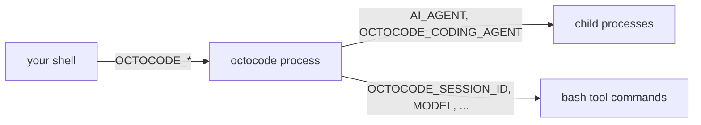

# Environment Variables

Octocode uses environment variables in three ways:

| Role                                   | Section                                                                                                                                                     |
| -------------------------------------- | ----------------------------------------------------------------------------------------------------------------------------------------------------------- |
| You set them to configure the process  | [Process configuration](#octocode-process-configuration), [diagnostics](#diagnostics-and-opt-in-switches), [native features](#native-feature-configuration) |
| Octocode sets them for child processes | [Process marker](#process-marker)                                                                                                                           |
| Octocode sets them for shell commands  | [Shell tool session environment](#shell-tool-session-environment)                                                                                           |



Provider API-key variables are documented separately in [Providers](providers.md#use-an-api-key-from-the-environment).

## Process Marker

The CLI and RPC entry points set two process markers:

- `AI_AGENT=octocode` is a generic marker that lets tooling identify Octocode as the agent that launched the process.
- `OCTOCODE_CODING_AGENT=true` is Octocode-specific and lets child processes detect that they run inside Octocode.

Child processes inherit both markers. They are not session-specific.

## Shell Tool Session Environment

Commands run by the native `bash` tool, using either `type: "bash"` or `type: "powershell"`, receive the current Octocode session state:

| Variable                   | Description                                                                                     |
| -------------------------- | ----------------------------------------------------------------------------------------------- |
| `OCTOCODE_SESSION_ID`      | Current session ID                                                                              |
| `OCTOCODE_SESSION_FILE`    | Absolute path to the current session JSONL file; unset for ephemeral sessions                   |
| `OCTOCODE_PROVIDER`        | Currently selected model provider                                                               |
| `OCTOCODE_MODEL`           | Currently selected model ID                                                                     |
| `OCTOCODE_REASONING_LEVEL` | Current effective reasoning level: `off`, `minimal`, `low`, `medium`, `high`, `xhigh`, or `max` |

The values are resolved when each command starts. Switching models or changing the reasoning level therefore affects the next shell command without restarting Octocode. `OCTOCODE_PROVIDER` and `OCTOCODE_MODEL` identify the selected Octocode model, not a different upstream model that a router may choose internally.

When asked which model or provider is running, inspect these variables instead of inferring the answer from the system prompt:

```bash
printf '%s/%s\n' "$OCTOCODE_PROVIDER" "$OCTOCODE_MODEL"
printf 'reasoning=%s session=%s\n' "$OCTOCODE_REASONING_LEVEL" "$OCTOCODE_SESSION_ID"
```

The session file can be inspected directly when the session is persistent:

```bash
if [ -n "$OCTOCODE_SESSION_FILE" ]; then
  tail -n 1 "$OCTOCODE_SESSION_FILE"
fi
```

These variables are injected into both shell modes of the LLM-callable `bash` tool. They are not injected into user-entered `!` or `!!` commands.

Provider API keys are removed from a command's environment unless the global `bash.inheritProviderKeys` setting keeps them; see [Permissions](permissions.md#modes).

## Octocode Process Configuration

These variables are read by Octocode itself:

| Variable                            | Description                                                                                                                                                                                                                                                                                                            |
| ----------------------------------- | ---------------------------------------------------------------------------------------------------------------------------------------------------------------------------------------------------------------------------------------------------------------------------------------------------------------------- |
| `OCTOCODE_MODEL_CATALOG_URL`        | Compatible remote catalog service base URL; no default upstream service                                                                                                                                                                                                                                                |
| `OCTOCODE_MCP_CLIENT_METADATA_URL`  | Hosted OAuth client metadata base URL required for MCP `cimd` registration                                                                                                                                                                                                                                             |
| `OCTOCODE_HOME`                     | Override configuration and runtime root; default is `~/.octocode/octocodecode`                                                                                                                                                                                                                                         |
| `OCTOCODE_CODING_AGENT_DIR`         | Override the core config directory independently of `OCTOCODE_HOME`                                                                                                                                                                                                                                                    |
| `OCTOCODE_CODING_AGENT_SESSION_DIR` | Override session storage; overridden by `--session-dir`                                                                                                                                                                                                                                                                |
| `OCTOCODE_PACKAGE_DIR`              | Override the package directory, useful for Nix/Guix store paths                                                                                                                                                                                                                                                        |
| `OCTOCODE_OFFLINE`                  | Disable automatic network activity, including model catalog refreshes                                                                                                                                                                                                                                                  |
| `OCTOCODE_SKIP_VERSION_CHECK`       | Disable the npm latest-version request for `@octocodeai/octocode-agent`                                                                                                                                                                                                                                                  |
| `OCTOCODE_TELEMETRY`                | Override install/update telemetry and provider attribution headers: `1`/`true`/`yes` or `0`/`false`/`no`; takes precedence over `enableInstallTelemetry` (default `true`). See [telemetry and privacy](settings.md#telemetry-and-privacy)                                                                              |
| `OCTOCODE_INSTALL_TELEMETRY_URL`    | Endpoint for the anonymous install ping; the ping is sent only when this is set, so there is no default endpoint                                                                                                                                                                                                       |
| `OCTOCODE_CACHE_RETENTION`          | Set to `long` for extended provider prompt caching where supported                                                                                                                                                                                                                                                     |
| `OCTOCODE_COPILOT_CLIENT_ID`        | Client ID of a GitHub OAuth app you registered for Octocode. When set, GitHub Copilot sign-in and requests identify as Octocode and the plan is checked through GitHub's Copilot entitlement. Unset, the VS Code Copilot Chat client is used. GitHub officially supports only OpenCode as a third-party Copilot client |
| `OCTOCODE_INSTRUCTION_CACHE_SPLIT`  | Set to `off` to send the leading system prompt as one instruction cache block instead of three, without the shared-tools breakpoint; see [second instruction block](prompt-caching.md#second-instruction-block)                                                                                                        |
| `OCTOCODE_SHARE_VIEWER_URL`         | Override the base URL used by `/share`                                                                                                                                                                                                                                                                                 |
| `OCTOCODE_BUG_REPORT_URL`           | Endpoint that `/bug` uploads reports to; without it, reports are exported as Zip files                                                                                                                                                                                                                                 |
| `OCTOCODE_HARDWARE_CURSOR`          | Set to `1` to show the hardware cursor                                                                                                                                                                                                                                                                                 |
| `OCTOCODE_CLIPBOARD_OSC52`          | Set to `1` to also send copied text to the terminal with OSC 52 after the local clipboard write, as Octocode does over SSH. Use it when a remote client reaches Octocode without SSH variables, such as a multiplexer attached from another machine or a remote IDE daemon                                             |
| `OCTOCODE_REDUCE_MOTION`            | Set to `1` or `true` to freeze spinners and shimmer while elapsed times keep updating. Applies while `terminal.reduceMotion` is `"auto"` (the default); an explicit `true` or `false` setting wins                                                                                                                     |
| `OCTOCODE_HYPERLINKS`               | Override OSC 8 hyperlink detection with `1`, `0`, or `auto`                                                                                                                                                                                                                                                            |
| `OCTOCODE_PROGRAM_STATUS`           | Override OSC 7501 program status detection: `1` always reports, `0` never reports; otherwise Octocode reports only after the terminal confirms support                                                                                                                                                                 |
| `OCTOCODE_IMAGE_PROTOCOL`           | Override inline image detection with `kitty`, `iterm2`, `none`, or `auto`                                                                                                                                                                                                                                              |
| `OCTOCODE_TRUE_COLOR`               | Override truecolor detection with `1`, `0`, or `auto`                                                                                                                                                                                                                                                                  |
| `NO_COLOR`                          | Any non-empty value turns off ANSI color in the terminal interface and in CLI output ([no-color.org](https://no-color.org)); bold, dim, underline and inverse stay, and motion is unchanged (see `OCTOCODE_REDUCE_MOTION`)                                                                                             |
| `TERM`                              | `TERM=dumb` turns color off like `NO_COLOR`                                                                                                                                                                                                                                                                            |
| `OCTOCODE_TUI_ESC_TIMEOUT`          | How long to wait after a lone ESC before treating it as Escape, in milliseconds; defaults to `100` over SSH and `10` otherwise. Increase if Alt-key input is misread as Escape                                                                                                                                         |
| `OCTOCODE_TUI_PASTE_TIMEOUT`        | How long a bracketed paste may go without input before it is accepted without its end marker, in milliseconds; defaults to `3000` over SSH and `1000` otherwise. Increase if long pastes over a slow link arrive split                                                                                                 |
| `VISUAL`, `EDITOR`                  | External editor fallback when `externalEditor` is unset                                                                                                                                                                                                                                                                |
| `HTTP_PROXY`, `HTTPS_PROXY`         | Proxy outbound HTTP requests                                                                                                                                                                                                                                                                                           |

Provider credentials such as `ANTHROPIC_API_KEY`, `OPENAI_API_KEY`, and provider-specific configuration are listed in [Providers](providers.md#use-an-api-key-from-the-environment).

## Diagnostics and opt-in switches

These variables change behavior for one process.

| Variable                        | Behavior                                                                                                                                                                                                                      |
| ------------------------------- | ----------------------------------------------------------------------------------------------------------------------------------------------------------------------------------------------------------------------------- |
| `OCTOCODE_EXPERIMENTAL`         | `1` enables experimental behavior and shows an `xp` marker in the footer. It is also a precondition of the first-time setup flow                                                                                              |
| `OCTOCODE_MODELS_DEV`           | On by default. `0`, `false`, `off` or `no` stops the background lookup of `https://models.dev/api.json`, which fills model prices and capabilities for subagent model routing; routing then uses only Octocode's own metadata |
| `OCTOCODE_CLEAR_ON_SHRINK`      | `1` clears empty terminal rows when content shrinks. The `terminal.clearOnShrink` setting takes precedence                                                                                                                    |
| `OCTOCODE_OAUTH_CALLBACK_HOST`  | Address the local OAuth callback server listens on during provider login (OpenAI and OpenRouter); default `127.0.0.1`. Set it when the browser that completes the login runs on another host                                  |
| `OCTOCODE_TIMING`               | `1` prints startup timings, wall and CPU per phase, to stderr                                                                                                                                                                 |
| `OCTOCODE_STARTUP_BENCHMARK`    | Truthy runs the interactive startup and exits, for measuring it; interactive mode only                                                                                                                                        |
| `OCTOCODE_MANAGED_INSTALL_ROOT` | Root folder of a managed install, used by the installer instead of the default location                                                                                                                                       |
| `OCTOCODE_INSTALLER_API_BASE`   | Installer API that `octocode update self` asks on a managed install; required for managed updates                                                                                                                             |
| `OCTOCODE_TUI_DEBUG`            | `1` writes the state and lines of each differential render under `/tmp/tui`                                                                                                                                                   |
| `OCTOCODE_TUI_DEBUG_REDRAW`     | `1` appends the reason for each full redraw to `octocode-tui-debug.log` in the agent directory                                                                                                                                |

`OCTOCODE_TRUST_PROJECT_LSP_CONFIG`, `OCTOCODE_PARENT_*` and the child-identity variables `OCTOCODE_AGENT_ID`, `OCTOCODE_AGENT_ROLE`, `OCTOCODE_AGENT_GOAL` and `OCTOCODE_AGENT_SCRATCH` are set by Octocode for child processes and are not user configuration. An Octocode that a subagent's command starts clears them at startup and runs as a top-level session ([nested sessions](native-features.md#subagent-request-budget)).

## Native feature configuration

These controls belong to the integrated Octocode features. Child identity, grants and nonce variables are set by the runtime and are not user configuration. The runtime also sets `OCTOCODE_PROMPT_CACHE_KEY` to group sibling prompt caches while keeping their transport sessions separate; see [subagent prefixes](prompt-caching.md#subagent-prefixes).

| Variable                                  | Behavior                                                                                                                                                                                                                                                                                                                                                                                                                                                                                                                                                     |
| ----------------------------------------- | ------------------------------------------------------------------------------------------------------------------------------------------------------------------------------------------------------------------------------------------------------------------------------------------------------------------------------------------------------------------------------------------------------------------------------------------------------------------------------------------------------------------------------------------------------------ |
| `OCTOCODE_PERMISSION`                     | Session start mode: `manual`, `workspace` or `full`; default `full`                                                                                                                                                                                                                                                                                                                                                                                                                                                                                          |
| `OCTOCODE_MAX_SUBAGENTS`                  | Maximum concurrent subagents; default: one per CPU and one per GiB of memory, at most `6`                                                                                                                                                                                                                                                                                                                                                                                                                                                                    |
| `OCTOCODE_SUBAGENT_MAX_REQUESTS`          | Soft limit on a child's cumulative saved assistant replies across continuations (a non-negative integer; `0` turns the budget off); default `160`. At the limit the parent steers the child once, and the child may ask its parent for more; at 1.5 times it (rounded up, plus what the parent granted) the child gets one last request without tools and its report is `partial`. A resume at or past the limit gets a new allowance. A profile's `maxRequests` takes precedence. See [subagent request budget](native-features.md#subagent-request-budget) |
| `OCTOCODE_SUBAGENT_THINKING`              | Thinking level (`off`, `minimal`, `low`, `medium`, `high`, `xhigh` or `max`) of a subagent whose `agent` call and profile name none; any other value is ignored. Unset, such a child runs at `medium`, never at the main session's level. See [the subagent model](native-features.md#the-subagent-model)                                                                                                                                                                                                                                                    |
| `OCTOCODE_SUBAGENT_LINGER_SECONDS`        | Seconds a finished background subagent stays resumable by a message to its id; default `0` (off). A profile's `linger:` front matter replaces it for that profile (the bundled `browser` profile sets 900). A non-isolated background subagent that reported `blocked` stays resumable for at least 600 seconds regardless                                                                                                                                                                                                                                   |
| `OCTOCODE_SUBAGENT_STARTUP_RETRY_SECONDS` | Seconds (0 to 600) during which a subagent that crashed while loading its code, before its first model turn, is started again, the wait doubling from 1.5 seconds; default 30 for a child that runs the source tree, while a bundled child gets one retry. `0` keeps that one retry                                                                                                                                                                                                                                                                          |
| `OCTOCODE_MCP`                            | Set to `0` to disable automatic Octocode research MCP startup; an explicitly configured `octocode` server is managed through [MCP configuration](mcp.md)                                                                                                                                                                                                                                                                                                                                                                                                     |
| `OCTOCODE_MCP_FREELLAMA`                  | `0` or `1` turns the built-in `freellama` MCP server (local Ollama models) off or on. Unset: on when an `ollama` command is on `PATH` and `OCTOCODE_OFFLINE` is not set. A switch saved in `/harness` or `/configuration` wins                                                                                                                                                                                                                                                                                                                               |
| `OCTOCODE_MCP_BROWSER`                    | Set to `0` to leave the built-in `browser` MCP preset (chrome-devtools) disabled. Octocode never sets it; a subagent inherits only a value you exported. A `browser` server you define in `mcp.json` and the `octocode` preset are unaffected                                                                                                                                                                                                                                                                                                                |
| `OCTOCODE_BASH_BACKGROUND_AFTER_SECONDS`  | Whole seconds a foreground `bash` command may run before it moves to the background as a job; overrides the `bashBackgroundAfterSeconds` setting. Default `90`; `0` turns the automatic move off                                                                                                                                                                                                                                                                                                                                                             |
| `OCTOCODE_EXTRA_SKILLS`                   | Set to `0` to disable extra skill directories                                                                                                                                                                                                                                                                                                                                                                                                                                                                                                                |
| `CLAUDE_CONFIG_DIR`                       | Select Claude user settings for hook/permission previews and Claude extra skills; project paths remain unchanged. See [hook discovery](hooks.md#discovery)                                                                                                                                                                                                                                                                                                                                                                                                   |
| `CODEX_HOME`                              | Select an existing Codex user directory for hook preview and extra skills; invalid overrides do not fall back to the default directory                                                                                                                                                                                                                                                                                                                                                                                                                       |
| `OCTOCODE_MEMORY_AUTO`                    | Set to `0` to disable automatic memory injection for this process                                                                                                                                                                                                                                                                                                                                                                                                                                                                                            |
| `OCTOCODE_AGENT_DB`                       | Override the durable agent database file                                                                                                                                                                                                                                                                                                                                                                                                                                                                                                                     |
| `OCTOCODE_CLEANUP_DAYS`                   | Overrides `retention.days` (default `30`; `0` keeps everything): days without a write before cleanup removes unlisted session folders (unless their process runs), kept sessions' output, bash logs and idle checkpoints, subagent screenshots and scratch, `<workspace>/.octocode/tmp` entries, compaction detail copies and database history. Not a whole number is ignored. See [retention](configuration.md#runtime-storage)                                                                                                                             |
| `OCTOCODE_SESSION_RETENTION_DAYS`         | Overrides `retention.sessionDays` (default `90`; `0` keeps transcripts forever): days a session transcript survives after its last write; the current and running sessions are never removed                                                                                                                                                                                                                                                                                                                                                                 |
| `OCTOCODE_NOTIFY`                         | Answer notifications: `off`, `unfocused` (default) or `always`                                                                                                                                                                                                                                                                                                                                                                                                                                                                                               |
| `OCTOCODE_NOTIFY_METHOD`                  | Notification protocol: `osc9`, `osc777`, `osc99` or `bel`; otherwise detected from the terminal (inside tmux, from the attached client; the OSC passes through only when the pane's `allow-passthrough` is `on` or `all`, and a bell is always sent with it)                                                                                                                                                                                                                                                                                                 |
| `OCTOCODE_API_HTTP`                       | Also serve the [local session API](session-api.md) on loopback HTTP on this port (`0` chooses an available port); the owner-only socket needs no variable, and the `sessionApi` setting turns both off                                                                                                                                                                                                                                                                                                                                                       |
| `OCTOCODE_WEB_DAEMON_IDLE_MINUTES`        | Minutes with no open tab and no attached session after which the daemon exits (default `10`; decimals allowed)                                                                                                                                                                                                                                                                                                                                                                                                                                               |

Settings that have environment overrides are listed in the [settings reference](settings.md). See [native features](native-features.md) for runtime ownership and [configuration](configuration.md) for storage paths and compatibility.
