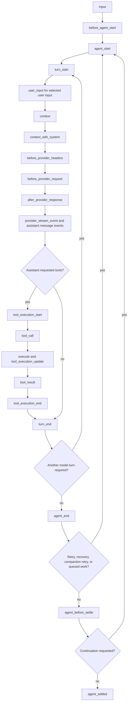
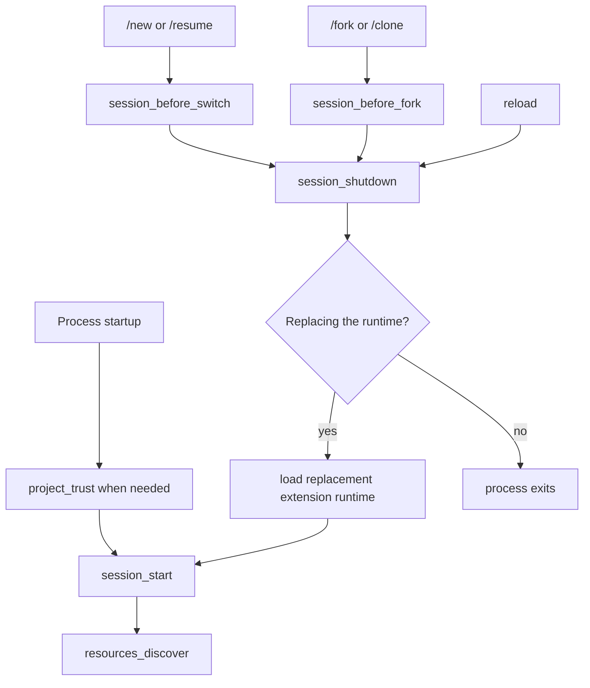

# Extensions

An extension is executable code, separate from an instruction-based [skill](skills.md), a [plugin container](plugins.md), or an external [command hook](hooks.md).

Extensions are TypeScript modules that add executable behavior to Octocode. Use one when a workflow needs tools, commands, event handlers, model providers, session state, or terminal UI rather than instructions alone.

An extension runs inside the Octocode process with the same operating-system permissions. It can inspect prompts, tool calls, files, credentials, and session history, so load extensions only from sources you trust.

Extension event handlers run inside Octocode and are separate from [command hooks](hooks.md). Claude Mods modules use a different API and cannot be loaded unchanged through this interface.

Typical extensions add an agent tool, protect paths, confirm dangerous commands, react to session events, modify context, expose a command, or display persistent status.

<a id="quick-start"></a>
<a id="writing-an-extension"></a>
<a id="create-an-extension"></a>

## Create and load an extension

An extension exports a default factory that receives `ExtensionAPI`. The factory registers capabilities for the current extension runtime.

Create `~/.octocode/octocodecode/extensions/hello.ts`:

```typescript
import type { ExtensionAPI } from "@octocodeai/octocodecode";

export default function (octocode: ExtensionAPI) {
	octocode.registerCommand("hello", {
		description: "Show a greeting",
		handler: async (name, ctx) => {
			ctx.ui.notify(`Hello, ${name || "world"}!`, "info");
		},
	});
}
```

Start Octocode and run `/hello`. Keep `description` to one sentence of at most 50 characters, because command lists show it on one line, and put usage in `argumentHint` (for example `"[name]"`). The `/` list shows the hint beside the command, and `getCommands()` and RPC `get_commands` return it for extension commands. During development, load a file directly:

```bash
octocode --extension ./hello.ts
```

Octocode uses `jiti`, so local TypeScript extensions do not need a separate compilation step. Use [Octocode packages](packages.md) for distributed extensions and dependencies.

## Command names

Each command has exactly one name. `registerCommand` has no `aliases` option and throws when one is passed; register a second command only when it needs its own behavior.

Command resolution keeps collisions distinct. Use the invocation names returned by `octocode.getCommands()` when constructing a command; duplicate extension names, and extension names that match a built-in terminal command, receive numeric suffixes such as `/model:1`.

`octocode.getCommands()` returns extension, prompt, and skill entries with `name`, `description`, `source` and `sourceInfo`, plus `argumentHint` when an extension command declares one. It does not list the terminal's core commands. RPC `get_commands` exposes the same naming and source metadata. Skills use their direct name when available and a `skill:` name when it conflicts; see [skill commands](skills.md). Keep `sourceInfo` with an entry when presenting it so users can distinguish resources with similar names.

## Active tool invocation

A session tool's `execute()` context can expose `ctx.invocation`: the tool name, call ID and an immutable snapshot of its execution arguments. Nested and parallel calls receive their own snapshot. `ctx.invocation` becomes unavailable when execution settles; a retained descriptor reports `active: false`, including when the context was copied during execution. Check that flag when retaining the descriptor across an asynchronous boundary.

The snapshot accepts bounded JSON data. Custom SDK arguments that contain cycles, accessors, non-JSON objects or excessive size/depth leave it unavailable without changing the tool's original arguments or execution. Direct tools without a session context also lack this metadata. It identifies a call for integrations such as permission hooks; it does not grant permissions or isolate trusted extensions. The exported `ToolInvocation` type describes it.

## Loaded skill resources

After the extension runtime binds to a session, `octocode.getSkillDirectories()` returns sorted, deduplicated canonical directories for loaded skill resources. Use it when an integration needs to read skill references or assets. It includes model-only skills and eligible Codex path-selection candidates that are absent from the command list. It does not register commands or execute bundled scripts.

`octocode.getSkillResourceSnapshot(names?)` returns a detached, versioned snapshot of the accepted file-backed skill inventory after the runtime binds to a session. Omit `names` for the full inventory, pass skill command names for a subset, or `[]` for no skills. Selection happens before resource validation, so an unrelated unavailable resource cannot break a selected valid subset. Unlike `getCommands()`, it includes model-only and eligible hidden explicit-selection resources, with their captured identities and invocation policy. The native child launcher uses this snapshot; it is not a list of executable plugins or a permission grant. Synthetic resources and invalid canonical identities produce an error. The public `SkillResourceSnapshot` type describes the transport; see [child skill inheritance](skills.md#child-skill-inheritance).

The list follows effective resource loading and overrides. Captured explicit-selection identities retain their canonical directory if a discovery alias later changes. This API supplies resource paths; the receiving integration still owns its access policy. The built-in and configured local Octocode MCP owners use these paths only as launch defaults, so explicit `ALLOWED_PATHS` continues to win.

<a id="extension-locations"></a>
<a id="available-imports"></a>
<a id="choose-where-it-loads"></a>

## Add it to Octocode

Place the extension in your user or project extensions directory. Octocode loads direct TypeScript or JavaScript files and subdirectories containing an `index.ts` or `index.js` entry point.

<a id="extension-directory-discovery"></a>

### Extension directory discovery

The CLI resource loader and the SDK function `discoverAndLoadExtensions()` apply the same rules to an extensions directory (`discoverExtensionsInDir()` in the SDK source):

1. If the directory itself has a `package.json` whose `octocode` (or legacy `pi`) manifest lists `extensions`, or an `index.ts`/`index.js`, those entries are the whole result.
2. Otherwise each top-level `*.ts` or `*.js` file loads, and each subdirectory loads through rule 1 applied to that subdirectory. Discovery does not recurse further.
3. Dot-prefixed files and directories, `node_modules`, and paths matched by `.gitignore`, `.ignore` or `.fdignore` in the directory are skipped.
4. **Plugin and skill markers** (`plugin.json`, `.claude-plugin`, `.codex-plugin`, `SKILL.md`) prevent implicit entry-point discovery in a directory. A hybrid package can declare native extensions in its `package.json`; a directly supplied module (`--extension ./file.ts`) is still a native extension. This keeps plugin and skill discovery separate from executable extension loading.

Earlier SDK versions loaded dot-prefixed entries and ignored folders; list such a path explicitly if you need it.

Use a single file for a small extension and a directory for a multi-file implementation. Put npm dependencies in a nearby `package.json`. See Configuration for conventional locations and Settings for additional paths.

Reload replaces the extension runtime, so code after `await ctx.reload()` must not reuse state from the old runtime. Only personal and explicit command-line extensions can participate in the `project_trust` event that runs before project extensions load.

<a id="understand-the-lifecycle"></a>

## Understand the runtime lifecycle

The factory can be synchronous or asynchronous. Octocode waits for an asynchronous factory before startup continues, allowing it to fetch configuration or register providers needed during startup.

Do not start processes, sockets, watchers, or timers in the factory because some invocations load extensions without starting a session.
Start long-lived resources from `session_start` or from the command or tool that needs them.
Close session-scoped resources from an idempotent `session_shutdown` handler.

A normal prompt follows this hook sequence:



The lifecycle involves these event groups:

| Area              | Events                                                                                                   |
| ----------------- | -------------------------------------------------------------------------------------------------------- |
| Input preparation | `input`, `before_agent_start`, `user_input`                                                              |
| Agent run         | `agent_start`, `agent_end`                                                                               |
| Model turn        | `turn_prompt`, `turn_start`, `context`, `context_with_system`, `turn_end`                                |
| Provider call     | `before_provider_headers`, `before_provider_request`, `after_provider_response`, `provider_stream_event` |
| Message lifecycle | `message_start`, `message_update`, `message_end`                                                         |
| Tool execution    | `tool_execution_start`, `tool_call`, `tool_execution_update`, `tool_result`, `tool_execution_end`        |
| Settlement        | `agent_before_settle`, `agent_interrupted`, `agent_settled`                                              |

Octocode counts as busy while a run starts, including the compaction check and `before_agent_start`, so messages sent meanwhile go into the starting run. Message lifecycle events also cover user and tool-result messages; the diagram places only the assistant stream where it occurs in each model turn.

Tool hooks run for each tool call, and one assistant response can start another turn by returning tool calls. Provider hooks run only when that transport exposes the corresponding stage. See the exported declarations in [`extensions/types.ts`](https://github.com/bgauryy/octocodecode/blob/main/packages/coding-agent/src/core/extensions/types.ts) for exact event payloads and result types.

Session startup and replacement follow a separate lifecycle:



`project_trust` runs before trusted project resources load and can run again when session replacement enters a new working directory. Retries, recovery, compaction, and queued messages can start another agent run after `agent_end`, so `agent_end` is not a final-idle signal. Reload and session replacement invalidate the old runtime. Code after `await ctx.reload()` still belongs to the old runtime and must not reuse its session-bound state.

### Choose an event by intent

| Goal                                                              | Event                                                |
| ----------------------------------------------------------------- | ---------------------------------------------------- |
| Inspect or transform user input at admission                      | `input`                                              |
| Gate a user item when it is selected for processing               | `user_input`                                         |
| Change prompt sections, active tools, or add context before a run | `before_agent_start`                                 |
| Observe one low-level agent run                                   | `agent_start`, `agent_end`                           |
| Act after one model response and its tool calls                   | `turn_end`                                           |
| Filter conversation messages for one provider request             | `context`                                            |
| Transform the complete transcript, including system messages      | `context_with_system`                                |
| Change request headers or the serialized provider payload         | `before_provider_headers`, `before_provider_request` |
| Observe provider response metadata or parsed stream events        | `after_provider_response`, `provider_stream_event`   |
| Authorize or modify a tool call                                   | `tool_call`                                          |
| Redact, annotate, or replace a tool result                        | `tool_result`                                        |
| Append final entries or request one last continuation             | `agent_before_settle`                                |
| Run notification work after automatic processing has stopped      | `agent_settled`                                      |
| Initialize or release session-scoped resources                    | `session_start`, `session_shutdown`                  |

<a id="agent_start--agent_end--agent_before_settle--agent_settled"></a>

`agent_interrupted` observes explicit cancellation after pending records are saved and before settlement. It carries the captured session ID, turn ID, working directory, optional transcript path and model. It has no continuation result. It does not fire for idle abort, internal cancellation, replacement or shutdown. `ctx.abort()` remains a non-waiting cancellation request. An SDK interruption handler that awaits `session.abort()` does not wait on itself; independent SDK callers still wait for settlement.

Use `agent_before_settle` when an extension must append entries or request one final continuation. Use `agent_settled` for notification-only work that should run after Octocode has no automatic continuation remaining.

<a id="extensionapi-methods"></a>

## Choose an integration point

| Capability                                    | Main API                                                   |
| --------------------------------------------- | ---------------------------------------------------------- |
| Observe or modify lifecycle behavior          | `octocode.on()`                                            |
| Add a model-callable operation                | `octocode.registerTool()`                                  |
| Add a `/` command                             | `octocode.registerCommand()`                               |
| Add a shortcut or CLI flag                    | `octocode.registerShortcut()` or `octocode.registerFlag()` |
| Send user or custom messages                  | `octocode.sendUserMessage()` or `octocode.sendMessage()`   |
| Persist non-context session data              | `octocode.appendEntry()`                                   |
| Change active tools, model, or thinking level | Session control methods on `octocode`                      |
| Add a model provider                          | `octocode.registerProvider()`                              |
| Add an MCP server                             | `octocode.registerMcpServer()`                             |
| Route each request to a model                 | [`octocode.registerVirtualModel()`](virtual-models.md)     |
| Add terminal rendering                        | Renderer registration and `ctx.ui`                         |
| Communicate with another extension            | `octocode.events`                                          |

Use the exported declarations in [`extensions/types.ts`](https://github.com/bgauryy/octocodecode/blob/main/packages/coding-agent/src/core/extensions/types.ts) for exact event, context, tool, and result types.

## Follow the extension contracts

The [extension contracts](extension-contracts.md) define events and concurrency, tools, tool exposure and dynamic activation, tool rendering, MCP servers, context and session changes, state, UI and modes, and errors and cleanup.

<a id="examples-reference"></a>
<a id="use-examples-as-the-implementation-reference"></a>

## Examples and reference

The checked [extension examples](../examples/extensions/README.md) are the implementation reference; the README lists each one with the test that runs it. Start with the smallest example matching the behavior you need:

| Goal                                    | Start with                                     | Why                                                                                    |
| --------------------------------------- | ---------------------------------------------- | -------------------------------------------------------------------------------------- |
| Change how a tool call is displayed     | `built-in-tool-renderer.ts`, `minimal-mode.ts` | Re-register a tool with custom `renderCall`/`renderResult` while delegating execution. |
| Transform or gate user input            | `input-transform-streaming.ts`                 | Uses `input` handlers and `streamingBehavior` to avoid slow work during steering.      |
| Request compaction from an extension    | `trigger-compact.ts`                           | Calls `ctx.compact()` from a token threshold.                                          |
| React to turns with follow-up work      | `git-merge-and-resolve.ts`                     | Runs after each turn and feeds results back to the agent.                              |
| Register a virtual model                | `jev-router.ts`                                | Routes between models and keeps phase state; see [virtual models](virtual-models.md).  |
| Restrict tools and track progress       | `plan-mode/`                                   | Selects tools, filters `bash`, and shows a progress widget.                            |
| Delegate work to child processes        | `subagent/`                                    | Fixture only: native sessions provide the `agent` tool.                                |
| Ship an extension with npm dependencies | `with-deps/`                                   | Resolves modules from the extension's own `node_modules`.                              |

Use [Custom Providers](custom-provider.md) for model-service integrations, [Terminal UI](tui.md) for custom components, and [Octocode Packages](packages.md) to install or distribute extensions with other resources. Use the exported declarations for exact signatures, payloads, and result schemas; this guide focuses on lifecycle choices, composition, and durable implementation patterns.

`session_before_compact` is observational: returned values are ignored and the preparation is an isolated snapshot. Compaction summaries, budgets and cut points are managed by the built-in implementation. Use `ctx.compact()` to request that flow; custom compaction boundary entries are rejected.

### Manual summary focus

Use `ctx.compact({ customInstructions: "Preserve the outstanding regression.", onComplete, onError })` to supply optional manual summary focus, bounded to 16,000 characters. The observational `session_before_compact` event includes that invocation's `customInstructions`; returning a different focus does not replace it. Automatic compaction never inherits a previous manual focus.
