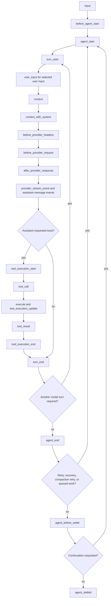
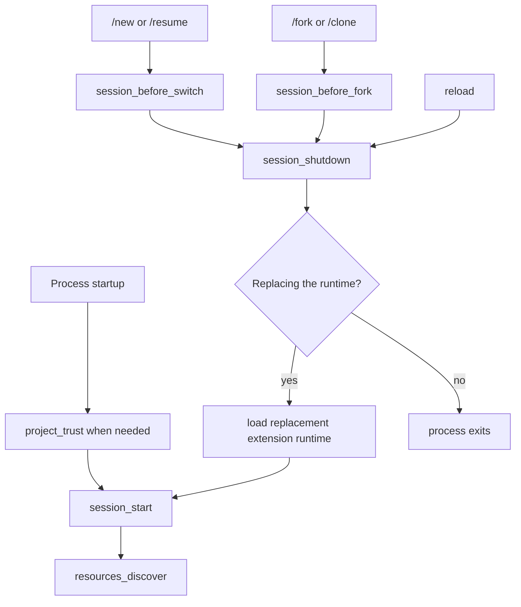

# Extensions

An extension is executable code, separate from an instruction-based [skill](skills.md), a [plugin container](plugins.md), or an external [command hook](hooks.md).

Extensions are TypeScript modules that add executable behavior to Octocode. Use one when a workflow needs tools, commands, event handlers, model providers, session state, or terminal UI rather than instructions alone.

An extension runs inside the Octocode process with the same operating-system permissions. It can inspect prompts, tool calls, files, credentials, and session history, so load extensions only from sources you trust.

Extension event handlers run inside Octocode and are separate from [command hooks](hooks.md). They do not require `OCTOCODE_HOOKS=1`. Claude Mods modules use a different API and cannot be loaded unchanged through this interface.

Typical extensions add an agent tool, protect paths, confirm dangerous commands, react to session events, modify context, expose a command, or display persistent status.

<a id="quick-start"></a>
<a id="writing-an-extension"></a>
<a id="create-an-extension"></a>

## Create and load an extension

An extension exports a default factory that receives `ExtensionAPI`. The factory registers capabilities for the current extension runtime.

Create `~/.octocode/octocodecode/extensions/hello.ts`:

```typescript
import type { ExtensionAPI } from "@octocodeai/octocodecode";

export default function (octocode: ExtensionAPI) {
  octocode.registerCommand("hello", {
    description: "Show a greeting",
    handler: async (name, ctx) => {
      ctx.ui.notify(`Hello, ${name || "world"}!`, "info");
    },
  });
}
```

Start Octocode and run `/hello`. During development, load a file directly:

```bash
octocode --extension ./hello.ts
```

Octocode uses `jiti`, so local TypeScript extensions do not need a separate compilation step. Use [Octocode packages](packages.md) for distributed extensions and dependencies.

## Command names

Each command has one canonical name and may declare compatibility `aliases`. Arguments follow the typed spelling and are passed to the same handler.

Command resolution keeps collisions distinct. Use the invocation names returned by `octocode.getCommands()` when constructing a command; duplicate extension names, and extension names that match a built-in terminal command, receive numeric suffixes such as `/model:1`.

`octocode.getCommands()` returns extension, prompt, and skill entries with `name`, optional resolved `aliases`, `description`, `source`, and `sourceInfo`. It does not list the terminal's core commands. RPC `get_commands` exposes the same naming and source metadata. Skills use their direct name when available and a `skill:` name when it conflicts; see [skill commands](skills.md). Keep `sourceInfo` with an entry when presenting it so users can distinguish resources with similar names.

## Active tool invocation

A session tool's `execute()` context can expose `ctx.invocation`: the tool name, call ID and an immutable snapshot of its execution arguments. Nested and parallel calls receive their own snapshot. `ctx.invocation` becomes unavailable when execution settles; a retained descriptor reports `active: false`, including when the context was copied during execution. Check that flag when retaining the descriptor across an asynchronous boundary.

The snapshot accepts bounded JSON data. Custom SDK arguments that contain cycles, accessors, non-JSON objects or excessive size/depth leave it unavailable without changing the tool's original arguments or execution. Direct tools without a session context also lack this metadata. It identifies a call for integrations such as permission hooks; it does not grant permissions or isolate trusted extensions. The exported `ToolInvocation` type describes it.

## Loaded skill resources

After the extension runtime binds to a session, `octocode.getSkillDirectories()` returns sorted, deduplicated canonical directories for loaded skill resources. Use it when an integration needs to read skill references or assets. It includes model-only skills and eligible Codex path-selection candidates that are absent from the command list. It does not register commands or execute bundled scripts.

`octocode.getSkillResourceSnapshot(names?)` returns a detached, versioned snapshot of the accepted file-backed skill inventory after the runtime binds to a session. Omit `names` for the full inventory, pass skill command names for a subset, or `[]` for no skills. Selection happens before resource validation, so an unrelated unavailable resource cannot break a selected valid subset. Unlike `getCommands()`, it includes model-only and eligible hidden explicit-selection resources, with their captured identities and invocation policy. The native child launcher uses this snapshot; it is not a list of executable plugins or a permission grant. Synthetic resources and invalid canonical identities produce an error. The public `SkillResourceSnapshot` type describes the transport; see [child skill inheritance](skills.md#child-skill-inheritance).

The list follows effective resource loading and overrides. Captured explicit-selection identities retain their canonical directory if a discovery alias later changes. This API supplies resource paths; the receiving integration still owns its access policy. The built-in and configured local Octocode MCP owners use these paths only as launch defaults, so explicit `ALLOWED_PATHS` continues to win.

<a id="extension-locations"></a>
<a id="available-imports"></a>
<a id="choose-where-it-loads"></a>

## Add it to Octocode

Place the extension in your user or project extensions directory. Octocode loads direct TypeScript or JavaScript files and subdirectories containing an `index.ts` or `index.js` entry point.

<a id="extension-directory-discovery"></a>

### Extension directory discovery

The CLI resource loader and the SDK function `discoverAndLoadExtensions()` apply the same rules to an extensions directory (`discoverExtensionsInDir()` in the SDK source):

1. If the directory itself has a `package.json` whose `octocode` (or legacy `pi`) manifest lists `extensions`, or an `index.ts`/`index.js`, those entries are the whole result.
2. Otherwise each top-level `*.ts` or `*.js` file loads, and each subdirectory loads through rule 1 applied to that subdirectory. Discovery does not recurse further.
3. Dot-prefixed files and directories, `node_modules`, and paths matched by `.gitignore`, `.ignore` or `.fdignore` in the directory are skipped.
4. **Plugin and skill markers** (`plugin.json`, `.claude-plugin`, `.codex-plugin`, `SKILL.md`) prevent implicit entry-point discovery in a directory. A hybrid package can declare native extensions in its `package.json`; a directly supplied module (`--extension ./file.ts`) is still a native extension. This keeps plugin and skill discovery separate from executable extension loading.

Earlier SDK versions loaded dot-prefixed entries and ignored folders; list such a path explicitly if you need it.

Use a single file for a small extension and a directory for a multi-file implementation. Put npm dependencies in a nearby `package.json`. See Configuration for conventional locations and Settings for additional paths.

Reload replaces the extension runtime, so code after `await ctx.reload()` must not reuse state from the old runtime. Only personal and explicit command-line extensions can participate in the `project_trust` event that runs before project extensions load.

<a id="understand-the-lifecycle"></a>

## Understand the runtime lifecycle

The factory can be synchronous or asynchronous. Octocode waits for an asynchronous factory before startup continues, allowing it to fetch configuration or register providers needed during startup.

Do not start processes, sockets, watchers, or timers in the factory because some invocations load extensions without starting a session.
Start long-lived resources from `session_start` or from the command or tool that needs them.
Close session-scoped resources from an idempotent `session_shutdown` handler.

A normal prompt follows this hook sequence:



The lifecycle involves these event groups:

| Area | Events |
|---|---|
| Input preparation | `input`, `before_agent_start`, `user_input` |
| Agent run | `agent_start`, `agent_end` |
| Model turn | `turn_start`, `context`, `context_with_system`, `turn_end` |
| Provider call | `before_provider_headers`, `before_provider_request`, `after_provider_response`, `provider_stream_event` |
| Message lifecycle | `message_start`, `message_update`, `message_end` |
| Tool execution | `tool_execution_start`, `tool_call`, `tool_execution_update`, `tool_result`, `tool_execution_end` |
| Settlement | `agent_before_settle`, `agent_interrupted`, `agent_settled` |

Octocode counts as busy while a run starts, including the compaction check and `before_agent_start`, so messages sent meanwhile go into the starting run. Message lifecycle events also cover user and tool-result messages; the diagram places only the assistant stream where it occurs in each model turn.

Tool hooks run for each tool call, and one assistant response can start another turn by returning tool calls. Provider hooks run only when that transport exposes the corresponding stage. See the exported declarations in [`extensions/types.ts`](https://github.com/bgauryy/octocodecode/blob/main/packages/coding-agent/src/core/extensions/types.ts) for exact event payloads and result types.

Session startup and replacement follow a separate lifecycle:



`project_trust` runs before trusted project resources load and can run again when session replacement enters a new working directory. Retries, recovery, compaction, and queued messages can start another agent run after `agent_end`, so `agent_end` is not a final-idle signal. Reload and session replacement invalidate the old runtime. Code after `await ctx.reload()` still belongs to the old runtime and must not reuse its session-bound state.

### Choose an event by intent

| Goal | Event |
|---|---|
| Inspect or transform user input at admission | `input` |
| Gate a user item when it is selected for processing | `user_input` |
| Change prompt sections, active tools, or add context before a run | `before_agent_start` |
| Observe one low-level agent run | `agent_start`, `agent_end` |
| Act after one model response and its tool calls | `turn_end` |
| Filter conversation messages for one provider request | `context` |
| Transform the complete transcript, including system messages | `context_with_system` |
| Change request headers or the serialized provider payload | `before_provider_headers`, `before_provider_request` |
| Observe provider response metadata or parsed stream events | `after_provider_response`, `provider_stream_event` |
| Authorize or modify a tool call | `tool_call` |
| Redact, annotate, or replace a tool result | `tool_result` |
| Append final entries or request one last continuation | `agent_before_settle` |
| Run notification work after automatic processing has stopped | `agent_settled` |
| Initialize or release session-scoped resources | `session_start`, `session_shutdown` |

<a id="agent_start--agent_end--agent_before_settle--agent_settled"></a>

`agent_interrupted` observes explicit cancellation after pending records are saved and before settlement. It carries the captured session ID, turn ID, working directory, optional transcript path and model. It has no continuation result. It does not fire for idle abort, internal cancellation, replacement or shutdown. `ctx.abort()` remains a non-waiting cancellation request. An SDK interruption handler that awaits `session.abort()` does not wait on itself; independent SDK callers still wait for settlement.

Use `agent_before_settle` when an extension must append entries or request one final continuation. Use `agent_settled` for notification-only work that should run after Octocode has no automatic continuation remaining.

<a id="extensionapi-methods"></a>

## Choose an integration point

| Capability | Main API |
|---|---|
| Observe or modify lifecycle behavior | `octocode.on()` |
| Add a model-callable operation | `octocode.registerTool()` |
| Add a `/` command | `octocode.registerCommand()` |
| Add a shortcut or CLI flag | `octocode.registerShortcut()` or `octocode.registerFlag()` |
| Send user or custom messages | `octocode.sendUserMessage()` or `octocode.sendMessage()` |
| Persist non-context session data | `octocode.appendEntry()` |
| Change active tools, model, or thinking level | Session control methods on `octocode` |
| Add a model provider | `octocode.registerProvider()` |
| Add an MCP server | `octocode.registerMcpServer()` |
| Route each request to a model | [`octocode.registerVirtualModel()`](virtual-models.md) |
| Add terminal rendering | Renderer registration and `ctx.ui` |
| Communicate with another extension | `octocode.events` |

Use the exported declarations in [`extensions/types.ts`](https://github.com/bgauryy/octocodecode/blob/main/packages/coding-agent/src/core/extensions/types.ts) for exact event, context, tool, and result types.

## Follow the extension contracts

<a id="events"></a>
<a id="work-with-events"></a>

### Events and concurrency

Handlers run in extension load and registration order. `octocode.on()` returns a function that unsubscribes that registration; changes do not affect a dispatch already in progress.
Some events notify; others transform data, replace results, or cancel an operation.
Use each event’s declared result type rather than assuming every return value has an effect.

Events cover resource discovery, sessions, agent and message lifecycle, providers, tools, and raw input.

#### Understand handler composition

| Pattern | Behavior |
|---|---|
| Notification | Return values are ignored. Use the event for observation only. |
| In-place mutation | Later handlers see changes to values such as `before_provider_headers.headers`, `before_agent_start.systemPromptOptions`, and `tool_call.input`. |
| Chained transformation | Later handlers receive the value returned by earlier `input`, `context`, `context_with_system`, `message_end`, `tool_result`, and `before_provider_request` handlers. |
| Gate | A handled input, blocked tool call, cancelled session operation, or handled `user_bash` command stops that operation's normal fallback path. |
| Actionable boundary | Each `turn_end` or `agent_before_settle` handler sees the entries and continuation decision proposed so far. |
| Last override | The last `cache_warming_decision` handler that returns an action wins. |

Notification handlers should not perform slow work on a streaming event. Transform handlers should preserve fields they do not intentionally own, and gate handlers should fail closed when their safety decision cannot be made.

`before_agent_start` exposes both the current prompt and its structured `systemPromptOptions`. `event.messageType` says what started the run: `"user"` for a prompt or `octocode.sendUserMessage()`, with `prompt` and `images`; `"custom"` for `octocode.sendMessage(..., { triggerTurn: true })`, with the starting `message` and no `prompt`. A returned `message` is added to either kind of run; check `messageType` to skip runs started by custom messages. Prefer changing prompt sections, selected tools, or guidelines so Octocode can append a transcript delta. Setting `systemPromptOptions.sections.<name>` to an empty string removes that section, including a default one such as `docs`. Returning `systemPrompt`, or setting `forceSystemPrompt`, replaces the whole prompt for that run while the transcript continues recording the structured sections. Providers receive the forced text as their leading system prompt.

`user_input` runs when a user item is consumed, before message persistence and Codex mention-skill reads. It receives the processed user text, images, source and queue behavior. Return `{ block: true }` to omit that item or `{ additionalContext: [text] }` to record hidden context after accepted input; blocked input can still retain context. Blocking decisions accumulate and context preserves handler order. Initial input runs after `agent_start` and `turn_start`; queued input runs after continuation preparation and its `turn_start`. Each finalized item is recorded before the next item is checked, so cancelling a later hook retains earlier accepted history. Custom context messages do not invoke this event. `AgentSession` owns the lower-level `Agent.prepareInput` callback and rejects an agent that already supplies one; session integrations should use `user_input`. Standalone `Agent` users can use the lower-level callback directly. Existing admission-time `input` transformations and slash/template expansion retain their behavior.

`ctx.getTurnId()` returns the active logical turn identity. Tool iterations, steering, retries and Stop continuations share it. A selected follow-up batch gets a new identity before continuation preparation; merely queueing a message does not change it. The identity remains available during `agent_settled` and is cleared afterward. Outside a run it is undefined, including idle manual compaction.

`message_end` can replace a finalized message while preserving its role. `tool_call` can mutate input or block execution. `tool_result` handlers compose, with each handler seeing prior changes.

<a id="provider_stream_event"></a>

`provider_stream_event` fires for each parsed provider stream event before Octocode normalizes it. The event identifies the provider, API, and model; `event.data` is the earliest structured value available to Octocode, not necessarily the original HTTP bytes or SSE frame. Treat it as read-only because mutation can affect normalization. The event is notification-only and is not persisted.

Handlers are awaited in stream order, so slow handlers delay stream consumption. Handler errors are reported without changing the provider response. See `debug-provider.ts` for an opt-in viewer that groups raw events by assistant message.

<a id="context_with_system"></a>

`context` transforms conversation messages without prompt and tool system messages; Octocode restores that state afterward. Use `context_with_system` only when a request-local transformation must own the complete transcript, and keep a system message at index zero.

`turn_end` and `agent_before_settle` are actionable boundaries. Their handlers can chain proposed `custom`, `custom_message`, or `context_edit` entries and return `continue: true` for one next model request. Guard continuation conditions because an unconditional continuation can loop. Use the exported event declarations for the complete validation and ordering contract.

<a id="cache_warming_decision"></a>

`cache_warming_decision` can override an idle prompt-cache refresh with `{ action: "warm" }` or `{ action: "stop" }`. The last handler that returns an action wins.

Tool calls from one assistant message can run in parallel.
Do not assume a sibling call or result exists when another tool event runs.
Use `ctx.signal` for nested work owned by an active turn; commands and idle session events often have no operation signal.

A `user_bash` handler that returns `undefined` passes the command to the next handler and then to local execution if no handler handles it. Returning `operations` or `result` stops propagation. A handler failure blocks the command rather than falling through to local execution.

<a id="custom-tools"></a>
<a id="register-tools"></a>

### Tools

A custom tool defines a name, model-facing description, TypeBox parameter schema, and `execute()` function.
Its result requires model-facing `content` and a `details` field for rendering or state reconstruction.
Use `details: undefined` when there are no structured details. If the tool makes nested model calls, include their `usage` in the result so session totals remain accurate.

Throw from `execute()` to produce a failed tool result.
Returning an object does not mark it as an error.
Return `terminate: true` only when the agent should skip its automatic follow-up after every completed tool in that batch agrees to terminate.

Use sequential execution when tools share mutable in-memory state.
File-mutating tools should wrap the complete read-modify-write operation with `withFileMutationQueue()`.
Truncate large model-facing results and tell the model where to read the complete output.

Declare `outputSchema` and return matching `structuredContent` when the result is data. The model receives `content`; programmatic consumers can read `structuredContent` from the tool result. Return `isError: true` for failures that still carry data. Keep both content forms consistent when redacting a result.

A tool can run other tools with `ctx.executeTool(name, args, { signal, onUpdate })`. Nested calls go through argument validation and the `tool_call` and `tool_result` handlers like model-issued calls, and emit `tool_execution_start`, `tool_execution_update`, and `tool_execution_end`; all of these events carry `parentToolCallId`, and their `toolCallId` is assigned by octocode as `<parent id>/<n>`. These ids do not appear as tool calls or tool results in the transcript. Nested calls do not add transcript entries: their results only reach the calling tool, which reports them itself, for example through `onUpdate` and `details`. The session keeps a bounded record of them (name, arguments, status, duration, error; never results) as `nestedCalls` on the calling tool's result message. It is used for compaction file lists and shown in HTML exports. Arguments over 8 KiB per call or 32 KiB per tool result are omitted, at most 256 calls are kept, and `complete: false` marks a record that lost anything. The `usage` of nested results, at every depth, is added to the calling tool's result `usage`, so a tool reports only its own usage, not that of the tools it called. `ctx.tools` lists the tools `ctx.executeTool()` can call. `tool_result` handlers that redact `content` should also replace `structuredContent`; replacing only `content` drops it.

See `hello.ts`, `todo.ts`, `dynamic-tools.ts`, and `truncated-tool.ts`.

### Tool exposure

`exposure` controls how the model reaches a tool. "Callable" means callable from other tools through `ctx.executeTool()`:

- `direct` (default): declared to the model while active, and callable while active.
- `model-only`: declared to the model while active, never callable. Use it for tools that orchestrate other tools or ask the user.
- `deferred`: callable when registered; `tool_search` can find and activate it for direct model calls.
- `hidden`: registered but unreachable. Re-register a tool with `exposure: "hidden"` to withdraw it, since tools cannot be unregistered.

`namespace: { name, aliases, description, instructions }` groups related tools, as MCP servers do. Discovery uses the description and aliases to match capabilities. Instructions provide server-specific usage guidance.

Registering a `direct` or `model-only` tool activates it; the other exposures are not activated on registration. The active set (`octocode.getActiveTools()`, `octocode.setActiveTools()`) is the set of tools declared to the model. `octocode.getAllTools()` reports each tool's `exposure`, `namespace`, `annotations`, and `reachesTools`.

`annotations` are hints about what a tool does, with the meaning of MCP tool annotations: `readOnlyHint`, `destructiveHint`, `idempotentHint`, and `openWorldHint`. Custom extensions may attach these hints to their own tools. MCP server annotations are discarded, and the native permission gate does not consult hints. An extension can implement its own policy; for example:

```typescript
octocode.on("tool_call", async (event, ctx) => {
  const hints = octocode.getAllTools().find((tool) => tool.name === event.toolName)?.annotations;
  const needsApproval =
    hints?.destructiveHint === true ||
    (!hints?.readOnlyHint && ((hints?.destructiveHint ?? true) || (hints?.openWorldHint ?? true)));
  if (needsApproval && !(await ctx.ui.confirm("Allow tool call?", event.toolName))) {
    return { block: true, reason: `${event.toolName} was not approved` };
  }
});
```

A tool that orchestrates other tools can adjust what the model sees while it is active with `prepareLoadout(loadout)`. It runs whenever the active tools change and receives the declared tools, the callable tools, and every registered tool with its exposure, namespace, and prompt guidelines. It returns replacement `descriptions` for declared tools (including its own) and `hiddenDeclarations`: active tools whose declarations requests leave out while they stay active and callable. The default system prompt leaves hidden tools out of its tool list and rules, and names no tool in the skills hint when the file reader is hidden, so the orchestrating tool should present their guidelines itself.

A tool that reaches other tools declares which ones a call may reach with `reachesTools(input)`: `"all"`, or tool/namespace names. `tool_search` targets one namespace when supplied, otherwise all tools. The MCP host waits for the requested servers before execution and activates discovery only when it declares `reachesTools`.

### Activate tools dynamically

Register every tool first, keep optional tools inactive, and use `octocode.setActiveTools()` from a loader tool to select the desired active tools. Names must already be registered; unknown names are ignored.

Octocode records the initial prompt and tool set in the transcript's first system message, then appends tool and prompt changes before the next model request. Providers that cannot represent the transition receive a complete transcript checkpoint, which can invalidate the cached prefix.

### Tool rendering

A tool's `renderCall` and `renderResult` draw its calls in the interactive transcript and in HTML exports. `octocode.registerToolRenderer((toolName, next) => renderers)` chooses renderers for calls to any tool, including tools that are not registered yet, such as MCP tools in a resumed session before their server connected. `next()` returns what the remaining resolvers (in extension load order), then the registered tool, would use, so `next() ?? mine` only fills in.

### MCP servers

`octocode.registerMcpServer(name, config)` adds an MCP server for the current session. `config` has the shape of an `mcpServers` entry in [`mcp.json`](mcp.md): `command`, `args`, `env`, `inheritEnv`, and `cwd` for stdio servers, `url`, `headers`, and `oauth` for HTTP servers, plus `exposure`, `toolExposure`, `description`, `enabled`, and `timeout`.

```typescript
octocode.registerMcpServer("jira", { url: "https://mcp.example.com/jira", exposure: "auto" });
octocode.unregisterMcpServer("jira");
```

Servers registered while the extension loads connect when the session starts, together with the `mcp.json` servers; servers registered later connect right away, and `octocode.unregisterMcpServer()` closes the connection and makes the server's tools unreachable. Registrations are not saved: register again on every load, for example based on the extension's own settings. A server in `mcp.json` with the same name takes precedence, and `/mcp` shows the override. Registering the same name again replaces the extension's earlier registration; names registered by another extension, invalid names, and invalid configs throw.

The built-in MCP support connects registered servers. When nothing does, because another extension replaced it (see [MCP](mcp.md#replace-the-built-in-mcp-support)), each registration is reported as an extension error. Other MCP extensions can connect registered servers too: read them with `octocode.getMcpServers()` on `session_start` and handle the `mcp_servers_change` event for later changes.

<a id="extensioncontext"></a>
<a id="extensioncommandcontext"></a>
<a id="use-extension-context"></a>

### Context and session changes

`ExtensionContext` provides the working directory, mode, UI, session manager, model runtime, abort signal, context usage, and controls for compaction and shutdown.
Use `ctx.modelRegistry.streamSimple()` for provider-neutral nested model calls.

Command handlers receive `ExtensionCommandContext`, which adds operations for waiting until idle, reloading, tree navigation, and session replacement.
These operations are command-only because calling them from lifecycle handlers can deadlock the runtime.

Session replacement invalidates the old context. Capture only plain data before switching, then use the fresh context supplied to `withSession` for session-bound work.

<a id="state-management"></a>
<a id="persist-state"></a>

### State

Choose storage based on how state participates in the conversation:

| State | Storage |
|---|---|
| Tool state that follows the active branch | Tool-result `details` |
| Durable data excluded from model context | `octocode.appendEntry()` |
| Custom content stored and sent to the model | `octocode.sendMessage()` |
| Data outside one session | External storage |

Reconstruct branch-sensitive state from `ctx.sessionManager.getBranch()` during `session_start`.
Do not rebuild it from every file entry because abandoned branches represent alternative histories.
Register an entry or message renderer when custom stored content should appear in the transcript.

`octocode.sendMessage()` returns the runtime's delivery promise. Await it when handling asynchronous preparation failures. Acceptance can mean the message is queued; it does not acknowledge that the model has seen it or that a transcript receipt is durable.

For auxiliary model requests, capture `const recordUsage = octocode.createUsageRecorder("my-request")` before starting asynchronous work and pass each returned assistant message to it before deciding whether to accept the response. It records reported nonzero usage in the originating session, including unsuccessful responses, and ignores repeat calls with the same message object. Do not also attach that usage to another persisted entry. Storage failures throw so the caller can stop rather than silently omit accounting.

<a id="custom-ui"></a>
<a id="mode-behavior"></a>
<a id="interact-with-the-user"></a>
<a id="account-for-each-mode"></a>

### UI and modes

`ctx.ui` provides dialogs, notifications, status text, widgets, titles, editor access, and custom components.
Use `ctx.ui.custom()` only when the interaction needs its own rendering and input.
See [Terminal UI](tui.md) for component, focus, overlay, theme, and performance guidance.

Extensions load in interactive, RPC, JSON, and print modes.
Interactive mode provides the complete terminal UI.
RPC can forward supported dialogs and notifications through the RPC Extension UI protocol, but not custom terminal components; JSON and print modes have no UI.
Guard terminal-only behavior with `ctx.mode === "tui"` and use `ctx.hasUI` for interactions supported by interactive and RPC clients.

Keep tool and event behavior independent from rendering so non-interactive modes remain functional.

<a id="error-handling"></a>
<a id="handle-errors-and-shutdown"></a>

### Errors and cleanup

Octocode reports handler errors and continues where possible. A `tool_call` handler failure blocks the tool as a fail-safe; a tool execution failure becomes an error result for the model.

Release resources in `session_shutdown` even when normal operation attempted cleanup.
Keep cleanup idempotent because cancellation, reload, session replacement, and process exit can converge on the same path.
Use `ctx.shutdown()` to request an orderly process shutdown.

<a id="examples-reference"></a>
<a id="use-examples-as-the-implementation-reference"></a>

## Examples and reference

The checked [extension examples](../examples/extensions/README.md) are the implementation reference; the README lists each one with the test that runs it. Start with the smallest example matching the behavior you need:

| Goal | Start with | Why |
|---|---|---|
| Change how a tool call is displayed | `built-in-tool-renderer.ts`, `minimal-mode.ts` | Re-register a tool with custom `renderCall`/`renderResult` while delegating execution. |
| Transform or gate user input | `input-transform-streaming.ts` | Uses `input` handlers and `streamingBehavior` to avoid slow work during steering. |
| Request compaction from an extension | `trigger-compact.ts` | Calls `ctx.compact()` from a token threshold. |
| React to turns with follow-up work | `git-merge-and-resolve.ts` | Runs after each turn and feeds results back to the agent. |
| Register a virtual model | `jev-router.ts` | Routes between models and keeps phase state; see [virtual models](virtual-models.md). |
| Restrict tools and track progress | `plan-mode/` | Selects tools, filters `bash`, and shows a progress widget. |
| Delegate work to child processes | `subagent/` | Fixture only: native sessions provide the `agent` tool. |
| Ship an extension with npm dependencies | `with-deps/` | Resolves modules from the extension's own `node_modules`. |

Use [Custom Providers](custom-provider.md) for model-service integrations, [Terminal UI](tui.md) for custom components, and [Octocode Packages](packages.md) to install or distribute extensions with other resources. Use the exported declarations for exact signatures, payloads, and result schemas; this guide focuses on lifecycle choices, composition, and durable implementation patterns.

`session_before_compact` is observational: returned values are ignored and the preparation is an isolated snapshot. Compaction summaries, budgets and cut points are managed by the built-in implementation. Use `ctx.compact()` to request that flow; custom compaction boundary entries are rejected.


### Command aliases and manual summary focus

`registerCommand(name, { aliases, description, handler })` can declare a list such as `aliases: ["list-agents"]`. Canonical native names stay single words; alias declarations accept lowercase words separated by hyphens. Duplicate/self aliases are rejected. Core and native spellings take priority, and collisions qualify the extension invocation. `getCommands()` and RPC discovery expose resolved aliases; all spellings invoke the same handler. See [compatibility aliases](native-features.md#compatibility-aliases).

Use `ctx.compact({ customInstructions: "Preserve the outstanding regression.", onComplete, onError })` to supply optional manual summary focus, bounded to 16,000 characters. The observational `session_before_compact` event includes that invocation's `customInstructions`; returning a different focus does not replace it. Automatic compaction never inherits a previous manual focus.
