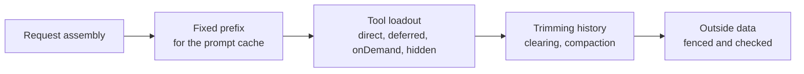
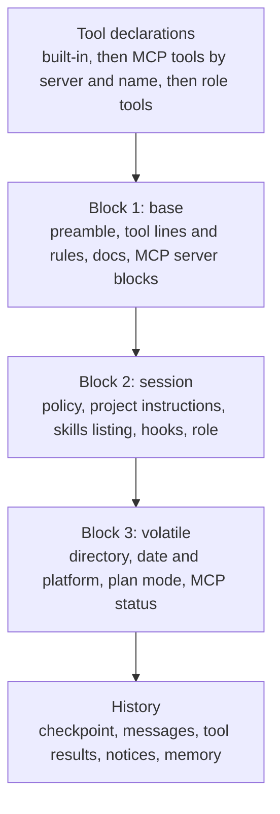
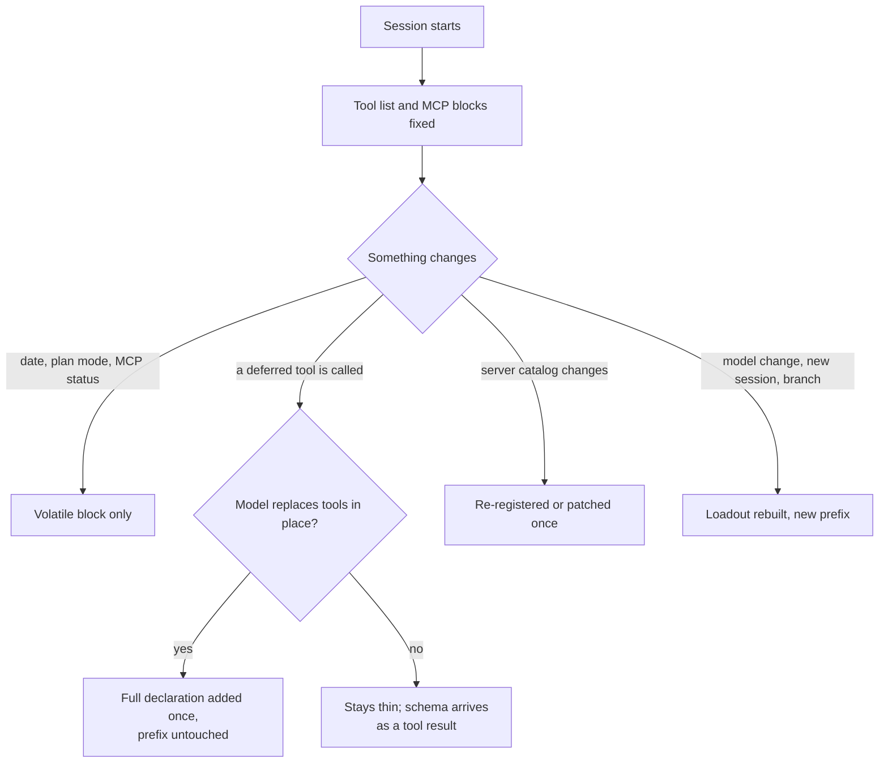
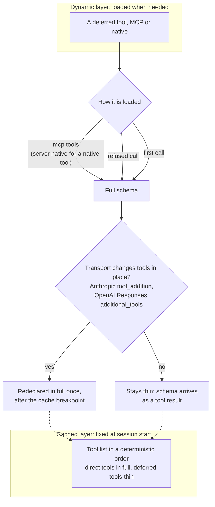
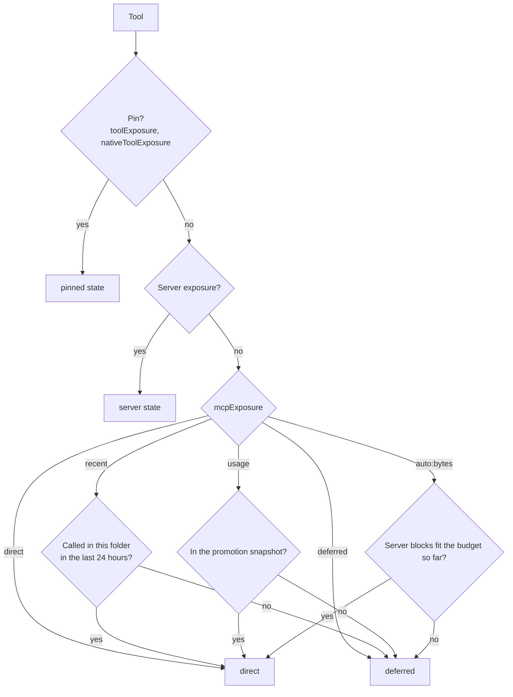
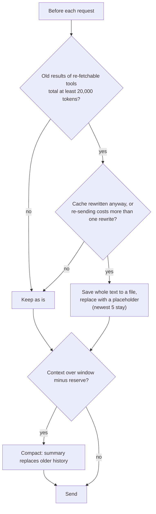
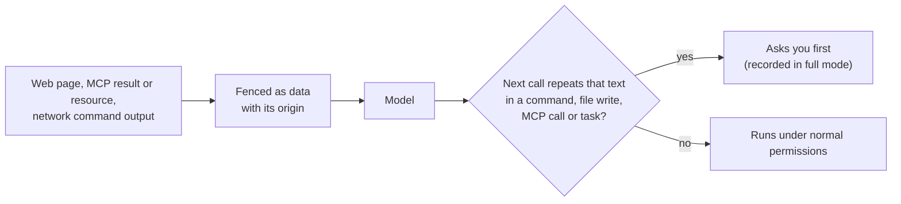
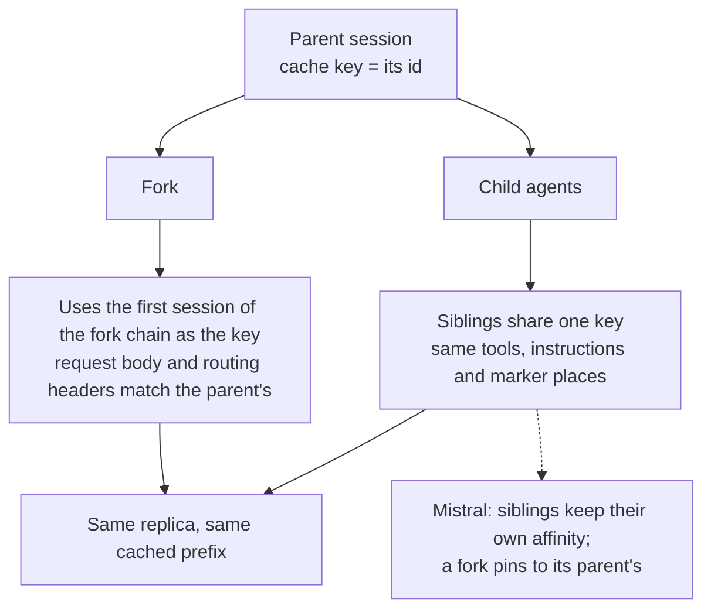

# How Octocode builds a request, and what keeps it small

Every model request is assembled from the same parts. This page follows them in order and names, for each saving, what it buys, what it costs and the setting that controls it. Provider cache details are in [prompt caching](prompt-caching.md); the source of each part is in [what an agent reads](agent-context.md).

| Optimization         | Saves                                             | Costs                                                      | Controlled by                                                         |
| -------------------- | ------------------------------------------------- | ---------------------------------------------------------- | --------------------------------------------------------------------- |
| Fixed prefix, cache  | Re-billing the unchanged start at full price      | Changes wait for a new session or a one-time rewrite       | `cacheRetention`, `cacheWarming`, [prompt caching](prompt-caching.md) |
| Deferred tools       | Tokens of descriptions and schemas you do not use | One extra call to read a schema                            | `mcpExposure`, `exposure`, `toolExposure`, `nativeToolExposure`       |
| Clearing old results | Re-sending large old tool output                  | A rewrite of the cached history once; saved copies on disk | None (always on)                                                      |
| Compaction           | Overflowing the window                            | A summary request; detail is lossy but archived            | `contextBudget`                                                       |
| Fencing outside data | Injected instructions reaching the model          | A few tokens of fence per fenced result                    | None (always on)                                                      |

## 1. Request assembly

A request is the tool declarations, the system prompt in up to three blocks, then the history. Order matters: the provider can reuse only an identical start.

| Part                   | What it holds                                                                                                           | You change it with                                               |
| ---------------------- | ----------------------------------------------------------------------------------------------------------------------- | ---------------------------------------------------------------- |
| System prompt          | Built-in text, the policy for the declared tools, your `SYSTEM.md` or `APPEND_SYSTEM.md`                                | [Instructions](prompts.md)                                       |
| Instruction files      | `AGENTS.md` files from the global one down to the working folder; deeper ones load when a file under them is first read | `--no-context-files`                                             |
| Skills listing         | Each skill's name, description and path; the body loads only when the agent calls `skill`                               | `/harness` per skill; [skills](skills.md)                        |
| MCP instruction blocks | One block per enabled server: its purpose, call prefix and instructions (deferred tools add one index line each)        | `/configuration enable` or `disable` `mcp:<name>`, [MCP](mcp.md) |
| Tool declarations      | One declaration per tool: native tools in full, MCP tools by their exposure                                             | [Tool loadout](#3-tool-loadout)                                  |
| History                | The latest checkpoint, recent messages, tool calls and results, memory and backlog notices                              | [Trimming context](#4-trimming-context)                          |

Block 3 is sent without a cache boundary, so a new day or a changed MCP status does not rewrite the two cached blocks above it. A session saved by an older version keeps its stored order. Block layout and the full section list: [Context management](../../../docs/CONTEXT.md#what-the-model-sees); per-adapter boundaries: [second instruction block](prompt-caching.md#second-instruction-block).

## 2. Prompt cache: a fixed prefix

The cache can reuse the start of a request only while it is byte-identical. Octocode therefore treats the tool list and instruction blocks as fixed for the session and moves changes somewhere cheaper.

| Mechanism                            | What happens                                                                                                                                                                                                                                                                                                                    | Saves                                     | Costs                                                                                                 | Setting                                              |
| ------------------------------------ | ------------------------------------------------------------------------------------------------------------------------------------------------------------------------------------------------------------------------------------------------------------------------------------------------------------------------------- | ----------------------------------------- | ----------------------------------------------------------------------------------------------------- | ---------------------------------------------------- |
| Tool list fixed per session          | Which MCP tools are direct or deferred is decided when the session starts and kept; the set of recently used tools is saved with the first prompt, so resume, reload and fork declare the same set                                                                                                                              | A prefix rewrite on every change          | A tool you start using mid-session is not promoted until later                                        | `mcpExposure` (and pins)                             |
| Redeclared in place after first use  | After its first call (successful or not), a deferred MCP tool is declared in full for the rest of the session, but only where the model accepts in-place tool changes (Anthropic with mid-conversation tool changes, OpenAI Responses with additional tools). The prefix is not rewritten, and compaction keeps the declaration | Re-reading the schema on every later call | Nothing on those models; elsewhere the tool stays thin and its schema keeps arriving as a tool result | `mcpPresentation` must be `declared` (default)       |
| Children share the parent's tool set | A subagent uses its parent's set of recently used tools, so siblings declare the same tools and share the cached tool prefix; tools that depend on the agent's role come last. A profile with `mcpDefer` defers its read-only tools and shares only with agents that defer the same ones                                        | Each child re-writing the same prefix     | A child's deferred or direct tools follow the parent's recent use, not its own                        | Agent profile `mcpDefer`                             |
| Cache warmer                         | Between turns Octocode may send a cheap refresh so the cached history does not expire, when its expected saving reaches $0.05, or while it waits on children, jobs, timers or an asked answer, up to one rewrite's cost per wait                                                                                                | A full re-write after a pause             | The refresh requests, billed as reads                                                                 | `cacheWarming`: `off`, `streaming`, `idle` (default) |

Catalog changes (an MCP server changing a tool's description or schema) re-register that tool once; a reconnect with the same catalog changes nothing ([the table](prompt-caching.md#second-instruction-block)). Look for misses with `showCacheMissNotices` or `OCTOCODE_CACHE_DIAGNOSTICS=on` ([miss reasons](prompt-caching.md#provider-reported-miss-reasons)); the warmer's arithmetic and window are in [warming and measurements](prompt-caching.md#warming-and-measurements).

## 3. Tool loadout

A tool is declared to the model in one of three states ([what each gives the model](configuration.md#tool-exposure)).

| State      | Model sees                                                                                                                              | Reads the schema through                               |
| ---------- | --------------------------------------------------------------------------------------------------------------------------------------- | ------------------------------------------------------ |
| `direct`   | Whole description and full schema                                                                                                       | The declaration                                        |
| `deferred` | The tool's whole description and its field names with JSON types (up to 32 names per object), plus one index line in its server's block | A rejected call, or the `mcp` tool with intent `tools` |
| `hidden`   | Nothing; the tool cannot be called                                                                                                      | Not available                                          |

A deferred tool stays callable and every call is still validated against the server's full schema. Only the schema detail (descriptions of fields, enums, bounds) is deferred: the field names let the model write a correct first call, and a wrong call returns the full schema. An agent without the `mcp` tool gets nothing deferred.

### Two layers of tools

| Layer   | Holds                                                                | Changes                                                                                                        |
| ------- | -------------------------------------------------------------------- | -------------------------------------------------------------------------------------------------------------- |
| Cached  | The tool list and server blocks, in the same order for every session | Only at session start, a model change, tree navigation or a catalog change                                     |
| Dynamic | Full definitions of deferred tools the session needed                | Appended once per tool, after the cache breakpoint, where the transport allows; otherwise only as tool results |

A deferred MCP tool is declared in full after its first call, successful or not. A deferred native tool is declared in full after being read with `mcp` (`intent: "tools"`, `server: "native"`, the tool's name), after a refused call, or after its first call. A compaction summarizes loaded schemas away, so the schemas of deferred tools the session called come back in one hidden message (within a size budget). Details: [exposure and results](mcp-reference.md#exposure-and-results).

### Choosing the state

| `mcpExposure`        | A tool without a pin is                                                                   | Saves                                        | Costs                                                                    |
| -------------------- | ----------------------------------------------------------------------------------------- | -------------------------------------------- | ------------------------------------------------------------------------ |
| `"recent"` (default) | `direct` if this working directory called it in the last 24 hours, else `deferred`        | Most unused descriptions and schemas         | A first call to a rarely used tool may be refused once for its schema    |
| `"usage"`            | `deferred` unless the promotion snapshot names it                                         | The same, learned across all your folders    | The same first-call cost; a new install has no data, so all are deferred |
| `"direct"`           | `direct`                                                                                  | Nothing                                      | Every description and schema in every request                            |
| `"deferred"`         | `deferred`                                                                                | The most                                     | The same first-call cost for every tool                                  |
| `"auto:<bytes>"`     | `direct` for servers in name order while their text fits the byte budget, then `deferred` | A fixed ceiling, whatever the model's window | Which servers are direct depends on name order, not on use               |

The `auto` budget counts bytes, not a share of the context window, so changing models never changes the loadout.

### Usage-based promotion

`"usage"` starts every deferrable tool deferred and promotes the ones that earn it.

| Rule                 | Value                                                                                                                                                                      |
| -------------------- | -------------------------------------------------------------------------------------------------------------------------------------------------------------------------- |
| Counts               | Per tool and per role group (main, subagent): sessions that declared it, called it, read its description, and calls its schema refused. Kept for 7 days across all folders |
| Promoted by use      | At least 10% of declaring sessions called or read it, and at least 20 sessions of that group declared it                                                                   |
| Promoted by refusals | Refused calls exceed one per session that used the tool                                                                                                                    |
| Snapshot             | Each group keeps one for 1 hour, built at the next session start after it expires; the session, its resumptions and its subagents keep it                                  |
| Native tools         | `memory` and `wait` are deferrable only under `"usage"` or a pin; `web`, `archive`, `models` and `backlogPlan` follow `recent` and `usage`                                 |
| No data              | Nothing is promoted; deleting the counts file defers every tool again                                                                                                      |

The default stays `"recent"`. Counts are a hint: an unreadable file reads as no data.

**Usage audit.** Three places show the same numbers per tool: the **Use (7 days)** column of the Tools panel on the [web Settings page](web-workspace.md#settings-page), the `/mcp` → server → **Tools** page, and the `mcp` tool's `tools` listing. Each row shows the share of sessions that used the tool, its calls, the last day used (or "unused in 7 days"), refusals, and for a deferred tool the bytes its thin declaration saves. Under `"usage"` the row also gives the reason: `promoted` (direct because the snapshot named it) or `unused` (deferred and never used in the window).

### Pins

| Pin                  | Where                                                          | Applies to                                                                                           |
| -------------------- | -------------------------------------------------------------- | ---------------------------------------------------------------------------------------------------- |
| `toolExposure`       | The server's entry in `mcp.json` (exact names or `*` patterns) | One MCP tool                                                                                         |
| `exposure`           | The server's entry in `mcp.json`                               | Every tool of the server without its own pin                                                         |
| `nativeToolExposure` | `settings.json`, for deferrable native tools                   | `direct` or `deferred`; unpinned they follow `mcpExposure`. Every other native tool is always direct |

Pins and `mcpExposure` apply from the next session. See and change them in the Tools panel, or in `/mcp`, then the server, **Tools** › **Default for tools**. Reference: [MCP tool exposure](mcp.md#control-tool-exposure).

## 4. Trimming context

Two mechanisms keep the history inside the window. Clearing is cheap and frequent; compaction is the last resort.

### Clearing old tool results

Only results that can be fetched again are cleared: `web`, MCP tools and `bash` commands that only print (reads, `sed -n` and `awk` that write nothing, also after `cd` or in a pipeline). `file` and `agent` results and writing commands never are. Each cleared result's full text is saved first and the placeholder names the file, so nothing is lost; one that cannot be saved stays.

Clearing is allowed only when the old results total at least 20,000 tokens (the newest five always stay) and clearing is cheaper than not clearing. In plain words:

- **Free:** if the next request would rewrite the cache anyway (the cache expired, the model changed, or an update rewrites the start), clearing costs nothing extra, so it happens.
- **While the cache is warm:** clearing makes the next request write the changed history to the cache once, which costs more than reading it. It happens only when re-sending the old results for the requests still expected would cost more than that one rewrite; it may then clear only the results after a large message that stays, when that saves more. Expected requests are about as many as the session has made since the last compaction, capped by how many fit before the compaction threshold.
- **Unknown cache lifetime:** only the free case clears.

The decision is stored with the session, so later requests, a resume and a fork show the same placeholders and the prefix stays byte-stable. Details and the formula: [clearing old tool results](native-features.md#clearing-old-tool-results). There is no setting for it.

**Clearing ledger.** The profiler lists each clearing wave as a finding: the tokens it freed, the tokens the next request wrote, the requests until the next compaction, and its net cost or saving (when the model lists prices). Waves that ran because the cache was rewritten anyway are listed apart, one finding per agent, since they added no write.

### Compaction

When context tokens exceed the window minus a reserve, Octocode summarizes older history into a checkpoint and keeps the newest messages verbatim.

| Part    | Rule                                                                                                                                                                                                                     |
| ------- | ------------------------------------------------------------------------------------------------------------------------------------------------------------------------------------------------------------------------ |
| Window  | `contextBudget` (default 300,000 tokens), capped at 90% of the model's capacity; `"full"` uses all of it                                                                                                                 |
| Trigger | Context above the window minus the reserve: 16,384 tokens (an eighth of smaller windows), raised for the thinking budget, at most a sixth of the window. A 200,000-token window compacts above 183,616 with thinking off |
| Kept    | Up to 20,000 recent tokens (a quarter of smaller windows), word for word                                                                                                                                                 |
| Manual  | `/compact [focus]`                                                                                                                                                                                                       |
| Setting | Automatic compaction is always on and has no switch; only `contextBudget` moves the trigger                                                                                                                              |

What survives, and where else to find the rest:

| Kept in context                                                                                                                                                                                                                                                                                                                                                                                                 | Left to the saved archive                                                                                       |
| --------------------------------------------------------------------------------------------------------------------------------------------------------------------------------------------------------------------------------------------------------------------------------------------------------------------------------------------------------------------------------------------------------------- | --------------------------------------------------------------------------------------------------------------- |
| The checkpoint (goal, constraints, decisions, progress, next steps); your messages and `askUser` answers word for word within a budget; file lists and saved results; loaded skills by name and path; the backlog and running work as the tools report them now; schemas of deferred tools the session called; up to five recent files re-read: changed ones whole, ones only read as an outline, never scratch | Summarized messages, as searchable Markdown for the `archive` tool; the session file keeps every original entry |

The cost is a summary request (shared with the cached prefix when the model is unchanged) and a lossy summary. The pipeline and its limits: [Context management](../../../docs/CONTEXT.md#the-compaction-pipeline); rules and caps: [Compaction](configuration.md#compaction).

## 5. Outside data

Text written by someone other than you can carry instructions aimed at the model. Octocode marks it and checks it before it can drive an action.

The origin is decided by where the result came from (the tool's source and what ran), never by a field a tool declares about itself, because MCP definitions come from external servers. The fence and the provenance check share this one rule.

| Result                                                                                                             | Fenced? | Why                                                                           |
| ------------------------------------------------------------------------------------------------------------------ | ------- | ----------------------------------------------------------------------------- |
| `web` pages and search snippets                                                                                    | Yes     | Anyone can publish them                                                       |
| MCP tool results                                                                                                   | Yes     | The server, or what it fetched, may be third-party                            |
| Resources read with the `mcp` tool (`read`); its other intents report Octocode's own state, so they are not fenced | Yes     | The resource is the server's text as it wrote it                              |
| Output of network commands such as `curl` and `ssh` that ran                                                       | Yes     | It is remote text                                                             |
| Reads and searches your trusted MCP entries declare as `reader` or `search` over your workspace                    | No      | It is the repository you asked about; a fence would cost tokens on every read |
| `file`, local commands, a refused or blocked call                                                                  | No      | Not outside text                                                              |

The fence names the origin (the URL, query, tool or command) and says the content is data. It is added only when the request is built, so the session, terminal and saved text stay as the tool returned them. The marker is a hash of the text, so the same result fences to the same bytes every time and the cached prefix is kept. A result already replaced by a clearing placeholder is not fenced.

The provenance check is separate: text from untrusted sources (MCP results and resource reads, network command output, a subagent's report) that reappears in a consequential argument (a shell command, file content, an MCP call, a memory, a subagent's task) asks before it runs, in `manual` and `workspace` modes; `full` runs and records it. It matches text, so paraphrase or encoding defeats it: a tripwire, not a sandbox. Sources, limits and modes: [Provenance](permissions.md#provenance).

## 6. Caching across providers, forks and children

How each provider is asked to cache decides what a change costs. Provider settings, lifetimes and warming are in [prompt caching](prompt-caching.md).

| Provider               | What Octocode sends                                                                                        | Routing                                                  |
| ---------------------- | ---------------------------------------------------------------------------------------------------------- | -------------------------------------------------------- |
| Anthropic              | Up to four explicit cache markers: tools, instruction blocks, the last message and the previous tail       | Session-affinity header on gateways that take one        |
| OpenAI Responses       | A cache key; 24-hour retention or explicit mode on models that support them                                | `x-client-request-id` carries the key                    |
| Codex                  | A cache key                                                                                                | `session-id` and `x-client-request-id` carry the key     |
| OpenRouter and similar | A cache key where the model allows it; Anthropic-style markers on models that need them                    | `x-session-id` carries the key                           |
| xAI                    | The Responses cache key                                                                                    | `x-grok-conv-id` and `x-client-request-id` carry the key |
| Google and Vertex      | Nothing: the provider caches a stable prefix implicitly, so keeping the prefix identical is the only lever | None                                                     |

What each event does to the cached request, per provider. "Kept" means the request opens with the previous one, so the cached part is read again; "rewritten once" means the history is billed again once and the next request appends.

| Event                         | Anthropic                                         | OpenAI Responses | Codex          | OpenRouter        | xAI            | Google, Vertex    |
| ----------------------------- | ------------------------------------------------- | ---------------- | -------------- | ----------------- | -------------- | ----------------- |
| Next turn                     | Kept                                              | Kept             | Kept           | Kept              | Kept           | Kept              |
| Deferred tool loaded          | Kept                                              | Kept             | Kept           | Kept: tool result | Kept           | Kept: tool result |
| Refused call returns a schema | Kept                                              | Kept             | Kept           | Kept              | Kept           | Kept              |
| Skill loaded                  | Kept                                              | Kept             | Kept           | Kept              | Kept           | Kept              |
| Images in history             | Kept                                              | Kept             | Kept           | Kept              | Kept           | Kept              |
| Fork                          | Kept                                              | Kept             | Kept           | Kept              | Kept           | Kept              |
| Child agent                   | Kept: tools, instructions and marker places match | Kept             | Kept           | Kept              | Kept           | Kept              |
| Model switch                  | Rewritten once                                    | Rewritten once   | Rewritten once | Rewritten once    | Rewritten once | Rewritten once    |
| Provider switch               | Rewritten once                                    | Rewritten once   | Rewritten once | Rewritten once    | Rewritten once | Rewritten once    |
| Compaction                    | Rewritten once, tools and instructions kept       | Same             | Same           | Same              | Same           | Same              |

No event rewrites the request on every turn. Two notes on reading it: the deferred-tool row says "kept" for every provider because loading never changes the tools that were sent: a model whose catalog entry allows in-place tool changes (Anthropic tool changes, OpenAI Responses and Codex additional tools, which xAI's endpoint can also carry) gets the definition appended after the breakpoint, and any other model gets the schema as a tool result; the table shows what the request bytes do, and a provider's own routing, minimum length and expiry still decide a real hit.

### Forks and children share the parent's cache

A fork sends its parent's request byte for byte, and the routing headers above carry the parent's key, so the fork lands where the parent's prefix is cached. Children of one parent and profile build the same tools and instruction blocks and share one key, so a second child reads what the first wrote. Each child keeps its own transcript and cancellation. On Mistral a fork pins to its parent's replica, but sibling children keep their own affinity. Disabling caching omits the key and the routing headers.
