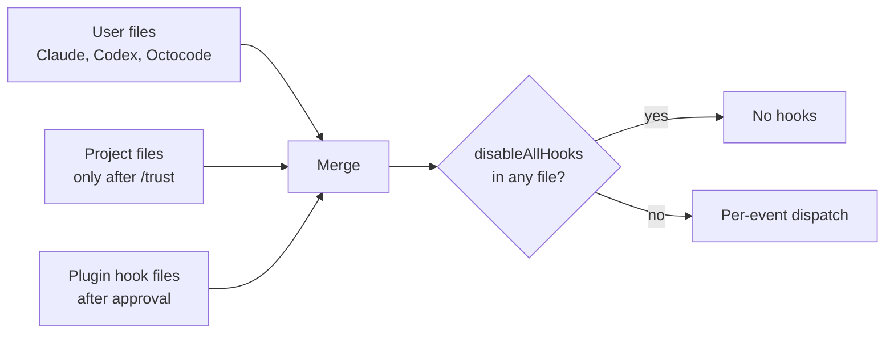
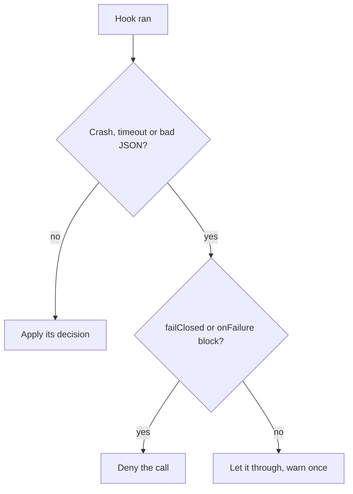
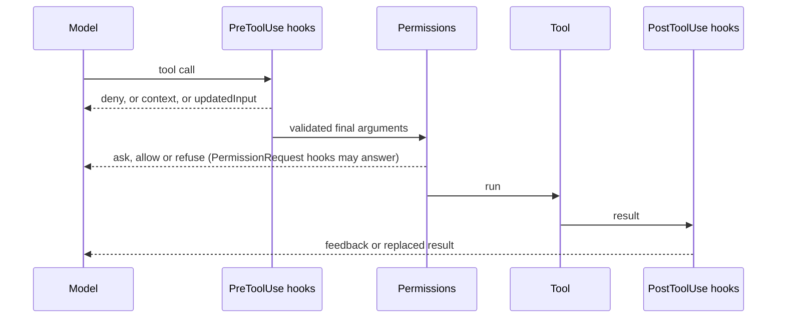

# Hooks

A hook is a handler run at a lifecycle event. Command hooks run a shell command that receives the event as JSON on stdin and answers with an exit code or JSON. Hooks are separate from [plugins](plugins.md) (containers) and [skills](skills.md) (instructions). Octocode reads a subset of Claude and Codex hook configuration; it implements neither host's whole protocol. [Hook events](hook-events.md) (generated from the hook catalog; `/harness hooks events` prints it) lists every event with the handler types, timeouts and input fields each profile accepts; this page owns discovery, trust, behavior and the differences from Claude Code and Codex.

Hooks run with your operating-system privileges and are not sandboxed. The runner caps captured output and sanitizes displayed context. Cancellation and timeout wait for a bounded process-tree cleanup attempt before the hook completes. A detached process or one whose identity cannot be verified may survive; cleanup does not provide process isolation.

## Quick start

Save this as `<repository-root>/.octocode/hooks.json`:

```json
{
	"hooks": {
		"SessionStart": [
			{
				"matcher": "startup",
				"hooks": [
					{
						"type": "command",
						"command": "node -e \"console.log('Project hooks are active')\"",
						"timeout": 5
					}
				]
			}
		]
	}
}
```

Run `/reload` (in a folder you have not trusted yet, `/trust` first), then `/harness hooks`. The command's stdout becomes hidden model context on the next prompt, not a terminal notice. The example needs Node on PATH.

## Add a command hook

Hooks are on in every main session; no flag switches them. Each file is read with the profile of the host that defined its format, so a Claude hook keeps Claude's matcher rules and output handling.

1. Save as `<repository-root>/.octocode/hooks.json`:

   ```jsonc
   {
   	"hooks": {
   		"PreToolUse": [
   			{
   				"matcher": "Bash",
   				"hooks": [{ "type": "command", "command": "\"$CLAUDE_PROJECT_DIR\"/scripts/check-bash.sh", "timeout": 10 }],
   			},
   		],
   	},
   }
   ```

   The script reads the event JSON on stdin. Exit 2 with a reason on stderr denies the call. Add `"failClosed": true` to deny when the script crashes or times out; otherwise such failures let the call through.

2. Run `/reload` (a project file needs a trusted folder: `/trust` it first if it is not; user-level files need no trust) and check `/harness hooks`: each loaded command with its source file, profile, timing (runs, failed runs such as a timeout, crash or `mcp_tool` call to a missing server, average, maximum) and diagnostics. `/harness hooks events` lists events and handler types. Both only inspect; switch hooks with `/configuration enable|disable hook:<id>` (`/configuration list hook` shows IDs). The startup Hooks row counts files that define at least one hook.

### Editor schema and test runs

| Need                                             | How                                                                                                                                                                                                                   |
| ------------------------------------------------ | --------------------------------------------------------------------------------------------------------------------------------------------------------------------------------------------------------------------- |
| Validate and complete a hook file in your editor | Add `"$schema": "<package>/schemas/hooks.schema.json"` (the file ships in the installed Octocode package). It lists every event and every handler field across profiles; the file's profile still decides which apply |
| Run the configured hooks once on a sample event  | `/harness hooks test <Event> [<tool or matcher> [<json>]]`                                                                                                                                                            |

A tool event takes the tool name and its input as JSON: `/harness hooks test PreToolUse bash {"command":"rm -rf x"}`. Other events take the matcher value (for example `startup`) and extra input fields as JSON. The command prints which hooks ran and what they answered (block, ask, context, input rewrite, error). The hooks really run, so a hook with side effects has them; the agent never sees the result, and an event with no matching hook says so.

Hooks you configured for Claude Code or Codex load from their usual files once that harness is on ([Discovery](#discovery)). To turn every hook off set `"disableAllHooks": true` in any loaded hook file. To turn off one host, file or hook without editing it, use `/configuration` ([plugins](plugins.md#inspect-and-switch)). The [Claude permission rules](permissions.md#claude-permission-rules) from the same settings files always apply.

An agent sees which hooks may act on its calls in the `hooks` section of its prompt: one line per event and tool matcher, never a command, URL or prompt, and absent without a hook. A subagent runs none of your hooks unless its profile or the coordinator's task turns them on ([hooks in subagents](#hooks-in-subagents)).

## Discovery



Octocode reads these files when a session starts, in this order; entries from all files merge:

| Order | Scope           | Location                                                                  | Profile  |
| ----- | --------------- | ------------------------------------------------------------------------- | -------- |
| 1     | User            | `settings.json` in `CLAUDE_CONFIG_DIR` (default `~/.claude/`)             | Claude   |
| 2     | User            | `hooks.json`, then `config.toml`, in `CODEX_HOME` (default `~/.codex/`)   | Codex    |
| 3     | User            | `<Octocode home>/hooks.json` (default `~/.octocode/octocodecode/`)        | Native   |
| 4     | Trusted project | `.claude/settings.json`, then `.claude/settings.local.json`               | Claude   |
| 5     | Trusted project | `.codex/hooks.json`, then `.codex/config.toml`                            | Codex    |
| 6     | Trusted project | `.octocode/hooks.json`                                                    | Native   |
| 7     | Plugin          | Hook files of a configured plugin, after approval ([plugins](plugins.md)) | Plugin's |

- Claude and Codex files load only while that harness is on in `/harness` (both off by default; a switched-off harness is not a warning, the startup Harness line counts its hooks as off). Cursor has no hook format Octocode reads.
- Project paths use the repository root even when the session starts in a subdirectory. `OCTOCODE_HOME` moves the Octocode home; `OCTOCODE_CODING_AGENT_DIR` changes core configuration, not this path.
- Project hooks load only when `/trust` (or `octocode trust add`) trusts the folder. Trust is per folder: it does not list hook commands, URLs or environment variables, and does not fingerprint the files, so later edits load without a new review. Read a project's hook files before trusting it. After editing user files use `/reload` or restart; there is no file watcher.
- `CLAUDE_CONFIG_DIR` selects the directory with the user `settings.json` (absolute path; relative values resolve from the process working directory; no shell or tilde expansion; no fallback to the default file). It does not change project locations; skill discovery uses the same resolver.
- A non-empty `CODEX_HOME` relocates Codex user JSON and TOML to that existing directory. An invalid value reports a diagnostic and skips Codex user sources (Codex itself aborts startup); project paths are unchanged.
- Codex TOML: inline `[hooks]` and JSON hooks in one directory merge with a diagnostic. TOML accepts `command_windows` or `commandWindows`; JSON only `commandWindows`. `[features] hooks = false` disables Codex-profile hooks, plugin hooks included (`codex_hooks` is a deprecated alias); a trusted project value overrides the user value. Other Codex configuration, profile selection and managed requirements are not imported. Invalid TOML is reported without snippets that could expose values.
- Missing files are normal; unreadable files, invalid JSON and malformed containers produce diagnostics. Ordinary settings files without a `hooks` key are fine. There is no recursive script search.
- Any loaded file with `"disableAllHooks": true` disables all hooks, required gates included; a later `false` does not override it (more conservative than Claude's precedence). An untrusted project cannot supply it, because its files are not loaded. `/harness hooks` can show the subsystem enabled with zero commands and a disable diagnostic.

## Profiles

A source decides the profile; handlers from different profiles are never merged, so identical command text from different profiles runs separately (review the sources in `/harness hooks` when one script is configured for several hosts), while duplicates within a profile run once (the first timeout and source are kept; required denial survives).

| Handler                   | Native | Claude                        | Codex                       |
| ------------------------- | ------ | ----------------------------- | --------------------------- |
| `command`                 | Yes    | Yes                           | Yes                         |
| `http`                    | No     | Yes, except on `SessionStart` | No                          |
| `prompt` (one model call) | No     | Yes, on gate and stop events  | No                          |
| `mcp_tool`                | No     | Yes                           | Yes, except on `SessionEnd` |
| `agent`                   | No     | No                            | No                          |

**Fields.** Every profile accepts `type`, `command`, `timeout`, `failClosed` (a local extension) and `statusMessage` (presentation only). Claude adds `args`, `shell` (`bash` or `powershell`; ignored with `args`), `onFailure`, `async`, `asyncRewake`, `if` ([Claude `if` conditions](#claude-if-conditions)) and ignores `once` (honored upstream only for skill-scoped hooks, which Octocode does not activate). Codex adds `commandWindows` (Windows only), `async`, `additionalContextLimit` and rejects `once`, `asyncRewake`. Native rejects `args`, `if`, `async`, `command_windows`. Any other field rejects the handler. Timeouts are in seconds: native default 60, Claude and Codex 600 (exceptions below), never above 600.

**Matchers.** Native: whole-name regex; empty or `*` matches all; an invalid pattern matches nothing and is diagnosed. Aliases such as `Bash` and `Edit|Write` work, but an alias match does not mean a full upstream payload translation. Claude: exact names separated by `|` or `,`, otherwise an unanchored JavaScript regex. Codex: unanchored regex. Stop matchers are ignored by Claude and Codex; a native Stop matcher matches no names, so omit it.

**Commands.** Run through the shell in the session working directory; `CLAUDE_PROJECT_DIR` is the repository root. An `args` array (even empty) spawns the executable directly with no shell tokenization; each argument is literal except `${CLAUDE_PROJECT_DIR}`, `${CLAUDE_PLUGIN_ROOT}` and `${CLAUDE_PLUGIN_DATA}`, and arguments are part of the handler identity. Plugin handlers get root and data variables ([plugins](plugins.md#hook-environment-and-data)); standalone handlers have no plugin identity.

**Upstream profiles** reject Octocode's message events and (Codex) `Notification`, and report Codex PreToolUse `ask`, `decision: approve`, `continue`, `stopReason` and `suppressOutput` as hook failures. Windows execution is unvalidated.

**Failure policy.**



- Pre-tool, pre-message and prompt hooks fail open after a crash, timeout or malformed JSON unless `failClosed: true` (any profile) or Claude `onFailure: "block"` denies. `"continue"` keeps fail-open unless `failClosed` is also set. Failed PostToolUse hooks with `"block"` add feedback after execution. Stop failure never forces continuation.
- Failures are audited; UI warnings show once per hook. A required hook (`failClosed` or `"block"`) with an invalid handler (empty command, unsupported handler type) keeps a blocking diagnostic on supported pre-tool, pre-message and prompt gates. Malformed groups, invalid regexes and unsupported events cannot establish a gate: read the diagnostics instead of assuming a gate enforces.
- A Claude-profile command that exits with a code other than 0 or 2 and prints a JSON object is decided by that object, so a deny printed with exit 1 still denies, unless `onFailure: "block"`, `failClosed` or a timeout counts the exit as a failure.

## Output and input

Supported results: exit 2 with a stderr reason, JSON deny or block decisions, pre-tool and message approval requests, and event-specific context. A hook's `allow` never bypasses Octocode permissions. Pre and post tool payloads carry `tool_use_id`; file queries share their parent call's ID. Plain stdout or `additionalContext` becomes hidden context on the next prompt.

| Claude result                                                    | Effect                                                    |
| ---------------------------------------------------------------- | --------------------------------------------------------- |
| `continue: false` on PreToolUse, PostToolUse, PostToolUseFailure | Stops the turn and shows `stopReason` to you              |
| Exit 2 on PostToolUseFailure                                     | stderr goes to the model as feedback                      |
| Exit 2 on SessionStart or SubagentStart                          | stderr is shown to you only                               |
| Context, `systemMessage`, plain stdout                           | Capped at 10,000 characters each (other profiles: 16 KiB) |

Hooks are paused while plan mode is on, so `permission_mode` never reports `plan`.

- **Native input** is `session_id`, `transcript_path` (empty string when missing; an existing one is in Octocode's format), `cwd`, `hook_event_name`. Native `bash` becomes `Bash` with input otherwise kept; native `file` becomes one Edit, Write, MultiEdit or Delete dispatch per query (`Delete` is a local alias); other tools keep their native name and arguments (legacy `edit`, `write`, `read` rename `path` only). Check every field a script uses. `tool_response` is `{content, text}` for Claude and native hooks (the result blocks as Claude sends them, plus their text joined) and plain text for Codex hooks, and partial file batches dispatch only successful queries. `updatedInput` is ignored, `systemMessage` and `suppressOutput` are ignored, and `hookEventName` is not validated. `continue: false` stops Stop continuation and blocks PreToolUse; SessionStart and PreCompact discard it, so PreCompact cannot veto. A hook `ask` runs without a dialog in the default `full` mode and is recorded.
- **Source-profile input** adds host metadata ([hook-events](hook-events.md#host-metadata-in-the-input)): the active model ID when known (Claude on `SessionStart`; Codex on most events), `permission_mode`, Codex `turn_id` (kept through tool iterations, steering, retry, automatic compaction and Stop continuation; a follow-up batch starts a new one; an idle manual compaction has none), and `agent_id` and `agent_type` inside an opted-in child. Codex gets `null` when no transcript exists. `pi_tool_name` is omitted.
- **Permission labels** are coarse: `full` maps to `bypassPermissions`; `manual` and `workspace` map to `default` (native `workspace` permits shell actions and is not `acceptEdits`). The label grants nothing. Codex SessionEnd, PreCompact and PostCompact omit it.
- **SessionStart source:** startup and reload send `startup`; new sends `clear`; resume `resume`; fork `fork` (native keeps `resume`); compaction `compact`. Start context is delivered as hidden data on a later prompt, with bounded waiting; do not assume upstream developer-message priority.
- **SessionStart resume fields:** a resumed or forked session whose transcript holds a reply also sends Claude Code's `seconds_since_last_response`, `context_tokens` (what the first request re-sends: the context estimate, else the last reply's prompt and output), `prompt_cache_likely_expired` (the last reply is older than the cache lifetime your cache settings give the model, a later compaction replaced the conversation, or no lifetime is known) and `estimated_cache_write_usd` (writing `context_tokens` to the cache at the model's prices; its input price where cache writes cost nothing extra). Every profile gets them.
- **Stop background work:** `Stop` also sends `background_tasks`, what still works after the turn: `{ id, type, status, description }` per background subagent (`type: "subagent"`, `status` `running`, `queued` or `held`), background bash job (`shell`, with `command`), timer (`timer`, `status: "scheduled"`) and external prompt (`external`). Text fields are capped at 1,000 characters with a `… [+N chars]` marker. It is `[]` when nothing runs; `session_crons` is not sent (Octocode has no cron wakeups).
- **Stop aggregation:** explicit `continue: false` wins over `decision: "block"`, within one output or across commands. Exit 2 and block decisions otherwise request continuation, capped at eight continuations in a row (reset on a new prompt or tool execution) and 32 per prompt (reset only by a new prompt). Claude Stop `hookSpecificOutput.additionalContext` continues the run as feedback.
- **Environment:** `CLAUDE_PROJECT_DIR` is added and the launching environment inherited; there is no `CLAUDE_ENV_FILE` mechanism.

Native files never get Claude Mods, plugin manifests or skill-frontmatter hooks; there is no managed-policy import and no per-file approval.

## Tool hooks



### Claude `if` conditions

A Claude handler's `if` holds one permission rule, written as in [Claude permission rules](permissions.md#claude-permission-rules): the handler runs only for calls the rule matches.

```json
{ "matcher": "Bash", "hooks": [{ "type": "command", "command": "./block-rm.sh", "if": "Bash(rm *)" }] }
```

| Case                                                            | Result                                                                                                          |
| --------------------------------------------------------------- | --------------------------------------------------------------------------------------------------------------- |
| `rm -rf x`, `cd build && rm -rf x` (each subcommand is checked) | Runs                                                                                                            |
| `ls`, `echo rm`                                                 | Skipped                                                                                                         |
| A command the rule cannot judge, such as `echo $(rm -rf /)`     | Runs: a guard is never skipped silently                                                                         |
| `file` calls with `Edit(*.env)`                                 | Judged per query: runs for `prod.env`, not for `main.ts`                                                        |
| Events                                                          | PreToolUse, PostToolUse, PostToolUseFailure, PermissionRequest                                                  |
| Handler types                                                   | Command, prompt, HTTP and MCP                                                                                   |
| A rule that does not parse, or `if` on another event            | The handler is skipped with a diagnostic; it never denies calls, even with `failClosed` or `onFailure: "block"` |

A call any PreToolUse hook would see (after `if`) never starts early ([early tool start](configuration.md#early-tool-start)).

### Input rewrite

Source-profile PreToolUse `updatedInput` replaces Bash and generic tool arguments after validation against the tool's schema; Codex requires `permissionDecision: "allow"` with a rewrite. Reservations and permissions are rechecked on the changed arguments, and `allow` never bypasses policy. Conflicting rewrites, invalid arguments and rewrites of a user-typed shell command refuse the call.

| Tool   | Rewrite behavior                                                                                                                                                                                                                                                                                                               |
| ------ | ------------------------------------------------------------------------------------------------------------------------------------------------------------------------------------------------------------------------------------------------------------------------------------------------------------------------------ |
| Bash   | Claude timeout in milliseconds maps to native seconds, `run_in_background` to `background`; advisory `description` is kept; a nonempty replacement drops omitted options; negative timeouts are rejected. Codex `tool_input` is only `command`; a rewrite changes that string and keeps native timeout and background options. |
| `file` | Claude Write, Edit and MultiEdit projections reverse into native queries and the whole batch is validated; `replace_all` maps to `edits[].replaceAll`. Codex patch rewrites use [canonical patch mode](native-features.md#canonical-patch-mode).                                                                               |
| `wait` | A wait on `check.result` reaches PreToolUse as the `bash` call its command runs (`Bash` matcher; deny or ask apply, a rewrite is refused). A wait without one keeps its own name.                                                                                                                                              |

Host timeout defaults and background lifetime stay native.

### Permission-request preview

`PermissionRequest` runs when a tool needs an unresolved approval, before a dialog, child relay or headless refusal. Automatic mode and existing grants skip it unless an explicit source ask still needs approval ([permissions](permissions.md)). It covers native file and network checks inside tools; requests without a live tool context stay on the native path. Neither profile sends `tool_use_id`.

| Output                                                                                      | Effect                                                                                                                                                                                                                                                                  |
| ------------------------------------------------------------------------------------------- | ----------------------------------------------------------------------------------------------------------------------------------------------------------------------------------------------------------------------------------------------------------------------- |
| `hookSpecificOutput: {"hookEventName":"PermissionRequest","decision":{"behavior":"allow"}}` | Approves this request only; no session grant. A provenance hit or a hook ask still needs a person; headless it is refused                                                                                                                                               |
| `"behavior":"deny"` with optional `message`                                                 | Denies; the audit keeps the message folded to one line, redacted and clipped                                                                                                                                                                                            |
| Claude `interrupt: true` on a denial                                                        | Audits the refusal, then stops the turn                                                                                                                                                                                                                                 |
| `continue: false`                                                                           | Stops the turn and beats a nested allow (Codex rejects it when true)                                                                                                                                                                                                    |
| Claude `updatedInput` (agent Bash)                                                          | Validated, source policy and reservations rechecked; the original command does not run. A replacement that matches a source ask, trips the provenance check or follows a hook ask needs a person; headless it is refused. An empty object keeps the input and rechecks. |

- Every matching handler runs and a deny wins: within a Claude request, across profiles and for Codex. A handler with no decision does not win; invalid output is diagnosed and contributes nothing. Codex exit 2 denies only with a stderr reason; Claude exit 2 without a decision leaves the approval open. `failClosed` and `onFailure: "block"` deny on failure. Prompt handlers are observational here: `ok: false` shows its reason as a warning.
- Native `file` batches need an allowance for every projected Claude query, and a hook whose file input cannot be represented causes refusal (another profile's allow cannot override). Cancellation or expiry while hooks run prevents a late allow. Hooks cannot undo invariant refusals that happen before the approval boundary.
- Claude Write, Edit and MultiEdit replacements apply to native `file` batches before execution: every query must be approved, the batch is validated whole (read coverage, anchors, reservations, protected state), previews show the effective queries, and targets are checked again under the file lock. An empty replacement keeps the query and rechecks its ask; settings changes invalidate pending approvals. `replace_all: true` replaces non-overlapping occurrences against the original file, exact matches first, smart-quote matching only without an exact match, and does not widen partial-read coverage; combining it with an edit needing broader fuzzy matching is refused. Canonical patch replacements and overlapping rewritten targets are unsupported. Staging writes nothing before validation but does not roll back earlier writes if a later one fails.
- Session-destination `addRules`, `replaceRules` and `removeRules` updates apply in order to future calls; an empty array is a no-op. Persistent destinations, mode changes and directory updates are unsupported. In an untrusted project a persistent `projectSettings` or `localSettings` update that would grant (allow rule, `acceptEdits`, extra directories) is refused before any write, naming `/trust` and the `userSettings` and `session` destinations; restricting updates are still written ([Claude permission rules](permissions.md#claude-permission-rules)).
- Unsupported: replacement during other internal checks, typed shell commands and PowerShell. Host permission suggestions, full MCP metadata, source permission modes are unverified; prompt evaluations cannot decide this event and agent verifiers do not exist.

### Failed-tool and post-tool behavior

- Claude `PostToolUseFailure` receives top-level tool errors and can add recovery context without replacing the error. Partial file-batch failures are not yet separated from denied or skipped queries.
- Codex `PostToolUse` runs for successful results and after a Bash command that completed with a non-zero exit, which it gets as `tool_response` (the result text, exit line included). It does not run for refused, aborted, timed-out or terminated calls, other failed tools, denied calls, invalid rewrites or batches with a failed query. A block, exit 2 or `continue: false` replaces the visible result with hook feedback (details and structured content are dropped); nested blocks mark the result an error, `continue: false` only replaces content. Non-null `updatedMCPToolOutput` and `suppressOutput: true` produce diagnostics without replacing output.
- Claude `PostToolBatch` fires once at the turn-end boundary after top-level tool calls resolve, failed results included; matchers are ignored. Each `tool_calls` item has `tool_use_id`, `tool_name`, `tool_input` and the model-visible `tool_response` blocks; native `file` stays one batched call. `additionalContext` is persisted before the next request; exit 2, `decision: "block"`, `continue: false` or a blocking failure policy stops the run before another request and keeps the reason in the conversation.
- Codex output validation covers PermissionRequest, PreToolUse, PostToolUse, SessionStart, PreCompact, PostCompact, UserPromptSubmit, Stop, SubagentStart, SubagentStop and Interrupt: unknown fields, wrong types and missing decision reasons are diagnostic failures; PreToolUse exit 2 needs a non-empty stderr reason and non-empty successful stdout must be a JSON object. Other profiles may ignore unknown fields.

### Codex file-patch preview

A supported native `file` batch produces one Codex `apply_patch` input, `{ "command": "*** Begin Patch\n…\n*** End Patch" }`, with the original call ID (`Edit` and `Write` are matcher aliases; the payload name stays `apply_patch`). Native and Claude handlers keep per-query dispatch.

- Edit queries become `*** Update File` sections with whole-line context, built from the file's current bytes only while the file guard still holds a read of it (unchanged since); the section is kept only if applying it reproduces those bytes exactly. Native writes must be empty or LF-only with a trailing newline.
- A batch the projection cannot reproduce (an edit of a file not read in this session, changed or evicted since, not UTF-8, without a final newline, with mixed line endings the edit would normalize, or changed by two queries) runs without its Codex hooks: a warning names the skipped hook, and only a matching `failClosed` hook denies the call. A post-only hook cannot prevent execution and reports the missing projection.
- A valid Codex `updatedInput.command` selects canonical patch mode (Add, Delete, Update, Move, context chunks, EOF markers): the file owner prepares every operation before mutating, runs them in order and stops at the first failure ([guarantees](native-features.md#canonical-patch-mode)). The final input passes permissions, reservations, unread-file and stale-file checks; invalid or conflicting rewrites block without falling back. PostToolUse receives the accepted patch captured before execution (also after a delete); failed or partial patches do not invoke a successful post-hook.
- A canonical Update or Move call with a possibly matching native or Claude pre-hook is refused, unless one of them is `failClosed` (the call then runs without those hooks), because per-query projection would hide a move destination from a Write gate; their post-hooks report the missing projection. Overlapping targets, unsupported path forms and remote routing are rejected.

### Claude MCP tool hooks

`mcp_tool` handlers (both profiles) call a configured MCP server with `server`, `tool` and optional `input`. Calls use the MCP connection owner, never trigger tool hooks or an OAuth sign-in, and pass the permission gate like a model's MCP call, except from `PermissionRequest` ([hook-initiated MCP calls](permissions.md#hook-initiated-mcp-calls)). Errors are hook failures, a refusal is a hook error, and error tool results never become decisions. Text output uses the shared decoder (64 KiB cap). Cancellation and timeouts stop waiting; the shorter of the server and hook deadline applies, and the deadline includes time in MCP elicitation (Codex excludes it).

| Aspect              | Claude                                                                                                                  | Codex                                                                                               |
| ------------------- | ----------------------------------------------------------------------------------------------------------------------- | --------------------------------------------------------------------------------------------------- |
| Input values        | String values support `${path.to.field}`                                                                                | Whole-value placeholders keep JSON types, embedded ones become text, a missing field fails the call |
| Server availability | Decision events wait for a connecting server within the deadline; observational events need a connected one             | Requires an existing connection; starts callbacks without waiting for servers                       |
| Start events        | Skips startup, resume and fork `SessionStart`; runs after clear and compact (context delivered once on the next prompt) | `SessionEnd` excluded                                                                               |

Missing, disabled, unauthenticated or failed servers are hook errors. Plugin servers use the same owner under their scoped name. `SessionEnd` delivery depends on the MCP owner still being up at shutdown. Without MCP (`--no-mcp`) the bridge has no owner.

### Claude HTTP hooks

`type: "http"` handlers (Claude profile, every supported event except `SessionStart`) POST the event JSON and decode the response like a command's output.

| Topic              | Rule                                                                                                                                                                                                                                                                                                              |
| ------------------ | ----------------------------------------------------------------------------------------------------------------------------------------------------------------------------------------------------------------------------------------------------------------------------------------------------------------- |
| URL                | `https`; plain `http` only for loopback (`localhost`, `127.0.0.0/8`, `::1`). Invalid URLs keep their failure policy: a required gate denies matching calls without sending.                                                                                                                                       |
| Refused addresses  | The host is resolved first; any link-local (`169.254.0.0/16`, `fe80::/10`) or cloud-metadata address (`169.254.169.254`, `fd00:ec2::254`) fails the hook, even for an allowlisted host. Octocode connects only to the addresses it checked. Loopback and private ranges stay reachable.                           |
| Allowlist          | `allowedHttpHookUrls` (`*` patterns) and `httpHookAllowedEnvVars` come from user settings (lists merge; an empty list permits nothing). A trusted project can only narrow them: a URL or variable must match the user list and every project list. Header env interpolation needs the handler's `allowedEnvVars`. |
| What the host gets | The full event payload (tool name and input, prompt text, working directory) and header values expanded from `allowedEnvVars`. Allow only hosts you would hand that data.                                                                                                                                         |
| What it may answer | Block, allow a permission request, rewrite input, add context. Returned text reaches the model inside the untrusted-data fence headed `External data from HTTP hook <host>`. An allow or rewrite is audited with the host (never path or query).                                                                  |
| Response limits    | Empty or a JSON object with a successful status; max 64 KiB; redirects rejected. Errors, invalid responses and timeouts follow `onFailure`. An unparseable body fails with `HTTP response is not valid JSON`; failure text is redacted. `/harness hooks` hides URL paths and headers.                             |

See the upstream [HTTP hook fields](https://code.claude.com/docs/en/hooks#http-hook-fields) and [allowlist policy](https://code.claude.com/docs/en/settings-reference#allowedhttphookurls).

### Claude prompt hooks

`type: "prompt"` handlers make one tool-less model call for PermissionRequest, PreToolUse, PostToolUse, PostToolUseFailure, PostToolBatch, Stop, SubagentStop and UserPromptSubmit. Set a non-empty `prompt`; `$ARGUMENTS` inserts the event JSON once (an escaped placeholder stays literal; without a placeholder the JSON is appended). `model` selects a unique registered model ID or `provider/model-id` (missing or ambiguous is a hook failure); without it the session model is used, unlike Claude Code's background-model default. Timeout default 30 s; responses cap at 64 KiB and 1,024 generated tokens. Evaluations can incur provider usage, and different models may judge differently.

The response must be JSON with boolean `ok`; `ok: false` needs a non-empty `reason`. A missing `ok` is a hook failure under the failure policy.

| Event                           | `ok: false` does                                                                        |
| ------------------------------- | --------------------------------------------------------------------------------------- |
| PreToolUse                      | Denies the call and ends the turn, unless `continueOnBlock: true`                       |
| PostToolUse                     | Ends the turn, or adds feedback and continues with `continueOnBlock: true`              |
| PostToolUseFailure              | Adds feedback, turn continues                                                           |
| PostToolBatch, UserPromptSubmit | Blocks the boundary                                                                     |
| Stop, SubagentStop              | Feeds the reason into a continuation (Stop-loop limits apply) unless `impossible: true` |
| PermissionRequest               | Observational: reason shown once per hook and reason as a warning                       |

Not available: agent verifiers, hook-local tool conditions, spinner text, upstream model aliases. See the [Claude prompt-hook contract](https://code.claude.com/docs/en/hooks#prompt-based-hooks).

### Background commands

| Profile | `async`                                                                                                                                                                                                                                                            | Other                                                                                                                         |
| ------- | ------------------------------------------------------------------------------------------------------------------------------------------------------------------------------------------------------------------------------------------------------------------ | ----------------------------------------------------------------------------------------------------------------------------- |
| Claude  | `async` and `asyncRewake` background a command; `async` ignores `timeout`, as Claude Code does, and is stopped after 10 minutes; the Claude `Notification` observer can defer context with `async: true`                                                           | Native rejects both fields                                                                                                    |
| Codex   | `async: true`; at most eight background commands per session, extras queue; timeouts apply; `SessionEnd` always runs synchronously; output must pass the event's validation; context waits for a natural prompt or tool boundary; system messages show as warnings | `asyncRewake` rejected. See the [Codex background contract](https://learn.chatgpt.com/docs/hooks#run-hooks-in-the-background) |

Background decisions, rewrites and Stop feedback cannot change the completed event or wake the agent. Session replacement and shutdown cancel running commands and discard queued work and undelivered context; a cancelled invocation cannot start a process, and a cancelled prompt does not consume pending context. Asynchronous `SessionEnd` is not supported.

### Codex context limits

`additionalContextLimit` (non-negative integer, Codex command hooks on PreToolUse, PostToolUse, SessionStart, SubagentStart, UserPromptSubmit) defaults to 2,500 approximate tokens (four UTF-8 bytes each); 0 disables per-handler spilling; other events ignore it with a diagnostic and malformed values reject the handler. Context over the limit is saved to an owner-only file in the session output folder; the model gets a head and tail preview plus the path. An independent 16 KiB aggregate delivery limit and 1 MiB command-output capture limit always apply. Different limits keep handlers distinct. See the [Codex large-output contract](https://learn.chatgpt.com/docs/hooks#large-hook-output).

## Lifecycle events

### Prompt submission

| Aspect                      | Claude `UserPromptSubmit`                         | Codex `UserPromptSubmit`                                                                                                                                         |
| --------------------------- | ------------------------------------------------- | ---------------------------------------------------------------------------------------------------------------------------------------------------------------- |
| Runs                        | At admission, before skill and template expansion | When initial, steering or follow-up input is selected for processing, before it is recorded and before mention skills are read; enqueueing alone does not run it |
| Input                       | The text at its position in the admission chain   | The request after that chain completes                                                                                                                           |
| Default timeout             | 30 s                                              | 600 s (also sends the logical `turn_id`)                                                                                                                         |
| Context from rejected input | Discarded                                         | Kept; in a batch, accepted messages proceed and blocked ones are omitted                                                                                         |

Both expose `prompt` and ignore the matcher. Exit 2 or a JSON block prevents submission (Claude `onFailure: "block"` also blocks on failure). Plain stdout or `additionalContext` is hidden context. With nothing accepted, processing ends without a model request or a Stop hook. Cancelled input delivers no context. Extension calls that submit user messages stay gated; injected custom context does not recurse. Slash commands handled immediately do not emit the event.

### Compaction

`PreCompact` and `PostCompact`: native `PreCompact` is observational and native rejects `PostCompact`. Source-profile `PreCompact` blocks cancel compaction (Claude failure policies apply; the cancellation signal reaches the hook's processes); Claude ignores `continue` (use `decision: "block"` or exit 2), Codex keeps `continue: false`. `PostCompact` runs after the summary is saved: Claude observes; Codex `continue: false` stops the operation, so automatic retry and queued continuation do not proceed (a later explicit operation may still consume queued messages).

`trigger` and the matcher keep the hosts' two values: `manual` for `/compact` and for the agent's own `compact` tool, `auto` for the context threshold and overflow recovery. Octocode adds fields after the hosts' own; a script that reads only the hosts' fields is unaffected.

| Field                        | Events        | Meaning                                                                                                                                                                            |
| ---------------------------- | ------------- | ---------------------------------------------------------------------------------------------------------------------------------------------------------------------------------- |
| `trigger`                    | both          | `manual` or `auto`                                                                                                                                                                 |
| `custom_instructions`        | `PreCompact`  | The focus a manual compaction was given: your `/compact` text or the agent's own `compact` focus; `""` without one and for an automatic compaction                                 |
| `custom_instructions_source` | `PreCompact`  | Whose `custom_instructions` are: `user` or `agent`; absent when there are none                                                                                                     |
| `compact_summary`            | `PostCompact` | The saved summary                                                                                                                                                                  |
| `trigger_source`             | both          | Who or what asked: `user`, `agent`, `threshold` or `overflow`                                                                                                                      |
| `tokens_before`              | both          | Context tokens when the compaction started, or `null`                                                                                                                              |
| `tokens_after`               | `PostCompact` | The context the next request sends, **estimated** from characters when the summary was saved, or `null`; it can be well off the provider's count, most on models other than Claude |
| `focus_source`               | `PostCompact` | Who wrote the focus the summary was given (`user` or `agent`), or `null` without one                                                                                               |
| `lifted`                     | `PostCompact` | The standing rules (`C…`) and decisions (`D…`) earlier summaries carried that this summary dropped, as `{ id, text, reason }`; often `[]`                                          |

### Notifications

`Notification` runs in the background and cannot block (native and Claude profiles; Codex has no such event). The input adds `message`, `title` and `notification_type` to the common fields, and the matcher tests `notification_type`. Claude Code's types keep their meaning; the others are Octocode's, so a matcher written for Claude Code (`permission_prompt|idle_prompt`) does not see them, while a hook without a matcher does.

| `notification_type`  | When                                                                                                                                              |
| -------------------- | ------------------------------------------------------------------------------------------------------------------------------------------------- |
| `permission_prompt`  | An approval dialog opens                                                                                                                          |
| `elicitation_dialog` | Another question from the agent opens                                                                                                             |
| `idle_prompt`        | An answer has waited a minute with no input from you                                                                                              |
| `compaction_lifted`  | A compaction dropped carried rules or decisions; `message` names them (the transcript and the web view show the same line)                        |
| `memory_update`      | A memory pass changed a memory file; `message` is the line you are shown, such as `Memory reflection: workspace MEMORY.md +2 −1 lines, 1 merged.` |
| `model_stalled`      | The model has been silent on a request for 20 seconds, once per request; `message` names the quiet time and the model                             |
| `spend_limit`        | `subagents.maxCost` or `subagents.maxChildren` refused a new subagent, once per session for each limit and value; `message` names the limit       |

Each fires once per occurrence, never per turn.

### Hooks in subagents

A subagent runs none of your hooks by default, so a `Stop` hook that runs the tests or a notifier does not fire once per child. **With the default, a deny hook does not cover delegated work**: a call your `PreToolUse` hook would refuse in the main session goes ahead in a subagent unless its profile or the coordinator turns hooks on for it.

| Mode        | What runs in the subagent                                                                                   |
| ----------- | ----------------------------------------------------------------------------------------------------------- |
| `off`       | Nothing (the default)                                                                                       |
| `decisions` | Your `PreToolUse` and `PermissionRequest` hooks, and only their deny or ask takes effect (the table below)  |
| `all`       | Every hook, as in the main session, plus `SubagentStart` and `SubagentStop` ([child agents](#child-agents)) |

Who chooses the mode, first match wins:

| Where                                                       | Value                          | Effect                                                            |
| ----------------------------------------------------------- | ------------------------------ | ----------------------------------------------------------------- |
| Profile front matter `hooks: false` (or `off`)              | forbids hooks                  | The subagent runs none, whatever the task asks                    |
| The coordinator's task (`agent` type `task`, field `hooks`) | `off`, `decisions` or `all`    | Applies to that child; a resumed or messaged child keeps its mode |
| Profile front matter `hooks`                                | `decisions`, or `true` / `all` | Applies to every child of the profile whose task names no mode    |
| Neither                                                     |                                | `off`                                                             |

The coordinator is told to choose `decisions` when your hooks deny or ask about actions and the child will take such actions (writes, shell, network), and `all` only when the child must behave like the main session. To make a deny rule cover a role's delegated work every time, set `hooks: decisions` in that role's profile.

What each answer does in the `decisions` mode:

| Hook, and what it answers                                                                                      | `decisions`                                                                                                                                    | `all`   |
| -------------------------------------------------------------------------------------------------------------- | ---------------------------------------------------------------------------------------------------------------------------------------------- | ------- |
| `PreToolUse` denies (exit 2, `decision: "block"`, `permissionDecision: "deny"`)                                | The call is refused with the hook's reason                                                                                                     | Same    |
| `PreToolUse` asks (`permissionDecision: "ask"`)                                                                | The call needs an approval, answered like the subagent's other approvals: relayed to you through its parent, or refused when nobody can answer | Same    |
| `PermissionRequest` denies an approval that is about to be asked                                               | The call is refused with the hook's reason (an `interrupt` is not applied)                                                                     | Same    |
| `PermissionRequest` allows, rewrites the input or updates permissions                                          | Ignored: an allow grants nothing, and the approval goes on to the parent or is refused                                                         | Applies |
| `PreToolUse` allows, adds context or rewrites the input; Claude `continue: false` halting the turn             | Ignored (`continue: false` still denies the call)                                                                                              | Applies |
| A `PreToolUse` or `PermissionRequest` hook fails or times out                                                  | The call goes ahead as it would without the hook (hooks fail open) unless the hook sets `failClosed`                                           | Same    |
| A hook with `async` or `asyncRewake`                                                                           | Not started: a background hook decides nothing                                                                                                 | Runs    |
| Every other event (`Stop`, `SubagentStop`, `SessionStart`, `PostToolUse`, `Notification`, message hooks, etc.) | Does not run                                                                                                                                   | Runs    |

A `PermissionRequest` hook runs only when a call needs an approval, as in the main session: a call the subagent's permission mode or its spawn approval already allows asks nothing, so use a `PreToolUse` hook for a rule that must hold on every call. The `off` and `decisions` modes add no `hooks` section to the subagent's prompt; a refusal names the hook's reason. `"disableAllHooks": true` and the `/configuration` switches turn these hooks off in subagents as they do in the main session.

### Child agents

`SubagentStart` and `SubagentStop` run inside a subagent whose hook mode is `all` (profile `hooks: true`, or the task's `hooks: all`); matchers use the profile name (such as `general`). `SubagentStart` runs once per subagent; its context is offered again only after a compaction removed it. Main-session SessionStart and Stop are not also sent for the child.

- **Start.** Codex runs for a new or forked child before its first request, not on reopening a saved session; Claude also runs on later child prompts. Start context belongs to the child and cannot veto creation. Claude suppresses identical startup context while an earlier copy is still in context.
- **Stop.** Runs at successful settlement; a block reason continues the child through its loop with `stop_hook_active` (eight continuations in a row, a tool call resets it; 32 per prompt). Cancellation and provider failure emit nothing. Claude can return `additionalContext` as feedback; Codex has no such field.
- **Identity.** Claude gets the parent session identity and transcript plus the child's agent identity; Codex gets the parent session ID (its spec: "Subagent hooks use the parent session id") and the child's turn ID and model. `SubagentStop` uses the parent `transcript_path` and the child `agent_transcript_path` (null if missing for Codex); these are Octocode transcripts. Other callbacks in the child carry `agent_id` and `agent_type` (Codex: PreToolUse, PostToolUse, UserPromptSubmit, PreCompact, PostCompact) and the child's own `session_id` (Codex: the parent's); main sessions omit them.
- Metadata is captured before an async command queues, so later changes cannot relabel an earlier event. Vendor internal agents, transcript formats and background-task inventories are not provided.

### Session start and end

`SessionEnd` runs for session replacement or quit (new session: `clear`, resume: `resume`, other: `other`); reload does not emit it, and there are no idle or archive events. It is observational with a fresh cancellation scope.

| Profile                | Per-command default | Shared budget                                                                                                                                                      |
| ---------------------- | ------------------- | ------------------------------------------------------------------------------------------------------------------------------------------------------------------ |
| Native, Claude, plugin | 1.5 s               | The largest configured hook timeout among them, at most 60 s, unless `CLAUDE_CODE_SESSIONEND_HOOKS_TIMEOUT_MS` overrides it (it also sets the per-command default) |
| Codex                  | 1 s                 | Explicit timeouts capped at 3 s; emitted only for main-session quit with `reason: "other"`, not for session switches or subagents                                  |

### Interrupted turns

Codex `Interrupt` runs once after an explicit interruption cancels active work and saves pending records; completion, provider failure, idle abort, session replacement, shutdown, internal hook termination and native children do not trigger it. Input: session, logical turn, model, permission label, nullable transcript path. Matchers are ignored; default timeout 1 s, clamped to 1 to 3 s; commands may be async and `mcp_tool` handlers are accepted. Output is observational: empty stdout or a JSON object with only `systemMessage` (shown as a notification); anything else is a diagnostic. It injects no context, cannot reverse cancellation or start a request, and async messages can arrive after settlement.

### Failure and stop events

`StopFailure` (Claude) observes a final error after automatic recovery: `error: "unknown"` plus the provider's message in `error_details` and `last_assistant_message`; no category inference. Success and abort emit nothing. Its output and exit status cannot block or continue the run. Native and Codex reject it.

### Backlog events in the Octocode profile

`TaskCreated`, `TaskCompleted` and `BacklogChange` are Octocode's own events; Claude Code's events of the first two names are not run from Claude or Codex files. They are written in the Octocode hooks file.

| Event           | Fires                                                                          | Matcher                     | Can block |
| --------------- | ------------------------------------------------------------------------------ | --------------------------- | --------- |
| `TaskCreated`   | An item this session added                                                     | none                        | no        |
| `TaskCompleted` | Before the `backlog` tool writes `done` or `close` of an item                  | `done` or `closed`          | yes       |
| `BacklogChange` | Every audited change to an item, from any session, the web board or `/backlog` | The change kind (see below) | no        |

`TaskCompleted` exits 2, or prints `{"decision": "block", "reason": "…"}`, to refuse the write: the item stays as it was and the agent reads the reason. It runs in the process that writes, so a write from the web board, `/backlog` or another session is not gated. A hook that fails or times out lets the write go ahead. Subagents run no hooks by default, so their completions are not gated.

`BacklogChange` kinds: `created`, `claimed`, `released`, `reassigned`, `done`, `closed`, `reopened`, `paths_changed`, `blocked` (a prerequisite was added), `unblocked` (one was removed), `note`, `step` and `edited`. Every session that follows the backlog runs the hook once per change, so a change made by another session reaches your hook too; `own` says whether this session made it.

```json
{ "BacklogChange": [{ "matcher": "done|closed", "hooks": [{ "type": "command", "command": "jq -r .task_id" }] }] }
```

| Field                                                                                     | Events                         | Meaning                                                                                                               |
| ----------------------------------------------------------------------------------------- | ------------------------------ | --------------------------------------------------------------------------------------------------------------------- |
| `task_id`, `task_subject`                                                                 | all three                      | The item (`B12`) and its title                                                                                        |
| `task_description`, `teammate_name`                                                       | `TaskCompleted`                | The item's goal and its assignee                                                                                      |
| `change`                                                                                  | all three                      | `done` or `closed` for `TaskCompleted`; the change kind otherwise                                                     |
| `completion`, `close`                                                                     | `TaskCompleted`                | What the call carries, with secrets masked                                                                            |
| `by`, `surface`, `own`, `audit_id`                                                        | `TaskCreated`, `BacklogChange` | Who made the change, through which surface (`tool`, `web`, `command`), and the audit row                              |
| `state`, `assignee`, `before_assignee`, `parent_id`, `paths`, `version`, `target`, `note` | `TaskCreated`, `BacklogChange` | The item after the change; `target` names the prerequisite of `blocked` and `unblocked`, `note` the comment of `note` |

### Monitor alerts in the Octocode profile

`MonitorAlert` is Octocode's own event: it runs your hook once for each alert the monitor raised, and only observes (it cannot block or add context). The matcher is the rule id, a regex over the rules in the [attention rules](configuration.md#attention-rules) table (`/monitor` lists them with their counts). The hook follows the monitor's own alerts, which are already paced per rule (cooldowns, one note per band), so it adds no repeats of its own.

The machine rules (`load`, `memory`, `swap`, `gpu`) describe the whole machine. Every session sees the same sample, so the hook runs only in the one process that holds the machine sampler, not in each open session. The other rules belong to the session they were raised in and run there.

```json
{
	"MonitorAlert": [
		{ "matcher": "swap|memory", "hooks": [{ "type": "command", "command": "jq -r .rule >> ~/monitor.log" }] }
	]
}
```

| Field       | Meaning                                                                                                        |
| ----------- | -------------------------------------------------------------------------------------------------------------- |
| `rule`      | The rule id                                                                                                    |
| `value`     | The reading that tripped it, in the rule's unit (load per CPU, percent, minutes)                               |
| `threshold` | The setting it crossed                                                                                         |
| `subject`   | What the alert is about (a job id, a child, a list of items), or `null`                                        |
| `at`        | When it tripped, in epoch milliseconds                                                                         |
| `delivered` | `false` when the alert did not reach the session (it ended, or the send was refused); the hook still runs once |

### Agent presence in the Octocode profile

`AgentQueued`, `AgentOn` and `AgentOff` are Octocode's own events (Claude and Codex have none; `SubagentStart` and `SubagentStop` there are separate). `AgentQueued` fires when a background child is queued behind prerequisites (`after`, or the open `dependsOn` of its item, with `subagents.queuedStarts` on); its matcher is the role. It starts on its own when they end well, and `AgentOn` then carries `started_after`. All three only observe: to veto a chain, use a `PreToolUse` hook on `agent` at queue time. `AgentOn` fires when an agent joins the team (a main session at start, a child at start); its matcher is the role (`main` for a main session). `AgentOff` fires when the row is retired; its matcher is the end reason: `completed`, `failed`, `stopped-user`, `stopped-parent`, `parent-gone`, `crashed` or `left` (an older stored `reaped` reads as `crashed`). Both use the `SessionEnd` deadline and a hook still running then is stopped; shutdown waits for hooks it started. Input adds these fields to `session_id`, `cwd` and `hook_event_name`:

| Field                                    | Event         | Meaning                                                                                                                                                                                  |
| ---------------------------------------- | ------------- | ---------------------------------------------------------------------------------------------------------------------------------------------------------------------------------------- |
| `seq`                                    | both          | Transition sequence in `agent_events`; orders events of one database                                                                                                                     |
| `agent_id`, `agent_type`                 | both          | Agent name and role                                                                                                                                                                      |
| `kind`                                   | both          | `main` without a parent, else `child`                                                                                                                                                    |
| `parent_agent_id`                        | both          | Coordinator's name, or `null`                                                                                                                                                            |
| `model`, `goal`                          | both          | Model and one-line goal on the row, or `null`                                                                                                                                            |
| `pid`                                    | both          | The agent's process                                                                                                                                                                      |
| `parent_session_id`, `branch`            | both          | Coordinator's session id and the agent's git branch when it joined, or `null`                                                                                                            |
| `backlog_item`, `run_id`                 | both          | Backlog item the run was started for (`B36`, or `<workspace name>:B36` from another workspace) and the run's id in `agent_runs`, or `null`                                               |
| `reason`, `detail`                       | `AgentOff`    | End reason; `detail` is free text when the writer gave one                                                                                                                               |
| `started_at`, `ended_at`, `duration_ms`  | `AgentOff`    | Join and transition times (ISO 8601) and the time between                                                                                                                                |
| `status`, `tool_calls`, `tokens`, `cost` | `AgentOff`    | Last heartbeat: status, tool calls, `tokens` as `{ input, cache_read, output }`, cost; `null` if never recorded                                                                          |
| `outcome`, `files_changed`               | `AgentOff`    | Outcome word (`done`, `partial`, `blocked`, `failed`) if the coordinator had recorded it (usually `null` for a child leaving before its report), and `{ count, paths }` (first 20 paths) |
| `after`, `item`                          | `AgentQueued` | What the child waits for (`B12`, `agent:sly-mantle`) and the backlog item it will work on (`null` without one); `seq` is `null`: a queued child has no team row yet                      |
| `started_after`                          | `AgentOn`     | Only for a child that was queued: `{ prerequisites, seq }`, the names it waited for and the `seq` of the transition that met the last agent prerequisite (`null` when only items did)    |
| `releases`, `holds`                      | `AgentOff`    | Names of the queued children this agent's end started, and those it held because it did not end well; empty arrays when none. Read as the end is delivered, in the process that wrote it |

The agent's folder is the common `cwd`.

## Troubleshoot

If a hook does not run, check `/harness hooks` in this order: the harness is on, the file is discovered, the folder is trusted, `disableAllHooks` is unset, the profile supports the event, handler type and fields, the matcher matches, and the command exists. Configuration changes apply on `/reload` or a new session. Do not remove safety checks to make an unsupported configuration run.

Before relying on a gate when porting a hook from Claude Code or Codex: read the `/harness hooks` diagnostics, inspect the real input the script consumes (a matched tool name is not a translated schema), set an explicit timeout (native default is 60 s, upstream 600 s), and test allow, deny, error and timeout. Basic command entries migrate directly; managed policy, plugin manifests, skill-frontmatter hooks and inline TOML for native files are not imported. Unsupported reverse translations deny the rewritten call rather than run unsanitized input.
