# How Octocode works

What happens between your message and the answer, how background work (jobs, child agents, timers) reaches the model, what the model reads and what keeps that small, and how long sessions stay inside the context window. This page describes the code as it runs; the pages it links hold the settings and the details.

- [Turn lifecycle](#turn-lifecycle): message, prompt, model, tool calls, gates, hooks, results
- [The event loop](#the-event-loop): queues, wakes, coalescing, interrupts, Stop
- [What the model reads](#what-the-model-reads): request layout, sources and their switches, other harnesses, hook context, measuring
- [Tool loadout](#tool-loadout): direct, deferred, on-demand and hidden tools
- [Keeping history small](#keeping-history-small): fencing, clearing, dropped thinking
- [Outside data](#outside-data): what is fenced and what is checked
- [Context window and compaction](#context-window-and-compaction)
- [Prompt caching](#prompt-caching)
- [Failure, recovery and resume](#failure-recovery-and-resume)

Related pages: [tools](tools.md), [subagents](subagents.md), [monitoring](monitoring.md), [instructions](instructions.md), [backlog and archive](backlog-and-archive.md), [permissions](permissions.md), [hooks](hooks.md).

## Turn lifecycle

A **run** starts when a message reaches an idle session and ends when the model answers without calling a tool and nothing else is waiting. A run is a series of **steps**: one model request, then the tool calls it asked for.

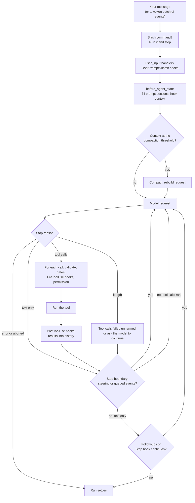

1. **Input.** A line starting with `/` that names a feature command runs at once, even mid-run, and sends no prompt. Otherwise `user_input` handlers and `UserPromptSubmit` hooks may block or add context; skill commands (`/skill:name`) and prompt templates expand; image paths in typed text attach as images. If a run (or a manual compaction) is active, the message is queued as steering or a follow-up instead of starting a run. Source: `core/agent-session/prompting.ts`.
2. **Prompt assembly.** Before each prompt, `before_agent_start` handlers fill the system prompt sections; the session sends only what differs from what the transcript already holds ([What the model reads](#what-the-model-reads)).
3. **Compaction check.** If the estimated request is at the compaction threshold, the session compacts first and rebuilds the request ([Context window and compaction](#context-window-and-compaction)). This check runs before every model request of a run, not only before the first.
4. **Model request.** The loop (`packages/agent/src/agent-loop.ts`) streams the reply. Provider failures that are safe to repeat are retried ([Failure, recovery and resume](#failure-recovery-and-resume)).
5. **Tool calls.** For each call in the reply, in order:
   1. Unknown tool or arguments that fail the tool's schema: an error result, no gate runs.
   2. The gates, first block wins ([Permission gates](#permission-gates)). A refusal becomes the tool result with its reason; the model reads it and changes course.
   3. Execution. Calls run in parallel unless a tool declares itself exclusive (for example the `file` tool runs alone, in call order); an exclusive call waits for every earlier call and holds back every later one.
   4. `PostToolUse` hooks and result clipping. Over-large results are saved to a file and the history keeps a bounded part and the path; an unchanged re-read returns a pointer to the earlier result ([Keeping history small](#keeping-history-small)).
6. **Step boundary.** After the tool results are in history, the loop asks the session for steering messages: input you typed during the step and queued events join here, before the next request ([The event loop](#the-event-loop)). With none, and tool calls having run, the loop requests again; a reply with no tool calls is where the run would stop.
7. **Settling.** At that point follow-up messages (typed with the follow-up key) and queued events that ask for a turn start another step. `Stop` hooks may ask to continue. Otherwise the run settles, `agent_settled` fires, and the event loop is told the session is idle.

A reply cut off at the output limit never runs its tool calls (their arguments may be incomplete): each gets an error result asking for smaller pieces, and three such turns in a row end the run. A plain-text reply cut off at the limit gets up to two automatic "continue exactly where you stopped" messages. Source: `core/agent-session/length-continuation.ts`, `packages/agent/src/agent-loop/tool-batch.ts`.

**Early start.** With `toolExecution.earlyStart` (default off) a call whose block has closed may start while the reply is still streaming, but only if it changes nothing, needs no approval in the current mode and matches no `PreToolUse` hook (a read-only tool or a trusted MCP read, such as an MCP tool whose server entry declares it read-only). If the reply then ends by error, abort or length limit, early calls are discarded. Source: `octocode/tool-gates.ts` (`tool_call_early_start`).

### Permission gates

Every tool call passes one pipeline, in this order; the first step that blocks decides (`GATE_STEPS` in `octocode/permission/judge.ts`):

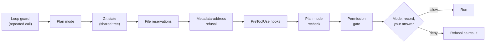

The permission step classifies the call's effect (for example `read.outside`, `mcp.read`, a shell command's parsed effects), applies the read-only role of a child, checks the provenance tripwire for text that came from outside sources, and then asks the mode (`manual`, `workspace`, `full`), the stored decisions and, when needed, you. A hook that rewrites a command makes the invariants (plan mode, git state, reservations, metadata) run again on the rewritten command. For a shell command, the checks run again just before it starts, since earlier approvals in the batch or another agent's lock may have changed what they saw. Modes, classes and source rules: [permissions](permissions.md); hook events and what each can do: [hooks](hooks.md), [hook events](hook-events.md).

## The event loop

Background work finishes while a run is going, or while you are away: a `bash` job exits, a child agent reports or ends, a timer fires, a hook reports back, a peer sends mail. Each session has one event loop (`octocode/events/loop/`) that decides *when* each of these reaches the model. Typed input goes through it too.

What the loop never does: pick an order by asking the model, or let a sender choose its own priority. Priority and wake policy are decided in code from what the event is (`octocode/wake/catalog.ts`, `loop-catalog.ts`).

### Events

The closed list of event topics (`events/topics.ts`) includes:

| Topic | Source | Asks for a turn |
| --- | --- | --- |
| `agent.report`, `agent.ended` | A child agent finished, or ended | yes |
| `agent.message` | Team mail | sometimes |
| `job.exit` | A background `bash` job exited | sometimes |
| `time.due`, `check.result`, `machine.load` | A `notify` timer, command or question check, load wait | yes |
| `item.ready`, `item.peer`, `qa.unavailable` | Backlog changes you hold or wait on | yes, yes, sometimes |
| `monitor.alert` | A monitor rule tripped ([monitoring](monitoring.md)) | yes |
| `hook.feedback`, `peer.notice`, `wake.retry` | A background hook, a peer note, a retry of a failed wake run | yes |
| `ticket.resolved`, `ticket.rejected` | A callback ticket settled | sometimes |
| `hook.<Event>` | A hook ran (logged, never shown to the model) | sometimes |

"Sometimes" means the catalog decides per event; an event that does not ask for a turn only rides along with the next batch. Some events are also written to the session log so a restart can deliver them again: `job.exit`, `agent.report`, `agent.message`, `time.due`, `item.peer` and the ticket events are deduplicated by key (one delivery each); `agent.ended` and `check.result` are replayed without deduplication (`events/loop/cutover.ts`).

### Queues

An entry waits in one of three queues until a safe point:

| Queue | Holds | Delivered |
| --- | --- | --- |
| Q1 | Text you (or an ACP, RPC or web client) sent | At once when the session is idle; at the next step boundary during a run |
| Q2 | Events that arrived during a run | At the next step boundary of that run |
| Q3 | Events that arrived while idle | After the window below; if a run starts first they move to Q2 |

Stop is not queued: it acts immediately (`EventLoop.preempt`, "Q0"), whatever the state, and it leaves every queue as it is.

The loop is a small state machine: `idle`, `running`, `stopping`, `locked` (compaction in progress) and `draining` (the compaction ended and what it held is being delivered). `events/loop/state.ts` also lists a `nudged` state, but nothing signals it today, so a run is either idle or running.

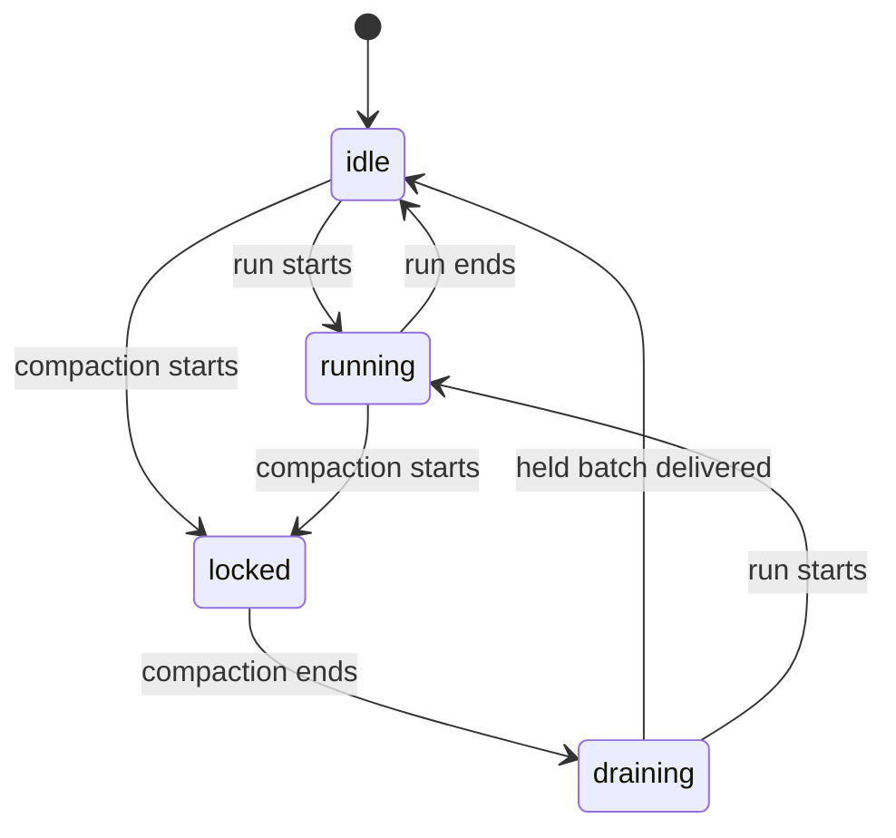

### Delivery

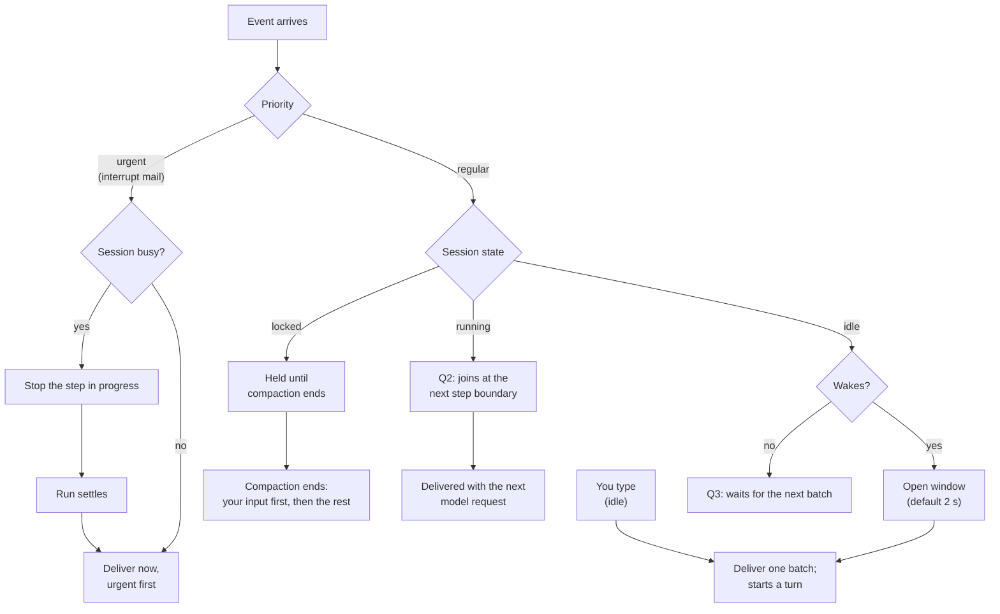

- **Regular events** are the next task. In a running session they join at the next step boundary, after the tool calls already running finish; nothing running is cut. In an idle session the first waking event opens a window (`runtime.eventWindowSeconds`, default 2, at most 10, `0` delivers at once); everything that arrives inside it shares one model turn.
- **Urgent events** are team messages sent with `interrupt`, which only the agent that started the recipient or you may send. The loop aborts the step in progress (the running tool is cancelled), waits for the run to settle, and delivers the message ahead of every regular entry; an idle session takes it without the window. If the run cannot be stopped, the message waits for the next step boundary but still goes first. Events found again after a restart are always regular.
- **Your input** never waits for the window. It releases whatever the window held and takes it into the same turn, your text first.
- **During compaction** the loop is locked: events and input queue, and everything held is delivered once when the compaction ends or fails (your input first). If you cancel the compaction, the held entries are handed over without starting a turn.
- **Mid-run joins.** A batch delivered at a step boundary is steered into the run, so one model request reads the tool results and the new events together. When your own queued steering already pays for the next request, completions attach to that same boundary instead of waking a separate turn.

### Coalescing

One delivery builds one message from its entries (`events/loop/batch.ts`):

- Entries with the same coalescing key (a job's id and start time, a child's report id, an idle-item set) become one line with a count.
- A batch shows at most 20 lines. Past that, event sources take turns round-robin so one chatty child cannot hide the others; the rest is a count and the range of log numbers that holds them.
- Your text goes first, then events in arrival order, urgent ones ahead of regular ones.
- Every woken batch also leaves one dim `woke` row in the transcript (one line per event when expanded). The row is not sent to the model.
- An idle-item nudge is skipped when the run that just ended already wrote that item or a running job names it.

The messages you queue with the keyboard while a run is going are separate from events: Enter queues steering for the next turn (after the current tool calls), the follow-up key queues for the end of the run. By default each queue is delivered whole in one request (`steeringMode`, `followUpMode`; [queued messages](#queued-messages)).

### Queued messages

Messages you send while the agent works wait in a queue: steering for the next turn, follow-ups for the end of the run. By default each queue is delivered whole, so five messages typed during a run cost one model request, not five that each resend the whole context.

| Setting        | Default | `one-at-a-time`                                                                     |
| -------------- | ------- | ----------------------------------------------------------------------------------- |
| `steeringMode` | `"all"` | One steering message per turn; the rest wait for the next turn boundary             |
| `followUpMode` | `"all"` | One follow-up per turn after the run would stop, each answered before the next goes |

```json
{ "followUpMode": "one-at-a-time" }
```

`/settings` and the RPC commands `set_steering_mode` and `set_follow_up_mode` change them too. Child reports and background job results that wait together are delivered together in either mode.

### Background completions and the wake window

`runtime.eventWindowSeconds` (default `2`, maximum `10`, `0` delivers at once) is the only wake setting. The earlier keys `runtime.eventLoop` and `subagents.wakeHoldSeconds` are no longer read: an old settings file loads and reports them as ignored keys.

A tool that continues in the background returns a task ID, and its completion carries that ID and the result. Background `bash` jobs use their `bash-N` ID. Oversized text arrives as a preview with a path to the complete output; image results include file paths that stay usable after a model switch. Switching models in the same session keeps pending completions, and stopping a task records its status quietly. On resume the session replays completed tasks whose results are missing from its transcript; if it saved part of a batch before stopping, only the missing results join the next turn.

An idle-item nudge is skipped when the run that just ended wrote that item (a note, completion, claim, close or step, or a delegation to it) or when a running background `bash` job names it with its `item`; the turn line counts the skipped nudges (`1 nudge dropped`). Being woken about an item does not skip it, and a skipped item is named after a later run that left it alone.

### Stop

Escape while the agent works (or an RPC/ACP abort) is the user's Stop:

1. It records an interruption, cancels the model stream and the running tools, aborts a retry wait, a running compaction and a branch summary.
2. In the terminal, queued steering and follow-ups return to the editor ahead of your draft (attachments are not restored).
3. Events the loop was holding are handed over to the conversation as one batch **without** starting a turn: a stop is never answered by a new run.

A peer's urgent interrupt differs in two ways: it does not cancel a running compaction (it waits behind it), and the loop delivers the interrupting message and starts a turn for it. Background `bash` jobs, children and timers are separate work with their own controls ([subagents](subagents.md), [tools](tools.md)).

### Background work and who wakes the session

- **Jobs.** A `bash` command run in the background returns an id (`bash-N`) and a log path. Its exit is a `job.exit` event delivered by the rules above, with oversized output as a preview and a path.
- **Children.** A child agent's report is an `agent.report` event; the main session's `children` section lists running children and reports ([subagents](subagents.md)). A child that answers while one of its own jobs still runs holds its run for up to 10 minutes, so the job's completion can still reach it; its report (first word `done`, `partial`, `blocked` or `failed`) ends the run and stops its jobs.
- **Timers and waits.** The `notify` tool schedules wakes: after a delay, on a cron, or when a condition holds (a command exits 0, a question check answers yes, a job, child or machine-load event). Each fire is a `time.due` or `check.result` event ([tools](tools.md)).
- **Wake failures.** When a run that nobody typed (a report, mail, job or timer wake) fails on a retryable error, the session tries again after 1, 2, 5, 10 and then 30 minutes, with each attempt visible to the model as a `wake.retry` event (`octocode/wake-retry.ts`). A headless parent whose run fails while children still live holds and retries when the next report arrives (`octocode/held-failure.ts`).
- **Session end.** The loop delivers what it still holds as one last batch without starting a turn, so senders' receipts settle and reports are recorded.

The settings and a user-level description of the window: [background completions and the wake window](#background-completions-and-the-wake-window).

## What the model reads

Each request is: tool declarations, then the system prompt in up to three blocks, then history.

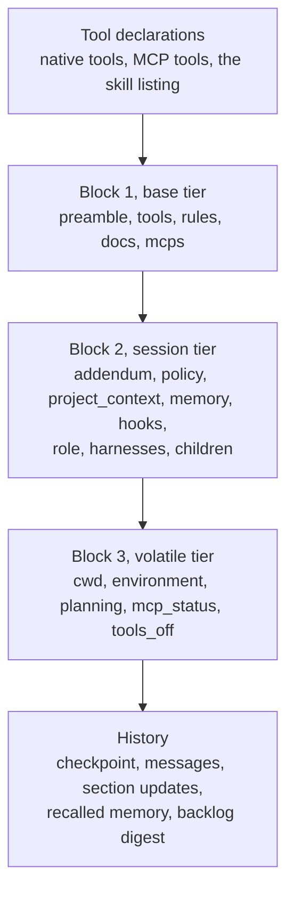

The section list, tiers and writers are one table: `octocode/native/prompts/sections/index.md`; the code reads it (`core/system-prompt-spec.ts`). Empty sections are left out.

| Part | Where it comes from |
| --- | --- |
| `preamble`, `tools`, `rules`, `docs` | Built-in text and each declared tool's snippet and guidelines. `SYSTEM.md` or `--system-prompt` replaces `preamble` and drops `docs`. |
| `mcps` | One block per connected MCP server: name, purpose, `mcp__<server>__*` prefix and the server's own instructions. Never raw `mcp.json`, launch commands or credentials. A server reaches an agent only when its tool selection names it. |
| `addendum` | `APPEND_SYSTEM.md` |
| `work`, `research`, `delegation`, `safety`, `communication` | Policy chosen from the tools the agent declares and its kind (main session or subagent); `lean` replaces it for lean profiles. |
| `project_context` | `AGENTS.md` and friends: the global file, then per ancestor folder from the outermost to `cwd` the first of `AGENTS.override.md`, `AGENTS.md`, `AGENTS.MD`, else `CLAUDE.md`. Files over 64 KiB are cut. `--no-context-files` skips all. Files below `cwd` load on the first read under their folder, appended to that result so the cached prompt stays the same. |
| `memory` | The global and the workspace `MEMORY.md`, read at session start and again after a compaction that finds them changed ([memory](memory.md)). |
| `hooks` | One line per configured event and matcher; never a command, URL or prompt. |
| `role` | A subagent's profile text and skills. |
| `harnesses` | Other agent products Octocode reads (Claude, Codex, Cursor, Pi); main session only. |
| `children` | Main session with the `agent` tool: running children and how to read reports, from the first request so delegation never rewrites the prompt. |
| `cwd`, `environment`, `planning`, `mcp_status`, `tools_off` | Volatile: directory; platform, shell, date, surface; plan mode; servers not ready; a tool turned off but still declared. |

Two things are not system sections:

- **The skills listing** (`path: description` per skill) is the description of the `skill` tool, so it lives with the tool declarations; a skill's body loads only when the model calls `skill` (or you use `/skill:name`). Descriptions can be shortened with `octocode context`.
- **Recalled memory and the backlog digest** arrive in history as hidden notices. Saved notes that match your prompt (a bounded, keyword-based recall, with a pinned-note allowance) are injected at prompt time and not repeated while still in context; a fresh session also gets a short backlog digest (items you hold, counts, the most urgent open titles). A subagent's task arrives in history as its first message.

Tool declarations are not all sent in full: see [Tool loadout](#tool-loadout).

### Sources and how to switch them off

Why something is in an agent's context, and the switch that removes it.

| Source               | Reaches the model as                                                                       | Switch                                                                                                                                           |
| -------------------- | ------------------------------------------------------------------------------------------ | ------------------------------------------------------------------------------------------------------------------------------------------------ |
| Core prompt          | `preamble`, `tools`, `rules`, `docs`, the policy sections or `lean`                        | `SYSTEM.md` or `--system-prompt` replaces `preamble`; the policy follows the declared tools ([prompts](prompts.md))                    |
| Native tools         | Tool declarations (description and schema)                                                 | The agent's profile (`tools:`), `/settings enable` or `disable` `tool:<name>` ([tools](tools.md))                       |
| MCP servers          | The `mcps` block and one declaration per `mcp__<server>__<tool>`                           | `/settings enable` or `disable` `mcp:<name>`, the server's `defaultActive` ([MCP](mcp.md))                                                  |
| Project instructions | `project_context` ([files and limits](../../../docs/CONTEXT.md#project-context))           | `--no-context-files`                                                                                                                             |
| Skills               | The `skill` tool's description lists each skill's path and description; the body loads when the agent calls `skill` | `/harness` (per skill or harness); rewrite descriptions with `octocode context` ([skills](skills.md))                                            |
| Hooks                | `hooks`: one line per event and matcher, never the command; plus hook output as context    | `/settings enable` or `disable` `hook:<id>`; `disableAllHooks` ([hooks](hooks.md))                                                          |
| Other harnesses      | Their MCP servers, skills, hooks and Claude Code's auto memory, merged into the rows above | `/settings enable` or `disable` `harness:<name>` for `claude`, `codex`, `cursor`, `pi`, `agents`, `mcp-json` (`--local` for one repository) |
| Memory               | The `memory` section (global and workspace `MEMORY.md`, read at start), plus a hidden notice with pinned notes and notes matching the user's prompt | `/memory`; Claude auto memory: `/harness` row `claude:memory`, off by default ([memory](memory.md))                                              |
| Backlog digest       | A hidden notice with counts and the top open items                                         | The repository's backlog                                                                                                                         |
| Child task           | The coordinator's brief, then `## You` and `## Report`                                     | The `agent` call                                                                                                                                 |

An agent sees only what its session loaded. A subagent gets its profile's tools, skills and MCP servers, not the coordinator's whole set.

### How other harnesses merge in

A harness adds no block of its own: its items join Octocode's lists, so their cost lands in the tool declarations and the skills listing.

| Item        | Merge rule                                                                                                                                                                                                                                                                                                                                                                             |
| ----------- | -------------------------------------------------------------------------------------------------------------------------------------------------------------------------------------------------------------------------------------------------------------------------------------------------------------------------------------------------------------------------------------- |
| MCP servers | Merged by name. A foreign server never replaces an Octocode server of the same name (`/harness config` lists it as shadowed). One that launches the same program (same command and arguments, or same URL) as a loaded default or Octocode server is dropped under any name; of identical foreign servers the first stays                                                              |
| Skills      | Merged by real path, so a folder symlinked into several harnesses is listed once; two different folders with one name are reported as a collision                                                                                                                                                                                                                                      |
| Hooks       | Keep their source profile: `.claude` files use the Claude profile, `.codex` the Codex profile, `.octocode/hooks.json` the native contract. Identical commands merge within a profile and run once per profile. Project hook files load only in a trusted folder; a subagent runs none unless its profile or its task turns them on ([hooks in subagents](hooks.md#hooks-in-subagents)) |

Before turning a harness on, `/harness list` shows what it supplies, `/harness config` what loaded and from where, `/mcp list` the session's servers.

### What a hook adds to the context

| Hook output                                                           | Becomes                                                                                 |
| --------------------------------------------------------------------- | --------------------------------------------------------------------------------------- |
| Plain text from `SessionStart`, `SubagentStart` or `UserPromptSubmit` | A hidden `Context from <event> hooks:` message                                          |
| JSON `additionalContext` on events that accept it                     | The same message                                                                        |
| Plain text from a Claude-profile `PreToolUse` hook                    | Nothing                                                                                 |
| Plain text from a Codex-profile `PreToolUse` hook                     | A hook failure (`Codex PreToolUse output must be a JSON object`) on every matching call |
| A refusal (exit 2 or a deny decision)                                 | The tool result, with the hook's reason                                                 |

Hook text over 16 KB is saved to a file and shown as head and tail with the path. Each matching hook spawns a process, so a hook on every tool adds its latency to every call.

### How a change reaches the model

A changed section (date, plan mode) becomes a patch in history rather than a rewrite of the cached blocks where the provider adapter allows it; a tool added or removed becomes a tool change in history where supported, else the blocks are rewritten. A model switch cannot reuse the old cache. Details: [Context management](../../../docs/CONTEXT.md#how-a-change-reaches-the-model).

Block 3 is sent without a cache boundary, so a new day or a changed MCP status does not rewrite the two cached blocks above it. A session saved by an older version keeps its stored order. Per-adapter boundaries: [second instruction block](prompt-caching.md#second-instruction-block).

### What keeps a request small

Each saving, what it costs and the setting that controls it:

| Optimization         | Saves                                             | Costs                                                      | Controlled by                                                         |
| -------------------- | ------------------------------------------------- | ---------------------------------------------------------- | --------------------------------------------------------------------- |
| Fixed prefix, cache  | Re-billing the unchanged start at full price      | Changes wait for a new session or a one-time rewrite       | `cacheRetention`, `cacheWarming`, [prompt caching](prompt-caching.md) |
| Deferred tools       | Tokens of descriptions and schemas you do not use | One extra call to read a schema                            | `mcpExposure`, `exposure`, `toolExposure`, `nativeToolExposure`       |
| Clearing old results | Re-sending large old tool output                  | A rewrite of the cached history once; saved copies on disk | None (always on)                                                      |
| Compaction           | Overflowing the window                            | A summary request; detail is lossy but archived            | `contextBudget`, `limits.compaction`                                  |
| Fencing outside data | Injected instructions reaching the model          | A few tokens of fence per fenced result                    | None (always on)                                                      |

### Measuring what a request holds

| Question                                            | How                                                                                                                                                                      |
| --------------------------------------------------- | ------------------------------------------------------------------------------------------------------------------------------------------------------------------------ |
| The exact prompt and tools each built-in agent gets | Contributors: `yarn workspace @octocodeai/octocode-agent run generate:prompts`, then read `.octocode/agent/tmp/agent-prompts/<agent>/` (`system.md`, `tools.md`, `request.json`) |
| Tokens per layer in a real session                  | `/context` in the terminal; an agent's `archive` call with `source: profile` and a request number                                                                        |
| Skill description and MCP file sizes                | `octocode context list`                                                                                                                                                  |
| Which hooks act and how long they take              | `/harness hooks`                                                                                                                                                         |

The captured prompts use an empty user MCP configuration and a fixture `AGENTS.md`, so they show Octocode's own text; a real session adds your servers, skills, harnesses and project files. Measure the real session before claiming a size.

## Tool loadout

A tool is declared to the model in one of four states ([what each gives the model](configuration.md#tool-exposure)).

| State      | Model sees                                                                                                                                                                                                  | Reads the schema through                                                                                                 |
| ---------- | ----------------------------------------------------------------------------------------------------------------------------------------------------------------------------------------------------------- | ------------------------------------------------------------------------------------------------------------------------ |
| `direct`   | Whole description and full schema                                                                                                                                                                           | The declaration                                                                                                          |
| `deferred` | The tool's whole description, its field names with JSON types (up to 32 names per nested object), the few values a field allows, list bounds and required fields, plus one index line in its server's block | A rejected call, or the `mcp` tool with intent `tools`                                                                   |
| `onDemand` | Not declared: one line with its name and trigger in its server's block or the tool list                                                                                                                     | Its first call, or the `mcp` tool with intent `tools`; either declares it from the next request, after the cached prefix |
| `hidden`   | Nothing; the tool cannot be called                                                                                                                                                                          | Not available                                                                                                            |

A deferred tool stays callable and every call is still validated against the server's full schema. Only the schema detail (descriptions of fields, long value lists, deeper fields) is deferred: the field names, short value lists and required fields let the model write a correct first call, and a wrong call returns the full schema. An agent without the `mcp` tool gets nothing deferred and nothing on demand.

### Two layers of tools

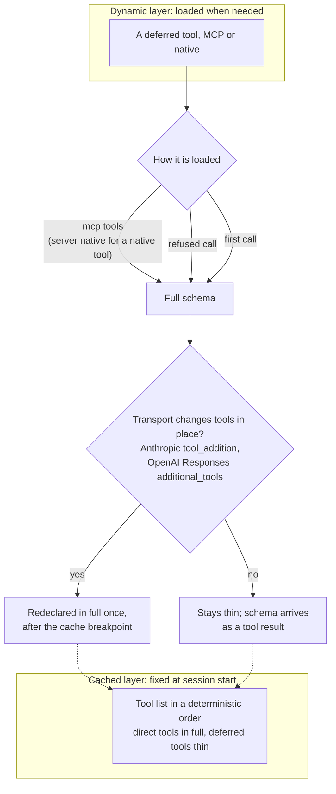

| Layer   | Holds                                                                | Changes                                                                                                        |
| ------- | -------------------------------------------------------------------- | -------------------------------------------------------------------------------------------------------------- |
| Cached  | The tool list and server blocks, in the same order for every session | Only at session start, a model change, tree navigation or a catalog change                                     |
| Dynamic | Full definitions of deferred tools the session needed                | Appended once per tool, after the cache breakpoint, where the transport allows; otherwise only as tool results |

A deferred MCP tool is declared in full after its first call, successful or not. A deferred native tool is declared in full after being read with `mcp` (`intent: "tools"`, `server: "native"`, the tool's name), after a refused call, or after its first call. A compaction summarizes loaded schemas away, so the schemas of deferred tools the session called come back in one hidden message (within a size budget). Details: [exposure and results](mcp-reference.md#exposure-and-results).

### Choosing the state

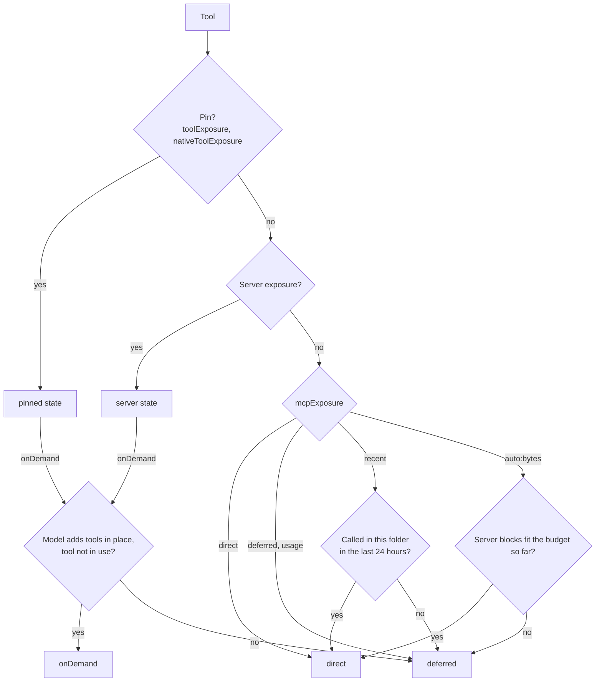

| `mcpExposure`       | A tool without a pin is                                                                                                                    | Saves                                         | Costs                                                                                             |
| ------------------- | ------------------------------------------------------------------------------------------------------------------------------------------ | --------------------------------------------- | ------------------------------------------------------------------------------------------------- |
| `"recent"`          | `direct` if this working directory called it in the last 24 hours, else `deferred`                                                         | Most unused descriptions and schemas          | A first call to a rarely used tool may be refused once for its schema                             |
| `"usage"` (default) | `deferred`, used or not; an on-demand tool the promotion snapshot names is declared `deferred` from the start instead of at its first call | The same; on-demand tools stay out until used | The same first-call cost; a new install has no data, so on-demand tools wait for their first call |
| `"direct"`          | `direct`                                                                                                                                   | Nothing                                       | Every description and schema in every request                                                     |
| `"deferred"`        | `deferred`                                                                                                                                 | The most                                      | The same first-call cost for every tool                                                           |
| `"auto:<bytes>"`    | `direct` for servers in name order while their text fits the byte budget, then `deferred`                                                  | A fixed ceiling, whatever the model's window  | Which servers are direct depends on name order, not on use                                        |

The `auto` budget counts bytes, not a share of the context window, so changing models never changes the loadout.

A tool its configuration puts on demand (`onDemand`) is left undeclared only where that pays:

| Case                                                                                                         | The tool is                                                          |
| ------------------------------------------------------------------------------------------------------------ | -------------------------------------------------------------------- |
| The model cannot add a tool after the cached prompt, or the agent has no `mcp` tool                          | `deferred` from the start                                            |
| In the session's set of tools in use: the promotion snapshot under `"usage"`, recent use under `"recent"`    | `deferred` from the start under `"usage"`, `direct` under `"recent"` |
| An MCP tool named exactly in the agent's `--tools` list (a pattern such as `mcp__browser__*` does not count) | `deferred` from the start                                            |
| Otherwise                                                                                                    | `onDemand` until its first call or a read with `mcp`                 |

`archive`, `models` and `configuration`, and `memory` in a subagent, are on demand whenever they would be `deferred` and no `nativeToolExposure` pin names them.

### Usage-based promotion

`"usage"` declares every deferrable tool thin, however often sessions use it: no tool is promoted to a full declaration. Use decides only when an on-demand tool is declared: one the snapshot names is `deferred` from the session's start, any other waits for its first call.

| Rule                 | Value                                                                                                                                                                                                                                                       |
| -------------------- | ----------------------------------------------------------------------------------------------------------------------------------------------------------------------------------------------------------------------------------------------------------- |
| Counts               | Per tool and per role group (main, subagent): sessions that declared it, called it, read its description, and calls its schema refused. Kept for 7 days across all folders                                                                                  |
| Promoted by use      | At least 10% of declaring sessions called or read it, and at least 20 sessions of that group declared it; a tool with fewer sessions keeps its configured exposure                                                                                          |
| Promoted by refusals | Refused calls exceed one per session that used the tool                                                                                                                                                                                                     |
| Budget               | The promoted tools' thin declarations, most used first, fit `mcpPromotedBytes` (8,192 bytes per role group by default)                                                                                                                                      |
| Snapshot             | Each group computes one per UTC day and installed version, at the first session start that needs it; the session, its resumptions and its subagents keep it                                                                                                 |
| Native tools         | `memory` and `notify` are deferrable only under `"usage"` or a pin; `archive`, `models`, `backlogPlan` and `configuration` follow `recent` and `usage`; `archive`, `models` and `configuration` (and `memory` in a subagent) are the native on-demand tools |
| No data              | Nothing is promoted: on-demand tools wait for their first call. Deleting the counts file has the same effect                                                                                                                                                |

`"usage"` is the default. A tool sessions use often still sends only its thin declaration; its full schema arrives after its first call, in place where the model allows. Counts are a hint: an unreadable file reads as no data.

**Usage audit.** Three places show the same numbers per tool: the **Use (7 days)** column of the Tools panel on the [web Settings page](web-workspace.md#settings-page), the `/mcp` → server → **Tools** page, and the `mcp` tool's `tools` listing. Each row shows the share of sessions that used the tool, its calls, the last day used (or "unused in 7 days"), refusals, and for a deferred tool the bytes its thin declaration saves. Under `"usage"` the row also gives the reason: `promoted` (an on-demand tool the snapshot declares from the session's start) or `unused` (deferred and never used in the window).

### Pins

| Pin                  | Where                                                          | Applies to                                                                                           |
| -------------------- | -------------------------------------------------------------- | ---------------------------------------------------------------------------------------------------- |
| `toolExposure`       | The server's entry in `mcp.json` (exact names or `*` patterns) | One MCP tool                                                                                         |
| `exposure`           | The server's entry in `mcp.json`                               | Every tool of the server without its own pin                                                         |
| `nativeToolExposure` | `settings.json`, for deferrable native tools                   | `direct` or `deferred`; unpinned they follow `mcpExposure`. Every other native tool is always direct |

Pins and `mcpExposure` apply from the next session. See and change them in the Tools panel, or in `/mcp`, then the server, **Tools** › **Default for tools**. Reference: [MCP tool exposure](mcp.md#control-tool-exposure).

## Keeping history small

Before compaction, three cheaper mechanisms run on every request (`octocode/compaction/request-view.ts`):

- **Fencing.** Results from outside sources are wrapped as data with their origin, only in the request, never in the saved session ([Outside data](#outside-data)).
- **Clearing.** Old results of re-fetchable tools and the payload of old `file` writes are replaced by placeholders naming a saved copy ([below](#clearing-old-tool-results)).
- **Dropped thinking.** Thinking made stale by a summary or a cleared result is left out for models that bind thinking to their prefix.

Clearing is cheap and frequent; [compaction](#context-window-and-compaction) is the last resort.

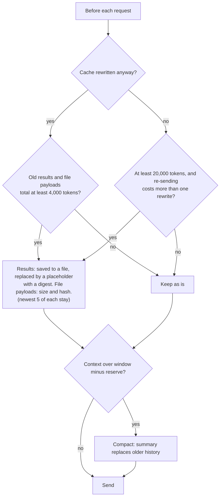

### Clearing old tool results

Old results of `web`, MCP tools and `bash` commands that only print are replaced by a short placeholder that names a file holding their whole text: the command's own output file when Octocode saved one, otherwise a copy saved at that moment. The newest five results always stay. Results still in use stay too: every one called in the last ten turns, whatever its size (the task is still working with them), and older ones whose file path a message of those turns names, up to 20,000 tokens, newest first. A result that cannot be saved stays, so nothing is lost; read the named file or run the call again to see it. A cleared result's placeholder also carries a short digest of what it held: its line count, a command's exit code, and hits per file for a search. `agent` results and writing `bash` commands are never cleared. A `bash` command only prints when every command in it reads (as plan mode judges it) or is a `sed` or `awk` that writes and runs nothing (no `-i`, `w`, `e`, redirect, pipe or `system()` in its script), also after `cd`, in a pipeline or after `;` or `&&`; nothing in the line may be redirected to a file. A `sed` or `awk` behind `xargs` or another wrapper does not count.

The payload of an old `file` change (written content, edit texts or a patch of at least 1,000 characters) is cleared too: the change is on disk, so each long string becomes its size and the start of its SHA-256, and the agent reads the file for its current text.

A `read` result that a later read of the same file shows again (a whole read, or one covering the same lines) is cleared even inside the in-use window: the newer text serves the next step.

Clearing happens when the old results total at least 20,000 tokens while the cache is warm and clearing pays, or at least 4,000 tokens at a request that rewrites the cache anyway:

| Occasion                             | Why clearing then costs nothing extra or pays                                                                                                                           |
| ------------------------------------ | ----------------------------------------------------------------------------------------------------------------------------------------------------------------------- |
| The cache is rewritten anyway        | The cache was last used longer ago than its lifetime, a compaction replaced the history, the model changed, or a tool or instruction update rewrites the leading prompt |
| Re-sending costs more than a rewrite | `T_old × R × N > S_after × W`, with the inputs below                                                                                                                    |

| Input     | Meaning                                                                                                                                                                                                                                                                            |
| --------- | ---------------------------------------------------------------------------------------------------------------------------------------------------------------------------------------------------------------------------------------------------------------------------------- |
| `T_old`   | Tokens of the results that would be cleared                                                                                                                                                                                                                                        |
| `S_after` | Tokens from the first cleared result to the end of the context, after clearing: the part the next request writes to the cache again                                                                                                                                                |
| `R`, `W`  | The model's price for one cached token read and for one token written at the session's cache lifetime (the input price where writes cost no premium). Unpriced models use 0.1 and 1.25 (5-minute) or 2 (longer) times the input price                                              |
| `N`       | Requests expected to re-send the old results: as many as the context has seen since it started or was last compacted, but no more than fit before the context fills its window at its average growth per request since then (counted from the size of the first of those requests) |

While the cache is warm, clearing may start at a later old result than the oldest: a later start clears fewer results but rewrites less of the cache, so a large message that stays (a long brief or report) does not stop the results after it from being cleared. Of the starts that free at least 20,000 tokens and pay, the one that saves most is taken. When the cache is rewritten anyway, all old results are cleared.

The decision is stored with the session, with what started it and the requests it expected (held to what this session's earlier clearings realized), so every later request, a resume and a fork show the same placeholders and the cached prompt stays the same between requests. A model whose cache lifetime is unknown clears only when the cache is rewritten anyway. There is no setting for it.

**Clearing ledger.** The profiler lists each clearing wave as a finding: the tokens it freed, the tokens the next request wrote, the requests until the next compaction, and its net cost or saving (when the model lists prices). Waves that ran because the cache was rewritten anyway are listed apart, one finding per agent, since they added no write.

## Outside data

Text written by someone other than you can carry instructions aimed at the model. Octocode marks it and checks it before it can drive an action.

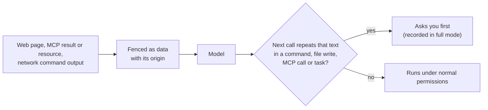

The origin is decided by where the result came from (the tool's source and what ran), never by a field a tool declares about itself, because MCP definitions come from external servers. The fence and the provenance check share this one rule.

| Result                                                                                                             | Fenced? | Why                                                                           |
| ------------------------------------------------------------------------------------------------------------------ | ------- | ----------------------------------------------------------------------------- |
| `web` pages and search snippets                                                                                    | Yes     | Anyone can publish them                                                       |
| MCP tool results                                                                                                   | Yes     | The server, or what it fetched, may be third-party                            |
| Resources read with the `mcp` tool (`read`); its other intents report Octocode's own state, so they are not fenced | Yes     | The resource is the server's text as it wrote it                              |
| Output of network commands such as `curl` and `ssh` that ran                                                       | Yes     | It is remote text                                                             |
| Reads and searches your trusted MCP entries declare as `reader` or `search` over your workspace                    | No      | It is the repository you asked about; a fence would cost tokens on every read |
| `file`, local commands, a refused or blocked call                                                                  | No      | Not outside text                                                              |

The fence names the origin (the URL, query, tool or command) and says the content is data. It is added only when the request is built, so the session, terminal and saved text stay as the tool returned them. The marker is a hash of the text, so the same result fences to the same bytes every time and the cached prefix is kept. A result already replaced by a clearing placeholder is not fenced.

The provenance check is separate: text from untrusted sources (MCP results and resource reads, network command output, a subagent's report) that reappears in a consequential argument (a shell command, file content, an MCP call, a memory, a subagent's task) asks before it runs, in `manual` and `workspace` modes; `full` runs and records it. It matches text, so paraphrase or encoding defeats it: a tripwire, not a sandbox. Sources, limits and modes: [Provenance](permissions.md#provenance).

## Context window and compaction

### How the agent compacts by context size and task

Three things can compact a session; only the first is always on.

| Who | Decides by | When |
|---|---|---|
| Harness, automatic | Context size | The context passes the [threshold](#thresholds); runs before the next model request. No off switch. |
| The agent (`compact` tool) | Context size **and** task boundary | Usage notices tell it how full the context is (50%, 75%, 90% of the room before automatic compaction). From 90% it may call `compact` at a task or item boundary, with a `focus` naming what to keep. Refused below 90%, within two turns of the last compaction, or when recent compactions kept refilling. |
| Harness, at item done | Task boundary and cost | After `backlog done`, if history fills at least `backlog.compactOnDone` (default half) of the room and the work still expected would save more than the summary costs ([details](#compaction-at-item-done)). |

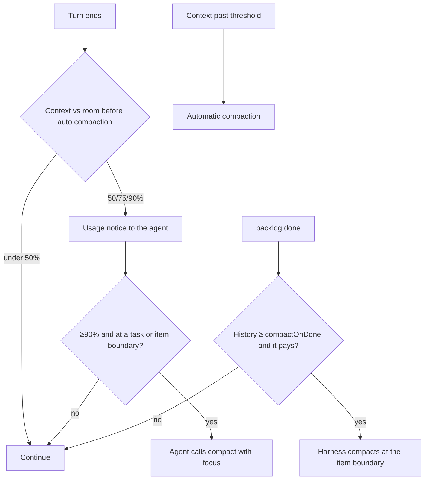

You can always run `/compact [focus]` yourself ([when to compact](#when-to-compact)).

### The window

The working window is `contextBudget` (default 300,000 tokens), capped at 90% of the model's capacity; `"full"` uses all of it (`core/agent-session/context-capacity.ts`). `/context` overrides it for one session. Token counts use the provider's usage receipts where they apply and estimates elsewhere (characters per token: 2.5 for Claude and unknown models, 3.3 for DeepSeek, 3.5 for OpenAI).

`/context` shows the cost per layer, compactions on the branch, the active checkpoint, the threshold and the kept-tail target without calling the model.

### Thresholds

Automatic compaction starts when the context passes `min(window − reserve, 90% of window, limits.compaction.trigger)` (`core/compaction/settings.ts`). `limits.compaction.trigger` can only make it earlier. Automatic compaction has no off switch.

| Value | Rule | 200k window, thinking off |
| --- | --- | --- |
| Reserve | At least 24,576 (room to write the summary inside the cached request), raised to the thinking budget plus 12,288, capped at a sixth of the window; a window whose sixth is under 20,485 keeps an eighth, at most 16,384 | 24,576 |
| Trigger | Context above the lowest of the three limits above | 175,424 |
| Kept recent tail | `limits.compaction.keepRecent`, else a tenth of the window and at least 20,000 tokens, never more than a quarter of the window; the system prompt does not count | 20,000 |

Where the check runs:

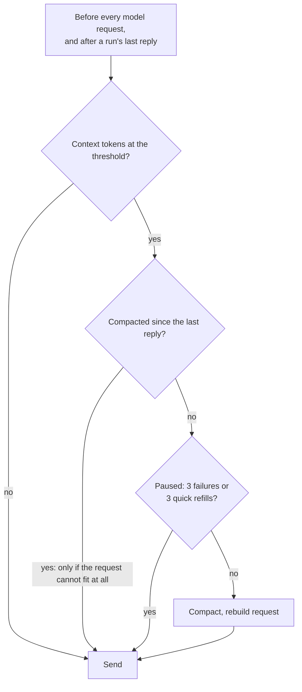

| Situation | Action |
| --- | --- |
| Context overflow or output cut off near a full window, first time this run | Drop that reply, compact, retry the turn once |
| The same again | Report that recovery failed |
| Overflow after a reply that completed | Compact, keep the reply |
| Threshold crossed | Compact without retrying; the run continues from the summary |
| Switch to a model whose window the context does not fit | Compact on the previous model first |

### When to compact

You rarely need to: automatic compaction always runs at the threshold. Run `/compact [focus]` yourself when:

- you finish one task and start an unrelated one, so the old history stops costing every request;
- `/context` shows the history near the threshold and you are at a natural break, so the summary lands between steps rather than mid-edit;
- you want the summary to keep something specific: put it in `focus` ("keep the failing test names and the plan").

Avoid it mid-step, right after another compaction, or when the cache is cold for no reason: each compaction costs a summary request and the next request rebuilds the cache. The agent follows the same rule with its `compact` tool: only at a task or item boundary, once a context notice says automatic compaction is near (see [tools](tools.md#compact)).

Other ways it starts:

- `/compact [focus]` compacts now.
- The agent's own `compact` tool queues one for the end of its reply; it is refused below 90% of the room before automatic compaction, within two turns of the last compaction, and when recent compactions kept refilling the context (`native/tools/compact/tool.ts`); it can take a summary written ahead, and its focus then follows the summary, labelled as the agent's.
- The harness may compact at a finished backlog item when the freed history would pay for the summary (`backlog.compactOnDone`, default `0.5`; [below](#compaction-at-item-done)).
- A summary can be requested ahead of the threshold (it reuses the cached prefix); the compaction takes it only for the same plan, otherwise it writes a new one.

**Pauses.** Automatic compaction stops after three failures in a row for a session and model, and retries after a growing wait (1, 5, 15, then 60 minutes) until one succeeds. It also stops after three compactions in a row that each came within three turns of the previous one. `/compact` resets both. A compaction that leaves the context above 80% of the trigger blocks the next one inside the refill window.

### What compaction does

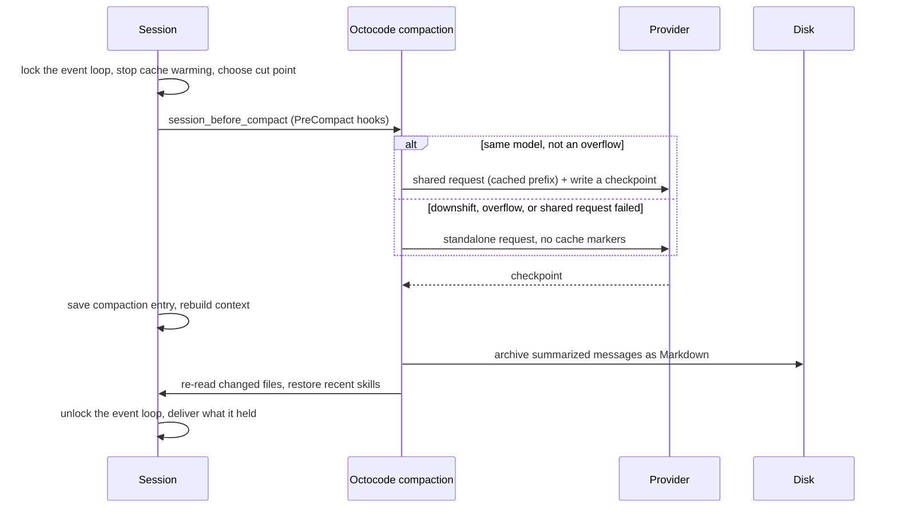

1. **Cut.** The cut is never on a tool result; if it falls inside a turn, a summary of that turn's start is added. If even the newest turn does not fit, compaction fails and history stays: switch to a larger window or `/new`.
2. **Summarize.** The model writes a checkpoint: goal, constraints, progress, decisions, errors and fixes, where it stopped, critical context. Constraints and decisions carry ids (`[C3]`, `[D2]`) and are carried word for word until a later summary marks one lifted or superseded.
3. **Code appends** what must not depend on the summary: your messages and `askUser` answers (and, for a child, its coordinator's messages) word for word within a budget; file lists and saved results; and a Recovery section of about 800 characters (archive and transcript locations, backlog items and running work as the tools report them now, loaded skills by name).
4. **Store.** A summary that fits 80% of the reserve stays inline; a longer one is saved whole to a file behind a reference.
5. **Archive.** Summarized messages become searchable Markdown for the `archive` tool and stay in the session file ([backlog and archive](backlog-and-archive.md)).
6. **Restore.** Up to five files the agent changed in the summarized part are re-read (whole within 8k characters, else an outline or a window of lines; 20k characters in all); files only read are named in one line; the two most recently loaded skills come back (5,000 tokens each, 10,000 in all); schemas of deferred tools the session called are kept. Hooks `SessionStart` (source `compact`) and `PostCompact` run afterward.

A failed or cancelled compaction leaves the history unchanged and gives the event-loop lock back. Navigating the session tree with `/tree` summarizes the branch you leave the same way (`branchSummary.reserveTokens`); if the summary cannot fit, navigation is refused before any model call.

### Compaction rules

One request holds at most one compaction. The event loop stops at a step boundary at 90% of the window, or at the threshold when the reserve leaves less than that. The agent's `compact` tool runs only from 90% of the threshold; below that only `/compact` compacts, except at a [finished backlog item](#compaction-at-item-done). Kept tail, reserve and trigger are in [Thresholds](#thresholds); every original entry stays on disk and compaction also saves searchable Markdown archives for the `archive` tool.

| Part               | Rule                                                                                                                                                                                                                                                                                                                                           |
| ------------------ | ---------------------------------------------------------------------------------------------------------------------------------------------------------------------------------------------------------------------------------------------------------------------------------------------------------------------------------------------- |
| Per request        | One per request; a compaction before a prompt leaves room for it. After one since the last reply, it runs again only if the context plus 12,288 tokens for the reply is past the window. One you cancel is not retried for that request                                                                                                        |
| Summary cache      | Reuses the session transcript and cache preferences when the summary model is the session's and it is not an overflow. A cold cache, a physical-model switch since the last reply or an instruction or tool update sends it with `cacheRetention: "none"`                                                                                      |
| Standalone summary | A downshift, overflow or unusable cached summary uses a standalone request. A final provider rate or usage limit ends the compaction. Standalone requests use no cache markers or routing id (OpenCode keeps its required `x-opencode-session` header)                                                                                         |
| Old tool results   | Cleared when the cache is rewritten anyway or when re-sending them costs more than one cache rewrite, only when enough space is recovered, and only after saving a readable copy ([rule](#clearing-old-tool-results))                                                                                                        |
| Summary output     | A standalone summary (compaction, split-turn prefix, branch summary) may write up to 32,768 tokens, or the model's own limit when lower; one that reaches it fails and saves nothing. The cache-shared summary can use up to 80% of the reserve. It keeps the cached transcript when the checkpoint prompt and its requested output target fit |
| Summary thinking   | A standalone summary thinks at the session's level up to `low` (`off` and `minimal` stay). The cache-shared summary keeps the session's level, since changing it would discard the cached messages                                                                                                                                             |
| Progress           | The status line shows how long the summary has been written and about how many tokens arrived, updated once a second                                                                                                                                                                                                                           |
| Silent summary     | An attempt that receives nothing for `httpIdleTimeoutMs` (default 5 minutes; `0` disables) is cancelled and retried by the `retry` policy; a summary that keeps arriving is never cut off. The same limit ends a silent model stream as a retryable error                                                                                      |

Context, output and thinking defaults follow the selected model. The session’s cache preferences are applied according to its endpoint’s capabilities. [Model defaults](models.md#model-defaults).


### Compaction limits and recovery

`memory` owns saved notes, and `archive` owns history and lifecycle retrieval; [Memory and Archive](memory.md) covers scopes, ids and paging. Compaction uses a built-in policy: settings cannot replace its summary, budget or cut point; `/compact [instructions]` requests it manually. Context sizes use one estimate per model family, measured on provider receipts: 2.5 characters per token for Claude and 3.5 for OpenAI models (2.5 for any other model, the safe side), including declared tools; provider limits can still reject a request.

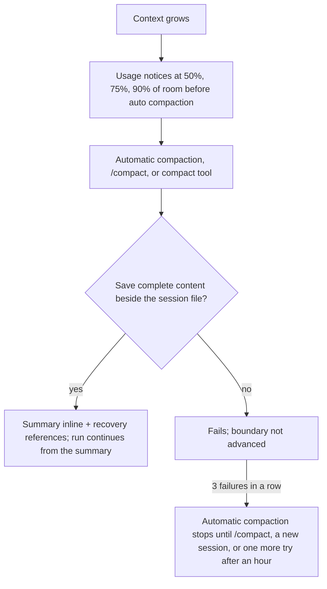

| Topic                | Behavior                                                                                                                                                                                                                                                                                                                                                                                                                                                                                                                                                                                                                                                                                                                                                                                                                                                                                                                                                                                                                              |
| -------------------- | ------------------------------------------------------------------------------------------------------------------------------------------------------------------------------------------------------------------------------------------------------------------------------------------------------------------------------------------------------------------------------------------------------------------------------------------------------------------------------------------------------------------------------------------------------------------------------------------------------------------------------------------------------------------------------------------------------------------------------------------------------------------------------------------------------------------------------------------------------------------------------------------------------------------------------------------------------------------------------------------------------------------------------------- |
| Detailed copies      | Expire `OCTOCODE_CLEANUP_DAYS` after the committed compaction time (default 30; `0` disables cleanup), only after a complete summary and trustworthy timestamp are stored. Reads and resume do not extend it; unknown legacy timestamps preserve copies. Summaries and original transcripts remain                                                                                                                                                                                                                                                                                                                                                                                                                                                                                                                                                                                                                                                                                                                                    |
| `compact` tool       | Optional `focus` (up to 16,000 characters, as for `/compact`). It only queues: compaction aborts the session first, so it runs when the run settles and a hidden message continues the task from the summary. A user stop drops the request, and so does a compaction that ran after it. Refused while context is under half the room before automatic compaction, within two turns of the previous compaction, and after the thrash breaker trips (three compactions in a row each within three turns of the previous stop automatic compaction; manual `/compact` resets; the tool counts as automatic). Subagents do not get it. The usage notice names it only at the 90% notice, when automatic compaction is a few turns away and its summary is being written ahead; compacting then reuses that summary when it is ready. The summarizer is told whether a focus came from the agent or from the user                                                                                                                         |
| Usage notices        | When a turn ends with context past 50%, 75% or 90% of the room before automatic compaction (window less reserve), one hidden message such as `[Context] 140k of 184k usable tokens used (76%); about 44k left before automatic compaction summarizes older turns. The window is 200k.` is added, once per band per compaction cycle (also across resume); the system prompt never changes for it                                                                                                                                                                                                                                                                                                                                                                                                                                                                                                                                                                                                                                      |
| Result budget        | One assistant message's tool results share 100,000 characters for every tool alike (two requested pages). One result keeps 20 KB by default (other MCP tools), 12 KB for `bash` and 8 KB for `web`; a call can ask for up to 50,000 (`responseChars`, `maxChars`; `bash` `maxOutputTokens` only lowers its result, never raises it), and no text part keeps more than 60,000 whole. Spent in tool-call order, not completion order, so the same calls keep and lose the same text and the cached prefix stays stable. The first part that does not fit keeps head and tail with a note, and it and every later part go to one JSON-lines file in the session's `output/` folder whose path the note names; later results show a short pointer. Images are not counted; a result with its own spill note is charged for what it shows; the budget restarts each turn. Only the stored message and the model's context are bounded: `tool_execution_end` events carry the full result. Archive reads reject files over 32 MiB           |
| Checkpoint           | Checked with retained messages, the system prompt and tool declarations. Oversized checkpoints, long user-message collections and a read/modified-files list over 3,000 characters are saved beside the session file and replaced by recovery references; an oversized checkpoint keeps its goal, TL;DR, newest user messages and Recovery section inline, whichever fit. A summary updating an earlier one is asked to stay under half the inline budget. A user message over 6,000 characters (less on a small window) is saved whole and replaced by its reference in place. A subagent's messages may each take up to half the section; its task, the oldest message, is evicted last. When messages do not fit beside the summary in the inline budget (80% of the reserve), the whole collection is saved behind one reference, keeping the newest that fit whole so the latest request survives word for word. The saved-results list also names each summarized subagent run's transcript and archive folder while they exist |
| While compacting     | Other input is queued but an extension command runs at once; one that cannot start returns to the editor with `Command did not run; restored to editor: <reason>`                                                                                                                                                                                                                                                                                                                                                                                                                                                                                                                                                                                                                                                                                                                                                                                                                                                                     |
| Moving or backing up | Keep checkpoint files with the session: they and `.bak` copies go when the session is removed, but files a saved-results list names live in `output/`, `bash/` and subagent scratch folders, which the session-start sweep removes after `OCTOCODE_CLEANUP_DAYS` without a write. A file in `output/` or `bash/` that the session's latest summary names (in its text, or in the list file a long saved-results list moves to) is kept past that age and goes with the session; a file only an earlier summary named can be gone                                                                                                                                                                                                                                                                                                                                                                                                                                                                                                      |
| `--no-session`       | No session file: long tool results, user messages and oversized checkpoints stay inline, cut to budget with a marker saying how many characters were omitted (head and tail stay); output past a tool's cap is still saved to `output/`. Only a session file that cannot be written fails compaction                                                                                                                                                                                                                                                                                                                                                                                                                                                                                                                                                                                                                                                                                                                                  |
| Summary too large    | When the messages to summarize do not fit the summarizer's window, the older half (by estimated size) is summarized on its own and that summary is updated with the rest, at the cost of one more request. A half that still does not fit drops its own oldest messages, and the summary says earlier history was left out                                                                                                                                                                                                                                                                                                                                                                                                                                                                                                                                                                                                                                                                                                            |
| Failures             | If complete content cannot be saved, or retained context and reference cannot fit, compaction fails without advancing its boundary. Three failures in a row stop automatic compaction until a successful `/compact`, a new session or, an hour after the last failure, one more attempt; reported once per trip and on each unrecoverable overflow. A user cancel does not count. A summary the model already wrote is kept for the next attempt over the same messages                                                                                                                                                                                                                                                                                                                                                                                                                                                                                                                                                               |

### Compaction at item done

When the main session completes an item with `backlog done`, Octocode may compact the context at that item boundary, before the next model request, so a run over many items keeps its context small. Two checks decide. `backlog.compactOnDone` (default `0.5`; `0` turns it off) is a floor on the history's share of the room before automatic compaction (the context less the system prompt and tool declarations): it limits how often this runs. A gain check limits losses: the history a compaction frees (all but the recent part it keeps) is read again by every later request, so it runs only when the requests this session still expects, its average per finished item times its own open items (at most 50), save more than the summary costs at the model's prices (cached reads and the cache write of the kept part for a caching provider, plain input otherwise). Items assigned to this session count (ongoing, or todo with this session as assignee); other sessions' todo items never do. When nothing remains, the compaction runs when the reply ends, only when the context is nearly full (the compact tool's 90% floor), and the session stays idle afterwards. When the model already has a summary written ahead of the threshold for the same input, it is reused and the finished items follow it; the summary labels them as recorded by the harness. Several items finished in one turn are focused together. A run that is stopped drops the request. It is skipped while an agent `compact` request is queued, right after another compaction, or after repeated compactions that did not shrink the context; compactions at finished items do not count as refills for that last check. Each decision, with its measures and outcome, is recorded in the session as a `done-compaction` note. Subagents never compact this way; `close`, `claim` and refused completions do not trigger it.

```json
{ "backlog": { "compactOnDone": 0.5 } }
```

### Across many windows

Each request and each later compaction use only the newest checkpoint.

| Layer | Keeps | Use for |
| --- | --- | --- |
| Recent messages | The retained tail, verbatim | Immediate reasoning, tool-call continuity |
| Checkpoint | Goals, constraints, decisions, evidence, active work, next steps | Continuing after compaction |
| Backlog and tasks | Work state, owners, dependencies | What remains; no duplicate work |
| Memory | Preferences, facts, procedures | Knowledge across sessions |
| Archive | Earlier transcripts and full checkpoints | Exact details no longer in context |

Summaries are lossy: a saved checkpoint proves persistence, not that every distinction survived. Because your messages are carried verbatim and the transcript keeps everything, a dropped correction is recoverable if the model looks. Details and limits: [Context management](../../../docs/CONTEXT.md#across-many-context-windows).

## Prompt caching

The request is built so its start stays byte-identical from one request to the next: tool declarations and the first two instruction blocks change rarely, the volatile block has no cache breakpoint, and changes arrive as patches in history. A model or provider switch, and a compaction, rewrite the cache once; no event rewrites it on every turn. Providers, retention, warming, what each event does to the cache and how forks and children share it: [prompt caching](prompt-caching.md); only the provider's cached-token usage fields prove a hit, and `/status` shows them.

## Failure, recovery and resume

**Retries.** A transient provider failure (overload, rate limit, server error, dropped stream) is retried with exponential backoff (`retry.maxRetries` 3, `retry.baseDelayMs` 2,000; [settings](settings.md)) only when repeating is safe: the failed attempt showed no text and ran no tool. Otherwise the error stands rather than printing a second answer or repeating a tool's effect (`core/agent-session/replay-safety.ts`). While the machine is offline, retries wait on `retry.offlineIntervalMs`. A usage limit, refused credential, unavailable model or outlasting outage can move the turn to the next model in `retry.fallbackModels` or `retry.fallbackChains`. Context overflow is not retried: it is recovered by compaction.

**Nothing is lost on disk.** Every entry stays in the session file, and compaction only changes what is projected into the request. A resumed or forked session rebuilds the same context, including stored clearing placeholders.

**Resume.** `octocode --resume`, `--session` or `/resume` open a saved session (flags: [CLI](cli.md)). On the next start the loop replays stored events that were never delivered (finished jobs, child reports, mail, timer fires), each once. A brief tagged `[Resumed]` then tells the model how long it was away, whether the Git branch or HEAD moved, uncommitted changes, the last user request, the backlog items and steps this session holds, paths it reserved and questions waiting for you. It also lists what ended with the earlier process:

- tool calls with no recorded result ("each may have run: check the current state before you repeat it"), and subagents those calls started;
- background jobs and subagents that stopped without a report, with how to continue a subagent (`agent` with `resume`).

After a compaction, a similar `[After compaction]` note and the checkpoint's Recovery section refresh running work from recorded state, not from the summary's memory: check it before retrying a side effect or delegating again.

**Child sessions.** A child's transcript and report are kept; its coordinator can continue it by id. Delegation, teams and profiles: [subagents](subagents.md).

### Transcript write failures

| Situation                                                           | Behavior                                                                                                                                                                                                                                                                                                                                                                                                                                                                                                                                                                                                                                                       |
| ------------------------------------------------------------------- | -------------------------------------------------------------------------------------------------------------------------------------------------------------------------------------------------------------------------------------------------------------------------------------------------------------------------------------------------------------------------------------------------------------------------------------------------------------------------------------------------------------------------------------------------------------------------------------------------------------------------------------------------------------- |
| An append fails                                                     | The live session restores its previous branch and blocks writes until one can succeed; nothing is cut from the file automatically; a full disk or I/O error is not final (freeing the disk resumes). A record that fully reached the file before its flush failed is kept, not rewritten; a partial one is sealed by the next write, as in the next row                                                                                                                                                                                                                                                                                                        |
| Lock held past 3 s                                                  | Nothing is written: a tool result or assistant message stays in memory and goes first at the next write (or at replacement or quit); any other entry fails for its caller to retry. The holder is recorded beside the lock (pid, host, start time): a lock whose holder is verifiably gone (killed, crashed: no process with its pid, or a later process that reused it) is taken at once instead of after 10 s, while a live or unknown holder is waited for. A database mirror read waits at most 250 ms and leaves the repair to a later append or open                                                                                                     |
| Full disk, I/O error                                                | A tool result or assistant message is lost and the run fails; the next request tells the model no result was recorded and the call may have run; a resume names the unanswered calls with their whole arguments, the last request in full, and, for an unanswered `agent` call, each subagent it started and how that run ended                                                                                                                                                                                                                                                                                                                                |
| Last record cut off (a crash, a kill, a power loss before the sync) | Loading skips it. The next write ends it with a newline under the session lock, so its bytes stay in the file as one line every reader skips, and writes right after it a `custom` record (`octocode-session-recovery`) naming its offset and length; the session goes on after it. An interactive session opened with such a tail says so once. Only bytes after the last newline that are not JSON count; a final line that is JSON but not a record, or a file with no whole line, stays refused                                                                                                                                                            |
| Shrunk file, unplaceable record                                     | Stays refused. The error names `octocode --fork <file>`, which copies the complete records into a new session and leaves the original byte-identical; `--fork <id>` reads the transcript file when it exists, the database copy only otherwise (stale exactly when a mirror rebuild failed). A malformed line another process left is refused unless the recovery record after it names it. A session whose very first write fails keeps the transcript in memory and creates the file at the next write, unless that left a partial file                                                                                                                      |
| Database mirror                                                     | Written after the transcript by a background database thread, so a busy database never holds the transcript lock or the screen; appends made together go as one write. A missed commit repairs itself at the next append; after a failed whole-file rebuild appends wait 5 s, then up to 5 min, before another try, while an open tries at once and every append still reaches the transcript. If the thread stops, its unconfirmed writes are rebuilt from the transcript; if it cannot start, the mirror is written on the main thread with a 100 ms wait. Quitting waits up to 1.5 s for queued mirror writes; one still queued is rebuilt at the next open |
| Older format                                                        | Opening rewrites the file in the current format (only parsable lines survive) after copying the original to the next free `.bak` name. Otherwise loading never writes: a final record lacking only its newline loads as is and the next append adds the newline. A session whose parent links loop still loads, with the entry closing the loop as root. A fork is written whole to a temporary file and renamed, so a failed copy leaves no partial session                                                                                                                                                                                                   |
