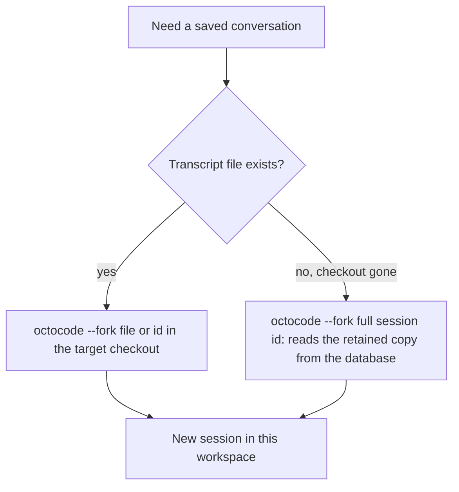
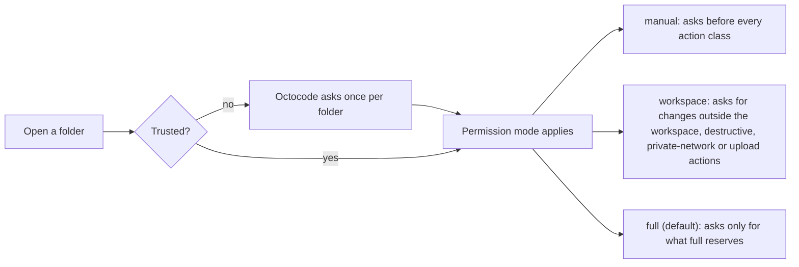
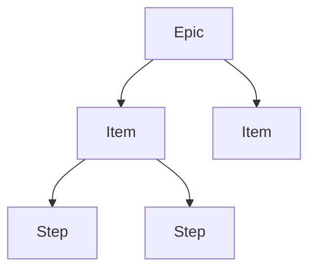

# How to

Short recipes. Each links to the page that owns the details. Lines starting with `/` run inside a session; the others run in a shell. Every command is listed in [commands](commands.md).

## Resume a session, or find the one that worked on a backlog item

| Want                                                                        | Do                                                             |
| --------------------------------------------------------------------------- | -------------------------------------------------------------- |
| Most recent session of this folder                                          | `octocode --continue`                                          |
| Pick from a list (grouped by day; Tab switches this folder and all folders) | `/resume` or `octocode --resume`                               |
| A specific session                                                          | `octocode --resume <id>`; the command is printed when you quit |
| Sessions that held or hold item B346                                        | `/resume B346` (`/resume all B346` searches every repository)  |

In a worktree, `--continue` and `--resume` see only that folder's sessions: press Tab in the picker or use `octocode --resume <id>`. Details: [session commands](native-features.md#session-workflow-commands), [CLI sessions](cli.md#sessions).

## Recover a saved conversation

Sessions persist as JSONL transcripts in `.octocode/agent/sessions/` of the checkout (`--session-dir` picks another folder) and are mirrored in Octocode's database, including tool results, child reports, branches and compactions. If the database is unavailable after a file write, Octocode reports the pending mirror and retries when the transcript is next opened or written.

A transcript writes repeated data once and refers back to it from later lines of the same file. Reading the file restores every entry whole, and nothing else is needed: a copied, forked or exported file reads on its own. Transcripts written by earlier versions read unchanged.

| Repeated data                                                           | Stored as                                                                                                                                                                                        |
| ----------------------------------------------------------------------- | ------------------------------------------------------------------------------------------------------------------------------------------------------------------------------------------------ |
| A request's layer list (sizes and hashes, for the profiler)             | The layers that differ from an earlier request's list                                                                                                                                            |
| System prompt text, sections and tool declarations, also in compactions | One copy per file, referred to by its hash                                                                                                                                                       |
| A bash result's output, repeated for the terminal and for scripts       | A position in the result text; when the output was saved to a file, that file's path, read when a script asks for the output; the result text stays in the transcript after that file is deleted |



A session whose last record was cut off (a crash or a power loss mid-write) resumes in place: that part stays in the file as a skipped line. `--fork <file>` copies a session's complete records into a new one and leaves the file as it is. `--no-session` keeps a conversation in memory only.

## Rename a session, and turn off automatic titles

- `/rename <name>`, `octocode --name "<name>"`, or Ctrl+R in the `/resume` picker. A name you give is never overwritten.
- An unnamed interactive or RPC session is titled after its first turn by a cheaper model; one still unnamed when compacted is titled from the summary's goal. To stop that, set `"sessions": { "autoTitle": false }` in `settings.json`; the first prompt then stays the title ([settings](settings.md)).

## Turn a tool, skill, hook or MCP server on or off

| Scope             | Do                                                                           |
| ----------------- | ---------------------------------------------------------------------------- |
| Everywhere        | `/settings disable tool:backlog` (or `enable`)                               |
| This project      | add `--local` (needs a trusted folder)                                       |
| One run           | `octocode --disable tool:backlog`, `--enable <id>`, `--set key=value`        |
| Browse and toggle | `/settings` with no argument; Space toggles, Tab switches global and project |

`/settings list <kind>` shows the ids (`tool:`, `mcp:`, `skill:`, `hook:`, `harness:`, ...). Details: [configuration](configuration.md#changing-configuration).

## Add an MCP server for this project only

1. `octocode mcp add --local docs -- npx -y some-mcp-server` (or `--url <url>` for a remote server) writes `.octocode/mcp.json`; `-l` is short for `--local`.
2. In a running session, `/reload`; the folder is already trusted, so project hooks, MCP servers, agents and skills load.
3. Check: `/mcp list` in the session shows each server's state; in a shell, `octocode mcp list --check` connects the enabled servers and shows theirs (without `--check` it only reads the configuration). `/mcp tools docs` lists its tools.
4. To switch it off later: `/settings disable mcp:docs --local`.

Details: [Add an MCP server](mcp.md#add-a-server), [MCP precedence](configuration.md#precedence), [project trust](permissions.md#project-trust).

## Make subagents use a cheaper model

| Level                                    | How                                                                                                                                                                    |
| ---------------------------------------- | ---------------------------------------------------------------------------------------------------------------------------------------------------------------------- |
| One call                                 | The `agent` tool's `model` field takes `small`, `medium`, `provider/id` or a bare id, optionally with `:thinking` (`small:high`). Ask: "run this with a `small` model" |
| A role                                   | `model: small` in the profile front matter, e.g. `.octocode/agents/<name>.md`. The bundled `researcher`, `browser` and `lean` roles already use `small:low`            |
| Every child with no thinking level named | `export OCTOCODE_SUBAGENT_THINKING=low`; otherwise such a child runs at `medium`. `defaultThinkingLevel` applies only to the main session                              |
| Escalate a cheap child                   | Continue it with `resume` and a stronger `model`; its conversation is kept                                                                                             |

`/modelsettings` shows what `small` and `medium` resolve to, the default thinking level and how each profile routes; each start result and report names the route a child ran on. Details: [the subagent model](native-features.md#the-subagent-model), [profile front matter](native-features.md#profile-front-matter).

## Give the agent a durable rule for this repository

- `/memory add <title>` opens an editor for a workspace memory, or tell the agent "remember that ..." and it saves one with `memory` (`op: set`). Add `keywords` you would type when the rule matters. Pin it (`/memory`, pick it, **Pin**) to inject it before every prompt.
- It may not appear later when automatic recall is off (the `memory.recall` setting: `off`, `main` by default, or `all` for subagents too; `/memory auto` shows it), the prompt shares too few words with it, or it was already injected on this branch. `/memory last` shows the latest injection.

Details: [memory](memory.md).

## Control a desktop app

1. Install Cua Driver from [github.com/trycua/cua](https://github.com/trycua/cua) with its own installer (macOS or Linux: `/bin/bash -c "$(curl -fsSL https://cua.ai/driver/install.sh)"`; Windows PowerShell: `irm https://cua.ai/driver/install.ps1 | iex`; [guide](https://cua.ai/docs/cua-driver/quickstart)), then grant it Accessibility and Screen Recording (`cua-driver permissions grant`). Octocode does not install it.
2. Start a new session. Check `/mcp`: `desktop` is listed, and enabled while Octocode finds `cua-driver` (on `PATH`, or at the absolute path in `OCTOCODE_CUA_DRIVER_PATH`).
3. Ask for the task: "open Calculator, compute 6 × 7 and show me the screenshot". The main agent starts the `desktop` specialist and you are asked to approve it, in every permission mode.
4. Read the report: the outcome, the app, the screenshot path. Cua Driver's telemetry is on by default; `cua-driver telemetry disable` turns it off.

[Details](native-features.md#desktop-control), [permissions](permissions.md#desktop-control).

## Run two sessions in parallel on different branches

- In a second terminal: `octocode --worktree <name>`. It creates `.octocode/agent/worktrees/<name>` on branch `worktree-<name>` at the current HEAD, or reuses it. From a session, `/worktree new <name>` does the same (inside tmux it opens a window).
- Add `.octocode/agent/worktrees/` to `.gitignore`. List `.env`-style untracked files to copy in a `.worktreeinclude` file; dependencies are not installed.
- `/worktree list` shows each worktree's branch and unsaved work. Each worktree has its own backlog and workspace memories; the agent team and project memories span the repository.

Details: [worktrees](native-features.md#worktrees).

## Message a CLI session Octocode did not start

Octocode sessions message each other directly. A Claude Code or Codex session that Octocode did not start has no such channel, so the agent sends through that tool's own command line, once per message:

1. Write the message to a file, and name a reply file in it.
2. Run the other tool's CLI as a one-shot proxy from `bash`: its cheapest model, with no MCP servers, skills or saved session, told to pass the file's text word for word to the intended session and print the result.
3. Wait for the reply file with a timer (`until` with the command `test -e <reply file>`) and a short deadline.

For Claude Code the proxy command is:

```sh
claude -p "<prompt>" --model haiku --strict-mcp-config --disable-slash-commands --no-session-persistence --allowedTools "ListAgents,SendMessage,ToolSearch,Read"
```

Leave out `--bare`: it breaks the login. When a tool's `--help` shows no way to message another session (Codex), the agent tells you instead of guessing. Secrets are never sent this way, and when it is unclear which session is meant, the agent asks.

## See what happened in a compacted part of this session

- Ask the agent: its `archive` tool searches this session's compacted messages and your repository's other sessions.
- `/archive` lists the compacted segments; `/archive <n>` prints the file path of segment `n` for you or the agent to read (not the content).
- `/tree` navigates the session's branches.

Details: [compaction and recovery](native-features.md#compaction-and-recovery).

## Limit what the agent may run, and trust a project



- Start stricter with `OCTOCODE_PERMISSION=manual` or `--permission-mode workspace`, or switch in a session with `/permissions manual|workspace|full`.
- `/permissions grants` lists what you allowed for the session; `/permissions grants clear` removes it.
- `/trust` lists and changes the per-folder decisions. Permissions apply after trust. This is not an operating-system sandbox.
- To confine what the agent's shell commands can write, read and reach once they run, turn on the [sandbox](sandbox.md).

Details: [modes](permissions.md#modes), [project trust](permissions.md#project-trust).

## Plan work as an epic with child items and steps



- Ask the agent to create an epic and its items: the `backlogPlan` tool's `add` takes one entry per item in `items`, with `type: "epic"` on the epic and `parentId` on each child. `backlogPlan` `list` with `underEpic` lists an epic's items; `backlog` `get` on the epic shows its derived state and done count.
- Steps of one piece of work are a checklist you keep under an item on the board (`/backlog` or the web workspace). The agent reads them with the item (`backlog get`) and after a resume, and cannot finish or close the item while one is open: finish or drop the steps on the board. The agent keeps its own steps in the item's plan and notes.
- See the hierarchy with `/web backlogs` (**Tree** view) or `/backlog tui`.
- Close an item that is not needed instead of deleting it: ask the agent (`backlog` with op `close`), run `/backlog B12 close`, or use **Close** on the web board. Give a kind (obsolete, duplicate of another item, won't do) and a reason; the item is kept, hidden from the default board and shown by `backlogPlan` `list` with `states: ["closed"]`. Reopen it with a note (`backlogPlan` `edit` with a state and `note`). `backlog` `get` with `changes` ends with the audit trail.

Details: [backlog view](web-workspace.md#backlog-board), [web controls](web-workspace.md#backlog-board).

## Load a skill, and write your own

- `/harness list skills` lists discovered skills and where each came from; `/settings enable|disable skill:<name>` switches one (`/settings list skill` shows the ids). Run one by typing `/<name>` (`/skill:<name>` on a name clash). The agent loads one itself when its description fits the task.
- To write one, create `<name>/SKILL.md` with `name` and `description` front matter, then the instructions, in `.octocode/skills/` (this project) or `~/.octocode/octocodecode/skills/` (all projects), then `/reload`. The description should say what the skill does and when to use it.

Details: [create a skill](skills.md#create-a-skill), [find and control skills](skills.md#find-and-control-skills), [skill locations](configuration.md#where-each-configuration-belongs).

## Use Octocode on a slow or small machine

| Lever                                      | Effect                                                                                                                              |
| ------------------------------------------ | ----------------------------------------------------------------------------------------------------------------------------------- |
| `OCTOCODE_MAX_SUBAGENTS`                   | Subagents running at once; default is one per CPU and one per GiB of memory, at most 6. A child with its MCP pair peaks near 450 MB |
| `terminal.reduceMotion` in `settings.json` | Stops the animated marks                                                                                                            |
| `/processes`                               | Shows what each Octocode process uses                                                                                               |
| `OCTOCODE_TIMING=1`                        | Prints wall and CPU time per startup phase                                                                                          |
