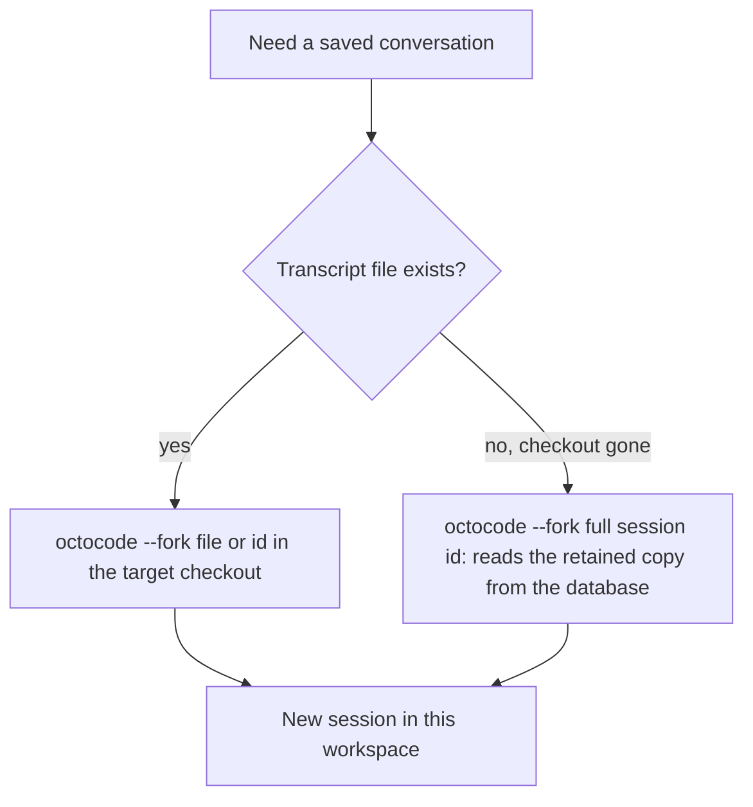
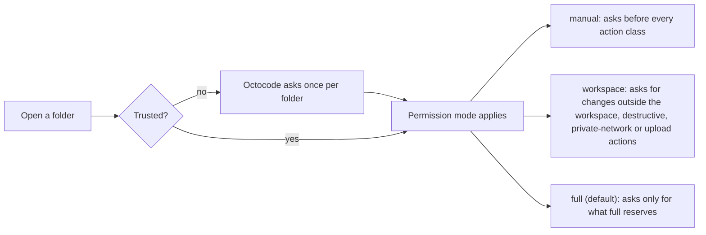
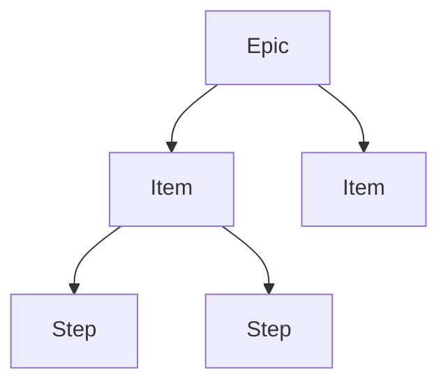

# How to

Short recipes. Each links to the page that owns the details. Lines starting with `/` run inside a session; the others run in a shell. Every command is listed in [commands](commands.md).

## Resume a session, or find the one that worked on a backlog item

| Want                                                                        | Do                                                             |
| --------------------------------------------------------------------------- | -------------------------------------------------------------- |
| Most recent session of this folder                                          | `octocode --continue`                                          |
| Pick from a list (grouped by day; Tab switches this folder and all folders) | `/resume` or `octocode --resume`                               |
| A specific session                                                          | `octocode --resume <id>`; the command is printed when you quit |
| Sessions that held or hold item B346                                        | `/resume B346` (`/resume all B346` searches every repository)  |

In a worktree, `--continue` and `--resume` see only that folder's sessions: press Tab in the picker or use `octocode --resume <id>`. Details: [session commands](native-features.md#session-workflow-commands), [CLI sessions](cli.md#sessions).

## Recover a saved conversation

Sessions persist as JSONL transcripts in `.octocode/code/sessions/` of the checkout (`--session-dir` picks another folder) and are mirrored in Octocode's database, including tool results, child reports, branches and compactions. If the database is unavailable after a file write, Octocode reports the pending mirror and retries when the transcript is next opened or written.

`--fork <file>` also continues a session whose last record was cut off: complete records are copied and the file stays. `--no-session` keeps a conversation in memory only.

## Rename a session, and turn off automatic titles

- `/rename <name>`, `octocode --name "<name>"`, or Ctrl+R in the `/resume` picker. A name you give is never overwritten.
- An unnamed interactive or RPC session is titled after its first turn by a cheaper model; one still unnamed when compacted is titled from the summary's goal. To stop that, set `"sessions": { "autoTitle": false }` in `settings.json`; the first prompt then stays the title ([settings](settings.md)).

## Turn a tool, skill, hook or MCP server on or off

| Scope             | Do                                                                                |
| ----------------- | --------------------------------------------------------------------------------- |
| Everywhere        | `/configuration disable tool:backlog` (or `enable`)                               |
| This project      | add `--local` (needs a trusted folder)                                            |
| One run           | `octocode --disable tool:backlog`, `--enable <id>`, `--set key=value`             |
| Browse and toggle | `/configuration` with no argument; Space toggles, Tab switches global and project |

`/configuration list <kind>` shows the ids (`tool:`, `mcp:`, `skill:`, `hook:`, `harness:`, ...). Details: [configuration](configuration.md#changing-configuration).

## Add an MCP server for this project only

1. `octocode mcp add --local docs -- npx -y some-mcp-server` (or `--url <url>` for a remote server) writes `.octocode/mcp.json`; `-l` is short for `--local`.
2. In a running session, `/reload`; the folder is already trusted, so project hooks, MCP servers, agents and skills load.
3. Check: `/mcp list` in the session or `octocode mcp list` in a shell shows each server's state; `/mcp tools docs` lists its tools.
4. To switch it off later: `/configuration disable mcp:docs --local`.

Details: [MCP quick setup](mcp.md#quick-setup), [MCP precedence](configuration.md#precedence), [project trust](permissions.md#project-trust).

## Make subagents use a cheaper model

| Level                                    | How                                                                                                                                                                    |
| ---------------------------------------- | ---------------------------------------------------------------------------------------------------------------------------------------------------------------------- |
| One call                                 | The `agent` tool's `model` field takes `small`, `medium`, `provider/id` or a bare id, optionally with `:thinking` (`small:high`). Ask: "run this with a `small` model" |
| A role                                   | `model: small` in the profile front matter, e.g. `.octocode/agents/<name>.md`. The bundled `researcher`, `browser` and `lean` roles already use `small:low`            |
| Every child with no thinking level named | `export OCTOCODE_SUBAGENT_THINKING=low`; otherwise such a child runs at `medium`. `defaultThinkingLevel` applies only to the main session                              |
| Escalate a cheap child                   | Continue it with `resume` and a stronger `model`; its conversation is kept                                                                                             |

`/modelsettings` shows what `small` and `medium` resolve to, the default thinking level and how each profile routes; each start result and report names the route a child ran on. Details: [the subagent model](native-features.md#the-subagent-model), [profile front matter](native-features.md#profile-front-matter).

## Give the agent a durable rule for this repository

- `/memory add <title>` opens an editor for a workspace memory, or tell the agent "remember that ..." and it saves one with `archive` (`op: set`, `source: memories`). Add `keywords` you would type when the rule matters. Pin it (`/memory`, pick it, **Pin**) to inject it before every prompt.
- It may not appear later when injection is off (`/memory auto`), the prompt shares too few words with it, or it was already injected on this branch. `/memory last` shows the latest injection.

Details: [memory](memory.md).

## Run two sessions in parallel on different branches

- In a second terminal: `octocode --worktree <name>`. It creates `.octocode/worktrees/<name>` on branch `worktree-<name>` at the current HEAD, or reuses it. From a session, `/worktree new <name>` does the same (inside tmux it opens a window).
- Add `.octocode/worktrees/` to `.gitignore`. List `.env`-style untracked files to copy in a `.worktreeinclude` file; dependencies are not installed.
- `/worktree list` shows each worktree's branch and unsaved work. Each worktree has its own backlog and workspace memories; the agent team and project memories span the repository.

Details: [worktrees](native-features.md#worktrees).

## See what happened in a compacted part of this session

- Ask the agent: its `archive` tool searches this session's compacted messages and your repository's other sessions.
- `/archive` lists the compacted segments; `/archive <n>` prints the file path of segment `n` for you or the agent to read (not the content).
- `/tree` navigates the session's branches.

Details: [compaction and recovery](native-features.md#compaction-and-recovery).

## Limit what the agent may run, and trust a project

- Start stricter with `OCTOCODE_PERMISSION=manual` or `--permission-mode workspace`, or switch in a session with `/permissions manual|workspace|full`.
- `/permissions grants` lists what you allowed for the session; `/permissions grants clear` removes it.
- `/trust` lists and changes the per-folder decisions. Permissions apply after trust. This is not an operating-system sandbox.

Details: [modes](permissions.md#modes), [project trust](permissions.md#project-trust).

## Plan work as an epic with child items and steps

- Ask the agent to create an epic and its items: the `backlog` tool takes `type: "epic"` and `parentId` on each child. `backlog list` with `parentId` lists an epic's items; `backlog get` on the epic shows its derived state and done count.
- Steps of one piece of work are the `steps` tool's tasks under the item you claim (`add`, `list`, `update`). An item cannot be done while it has open tasks.
- See the hierarchy with `/web backlogs` (**Tree** view) or `/backlog tui`.
- Close an item that is not needed instead of deleting it: ask the agent (`backlog update` with `close`), run `/backlog B12 close`, or use **Close** on the web board. Give a kind (obsolete, duplicate of another item, won't do) and a reason; the item is kept, hidden from the default board and shown with `states: ["closed"]`. Reopen it with a note. `backlog get B12` ends with the audit trail.

Details: [backlog view](web-workspace.md#backlog-board), [web controls](web-workspace.md#backlog-board).

## Load a skill, and write your own

- `/harness list skills` lists discovered skills and where each came from; `/configuration enable|disable skill:<name>` switches one (`/configuration list skill` shows the ids). Run one by typing `/<name>` (`/skill:<name>` on a name clash). The agent loads one itself when its description fits the task.
- To write one, create `<name>/SKILL.md` with `name` and `description` front matter, then the instructions, in `.octocode/skills/` (this project) or `~/.octocode/octocodecode/skills/` (all projects), then `/reload`. The description should say what the skill does and when to use it.

Details: [create a skill](skills.md#create-a-skill), [find and control skills](skills.md#find-and-control-skills), [skill locations](configuration.md#where-each-configuration-belongs).

## Use Octocode on a slow or small machine

| Lever                                      | Effect                                                                                                                              |
| ------------------------------------------ | ----------------------------------------------------------------------------------------------------------------------------------- |
| `OCTOCODE_MAX_SUBAGENTS`                   | Subagents running at once; default is one per CPU and one per GiB of memory, at most 6. A child with its MCP pair peaks near 450 MB |
| `terminal.reduceMotion` in `settings.json` | Stops the animated marks                                                                                                            |
| `/llama`                                   | A local model stays in memory while it runs; it warns when a download exceeds free memory, so pick a smaller quantization           |
| `/processes`                               | Shows what each Octocode process uses                                                                                               |
| `OCTOCODE_TIMING=1`                        | Prints wall and CPU time per startup phase                                                                                          |
