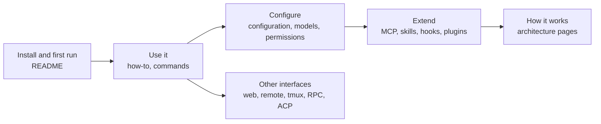

# Octocode documentation

Octocode is a terminal coding agent: it researches code before changing it and can split work across a team of subagents. Start with the [README](../README.md); this index maps every page.

## Use it

| Page                                  | Read it to                                                          |
| ------------------------------------- | ------------------------------------------------------------------- |
| [How to](how-to.md)                   | Do a common task in a few steps                                     |
| [Commands](commands.md)               | Look up every slash command and `octocode` subcommand               |
| [CLI modes](cli.md)                   | Run text, JSON, RPC or ACP mode and pass flags                      |
| [Native features](native-features.md) | Learn the tools, subagents, teams, worktrees, planning and recovery |
| [Glossary](GLOSSARY.md)               | Look up coordinator, subagent, team, worktree agent and other terms |
| [Memory](memory.md)                   | Keep notes that later sessions reuse                                |

## Configure

| Page                                                      | Read it to                                                                      |
| --------------------------------------------------------- | ------------------------------------------------------------------------------- |
| [Configuration](configuration.md)                         | Find each file, its precedence and trust; switch anything with `/configuration` |
| [Settings reference](settings.md)                         | Look up every setting and its default                                           |
| [Environment variables](environment-variables.md)         | Set behaviour from the environment                                              |
| [Providers](providers.md)                                 | Connect an AI provider                                                          |
| [Models](models.md)                                       | Pick, route, discover and add models                                            |
| [Models configuration reference](models-configuration.md) | Look up every `models.json` field                                               |
| [Permissions](permissions.md)                             | Choose a permission mode and write rules                                        |
| [Instructions](instructions.md)                           | Change what agents are told                                                     |
| [What an agent reads](agent-context.md)                   | See each context source, its switch and how to measure it                       |
| [Prompt caching](prompt-caching.md)                       | Keep requests cheap and find cache misses                                       |
| [Request flows](harness-flows.md)                         | Follow how a request is built and what keeps it small and cached                |
| [Keybindings](keybindings.md), [Themes](themes.md)        | Change keys and colours                                                         |

## Extend

| Page                                         | Read it to                                        |
| -------------------------------------------- | ------------------------------------------------- |
| [MCP](mcp.md), [reference](mcp-reference.md) | Add MCP servers, choose exposure, sign in         |
| [Skills](skills.md)                          | Add and switch skills                             |
| [Prompt templates](prompt-templates.md)      | Add reusable prompts                              |
| [Hooks](hooks.md), [events](hook-events.md)  | Run commands on agent events                      |
| [Plugins](plugins.md)                        | Install Claude and Codex plugins and marketplaces |
| [Packages](packages.md)                      | Share skills, prompts and themes as a package     |

## Other interfaces

| Page                                   | Read it to                                          |
| -------------------------------------- | --------------------------------------------------- |
| [Web workspace](web-workspace.md)      | Use `/web`: activity, backlog board, profiler, docs |
| [Remote access](remote.md)             | Reach a session from another device with `/remote`  |
| [Terminal UI](tui.md), [tmux](tmux.md) | Use the terminal interface and tmux panes           |
| [External agents](external-agents.md)  | Delegate through the CLI, JSON Lines or RPC         |
| [RPC mode](rpc.md)                     | Drive a headless session over stdin and stdout      |
| [ACP](acp.md)                          | Connect Octocode to editors and other agents        |
| [Session API](session-api.md)          | Send messages to running agents                     |

## How it works

| Page                                                                    | Covers                                       |
| ----------------------------------------------------------------------- | -------------------------------------------- |
| [Features](../../../docs/FEATURES.md)                                   | Every feature, its owner and its page        |
| [Agent communication](../../../docs/AGENT_COMMUNICATION.md)             | Orchestration, workers, team mail, isolation |
| [Execution and permissions](../../../docs/EXECUTION_AND_PERMISSIONS.md) | Tool calls, gates, editing and verifying     |
| [Context](../../../docs/CONTEXT.md)                                     | Request contents, caching and compaction     |
| [Interface architecture](../../../docs/INTERFACE_ARCHITECTURE.md)       | Terminal, web and daemon boundaries          |
| [Entities](../../../docs/ENTITIES.md)                                   | Shared records, database and contracts       |

## Working on Octocode

[DEVELOPMENT.md](../../../DEVELOPMENT.md) covers setup and checks. Library references: [agent](../../agent/README.md), [ai](../../ai/README.md), [tui](../../tui/README.md), [webview](../../webview/README.md), [contracts](../../contracts/README.md), [MCP client](../../mcp/README.md), [telemetry](../../telemetry/README.md), [agent eval](../../../scripts/agent-eval/README.md).
