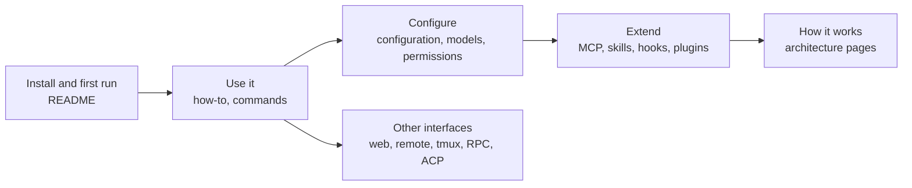

# Octocode documentation

Octocode is a terminal coding agent: it researches code before changing it and can split work across a team of subagents. Start with the [README](../README.md); this index maps every page.

## Use it

| Page                                  | Read it to                                                            |
| ------------------------------------- | --------------------------------------------------------------------- |
| [How to](how-to.md)                   | Do a common task in a few steps                                       |
| [Commands](commands.md)               | Look up every slash command and `octocode` subcommand                 |
| [CLI modes](cli.md)                   | Run text, JSON, RPC or ACP mode and pass flags                        |
| [Native features](native-features.md) | Find which page owns each native feature |
| [How it works](how-it-works.md) | Follow a turn, the event loop, what the model reads, tool loadout, compaction and resume |
| [Tools](tools.md)                     | Look up every core tool, its fields and its gates                     |
| [Browser and desktop](browser-and-desktop.md) | Drive a browser or the desktop; presets, approvals and limits |
| [Subagents](subagents.md)             | Delegate work: profiles, models, worktrees, locks, team mail          |
| [Instructions](instructions.md)       | Steer the agent with AGENTS.md, prompts, memory and skills            |
| [Backlog and archive](backlog-and-archive.md) | Track work items; read and profile earlier sessions           |
| [Monitoring](monitoring.md)           | Watch activity, jobs, notifications, load, cost and logs              |
| [Glossary](GLOSSARY.md)               | Look up coordinator, subagent, team, worktree agent and other terms   |
| [Memory](memory.md)                   | Keep notes that later sessions reuse                                  |
| [Troubleshooting](troubleshooting.md) | Fix install, sign-in, trust, rate-limit, VS Code and Windows problems |

## Configure

| Page                                                      | Read it to                                                                 |
| --------------------------------------------------------- | -------------------------------------------------------------------------- |
| [Configuration](configuration.md)                         | Find each file, its precedence and trust; switch anything with `/settings` |
| [Settings reference](settings.md)                         | Look up every setting and its default                                      |
| [Environment variables](environment-variables.md)         | Set behaviour from the environment                                         |
| [Providers](providers.md)                                 | Connect an AI provider                                                     |
| [Models](models.md)                                       | Pick, route, discover and add models                                       |
| [Smart routing](smart-routing.md)                         | Route requests safely across configured physical models                    |
| [Models configuration reference](models-configuration.md) | Look up every `models.json` field                                          |
| [Permissions](permissions.md)                             | Choose a permission mode and write rules                                   |
| [Sandbox](sandbox.md)                                     | Confine the agent's shell commands with an operating-system sandbox        |
| [Prompts](prompts.md)                                     | Change what agents are told                                                |
| [Prompt caching](prompt-caching.md) | Keep requests cheap, understand what each event does to the cache, find misses |
| [Keybindings](keybindings.md) | Change keys |
| [Themes](themes.md) | Change colours |

## Extend

| Page                                         | Read it to                                        |
| -------------------------------------------- | ------------------------------------------------- |
| [MCP](mcp.md) | Add MCP servers, choose exposure, sign in |
| [MCP reference](mcp-reference.md) | Look up server fields, exposure and results |
| [Skills](skills.md)                          | Add and switch skills                             |
| [Prompt templates](prompt-templates.md)      | Add reusable prompts                              |
| [Hooks](hooks.md) | Run commands on agent events |
| [Hook events](hook-events.md) | Look up each event, its input and output |
| [Plugins](plugins.md)                        | Install Claude and Codex plugins and marketplaces |
| [Packages](packages.md)                      | Share skills, prompts and themes as a package     |

## Other interfaces

| Page                                                                  | Read it to                                                                        |
| --------------------------------------------------------------------- | --------------------------------------------------------------------------------- |
| [Web workspace](web-workspace.md)                                     | Use `/web`: activity, backlog board, profiler, docs                               |
| [Remote access](remote.md)                                            | Reach a session from another device with `/remote`                                |
| [Terminal UI](tui.md) | Use the terminal interface |
| [TUI design rules](tui-design.md) | Learn its marks, colors and cut rules |
| [tmux](tmux.md) | Use tmux panes and windows |
| [External agents](external-agents.md)                                 | Delegate through the CLI, JSON Lines or RPC                                       |
| [RPC mode](rpc.md)                                                    | Drive a headless session over stdin and stdout                                    |
| [ACP](acp.md)                                                         | Connect Octocode to editors and other agents                                      |
| [Session API](session-api.md)                                         | Send messages to running agents                                                   |

## How it works

| Page                                                                    | Covers                                       |
| ----------------------------------------------------------------------- | -------------------------------------------- |
| [Features](../../../docs/FEATURES.md)                                   | Every feature, its owner and its page        |
| [Agent communication](../../../docs/AGENT_COMMUNICATION.md)             | Orchestration, workers, team mail, isolation |
| [Execution and permissions](../../../docs/EXECUTION_AND_PERMISSIONS.md) | Tool calls, gates, editing and verifying     |
| [Context](../../../docs/CONTEXT.md)                                     | Request contents, caching and compaction     |
| [Interface architecture](../../../docs/INTERFACE_ARCHITECTURE.md)       | Terminal, web and daemon boundaries          |
| [Entities](../../../docs/ENTITIES.md)                                   | Shared records, database and contracts       |

## Working on Octocode

[DEVELOPMENT.md](../../../DEVELOPMENT.md) covers setup, checks and the [package map](../../../DEVELOPMENT.md#packages). Library references: [agent](../../agent/README.md), [ai](../../ai/README.md), [tui](../../tui/README.md), [webview](../../webview/README.md), [contracts](../../contracts/README.md), [common](../../common/README.md), [telemetry](../../telemetry/README.md), [MCP client](../../mcp/README.md), [ACP](../../acp/README.md), [database](../../db/README.md), [shell completion](../../terminal/README.md), [agentic testkit](../../octocode-agentic-testkit/README.md), [agent eval](../../../scripts/agent-eval/README.md).
