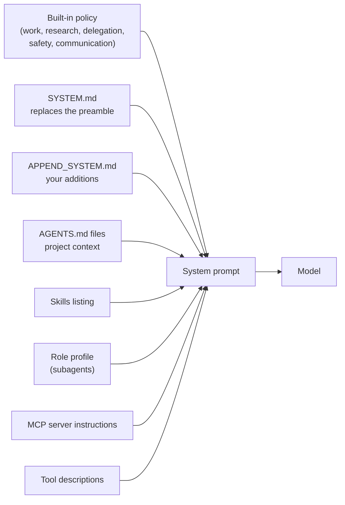

# Agent instructions

What tells Octocode's agents how to work, and how you add to it.



Order, cache tiers and what each section holds: [Context management](../../../docs/CONTEXT.md#what-the-model-sees).

## What you can change

| You want to                           | Do this                                                                                                                                                                                                                                                     | Turn off or undo        |
| ------------------------------------- | ----------------------------------------------------------------------------------------------------------------------------------------------------------------------------------------------------------------------------------------------------------- | ----------------------- |
| Give every session extra instructions | Create `APPEND_SYSTEM.md` in the agent directory, or in the trusted project's `.octocode/` (the project file wins)                                                                                                                                          | Delete the file         |
| Replace the base prompt               | Create `SYSTEM.md` the same way, or pass `--system-prompt`. It replaces the preamble, the documentation pointer and the default rule lines (conciseness, bash search); tools, rules, MCP blocks, project context, skills, the policy and `environment` stay | Delete the file or flag |
| Give a project standing instructions  | Put them in `AGENTS.md` (or `AGENTS.override.md`) in the repository: [which files load, in what order](../../../docs/CONTEXT.md#project-context). `CLAUDE.md` is not read: point it at `AGENTS.md`                                                          | `--no-context-files`    |
| Add or change a subagent role         | A profile is a Markdown file with YAML front matter in the global `agents/` folder or the trusted project's `.octocode/agents/`; same name replaces the bundled one ([profiles](native-features.md#configuration))                                          | Delete the profile      |
| Load a skill's instructions on demand | [Skills](skills.md)                                                                                                                                                                                                                                         | `/harness`              |
| Save notes the agent recalls later    | [Memory](memory.md)                                                                                                                                                                                                                                         | `/memory auto off`      |

Example `.octocode/APPEND_SYSTEM.md`:

```markdown
Answer in British English. Run `yarn test` before reporting a change done.
```

Profile lookup order: bundled defaults, user configuration, the runtime home, then trusted project profiles; a later profile with the same name replaces an earlier one, and a project file that does so is named in a warning at session start. Bundled roles are package assets, so customize them through a profile of the same name rather than by editing the install. A subagent role never uses `--append-system-prompt`: the parent hands the role text only to that child, which adds it beside any `APPEND_SYSTEM.md`.

## What the built-in policy says

| Concern               | Rule                                                                                                                                                                                                                                               |
| --------------------- | -------------------------------------------------------------------------------------------------------------------------------------------------------------------------------------------------------------------------------------------------- |
| Work and verification | Establish goal and constraints, inspect owners and callers, map blast radius and before -> after, make the smallest complete change, run the deciding check after the last edit (or say why none could run)                                        |
| Context and research  | Keep the next step's evidence, decisions and exact identifiers; fetch large material by path or cursor and disclose coverage gaps; fetch only what the next decision needs                                                                         |
| Delegation            | Bounded tasks with ownership and observable checks; the parent owns integration and user communication                                                                                                                                             |
| Safety                | Preserve authorization, user changes and trust boundaries; never bypass a permission refusal by switching tools                                                                                                                                    |
| Communication         | Lead with the result and its evidence, separate verified facts from unknowns, report checks actually run. The main session ends a finished task with what was done, files changed, checks run and what is left, and leaves nothing it started open |

The policy follows the selected tools: a session without web or agent tools gets no advice to call them. A `lean: true` profile gets a short subagent section instead. Tool mechanics (polling, model choice, `headless`, path locks, message fields) live only in each tool's description. A subagent's report outcome is one of `done`, `partial`, `blocked`, `failed`.

## Updates and caching

Unchanged inputs give unchanged prompt text; changes reach the model as section updates ([how](../../../docs/CONTEXT.md#how-a-change-reaches-the-model)). Different roles, tool sets or project context can change the provider's cached prefix: [prompt caching](prompt-caching.md). See the exact prompt each built-in agent gets in [agent context](agent-context.md#measure-it). Contributors editing the bundled prose: `instructions/README.md` in the source tree maps each section to its Markdown file; edit the Markdown, then run `yarn workspace @octocodeai/octocodecode run generate:prompts`.
