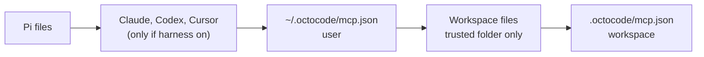
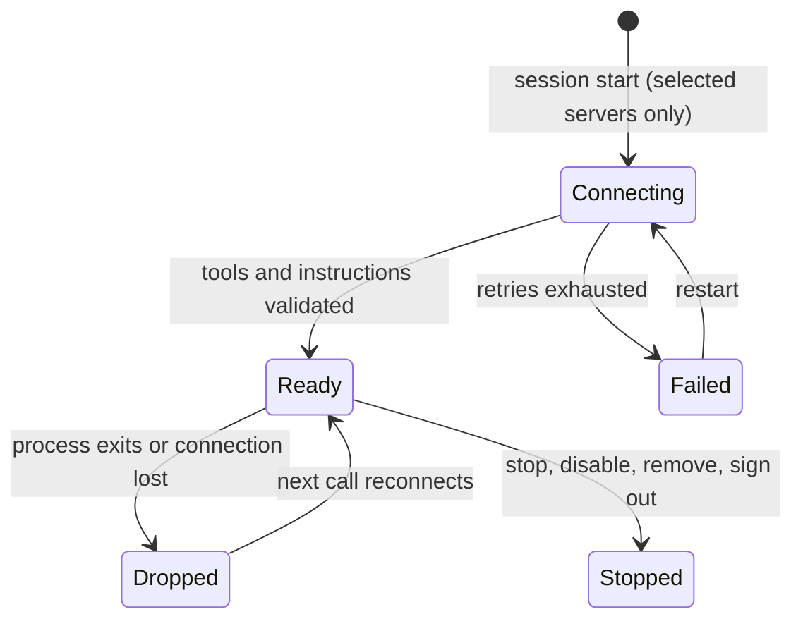
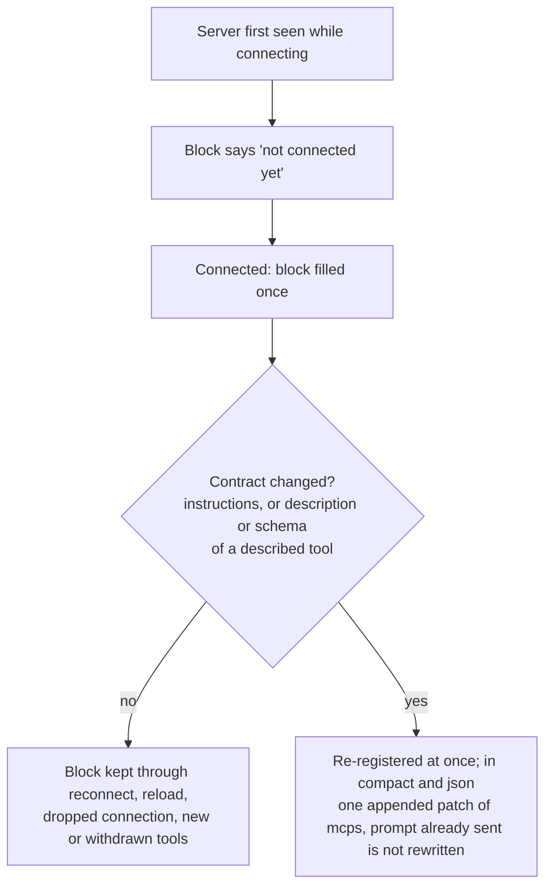
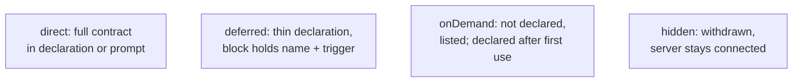

# MCP reference

Setup, commands, exposure and assignment (the `/mcp` tools page) are in the [MCP guide](mcp.md); this page has the details.

## Configuration and precedence

Octocode's files use a top-level `mcpServers` object; other agents' files are read in their own format. Later rows win:



| Scope             | Read order (low to high)                                                                                                                             |
| ----------------- | ---------------------------------------------------------------------------------------------------------------------------------------------------- |
| User              | `~/.pi/mcp.json`, `~/.pi/agent/mcp.json`, Claude `~/.claude.json`, Codex `~/.codex/config.toml`, Cursor `~/.cursor/mcp.json`, `~/.octocode/mcp.json` |
| Trusted workspace | `.pi/mcp.json`, `.codex/config.toml`, `.cursor/mcp.json`, `.mcp.json`, `.agents/mcp.json`, `.octocode/mcp.json`                                      |

Write targets are `~/.octocode/mcp.json` and `<workspace>/.octocode/mcp.json`. Workspace files load only in a trusted folder; `/reload` applies edits. Setting `OCTOCODE_HOME` or `OCTOCODE_CODING_AGENT_DIR` turns Pi compatibility off (the Pi files are not read). `/mcp config` shows resolved paths, each file's harness and whether it is on.

**Rules for definitions**

| Rule        | Behavior                                                                                                                                                                                                                                                                                                                                                                                                                                                                                                                                        |
| ----------- | ----------------------------------------------------------------------------------------------------------------------------------------------------------------------------------------------------------------------------------------------------------------------------------------------------------------------------------------------------------------------------------------------------------------------------------------------------------------------------------------------------------------------------------------------- |
| Replacement | A later full definition replaces an earlier transport without merging credentials. An entry with no `command`, `url` or `type` changes only `enabled`, `defaultActive`, `exposure` or `toolExposure` of an existing server; removing an override may reveal an earlier definition.                                                                                                                                                                                                                                                              |
| Names       | Letters, digits, `_`, `-`; no `__` (a `-` before is read as `_`) and no trailing `_` or `-`, because tools are `mcp__<server>__<tool>`. Such a name is rejected.                                                                                                                                                                                                                                                                                                                                                                                |
| Stdio       | One executable in `command` (not a shell expression), optional `args`, `env`, `cwd` (relative to the session folder; `~/` expands). Starts with a minimal environment plus `env`; `inheritEnv: true` passes everything. Not sandboxed unless `sandbox: true`: the server then runs in the [shell sandbox](configuration.md#shell-sandbox) whatever `sandbox.mode` says (writes in its workspace and the temporary folders, no reads of credential folders, network through the sandbox proxy), and it does not start where that sandbox cannot. |
| Values      | `env` and HTTP `headers` support `${NAME}` or a whole-value `!command`; `literalHeaders: true` sends headers verbatim.                                                                                                                                                                                                                                                                                                                                                                                                                          |
| Timeouts    | `enabled` defaults to true; per-request `timeout` to 60 s. A server whose startup times out is retried once at twice the timeout (`/mcp` shows `(retried after timeout)`).                                                                                                                                                                                                                                                                                                                                                                      |
| Errors      | Invalid entries are reported and skipped independently. JSON comments and trailing commas load; saving writes plain JSON and backs up the old file as `<file>.bak`.                                                                                                                                                                                                                                                                                                                                                                             |
| Safety      | Text a server sends is shown with `<mcp`, `</mcp`, `<mcps`, `</mcps` escaped so it cannot forge a prompt block. Keep credentials in user-level config.                                                                                                                                                                                                                                                                                                                                                                                          |

### Files of other agents

Each file belongs to a harness switched with `/settings enable|disable harness:<harness>`. Octocode's own files are always read; `agents` (`.agents/mcp.json`), `mcp-json` (root `.mcp.json`) and `pi` are on by default; `claude`, `codex` and `cursor` are off. A key set in the workspace's `.octocode/settings.json` reaches only that harness's workspace files, so a committed setting cannot switch on a user's own servers. Switching applies at once: servers connect or close without `/reload`, and a profile or task can name them for subagents started later (running children keep what they started with).

| Harness     | Files                                                                                                                                                                               | Format and interpolation                                                                                                                                                                                                                                                                                          |
| ----------- | ----------------------------------------------------------------------------------------------------------------------------------------------------------------------------------- | ----------------------------------------------------------------------------------------------------------------------------------------------------------------------------------------------------------------------------------------------------------------------------------------------------------------- |
| Claude Code | `~/.claude.json` (`$CLAUDE_CONFIG_DIR/.claude.json` if set): top-level `mcpServers`, then this repository root's and session folder's `projects[...]` entries; other projects never | `command`, `args`, `env`; `url`, `headers`, `type` `http` or `streamable-http`, `timeout` (ms, rounded up to s). `sse` and `ws` are reported unsupported, `sdk` skipped. `${VAR}` resolves like `mcp.json`.                                                                                                       |
| Codex       | `$CODEX_HOME/config.toml` (default `~/.codex`), `.codex/config.toml`: `[mcp_servers.<name>]`                                                                                        | `command`, `args`, `env`, `env_vars`, `cwd`; `url`, `http_headers`, `env_http_headers`, `bearer_token_env_var`; `enabled`; `tool_timeout_sec`; `enabled_tools` (others hidden), `disabled_tools`. Codex's project trust is not consulted; Octocode's folder trust applies.                                        |
| Cursor      | `~/.cursor/mcp.json`, `.cursor/mcp.json`                                                                                                                                            | `command`, `args`, `env`, `url`, `headers`, `auth` (`CLIENT_ID`, `CLIENT_SECRET`, `scopes` as OAuth settings). `${userHome}`, `${workspaceFolder}`, `${workspaceFolderBasename}`, `${pathSeparator}`, `${/}` resolve when read; `${env:NAME}` at launch in `env` and `headers`. `envFile` and rules are not read. |

A leading `!` in these files' `env` or header values stays literal. Another agent's server never replaces a built-in server or a same-named server from an Octocode-format file (Octocode, `.agents`, `.mcp.json`, Pi); discovery lists it as shadowed. Among other agents' files the later wins. Octocode never writes them: `/settings enable|disable mcp:<name>` and the exposure choices on the `/mcp` tools page for their servers are saved as overrides in Octocode's file of the same scope, kept even while the harness is off.

### Migrate from another client

Claude Code, Codex and Cursor files are read in place once their harness is on; copy an entry only to change it. Claude Desktop `mcpServers` entries copy as is. VS Code: move an entry from `servers` and replace `${input:...}` with `${NAME}`. OpenCode: split `command` arrays into `command` and `args`, rename `environment` to `env`, convert remote entries to `url`. Validate with `octocode mcp list`.

## Authentication

An HTTP server without an `Authorization` header can use OAuth: `/mcp login <server>`, `octocode mcp login <server>` or **Sign in** in `/mcp` (paste the redirected URL if a remote browser cannot reach the loopback callback). Tokens live in `mcp-auth.json` in the agent directory, keyed by server name and URL, refreshed as needed, deleted on sign-out; new scopes need a new sign-in.

| `oauth` setting                 | Use                                                                                      |
| ------------------------------- | ---------------------------------------------------------------------------------------- |
| `clientId`, `clientSecret`      | For servers without dynamic client registration                                          |
| `callbackPort` or `callbackUrl` | Fixed loopback callback; must be loopback HTTP ending in `/callback`                     |
| `scope`                         | Overrides missing advertised scopes                                                      |
| `clientName`                    | Name for dynamic registration; sign out before re-registering                            |
| `clientRegistration: "cimd"`    | Needs `OCTOCODE_MCP_CLIENT_METADATA_URL`; cannot combine with `clientId` or `clientName` |
| `authServerMetadataUrl`         | Trusted HTTPS (or loopback HTTP) metadata URL replacing broken discovery                 |

A server can instead use a current `/providers` sign-in; the token is sent as a bearer token on each request, including after refresh. Because this routes credentials to the server URL, `auth` is accepted only in global config, over HTTPS (loopback excepted), and not combined with project replacement or OAuth:

```json
{ "mcpServers": { "gateway": { "url": "https://gateway.example/mcp", "auth": { "provider": "gateway" } } } }
```

For the built-in `octocode` server, `GITHUB_TOKEN` or `GH_TOKEN` takes priority, then the login from `/octocode auth login`, then `gh` CLI credentials.

## Connections and caching



- `octocode mcp list` connects enabled servers, reports errors and exits 1 on invalid entries or failed connections. `/mcp` shows state and failed stdio stderr; notifications also go to a rotated `mcp.log` in the agent directory. Enabled plugins' servers appear as `plugin:<plugin>:<server>` (scope `extension`).
- In an untrusted folder a workspace `mcp.json` is not loaded; one warning names the files at start and each `/reload`, and `octocode mcp list` prints it. Trust the folder (`octocode trust add`) and `/reload`.
- Connections start in the background for servers the tool selection reaches, once the session's skills are loaded (a server's launch names their folders), or sooner when the first prompt or a hook needs one, so each server starts once. A subagent that runs on its parent's skill inventory has its skill folders from the start, so its servers start with the session. The first prompt waits up to 10 s for servers with declared tools, so sessions with the same servers share a cached prefix; a call waits for its server.
- `/new`, `/resume` and a fork keep a server's process when it is connected and idle and its launch is unchanged (its entry, the folder, project trust and the skill folders its launch names): the next session takes the connection and its catalog, so its first prompt does not wait for a restart. Every other server stops and starts again, as do all of them on `/reload` and at exit.
- The bundled Octocode server hands its calls to a warm `octocode serve` process, one per Octocode build, workspace and environment, shared by every session and client that matches; it pools language servers. It is the one MCP process a session leaves running at exit, by design: it exits on its own after 10 minutes without a request, and its language servers stop earlier on the pool's idle timeout.
- Transient HTTP failures get two retries; three consecutive failures trigger a 5 to 60 s backoff until restart. An expired HTTP session gets one fresh-session retry; ordinary tool calls are not retried because they may have changed state.
- A stdio connection drops when its process exits, even if a descendant holds the pipes (and for launchers such as `npx` or `uvx`): stdout gets 250 ms to deliver, the call in flight fails, and the process group gets SIGTERM then SIGKILL.
- Catalogs and instructions are cached in memory. A dropped connection or failed reconnect keeps them, so declared tools stay byte-identical (the provider's cached prefix is not rewritten) and calls fail at once naming the state and how to restart. Stop, disable, removal, sign-out, shutdown and a failed catalog refresh of a connected server withdraw the tools; a reconnect withdraws only tools the server no longer offers. Shutdown (except a server a new session keeps, above), authentication or configuration replacement and workspace changes clear the cache. [Prompt caching](prompt-caching.md) is separate; in `compact` mode the generated files below are the only catalog data kept on disk.

## Presentation modes

The `mcpPresentation` setting selects where the tool contract appears. Exposure determines how much of it the model sees initially. With the defaults (`declared` and `mcpExposure: "usage"`), an MCP tool without an override starts deferred when the agent has the `mcp` tool. Its declaration carries the server's description and thin parameters. The agent can read the full schema with `mcp` when it needs more detail. See [tool exposure](configuration.md#tool-exposure).

| Mode                 | Provider declaration for a direct tool                      | Prompt block for a direct tool                                                               | Files |
| -------------------- | ----------------------------------------------------------- | -------------------------------------------------------------------------------------------- | ----- |
| `declared` (default) | Server description, full input schema and any output schema | Server instructions                                                                          | None  |
| `compact`            | One-line trigger and thin parameters                        | Instructions and contract as [TypeScript](#compact-presentation), with a plain-form fallback | Yes   |
| `json`               | One-line trigger and thin parameters                        | Instructions, description and server schema in plain form                                    | None  |

On a provider that cannot change tools mid-conversation, a server that connects after the first request has its tools callable at once but declared only at the next compaction, so the cached prompt is not rewritten for it ([prompt caching](prompt-caching.md)). Calls are validated locally against the server's own input schema in every mode (in `compact` a failed validation also shows the tool's signature). The block never carries connection state: a server not ready is one line in `mcp_status`, so a state change patches only that line.



A rebuilt loadout (model change, tree navigation, new session) describes servers again. A server's one-line purpose (its `description`, kept from the built-in when a configured entry replaces a built-in server) appears once, as a `- mcp__<server>__*: purpose` line in the tool list, or in its block when no tool is described. The `declared` block changes only when instructions or a deferred tool's trigger change; a changed tool description or schema then reaches the model through its declaration.

## Compact presentation

Opt-in `compact` mode (`"mcpPresentation": "compact"`) renders each server as a TypeScript file. `declared` renders no file and ignores the rest of this section.

| Topic       | Behavior                                                                                                                                                                                                                                                                                                                                                                                                                                  |
| ----------- | ----------------------------------------------------------------------------------------------------------------------------------------------------------------------------------------------------------------------------------------------------------------------------------------------------------------------------------------------------------------------------------------------------------------------------------------- |
| File        | A header line, the server's instructions and one typed function per visible tool in `declare namespace <server>`, stored under `context-optimization/mcp/` in the agent directory (workspace-defined servers get a per-project folder). Deleting the cache is safe; the next connect regenerates it. Only tools not `hidden` are listed. A tool with an unusual registered name is named after the tool after a `// call as <name>` line. |
| Constraints | Constraints TypeScript cannot express become comments (formats, bounds, list sizes above one, defaults, union and array-item descriptions, required-key alternatives). Validation-only ones are omitted since an error names the one broken. Shared field docs go in a block at the top; an object type used by three tools or written out twice at 200 characters or more becomes an alias under `// Types used more than once:`.        |
| Plain form  | A tool the file cannot render faithfully (unresolvable `$ref`, too deep, unsupported tuple or union, lost name, value or requirement) follows in the same block in plain form: description and the server's JSON Schema.                                                                                                                                                                                                                  |
| Triggers    | A tool's declaration is thin: its description is the first sentence of the server's description.                                                                                                                                                                                                                                                                                                                                          |
| Timing      | Taken when the server first appears; renewed when the loadout is rebuilt and mid-session when the contract changes (see the diagram above).                                                                                                                                                                                                                                                                                               |
| Validation  | Octocode validates locally against the server schema. It drops a top-level string `reason` only if the schema neither declares nor accepts it. A refusal identifies rejected paths and, when available, declared fields at that location. A repeated identical failure can include a schema-checked example. Only a new call from the agent can execute it.                                                                               |

The server's description, schemas and instructions are never rewritten: the file carries the server's own text. The stored file is a cache, safe to delete, rendered again when the server's catalog or the renderer changes. Running sessions keep their file until the next start, rebuild or contract change.

## Exposure and results



- `deferred` keeps validation identical to `direct`. A server whose every described tool is deferred shows its `description`, its instructions, then one `- <tool>: <trigger>` line per tool. The agent reads a tool's text with its `mcp` tool (`intent: "tools"`, `server`, `tool` for one tool's description and input and output schemas as sent; without `tool`, the instructions and every tool name). It arrives as a tool result, so the cached prompt never changes. Deferral is decided when the block is described and kept until it is described again.
- `mcpExposure` applies to tools with no `exposure` or matching `toolExposure`; `"auto:<bytes>"` describes servers in name order and defers a server once the direct blocks so far plus its own would pass the budget (bytes, not a context share, so a model change never rewrites the prompt). Nothing is deferred for an agent without the `mcp` tool.
- `"recent"` declares a tool in full while this working directory has called it in the last 24 hours and defers it otherwise. A deferred tool keeps the server's whole description and its field names and types (the top-level fields, the fields of a top-level object or list of objects, and of lists of objects inside those, up to 32 names per object, without descriptions), with the values a field allows when it names 16 or fewer, list `minItems` and `maxItems`, and the fields each object requires, stays callable, and a call its schema rejects returns the schema. The set of tools in use is read when the session starts and does not change during it, so the cached prompt stays the same; a subagent uses its parent's set. The session saves the set with its first prompt, and resuming, reloading or forking that session in the same folder declares the saved set again instead of reading the record, so the provider's cached prompt still matches; a new session reads the record. Calls are recorded in `tool-use.json` in the agent directory; deleting the file only defers every tool once more. Pin a tool with `toolExposure` to keep it `direct` or `deferred` regardless of use.
- `"usage"`, the default, defers every tool with the server's whole description and field names, as `"recent"` does, whether sessions use it or not: no tool is promoted to its full schema. The promotion snapshot only decides whether an `onDemand` tool is declared deferred from the session's start instead of after its first use. The agent directory keeps counts per day for 7 days in `tool-usage.json`: for each tool and role group (main or coordinator sessions, and subagents), the sessions that declared it or listed it on demand, called it, read its full description with the `mcp` tool, and the calls its deferred schema refused, plus the bytes each on-demand tool's declaration would add. A tool is promoted when sessions that called or read it are at least 10% of the sessions that offered it and at least 20 sessions of that role group offered it, or when its refused calls exceed one per session that used it; promoted tools are kept, most used first, while their declarations fit `mcpPromotedBytes` (default 8192 bytes per role group). A tool with fewer sessions keeps the exposure its configuration gives it, so a new install declares what a warm one does except promoted on-demand tools. The snapshot is computed once per UTC day and installed version (several processes merge their counts into the file under a lock), saved with the session like the `"recent"` set, and a subagent uses its parent's. Counts are a hint: an unreadable file reads as no data. Pins (`exposure`, `toolExposure`, `nativeToolExposure`) win. See [Harness flows](harness-flows.md).
- After its first call in a session, successful or not, a deferred tool is declared in full for the rest of that session where the model can replace a tool's definition in place (Anthropic models with mid-conversation tool changes, OpenAI Responses models with additional tools). The definition is added once, after the call; the tool list and instructions sent at the session's start are not rewritten, and a compaction or a resumed session keeps the full declaration. On every other model the tool stays deferred, since declaring it again would resend the whole tool list, and its schema keeps arriving as a tool result. This applies in `declared` mode. Deferred native tools (below) use the same second layer.
- Under `"usage"` (the default) the native tools `archive`, `models`, `backlogPlan`, `configuration`, `memory` and `notify` are deferred; under `"recent"` the first four follow its rule: deferred until this working directory calls them, then declared in full in the next session (`memory` and `notify` are otherwise always declared in full unless pinned); resuming, reloading or forking a session declares them as that session did before. `nativeToolExposure` pins one, for example `{ "archive": "direct" }`. Other native tools, `web` among them, are always declared in full; a pin naming one is ignored. Where the model adds tools after the cached prefix (tool loading mode `changes` or `additions`) and the agent has the `mcp` tool, `archive`, `models` and `configuration` (and `memory` in a subagent) are `onDemand` instead of deferred unless the `"usage"` snapshot names them (`web` is always declared in full, so a model asked for live content sees it): listed in `<tools>`, declared after their first call or a read with `mcp` (`server: "native"`); a pin opts one out.
- A deferred native tool is read like an MCP tool: `mcp` with `intent: "tools"`, `server: "native"` and the tool's name returns its description and full input schema and counts as a read in the usage counts; a native tool already declared in full returns its declared schema the same way, counted as nothing; without `tool` it lists the deferred native tools, and an unknown name is answered with that list. A configured server named `native` takes the name instead. A deferred native tool that is read this way, rejected once, or called for the first time in a session is declared in full for the rest of that session on the models described above: the definition is added once after the cached tool list, which stays as sent. On other models it stays deferred, and its schema arrives as a tool result. A compaction restores the schema of a deferred tool the session called, native or MCP, by name.
- `toolExposure` accepts `onDemand` too: the tool is registered and callable but left out of the tool list, and its server's block lists it as `- name: trigger` (the trigger is the first sentence of the description's `<when>` text, else of the description). Loading it with `mcp` intent `tools`, or calling it, declares it after the cached prefix from the next request on; the session keeps it declared, on resume too. It applies only where the model's transport adds tools mid-conversation and the agent has the `mcp` tool; elsewhere, and for a tool in use under `"recent"` (declared in full) or promoted under `"usage"` (declared deferred), the usual rule decides; a tool the agent's tool selection names is declared deferred. The bundled Octocode preset sets it for `astSearch`, `lspSearch`, `clasify`, `ghSearchRepo`, `ghSearchCode`, `ghStructure`, `ghGetFileContent`, `ghSearchHistory`, `ghGetHistoryItem`, `ghCloneRepo`, `artifactSearch` and `securityCheck`; the FreeLlama preset for every tool, and its block then holds no instructions until a tool is declared (the `mcp` tool's read of the server, or of its first tool, returns them); the browser preset sets none: its tools are declared as the server serves them.
- `toolExposure` keys are exact names or `*` patterns (exact first, then first matching pattern) and beat the server default. An invalid value is reported and the entry skipped (an earlier definition stays). `/mcp` → the server → **Tools** → **Default for tools** saves a server value.

Results keep text, images, structured data and errors in history. An embedded resource becomes its text after a `[resource <uri> (<mimeType>)]` line; an image blob an image; another blob a line with URI, type and size; a resource link its URI, name, title, description, type and size. The host never follows a link on its own; the agent reads one with `mcp` `read` ([resources and prompts](#resources-and-prompts)). Oversized text is saved under the session's `output/` folder with an excerpt and path. Generic server text keeps 20 KB; the built-in `octocode` server's parts stay whole up to 60,000 characters; all results share a 100,000-character per-message budget ([compaction and recovery](native-features.md#compaction-and-recovery)).

To check that a model uses a server, run `octocode --mode json --print --no-session "<task>"` against a disposable or read-only server and look for a call to one of its tools; a connection alone proves nothing.

## Assign servers to agents

A server is assigned as a unit, its generated file and tools, with the pattern `mcp__<server>__*` in `--tools`, `--exclude-tools` or a subagent profile's `tools:` or `excludeTools:`. The `defaultTools` setting takes exact tool names.

| Goal                   | Configuration                                                                                                                                                                              |
| ---------------------- | ------------------------------------------------------------------------------------------------------------------------------------------------------------------------------------------ |
| Every agent (default)  | Nothing                                                                                                                                                                                    |
| Only some subagents    | `"defaultActive": false` on the server and `mcp__<server>__*` in the `tools:` of each profile that needs it                                                                                |
| The main agent as well | `--tools` with an entry naming `mcp__<server>__`, or `{ "mcpServers": { "<server>": { "defaultActive": true } } }` in the workspace (for `browser`, children still need `mcp__browser__*`) |
| No agent               | `"enabled": false`                                                                                                                                                                         |

- With `defaultActive: false` only an entry naming the server selects it (an allowlist entry or `+` entry starting `mcp__<server>__`). A selection that does not reach it keeps it from starting; `/mcp` shows `not selected`, and `/mcp reconnect` and the model's `mcp` tool report that instead of starting it. A server started anyway (enabled again from `/mcp`) declares its tools for that session; one a hook started for its own call stays unselected and declares none.
- Under a `--tools` allowlist a server starts only when an entry can match its tools (an allowlist without `mcp__` entries declares no MCP tools). `--exclude-tools` with `mcp__<server>__*` keeps it from starting.
- Subagents run only the servers they name, whatever `defaultActive` says: the servers a child's tools name explicitly (the research floor names `octocode`; a profile's `mcp__<server>__…` entries name others, such as `browser` for the `browser` role) plus those its task's `mcp` list names. Every other server, configured (yours, the project's, another harness's, a plugin's) or added with the `mcp` tool, never starts in the child, so none carries its tools or instructions. A profile `tools:` entry naming `mcp__freellama__*`, or a task `mcp` list naming `freellama`, gives one child that server.
- Each assigned server adds its whole file to the cached prompt of every agent that selects it; subagents of one profile share the prefix. Assign large servers only to the agents that use them.

**Servers per task.** The `agent` task's optional `mcp` list names the session's servers a child gets beside its own.

| `mcp` value   | Child runs                                                                                                                                                                                                                                                        |
| ------------- | ----------------------------------------------------------------------------------------------------------------------------------------------------------------------------------------------------------------------------------------------------------------- |
| omitted, `[]` | Only the servers its own `tools` name explicitly (the research floor and `mcp__<server>__…` entries; wildcards such as `mcp__*` name none); every other server stays out. A server named only by an exact `+mcp__<server>__<tool>` entry runs with only that tool |
| a list        | Those plus the named servers, with all their tools (even with `defaultActive` off)                                                                                                                                                                                |

The list never lowers the profile's requirements (a read-only profile keeps its limits). A name that is not an enabled server refuses the task with a line naming the configured ones; a lean profile (no MCP) refuses `mcp` too. The list is passed privately to the child, never written to `mcp.json`; a lingering child resumed by a message keeps it, and a `resume` task names the servers again (without `mcp` it runs only its own).

## Resources and prompts

A server that declares the `resources` or `prompts` capability offers reference text and ready-made prompts beside its tools. Nothing of them enters the prompt: they are read on request, from the server's current connection, each time.

| Who   | How                                           | Result                                                                                                                                                                    |
| ----- | --------------------------------------------- | ------------------------------------------------------------------------------------------------------------------------------------------------------------------------- |
| Agent | `mcp` tool, `intent: "resources"`, `server`   | One line per resource (URI, name, description, type) and per URI template                                                                                                 |
| Agent | `mcp` tool, `intent: "read"`, `server`, `uri` | The resource's text after a `[resource <uri> (<type>)]` line; an image blob as an image; another blob as a line with its size. Text is capped and saved like tool results |
| You   | `/mcp resources <server>`                     | The same list                                                                                                                                                             |
| You   | `/mcp prompts <server>`                       | Each prompt with its arguments: `<required>`, `[optional]`                                                                                                                |
| You   | `/mcp prompt <server> <name> [args]`          | The prompt's messages, sent as your next message                                                                                                                          |

Prompt arguments: `key=value` sets that argument; other words fill the prompt's declared arguments in order, skipping ones already set. Quote a value with spaces (`"src/my app.ts"`). Extra words or a missing required argument are reported and nothing is sent.

Reading and listing count as reads: they never ask and are allowed in plan mode. A server without the capability gets no request. Resource subscriptions are not supported.

## Model management and permissions

The model's `mcp` tool takes `list` (state, tool count, last error of every server or one), `tools` (descriptions and schemas without running anything), `resources` and `read` ([resources and prompts](#resources-and-prompts)), `restart` (also starts a stopped or failed server at once; a second restart of a connected server within 10 s is refused; a stopped or failed one starts at once) and `stop` (withdraws tools until restart; a dropped connection does not). The older `status`, `connect`, `add` and `remove` intents return an error naming their replacement (`list`, `restart`, or your `/mcp` and `octocode mcp add|remove`). None edit configuration; children use their own connections and get a session registration only when their profile or task names it.

Model MCP calls use the normal tool pipeline and permission gates; hook-initiated `mcp_tool` calls skip repeated extension handlers but still check availability and permissions. Only an explicit `destructiveHint: true` affects permission, by adding an ask (`mcp.destructive`). Role-declared reads are `mcp.read` and never ask; other calls are `mcp.write` ([MCP permissions](permissions.md#mcp-tools), [hook calls](permissions.md#hook-initiated-mcp-calls)).

## Built-in MCP host

| Setting                           | Effect                                                                                                                                |
| --------------------------------- | ------------------------------------------------------------------------------------------------------------------------------------- |
| `--no-mcp`                        | MCP off for one run (children inherit); it cannot be switched off persistently. Turn servers off in `/mcp`, `/settings` or `mcp.json` |
| `OCTOCODE_MCP=0`                  | Disables the default `octocode` server unless file configuration overrides it                                                         |
| `OCTOCODE_MCP_FREELLAMA=0` or `1` | Turns the default `freellama` server off or on (unset: off); a saved switch still wins                                                |

The shell `octocode mcp` commands do not start a session.

**`octocode` server.** It is the default research server and uses this same host. A full `octocode` definition in `mcp.json` replaces the built-in launch (your `command`, a minimal environment unless `inheritEnv: true`, `OCTOCODE_MCP` ignored). It keeps the built-in `description` and, unless it sets `roles`, its `roles`, so plan-mode reads and research guidance still find its reader and search tools; `"roles": {}` clears them, and a workspace entry's roles count only in a trusted project. A stdio entry replacing a default keeps each default `env` value it does not set (never values from another file); its own `ALLOWED_PATHS` replaces the allowed folders. To change only `enabled`, `defaultActive` or exposure use a control-only override. Like every server, its tools follow `mcpExposure` (by default each is deferred, and the on-demand ones are listed by name until used or promoted); to declare all of them in full in every session: `{ "mcpServers": { "octocode": { "exposure": "direct" } } }`. See [skill access](skills.md#understand-how-skills-load).

Tool roles (`roles` in a server entry list bare tool names; each role is read-only for plan mode and read trust):

| Role       | Meaning                                                                                                |
| ---------- | ------------------------------------------------------------------------------------------------------ |
| `reader`   | Returns file content                                                                                   |
| `search`   | Returns matched lines                                                                                  |
| `judge`    | Judges unread text by meaning (a page, a log, many files) before it is read; guidance names it by role |
| `readOnly` | Never writes the workspace; `reader`, `search` and `judge` are implied                                 |

**`browser` server.** It runs the installed browser package under Octocode's Node with the session folder as working directory (no `npx` fallback), sets `defaultActive: false`, and by default only the bundled `browser` subagent starts it; the main agent delegates browser work. Captures are saved under `.octocode/octocode-chrome-devtools/` in the workspace; each result shows the server's acknowledgement then its structured evidence. A `browser` entry in `mcp.json` replaces the launch, and `/settings disable mcp:browser` turns it off. To give the main session a trimmed browser, name tools in the `defaultTools` setting (`["+mcp__browser__open", "+mcp__browser__run", "+mcp__browser__cleanup"]`, or `--tools` for one run); the main agent is then told to use them. A subagent starts the server only when its profile's `tools:` names `mcp__browser__*` or its task's `mcp` list names `browser` (no other child runs it), so `defaultActive: true` and **Available to** → every agent on the `/mcp` tools page (server `browser`) reach the main session and the `browser` specialist, not `implementer`, `researcher` or `reviewer`.

**`desktop` server.** It runs `cua-driver mcp` ([Cua Driver](https://cua.ai/docs/cua-driver/quickstart), MIT) for native apps on your computer. Octocode neither installs nor bundles it: the server is enabled only while `cua-driver` is on `PATH` (`OCTOCODE_MCP_DESKTOP=0` keeps it off), and without it the server stays listed, disabled, with the install pointer. It sets `defaultActive: false`, and by default only the bundled `desktop` subagent starts it, or a task whose `mcp` list names it; no other child runs it. Its instructions stay out of the prompt until a tool is declared. Octocode never passes `--grant existing-profile`: attaching Driver to your signed-in Chromium profile is your own decision in a `desktop` entry of `mcp.json`, which replaces the preset. Every call asks `desktop.control` ([permissions](permissions.md#desktop-control)). Driver keeps the data a call returns (window ids, `snapshot_id`, `element_token`, the accessibility tree) in `structuredContent` beside a one-line text, so Octocode appends it to the text the model reads. The preset removes the tools that install software or rewrite Driver's configuration (`install_extension`, `install_ffmpeg`, `set_config`); do those with `cua-driver` yourself. Octocode leaves Driver's telemetry setting as you have it: `cua-driver telemetry status` shows it, `cua-driver telemetry disable` turns it off.

Browser calls use the general MCP permission class, with these exceptions (`manual` and `workspace` unless noted):

| Call                                                                                                                                                                                                                                                                    | Asks              |
| ----------------------------------------------------------------------------------------------------------------------------------------------------------------------------------------------------------------------------------------------------------------------- | ----------------- |
| Opening a page at a private or local address, a name that does not resolve, or a non-web scheme (`open`'s `url`, a connection's `newTab`, a tab group's `urls`, a flow's `url` parameter, plan `goto`, a navigating CDP command)                                        | `net.private`     |
| Page scripts (`evaluate` plan steps, a flow's `trigger` parameter); `open` with `attach` (your own browser) or `launch.chromePath`; raw CDP commands that set download behavior (other than `deny` or `default`) or wrap another command (`Target.sendMessageToTarget`) | `browser.control` |
| Every raw CDP command (the `cdp` tool and `cdp` plan steps): opaque browser programs can access cookies; asks in `full` too, no profile grants it, one answer can cover the session                                                                                     | `browser.cookies` |
| Sending a file from outside the workspace to a page (`upload` action, `DOM.setFileInputFiles`)                                                                                                                                                                          | `upload.outside`  |

A call that is several of these asks once, naming them all. A read-only role (the bundled `browser` specialist included) is refused the other calls in every mode, and its cookie access asks you through its coordinator.

Requests the opened page makes (images, scripts, frames, redirects, WebSockets) are filtered too: `open` starts Chrome behind the same filtering proxy as the native `browser` tool, which runs in the Octocode process from the first `open` until shutdown. It refuses requests to local, private or unresolvable addresses with HTTP 403 unless the agent opened that host and port itself in a call you allowed (the approval lasts for the session). `open` also sets Chrome's WebRTC policy in a fresh isolated profile and replaces any `launch.proxy` the model sends. A Chrome already running on the port keeps its old settings and `open` reports it as not filtered: run `cleanup` and `open` again. A browser you started and attached to (`attach`) is not filtered.
