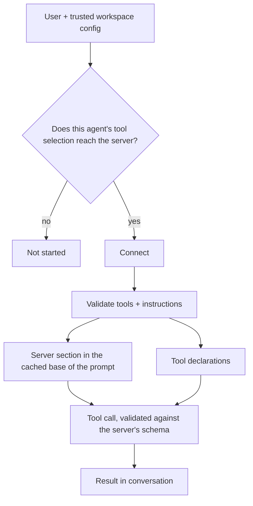

# MCP servers

MCP adds server-hosted tools to Octocode. This host supports tools, not MCP resources or prompts. The built-in `octocode` research server and the built-in `browser` server use the same connection path as other servers.

## Quick setup

```bash
octocode mcp add filesystem -- npx -y @modelcontextprotocol/server-filesystem .
octocode mcp list
octocode
```

Use `octocode mcp add -l ...` to save to a trusted workspace instead of your user configuration. In a running terminal session, run `/trust` after creating or changing workspace configuration, then `/reload`. Open `/mcp` to inspect servers, tools, errors, sign-in, and exposure.

## Configure servers

| Scope             | File                             |
| ----------------- | -------------------------------- |
| User              | `~/.octocode/mcp.json`           |
| Trusted workspace | `<workspace>/.octocode/mcp.json` |

```json
{
	"mcpServers": {
		"filesystem": {
			"command": "npx",
			"args": ["-y", "@modelcontextprotocol/server-filesystem", "."]
		},
		"docs": {
			"url": "https://example.com/mcp",
			"headers": { "Authorization": "Bearer ${DOCS_TOKEN}" }
		}
	}
}
```

A `command` starts a local stdio server; a `url` uses streamable HTTP by default. Legacy `"type": "sse"` definitions are rejected; use a Streamable HTTP endpoint. Keep credentials in environment variables, and trust a workspace before its file loads. `/mcp config` shows the actual paths and trust state. Older Pi and other supported config files still load in precedence order; see [configuration details](mcp-reference.md#configuration-and-precedence) and [CONFIGURATIONS.md](../../../CONFIGURATIONS.md).

To disable an inherited server only in one workspace, use a control-only override (no command or URL):

```json
{ "mcpServers": { "octocode": { "enabled": false } } }
```

## Manage servers

| Need                                | Terminal session                         | Shell                                                                                                                   |
| ----------------------------------- | ---------------------------------------- | ----------------------------------------------------------------------------------------------------------------------- |
| Browse state and tools              | `/mcp`, `/mcp tools`                     | `octocode mcp list`, `octocode mcp tools`                                                                               |
| Enable or disable                   | `/mcp enable docs`, `/mcp disable docs`  | `octocode mcp enable docs`, `octocode mcp disable docs`                                                                 |
| Show or optimize the generated file | none                                     | `octocode mcp compact show\|check\|apply\|preset\|list` ([compact presentation](mcp-reference.md#compact-presentation)) |
| Sign in or reconnect                | `/mcp login docs`, `/mcp reconnect docs` | `octocode mcp login docs`                                                                                               |
| Add or remove a definition          | Edit `mcp.json`, then `/reload`          | `octocode mcp add`, `octocode mcp remove`                                                                               |

The `/mcp` manager changes live state and exposure, but does not add or remove persistent definitions. Use `--local` on shell mutations for a trusted workspace override. [OAuth and other sign-in options](mcp-reference.md#authentication) are in the reference.

## Authenticate with OAuth

For a remote server without an `Authorization` header, use `/mcp login <server>` or the manager's **Sign in** action. Tokens are stored outside `mcp.json`; see [authentication options](mcp-reference.md#authentication).

## Discovery and agent context



Every tool of a selected server is declared up front; there is no discovery step. Each such server gets its own system prompt section, `mcp_contract_<server>`, placed after the tool-only instructions and before project context, so sessions in other projects or on other days read it from cache ([second instruction block](prompt-caching.md#second-instruction-block)). With the default `mcpPresentation: "compact"` ([compact presentation](mcp-reference.md#compact-presentation)), the section is the server's generated TypeScript file: its instructions, then each tool as a typed function with its description and result type. The declarations sent to the provider then carry only a one-line trigger and the top-level field types; calls are still validated locally against the server's own input schema, and a failed validation shows the tool's signature. With `"json"`, the section carries the server's instructions once and each declaration carries the full description and input schema (and output schema when supplied). A selected server that is not connected is named in a small `mcp_status` section, which disappears once every selected server is connected. Tool results enter conversation history after a call.

The integration does **not** put raw `mcp.json`, commands, environment values, headers, or tokens into agent context. Server-provided descriptions and instructions do reach it: do not put secrets there. Servers the agent does not select, disabled servers, and servers without declared tools contribute no instructions. [Prompt caching](prompt-caching.md) and [catalog refresh](mcp-reference.md#connections-and-caching) have more detail.

## Control tool exposure

Each tool is named `mcp__<server>__<tool>`. Set `exposure` on a server or `toolExposure` for individual tools:

| Value              | What the agent sees                           |
| ------------------ | --------------------------------------------- |
| `direct` (default) | The tool, declared up front                   |
| `hidden`           | No callable tool; server may remain connected |

```json
{
	"mcpServers": {
		"docs": {
			"url": "https://example.com/mcp",
			"toolExposure": { "delete_*": "hidden" }
		}
	}
}
```

`/mcp` shows each server's exposure. The former `auto`, `deferred`, `codemode` and `codemode-deferred` values are configuration errors; see [exposure and results](mcp-reference.md#exposure-and-results).

## Assign servers to agents

Every server is in each agent's default tool selection. Set `"defaultActive": false` on a server to give it only to the agents whose selection names its tools, for example `mcp__docs__*` in a subagent profile's `tools:` or in `--tools`; a broad wildcard such as `*` or `mcp__*` does not select it. `/mcp assign <server> selected` saves that setting (`all` removes it; add `--local` for the trusted project) and applies from the next session. A session whose selection does not reach a server never starts it, and `/mcp` shows it as `not selected`; a server started for the session anyway (enabled again from `/mcp` after being disabled) declares its tools for that session. The built-in `browser` server ships this way, so only the bundled `browser` subagent starts it and the main agent delegates browser work. [Assignment rules](mcp-reference.md#assign-servers-to-agents) are in the reference.

## Host and protocol support

The host supports stdio and Streamable HTTP, with stateful MCP through `2025-11-25`. It does not support stateless `2026-07-28`, elicitation, resources, prompts, sampling, tasks, or MCP Apps. [Protocol detail](../../mcp/README.md#supported-protocol-surface).

## Let the model manage servers

The agent's `mcp` tool can inspect tools and connection state, connect/restart/stop a server, or temporarily add/remove one for its session. Adding requires user confirmation and does not write configuration. Child agents use separate connections. [Management and permission details](mcp-reference.md#model-management-and-permissions).

## Catalog caching

Validated instructions and tool contracts are cached in memory; reconnect refreshes tools and disconnect withdraws them. In compact presentation each server's generated file is also stored under `<agent directory>/context-optimization/mcp/` and renewed when its catalog changes, keeping the rewritten descriptions of tools that did not change. [Connection behavior](mcp-reference.md#connections-and-caching).

## Replace the built-in MCP support

`--no-mcp` disables the host for one run. An extension that registers `/mcp` replaces the built-in host, including the default `octocode` and `browser` servers. [Extension and SDK details](mcp-reference.md#extensions-and-sdk).

For migration, OAuth settings, retries, permissions, and SDK use, see the [MCP reference](mcp-reference.md).
