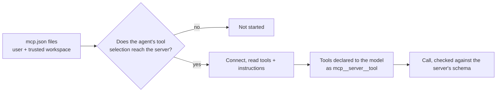

# MCP servers

MCP adds server-hosted tools to Octocode. MCP support is always on (it is not an `extensions` entry); you switch individual servers. The host supports tools only, not MCP resources or prompts. Octocode ships two default servers, `octocode` (code research) and `browser`, which connect like any other server; this page covers how to turn them on or off, never their tools. Details and rarely used options: [MCP reference](mcp-reference.md).

Each server owns its tool schemas and arguments. Octocode adds no required `reason` field to MCP calls: use it only when the tool declares it, with the type and requiredness that server defines. This applies to any configured server.



## Add a server

In the terminal, open `/mcp` and choose **Add MCP**, or run `/mcp add`. The entry is available even when no servers are configured. In the web page opened from the Octocode terminal, open a **running session**, choose **Settings**, then **Add MCP**. Published read-only links cannot save. The form appears only after the session supplies its complete MCP registry; standalone daemon settings, disconnected sessions and older sessions without registry support explain this requirement before asking for credentials. Reconnect or reload the session if its registry is unavailable.

**In the terminal**, paste a JSON definition. The prompt shows where this page is. Accepted shapes:

| Paste                                                       | Result                                       |
| ----------------------------------------------------------- | -------------------------------------------- |
| `{"mcpServers":{"docs":{...}}}`                             | Every server in the object (several at once) |
| `{"docs":{...}}`                                            | Every named server in the object             |
| One server object, such as `{"command":"npx","args":[...]}` | A name prompt, then that server              |

A Markdown code fence around the paste is removed. An invalid paste is rejected with the JSON path of the problem, never the value. A literal `env` or header value gets a warning: prefer `${VAR}` references. Then choose **Save to**: **Global** or **This workspace** (offered only in a trusted folder; each option shows its file). Each server is shown with its security rating (the static scan `/security` shows later) before it is saved. Servers are saved off and unassigned and stay off until you approve them in `/security` and switch them on in `/harness mcp`.

Submit an empty paste for the field-by-field form (it is not scanned): choose the scope, name the server and choose **Stdio** or **HTTP**.

**In the web page**, the form has these steps:

1. Choose **Global** or **Trusted workspace**. For a workspace, select it in web settings first and grant folder trust from the terminal if needed.
2. Enter a unique server name and choose **Stdio** or **HTTP**.
3. Enter the transport fields below, then choose **Save MCP**. Cancel leaves configuration unchanged. Validation or save errors keep your input available for correction.

| Transport | Fields                                                                                                                                                                                          |
| --------- | ----------------------------------------------------------------------------------------------------------------------------------------------------------------------------------------------- |
| Stdio     | An executable name or path, plus a JSON array of argument strings, such as `["--port", "3000"]`. This is not a shell command line. Optional environment variables are a JSON object of strings. |
| HTTP      | An `http://` or `https://` Streamable HTTP URL. Optional headers are a JSON object of strings, such as `{"Authorization":"Bearer ${TOKEN}"}`.                                                   |

Environment and header values are saved to the configuration file but are not returned in the web save response. On POSIX systems, configuration files and their backups are written owner-only (`0600`), including existing permissive files. Newly created configuration directories are private; existing directory permissions are unchanged. Prefer environment references over literal credentials. Names already present in configuration or the current session's registry—including disabled registrations and equivalent tool namespaces (`my-server` and `my_server`)—are rejected rather than replaced. This checks the current session, not extensions that a different or future session might register.

If audit recording fails after a save, the page still reports **Saved** and shows an audit warning. The definition is on disk; do not retry it as a failed save.

**Saved does not mean applied.** New definitions are saved disabled and unassigned by default. Saving does not launch a process, connect, sign in or approve anything. Run `/reload` in the session that should use the server, review it in `/security` (not checked/off until approved), then switch it on in `/harness mcp` (or the web Harness panel) and choose which agents get it on the `/mcp` → server → **Tools** page.

### Command-line configuration

The existing command-line path is also available:

```bash
octocode mcp add filesystem -- npx -y @modelcontextprotocol/server-filesystem .
octocode mcp list
octocode
```

Add `--local` (`-l`) to save to the workspace file `.octocode/mcp.json` instead of your user file; a workspace file loads only in a trusted project (`/trust add`, then `/reload` after editing). `/mcp` opens the manager (Add MCP, servers, tools, errors, sign-in).

## Configure servers

| Scope             | File                             |
| ----------------- | -------------------------------- |
| User              | `~/.octocode/mcp.json`           |
| Trusted workspace | `<workspace>/.octocode/mcp.json` |

With `OCTOCODE_HOME` or `OCTOCODE_CODING_AGENT_DIR` set, the user file is `mcp.json` in that directory, and `~/.octocode/mcp.json` is not read. `/mcp config` prints the paths in use.

```json
{
	"mcpServers": {
		"filesystem": {
			"command": "npx",
			"args": ["-y", "@modelcontextprotocol/server-filesystem", "."]
		},
		"docs": {
			"url": "https://example.com/mcp",
			"headers": { "Authorization": "Bearer ${DOCS_TOKEN}" }
		}
	}
}
```

A `command` starts a local stdio server; a `url` uses streamable HTTP (legacy `"type": "sse"` is rejected). Keep credentials in environment variables. `/mcp config` shows the real paths and trust state. Other agents' files, interpolation and precedence: [reference](mcp-reference.md#configuration-and-precedence).

### Server groups

Every server belongs to one group, using the same words as [skills](skills.md#the-four-groups). The group shows on `/harness` and `/configuration` rows, in `/status` and in the agent's `mcp` list.

| Group     | Where the server is defined                                                                                                   | Row example                                                 |
| --------- | ----------------------------------------------------------------------------------------------------------------------------- | ----------------------------------------------------------- |
| Core      | Built into Octocode: the default research server and the browser server                                                       | `Core · connected · 14 tools · direct · built in`           |
| Workspace | A trusted project file: `.octocode/mcp.json`, `.mcp.json`, `.agents/mcp.json`, `.cursor/mcp.json`, `.codex/config.toml`       | `Workspace · connected · 3 tools · direct · …/.mcp.json`    |
| Global    | A user file (`~/.octocode/mcp.json`, Pi's, `~/.claude.json`, Codex `config.toml`, `~/.cursor/mcp.json`), or added by a plugin | `Global · connected · 5 tools · direct · plugin ~/kits/kit` |

Redefining a built-in server in `~/.octocode/mcp.json` moves it to Global. An override that only switches a server on or off keeps the group of the file that defines it. The skills collection has its own group (Octocode); MCP has no matching group.

To change an inherited server in one workspace only, write a control-only override (no `command` or `url`):

```json
{ "mcpServers": { "docs": { "enabled": false } } }
```

### Servers from Claude Code, Codex and Cursor

Octocode also reads `.agents/mcp.json`, the workspace `.mcp.json` and Pi's `mcp.json` files. Claude Code, Codex and Cursor servers stay off until you enable that harness, and then connect in the running session without a reload:

| Harness     | Enable                                 | Reads                                              |
| ----------- | -------------------------------------- | -------------------------------------------------- |
| Claude Code | `/configuration enable harness:claude` | `~/.claude.json` (user and this project's servers) |
| Codex       | `/configuration enable harness:codex`  | `~/.codex/config.toml`, `.codex/config.toml`       |
| Cursor      | `/configuration enable harness:cursor` | `~/.cursor/mcp.json`, `.cursor/mcp.json`           |

Before the switch is written, `/harness` (Enter on the harness) and `/configuration enable harness:<name>` list what it would bring — its skills, MCP servers and hooks — each scanned now by the [security review](configuration.md#security-review), worst rating first, with the top finding per item. The scan reads files only: nothing starts and nothing is looked up. `/harness` asks you to confirm and writes nothing on cancel; `/configuration` prints the list and then switches. Items stay off until you approve them in `/security`.

Add `--local` to enable for this workspace only. A same-named server in an Octocode file wins. Formats: [files of other agents](mcp-reference.md#files-of-other-agents).

## Manage servers

| Need                      | In a session                                                          | In the shell                                                        |
| ------------------------- | --------------------------------------------------------------------- | ------------------------------------------------------------------- |
| Browse state and tools    | `/mcp`, `/mcp list`, `/mcp tools`                                     | `octocode mcp list`, `octocode mcp tools [server] [tool]`           |
| Turn a server on or off   | `/configuration enable\|disable mcp:docs`                             | `octocode configuration enable\|disable mcp:docs`                   |
| Add a definition          | `/configuration add mcp`, or edit `mcp.json` and `/reload`            | `octocode mcp add <server> -- <command> [args]` or `--url <url>`    |
| Remove a definition       | `/configuration remove`, or edit `mcp.json`                           | `octocode mcp remove <server> [-l]`                                 |
| Sign in or out, reconnect | `/mcp login docs`, `/mcp logout docs`, `/mcp reconnect docs`          | `octocode mcp login docs [--timeout s]`, `octocode mcp logout docs` |
| Exposure and assignment   | `/mcp` → server → **Tools** → **Available to**, **Default for tools** | `octocode mcp exposure <server> <mode> [-l]`                        |
| Show resolved config      | `/mcp config`                                                         | `octocode mcp config [--json]`                                      |

`mcp add` options: `--env KEY=VALUE`, `--cwd`, `--header KEY=VALUE`, `--bearer-token-env-var`, `--oauth-client-id`, `--oauth-client-secret`, `--oauth-callback-port`, `--oauth-client-name`, `--exposure direct|hidden`, `--description`. `/mcp enable|disable` and `octocode mcp enable|disable` are retired and print a hint to `/configuration`; `/mcp assign` and `/mcp exposure` are retired and print where to go on the `/mcp` tools page. A server that is off shows `Off · turn on in /harness mcp` in `/mcp`.

### Default servers

| Server      | Default                                                          | Turn off                                                                                                             | Turn on again                                                                        |
| ----------- | ---------------------------------------------------------------- | -------------------------------------------------------------------------------------------------------------------- | ------------------------------------------------------------------------------------ |
| `octocode`  | on                                                               | `/configuration disable mcp:octocode`, `OCTOCODE_MCP=0`, or `{ "mcpServers": { "octocode": { "enabled": false } } }` | `/configuration enable mcp:octocode`; a file definition overrides `OCTOCODE_MCP=0`   |
| `browser`   | on, assigned only to the bundled `browser` subagent              | `/configuration disable mcp:browser`                                                                                 | `/configuration enable mcp:browser`                                                  |
| `freellama` | on when an `ollama` command is on `PATH`, except in offline mode | `/harness mcp`, `/configuration disable mcp:freellama`, or `OCTOCODE_MCP_FREELLAMA=0`                                | `/harness mcp`, `/configuration enable mcp:freellama`, or `OCTOCODE_MCP_FREELLAMA=1` |

`freellama` runs [FreeLlama](https://github.com/bgauryy/FreeLlama) (`@octocodeai/freellama-mcp-server`), which picks, runs and manages local Ollama models. Octocode installs the pinned package from npm on its first launch, so offline mode leaves it off unless you turn it on. A switch you save in `/harness` or `/configuration` wins over the `PATH` check. Ollama must be running for its tools to work. It serves the main session only: a subagent never starts it (no tools, no instructions in its prompt), unless its profile's `tools` names `mcp__freellama__*` or its task's `mcp` list names `freellama`.

Defining a server with the same name in `mcp.json` replaces the built-in launch. To switch MCP off for one run use `--no-mcp` (no servers connect, no MCP tools; subagents inherit it). The browser server and its permission rules: [reference](mcp-reference.md#built-in-mcp-host).

## Authenticate with OAuth

For a remote server without an `Authorization` header, run `/mcp login <server>` (or `octocode mcp login <server>`, or **Sign in** in `/mcp`). Tokens are stored outside `mcp.json`. Pre-registered clients, callback ports and provider sign-in: [authentication](mcp-reference.md#authentication).

## Discovery and agent context

Every tool of a selected server is declared to the model up front, and the servers share one cached prompt section, `mcps`, with a block per server (its name, the `mcp__<server>__*` prefix, its instructions). `/mcp` shows state; a server that is not ready appears as one line in the separate `mcp_status` section at the end of the prompt, so state changes do not disturb the cache. Raw `mcp.json`, commands, environment values, headers and tokens never reach agent context, but server-provided descriptions and instructions do. Disabled and unselected servers contribute nothing. How the block is rendered ([presentation modes](mcp-reference.md#presentation-modes)) and when it is refreshed ([connections and caching](mcp-reference.md#connections-and-caching)) are in the reference; [prompt caching](prompt-caching.md) explains the cost.

## Control tool exposure

Set `exposure` on a server, or `toolExposure` for individual tools (exact names or `*` patterns; exact wins):

| Value              | The agent sees                                                                                                                                                                                                              |
| ------------------ | --------------------------------------------------------------------------------------------------------------------------------------------------------------------------------------------------------------------------- |
| `direct` (default) | The tool, declared up front                                                                                                                                                                                                 |
| `deferred`         | The tool declared up front with its whole description and its field names and types; its server's block lists only name and trigger, and the agent loads the schema detail with its `mcp` tool                              |
| `onDemand`         | Not declared at first: the block lists name and trigger, and the tool's first call or a load with the `mcp` tool (intent `tools`) declares it after the cached prompt; `deferred` where the model cannot add tools that way |
| `hidden`           | No callable tool; the server may stay connected                                                                                                                                                                             |

```json
{
	"mcpServers": {
		"docs": { "url": "https://example.com/mcp", "toolExposure": { "delete_*": "hidden" } }
	}
}
```

The `mcpExposure` setting sets the default for servers that set none: `"direct"`, `"deferred"`, `"recent"` (a tool called in this working directory in the last 24 hours is direct, any other is deferred), `"usage"` (every tool is deferred unless the promotion snapshot built from use across all your folders names it; [how](harness-flows.md#usage-based-promotion)) or `"auto:<bytes>"` (keeps servers direct in name order while their blocks fit the byte budget, then defers the rest). An agent without the `mcp` tool gets deferred servers in full. A deferred tool the session has called is declared in full from then on where the model can add the definition without resending its tool list ([reference](mcp-reference.md#exposure-and-results)). After a compaction, the input schemas of the deferred tools the session called (MCP and native) follow the summary as one hidden message, whole schemas only, most recent first. In the terminal, open `/mcp`, select the server, then **Tools** (Enter on a server row in `/harness mcp` opens the same page). **Default for tools** sets the server default, and each tool row opens a page of choices: `direct`, `deferred`, `onDemand`, `hidden`, or `server default` to remove its pin. Changes apply from the next session. More: [exposure and results](mcp-reference.md#exposure-and-results).

The Tools panel of the [web Settings page](web-workspace.md#settings-page) lists every tool of each enabled server with its state in the running session and what decided it (a pin, the server's `exposure`, use in the last 24 hours, or the default), and pins one tool by saving its `toolExposure` entry. A pin applies from the next session.

## Assign servers to agents

By default every server is in every agent's tool selection. Set `"defaultActive": false` to give a server only to agents whose selection names it (for example `mcp__docs__*` in a subagent profile's `tools:` or in `--tools`; `*` and `mcp__*` do not select it). In the terminal, `/mcp` → the server → **Tools** → **Available to** switches between `every agent` and only agents whose profile `tools:` names `mcp__<server>__` from the next session. A session whose selection does not reach a server never starts it and `/mcp` shows `not selected`. The `browser` server ships this way: the main agent delegates browser work to the `browser` subagent. Rules and examples: [assign servers to agents](mcp-reference.md#assign-servers-to-agents).

## Host and protocol support

| Supported                                                  | Not supported                                                                      |
| ---------------------------------------------------------- | ---------------------------------------------------------------------------------- |
| stdio and Streamable HTTP; stateful MCP up to `2025-11-25` | Stateless `2026-07-28`, elicitation, resources, prompts, sampling, tasks, MCP Apps |

## Let the model manage servers

The agent's `mcp` tool can list state, inspect tools and restart or stop a server for its session (restart also starts a stopped or failed one). Its list shows each server's group and configured description, like a skill entry: `octocode: connected · 14 tools · Core. Code search and read…`. Asked about one server, it also names where that server is defined (`Defined in: ~/.octocode/mcp.json` or `built in`). It never edits configuration; adding and removing stays with you. Subagents use separate connections. [Details and permissions](mcp-reference.md#model-management-and-permissions).

## Catalog caching

Tool catalogs and instructions are cached in memory. A reconnect refreshes tools; a dropped connection keeps them declared (calls fail until it returns); only stop, disable, removal and shutdown withdraw them. [Connection behavior](mcp-reference.md#connections-and-caching).
