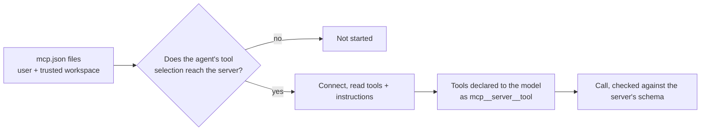

# MCP servers

MCP adds server-hosted tools to Octocode. MCP support is always on (it is not an `extensions` entry); you switch individual servers. The host supports tools only, not MCP resources or prompts. Octocode ships two default servers, `octocode` (code research) and `browser`, which connect like any other server; this page covers how to turn them on or off, never their tools. Details and rarely used options: [MCP reference](mcp-reference.md).



## Quick setup

```bash
octocode mcp add filesystem -- npx -y @modelcontextprotocol/server-filesystem .
octocode mcp list
octocode
```

Add `--local` (`-l`) to save to the workspace file `.octocode/mcp.json` instead of your user file; a workspace file loads only in a trusted project (`/trust add`, then `/reload` after editing). `/mcp` opens the manager (servers, tools, errors, sign-in, exposure).

## Configure servers

| Scope             | File                             |
| ----------------- | -------------------------------- |
| User              | `~/.octocode/mcp.json`           |
| Trusted workspace | `<workspace>/.octocode/mcp.json` |

```json
{
	"mcpServers": {
		"filesystem": {
			"command": "npx",
			"args": ["-y", "@modelcontextprotocol/server-filesystem", "."]
		},
		"docs": {
			"url": "https://example.com/mcp",
			"headers": { "Authorization": "Bearer ${DOCS_TOKEN}" }
		}
	}
}
```

A `command` starts a local stdio server; a `url` uses streamable HTTP (legacy `"type": "sse"` is rejected). Keep credentials in environment variables. `/mcp config` shows the real paths and trust state. Other agents' files, interpolation and precedence: [reference](mcp-reference.md#configuration-and-precedence).

### Server groups

Every server belongs to one group, using the same words as [skills](skills.md#the-four-groups). The group shows on `/harness` and `/configuration` rows, in `/status` and in the agent's `mcp` list.

| Group     | Where the server is defined                                                                                                   | Row example                                                 |
| --------- | ----------------------------------------------------------------------------------------------------------------------------- | ----------------------------------------------------------- |
| Core      | Built into Octocode: the default research server and the browser server                                                       | `Core · connected · 14 tools · direct · built in`           |
| Workspace | A trusted project file: `.octocode/mcp.json`, `.mcp.json`, `.agents/mcp.json`, `.cursor/mcp.json`, `.codex/config.toml`       | `Workspace · connected · 3 tools · direct · …/.mcp.json`    |
| Global    | A user file (`~/.octocode/mcp.json`, Pi's, `~/.claude.json`, Codex `config.toml`, `~/.cursor/mcp.json`), or added by a plugin | `Global · connected · 5 tools · direct · plugin ~/kits/kit` |

Redefining a built-in server in `~/.octocode/mcp.json` moves it to Global. An override that only switches a server on or off keeps the group of the file that defines it. The skills collection has its own group (Octocode); MCP has no matching group.

To change an inherited server in one workspace only, write a control-only override (no `command` or `url`):

```json
{ "mcpServers": { "docs": { "enabled": false } } }
```

### Servers from Claude Code, Codex and Cursor

Octocode also reads `.agents/mcp.json`, the workspace `.mcp.json` and Pi's `mcp.json` files. Claude Code, Codex and Cursor servers stay off until you enable that harness, and then connect in the running session without a reload:

| Harness     | Enable                                 | Reads                                              |
| ----------- | -------------------------------------- | -------------------------------------------------- |
| Claude Code | `/configuration enable harness:claude` | `~/.claude.json` (user and this project's servers) |
| Codex       | `/configuration enable harness:codex`  | `~/.codex/config.toml`, `.codex/config.toml`       |
| Cursor      | `/configuration enable harness:cursor` | `~/.cursor/mcp.json`, `.cursor/mcp.json`           |

Add `--local` to enable for this workspace only. A same-named server in an Octocode file wins. Formats: [files of other agents](mcp-reference.md#files-of-other-agents).

## Manage servers

| Need                        | In a session                                                 | In the shell                                                                                               |
| --------------------------- | ------------------------------------------------------------ | ---------------------------------------------------------------------------------------------------------- |
| Browse state and tools      | `/mcp`, `/mcp list`, `/mcp tools`                            | `octocode mcp list`, `octocode mcp tools [server] [tool]`                                                  |
| Turn a server on or off     | `/configuration enable\|disable mcp:docs`                    | `octocode configuration enable\|disable mcp:docs`                                                          |
| Add a definition            | `/configuration add mcp`, or edit `mcp.json` and `/reload`   | `octocode mcp add <server> -- <command> [args]` or `--url <url>`                                           |
| Remove a definition         | `/configuration remove`, or edit `mcp.json`                  | `octocode mcp remove <server> [-l]`                                                                        |
| Sign in or out, reconnect   | `/mcp login docs`, `/mcp logout docs`, `/mcp reconnect docs` | `octocode mcp login docs [--timeout s]`, `octocode mcp logout docs`                                        |
| Exposure and assignment     | `/mcp exposure …`, `/mcp assign …`                           | `octocode mcp exposure <server> <mode> [-l]`                                                               |
| Show resolved config        | `/mcp config`                                                | `octocode mcp config [--json]`                                                                             |
| Optimize the generated file | none                                                         | `octocode mcp compact show\|check\|apply\|preset\|list` ([compact](mcp-reference.md#compact-presentation)) |

`mcp add` options: `--env KEY=VALUE`, `--cwd`, `--header KEY=VALUE`, `--bearer-token-env-var`, `--oauth-client-id`, `--oauth-client-secret`, `--oauth-callback-port`, `--oauth-client-name`, `--exposure direct|hidden`, `--description`. `/mcp enable|disable` and `octocode mcp enable|disable` are retired and print a hint to `/configuration`.

### Default servers

| Server     | Default                                             | Turn off                                                                                                             | Turn on again                                                                      |
| ---------- | --------------------------------------------------- | -------------------------------------------------------------------------------------------------------------------- | ---------------------------------------------------------------------------------- |
| `octocode` | on                                                  | `/configuration disable mcp:octocode`, `OCTOCODE_MCP=0`, or `{ "mcpServers": { "octocode": { "enabled": false } } }` | `/configuration enable mcp:octocode`; a file definition overrides `OCTOCODE_MCP=0` |
| `browser`  | on, assigned only to the bundled `browser` subagent | `/configuration disable mcp:browser`                                                                                 | `/configuration enable mcp:browser`                                                |

Defining a server with the same name in `mcp.json` replaces the built-in launch. To switch MCP off for one run use `--no-mcp` (no servers connect, no MCP tools; subagents inherit it). The browser server and its permission rules: [reference](mcp-reference.md#built-in-mcp-host).

## Authenticate with OAuth

For a remote server without an `Authorization` header, run `/mcp login <server>` (or `octocode mcp login <server>`, or **Sign in** in `/mcp`). Tokens are stored outside `mcp.json`. Pre-registered clients, callback ports and provider sign-in: [authentication](mcp-reference.md#authentication).

## Discovery and agent context

Every tool of a selected server is declared to the model up front, and the servers share one cached prompt section, `mcps`, with a block per server (its name, the `mcp__<server>__*` prefix, its instructions). `/mcp` shows state; a server that is not ready appears as one line in the separate `mcp_status` section at the end of the prompt, so state changes do not disturb the cache. Raw `mcp.json`, commands, environment values, headers and tokens never reach agent context, but server-provided descriptions and instructions do. Disabled and unselected servers contribute nothing. How the block is rendered ([presentation modes](mcp-reference.md#presentation-modes)) and when it is refreshed ([connections and caching](mcp-reference.md#connections-and-caching)) are in the reference; [prompt caching](prompt-caching.md) explains the cost.

## Control tool exposure

Set `exposure` on a server, or `toolExposure` for individual tools (exact names or `*` patterns; exact wins):

| Value              | The agent sees                                                                                                           |
| ------------------ | ------------------------------------------------------------------------------------------------------------------------ |
| `direct` (default) | The tool, declared up front                                                                                              |
| `deferred`         | The tool declared up front, but its block lists only name and trigger; the agent loads the full text with its `mcp` tool |
| `hidden`           | No callable tool; the server may stay connected                                                                          |

```json
{
	"mcpServers": {
		"docs": { "url": "https://example.com/mcp", "toolExposure": { "delete_*": "hidden" } }
	}
}
```

The `mcpExposure` setting sets the default for servers that set none: `"direct"`, `"deferred"` or `"auto:<bytes>"` (keeps servers direct in name order while their blocks fit the byte budget, then defers the rest). An agent without the `mcp` tool gets deferred servers in full. `/mcp exposure <server> <direct|deferred|hidden>` saves a value. More: [exposure and results](mcp-reference.md#exposure-and-results).

## Assign servers to agents

By default every server is in every agent's tool selection. Set `"defaultActive": false` to give a server only to agents whose selection names it (for example `mcp__docs__*` in a subagent profile's `tools:` or in `--tools`; `*` and `mcp__*` do not select it). `/mcp assign <server> selected` saves that (`all` removes it; `--local` for the project) from the next session. A session whose selection does not reach a server never starts it and `/mcp` shows `not selected`. The `browser` server ships this way: the main agent delegates browser work to the `browser` subagent. Rules and examples: [assign servers to agents](mcp-reference.md#assign-servers-to-agents).

## Host and protocol support

| Supported                                                  | Not supported                                                                      |
| ---------------------------------------------------------- | ---------------------------------------------------------------------------------- |
| stdio and Streamable HTTP; stateful MCP up to `2025-11-25` | Stateless `2026-07-28`, elicitation, resources, prompts, sampling, tasks, MCP Apps |

## Let the model manage servers

The agent's `mcp` tool can list state, inspect tools and restart or stop a server for its session (restart also starts a stopped or failed one). Its list shows each server's group and configured description, like a skill entry: `octocode: connected · 14 tools · Core. Code search and read…`. Asked about one server, it also names where that server is defined (`Defined in: ~/.octocode/mcp.json` or `built in`). It never edits configuration; adding and removing stays with you. Subagents use separate connections. [Details and permissions](mcp-reference.md#model-management-and-permissions).

## Catalog caching

Tool catalogs and instructions are cached in memory. A reconnect refreshes tools; a dropped connection keeps them declared (calls fail until it returns); only stop, disable, removal and shutdown withdraw them. [Connection behavior](mcp-reference.md#connections-and-caching).
