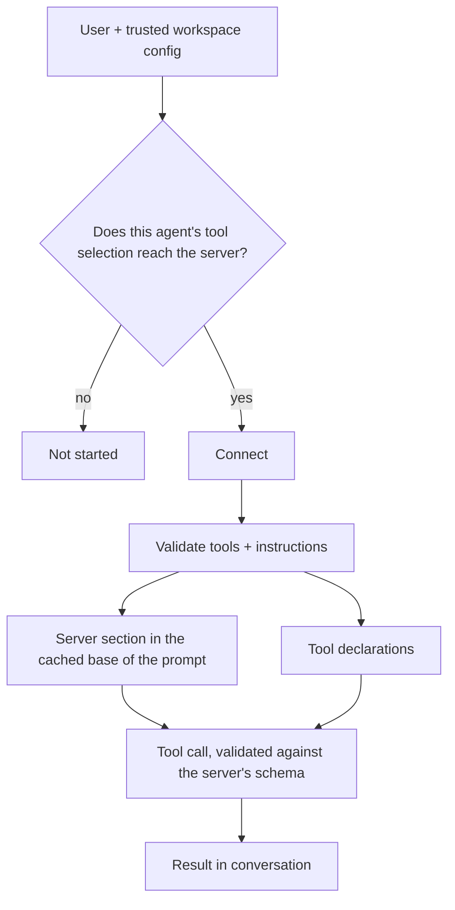

# MCP servers

MCP adds server-hosted tools to Octocode. This host supports tools, not MCP resources or prompts. The built-in `octocode` research server and the built-in `browser` server use the same connection path as other servers.

## Quick setup

```bash
octocode mcp add filesystem -- npx -y @modelcontextprotocol/server-filesystem .
octocode mcp list
octocode
```

Add `--local` (shell short form `-l`) to save to the workspace file `.octocode/mcp.json` instead of your user configuration: `octocode mcp add --local filesystem -- npx -y @modelcontextprotocol/server-filesystem .`. A workspace file loads only in a trusted project. In a running terminal session, run `/trust config` after creating or changing it, then `/reload`; `octocode mcp list` and `/mcp list` check the connection. Open `/mcp` to inspect servers, tools, errors, sign-in, and exposure.

## Configure servers

| Scope             | File                             |
| ----------------- | -------------------------------- |
| User              | `~/.octocode/mcp.json`           |
| Trusted workspace | `<workspace>/.octocode/mcp.json` |

```json
{
	"mcpServers": {
		"filesystem": {
			"command": "npx",
			"args": ["-y", "@modelcontextprotocol/server-filesystem", "."]
		},
		"docs": {
			"url": "https://example.com/mcp",
			"headers": { "Authorization": "Bearer ${DOCS_TOKEN}" }
		}
	}
}
```

A `command` starts a local stdio server; a `url` uses streamable HTTP by default. Legacy `"type": "sse"` definitions are rejected; use a Streamable HTTP endpoint. Keep credentials in environment variables, and trust a workspace before its file loads. `/mcp config` shows the actual paths and trust state. Older Pi and other supported config files still load in precedence order; see [configuration details](mcp-reference.md#configuration-and-precedence) and [CONFIGURATIONS.md](../../../CONFIGURATIONS.md).

To disable an inherited server only in one workspace, use a control-only override (no command or URL):

```json
{ "mcpServers": { "octocode": { "enabled": false } } }
```

## Manage servers

| Need                                | Terminal session                         | Shell                                                                                                                   |
| ----------------------------------- | ---------------------------------------- | ----------------------------------------------------------------------------------------------------------------------- |
| Browse state and tools              | `/mcp`, `/mcp tools`                     | `octocode mcp list`, `octocode mcp tools`                                                                               |
| Enable or disable                   | `/mcp enable docs`, `/mcp disable docs`  | `octocode mcp enable docs`, `octocode mcp disable docs`                                                                 |
| Show or optimize the generated file | none                                     | `octocode mcp compact show\|check\|apply\|preset\|list` ([compact presentation](mcp-reference.md#compact-presentation)) |
| Sign in or reconnect                | `/mcp login docs`, `/mcp reconnect docs` | `octocode mcp login docs`                                                                                               |
| Add or remove a definition          | Edit `mcp.json`, then `/reload`          | `octocode mcp add`, `octocode mcp remove`                                                                               |

The `/mcp` manager changes live state and exposure, but does not add or remove persistent definitions. Use `--local` on shell mutations for a trusted workspace override. [OAuth and other sign-in options](mcp-reference.md#authentication) are in the reference.

## Authenticate with OAuth

For a remote server without an `Authorization` header, use `/mcp login <server>` or the manager's **Sign in** action; when a dialog, selector or session reset takes the place of the manager, it closes and cancels a sign-in in progress. Tokens are stored outside `mcp.json`; see [authentication options](mcp-reference.md#authentication).

## Discovery and agent context



Every tool of a selected server is declared up front; there is no discovery step. The servers share one system prompt section, `mcps`, with a block per enabled server (its name, tool prefix `mcp__<server>__*` and contract), placed after the tool-only instructions and before project context, so sessions in other projects or on other days read it from cache ([second instruction block](prompt-caching.md#second-instruction-block)). Every server takes the same path, preset or configured (user, project, plugin, ACP): the block holds the server's own instructions and, for each tool enabled for that agent (a role's allow-list, `defaultActive`, `hidden` and tool toggles all apply), the tool's description and schema. Disabled servers and tools are absent. A server's one-line purpose (its `description`, which a configured entry that replaces a built-in server keeps from the built-in unless it sets its own) is stated once: for a server with described tools as a `- mcp__<server>__*: purpose` line in the `tools` list the model reads first, otherwise (not connected yet, or no tool enabled) in its block. With the default `mcpPresentation: "compact"` ([compact presentation](mcp-reference.md#compact-presentation)), the block is the server's generated TypeScript file: its instructions, then each tool as a typed function with its description and result type; a tool the renderer cannot express faithfully follows in plain form (its description and the JSON Schema as the server sent it). With `"json"`, every tool is in plain form. The declarations sent to the provider carry only a one-line trigger and the top-level field types in both modes, never a second copy of the schema; calls are still validated locally against the server's own input schema, and a failed validation shows the tool's signature when it has one. A block never carries connection state: a server that is not ready (connecting, failed, disconnected, stopped, needing sign-in, or with tools left undeclared) is one line in the separate `mcp_status` section, the last of the prompt, so a state change patches only that line. A server first seen while it connects gets a block that says in one line it is not connected yet, and fills once when it connects, also between two requests of the same run. After that its block is kept through a reconnect, a no-op reload, a state change, a dropped connection, a withdrawn tool or a newly offered tool. It is described again when the connected server's contract changes: its instructions, or the description, input schema or output schema of a tool the block already describes. That new description reaches the model as one appended patch of the `mcps` section, with the changed tool's declaration thin again in the same request; the prompt already sent is not rewritten. It is also described again when the loadout is rebuilt (model change, tree navigation, new session) or the server leaves the list. A tool the server stops offering is named in `mcp_status` and removed from the declarations; its block stays. A dropped connection withdraws nothing: its tools stay declared and the server's state alone shows in `mcp_status`. Tool results enter conversation history after a call.

The integration does **not** put raw `mcp.json`, commands, environment values, headers, or tokens into agent context. Server-provided descriptions and instructions do reach it: do not put secrets there. Servers the agent does not select, disabled servers, and servers without declared tools contribute no instructions. [Prompt caching](prompt-caching.md) and [catalog refresh](mcp-reference.md#connections-and-caching) have more detail.

## Control tool exposure

Each tool is named `mcp__<server>__<tool>`. Set `exposure` on a server or `toolExposure` for individual tools:

| Value              | What the agent sees                           |
| ------------------ | --------------------------------------------- |
| `direct` (default) | The tool, declared up front                   |
| `hidden`           | No callable tool; server may remain connected |

```json
{
	"mcpServers": {
		"docs": {
			"url": "https://example.com/mcp",
			"toolExposure": { "delete_*": "hidden" }
		}
	}
}
```

`/mcp` shows each server's exposure; see [exposure and results](mcp-reference.md#exposure-and-results).

## Assign servers to agents

Every server is in each agent's default tool selection. Set `"defaultActive": false` on a server to give it only to the agents whose selection names its tools, for example `mcp__docs__*` in a subagent profile's `tools:` or in `--tools`; a broad wildcard such as `*` or `mcp__*` does not select it. `/mcp assign <server> selected` saves that setting (`all` removes it; add `--local` for the trusted project) and applies from the next session. A session whose selection does not reach a server never starts it, and `/mcp` shows it as `not selected`; a server started for the session anyway (enabled again from `/mcp` after being disabled) declares its tools for that session. The built-in `browser` server ships this way, so only the bundled `browser` subagent starts it and the main agent delegates browser work. To give the main session a trimmed browser, name its tools in `defaultTools` ([browser opt-in](mcp-reference.md#configuration-and-precedence)); subagents still start it only when their profile names `mcp__browser__*`. [Assignment rules](mcp-reference.md#assign-servers-to-agents) are in the reference.

## Host and protocol support

The host supports stdio and Streamable HTTP, with stateful MCP through `2025-11-25`. It does not support stateless `2026-07-28`, elicitation, resources, prompts, sampling, tasks, or MCP Apps. [Protocol detail](../../mcp/README.md#supported-protocol-surface).

## Let the model manage servers

The agent's `mcp` tool can list connection state, inspect tools, and restart (also starting a stopped or failed server) or stop a server for its session, without writing configuration. Adding and removing servers stays with `/mcp` and `octocode mcp`. Child agents use separate connections. [Management and permission details](mcp-reference.md#model-management-and-permissions).

## Catalog caching

Validated instructions and tool contracts are cached in memory; reconnect refreshes tools, and a disconnect keeps them declared (calls fail while the server is down); only stop, disable, removal and shutdown withdraw them. In compact presentation each server's generated file is also stored under `<agent directory>/context-optimization/mcp/` and renewed when its catalog changes, keeping the rewritten descriptions of tools that did not change. [Connection behavior](mcp-reference.md#connections-and-caching).

## Replace the built-in MCP support

`--no-mcp` disables the host for one run. See the [built-in MCP host notes](mcp-reference.md#built-in-mcp-host).

For migration, OAuth settings, retries and permissions, see the [MCP reference](mcp-reference.md).
