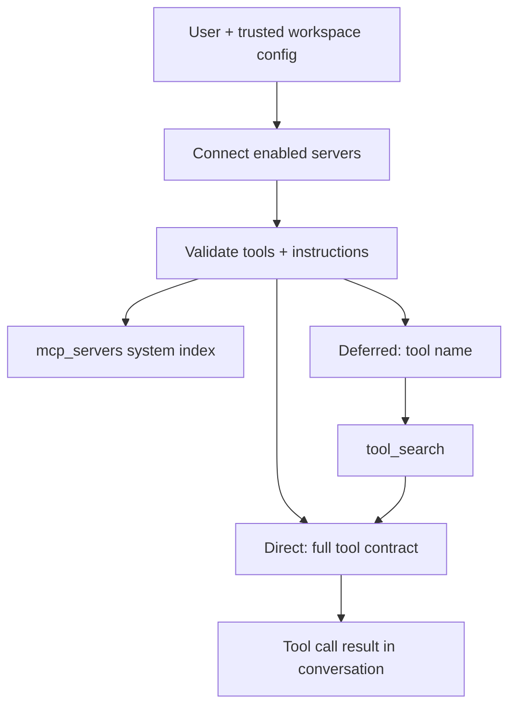

# MCP servers

MCP adds server-hosted tools to Octocode. This host supports tools, not MCP resources or prompts. The built-in `octocode` research server uses the same connection path as other servers.

## Quick setup

```bash
octocode mcp add filesystem -- npx -y @modelcontextprotocol/server-filesystem .
octocode mcp list
octocode
```

Use `octocode mcp add -l ...` to save to a trusted workspace instead of your user configuration. In a running terminal session, run `/trust` after creating or changing workspace configuration, then `/reload`. Open `/mcp` to inspect servers, tools, errors, sign-in, and exposure.

## Configure servers

| Scope             | File                             |
| ----------------- | -------------------------------- |
| User              | `~/.octocode/mcp.json`           |
| Trusted workspace | `<workspace>/.octocode/mcp.json` |

```json
{
	"mcpServers": {
		"filesystem": {
			"command": "npx",
			"args": ["-y", "@modelcontextprotocol/server-filesystem", "."]
		},
		"docs": {
			"url": "https://example.com/mcp",
			"headers": { "Authorization": "Bearer ${DOCS_TOKEN}" }
		}
	}
}
```

A `command` starts a local stdio server; a `url` uses streamable HTTP by default. Add `"type": "sse"` only for a legacy SSE server. Keep credentials in environment variables, and trust a workspace before its file loads. `/mcp config` shows the actual paths and trust state. Older Pi and other supported config files still load in precedence order; see [configuration details](mcp-reference.md#configuration-and-precedence) and [CONFIGURATIONS.md](../../../CONFIGURATIONS.md).

To disable an inherited server only in one workspace, use a control-only override (no command or URL):

```json
{ "mcpServers": { "octocode": { "enabled": false } } }
```

## Manage servers

| Need                       | Terminal session                         | Shell                                                   |
| -------------------------- | ---------------------------------------- | ------------------------------------------------------- |
| Browse state and tools     | `/mcp`, `/mcp tools`                     | `octocode mcp list`, `octocode mcp tools`               |
| Enable or disable          | `/mcp enable docs`, `/mcp disable docs`  | `octocode mcp enable docs`, `octocode mcp disable docs` |
| Sign in or reconnect       | `/mcp login docs`, `/mcp reconnect docs` | `octocode mcp login docs`                               |
| Add or remove a definition | Edit `mcp.json`, then `/reload`          | `octocode mcp add`, `octocode mcp remove`               |

The `/mcp` manager changes live state and exposure, but does not add or remove persistent definitions. Use `--local` on shell mutations for a trusted workspace override. [OAuth and other sign-in options](mcp-reference.md#authentication) are in the reference.

## Authenticate with OAuth

For a remote server without an `Authorization` header, use `/mcp login <server>` or the manager's **Sign in** action. Tokens are stored outside `mcp.json`; see [authentication options](mcp-reference.md#authentication).

## Discovery and agent context



The `mcp_servers` system section includes server names, states, descriptions, reachable tool names, **and the server's full instructions when it has reachable tools**. Direct tool declarations include the full description and input schema (and output schema when supplied). Deferred tools appear by name until `tool_search` loads their contract. Tool results enter conversation history after a call.

The integration does **not** put raw `mcp.json`, commands, environment values, headers, or tokens into agent context. Server-provided descriptions and instructions do reach it: do not put secrets there. Disabled, disconnected, or hidden-only servers contribute no instructions. [Prompt caching](prompt-caching.md) and [catalog refresh](mcp-reference.md#connections-and-caching) have more detail.

## Control tool exposure

Each tool is named `mcp__<server>__<tool>`. Set `exposure` on a server or `toolExposure` for individual tools:

| Value            | What the agent sees                                                                |
| ---------------- | ---------------------------------------------------------------------------------- |
| `auto` (default) | Direct for small catalogs; deferred for large ones when `tool_search` is available |
| `direct`         | Full tool contract immediately                                                     |
| `deferred`       | Name first; `tool_search` loads the contract                                       |
| `hidden`         | No callable tool; server may remain connected                                      |

```json
{
	"mcpServers": {
		"docs": {
			"url": "https://example.com/mcp",
			"exposure": "deferred",
			"toolExposure": { "search": "direct", "delete_*": "hidden" }
		}
	}
}
```

`/mcp` shows effective exposure. [Exact auto rules and tool filtering](mcp-reference.md#exposure-and-results) are in the reference.

## Host and protocol support

The host supports stdio, streamable HTTP, and legacy SSE, with stateful MCP through `2025-11-25`. It does not support stateless `2026-07-28`, elicitation, resources, prompts, sampling, tasks, or MCP Apps. [Protocol detail](../../mcp/README.md#supported-protocol-surface).

## Let the model manage servers

The agent's `mcp` tool can inspect tools and connection state, connect/restart/stop a server, or temporarily add/remove one for its session. Adding requires user confirmation and does not write configuration. Child agents use separate connections. [Management and permission details](mcp-reference.md#model-management-and-permissions).

## Catalog caching

Validated instructions and tool contracts are cached in memory; reconnect refreshes tools and disconnect withdraws them. [Connection behavior](mcp-reference.md#connections-and-caching).

## Replace the built-in MCP support

`--no-mcp` disables the host for one run. An extension that registers `/mcp` replaces the built-in host, including the default `octocode` server. [Extension and SDK details](mcp-reference.md#extensions-and-sdk).

For migration, OAuth settings, retries, permissions, and SDK use, see the [MCP reference](mcp-reference.md).
