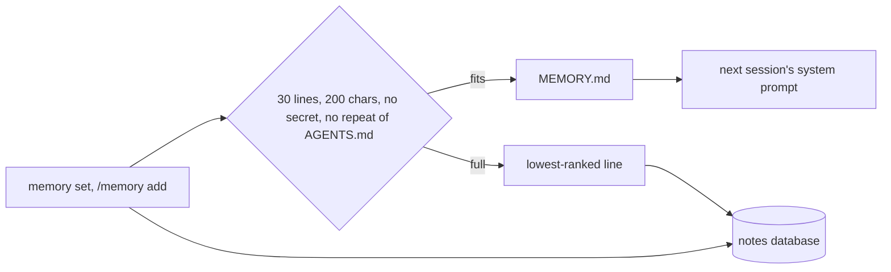
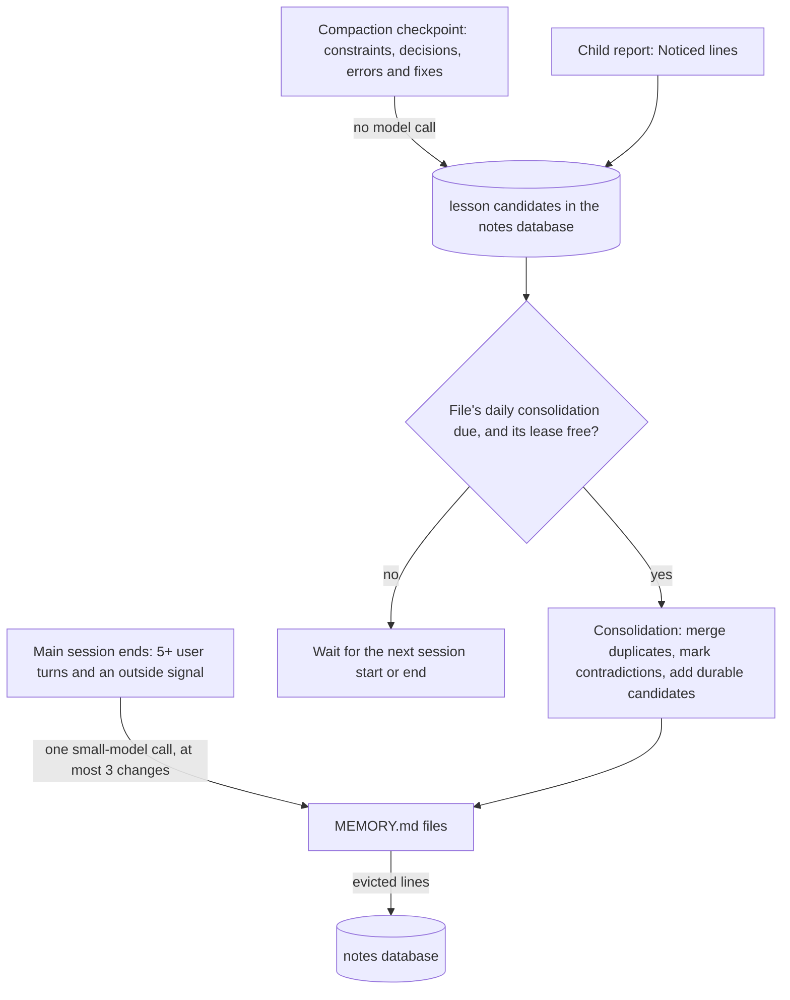

# Memory and Archive

Part of the [native feature guide](native-features.md).

The model has two tools: `memory` for saved notes, and `archive` for earlier conversations, complete compaction summaries and diagnostics (agent lifecycle events, tool errors, a session's request profile). `/memory` is the user's command for editing notes. The most useful notes also live in two small `MEMORY.md` files that every session reads at its start.

| Tool      | Reads                                                         | Changes            | In a subagent                                                             |
| --------- | ------------------------------------------------------------- | ------------------ | ------------------------------------------------------------------------- |
| `memory`  | Notes: search, get, list                                      | Notes: set, delete | Reads only                                                                |
| `archive` | Session history, compaction summaries, agents and diagnostics | Nothing            | History, summaries, agents and request profiles; no events or error scans |

## MEMORY.md files

Two files hold the curated notes the next agent should know: preferences, decisions, gotchas, procedures, pointers and reflections.

| File      | Path                                                                               | Holds                                                                                                             |
| --------- | ---------------------------------------------------------------------------------- | ----------------------------------------------------------------------------------------------------------------- |
| Global    | `MEMORY.md` in the Octocode home (`~/.octocode/octocodecode/`, or `OCTOCODE_HOME`) | Your preferences and working style across repositories, facts about the machine, procedures that apply everywhere |
| Workspace | `.octocode/octocodecode/MEMORY.md` in the repository's main checkout               | This repository's decisions and why, gotchas with their trigger, procedures, pointers, reflections                |

Every worktree of a repository, a child's isolated one included, reads and writes the main checkout's file. A folder outside Git uses its workspace folder. The first write creates `.octocode/octocodecode/.gitignore` containing `*`, so the file stays out of commits. If you commit it anyway, it counts as repository content: the prompt labels it read-only, and Octocode proposes a diff instead of writing it. The agent's `file` tool refuses to change either file and names the `memory` tool, which keeps the format and the caps.

```markdown
## Preferences

- ! Spend money (live evals, paid models) only when I ask (user 2026-11-18)

## Decisions

- The TUI stays the default renderer; Ink only behind OCTOCODE_UI=ink (agent 2026-11-18)
```

- Sections appear in this order, each only when it holds a line: Preferences, Decisions, Gotchas, Procedures, Pointers, Reflections.
- One fact per `- ` line: the rule and why, then who last confirmed it (`user`, `agent` or `reflection`) and when. A line you write by hand without that ending counts as yours.
- A leading `!` pins a line: it is never removed to make room, and only a change you approve edits it.
- Each file holds at most 30 non-blank lines (headings count), 200 characters per line and 4 KB. Octocode enforces this on every write and on every read.

Octocode never just appends. A save of a fact already in the file confirms it (the date moves on), a rename replaces its line, and a delete removes it. When a file is full, the line that ranks lowest leaves to make room: first by who confirmed it (yours over a reflection's over an agent's), then by section (preferences and decisions over gotchas and procedures over pointers and reflections), then by date, oldest first. A line that leaves is kept as a note in the database, so nothing is lost. A line that looks like a secret, or that repeats `AGENTS.md` or Octocode's shipped policy, is refused.



A session reads both files when it builds its first request and keeps that text for the whole session, so the cached prompt stays the same while another session changes a file. After a compaction it reads them again and uses the new text when a file changed. The global file comes first, then the workspace file; a header says the notes are data, that `AGENTS.md` and your current words win, and that workspace notes beat global ones. A subagent gets the workspace file only (`memory.subagents`), and a lean subagent gets none. A line that looks like a secret is left out of the prompt, and a session with a screen says so.

`/memory migrate --dry-run` shows what one pass from the notes database would write, as a diff, and writes nothing; `/memory migrate` writes it. Workspace and project notes go to the workspace file, global notes to the global file; a note is never moved to global there. Notes that do not fit stay in the database only. Every note stays in the database either way.

### How the files learn

With `memory.autoUpdate` at `auto`, a main session also turns what it learned into lines, in three steps. Subagents and lean sessions take no part: a coordinator collects its children's `Noticed:` lines instead.



- **Harvest.** After each compaction the checkpoint's standing rules, decisions and errors with their fixes become candidates, and so does each child report's `Noticed:` text. A checkpoint holds detail of one task, so a candidate never reaches a file by itself.
- **Reflection.** When a main session of 5 or more user turns ends (you quit, or start or resume another session), and only if something outside the agent happened, one call to the cheaper model proposes at most 3 changes. Those signals are: you corrected the agent, a check failed and then passed, a call was refused or reverted, or the same error came back. The model sees the last checkpoint, the session's candidates, the signals with the session and entries that show them, and both files.
- **Consolidation.** At most once a day per file, when candidates are pending, the first session to start or end takes the file's lease and reviews it. Code drops lines that repeat `AGENTS.md` or Octocode's policy (a line you wrote is marked instead), marks a line whose repository path no longer exists, and confirms a line a candidate restates. The model then merges duplicates and paraphrases, marks both sides of a contradiction instead of keeping only the newer one, and adds candidates that are durable rules; the candidates it saw are dropped, while the checkpoints they came from stay in the archive. Without a cheaper model, or with `memory.reflection` off, only the code's part runs.

The model never writes a file. It returns changes as data; Octocode applies them as `reflection` lines, never pinned and never touching a pinned line, and the same checks as a save apply: 30 lines, 200 characters, no secret, no repeat of `AGENTS.md`. A reply that is not the changes asked for leaves both files as they were. A marked line ends with `recheck`, for you or the next pass to settle; rewriting it clears the mark.

A proposed line is quarantined, kept as a candidate tagged `memory-quarantined` and never written, when it names a URL, tells tools what to run or fetch, would skip your approval, mostly repeats what a web page, an MCP tool or a network command returned, or comes from a child that read outside the workspace. Find them with `/memory search quarantined`, and save one yourself if it is right. Each pass is recorded in the session, and a session with a screen names what changed.

Only sessions with a screen (the terminal, RPC clients such as the web workspace) make these calls; print and JSON runs never do. Quitting waits for them, about 10 seconds for the reflection and 15 for a consolidation. Other sessions see a changed file at their next compaction or start.

Settings (global or project, see [configuration](configuration.md#memory)): `memory.file`, `memory.autoUpdate`, `memory.subagents`, `memory.recall`, `memory.reflection`.

## Notes

Notes live in the agent database selected by `OCTOCODE_AGENT_DB`, which is also the archive and search index behind the MEMORY.md files. A new note belongs to the workspace identified by `.octocode/code/workspace/id`; every Git worktree, including a child's isolated one, has its own workspace in the database, and the ID follows a moved checkout. Scope `project` shares a note across a repository's worktrees, `global` makes it available everywhere; reads with scope `all` see the workspace, its repository's project notes and global notes. IDs are `M<n>`. A workspace or global note's title is also its line in the matching MEMORY.md file; its body stays in the database.

Kinds: `preference`, `fact`, `decision`, `gotcha`, `procedure`, `reference`; in a MEMORY.md file facts and references go under Pointers. A pinned note is injected before every prompt while recall is on, and is a pinned line in its file.

## Session notes

Scope `session` holds short notes for the current session only: constraints, verified facts and decisions the session must not lose when a compaction summarizes the conversation. They are kept in the session itself, not in the agent database, so another session (or a subagent's own session) never sees them, while a fork or a resumed branch keeps the notes it had. IDs are `S<n>`, numbered per session and never reused in it.

| Call                                                                        | Effect                                                                                                                                   |
| --------------------------------------------------------------------------- | ---------------------------------------------------------------------------------------------------------------------------------------- |
| `set` with `scope: "session"` and a `title`                                 | Adds a note                                                                                                                              |
| `set` with `id: "S<n>"`                                                     | Saves a new version of that note                                                                                                         |
| `set` with `id: "S<n>"` and `scope: "workspace"`, `"project"` or `"global"` | Promotes it: the note is saved as a durable `M<n>` with the same duplicate, secret and approval checks, then the session note is removed |
| `delete`, `get` with `id: "S<n>"`                                           | Removes or reads a note; removing needs no approval                                                                                      |
| `list`, `search`                                                            | Scope `session` shows only session notes; scope `all` lists them first, then notes                                                       |

The model sees a note in the result that saved it. When a compaction, a context edit or clearing of old tool results removes that text from the context, the next run starts with the note again, in the same hidden message as recalled notes and whatever the recall query is; a note already visible adds nothing, so a turn without such a change sends the same bytes as before. Notes that do not fit the message's size limit follow on later prompts, and the message names the `list` call that reads them. Session notes are sent even when automatic recall is off. A subagent can read session notes but not write them.

## The `memory` tool

Every call includes `reason` and an `op`.

| Field      | Used by           | Meaning                                                                                                                  |
| ---------- | ----------------- | ------------------------------------------------------------------------------------------------------------------------ |
| `op`       | every call        | `search`, `get`, `list`, `set`, `delete` (a subagent has the first three)                                                |
| `id`       | get, set, delete  | `M<n>` (or `S<n>`, a session note): the note to read, update or remove; set without it adds a note                       |
| `keywords` | search, set       | Retrieval terms: a search ranks by them, set stores them on the note                                                     |
| `query`    | search            | Case-insensitive regex tested against every note of the scope                                                            |
| `scope`    | search, list, set | Reads default to `all`; a new note defaults to `workspace`, an update keeps its scope; `session` is this session's notes |
| `title`    | set               | The rule and why in one line; required for a new note. For a workspace or global note it is the MEMORY.md line           |
| `body`     | set               | The note itself                                                                                                          |
| `kind`     | set               | One of the kinds above (default `fact`)                                                                                  |
| `pinned`   | set               | Injects the note before every prompt while recall is on, and pins its MEMORY.md line                                     |
| `limit`    | search, list      | 1 to 50 notes per call (default 10)                                                                                      |
| `cursor`   | search, list      | Continues the same search or list after the last note read                                                               |

```json
{
	"reason": "The user requested it",
	"op": "set",
	"title": "Use the staging rollout first",
	"body": "Validate the staging rollout before production."
}
```

- A list shows pinned notes first, then the most recently updated. A search needs `keywords`, `query` or both; with both, only notes matching the regex are ranked. A regex search reads the whole scope, not one page, and returns a cursor when it stops at `limit` matches.
- `get` returns the whole note. A line of a list, search or save that cuts a long body ends with the `get` call that reads it.
- A save's result ends with what changed in the MEMORY.md file: its line count, or the lines moved to the database to make room. A title too long for a line, or one that repeats `AGENTS.md` or shipped policy, is refused before anything is saved.
- Saving or updating a note that will be global or pinned asks for approval even in full mode; a headless session cannot answer. Deleting a global or pinned note asks in manual and workspace modes; full mode allows it. An update that leaves the note neither global nor pinned does not ask. Plan mode and subagents can read but not save or delete. Secret rejection, duplicate detection, source-provenance checks and the long-body warning stay on. Notes are data, not instructions.
- If another session changes a note while approval or editing is open, read it again before retrying. The editor keeps your unsaved draft; cancel it to reload the current note.
- Keyword search matches the title, keywords and body. Regex search also checks the displayed metadata.

## The `archive` tool

Every call includes `reason`. `op` is `list | search | get`; `source` is `all | sessions | compactions | agents | events | profile` and defaults to `all`.

- Session history is the `sessions` source: `op: "search"` with `query` or `keywords` (or `errors: true` for error analysis) searches transcripts; `op: "get"` with `file` (and `line`) reads one. It covers the current workspace and inherited history (fork sources and parent); other workspaces of the repository are excluded unless inherited. Error analysis reads original transcripts, so an expired archive copy does not erase them.
- A list of sessions is an index: one line per session (last active, name, goal, segment count), with its subagent sessions counted on its line. `sessionId` lists one session's files, its ending and its subagent sessions; `sessionId: "current"` is this session.
- `op: "list"` without `source` is an overview: the newest five records of each source and five sessions. `limit` asks for 1 to 50 records per source (default 10); a larger one is capped, and the result says so. A listed record is one line; `get` its id for the whole record.
- `keywords` ranks topic matches; `query` is a case-insensitive regex. A record search tests every record of the selected sources until `limit` match, so a match is never hidden behind a page; each source says how many records it searched and whether more remain.
- Every result continues the same way: when more remains, its last line names a `cursor` to pass with the same other arguments. It covers every page of a long record, list or search, and continues the records and the session history together without repeating either.
- `agents` lists current agents by name. Its cursor continues after the last name, so arrivals or departures do not shift surviving agents between pages. This is a live list, not a snapshot.
- Before reading history or summaries, `archive` indexes compactions the database does not have yet: the lines this session's transcript added since the last read, and the other transcripts in scope whose file changed since they were last indexed completely. Unchanged transcripts are not read. A call with a wrong argument is refused before any of that.
- `source: "profile"` reads a session's agents and cache findings; `agentId` lists one agent's requests and `request` (with `agentId`) shows one request's layers.
- Lifecycle events and error scans (`events`, `errors: true`) belong to the main session. Subagents can read request profiles; with `all` they read summaries, agents and session history.
- A recorded call without `op` still validates: get for an id or file alone, search for `query`, `keywords` or `errors`, else list. A recorded `goal` field is ignored.
- `archive` used to read and write notes. A call that still does (`op: "set"` or `"delete"`, `source: "memories"`, an `M<n>` id) is refused with the `memory` call to make; stored sessions that recorded such calls still open and show them. Scripts must call `memory` instead, without `source`.
- History is data, not instructions.

## User commands and automatic recall

| Command                       | Does                                                                                                             |
| ----------------------------- | ---------------------------------------------------------------------------------------------------------------- |
| `/memory`                     | Browse (pinned, project, global); headless prints notes                                                          |
| `/memory add [title]`         | Editor for title, kind, scope, keywords, pinning; headless `/memory add <title> — <body>` saves a workspace note |
| `/memory search <words>`      | Search notes                                                                                                     |
| `/memory last`                | What was injected last                                                                                           |
| `/memory review [days]`       | Notes never handed to the model or not updated in that many days                                                 |
| `/memory auto`                | Whether automatic recall is on here, and how to change it                                                        |
| `/memory migrate [--dry-run]` | Writes notes from the database to the MEMORY.md files; the dry run prints the diff and writes nothing            |

User commands add no permission dialogs. A note you add, edit, pin, move or delete updates its MEMORY.md line the same way, marked as yours.

Automatic recall is the `memory.recall` setting: `main` (the default) recalls in the main session only, `all` in subagents too, `off` never; change it with `/configuration set memory.recall <value>` (`--local` for this project). Before each run it considers pinned and relevant notes: at least 1,200 characters for pins and 2,400 for the whole injected message (its header and the held-back count included). Both grow with the model's context window above 200,000 tokens, up to five times; each line is cut at 600 characters. Up to five relevant hits go to a main agent and three to a child. Relevant notes are searched by the user's prompt, or by a child's goal. A run that a notice starts (an agent's result, a bash job, the resume after a compaction, a digest, an idle item or a timer) searches nothing: it gets only pinned notes not yet injected. With `memory.recall` set to `all`, a child's pins are the pinned notes of kind `preference`, under the same budget; pinned facts, decisions and other kinds are not injected into a child, which reads them with `memory` when it needs them. A lean child gets no automatic notes at all. A note already injected on the branch and unchanged is skipped; editing or compaction can make it eligible again. Committed injections and get/search hits count as use; listing does not. `OCTOCODE_MEMORY_AUTO=0` disables recall in the process. A database that is missing, unreadable or busy warns once without blocking the prompt. Notes are never deleted by age.

Claude Code's auto memory is a separate, read-only source, off by default: [project context](../../../docs/CONTEXT.md#project-context).

An omitted or replaced memory notice no longer counts as present: unchanged notes can be recalled again when their original content has left the active branch. Restoring the exact notice restores that deduplication state. Saved notes provide long-term knowledge; the checkpoint, recent messages and task records provide the working state of the current session ([context management](../../../docs/CONTEXT.md#working-across-many-context-windows)).

## Lifecycle events and compaction history

Built-in hooks record init, create, update, delete and committed compaction events in the same database. Every activation, including resume and reload, gets its own init event; repeated delivery is idempotent; registration IDs distinguish reused agent names. Heartbeats and activity text produce no events, and nonpersistent agents produce no automatic durable events.

`.octocode/code/agents.txt` is a generated JSON Lines view of the latest 50 workspace events (time, event id, name, parentId, sessionId, type, data, schema version); older events stay in the database and in Archive. The first writer binds the view to its database through `data.storeKey`; a different database or a malformed file is refused. Delete the file to rebuild or rebind it. Symlinks and forbidden workspace writes are refused, and a projection failure does not undo database commits.

Complete compaction summaries are kept indefinitely. Detailed archive copies expire after `OCTOCODE_CLEANUP_DAYS` days (default 30, zero disables), counted from the committed compaction time, not reads, resume or file mtime; a copy is removed only after its full summary and a trustworthy timestamp are retained, and unverifiable legacy copies stay. Forks reference source compactions and repair never recreates expired copies. Original transcripts stay available for resume and branching. `--no-session` skips automatic lifecycle and compaction persistence; saving a memory explicitly is unchanged.
