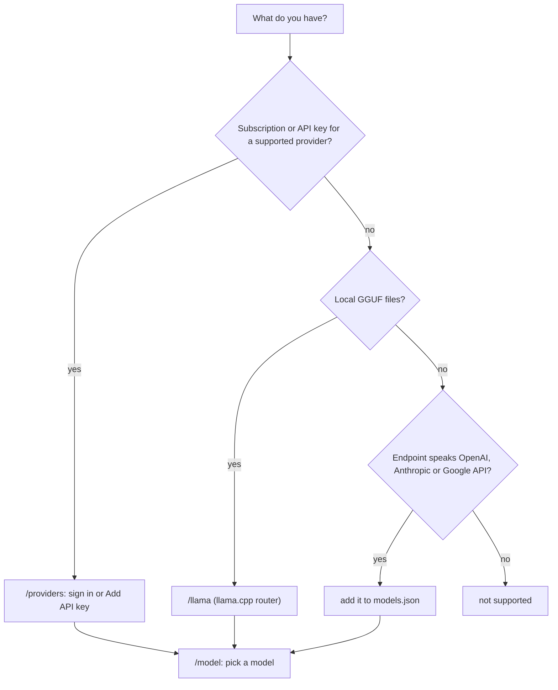

# Models

Connect a provider, pick a model, and describe custom endpoints. Sign-in and keys: [providers](providers.md). Every `models.json` field: [models configuration](models-configuration.md).



| What you have                                       | Setup                                                |
| --------------------------------------------------- | ---------------------------------------------------- |
| A supported subscription                            | Sign in through `/providers`                         |
| A provider API key                                  | `/providers`, or the provider's environment variable |
| A local GGUF model                                  | `/llama`                                             |
| Ollama, LM Studio, vLLM, SGLang, a proxy or gateway | [`models.json`](#configure-a-compatible-endpoint)    |

Octocode starts with a bundled catalog; cached catalog data works offline. `OCTOCODE_MODEL_CATALOG_URL` points at a compatible catalog service for remote overlays (there is no default service) and `octocode update --models` refreshes from it. Catalog entries whose id holds a control character are dropped; control sequences are removed from names; a bad catalog response is reported without quoting its body.

## Select a model

| Action           | How                                                                                                                                                                     |
| ---------------- | ----------------------------------------------------------------------------------------------------------------------------------------------------------------------- |
| Pick a model     | `/model` (grouped by provider; `/model openai/` limits it to one provider; `Ctrl+S` saves the default for new sessions). Catalog presence does not prove account access |
| Cycle models     | `Ctrl+P`; `/modelsettings` → **Model shortcuts** controls the cycle, or set model patterns in `settings.json`                                                           |
| Start on a model | `octocode --model <provider>/<id>`                                                                                                                                      |
| Thinking level   | `/effort` (`Ctrl+S` saves the startup level); only levels the model supports are offered                                                                                |
| Context budget   | `/context` shows usage; `/context size` or `/context 32k` sets a budget; `/context reset` restores catalog capacity                                                     |

- A model switch keeps your last chosen level (from `/effort` or `--thinking`), lowered to what the new model supports; switching back restores it. A level in `modelThinkingLevels` or the `--models` pattern wins; before you choose one, `defaultThinkingLevel` applies.
- Context budgets apply to the selected physical model in this session, cannot exceed its catalog capacity, have a minimum of 8,192 tokens (or the full capacity of smaller models), need an idle session and are not saved.
- Model details show catalog context, maximum output, thinking support, input/output/cache prices and known cache lifetimes. A time-limited price (`cost.until` with `cost.after`) shows today's rates. Prices are provider-specific estimates; reasoning output, cache-write retention, long-context tiers, service tiers, subscription billing, credits and regional premiums can change totals.
- A session records model and thinking changes; resuming restores them without changing defaults.

## Connect local models

Octocode integrates with the llama.cpp router, which discovers GGUF files and loads models on demand. `/llama` manages the router (loaded models, downloads, connection); `/model` selects a loaded model.

- Loading a model in place of loaded ones unloads them first, with a status line each; an unload unfinished after 60 seconds is reported with the model's state.
- When a load fails or is stopped, `/llama` restores the previous models in a progress view (Esc asks `Stop restoring?`).
- Live router updates stop if it sends more than 1 MiB without ending an event; `/llama` then keeps polling the catalog.
- Thinking support comes from each model's chat template. A model whose template cannot be read is listed without thinking support until the next refresh, with a warning.
- A dialog, selector or session reset closes the view; a running load, download or restore finishes anyway.

## Configure a compatible endpoint

Use the global `models.json` when an endpoint speaks an API Octocode supports.

```json
{
	"providers": {
		"ollama": {
			"baseUrl": "http://localhost:11434/v1",
			"api": "openai-completions",
			"apiKey": "ollama",
			"models": [{ "id": "qwen2.5-coder:7b" }]
		}
	}
}
```

The dummy key makes the model available; Ollama ignores it. `apiKey` and header values accept `$NAME` or `${NAME}` (environment), a literal, or a leading `!command` (run at request time, not cached); `$$` and `$!` give a literal `$` and `!`. Opening `/model` reloads the file.

| Goal                                      | Use                                                                                                                                         |
| ----------------------------------------- | ------------------------------------------------------------------------------------------------------------------------------------------- |
| Add or replace a model                    | A `models` entry (same id on that provider replaces it)                                                                                     |
| Change metadata of an existing model      | `modelOverrides` (unknown ids are ignored)                                                                                                  |
| Route a built-in provider through a proxy | Only `baseUrl`; models and authentication stay unchanged: `{ "providers": { "anthropic": { "baseUrl": "https://proxy.example.com/v1" } } }` |
| Describe verified request differences     | `compat` (never enable it just because an endpoint claims OpenAI or Anthropic compatibility)                                                |

For editor validation, point `$schema` at `schemas/models.schema.json` in the installed package. User code extensions cannot register providers; use `models.json`.

### Attach images by path

In the terminal and `/web`, a message that names an existing PNG, JPEG, GIF, WebP or BMP file (recognized by content, not extension) sends it as an image; the text stays as typed.

| Accepted path form                                                      | Notes                                                |
| ----------------------------------------------------------------------- | ---------------------------------------------------- |
| Absolute, `~/`, `./`, `../` (relative to the session folder), `file://` | Quoted when it contains spaces, or backslash-escaped |
| Alone on a line                                                         | Also accepted                                        |

Each file is attached once, up to 8 images per message or the model's lower `images.maxPerMessage`. A file over 20 MB or unreadable is skipped with a short note; a path that is no image stays text. Images are resized like `@file` images and work in queued steering and follow-up messages. A text-only model receives the text. Skill commands, prompt templates and Octocode's own messages are not scanned.

### Describe model input and caching

Image support belongs to the exact model and endpoint. `octocode --list-models` shows an `images` column and `/model` shows it in the details. Mark a verified image-capable custom model with `"input": ["text", "image"]` (default `["text"]`); it works in `models.json` and `modelOverrides`.

```json
{
	"providers": {
		"local-vision": {
			"api": "openai-completions",
			"baseUrl": "http://localhost:11434/v1",
			"apiKey": "ollama",
			"models": [{ "id": "your-installed-vision-model", "input": ["text", "image"] }]
		},
		"openai": { "modelOverrides": { "gpt-4o": { "input": ["text", "image"] } } }
	}
}
```

Declaring image input adds no vision to a text-only server. New images are rejected for text-only models, including queued input; earlier image turns replay with omission notices and stay in history. The web composer shows the model's input support and keeps attachments when you switch to a text-only model: pick an image-capable model or remove them.

| Field                                                                         | Effect                                                                                                                                           |
| ----------------------------------------------------------------------------- | ------------------------------------------------------------------------------------------------------------------------------------------------ |
| `cacheRetention`, `instructionCacheRetention`                                 | Cache preferences for history and instructions, in settings or provider/model entries: [prompt caching](prompt-caching.md)                       |
| `promptCache: { "short": 300, "long": 3600 }`                                 | Best-effort cache lifetime in seconds per retention tier; choose the conservative end of a published range                                       |
| `inputLimits.images.resize`                                                   | How new image attachments and tool-result images are encoded before storing: `maxWidth`, `maxHeight`, `maxBytes` (base64 payload), `jpegQuality` |
| `inputLimits.maxRequestBytes`, `images.maxPerMessage`, `images.maxPerRequest` | Reject requests over the limit; image counts include history and tool results                                                                    |

Resize defaults: 2000 by 2000 pixels, 4.5 MiB encoded, JPEG quality 80. Images are encoded once; changing models rewrites nothing. Limits are checked on the final provider payload (JSON size, images counted as base64); provider SDK overhead and server limits can still reject a request: reduce attachments or start a new session.

Without a declared `promptCache`, warming uses the lifetime the adapter sends for the tier: 5m and 1h for Anthropic-style markers, 30m and 12h for OpenAI explicit caching, 24h for long history on OpenAI and listed Azure models. A model with neither is not eligible for [cache warming](configuration.md#prompt-cache-warming). A `modelOverrides` entry may set `inputLimits` or `promptCache` for a built-in model, also behind a validated proxy.

**Azure OpenAI Responses.** 24h retention applies only to models Microsoft lists, matched by `id`. A deployment-named model opts in with `"compat": { "supportsLongCacheRetention": true }` (set it only when the deployment runs a listed model; `false` turns it off). Standard (pay-as-you-go) GPT-5.6 or later deployments may add `"supportsExplicitPromptCacheMode": true`: requests then carry `prompt_cache_options` (12h TTL when history or instruction retention is long, since breakpoints inherit it; `supportsLongCacheRetention: false` keeps 30m) and breakpoints on the leading instructions. Leave it unset on provisioned deployments, which reject breakpoints.

### Configure sampling by thinking level

`samplingParams` sets model defaults and `samplingParamsByThinkingLevel` overrides per Octocode level (`off`, `minimal`, `low`, `medium`, `high`, `xhigh`, `max`; not provider values from `thinkingLevelMap`). Octocode clamps unsupported levels, then merges model `samplingParams`, the level's override and request-level `samplingParams`; later wins per key, missing levels inherit defaults, and `modelOverrides` merges per level per key. Applies to `openai-completions`, `openai-responses` and `azure-openai-responses` only.

```json
{
	"id": "qwen-thinking-model",
	"reasoning": true,
	"samplingParams": { "temperature": 1.0, "top_p": 0.95 },
	"samplingParamsByThinkingLevel": {
		"off": { "temperature": 0.7, "top_p": 0.8 },
		"high": { "top_k": 20 }
	}
}
```

## Classifier and image models

Both are listed under their provider but never appear in `/model`, because they do not chat.

| Kind       | What it does                                                                                | Comes from                                                                                                                                                   |
| ---------- | ------------------------------------------------------------------------------------------- | ------------------------------------------------------------------------------------------------------------------------------------------------------------ |
| Classifier | Answers typed questions about JSON state (a choice, yes/no, or a score, with probabilities) | TypeSafe Jev, Cloudflare Clef and Clef Flash (Workers AI), OpenAI GPT-6 Luna (Decisions API); OpenRouter via `/providers`; chat models on a llama.cpp router |
| Image      | Generates images from a prompt and optional images                                          | OpenRouter image models such as `google/gemini-2.5-flash-image` and `black-forest-labs/flux.2-pro`, with the same key as its chat models                     |

OpenAI's Decisions API needs an API key: `gpt-6-luna` is not listed while `openai` is signed in with ChatGPT, even with `OPENAI_API_KEY` set; log out of `openai` to use the key. GPT-6 Luna also judges images; other classifiers error on them. Inputs above 922K tokens are rejected, and requests running past about five seconds (roughly 600K input tokens) time out. TypeSafe keys serve classifier models.

## Discover vendor models

`octocode models discover [--provider <id>] [--json] [--offline]` compares documented vendor model lists with the configured catalog. It makes listing requests only, never inference; normal credential resolution may refresh and save an expired OAuth token.

```bash
octocode models discover --provider openai
octocode models discover --provider google --json
octocode models discover --offline --json
```

Without `--provider` it checks every registered provider (four at a time, 60-second command deadline, 15 seconds per vendor list). `--offline` or `OCTOCODE_OFFLINE=1` reads only local definitions and resolves no credentials. An `error` or `unconfigured` provider gives a nonzero exit status; unavailable discovery contracts are reported separately.

| Status         | Meaning                                                                                         |
| -------------- | ----------------------------------------------------------------------------------------------- |
| `verified`     | The model-list request succeeded; this does not prove inference access or feature compatibility |
| `catalog`      | Offline result from configured definitions                                                      |
| `unsupported`  | No verified list contract for this provider; the result links its documentation                 |
| `unconfigured` | The list needs authentication and none resolved                                                 |
| `error`        | Authentication or the request failed; local definitions stay in the result                      |

- `known` means the id already has a definition. Unknown ids are marked **metadata required**: vendor lists omit verified context limits, prices, modalities, reasoning and tool support, and discovery never guesses them or adds runnable models. Check the vendor's documentation, add a definition to `models.json`, then test with a real call. `missingFromVendor` lists configured ids absent from the response (absence alone does not prove retirement).
- Public Hugging Face, OpenCode Console and Vercel catalogs need no credentials and do not show subscription entitlement; subscription plans use their own lists.
- Azure deployments, Bedrock regional availability, Vertex publisher models, Fireworks deployments and Cloudflare account models have separate control-plane contracts: the command gives guidance instead of guessing a route or sending inference credentials elsewhere.
- OpenAI API keys use the standard `data[].id` list. Sign in with ChatGPT uses the account's `models[].slug` list in the vendor's order and names, only `visibility: "list"` entries that also have trusted runtime metadata; login saves the list and refresh updates it without mixing accounts.
- A vendor id with a control character (escape sequence, C0/C1 control, line break, bidi override, zero-width character) fails with `Vendor model list contains an invalid model ID` rather than being rewritten; slashes, colons, dots, `@`, underscores and spaces are kept. Control sequences are removed from display names.

## Troubleshooting

| Symptom                                     | Check                                                                                                                                                                            |
| ------------------------------------------- | -------------------------------------------------------------------------------------------------------------------------------------------------------------------------------- |
| A model does not appear                     | The provider needs usable credentials; custom models load from `models.json` but stay unavailable in `/model` until credentials resolve. For llama.cpp only loaded models appear |
| Authentication works in one shell only      | The key came from an environment variable; it must be set in the process that starts Octocode                                                                                    |
| Sign-in opens a browser on a remote machine | Paste the final redirect URL or code back into Octocode: [providers](providers.md#how-sign-in-works)                                                                             |
| A compatible endpoint rejects requests      | Check the `api` type and `compat` in `models.json`; the server must support the request fields                                                                                   |
