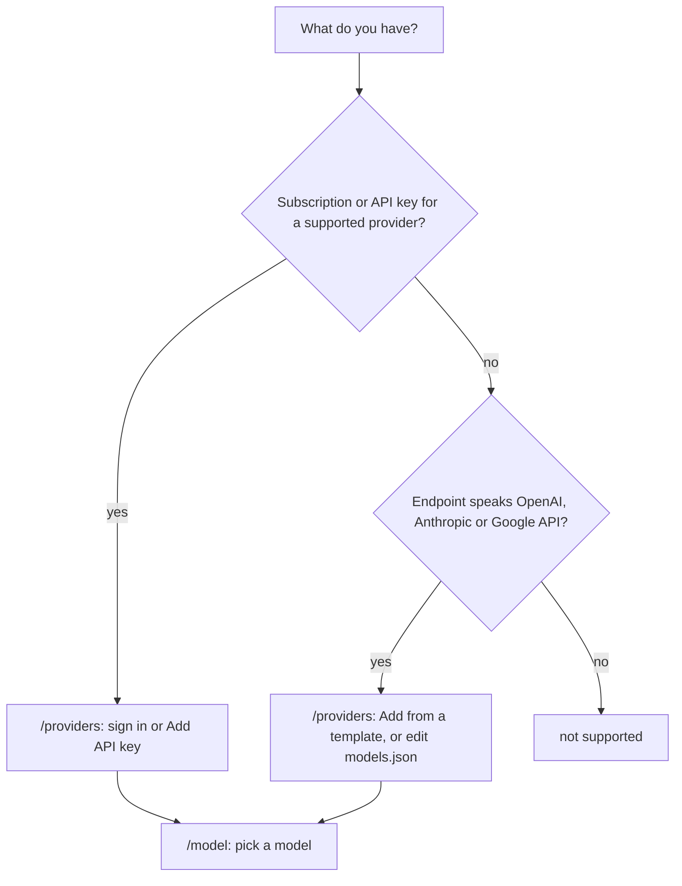
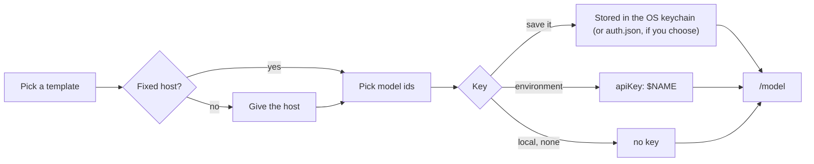

# Models

Connect a provider, pick a model, and describe custom endpoints. Sign-in and keys: [providers](providers.md). Every `models.json` field: [models configuration](models-configuration.md).



| What you have                                       | Setup                                                                                           |
| --------------------------------------------------- | ----------------------------------------------------------------------------------------------- |
| A supported subscription                            | Sign in through `/providers`                                                                    |
| A provider API key                                  | `/providers`, or the provider's environment variable                                            |
| Another API-key host, a gateway or a local server   | [`/providers` → Add from a template](#provider-templates)                                       |
| Ollama, LM Studio, vLLM, SGLang, a proxy or gateway | [Provider templates](#provider-templates), or [`models.json`](#configure-a-compatible-endpoint) |

Octocode starts with a bundled catalog; cached catalog data works offline. `OCTOCODE_MODEL_CATALOG_URL` points at a compatible catalog service for remote overlays (there is no default service) and `octocode update --models` refreshes from it. Catalog entries whose id holds a control character are dropped; control sequences are removed from names; a bad catalog response is reported without quoting its body.

## Select a model

| Action           | How                                                                                                                                                                     |
| ---------------- | ----------------------------------------------------------------------------------------------------------------------------------------------------------------------- |
| Pick a model     | `/model` (grouped by provider; `/model openai/` limits it to one provider; `Ctrl+S` saves the default for new sessions). Catalog presence does not prove account access |
| Cycle models     | `Ctrl+P`; `/modelsettings` → **Model shortcuts** controls the cycle, or set model patterns in `settings.json`                                                           |
| Start on a model | `octocode --model <provider>/<id>`                                                                                                                                      |
| Thinking level   | `/effort` (`Ctrl+S` saves the startup level); only levels the model supports are offered                                                                                |
| Context budget   | `/context` shows usage; `/context size` or `/context 32k` sets a budget; `/context reset` restores catalog capacity                                                     |

- Provider headings name the access method, such as `openai · subscription` or `ollama · local`. A check marks the current model; **default** marks the startup preference. The header identifies whether that preference comes from global, workspace or run settings.
- Untick models you never use on a provider's page in `/providers` (**Choose models**) or on the web provider page: they disappear from `/model`, `Ctrl+P` and subagent routing, and a provider you have not touched shows all its models. See [providers](providers.md).
- A model switch within one provider on the Anthropic Messages API keeps the signed thinking of earlier turns (measured live between two Claude models); any other switch drops the earlier model's thinking, because its signatures are not valid elsewhere. When the switch changes the model or provider and the last reply cached context, the `/model` selector shows, under the highlighted model, one line naming the cached tokens the switch rewrites and their cost at that model's cache-write price (its input price without one); `/model <name>` prints the same line after it switches.
- A model switch keeps your last chosen level (from `/effort` or `--thinking`), lowered to what the new model supports; switching back restores it. A level in `modelThinkingLevels` or the `--models` pattern wins; before you choose one, `defaultThinkingLevel` applies.
- Context budgets apply to the selected physical model in this session, cannot exceed its catalog capacity, have a minimum of 8,192 tokens (or the full capacity of smaller models), need an idle session and are not saved.
- A model models.dev added after this release shipped is marked `new`; one models.dev lists as deprecated is dimmed and marked `deprecated` ([catalog updates](#catalog-updates-from-modelsdev)).
- The compact picker shows context, output limits, image/reasoning support and billing (**billed per token** or **billed by plan**, as in `/providers`). **Alt+I** toggles full identifiers, names, billing and prices first, then limits and cache lifetimes; **PgUp/PgDn** scroll those details. A price you set in `models.json` reads "(your price)" and its billing line "billed per token at your price". A time-limited price (`cost.until` with `cost.after`) shows today's rates. For a provider billed by plan, the API prices shown are estimates at list price. Account terms, retention, long-context tiers, service tiers, credits and regional premiums can change totals.
- A session records model and thinking changes; resuming restores them without changing defaults.

### Automatic model routing

Select `octocode/auto-code` to choose a physical model and thinking level for each request. The native router filters credentials, provider and account restrictions, modality and context capacity first, then favors session stickiness, suitable capability and lower cost. It raises effort before switching models and fails over after transient errors. Routing uses session data only; it makes no extra model call and stores no prompt text in its diagnostics.

The router never becomes the startup default implicitly. A session that used a flat-rate plan cannot switch to per-token billing unless you explicitly set `runtime.smartRouting.allowPlanToMeteredEscalation: true` in **global** settings. Trusted project settings may set candidate `allow`/`deny` patterns, capability `tiers`, `planOnly`, `cooldownRequests` and `outputReserveTokens`, but cannot enable paid escalation. See [Smart routing](smart-routing.md).

### Model defaults

| Setting             | How Octocode chooses it                                                                                                                                                                                                                                                                                                                                                                                                                                                                                                                                                                                                                                                      |
| ------------------- | ---------------------------------------------------------------------------------------------------------------------------------------------------------------------------------------------------------------------------------------------------------------------------------------------------------------------------------------------------------------------------------------------------------------------------------------------------------------------------------------------------------------------------------------------------------------------------------------------------------------------------------------------------------------------------- |
| Context and output  | A custom model uses its explicit `contextWindow` and `maxTokens`, then matching bundled model values. An unknown custom model defaults to 128,000 context tokens and 16,384 output tokens. The default session budget is the smaller of 300,000 tokens and 90% of the model’s context window. Use `/context` to change it. When the endpoint declares a separate prompt ceiling, compaction uses the smaller of that ceiling and the working window after reserving reply space. Set `inputLimits.maxInputTokens` in a custom model entry to supply that ceiling. The simple chat adapters cap it at the model’s output ceiling and leave room for the estimated transcript. |
| Thinking and effort | The agent starts with `high` unless a saved choice, model setting or launch option applies. The model’s supported levels determine the effective choice. The adapter sends the control its route accepts, such as an on/off switch, named effort, or token budget. A provider-managed model can have no selectable levels.                                                                                                                                                                                                                                                                                                                                                   |
| Prompt caching      | The agent requests short retention for conversation history and long retention for instructions. The endpoint and model determine whether that becomes a cache marker, a key, automatic caching, or no cache control. Cache read and write prices describe billing. Configure retention separately.                                                                                                                                                                                                                                                                                                                                                                          |

The bundled catalog takes provider-specific facts from models.dev and the supported gateway catalogs. For a custom endpoint, check the values with `/model`. The coordinator’s `models` tool uses the configured reasoning capability, including when its optional models.dev lookup is offline.

### Catalog updates from models.dev

Octocode fetches the models.dev index at most once a day, in the background, and applies it to the built-in catalog of each provider that was built from a models.dev listing:

| Change            | Rule                                                                                                                                                                                                                                                            |
| ----------------- | --------------------------------------------------------------------------------------------------------------------------------------------------------------------------------------------------------------------------------------------------------------- |
| New models        | Added when a model of the same family is already bundled for that provider, it comes from the listing the provider was built from, it calls tools, answers in text and has a price. Ids Octocode leaves out on purpose are never added. `/model` marks it `new` |
| Prices and limits | Replaced when the listing changed after the bundled data was taken; a missing or zero listed price never replaces a bundled one                                                                                                                                 |
| Deprecation       | A model models.dev lists as deprecated stays listed, dimmed and marked `deprecated`; automatic choices skip it                                                                                                                                                  |
| Wiring            | Host, API, headers and sign-in always stay as bundled                                                                                                                                                                                                           |

| To                                    | Do                                                                                                                                                                |
| ------------------------------------- | ----------------------------------------------------------------------------------------------------------------------------------------------------------------- |
| Turn updates off                      | Set `modelCatalogUpdates: false` in your global settings (read once per process: restart to apply), or export `OCTOCODE_MODELS_DEV=0`, which also stops the fetch |
| Stop fetching but keep the last index | Start with `--offline` or `OCTOCODE_OFFLINE=1`: the saved index still applies                                                                                     |

Without an index, or with updates off, the catalog shipped with Octocode is used as it is. The `models` tool says when updates do not apply in full.

### Models your account cannot use

When the provider refuses a specific model for your account or endpoint, Octocode leaves it out of the current session’s model choices for five minutes. Other models on the same provider stay available. Reconnecting the provider or a successful access check restores the model immediately. Your saved defaults and enabled models stay in settings.

### List models by size

Run `octocode --list-models` to see configured models grouped by provider and ordered from small to large. The size class is an estimate from the model name and token limits. The context and max-output columns give the catalog’s actual token limits. Filter the same list with `octocode --provider amazon-bedrock --list-models kimi` or `octocode --model-size small`.

The lead agent’s `models` tool accepts the same `size` filter. Combine it with `provider` or `ability` to narrow the results. For a large inventory, follow the returned `offset` using the same filters. Request `routes: true` to see which model each task purpose or agent profile would use. Hidden models, disabled providers and credentials confined to the parent session are excluded from child routes. Use the exact `provider/id` when starting a task. Consult the output limit for long responses and the context window for large inputs.

### Save a startup default

In `/model`, highlight a model: **Enter** switches this chat, and **Ctrl+S** switches it and saves it as the startup default (in a trusted workspace, choose this project or every project). With the details open (**Alt+I**), **Ctrl+P** makes it its provider's preferred model and leaves the chat on its current model. In `/models`, `d` saves the highlighted model as the default for new chats.

To start new chats with a provider and follow its preferred model, open `/providers`, select the provider, and choose **Set as default provider for new chats**. This clears a previously pinned global model. If that provider has no preferred model, Octocode uses its built-in default or an available model from its catalog. Web Settings offers the same global controls in the provider’s model settings.

The saved global default applies to new sessions. Trusted workspace or run settings can override it; the picker says when they do. Resuming an existing session restores its prior available model. Disabled or unavailable providers are skipped rather than reactivated by a saved selection. When Octocode picks the start model itself (no saved default, or the default provider's built-in choice), it skips models models.dev lists as deprecated, unless nothing else is available; a model you named still applies. When the saved default is not used, the startup warning names it, says why (provider not configured, off or paused, no credentials, model not in the catalog or hidden) and names the model used instead, with its billing when that may differ: `Saved default p/m not used: no credentials. Using q/n (billed per token).`

Saving a global default preserves existing global shortcut ordering. Workspace/run shortcut lists keep their own scope and are not copied into global settings.

| Surface                    | Select for the current chat/run                  | Save a startup default                                                                                     |
| -------------------------- | ------------------------------------------------ | ---------------------------------------------------------------------------------------------------------- |
| Terminal picker            | Enter, or `/model <provider>/<id>`               | Ctrl+S in `/model`                                                                                         |
| CLI                        | `octocode --model <provider>/<id>`               | `octocode configuration set defaultProvider <provider>` and `octocode configuration set defaultModel <id>` |
| Configuration/web settings | Changing defaults keeps the current chat's model | Set global defaults or trusted workspace defaults; new sessions use them                                   |
| RPC                        | `set_model`                                      | No persistence option; use configuration separately                                                        |

The CLI configuration commands edit the two fields independently. Prefer the picker's paired save when changing provider and model together.

`octocode --model <name>` without a provider resolves the name across providers. When more than one provider serves it, or none of the matching providers has credentials, it does not choose: it exits listing the matching `provider/id` names. Pass `--provider` or `provider/id`.

API/subscription models, configured local-server models and connected `claude-code/*` models can be defaults. Codex, OpenCode and Gemini **CLI task runners** are separate task backends; their CLI models cannot be this chat's default. Omit a runner task's model to use that vendor's own default, or pass its model ID for that task when its adapter supports model configuration.

## Connect local models

For a llama.cpp server, Ollama, LM Studio or vLLM server, open `/providers` → **Add from a template**, choose the server, enter its API base URL and the model IDs it serves, then select the model in `/model`. The templates use the defaults below and offer a no-key option for servers without authentication; a local model ID must match your server's installed or loaded model.

Local templates also ask for each model's loaded context window and maximum output. Enter positive token counts (`k` and `m` suffixes work); maximum output cannot exceed the context window. These values describe your running server and do not reconfigure it. Local definitions start with text input, no declared thinking and zero configured token rates; add verified vision, reasoning or pricing metadata explicitly. Templates do not start servers, pull models or infer their capabilities.

## Provider templates

`/providers` → **Add from a template** sets up a provider Octocode does not build in: you choose a template, give the host when the template has none, choose model ids and say where the key comes from. Octocode adds the provider to your global `models.json` with the right API type and request settings; the rest of the file stays as it was.



| Template                       | Host                                     | API                     | Key variable              | Models offered     |
| ------------------------------ | ---------------------------------------- | ----------------------- | ------------------------- | ------------------ |
| Nebius Token Factory           | `https://api.tokenfactory.nebius.com/v1` | OpenAI Chat Completions | `NEBIUS_API_KEY`          | models.dev listing |
| DeepInfra                      | `https://api.deepinfra.com/v1/openai`    | OpenAI Chat Completions | `DEEPINFRA_API_KEY`       | models.dev listing |
| SambaNova Cloud                | `https://api.sambanova.ai/v1`            | OpenAI Chat Completions | you name it               | models.dev listing |
| Hyperbolic                     | `https://api.hyperbolic.ai/inference/v1` | OpenAI Chat Completions | you name it               | you type the ids   |
| Ollama Cloud                   | `https://ollama.com/v1`                  | OpenAI Chat Completions | `OLLAMA_API_KEY`          | models.dev listing |
| Anthropic API gateway          | yours                                    | Anthropic Messages      | you name it               | Anthropic's models |
| OpenAI API gateway (Responses) | yours                                    | OpenAI Responses        | you name it               | OpenAI's models    |
| Google Gemini API gateway      | yours                                    | Google Gemini           | you name it               | Google's models    |
| LiteLLM proxy                  | yours (default `http://localhost:4000`)  | OpenAI Chat Completions | `LITELLM_API_KEY`         | you type the ids   |
| Ollama                         | default `http://localhost:11434/v1`      | OpenAI Chat Completions | no key needed             | you type the ids   |
| LM Studio                      | default `http://localhost:1234/v1`       | OpenAI Chat Completions | `LM_API_TOKEN` (optional) | you type the ids   |
| vLLM                           | default `http://localhost:8000/v1`       | OpenAI Chat Completions | `VLLM_API_KEY` (optional) | you type the ids   |

Providers Octocode builds in (OpenRouter, Together, Fireworks, Groq, Cerebras, DeepSeek, Hugging Face and others) have no template: sign in to them with **Add a provider**.

| Choice          | What is written                                                                                                                                                                                                                                                                                                  |
| --------------- | ---------------------------------------------------------------------------------------------------------------------------------------------------------------------------------------------------------------------------------------------------------------------------------------------------------------- |
| Provider id     | The template id (`nebius`); when that id is taken by a provider or a saved credential, the next free one (`nebius-2`). An id already in `models.json` is never replaced                                                                                                                                          |
| Models          | All offered ids, one picked from the list, or ids you type as the server names them                                                                                                                                                                                                                              |
| Vendor model id | Only `{ "id": ... }`: it starts from Octocode's model when the file loads (context window, output limit, thinking, image input, prices), without direct-host cache lifetimes                                                                                                                                     |
| Listed model id | The host's context window, thinking, image input and input/output price from [models.dev](https://models.dev); an id the listing lacks keeps the plain defaults                                                                                                                                                  |
| Save a key      | `"apiKey": "!…"`, a reference to a keychain entry named for this provider (its own entry, never shared between providers); the key goes in the OS keychain. Only if you choose it, the key is stored as plain text in `auth.json` instead. Without a keychain the template asks for an environment variable name |
| Environment     | `"apiKey": "$NAME"` with the variable the vendor documents or one you name; set it where you start Octocode                                                                                                                                                                                                      |
| No key (local)  | `"apiKey": "no-key"`, a marker the server ignores; choose a key instead when the server was started with one                                                                                                                                                                                                     |
| Request fields  | OpenAI-compatible servers get `max_tokens` and no OpenAI-only `store` field or `developer` role, which their documentation does not list                                                                                                                                                                         |

The file is written atomically with private permissions (owner read and write only). A `models.json` with `//` comments is left unchanged, since a rewrite would drop them: the error shows the entry to paste. The models.dev listing is read from Octocode's cached copy (refreshed at most once a day; `OCTOCODE_MODELS_DEV=0` turns it off) and may not list every model a host serves. Edit the entry in `models.json` afterwards to change anything; opening `/model` reloads it.

## Configure a compatible endpoint

A session identifies a model by provider ID and model ID. For a custom model, Octocode resolves `api` and `baseUrl` independently. A value on the model takes precedence over the provider entry, followed by the catalog default when available. The resolved API selects the request format. On Chat Completions, the provider, endpoint and model ID determine the compatibility defaults. Explicit `compat` values on the model take precedence over provider settings. This lets a single gateway serve models with different tool formats.

Use the global `models.json` when an endpoint speaks an API Octocode supports.

```json
{
	"providers": {
		"ollama": {
			"baseUrl": "http://localhost:11434/v1",
			"api": "openai-completions",
			"apiKey": "ollama",
			"models": [{ "id": "qwen2.5-coder:7b" }]
		}
	}
}
```

The dummy key makes the model available; Ollama ignores it. `apiKey` and header values accept `$NAME` or `${NAME}` (environment), a literal, or a leading `!command` (run at request time, not cached); `$$` and `$!` give a literal `$` and `!`. Opening `/model` reloads the file.

| Goal                                              | Use                                                                                                                                                                                                                                                                                           |
| ------------------------------------------------- | --------------------------------------------------------------------------------------------------------------------------------------------------------------------------------------------------------------------------------------------------------------------------------------------- |
| Add a model to a custom provider                  | A `models` entry on your own provider id (a known vendor id starts from that model)                                                                                                                                                                                                           |
| Tune or throttle an official provider             | `modelOverrides` and `defaults` on the official id, limited to `compat`, `contextWindow`, `maxTokens`, `inputLimits` and `cost`; `requestsPerMinute` and `tokensPerMinute` at provider level and in `modelOverrides` (unknown model ids are ignored); any other field refuses the whole entry |
| Use another host for an official provider         | `/providers`, then the provider, then sign in: the optional host is saved with the key. For a fully custom host, use the **Custom OpenAI-compatible host** template                                                                                                                           |
| Make a gateway behave like the provider it fronts | `profile` on the provider (`anthropic` for a Claude gateway: Anthropic cache markers and the 1h tier); `compat` still wins over it                                                                                                                                                            |
| Describe verified request differences             | `compat` (never enable it just because an endpoint claims OpenAI or Anthropic compatibility)                                                                                                                                                                                                  |

For editor validation, point `$schema` at `schemas/models.schema.json` in the installed package. User code extensions cannot register providers; use `models.json`.

### Use a vendor's models through a gateway

A gateway or proxy that serves Anthropic, OpenAI or Google models needs only its host, its API and the model ids. Each provider id keeps its own host and key:

```json
{
	"providers": {
		"anthropic-gateway": {
			"baseUrl": "https://gateway.example.com/anthropic",
			"api": "anthropic-messages",
			"models": [{ "id": "claude-opus-5-5" }, { "id": "claude-haiku-5-5" }]
		},
		"openai-gateway": {
			"baseUrl": "https://gateway.example.com/openai/v1",
			"api": "openai-responses",
			"models": [{ "id": "gpt-6.1-sol" }, { "id": "gpt-6-luna" }]
		},
		"google-gateway": {
			"baseUrl": "https://gateway.example.com/google",
			"api": "google-generative-ai",
			"models": [{ "id": "gemini-3.1-pro-preview" }]
		}
	}
}
```

Add each key on the provider's page in `/providers` (stored under that provider id), or set `apiKey` to `$NAME` so the key stays in your environment. An id Octocode knows for that API starts from the vendor's model: context window, output limit, thinking levels, image input, prices and request compatibility, so subagent routing (`small`, `medium`) can price and place it. A vendor prefix or dot spelling (`anthropic/claude-opus-5.5`) names the same model. Fields you set win.

| Starts from the vendor's model                                                                          | Needs your confirmation for this host                                                                                          |
| ------------------------------------------------------------------------------------------------------- | ------------------------------------------------------------------------------------------------------------------------------ |
| `contextWindow`, `maxTokens`, `reasoning`, `thinkingLevelMap`, `input`, `inputLimits`, `cost`, `compat` | `promptCache` (cache lifetimes) and `compat.supportsLongCacheRetention`: set them when the gateway passes long caching through |

A gateway that serves a vendor's model through another API (a LiteLLM proxy speaking `openai-completions` for `claude-sonnet-5-5`) gets only the parts that do not depend on the API: context window, output limit, reasoning, image input, input limits and prices; thinking levels and request compatibility stay at the API's defaults. An id Octocode does not know keeps the plain defaults below (128k context, 16k output, text only, no thinking): describe it yourself. With such a provider as your default provider and no default model, Octocode opens its model that a vendor defaults to (for example `claude-opus-5-5`), else its first one.

### Attach images by path

In the terminal and `/web`, a message that names an existing PNG, JPEG, GIF, WebP or BMP file (recognized by content, not extension) sends it as an image; the text stays as typed.

| Accepted path form                                                      | Notes                                                |
| ----------------------------------------------------------------------- | ---------------------------------------------------- |
| Absolute, `~/`, `./`, `../` (relative to the session folder), `file://` | Quoted when it contains spaces, or backslash-escaped |
| Alone on a line                                                         | Also accepted                                        |

Each file is attached once, up to 8 images per message or the model's lower `images.maxPerMessage`. A file over 20 MB or unreadable is skipped with a short note; a path that is no image stays text. Images are resized like `@file` images and work in queued steering and follow-up messages. A text-only model receives the text. Skill commands, prompt templates and Octocode's own messages are not scanned.

### Describe model input and caching

Image support belongs to the exact model and endpoint. `octocode --list-models` shows an `images` column and `/model` shows it in the details. Mark a verified image-capable custom model with `"input": ["text", "image"]` (default `["text"]`); it works in a custom provider's `models` and `modelOverrides`. An official provider's `modelOverrides` cannot set `input` ([fields it may set](models-configuration.md#providers)).

```json
{
	"providers": {
		"local-vision": {
			"api": "openai-completions",
			"baseUrl": "http://localhost:11434/v1",
			"apiKey": "ollama",
			"models": [{ "id": "your-installed-vision-model", "input": ["text", "image"] }]
		}
	}
}
```

Declaring image input adds no vision to a text-only server. New images are rejected for text-only models, including queued input; earlier image turns replay with omission notices and stay in history. The web composer shows the model's input support and keeps attachments when you switch to a text-only model: pick an image-capable model or remove them.

| Field                                                                         | Effect                                                                                                                                           |
| ----------------------------------------------------------------------------- | ------------------------------------------------------------------------------------------------------------------------------------------------ |
| `cacheRetention`, `instructionCacheRetention`                                 | Cache preferences for history and instructions, in settings or provider/model entries: [prompt caching](prompt-caching.md)                       |
| `promptCache: { "short": 300, "long": 3600 }`                                 | Best-effort cache lifetime in seconds per retention tier; choose the conservative end of a published range                                       |
| `inputLimits.images.resize`                                                   | How new image attachments and tool-result images are encoded before storing: `maxWidth`, `maxHeight`, `maxBytes` (base64 payload), `jpegQuality` |
| `inputLimits.maxRequestBytes`, `images.maxPerMessage`, `images.maxPerRequest` | Reject requests over the limit; image counts include history and tool results                                                                    |

Resize defaults: 2000 by 2000 pixels, 4.5 MiB encoded, JPEG quality 80. Images are encoded once; changing models rewrites nothing. Limits are checked on the final provider payload (JSON size, images counted as base64); provider SDK overhead and server limits can still reject a request: reduce attachments or start a new session.

Without a declared `promptCache`, warming uses the lifetime the adapter sends for the tier: 5m and 1h for Anthropic-style markers, 30m and 12h for OpenAI explicit caching, 24h for long history on OpenAI and listed Azure models. A model with neither is not eligible for [cache warming](prompt-caching.md#warming-and-measurements). A custom provider's `modelOverrides` entry may set `inputLimits` or `promptCache` for a built-in model behind a validated proxy; an official provider's may set `inputLimits` but not `promptCache`.

**Azure OpenAI Responses.** 24h retention applies only to models Microsoft lists, matched by `id`. A deployment-named model opts in with `"compat": { "supportsLongCacheRetention": true }` (set it only when the deployment runs a listed model; `false` turns it off). Standard (pay-as-you-go) GPT-5.6 or later deployments may add `"supportsExplicitPromptCacheMode": true`: requests then carry `prompt_cache_options` (12h TTL when history or instruction retention is long, since breakpoints inherit it; `supportsLongCacheRetention: false` keeps 30m) and breakpoints on the leading instructions. Leave it unset on provisioned deployments, which reject breakpoints.

### Configure sampling by thinking level

`samplingParams` sets model defaults and `samplingParamsByThinkingLevel` overrides per Octocode level (`off`, `minimal`, `low`, `medium`, `high`, `xhigh`, `max`; not provider values from `thinkingLevelMap`). Octocode clamps unsupported levels, then merges model `samplingParams`, the level's override and request-level `samplingParams`; later wins per key, missing levels inherit defaults, and `modelOverrides` merges per level per key. Applies to `openai-completions`, `openai-responses` and `azure-openai-responses` only.

```json
{
	"id": "qwen-thinking-model",
	"reasoning": true,
	"samplingParams": { "temperature": 1.0, "top_p": 0.95 },
	"samplingParamsByThinkingLevel": {
		"off": { "temperature": 0.7, "top_p": 0.8 },
		"high": { "top_k": 20 }
	}
}
```

## Classifier and image models

Both are listed under their provider but never appear in `/model`, because they do not chat.

| Kind       | What it does                                                                                | Comes from                                                                                                                                                   |
| ---------- | ------------------------------------------------------------------------------------------- | ------------------------------------------------------------------------------------------------------------------------------------------------------------ |
| Classifier | Answers typed questions about JSON state (a choice, yes/no, or a score, with probabilities) | TypeSafe Jev, Cloudflare Clef and Clef Flash (Workers AI), OpenAI GPT-6 Luna (Decisions API); OpenRouter via `/providers`; chat models on a llama.cpp router |
| Image      | Generates images from a prompt and optional images                                          | OpenRouter image models such as `google/gemini-2.5-flash-image` and `black-forest-labs/flux.2-pro`, with the same key as its chat models                     |

OpenAI's Decisions API needs an API key: `gpt-6-luna` is not listed while `openai` is signed in with ChatGPT, even with `OPENAI_API_KEY` set; log out of `openai` to use the key. GPT-6 Luna also judges images; other classifiers error on them. Inputs above 922K tokens are rejected, and requests running past about five seconds (roughly 600K input tokens) time out. TypeSafe keys serve classifier models.

## Discover vendor models

`octocode models discover [--provider <id>] [--json] [--offline]` compares documented vendor model lists with the configured catalog. It makes listing requests only, never inference; normal credential resolution may refresh and save an expired OAuth token.

```bash
octocode models discover --provider openai
octocode models discover --provider google --json
octocode models discover --offline --json
```

Without `--provider` it checks every registered provider (four at a time, 60-second command deadline, 15 seconds per vendor list). `--offline` or `OCTOCODE_OFFLINE=1` reads only local definitions and resolves no credentials. An `error` or `unconfigured` provider gives a nonzero exit status; unavailable discovery contracts are reported separately.

| Status         | Meaning                                                                                         |
| -------------- | ----------------------------------------------------------------------------------------------- |
| `verified`     | The model-list request succeeded; this does not prove inference access or feature compatibility |
| `catalog`      | Offline result from configured definitions                                                      |
| `unsupported`  | No verified list contract for this provider; the result links its documentation                 |
| `unconfigured` | The list needs authentication and none resolved                                                 |
| `error`        | Authentication or the request failed; local definitions stay in the result                      |

- `known` means the id already has a definition. Unknown ids are marked **metadata required**: vendor lists omit verified context limits, prices, modalities, reasoning and tool support, and discovery never guesses them or adds runnable models. Check the vendor's documentation, add a definition to `models.json`, then test with a real call. `missingFromVendor` lists configured ids absent from the response (absence alone does not prove retirement).
- Public Hugging Face, OpenCode Console and Vercel catalogs need no credentials and do not show subscription entitlement; subscription plans use their own lists.
- Azure deployments, Bedrock regional availability, Vertex publisher models, Fireworks deployments and Cloudflare account models have separate control-plane contracts: the command gives guidance instead of guessing a route or sending inference credentials elsewhere.
- OpenAI API keys use the standard `data[].id` list. Sign in with ChatGPT uses the account's `models[].slug` list in the vendor's order and names, only `visibility: "list"` entries that also have trusted runtime metadata; login saves the list and refresh updates it without mixing accounts.
- A vendor id with a control character (escape sequence, C0/C1 control, line break, bidi override, zero-width character) fails with `Vendor model list contains an invalid model ID` rather than being rewritten; slashes, colons, dots, `@`, underscores and spaces are kept. Control sequences are removed from display names.

## Troubleshooting

| Symptom                                     | Check                                                                                                                                                                            |
| ------------------------------------------- | -------------------------------------------------------------------------------------------------------------------------------------------------------------------------------- |
| A model does not appear                     | The provider needs usable credentials; custom models load from `models.json` but stay unavailable in `/model` until credentials resolve. For llama.cpp only loaded models appear |
| Authentication works in one shell only      | The key came from an environment variable; it must be set in the process that starts Octocode                                                                                    |
| Sign-in opens a browser on a remote machine | Paste the final redirect URL or code back into Octocode: [providers](providers.md#how-sign-in-works)                                                                             |
| A compatible endpoint rejects requests      | Check the `api` type and `compat` in `models.json`; the server must support the request fields                                                                                   |
