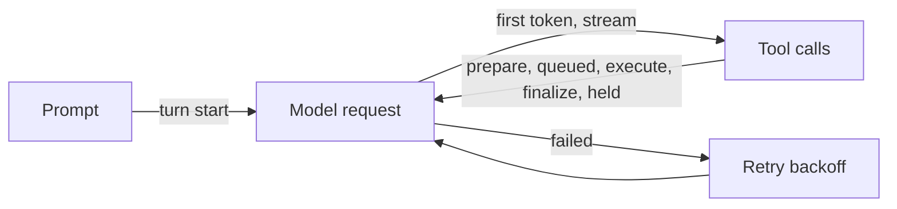
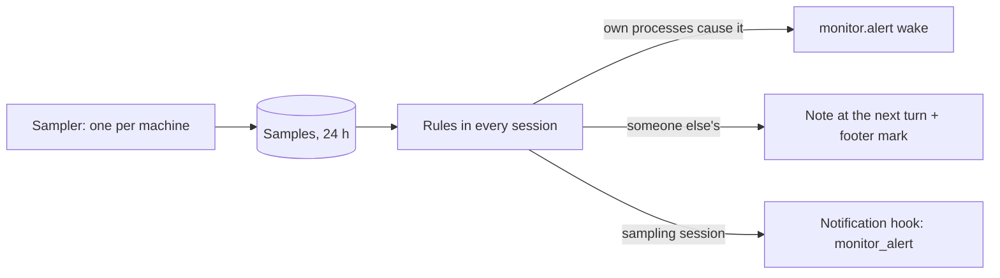

# Monitoring

How you see what the agent is doing, what it costs and whether the machine is coping. Each section names the surface and where its detail lives.

| Question                                  | Look at                                                                                            |
| ----------------------------------------- | -------------------------------------------------------------------------------------------------- |
| What is running now?                      | Footer, `/agents`, `/jobs`, `/processes`, the web Activity view                                    |
| What has it cost?                         | Footer `Σ`, `/usage`, `/status`                                                                   |
| Why was a turn slow or expensive?         | `octocode profile`, the web Profiler                                                               |
| Is the machine overloaded?                | `/monitor`, the footer's tripped readings, the [machine monitor](#machine-monitor)                 |
| What did a background command print?      | Its job log ([below](#background-jobs-and-logs))                                                   |
| Tell me when something happens            | The `notify` tool, [hooks](hooks.md), web notifications                                            |

## Terminal activity and status

- **Footer and panels.** The footer, agents panel and turn line are described under [Live status](#live-status); narrow terminals drop details in a fixed order ([TUI](tui.md)).
- **`/status`** prints one report: statistics (messages, tokens, cache, cost), native activity, skills and MCP, recent errors and a Quota section when a provider reported plan windows or rate limits. Start troubleshooting here ([troubleshooting](troubleshooting.md)).
- **`/agents`** lists the team and its subagents; `tell`, `interrupt`, `kill`, `merge`, `stats` and `history` act on them ([commands](commands.md)).
- **`/jobs`** lists this session's background bash jobs, crons and waits; `/jobs kill <id>` stops one.
- **`/processes`** lists the Octocode processes in this folder (`all`: the whole machine) and flags orphans and steadily growing memory; see [process names, list and orphans](#process-names-list-and-orphans).
- **`/debug [terminal]`** saves redacted diagnostics; `terminal` prints frame, output-queue, CPU, GC and event-loop counters for a laggy interface.

### Live status

| Element          | What it shows                                                                                                                                                                                                                                                                                                                                                                                                                                                                                                                                                                                                                                                                                                                                                                                                                                                                                                                                                                                                                                                                                                                                                                                                                                                                                                                                                                                                                                                                                                                                                                                                                                                                                                                                                                                                                                                                                                                                                                                                                                                                                                                                                                                                                                                                                             |
| ---------------- | --------------------------------------------------------------------------------------------------------------------------------------------------------------------------------------------------------------------------------------------------------------------------------------------------------------------------------------------------------------------------------------------------------------------------------------------------------------------------------------------------------------------------------------------------------------------------------------------------------------------------------------------------------------------------------------------------------------------------------------------------------------------------------------------------------------------------------------------------------------------------------------------------------------------------------------------------------------------------------------------------------------------------------------------------------------------------------------------------------------------------------------------------------------------------------------------------------------------------------------------------------------------------------------------------------------------------------------------------------------------------------------------------------------------------------------------------------------------------------------------------------------------------------------------------------------------------------------------------------------------------------------------------------------------------------------------------------------------------------------------------------------------------------------------------------------------------------------------------------------------------------------------------------------------------------------------------------------------------------------------------------------------------------------------------------------------------------------------------------------------------------------------------------------------------------------------------------------------------------------------------------------------------------------------------------- |
| Working line     | Above the input (in the editor border when embedded): `⠙ Running Bash (12s · esc to interrupt)`. The time is the whole run's elapsed time (through tool waits, retries and automatic compaction) right after the action, so a narrow terminal clips the action first, then the interrupt hint. The action names what the agent does, not the command: a tool row title (`Running Bash`, `Running localSearch +2`), `Running 3 tools: Bash · File`, `Running subagent <goal>`, else `Thinking: <gist>`, `Writing`, `Preparing tool calls`, `Waiting for you: <question>`, `Waiting for model`. A permission-flagged call keeps its warning and target (`⚠ Running Bash: rm -rf build`); permission class ids never appear. Teammates see a separate stored line with the permission action and no clock                                                                                                                                                                                                                                                                                                                                                                                                                                                                                                                                                                                                                                                                                                                                                                                                                                                                                                                                                                                                                                                                                                                                                                                                                                                                                                                                                                                                                                                                                                    |
| Reason line      | One italic line under a tool's title, `↳ list the folder`, in the theme's `toolReason` color (`muted` if absent), collapsed or expanded and while running: the call's `reason` as written (filled as in [tool selection](tools.md#tool-selection-and-exposure)). Nothing for a missing or one-word reason; long ones are cut to the width; a `File` row with one change shows that change's own `reason`; extension tools never show it. Exports show it, permission prompts show native calls' reasons, ACP clients get it in the tool call title (`bash: Run the focused tests`), the web view under the tool's name                                                                                                                                                                                                                                                                                                                                                                                                                                                                                                                                                                                                                                                                                                                                                                                                                                                                                                                                                                                                                                                                                                                                                                                                                                                                                                                                                                                                                                                                                                                                                                                                                                                                                           |
| Purpose block    | Below a tool's result: every goal and reasoning the result's own data states per query row, for any tool and server, never from the call's arguments. A goal every row shares is one `◎ <goal>` line then `· #<row> <reasoning>` lines (row number only with two or more rows); otherwise `#<row> <goal> — <reasoning>`. Text the `↳` line shows is not repeated. `toolReason` color, escapes and line breaks stripped, lines cut to the width, at most six lines then `… +N more`; same in exports and the web view; the stored result is never changed                                                                                                                                                                                                                                                                                                                                                                                                                                                                                                                                                                                                                                                                                                                                                                                                                                                                                                                                                                                                                                                                                                                                                                                                                                                                                                                                                                                                                                                                                                                                                                                                                                                                                                                                                  |
| Turn line        | When the job ends, one dim line: `✻ Worked 52s · waited 3m10s · 7 tools · 3 agents · ≈$4.12 · cache 61%`. A job lasts from its first run until nothing is left: no run, background agent, queued child, bash or external job, pending wake (a report, a held wake, a wake retry) or timer. Runs a wake or you start inside it are part of it; `waited` is the time no run was active. Until then a waiting line above the editor says what the job waits on, and the terminal's tab progress and program status follow the footer's activity light: working while a run, compaction, retry, background agent or wake goes on, blocked while a dialog waits, idle while only a timer is pending. If you still hold ongoing items, the line ends with `· N items still open` in warning color. Within a run, a retry, continue, compaction resume and queued steer belong to it; an aborted run ends the job when nothing else is pending. It sums wall time, top-level tool calls (not a subagent's own), subagents whose result arrived, cost (main replies, those subagents, compaction, branch summaries and other recorded requests, formatted like the footer) and the share of prompt tokens read from cache. Zero or unknown parts are left out; a run under 3 s with no tool writes nothing. It is not sent to the model and is redrawn on resume; subagents and headless runs do not write it                                                                                                                                                                                                                                                                                                                                                                                                                                                                                                                                                                                                                                                                                                                                                                                                                                                                                                     |
| Reasoning labels | A finished block `▾ Reasoning · 4s` (first streamed token to the next block; none after a resume or under 1 s); hidden `▸ Reasoning · 4s (ctrl+t)` with the bound key, plus `or click` only in fullscreen mode. An interrupted turn says `Interrupted` once; the tool row shows `aborted`                                                                                                                                                                                                                                                                                                                                                                                                                                                                                                                                                                                                                                                                                                                                                                                                                                                                                                                                                                                                                                                                                                                                                                                                                                                                                                                                                                                                                                                                                                                                                                                                                                                                                                                                                                                                                                                                                                                                                                                                                 |
| Footer           | Two lines. Line 1 has three zones: environment on the left (folder ⎇ branch, the permission mode with its shortcut, `plan r2` while a plan is open), health in the center (`ctx ▰▰▰▱▱▱▱▱ 34% of 271k · 723k tok (↑578k ↓145k) · 96% cached`) and totals on the right (running work, queued messages, what full mode ran for the agents without asking, never your own `!` commands, a running hook or pending retry, then `Σ`). Line 2 has `model:effort` with the provider kind, session name and compactions on the left, and on the right steps, backlog, the GitHub token mark, the last run's speed (between runs), timer judging spend, other statuses and command hints. Zones are separated by space, parts by a dim `·`. As the row narrows, parts give way in one order: the hints, the hook clock and full-mode count, the routine team count, the token breakdown, the window and bar, the tokens, the cached share, then the folder shortens. The permission mode, `ctx NN%` and `Σ` stay; above 80% the context keeps its bar and percent in red. A warning or error status that does not fit whole moves to up to two rows below, then `+N alerts · /status`                                                                                                                                                                                                                                                                                                                                                                                                                                                                                                                                                                                                                                                                                                                                                                                                                                                                                                                                                                                                                                                                                                                               |
| Footer totals    | Run tokens come from completed messages and streaming usage when the provider reports it, never estimated from text. Tokens are new prompt tokens (uncached input and cache writes) plus output, including subagent usage (`↑72k ↓35k`); cache reads show only as the cached share (`94% cached`), because every request re-reads the conversation. The agents panel counts tokens the same way. `coordinate list` shows each agent since it joined, with its cache reads (`↑72k +1.1M cached ↓35k`). The footer's one cost is `Σ`: this session's replies and recorded requests, every subagent result or report already received, and what live agents under it spent until their result arrives, each counted once. Money billed per token and a plan's share (an estimate at list price, not money) stay apart: `Σ ≈$1.24`, `Σ ~$3.10 plan`, `Σ ≈$1.24 · ~$3.10 plan`, and `Σ (sub)` when a plan paid for everything and nothing priced it. A plan window at 70% or more shows beside it (`quota 5h 82% · resets 14:20`; error colour from 90%). `/status` shows this session's own figures. Between runs the footer shows the last run's output speed when it streamed for at least 1 s                                                                                                                                                                                                                                                                                                                                                                                                                                                                                                                                                                                                                                                                                                                                                                                                                                                                                                                                                                                                                                                                                                              |
| Agents panel     | A grid rooted at this session (🦑, the main agent), one row per agent: tree, state light and name · goal, the status first, each column starting at the same cell on every row and the columns joined by a dim `·`. Unanswered messages (`✉ n`) and a `worktree` word close the goal and are never cut. The action follows the goal (`› action`) when it fits whole, else it goes on an indented `↳` line. A click on a row opens its detail line: role and model with its thinking level, then elapsed time, cost, tokens with the cache share, tool calls, worktree and locks. Below 60 columns each agent shows its goal on a second line. Words appear only on `↳` lines, for what a mark says twice: `waits for your approval`, `waits for your answer`, `asks parent`, `blocked: …`, `partial: …`, a finished run's headline, `left`. An agent's latest message follows as a block of at most 3 lines and 100 columns: a dim head (`✉ #850 ↩#848 → peer · awaiting reply · 12s ago`), then the body in quotes, ending in `…` when longer. Up to 2 peer sessions in this checkout follow under a dim `peers` label. The worktree badge on the detail line reads `worktree ⎇ branch`. The root row carries no cost: the footer's `Σ` is the one total. It also lists other running work, one typed row each: a `bash` job (id, reason or command, elapsed), a `timer` (id, what it waits for, time left, warning tone) and a background subagent the team does not list yet. The footer's first line counts them (`🐙 2 agents · 1 bash · 1 timer`; empty when idle). What timer judging spent shows as its own status on the footer's second line, `timer judging ≈$0.01`, in the same format as the cost. Rows repaint when work starts or ends; while any runs the panel repaints once a second and times count in seconds. The state lights never move. With nothing running, cells show whole minutes (`<1m`, `3m`, `in 9m`), repainted on the oldest row's minute boundary. The panel takes at most a third of the terminal and never more than 16 rows; past that, message bodies, `↳` action lines, peer rows and the other `↳` lines leave in turn (an agent that waits on someone keeps its reason longest), then the last agents collapse into `+N more · ◇ 1 ⠋ 2`, counted by their marks |
| Team name        | After joining the team the footer shows `🦑 <name>`, the name peers and messages use. The session file records it, so continue, resume and reload rejoin under it unless another running agent holds it (then a fresh name is taken and recorded); a new or forked session gets a name on its first team action                                                                                                                                                                                                                                                                                                                                                                                                                                                                                                                                                                                                                                                                                                                                                                                                                                                                                                                                                                                                                                                                                                                                                                                                                                                                                                                                                                                                                                                                                                                                                                                                                                                                                                                                                                                                                                                                                                                                                                                           |
| Team errors      | `team off` (unusable, e.g. newer schema) or `team retrying` (locked) in the footer; the error is said once in the message list (a lock only after two failed one-second refreshes) and one line says when it is reachable again                                                                                                                                                                                                                                                                                                                                                                                                                                                                                                                                                                                                                                                                                                                                                                                                                                                                                                                                                                                                                                                                                                                                                                                                                                                                                                                                                                                                                                                                                                                                                                                                                                                                                                                                                                                                                                                                                                                                                                                                                                                                           |

### Where a turn's time goes

Every agent records timings in its own transcript, so the profiler can name the slow phase instead of only the total. Recording uses timestamps only (nothing per token) and has no setting.



| Recorded on    | Phase       | What it covers                                                                                                                                                                                |
| -------------- | ----------- | --------------------------------------------------------------------------------------------------------------------------------------------------------------------------------------------- |
| Model response | first token | From the request until its first content arrived: connection, provider queueing and prompt processing                                                                                         |
| Model response | stream      | The rest of the response                                                                                                                                                                      |
| Model response | longest gap | The longest wait between two events of the response (transcript only). A long gap after the first token is the provider pausing mid-response, shown live as "no model event for N s"          |
| Tool result    | prepare     | Argument checks, PreToolUse hooks and the permission decision, including a wait for your answer                                                                                               |
| Tool result    | queued      | Waiting for the batch schedule: a call that changes state runs alone, so it waits for earlier calls and later calls wait for it                                                               |
| Tool result    | execute     | The tool itself (the duration shown before)                                                                                                                                                   |
| Tool result    | finalize    | PostToolUse hooks and result processing                                                                                                                                                       |
| Tool result    | held        | Until the result went back to the model; the results of one message go back together, so a fast call waits for the slowest                                                                    |
| Timeline only  | turn start  | From a prompt to its first model request (prompt hooks, context assembly, memory recall, compaction), drawn when it takes 250 ms or more                                                      |
| Timeline only  | retry       | From a failed request to the retry that followed it                                                                                                                                           |
| Session entry  | stall       | A window in which the agent's event loop was blocked for 200 ms or more, named after the request, tool call, turn end or compaction that closed it; a compaction after the run is watched too |
| Compaction     | summary     | How long writing the checkpoint held the turn, drawn as a span ending at the compaction, labeled with how it was written and whether an early summary was used                                |

A tool call started early (while the model was still streaming) is marked so; its preparation did not delay the batch. `octocode profile --timeline` lists the phases beside each event, `--trace` exports them on a `phases` thread of each agent, and the web Profiler shows them in an event's details. `--insights` adds these checks:

| Check               | Reported when                                                                                                                          |
| ------------------- | -------------------------------------------------------------------------------------------------------------------------------------- |
| `slow-phase`        | A tool call spent 5 s or more outside its execution in one phase; your permission wait is left out, since `permission-wait` reports it |
| `slow-first-token`  | A model took 30 s or more to send its first token                                                                                      |
| `slow-turn-start`   | A prompt took 10 s or more to reach its first model request                                                                            |
| `retry-wait`        | An agent spent 10 s or more in total between failed requests and their retries                                                         |
| `main-thread-stall` | The event loop was blocked 200 ms or more; 1 s or more is medium                                                                       |

## Process names, list and orphans

Every Octocode process names itself `octocode-agent-<role>-<id>`, so `ps`, `pgrep -f octocode` and `/processes` tell them apart.

| Process      | Name                                                                                                                   |
| ------------ | ---------------------------------------------------------------------------------------------------------------------- |
| Main session | `octocode-agent-main-<last 8 characters of its session id>` (renamed on `/new`, `/resume`, a fork or a session switch) |
| RPC host     | `octocode-agent-rpc-<id>`                                                                                              |
| ACP broker   | `octocode-agent-acp-<pid>`                                                                                             |
| Web daemon   | `octocode-agent-web-<pid>`: one per user, serving `/web` and `/remote` for every session                               |
| Subagent     | `octocode-agent-<role>-<agent id>`                                                                                     |

A title is at most 64 characters of letters, digits, `.`, `_`, `-`.

`/processes` lists the Octocode processes working in this folder (every session here, the subagents they started, and the web daemon, which serves every folder and is never an orphan of the session that started it; `/processes all` lists the whole machine) with name, API instance ID (`off` when its API is off or it is a subagent), pid, parent pid, RSS, age and, for a subagent, whether its parent is alive, plus the MCP stdio servers, bash jobs and anything below them it owns (it reads `ps`, so not on Windows). `/jobs` is one session's bash jobs, crons and waits, `/agents` its team, `/status` its summary.

Each process records a sample every 5 minutes (`OCTOCODE_PROCESS_SAMPLE_MINUTES`; `0` for none besides the first and last): memory (`rss`, `heapUsed`), pid and start time, title, session or agent id, owner, and each owned child's pid, start time, parent and RSS. Neither the first sample nor the last one delays the session: the first is taken while it starts, and shutdown writes a last sample marked ended at once from the latest listing; samples older than 7 days are deleted by the next sample, at most hourly per process. Samples are the only source of what another session owned, so a child that started after its owner's last listing is not known as an orphan.

Sampling skips intervals while a process listing is still running and starts no further listings after shutdown. Positive intervals are bounded to Node's timer range of 1–2,147,483,647 milliseconds.

| Finding        | Rule                                                                                                                                                                                                                                                   |
| -------------- | ------------------------------------------------------------------------------------------------------------------------------------------------------------------------------------------------------------------------------------------------------ |
| Orphan         | A child alive with its recorded start time whose owner is gone (dead, or its pid now has another start time; a graceful shutdown gets 15 s first), or that was reparented away to init while its owner lives; a subagent whose parent Octocode is gone |
| Growing memory | Over at least four samples spanning 15 minutes or more: never drops more than 5% between samples and rises at least 64 MB and 25%                                                                                                                      |

`/processes stop` asks for confirmation (interactive only), re-reads records and the process table, and ends only processes still orphans of a recorded owner with the recorded start time: SIGTERM, then SIGKILL after the grace. A pid without a recorded start time, a changed start time, init and this process are never signalled.

## Web workspace

`/web` opens one page for every session of the user ([web workspace](web-workspace.md)).

- **Activity** streams the session: replies, tool output, agent mail, approvals and questions (the page and terminal race for the first answer), and a usage strip that reads like the footer (`Context`, `Σ`, quota windows).
- **Profiler** has Overview (agent hierarchy, current activity, context by layer, tokens, findings), Cache, Trace (requests, tool calls, waits and timing phases on one timeline), Messages (delivery between agents) and Insights (findings with evidence).
- **Notifications.** **Enable notifications** in the ⋯ menu raises one OS notification per event while the window is hidden: approval or question waiting, turn finished, subagent or task finished, failure. Terminal notices (a memory pass, a hook diagnostic, a model silent for 20 s) also appear as toasts and Activity lines.
- **Audit** and the backlog board show who changed what ([backlog and archive](backlog-and-archive.md)).

No browser is needed to diagnose a run. From a shell: `octocode profile --insights`, `--timeline`, `--agent <id> --request <n>`, `--session <id>`, `--json`; `--trace` writes Chrome Trace JSON for Perfetto or `chrome://tracing`. Agents read the same data with the `archive` tool (`op: "list", source: "profile"`); for archive and profile storage, retention and resume see [backlog and archive](backlog-and-archive.md#archive). Timings are recorded as timestamps in each agent's own transcript (nothing per token; no setting).

## Background jobs and logs

A `bash` command that outlives 90 seconds (`bashBackgroundAfterSeconds`, `0` turns it off) or is started with `background: true` becomes a job with an id such as `bash-3`. Its reply and the end-of-job message start with a header like `[exit 0 · 4.2s · log: <path>]`; read the log with the file tools or `tail`. A log that reaches its size cap rotates to `<log>.1`; earlier rotations are dropped. A job records its state in the workspace database (`jobs`), so `/jobs` and `octocode backlog graph` can show it; only the owner record of a job ever signals its process.

- A silent, idle job wakes its session after `monitor.stuckJobMinutes` (default 15).

| Location                                  | Contents                                                                                      |
| ----------------------------------------- | --------------------------------------------------------------------------------------------- |
| `.octocode/agent/tmp/`                    | Throwaways agents write by name: build and test logs, probes. Expired by idle time            |
| `.octocode/agent/temp/`                   | Session scratch and tool output, including saved long bash output (`octocode-bash-*.log`)     |
| `.octocode/agent/agents.txt`              | Generated activity snapshot of the team                                                       |
| `octocode-console.log` (agent folder)     | `console.*` output while the fullscreen terminal owns the screen; owner-only, secrets redacted |
| `octocode-tui-debug.log` (agent folder)   | Reasons for full redraws, with `OCTOCODE_TUI_DEBUG_REDRAW=1`                                  |
| `OCTOCODE_TUI_WRITE_LOG`                  | A file (or folder) that receives a copy of everything the terminal writes                     |

Retention (`retention.days`, default 30; `OCTOCODE_CLEANUP_DAYS`) removes bash logs, scratch and `tmp` entries after their last write. Layout and the sweep: [configuration](configuration.md#runtime-storage). Project rule: run builds and full suites as background jobs with their output in `.octocode/agent/tmp/`.

## Waiting for events: `notify`

The `notify` tool wakes the session at a time or when a condition holds, so an agent need not poll. Events, filters, cron schedules, limits and costs are in [tools: notify](tools.md#notify). The machine-load event (`machine.load`) reads the samples of the [machine monitor](#machine-monitor).

## Machine monitor

Once a minute one Octocode process per machine samples load, free memory, swap, GPU use and the busiest processes, and keeps the samples for 24 hours. It is whichever process holds the sampler lease; when it exits or dies, another one takes over. Every session checks each new sample against its thresholds, so the commands that read the machine run once.



A threshold alerts after it holds for several samples in a row, then stays quiet for a cooldown. The session whose processes weigh most is woken with the reading and the busiest processes; other sessions get a note at their next turn, and the footer shows tripped readings until they clear. A background `bash` job that is silent and idle for too long wakes the session that started it, once per silence.

The same rules also cover a session's own work: context bands before compaction, a subagent check-in, an idle agent (a child its parent is told about, or a main session that tells itself and marks the footer), idle items, and the early compaction summary (a warning to the user, never to the model, when it was billed for nothing or the compaction still waited on it). Each rule tells the owner of the cause once per state change, as a `monitor.alert` wake (listed with its rule on the woken turn's row) or as a note that starts no turn. Thresholds, defaults and the rule table: [configuration](#machine-monitor).

- Rules: `load`, `memory`, `swap`, `gpu`, `job`, `context`, `check-in`, `idle-agent`, `compaction-prewarm`, `stalled-item`, `idle-items`; `monitor.enabled: false` stops sampling. Thresholds are the `monitor.*` settings below.

Only the sampling session decides whether a threshold tripped; it files the alert with its culprits, and the other sessions read it. The session whose processes weigh most (CPU for load, memory for swap and memory) is woken with the reading and the busiest processes. A process counts for a session only when that session or one of its descendants started it; an editor or terminal host above the session (VS Code helpers, for example) is another process, and when such a process weighs more than the session's own, no session is blamed. Other root sessions get a short note at their next turn, and every root session shows the tripped readings in the footer until they clear. A subagent runs no rules and hears an alert only when it owns the culprit. The sampling session also sends one desktop notification through the `Notification` hook, with `notification_type` `monitor_alert`. A background `bash` job that writes no output and uses almost no CPU for `stuckJobMinutes` wakes the session that started it, once per silence.

| Setting                          | Default | Range                                                                             |
| -------------------------------- | ------- | --------------------------------------------------------------------------------- |
| `monitor.enabled`                | `true`  | `false` stops sampling and alerts                                                 |
| `monitor.sampleSeconds`          | `60`    | 10 to 3600                                                                        |
| `monitor.samples`                | `3`     | 1 to 60 samples in a row before an alert                                          |
| `monitor.cooldownMinutes`        | `15`    | minutes before the same threshold alerts again                                    |
| `monitor.loadPerCore`            | `3`     | load average per logical CPU; `0` turns it off                                    |
| `monitor.memoryAvailablePercent` | `10`    | alert at or below this share of memory free; `0` turns it off                     |
| `monitor.swapPercent`            | `90`    | share of swap used; above `100` turns it off                                      |
| `monitor.gpuPercent`             | `95`    | GPU utilization; above `100` turns it off                                         |
| `monitor.stuckJobMinutes`        | `15`    | silent, idle background job; `0` turns it off                                     |
| `monitor.contextBands`           | `[0.9]` | shares of the room before compaction, each above 0 and below 1; `[]` turns it off |
| `monitor.checkInSeconds`         | `300`   | seconds without a message before a subagent is asked; `0` turns it off            |
| `monitor.idleAgentMinutes`       | `5`     | minutes a working agent may make no progress; `0` turns it off                    |

```json
{ "monitor": { "loadPerCore": 4, "gpuPercent": 101 } }
```

GPU use is read on macOS and on Linux with `nvidia-smi`; elsewhere the GPU threshold never trips.

### Attention rules

The monitor also owns the nudges about a session's own work. A wake is listed as `monitor.alert` with its rule on the woken turn's row; a note joins the next request and starts no turn.

| Rule                            | Checked                                         | Told as                                                                                        | Setting                                                                                              |
| ------------------------------- | ----------------------------------------------- | ---------------------------------------------------------------------------------------------- | ---------------------------------------------------------------------------------------------------- |
| `load`, `memory`, `swap`, `gpu` | each machine sample                             | wake for the session whose processes cause it; other sessions: footer mark and ledger only     | `monitor.loadPerCore`, `monitor.memoryAvailablePercent`, `monitor.swapPercent`, `monitor.gpuPercent` |
| `job`                           | each machine sample                             | wake                                                                                           | `monitor.stuckJobMinutes`                                                                            |
| `context`                       | turn end                                        | note, once per band until a compaction                                                         | `monitor.contextBands`                                                                               |
| `check-in`                      | between a subagent's steps                      | note to the subagent                                                                           | `monitor.checkInSeconds`                                                                             |
| `idle-agent`                    | once a minute, in the agent responsible for it  | parent: wake within the wake pace, else a note; main session: note to itself and a footer mark | `monitor.idleAgentMinutes`                                                                           |
| `compaction-prewarm`            | each compaction cycle                           | ledger and one warning to the user; the model is not told                                      | none                                                                                                 |
| `stalled-item`                  | once a minute while children run                | wake, once per stall; the second stall of an item asks for a re-plan, a third says nothing     | none                                                                                                 |
| `idle-items`                    | when the main session settles with work running | wake                                                                                           | none                                                                                                 |

`idle-agent` measures a working agent's last model or tool event: a subagent's parent tells it about the child, and a main session, which nobody is above, tells itself. Each silence is told once; the agent's next progress re-arms the rule. An agent waiting on the user's answer, on its own working agents or on its background jobs is not reported.

`stalled-item` measures the work, not the agent: an ongoing item a running subagent was started for counts as stalled after 20 minutes with no note, step or claim on it, no file the subagent changed and no background job for it running. A busy subagent that moves none of these is reported here even when `idle-agent` stays quiet. A subagent holding several items works one at a time: while it made a model or tool event in the last 20 minutes, only its most recently moved item is measured. Done or closed items, and subagents whose process has ended, are never named. The check waits while the coordinator is in a turn, so the wake it sends is current when read. No model decides it.

`compaction-prewarm` alerts at most once per compaction cycle (from one successful compaction to the next) when the summary requested ahead of the threshold was billed for nothing (its request failed, it was discarded or a newer one replaced it), when a threshold compaction still waited 10 seconds or more for it, or when the context reached the threshold with no early summary planned. The alert counts as delivered: it reaches the `MonitorAlert` hook, `/monitor` and one warning notice.


### Monitor room and hooks

`/monitor` lists every monitor rule of this session: its state (`ok` or `tripped`), the last reading against its threshold, how many times it tripped, how many alerts reached the session, when the last one did and what it was about. It counts only this session's alerts, and a rule that never tripped shows `-`. In a terminal it opens a page; open a rule for its figures and press Escape to leave. Without a screen (print, JSON, RPC) it prints the table as text, and `/monitor text` prints the table anywhere.

The `MonitorAlert` hook runs your command once for each alert, with the rule id as its matcher; the machine rules run it only in the process that holds the sampler lease, so one machine alert is one run ([hooks](hooks.md#monitor-alerts-in-the-octocode-profile)).

### Load guard and host lock

Full runs overload a machine when started together, so a whole vitest suite (no file filters) or `yarn run check` takes one lock per host, across sessions, checkouts and worktrees (`scripts/test/full-run-lock.ts`):

- The lock is the directory `~/.octocode/locks/full-run` with an `owner.json` naming the pid, label, agent, backlog item and job (from `OCTOCODE_AGENT_NAME`, `OCTOCODE_ITEM`, `OCTOCODE_JOB_ID`). A waiter prints who holds it; a killed holder is detected by pid and start time and taken over at once. Runs named by file start immediately.
- Before taking the lock a run waits while the one-minute load per core is above `OCTOCODE_RUN_LOCK_LOAD` (default `2`, `0` never waits), for at most `OCTOCODE_RUN_LOCK_LOAD_WAIT` seconds (default `300`), and prints one line when it defers and one when it starts.
- `OCTOCODE_RUN_LOCK=off` skips the lock. `node scripts/test/full-run-lock.ts --status` exits 0 when free, 1 with the holder when held.
- Agents queue behind it with `notify` `path.unlocked` on `full-run`, or an `agent` task `after: ["lock:full-run"]`; to be told when load drops, `notify` `machine.load` with `{ perCoreBelow: 2, for: 3 }`.
- Sandboxed commands can write the lock folder, so test runs still take turns ([sandbox](sandbox.md)).

## Cost and usage

- **Footer `Σ`** counts this session and every agent under it, each once. Money billed per token and a plan's share (an estimate at list price) stay apart: `Σ ≈$1.24`, `Σ ~$3.10 plan`, `Σ ≈$1.24 · ~$3.10 plan`. Tokens are new prompt tokens plus output; cache reads appear only as the cached share. Token counts come from provider usage, never estimated from text.
- **`/usage [today|7d|30d]`** (also `/cost`) shows spend by provider and model with money and plan estimate in separate columns, then quota windows. History starts at the release that added it.
- **`/status`** and `coordinate list` show per-session and per-agent tokens, cache and cost.
- **Limits.** `subagents.maxCost` and `subagents.maxChildren` refuse new subagents past the limit (a `spend_limit` notice); `timer.cron.maxUsdPerSession` (default 2) caps unattended scheduled runs. The cache lifetime and its cost are in [prompt caching](prompt-caching.md).

## Telemetry

The `@octocodeai/octocode-telemetry` package (`packages/telemetry`) holds vendor-neutral contracts: spans, attributes, events, metrics and a context. It ships a no-op context and an in-memory test recorder and has no exporter or backend; no host passes a telemetry context today, so model requests record through the no-op. It is diagnostics, not state. What reaches the network is separate: an anonymous install ping when `OCTOCODE_INSTALL_TELEMETRY_URL` names an endpoint, controlled by `enableInstallTelemetry` or `OCTOCODE_TELEMETRY` ([settings](settings.md#telemetry-and-privacy), [environment variables](environment-variables.md)).

## Reacting from scripts

[Hooks](hooks.md) run your command on lifecycle events. For monitoring the useful ones are `Notification` (permission prompt, idle prompt, `model_stalled`, `spend_limit`, `memory_update`, `monitor_alert`), `MonitorAlert`, `BacklogChange`, `AgentOn`, `AgentQueued`, `AgentOff`, `Stop` (with `background_tasks`) and `SessionEnd` ([hook events](hook-events.md)).
