# Native Octocode features

Octocode's own tools, subagents, team, worktrees, live status and recovery. Commands, settings, permissions, MCP, memory, caching and the web workspace have their own pages, linked where they matter.

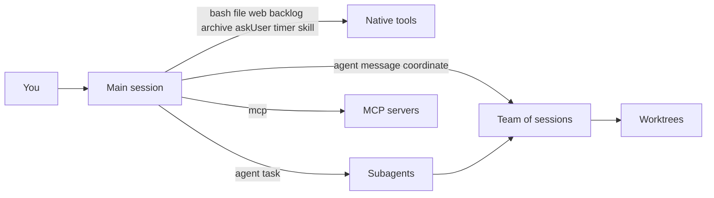

## Runtime ownership

The native runtime loads automatically. User code extensions are not supported: an `extensions` setting entry or package resource that names code is ignored with a warning, and features add no CLI flags (`--extension`, `-e` and `--no-extensions` are unknown; `--plan` is built in). Only `builtin:<id>` entries of `extensions` act (`-builtin:llama.cpp`); MCP is core, so `-builtin:mcp` is ignored with a warning. Extend the agent with [plugins](plugins.md) and [hooks](hooks.md). Permission checks, reservations and your command hooks run in that order on every tool call. Child sessions have fewer capabilities than the main one; `/help` lists the commands of the current mode.

| Feature                                      | You use                                         | Page                                                   |
| -------------------------------------------- | ----------------------------------------------- | ------------------------------------------------------ |
| Guarded file changes, checkpoints            | `file`, `/rewind`                               | [below](#file-mutation-guarantees)                     |
| Shell, background jobs                       | `bash`, `/jobs`                                 | [below](#shell)                                        |
| Debugging, profiling                         | the `octocode-debugging` core skill             | [below](#debugging-and-resuming-other-tools-sessions)  |
| Resuming Claude Code, Codex, Cursor sessions | the `resume-external-harness` core skill        | [below](#resuming-other-tools-sessions)                |
| Code research                                | Octocode MCP (default server), `/mcp`           | [MCP](mcp.md)                                          |
| Subagents, external agents, profiles         | `agent` types `task`, `external`; `/agents`     | [below](#subagents)                                    |
| Team messages, reservations                  | `agent` types `message`, `coordinate`           | [below](#communication-and-results)                    |
| Worktrees and landing                        | `--worktree`, `/worktree`, `coordinate` `merge` | [below](#worktrees)                                    |
| Process list, orphans                        | `/processes`                                    | [below](#process-names-list-and-orphans)               |
| Web retrieval, browser                       | `web`, `mcp__browser__*`                        | [below](#browser-and-web-access)                       |
| Questions, permissions                       | `askUser`, `/permissions`                       | [permissions](permissions.md)                          |
| Command hooks                                | `/harness hooks`                                | [hooks](hooks.md)                                      |
| Backlog, memory                              | `backlog`, `archive`, `/memory`                 | [web workspace](web-workspace.md), [memory](memory.md) |
| Compaction, recovery                         | `/compact`, `compact`                           | [below](#compaction-and-recovery)                      |
| Local session API                            | `/api`                                          | [session API](session-api.md)                          |
| Editor control                               | `octocode --mode acp`                           | [ACP](acp.md)                                          |

## Find and run commands

[Commands](commands.md) lists every built-in and native command, its arguments and its one name (no aliases; `/clear` and `/reset` both run `/new`). Switches (`/configuration`, `octocode configuration`, `--enable`, `--disable`, `--set`) are in [Changing configuration](configuration.md#changing-configuration). `/trust` is in [permissions](permissions.md#project-trust).

### Session workflow commands

`/compact`, `/btw`, `/context`, `/diff`, `/plan`, `/resume`, `/purge` and `/optimize` are in [commands](commands.md#session). Behavior they share:

| Command    | Limits and guarantees                                                                                                                                                                                                                                                                                                                     |
| ---------- | ----------------------------------------------------------------------------------------------------------------------------------------------------------------------------------------------------------------------------------------------------------------------------------------------------------------------------------------- |
| `/btw`     | Question of 1–8,000 characters; keeps the last 20 exchanges (trimmed to fit the model); runs while the main turn continues; text never enters history, compaction, archives or exports (only usage receipts persist); cleared on session replacement, tree navigation, reload and disposal; rejected while compaction runs; terminal only |
| `/context` | No model request; sizes are estimates of the committed projection                                                                                                                                                                                                                                                                         |
| `/diff`    | No model request; bounded Git output with external diff, textconv and filters off; each output and each untracked file capped at 128,000 bytes with visible truncation; paths outside the repository rejected; untracked symlink content never read                                                                                       |

### Opening a fork in a tmux pane or window

`/fork pane [down]` and `/fork window` need Octocode inside tmux and a conversation with at least one message; otherwise they say why and start nothing. The new pane runs `octocode --fork <session file> --session-dir <dir>` in the same directory; this session keeps running. tmux starts it from its own environment, so only `OCTOCODE_CODING_AGENT_DIR`, `OCTOCODE_CODING_AGENT_SESSION_DIR` and `OCTOCODE_HOME` are copied. Plain `/fork` opens the message selector. More in [tmux](tmux.md#open-a-fork-in-a-pane-or-window).

### Native planning constraint

Planning is a constraint over `manual`, `workspace` and `full` alike ([permissions](permissions.md#plan-mode)). `/permissions plan [off]`, `/plan` and `octocode --plan` control one state; the RPC `plan` operation exposes the same controls. Model text cannot leave planning.

```mermaid
stateDiagram-v2
  [*] --> Normal
  Normal --> Planning: /plan, /permissions plan, --plan
  Planning --> Normal: /plan --off, /plan --approve rev
  note right of Planning: host stops turn, shell, jobs, children, external prompts and hooks first; a failed stop keeps the old state
```

| Planning        | Behavior                                                                                                                                                                                                                                                                                                |
| --------------- | ------------------------------------------------------------------------------------------------------------------------------------------------------------------------------------------------------------------------------------------------------------------------------------------------------- |
| Allowed         | Octocode local research, `web`, `archive` reads, `askUser`, `skill`, `mcp` `list`/`tools`/`restart` (not `stop`), foreground shell commands made only of read-only programs (`ls`, `cat`, `rg`, `git log`, `git diff`, `git status`...) that the quick scan and the bash parse both judge read-only     |
| Blocked         | A heredoc, `$((…))`, `[[ ]]`, a reader given `$X` or a glob before `--`; redirects, `git branch -D`, installs, builds, test runners, interpreters, background jobs; file changes; debugger and browser operations; delegation and messages; unknown or external MCP tools even when annotated read-only |
| Hooks, children | Executable compatibility hooks pause; children and external agents are stopped on entry and cannot be launched                                                                                                                                                                                          |
| Revisions       | Stored on the session branch; resume and tree navigation restore them; after compaction the current revision (clipped to 8,000 characters) returns as a hidden follow-up; approval checks the current revision                                                                                          |

This is a host execution policy, not an OS sandbox.

### Questions to a person

`askUser`, permission prompts (native, external-agent, subagent) and a subagent's relayed questions are one typed question (`text`, `choice`, `multi`, `confirm`, `approval`) that a reply answers by option id. `askUser` takes at most four questions of two to four options.

| Frontend     | Behavior                                                                                                                                                                                                                                                                                                                       |
| ------------ | ------------------------------------------------------------------------------------------------------------------------------------------------------------------------------------------------------------------------------------------------------------------------------------------------------------------------------ |
| Terminal     | tabbed ask dialog for an `askUser` batch; a permission prompt is a card                                                                                                                                                                                                                                                        |
| RPC          | with `--rpc-ask`, one `ask` request carries the batch; a permission prompt adds `header`, which a subagent's parent reads to answer prompts its own mode allows. Without the flag, questions arrive as `select`, `confirm`, `input`, and a permission `select` still carries `approval`, `permission`, `ask` for older clients |
| Web          | the session list shows approvals and questions from the `ask` event; answered with `replies`                                                                                                                                                                                                                                   |
| ACP          | elicitation form; approval is a permission request                                                                                                                                                                                                                                                                             |
| Print, no UI | refused                                                                                                                                                                                                                                                                                                                        |

A subagent always runs with `--rpc-ask`; its parent relays each question and checks the replies against what it showed.

## Web workspace and memory

[Web workspace](web-workspace.md) covers `/web`, the Activity view, the backlog board, the Docs view and the Profiler; [memory](memory.md) covers notes and `/memory`. People read profile data with `octocode profile`; agents read it with the `archive` tool's `profile` source.

## Tool selection and migration

Each tool below is active unless the Default column says otherwise. `defaultTools` and `--tools` replace or modify the selection; `/configuration enable|disable tool:<name>` or per-run `--enable`/`--disable` switch one ([configuration](configuration.md#changing-configuration)). Role profiles, plan mode and permissions can narrow it further. There is no `/tools` command.

| Tool      | Default                                                                          | Notes                                                                                                                                                                       |
| --------- | -------------------------------------------------------------------------------- | --------------------------------------------------------------------------------------------------------------------------------------------------------------------------- |
| `bash`    | Active                                                                           | Shell and jobs; [Shell](#shell)                                                                                                                                             |
| `file`    | Active                                                                           | Guarded edits; [File mutation guarantees](#file-mutation-guarantees)                                                                                                        |
| `web`     | Active                                                                           | Public search and fetch; [Browser and web access](#browser-and-web-access)                                                                                                  |
| `backlog` | Active; a subagent has it only when its task names an item (`agent` task `item`) | Turning it off also drops the delegation rules that plan on items and the start-up digest                                                                                   |
| `archive` | Active                                                                           | Memory, history, profile data; [memory](memory.md)                                                                                                                          |
| `compact` | Active in the main session; none for subagents                                   | [Compaction](#compaction-and-recovery)                                                                                                                                      |
| `askUser` | Active                                                                           | [Questions](#questions-to-a-person)                                                                                                                                         |
| `agent`   | Active                                                                           | [Agent operations](#agent-operations)                                                                                                                                       |
| `steps`   | Inactive; `/configuration enable tool:steps` or a profile listing it             | Tracked steps `T<n>` of the held item or the session; unfinished steps show on resume; a subagent's open steps pass to its parent                                           |
| `timer`   | Active; also in subagents; kept while `agent` is active                          | [Timer](#timer)                                                                                                                                                             |
| `models`  | Active in the main session; none for subagents                                   | Inspection, not an `agent` type: this session's model, providers with credential status, models a task can run on; `check: true` first sends one small request per provider |
| `skill`   | Active; hidden when no skill is invocable                                        | [skills](skills.md)                                                                                                                                                         |
| `mcp`     | Active when the built-in MCP host registers it                                   | [MCP](mcp.md#let-the-model-manage-servers)                                                                                                                                  |

Tool descriptions own each tool's arguments. Rules that span tools:

| Rule                | Behavior                                                                                                                                                                                                                                                                                                                                                                                                                                                                                                                                                                            |
| ------------------- | ----------------------------------------------------------------------------------------------------------------------------------------------------------------------------------------------------------------------------------------------------------------------------------------------------------------------------------------------------------------------------------------------------------------------------------------------------------------------------------------------------------------------------------------------------------------------------------- |
| Companion           | While `agent` is active, `timer` is registered and active whatever `--tools`, `--disable tool:timer` or `defaultTools` say, because delegation waits with timers instead of polling. Only `--exclude-tools timer` or a tool policy removes it; to run without `timer`, leave out `agent` too. Only native and base tools get companions                                                                                                                                                                                                                                             |
| Operator exclusions | `--exclude-tools` and `--no-mcp` also bind every subagent of the run, over what a profile may not remove: a child of `--exclude-tools file` has no `file`. `--tools` stays the session's own allowlist; a child's selection comes from its profile                                                                                                                                                                                                                                                                                                                                  |
| `reason`            | Every native tool and the built-in `mcp` tool declares a required `reason` first, but a call never fails for a missing one: it is filled from a nested `reason`, else from the call's arguments (`file src/a.ts`), else the tool name, and marked derived so permission cards never show it empty. Octocode never adds or removes `reason` on an MCP tool's input                                                                                                                                                                                                                   |
| Repeated calls      | The same tool, arguments and result (an error counts by call alone) in a row: a note on the 3rd, a stronger note asking the model to report it is blocked on the 5th and every 3rd after, and on the 8th the next identical call is refused and the run ends (a notice, a subagent's last error, or stderr and exit 1 when headless). `reason` text is ignored; blocked, invalid and unknown calls count; a different call or new prompt resets. Exempt: `agent`, `askUser`, `backlog`, `coordinate`, `steps`, nested calls, waiting commands (`sleep`, `wait`, `watch`, `tail -f`) |
| Result budget       | One assistant message's tool results share a text budget; see [compaction](#compaction-and-recovery)                                                                                                                                                                                                                                                                                                                                                                                                                                                                                |

### Timer

`timer` (`op` `set`, `list`, `cancel`) wakes the session that set it with its note.

| Trigger | Fires                                                                                                                                                                                                                 |
| ------- | --------------------------------------------------------------------------------------------------------------------------------------------------------------------------------------------------------------------- |
| `after` | once after N seconds                                                                                                                                                                                                  |
| `every` | every N seconds (at least 30), up to `maxRuns` (default 20) or a `deadline`                                                                                                                                           |
| `until` | once when exactly one condition holds: `unlocked`, `file` (`exists`, `absent`, `changed`), `item`, `agent`, `port` (loopback only), `command` (exits 0), `check`; stops at its deadline (default an hour) and says so |

Directory and glob waits, and `job` and `message` kinds, do not exist.

| Behavior    | Detail                                                                                                                                                                                                                                                                                                                                                                                                                                                               |
| ----------- | -------------------------------------------------------------------------------------------------------------------------------------------------------------------------------------------------------------------------------------------------------------------------------------------------------------------------------------------------------------------------------------------------------------------------------------------------------------------- |
| Persistence | Timers belong to one session and survive restart and resume; a missed wake comes once; two processes never fire one twice; at most 10 active per session; `cancel` takes the id `set` returned (`all: true` stops all); erasing a session removes its timers                                                                                                                                                                                                         |
| Wake        | A follow-up message that starts a turn; the footer counts active timers; a headless run waits for the next wake before it ends                                                                                                                                                                                                                                                                                                                                       |
| Polling     | Events poke a check; a safety-net poll (30 s; 60 s for item and agent; 5 s for `port`; 15 s for `command`; or `every`) catches misses; a check that finds nothing writes nothing                                                                                                                                                                                                                                                                                     |
| `check`     | A question beside one trigger: after the trigger fires and its evidence (up to 6,000 characters) changed, at least 30 s after the last call, the `small`-route model returns `met`, `not_met` or `unsure`; only `met` wakes. Caps: $0.01 per judgment, 5 judgments or $0.05 per wait, $0.25 per session; hitting one ends the wait `failed` with `check budget`. Off until `timer.check.enabled` (global settings only) is `true` or you answer a first-use question |
| Permissions | An until-command (or a `check` trigger) is gated as the `bash` call it is when set, and against plan mode and read-only roles each time it runs                                                                                                                                                                                                                                                                                                                      |

### MCP and native tools

Native tools are not MCP servers: ACP client MCP configuration exposes server tools to the session, not native tools to remote callers. Octocode MCP is the default server; [MCP](mcp.md) shows how to enable or disable it and the other servers, [MCP reference](mcp-reference.md) covers exposure, presentation (`mcpPresentation`) and assignment. By default every enabled tool of every selected server is declared up front (`direct`); a server or tool set to `deferred`, or a byte budget in `mcpExposure`, sends a thin declaration instead and the agent reads the full text with its `mcp` tool ([exposure](mcp-reference.md#exposure-and-results)). The `mcp` tool lets the model, and each subagent for its own session, list, restart, stop or add servers. MCP arguments are validated as sent and reach the server unchanged; ones the schema does not allow fail locally without a call.

### Removed tools

These names are not registered; drop them from `--tools`, `defaultTools` and hook matchers:

| Removed                                      | Use instead                                                                               |
| -------------------------------------------- | ----------------------------------------------------------------------------------------- |
| `read`, `ls`, `find`, `grep`                 | Octocode MCP local tools, or `bash` when the server is off                                |
| `edit`, `write`                              | `file`                                                                                    |
| `powershell`                                 | `bash` with `type: "powershell"`                                                          |
| `externalAgent`, `coordinate`, `sendMessage` | `agent` types `external`, `coordinate`, `message`                                         |
| `agentModels`                                | `models`                                                                                  |
| `debug`                                      | the `octocode-debugging` skill                                                            |
| `browser`                                    | the browser MCP server ([below](#browser-and-web-access))                                 |
| `ollama`                                     | an Ollama endpoint in `models.json` ([models](models.md#configure-a-compatible-endpoint)) |

Old sessions and exports still show calls of removed names. Sessions started without native features have `bash` as their only built-in tool.

### Reading before editing

`file` refuses to overwrite an existing file the model has not read completely, and a file changed since its read must be read again.

| Read                                               | Counts as a complete read                                                                                                                                                                                                                                                                                              |
| -------------------------------------------------- | ---------------------------------------------------------------------------------------------------------------------------------------------------------------------------------------------------------------------------------------------------------------------------------------------------------------------- |
| Octocode MCP local source read                     | A successful, untransformed, numbered read (separate line windows included) while the file stays unchanged during retrieval. Filtered, minified, byte-window, failed or truncated results do not count; fetch the original ranges first                                                                                |
| `bash` (when the Octocode server is off or failed) | Exactly one literal command that prints the file: `cat FILE...`, `head [-n N] FILE`, `tail -n +N FILE`, `sed -n 'A,Bp' FILE`. A pipe, redirect, list, substitution, glob, variable, background job or failed call counts for nothing; a cut result is a partial read (an edit may follow, a full write needs the rest) |

A complete read appends the whole-source SHA-256; an edit may anchor on a line with `edits: [{ line, sourceSha256, oldText, newText }]`, and stale or partial identity is refused. After an edit or write of a completely read file, the result line ends with the new `sourceSha256`, so the next anchored edit needs no new read. The digest from the read also stays valid across the agent's own later edits: the line moves with lines added or removed above it, and a line those edits replaced, or any change made outside the agent, needs a new read. The guard remembers reads for the live session only: read again after resume or compaction. Relative and absolute paths count alike. Image decoding is not part of source reads; attach the image or use an image-capable MCP tool.

### Debugging and resuming other tools' sessions

Stopped-state inspection and profiling are a skill, not a tool: the `octocode-debugging` core skill teaches batch lldb, gdb and pdb runs, a Node inspector script and profile summaries through `bash`, under the shell permission gate. Ask: "debug why this crashes with lldb".

#### Resuming other tools' sessions

The `resume-external-harness` core skill finds sessions Claude Code (`~/.claude/projects/`), Codex (`~/.codex/sessions/`) and Cursor (`~/.cursor/` and its app data) recorded for the repository, its folders and git worktrees. It lists them with last activity, run length and location, prints one as a digest (compaction summary, files edited, last turns, native resume command) and reports each worktree's changes, unmerged commits, sessions and a suggested prune, repair or remove command. It only reads (Cursor's SQLite files open immutable) and runs no git command that changes anything. Ask: "continue my last Codex session for this repo".

### Shell

`bash({ type, command })` runs Bash (default) or PowerShell (Windows), foreground or as a background job.

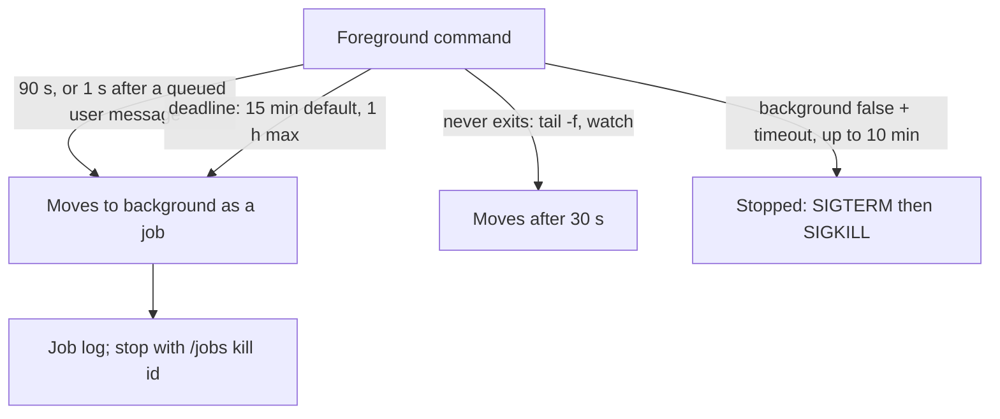

| Setting                                                                 | Detail                                                                                                                                                             |
| ----------------------------------------------------------------------- | ------------------------------------------------------------------------------------------------------------------------------------------------------------------ |
| `bashBackgroundAfterSeconds` / `OCTOCODE_BASH_BACKGROUND_AFTER_SECONDS` | The 90-second move; `0` turns it off                                                                                                                               |
| Queued user message                                                     | Moves a running foreground command after its first second so the agent can answer; hidden notices and team FYIs wait for the next step                             |
| `sleep` start, user abort                                               | Stopped, not moved                                                                                                                                                 |
| Headless run                                                            | Stops its jobs when the run ends                                                                                                                                   |
| Bash command prefix setting                                             | Applies only to Bash                                                                                                                                               |
| Result                                                                  | Starts with a header `[exit 0 · 4.2s · 312 lines · 18 KB]`; a non-zero exit is still an error result; `!<command>` (or RPC `bash`) gives the model the same result |
| `verify: true`                                                          | Records a verification receipt tied to the current edits; a later edit makes it stale; a zero exit proves only that the command succeeded                          |

The tool description ends with a ten-line CLI guide. Its first line names the host: OS and architecture, which of `git`, `rg`, `fd`, `jq`, `ast-grep`, `yq`, `gh`, `python3`, `lsof` are on the shell's PATH (Octocode's own `bin` included) and whether `gh` is logged in (read from `GH_TOKEN`, `GITHUB_TOKEN` or gh's `hosts.yml`, never over the network); the second gives platform flag notes. The probe only stats files and runs when the tool registers, so the description stays stable for the session and its prompt cache.

### Agent operations

`agent({ type, ...fields, reason })` takes flat fields. A call with another type's field, or the old `input` envelope, is refused before dispatch (recorded old sessions still render). Only `paths` is shared (by `task` and `coordinate`).

| Type         | Does                                                                                                                                                                                                                                                 |
| ------------ | ---------------------------------------------------------------------------------------------------------------------------------------------------------------------------------------------------------------------------------------------------- |
| `task`       | Launch a native child: `goal`, `task`, `skills`, `paths`, profile, model, `headless`, `background`, `isolate`, `resume`, `mcp`, `tasks`, `resultSchema`                                                                                              |
| `external`   | `externalAction` `list`, `connect`, `prompt`, `cancel`, `disconnect` to reach ACP or other Octocode hosts; present only when the global `externalAgents` setting is `true` (default off) and a known ACP agent is on `PATH` or another Octocode runs |
| `coordinate` | `action` `list`, `join`, `leave`, `lock`, `unlock`, `stop`, `merge`, `grant`, `changes`: membership, reservations, isolated results, [worktree landing](#finishing-a-worktree), a child's [request budget](#subagent-request-budget)                 |
| `message`    | Reach a teammate, another Octocode process or the coordinator: [who to address](#communication-and-results)                                                                                                                                          |

Child sessions expose only the coordination and message modes, with their usual restrictions.

## Subagents

A subagent is a child Octocode session you or the main agent start for one task. Example: "have the reviewer check my diff in the background".

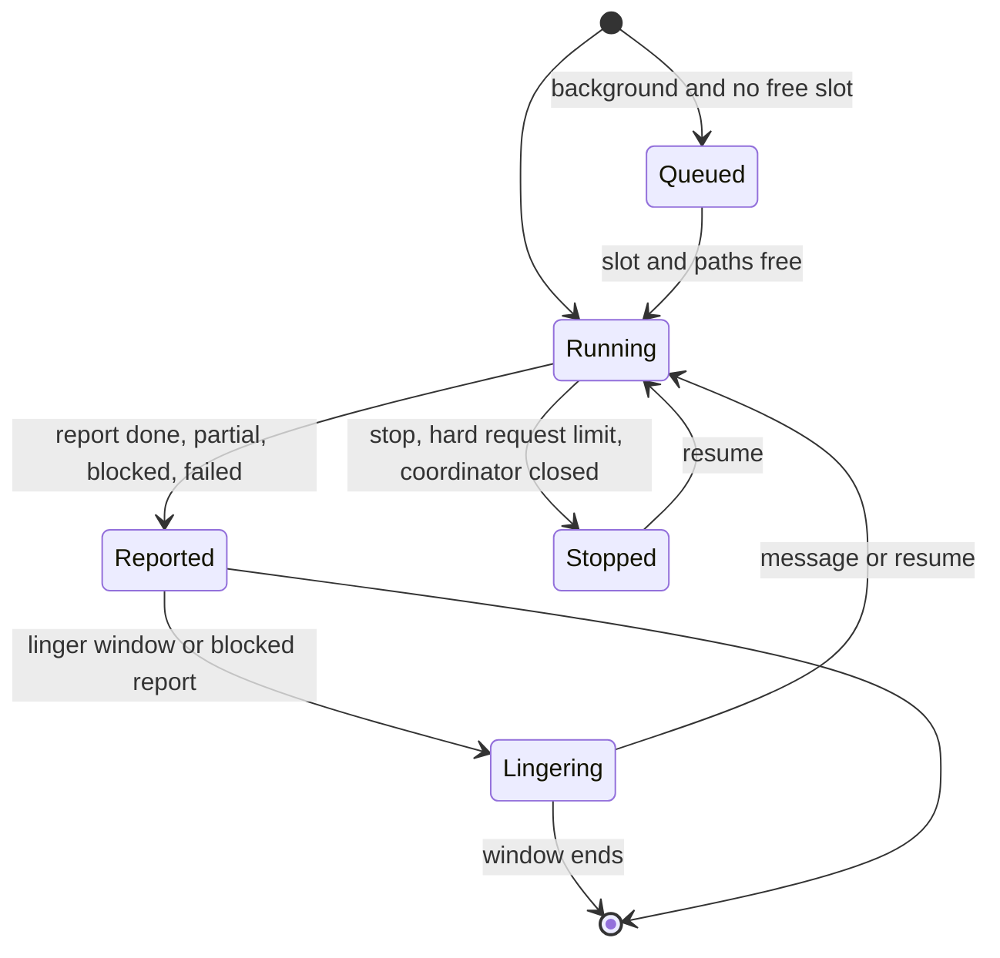

### Starting children

| Topic            | Behavior                                                                                                                                                                                                                                                                                                                                                                                                                                                                                                                                                                                                                                                          |
| ---------------- | ----------------------------------------------------------------------------------------------------------------------------------------------------------------------------------------------------------------------------------------------------------------------------------------------------------------------------------------------------------------------------------------------------------------------------------------------------------------------------------------------------------------------------------------------------------------------------------------------------------------------------------------------------------------- |
| Skills           | A child inherits the parent's accepted skill inventory. The task's `skills` array narrows it (`[]` for none); a model-only name or a `disable-model-invocation` skill is refused, unknown or ambiguous names fail before launch (use qualified names). The child adopts captured paths and invocation policy (not file contents) and does not rediscover skills; a retargeted discovery symlink makes it refuse the inventory, and a deleted or moved skill is left out with a warning. [Skill inheritance](skills.md#child-skill-inheritance)                                                                                                                    |
| MCP              | The task's `mcp` array narrows the child's servers to those it names plus those its profile and the research floor require; every tool of a named server is active unless the profile names one exact `+mcp__<server>__<tool>`. An unknown or disabled name refuses the task; `resume` or a lean profile with `mcp` is refused ([MCP reference](mcp-reference.md#assign-servers-to-agents))                                                                                                                                                                                                                                                                       |
| Specialist floor | Every specialist keeps `file`, `agent`, `timer`, `archive` and Octocode local research. Restrictive allowlists gain them by server `roles`, not tool name. Profiles that remove them or set `mcp: false` are rejected; a global MCP opt-out still applies. Researcher and reviewer use `file` only for requested reports and scratch artifacts                                                                                                                                                                                                                                                                                                                    |
| Server state     | A child starts with servers its parent added with `mcp` this session (never written to `mcp.json`) and loads configured servers itself. A server the parent ended with `mcp` `stop` is hidden from the child unless its own selection names it (`tools: mcp__<server>__*`; default-active does not count). `/configuration disable mcp:<name>` is saved, so children see it. A harness switch reaches running children: before each request a child compares saved `harness:` switches with what it last saw and, on a change, reloads MCP as its parent did                                                                                                      |
| Concurrency      | Slots follow the machine (at most 6; `OCTOCODE_MAX_SUBAGENTS` overrides; [environment variables](environment-variables.md)). A `background: true` task with no free slot returns its id as queued and starts first come first served; it can be stopped like a running one and has no worktree or team seat until it starts. A foreground task waits. Background children sharing profile, model and skills share a prompt prefix: the first starts at once, the others wait until its first reply starts (at most 10 s, not at all once that prefix was warm in the last 4 min)                                                                                  |
| Batches          | `tasks` is an array of task objects started in one call; other task fields beside it are defaults an entry overrides. Each entry is validated and started on its own (own approval, slot, reservations); a failed entry leaves the others running. The result has one `#n ok\|error: <goal>` section per entry and `details.batch`                                                                                                                                                                                                                                                                                                                                |
| Limits           | `subagents.maxChildren` (children started; a resume is not new) and `subagents.maxCost` (US dollars, own and children's, running children included) refuse a new task past either, with the total; nothing running is stopped. Both off by default ([settings](settings.md))                                                                                                                                                                                                                                                                                                                                                                                      |
| Nesting          | A child has no `task` type. An `octocode` it starts from its shell is a top-level session; `OCTOCODE_AGENT_NESTING` counts tasks across that boundary and a session two deep refuses another                                                                                                                                                                                                                                                                                                                                                                                                                                                                      |
| Permissions      | A subagent cannot ask anyone, so it runs with what its parent decided at spawn. In `full` it inherits the mode. In `manual` or `workspace` the spawn dialog names what the profile's tools reach and the permissions the profile declares; approving (once or for the session) grants those classes for the whole run, deliberately looser than the parent's mode: the dialog is the consent. Classes that always ask (destructive shell, changes outside the workspace, browser control unless declared, browser cookies) never pass down; a mode change that makes an action ask stops running children and clears grants ([permissions](permissions.md#modes)) |
| Identity         | A child's commands inherit `OCTOCODE_SUBAGENT`, `OCTOCODE_AGENT_ID`, `OCTOCODE_PARENT_ID`, `OCTOCODE_AGENT_ROLE`, `OCTOCODE_TEAM_WORKSPACE` and related variables, and `OCTOCODE_PARENT_PID`. A separate Octocode started from such a command clears them and runs top-level (own team name, default prompt); `OCTOCODE_PERMISSION` is kept so it is never looser than the inherited mode; it does not keep a `readOnly` profile's guard, which is not a sandbox. [Shell tool session environment](environment-variables.md#shell-tool-session-environment) is unaffected                                                                                         |

### Path reservations

A task's `paths` (files, or `dir/` for a tree) are reserved for the child from before it starts until its run ends, so the parent needs no `coordinate` lock. All are reserved or none, under the child's id with its goal as the reason, and they block other agents and the parent like any reservation.

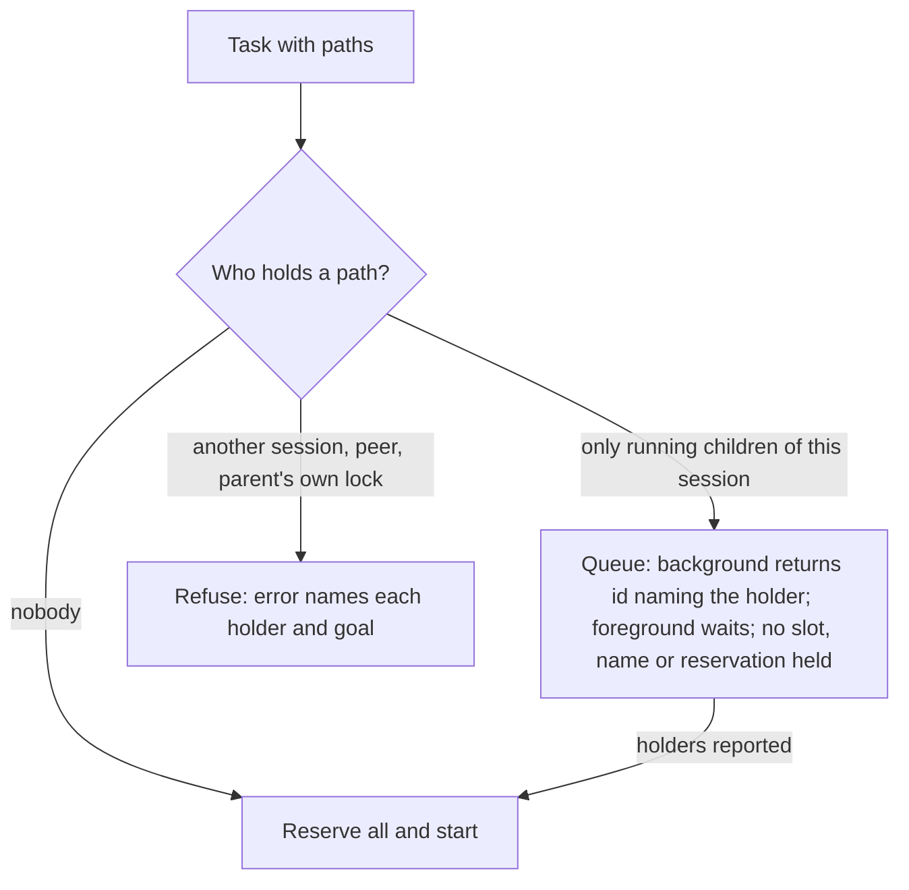

| Case                                          | Behavior                                                                                                                                                                                          |
| --------------------------------------------- | ------------------------------------------------------------------------------------------------------------------------------------------------------------------------------------------------- |
| Repeated path, path inside another named tree | Folded, not refused                                                                                                                                                                               |
| Before the child joins                        | The parent holds its team row, so siblings started together cannot overlap; a dying parent takes the reservations with it                                                                         |
| End                                           | With the run however it ended; a child still closing at `/new` or `/resume` keeps them until its run ends                                                                                         |
| Lingering child                               | Holds nothing while no process runs; a follow-up takes them again; if another agent took a path meanwhile it still runs, the resume receipt names the holder and the file guard refuses that edit |
| `isolate` or read-only profile                | `paths` does nothing (the result says so); `/agents merge` checks reservations at landing                                                                                                         |
| Team database unwritable                      | The child starts without them and says why                                                                                                                                                        |

### Reports and structured results

| Topic           | Behavior                                                                                                                                                                                                                                                                                                                                                                                                                                                                                                                                                                                                                                                                                                                                                                                                                                                        |
| --------------- | --------------------------------------------------------------------------------------------------------------------------------------------------------------------------------------------------------------------------------------------------------------------------------------------------------------------------------------------------------------------------------------------------------------------------------------------------------------------------------------------------------------------------------------------------------------------------------------------------------------------------------------------------------------------------------------------------------------------------------------------------------------------------------------------------------------------------------------------------------------- |
| Outcome         | The first word: `done`, `partial`, `blocked`, `failed`, optionally after one `Report:`, `Status:` or `Outcome:` label. Any other opening is unknown, not a failure; so is a prose first word (`Done with the audit, but blocked by X`) when its line names another outcome word. The latest completed report decides the displayed outcome; a failed follow-up is a failure that keeps earlier results as partial evidence                                                                                                                                                                                                                                                                                                                                                                                                                                      |
| Fences          | Foreground and background report bodies carry untrusted-content fences in model context; the terminal removes the wrapper                                                                                                                                                                                                                                                                                                                                                                                                                                                                                                                                                                                                                                                                                                                                       |
| `resultSchema`  | A bounded JSON Schema object (`type`, `properties`, `required`, boolean `additionalProperties`, `items`, `enum`, `const`, `description`, numeric and length bounds); remote references, patterns, custom keywords and executable definitions are rejected before the child is claimed. The child ends its report with `Structured result:` and one fenced `json` block; the host validates the complete final answer. `details.structured` carries version 1, the schema SHA-256, `valid`/`invalid`/`unavailable` and data only when valid. A schema-enabled foreground task succeeds only on `done` plus `valid`; a background launch returns at once and its report carries the verdict. Cancellation and failed final replies leave it unavailable                                                                                                           |
| Delivery        | Reports keep recovery copies until the transcript records them. A rejected asynchronous delivery retries after 1, 2, 4 s, then 30 s, 1 and 2 min with the same report ID; when exhausted you are told once, the report is resent after each settled turn, and shutdown saves it for the next start. While the parent is mid-turn, a report wanting action leaves a short hidden notice (agent, outcome, saved report path; never the child's words) read at its next step; the full report follows when the turn ends. A subagent's own background `bash` job never starts a child turn; the parent's report gains one line per job that ended after the answer. A saved report that is not JSON or has invalid schema metadata is renamed `<name>.json.invalid` and never read again                                                                           |
| Startup failure | A child that exits before its first model turn reports `failed (startup)` with the exit reason, the first stderr error line and the saved `stderr.txt` path. A module-load error (`ERR_*`, `SyntaxError`, `Cannot find module`) restarts it after 1.5 s, then with doubling waits while they fit `OCTOCODE_SUBAGENT_STARTUP_RETRY_SECONDS` (0–600; default 30 for a child running from source, one retry for a bundled one). A startup-failed, crashed or stopped foreground child stays resumable (a resume naming a different profile is refused); a stop is never retried. Every failed report names the model and what chose it (`Ran on <provider/id> (profile researcher: small).`); on a refused credential or model (401/403, expired key, unknown model) the advice is to pass `model` with this session's model or fix the provider with `/providers` |
| Child notices   | Warnings and errors a child shows reach the parent: the report lists the first 5 distinct (up to 4,000 characters, repeats as `warning (×3)`); `notices.txt` keeps the first 1,000 distinct (up to 1,000,000 characters)                                                                                                                                                                                                                                                                                                                                                                                                                                                                                                                                                                                                                                        |
| `blocked`       | A background child that reports `blocked` stays resumable for at least 10 minutes even with `OCTOCODE_SUBAGENT_LINGER_SECONDS` at 0; a longer positive setting wins; then the saved context is released. Isolated runs are not resumable                                                                                                                                                                                                                                                                                                                                                                                                                                                                                                                                                                                                                        |
| Lingering       | Finished non-isolated background workers stay addressable for `OCTOCODE_SUBAGENT_LINGER_SECONDS` (default off) or the profile's `linger` seconds (`0` off; `browser` is 900). A message revives the conversation with fresh authorization and capacity checks; restart recovery needs the same parent session, workspace, profile and surviving transcript. The parked record never holds MCP server configs the model added (they may carry credentials); a revived run takes the session's current ones. Pending mail does not relaunch work                                                                                                                                                                                                                                                                                                                  |

### Transcripts, resume and stats

A child's conversation is saved in its scratch folder `<workspace>/.octocode/code/temp/agents/<id>/session/` (long report beside it as `report.md`); every report footer names its transcript, and `/agents history` lists every subagent the session records (profile, goal, latest status and outcome, transcript, report).

`agent` `task` with `resume: <id>` restarts the child on its transcript with the task as a follow-up, under its recorded profile and, while still configured, its recorded model (a `model` in the call wins), after the usual slot and spawn approval. Only ids recorded in the current session are accepted; an unknown id is refused with the list, and so are a running child, an `isolate` child and one whose transcript is gone. A fork of a session whose background children were running gets a hidden note naming them: they stopped with the original session, which receives their reports, and the fork can `resume` them. Scratch folders are swept at session start once nothing wrote to them for `OCTOCODE_CLEANUP_DAYS` (default 30; `0` keeps them), never while the Octocode that started the child runs.

`/agents stats` summarizes this session's runs per role (`general` when none) from the transcript, so it survives reload: runs, outcome counts, the share that led with an outcome word, tokens (input, output, cache reads and writes), cost (`n/a` without pricing), asks, startup failures and compactions; average initial context and p50/p95/max requests per run appear only for runs that recorded them.

### Profiles

Bundled profiles are `browser`, `implementer`, `lean`, `researcher`, `reviewer`. Your own override them by name; a project file that replaces an earlier one is named in a warning at start. A `readOnly: true` profile (bundled `reviewer`, `researcher`, `browser`) keeps `file` for its own reports and scratch evidence, gets the investigate-and-report policy, and its other changes are refused in every mode ([read-only roles](permissions.md#read-only-roles)). [Agent instructions](instructions.md) separates system policy, role text and task context.

A `lean: true` profile (bundled `lean`) is for small models: its child runs the profile's `tools` (default `bash,agent,file`; a list leaving out `bash`, `agent` or `timer` gets them anyway), has no `archive`, `skill`, `mcp`, local research, extensions, MCP servers or automatic memory notes, and a short report-contract section replaces the native policy. Its tool list must be explicit (`+`/`-` entries are refused). A profile's `skills:` are inlined in its cached role section when the task names none; skills a task names, and a lean profile's, ride in the task ([prompt caching](prompt-caching.md#subagent-prefixes)).

#### Profile front matter

A profile is Markdown: YAML front matter, then the role's instructions. It loads from the global `agents/` folder or the trusted project's `.octocode/agents/` at the repository root ([configuration locations](configuration.md#where-each-configuration-belongs)); a later source replaces an earlier profile of the same name. An invalid value skips that file with a diagnostic; unknown keys are ignored.

| Key            | Value            | Effect                                                                                                                                                                                                                                              |
| -------------- | ---------------- | --------------------------------------------------------------------------------------------------------------------------------------------------------------------------------------------------------------------------------------------------- |
| `name`         | text             | Defaults to the file name without `.md`                                                                                                                                                                                                             |
| `description`  | text             | What the parent reads to pick the profile; start with "Use when…"                                                                                                                                                                                   |
| `model`        | text             | The child's model; [the subagent model](#the-subagent-model)                                                                                                                                                                                        |
| `tools`        | comma-separated  | A plain list is an allowlist to which `bash`, `file`, `agent`, `timer`, `archive`, `skill`, `mcp` and local research are added (only the local reader and search when the list names Octocode server tools); `+name`/`-name` adjust the default set |
| `excludeTools` | comma-separated  | Naming `file`, `agent`, `timer`, `archive`, `mcp` or a local research tool is refused                                                                                                                                                               |
| `mcpDefer`     | list             | MCP tool roles, e.g. `readOnly`, whose tools the child lists by name instead of declaring in full; they stay callable and load through the `mcp` tool. Each server says which tools have a role in its `roles` setting                              |
| `skills`       | string or list   | Skills inlined in the role prompt when the task names none                                                                                                                                                                                          |
| `permissions`  | list             | Classes the spawn prompt asks you to allow, e.g. `[browser.control]`; undeclarable names are ignored and reported                                                                                                                                   |
| `readOnly`     | `true`           | Investigate-and-report role                                                                                                                                                                                                                         |
| `lean`         | `true`           | Lean child for small models                                                                                                                                                                                                                         |
| `headless`     | `true` / `false` | Browser mode (legacy `visibleBrowser` is its inverse)                                                                                                                                                                                               |
| `maxRequests`  | integer ≥ 0      | Soft request limit; `0` turns the budget off                                                                                                                                                                                                        |
| `linger`       | seconds ≥ 0      | How long a finished background run stays reachable for a follow-up                                                                                                                                                                                  |
| `hooks`        | `true`           | The child runs your command hooks; by default it does not                                                                                                                                                                                           |

Switches take YAML booleans only (a quoted `"false"` fails the profile). `mcp: false` is refused because every specialist needs local research.

### Where a task can run

Every route starts from a credential. A provider you turn off in `/providers` drops out of every route below.

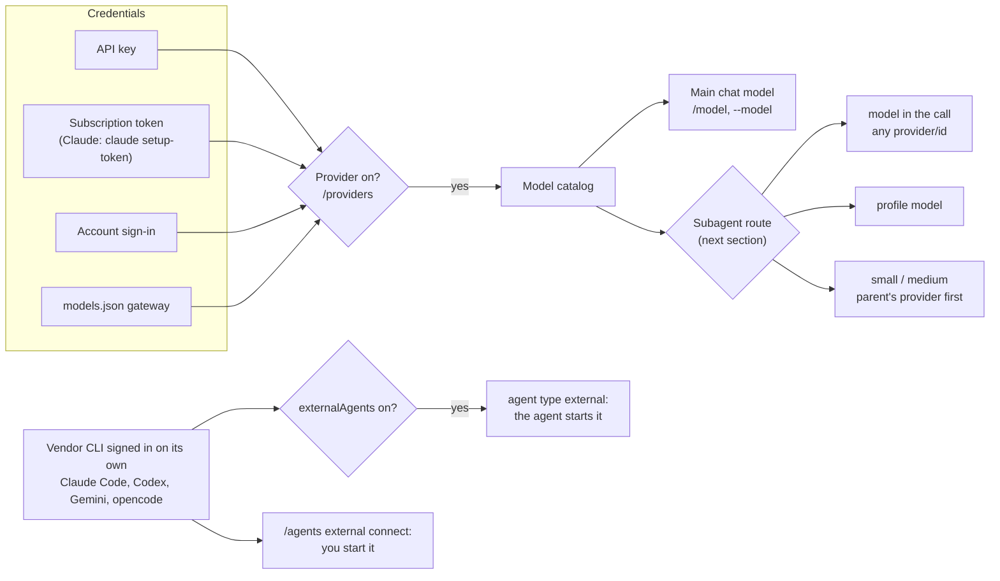

| Route                                                 | Who starts it                                     | What it needs                                                    | What it costs                                                              |
| ----------------------------------------------------- | ------------------------------------------------- | ---------------------------------------------------------------- | -------------------------------------------------------------------------- |
| Subagent on a provider model                          | The agent (`agent` task)                          | The provider on, with a working credential                       | API price per token, or your plan's usage limits with a subscription token |
| Subagent on a named model                             | The agent, or you by asking for that model        | As above; `models` lists what can run a task                     | As above; free models cost nothing                                         |
| External agent (Claude Code, Codex, Gemini, opencode) | The agent, with `agent` type `external`           | `externalAgents: true`, the vendor's CLI on `PATH` and signed in | The vendor account's own billing or plan                                   |
| External agent from the terminal                      | You, with `/agents external connect` and `prompt` | The vendor's CLI on `PATH` and signed in                         | The vendor account's own billing or plan                                   |

A listed provider or external agent is not proof that it works. A connected opencode peer, for example, starts on its own default model, which may need funds. Check with `/modelsettings` → Credential check, or connect and send one short prompt.

### The subagent model

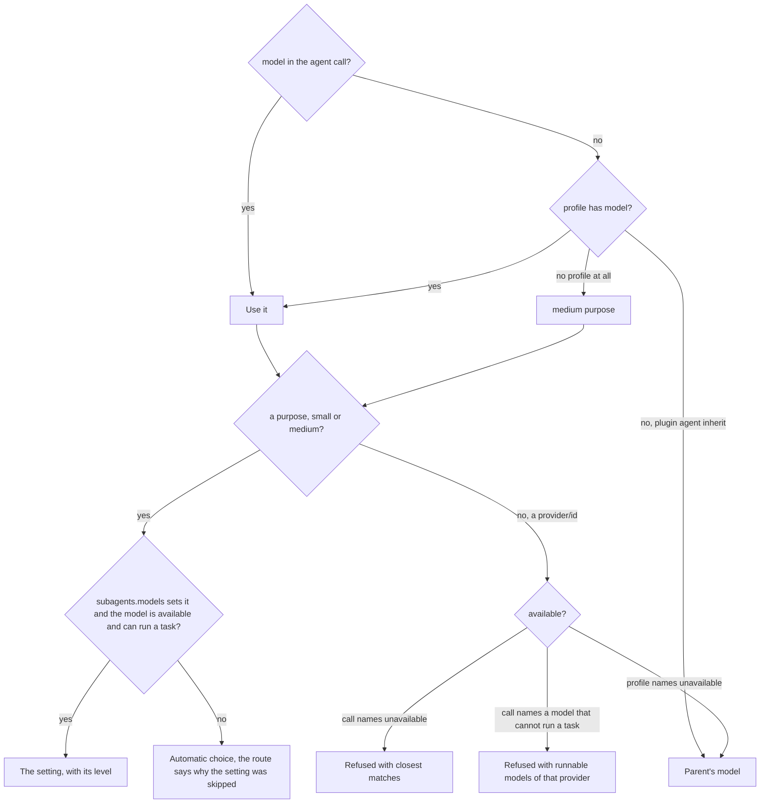

| Value                    | Meaning                                                                                                                                                    |
| ------------------------ | ---------------------------------------------------------------------------------------------------------------------------------------------------------- |
| `provider/id` or bare id | A name `/modelsettings` lists; a bare id several providers list resolves to the parent's provider first. A model that cannot run a task (below) is refused |
| `small`                  | The model set in `subagents.models.small`, else the cheapest capable model the session can use                                                             |
| `medium`                 | The model set in `subagents.models.medium`, else the dearest capable model priced between 15% and 80% of the parent's                                      |
| any of these `:level`    | `off`, `minimal`, `low`, `medium`, `high`, `xhigh`, `max`, e.g. `small:high`                                                                               |

`small` and `medium` prefer the parent's provider and lab. A candidate must support tool calls, have a context window of at least 100,000 tokens, take images when the parent does, not be deprecated and be its family's current generation; with none, or an unknown parent price, the child runs on the parent's model. The thinking level is the call's suffix, else the profile's (kept on whichever model is picked, and on the parent's model after a fallback), else `OCTOCODE_SUBAGENT_THINKING`, else `medium`; a child never takes the parent's level or `defaultThinkingLevel`; a level the model lacks is clamped to the nearest one it supports, and the route says so (`low thinking (model argument: p/m:off; asked off; this model does not support off)`). The `models` tool lists the thinking levels of a reasoning model that supports others than `off`, `minimal`, `low`, `medium` and `high` (` · thinking low/medium/high`).

What the `models` tool returns:

| Call                                            | Result                                                                                                                                                                                          |
| ----------------------------------------------- | ----------------------------------------------------------------------------------------------------------------------------------------------------------------------------------------------- |
| No filter                                       | This session's model, one row per provider (credential source, last result, how many models can run a task, cheapest and most capable one with price), the `small`, `medium` and profile routes |
| `provider: openai`                              | That provider's models that can run a task, then its other models under "Cannot run a task" with the reason                                                                                     |
| `query` or `ability` keeping 40 or fewer models | The matching models, listed as above                                                                                                                                                            |
| `query` or `ability` keeping more               | The provider rows with how many models each has matching, so a long list never opens the call                                                                                                   |
| `scope: catalog`                                | Also the models of providers that are not connected, marked not runnable                                                                                                                        |

A model cannot run a task when it has no tool calls, is deprecated, or has a context window under 100,000 tokens. A model whose abilities are not known is allowed. Naming such a model in a call, for example `model: openai/gpt-4`, starts no child: the refusal says why and names runnable models of that provider. The credential source uses the same words as `/providers` (saved credential, environment variable name, `models.json`). The coordinator's prompt lists each provider with its number of runnable models, such as `openai` (41), and the routing notice repeats the counts when they change; `/modelsettings` always shows the full listing.

| Bundled profile           | Model           |
| ------------------------- | --------------- |
| `researcher`              | `small:medium`  |
| `browser`, `lean`         | `small:low`     |
| `implementer`, `reviewer` | `medium:medium` |

To make every child that names a purpose cheaper, set the global `subagents.models` setting; to change one role, set `model: small:low` in a same-named profile under `.octocode/agents/` or pass `model` on the call.

```json
{ "subagents": { "models": { "small": "openai/gpt-5-mini:low", "medium": "anthropic/claude-sonnet-5" } } }
```

Each value is a `provider/model` with an optional `:level`. It applies to every profile or call that names `small` or `medium` (bundled profiles do) and to a task with no profile; a call's own `model` still wins, and a profile's own `:level` (`small:high`) outranks the setting's. The setting is read from the global settings file only. It is used only when the model is available, can run a task and its provider has not just refused its credential; otherwise the automatic choice applies and the route says why (`automatic; subagents.models.small p/m unavailable`). The `models` tool, `/modelsettings`, the coordinator's routing line and the routing notice show a configured route as `(setting subagents.models.small)`, and each child's `Runs on` line names the setting that chose it.

You see each child's route: start results and every report end with `Runs on` / `Ran on provider/id, <level> thinking (what chose it)`, and `coordinate list` and the agents panel show `provider/id:level`.

For 15 minutes after a refusal, a purpose or profile model skips a provider whose credential was refused (except the parent's own; a provider that is only out of funds keeps its free models, and stays in the coordinator's provider list while it has one) and a model that refused a run with a client error before spending a token (4xx other than 408 or 429); the parent's model is never skipped and the failed report names it as the model to retry with. Siblings started in one call were routed together, so they fail alike. `/modelsettings` and the `models` tool list what `small` and `medium` resolve to, the default thinking level, each profile's route and the last credential result per provider (`check: true` or `/modelsettings check` first sends one 64-token request per provider, 20 s each). The coordinator's delegation section states this once per session, read at the first prompt after start, resume or reload and then kept so the cached prompt does not change; when a command changes the facts (provider enabled, disabled or signed in, model switch) the agent gets one hidden `octocode-routing` notice after the current turn. Agents of other vendors over ACP come from `agent` type `external` `list` ([ACP](acp.md#connect-from-octocode-to-another-agent)).

### Subagent check-in

A running subagent that exchanged no message with its parent for `subagents.checkInSeconds` (default 300, `0` off; [settings](settings.md)) is asked whether it needs something. The child's own harness sends the ping at the end of a step that ran tools, so it adds no model request, costs the parent no turn and cannot reach a finished, lingering or idle child. A message either way restarts the interval; messages with other agents do not. It is not a deadline.

| Child      | What happens                                                                                           |
| ---------- | ------------------------------------------------------------------------------------------------------ |
| Background | May answer with `message` to `parent`; a `replyRequired` message wakes the parent                      |
| Foreground | Its parent reads messages only with its report, so the ping tells it to finish with a `blocked` report |

`coordinate list` shows each running child's last progress (a model or tool event; none for 10 minutes outside declared waiting work marks it `stalled`) and every question still waiting on the parent with number, age and first line. While a child waits for a relayed dialog, `coordinate list` and `/agents` show `waiting for approval`.

### Subagent request budget

The parent counts a child's model requests: one per assistant reply (compaction summaries are not replies). The count covers the child's whole transcript, including earlier branches and failed replies, so resume, message revival, reopened sessions and parent forks count the same history; a new child starts fresh.

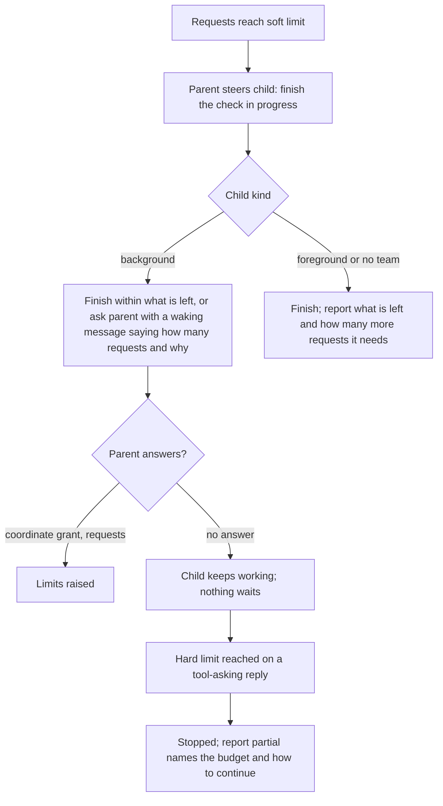

| Item                             | Value                                                                                                                                                                                                                                                                                                                           |
| -------------------------------- | ------------------------------------------------------------------------------------------------------------------------------------------------------------------------------------------------------------------------------------------------------------------------------------------------------------------------------- |
| Soft limit                       | profile `maxRequests` (`0` off), else `OCTOCODE_SUBAGENT_MAX_REQUESTS` (`0` off), else 160                                                                                                                                                                                                                                      |
| Hard limit                       | 1.5 × soft, rounded up, plus grants (240 by default). The child gets one last request without tools and is told to write its report from what it has; then the run ends and the report is `partial`. A provider that cannot turn tools off keeps them for that request: a reply that still asks for tools stops the run at once |
| Bounds                           | Saved assistant replies, not provider attempts, tokens or cost                                                                                                                                                                                                                                                                  |
| Resume at or past the soft limit | A whole new allowance: soft = saved count + soft, stop = saved count + hard; the child is told its usage and where it stops. A peer's message relayed by the parent's process decided nothing, so it stays within the old limits and at the hard limit returns `partial` without launching                                      |
| Recorded                         | Each run records requests and cache reads/writes apart from summary and warming spend; `/agents stats` aggregates per profile                                                                                                                                                                                                   |

### Isolated worktrees

`isolate: true` runs the child in its own git worktree; `resume` is refused for it. Isolated worktrees of every checkout of a repository share one folder under the Octocode home's `worktrees/`, so a session in any worktree prunes another's crashed run after saving its changes to a ref. Creating one never runs repository hooks such as `post-checkout`.

| Topic        | Behavior                                                                                                                                                                                                                                                                                                                                                                                                                                                                                                                                                                                                                               |
| ------------ | -------------------------------------------------------------------------------------------------------------------------------------------------------------------------------------------------------------------------------------------------------------------------------------------------------------------------------------------------------------------------------------------------------------------------------------------------------------------------------------------------------------------------------------------------------------------------------------------------------------------------------------- |
| Snapshot     | `workingCopy: true` with `isolate: true` starts from tracked and non-ignored untracked files, keeping the parent index and branch; the default starts at HEAD. Snapshots and saved refs exclude private data in `.octocode/code/`; a tracked or staged workspace marker or session file blocks automatic checkout and export                                                                                                                                                                                                                                                                                                           |
| Export       | Baseline-only changes are removed; if the worker delta cannot apply cleanly to the original HEAD the worktree is kept for review. Fixed diff options and a private patch file mean your Git diff and apply settings do not change it and there is no size limit. A repository the child creates inside its worktree (`git init`, a clone, an initialised submodule) is not saved as a gitlink: the worktree is kept and the message names the paths. Ignored files are never exported                                                                                                                                                  |
| Containment  | In every mode, including `full`, a `file` change or parsed shell write into the parent's main tree is refused: also repository changes naming no file (`git -C <main> reset --hard`, `git --work-tree=<main> checkout`, `tar -C <main>`), commands moving a ref shared with main (`git update-ref`, `git branch -f`, `git branch -D`, `git tag -f`, `git fetch . a:b`, `git stash drop`, `git gc`), a write after a `cd` the parser cannot follow (use `cd ./dir` or an absolute path), and a write it cannot place. A new branch or tag and the child's own detached `HEAD` stay allowed. Not a sandbox: `node script.js` is not seen |
| Landing      | The parent runs `coordinate` `merge` (follows the permission mode; a reserved file refuses it); you run `/agents merge [id]` (can override a reservation; needs a clean parent tree). Both check reservations, remove the ref and note the merge on the backlog item; a plain `git merge` does neither                                                                                                                                                                                                                                                                                                                                 |
| Discarding   | `/agents discard <id>` asks for confirmation, naming the ref and the files it changes, then deletes the ref without merging it; nothing is deleted when no one can be asked. The merge prompt for `coordinate` `merge` names the ref and its changed files too                                                                                                                                                                                                                                                                                                                                                                         |
| Unsaved work | The next start commits it to `refs/octocode/<id>`; if the child held a backlog item the ref is linked on it as an `output` with a not-merged note (`Linked <ref> on B<n>.`); `/agents merge <id>` adds a merged note to every item linking the ref                                                                                                                                                                                                                                                                                                                                                                                     |

### Subagent lifecycle

When the coordinator closes, its subagents close too.

| Exit                                                                         | What happens to children                                                                                                                                                                                                                  |
| ---------------------------------------------------------------------------- | ----------------------------------------------------------------------------------------------------------------------------------------------------------------------------------------------------------------------------------------- |
| `/quit`, SIGTERM, SIGHUP, SIGINT, `/new`, `/resume`, fork                    | Each child stops gracefully: abort, close stdin, SIGTERM its process group, SIGKILL after the grace, so it can report and save an isolated worktree. Each child leads its own process group, so Ctrl+C and SIGHUP never reach it directly |
| Crash, dead-terminal emergency exit, `process.exit` before the stop finished | Every registered group is SIGKILLed synchronously from the exit hook, taking bash jobs, MCP servers and browser too                                                                                                                       |
| `kill -9` of the coordinator                                                 | Each child notices within about a second (stdin EOF or parent check) and exits after at most 10 s even if shutdown hangs                                                                                                                  |
| Restart                                                                      | The resumed session is told once, without a turn, which children it recorded as running ended with it without a report; `resume` continues one                                                                                            |

Long and unattended runs keep going through what would otherwise end them:

| Situation                             | Behavior                                                                                                                                                                                                                                                          |
| ------------------------------------- | ----------------------------------------------------------------------------------------------------------------------------------------------------------------------------------------------------------------------------------------------------------------- |
| Provider failure in a headless parent | A print or JSON run whose turn ends in a retryable provider error while children run holds, says so on stderr and retries when the next report arrives; it ends when no child is left and that attempt failed, naming the session id and `octocode --resume <id>` |
| Provider failure on a wake            | In the terminal or RPC, a turn started by a report or message that ends in a retryable error retries after 1, 2, 5, 10 and 30 minutes with a status line; new input cancels the waits; a notice says when they run out                                            |
| Machine sleep                         | A gap between watchdog ticks moves the child's deadlines by the gap                                                                                                                                                                                               |

### External-agent lifecycle

At most eight external-agent connections can be open or starting at once. An ACP prompt timeout reports uncertain execution and retains the peer's active request; another prompt is refused until it settles; explicit cancellation closes the owned connection. The [ACP guide](acp.md#connect-from-octocode-to-another-agent) explains timeout recovery, retained evidence and process ownership.

## Browser and web access

`web({ query })` or `web({ url })` (kept enabled in the main agent) does public search and retrieval. Search providers share a 30-second deadline across the fallback chain; failures name the providers tried and cancellation stops the chain. Fetch warnings come from transport metadata, so page text that resembles an error stays ordinary content.

Browsing uses the built-in `browser` MCP server (`mcp__browser__*`, powered by `@octocodeai/octocode-chrome-devtools`); the native `browser` tool was retired. Its own instructions and the bundled `octocode-chrome-devtools` skill say how to use it; launch and exposure are in the [MCP reference](mcp-reference.md#configuration-and-precedence).

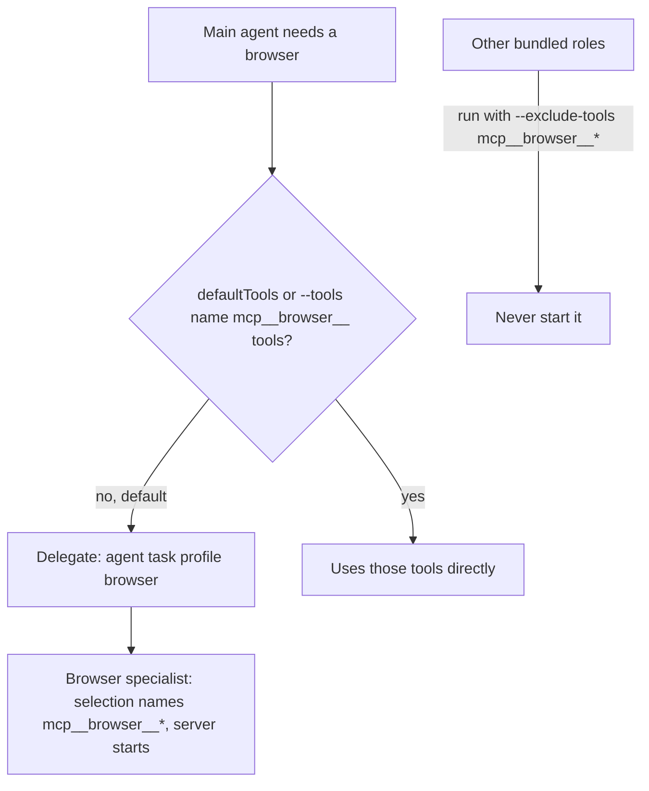

| Topic                   | Behavior                                                                                                                                                                                                                                                                                                                                                                                                                                                                                                                                  |
| ----------------------- | ----------------------------------------------------------------------------------------------------------------------------------------------------------------------------------------------------------------------------------------------------------------------------------------------------------------------------------------------------------------------------------------------------------------------------------------------------------------------------------------------------------------------------------------- |
| Default                 | The server is `defaultActive: false`, so only an agent whose selection names `mcp__browser__*` starts it (by default the `browser` specialist); your own MCP servers and the research server start as usual for every child                                                                                                                                                                                                                                                                                                               |
| Opt the main session in | Name tools in `defaultTools` (or `--tools` for one run): `+mcp__browser__open`, `+mcp__browser__run`, `+mcp__browser__snapshot`, `+mcp__browser__screenshot`, `+mcp__browser__check`, `+mcp__browser__cleanup`; the rest of the catalog stays undeclared and the main agent is told to use these instead of delegating                                                                                                                                                                                                                    |
| Other ways              | A profile `tools:` entry naming `mcp__browser__*`, or `{ "mcpServers": { "browser": { "defaultActive": true } } }`, gives an agent direct access; a `browser` server defined in full in `mcp.json` replaces the preset (`defaultActive` included); children that do not name it are still excluded. A `defaultTools` entry `browser` has no effect (reported in settings warnings) and `--tools +browser` selects nothing. `-web` omits retrieval                                                                                         |
| Permissions             | A page at a private or local address, or a name that does not resolve, asks `net.private`; `script` and `api-replay` ask `browser.control` every call; the `cookies` tool and CDP cookie methods ask `browser.cookies` (no profile grants it; one answer can cover the session). Requests the opened page makes pass Octocode's filtering proxy for private addresses. `dev-check` would start an unproxied Chrome, so it runs only against a browser `open` started on its port                                                          |
| Chrome                  | `open` takes `headless`. A visible Chrome on an explicit `port` keeps its profile under the workspace's browser state between opens, so a login persists (logins saved earlier under `browser-profile` in the Octocode home are not reused: sign in again). A headless Chrome a browser subagent leaves running stays for follow-ups and stops when the top session shuts down; a visible one stays open. Calls reach the server in the order made, and a command without a port uses the browser `open` last made ready in the workspace |

Start the specialist with `background: true` and give it the task, URL, required evidence and `headless` choice:

```json
{
	"type": "task",
	"profile": "browser",
	"headless": false,
	"goal": "Check the signed-in dashboard",
	"task": "Open https://example.com/dashboard and report what is visible.",
	"reason": "Check the dashboard as the signed-in user"
}
```

`headless` defaults to `true`; `false` selects visible Chrome with its persistent login profile. Both modes share role instructions, so the mode belongs in the task and the cached role text stays identical. The profile sets `linger: 900`: after a successful report it stays reachable for 15 minutes and `message` to its id resumes the same conversation (page map and decisions included). A resumed run is a new process but Chrome outlives it: when follow-ups may come, the specialist leaves the browser running and reports its port, and `open` on that port reuses the browser and tabs; Octocode records the private-address filter port beside the browser state and restores the filter (approvals of private hosts start empty). Tell the specialist to close the browser when done. Foreground runs need an explicit `task` resume; isolated runs cannot resume. Replace the former `webHeadless` and `webLive` profiles with `profile: "browser"` and `headless`.

The specialist's page-awareness loop:

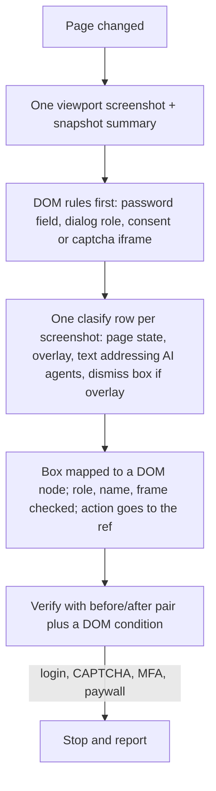

It reuses saved captures, skips classification when URL, title and DOM digest are unchanged, and keeps a page map in its scratch folder. A box is never clicked.

## File mutation guarantees

`file` edits, writes and deletes check the current content under a cross-process filesystem lock (symlink aliases resolved) and replace files atomically (temporary file and rename).

| Guarantee    | Detail                                                                                                                                                                                                                                                                                                                                                                                                               |
| ------------ | -------------------------------------------------------------------------------------------------------------------------------------------------------------------------------------------------------------------------------------------------------------------------------------------------------------------------------------------------------------------------------------------------------------------- |
| Read first   | Overwriting an existing file needs a complete read; a file changed on disk since needs a new read; a new path needs none                                                                                                                                                                                                                                                                                             |
| Edits        | Each `oldText` is re-validated and applies when it still matches exactly once: exact LF-normalized match, then a whitespace/punctuation fallback; after an outside change the exact anchor must stay unique                                                                                                                                                                                                          |
| Checkpoints  | Journals reject malformed paths and digests when loaded; if another writer takes a path during `/rewind`, the displaced copy is preserved and `/rewind` names its recovery path                                                                                                                                                                                                                                      |
| Batches      | Each outcome is reported; earlier successes are not rolled back                                                                                                                                                                                                                                                                                                                                                      |
| Not excluded | Atomic replacement prevents torn files but not unrelated editors, shell commands or processes that ignore the lock                                                                                                                                                                                                                                                                                                   |
| Reservations | Enforced for `file` and for `bash` write targets the parser can name. While another agent holds any reservation, shell commands whose writes no parse can name (PowerShell outside the read-only list, inline interpreter code, unreadable code) are refused, and a `node -e` that only lacks Node's permission flags runs with them added ([reservations and the shell](permissions.md#reservations-and-the-shell)) |
| Lapse        | A reservation lapses 90 s after its owner's last heartbeat and is not fenced: an owner stalled longer that resumes can overwrite a peer that took the file                                                                                                                                                                                                                                                           |

### Canonical patch mode

`file` takes either native `queries` or a Codex `patch` string, never both (a patch call may include `reasoning`); no second file tool exists.

| Topic       | Behavior                                                                                                                                                                                                                                             |
| ----------- | ---------------------------------------------------------------------------------------------------------------------------------------------------------------------------------------------------------------------------------------------------- |
| Operations  | Add, Delete, Update, Move, context chunks and EOF markers                                                                                                                                                                                            |
| Preparation | Every operation is prepared before the first mutation; an invalid later operation, duplicate source path or failed guard prevents the whole commit                                                                                                   |
| Execution   | Cancellation or the first failure stops later operations; earlier changes stay recorded for `/rewind`; a move writes its destination before removing its source, with guards and checkpoints for both. Native query batches continue after a failure |
| Matching    | Update matching and line endings follow the Codex transformer; read coverage, stale-content checks, permissions and reservations still apply; a patch update does not turn a partial read into whole-file coverage                                   |
| Unsupported | Path forms Octocode would normalize differently, remote environment routing ([hook patch compatibility](hooks.md#codex-file-patch-preview))                                                                                                          |

## Live status

| Element          | What it shows                                                                                                                                                                                                                                                                                                                                                                                                                                                                                                                                                                                                                                                                                                                                                                                                                                                                                                                                                                                                      |
| ---------------- | ------------------------------------------------------------------------------------------------------------------------------------------------------------------------------------------------------------------------------------------------------------------------------------------------------------------------------------------------------------------------------------------------------------------------------------------------------------------------------------------------------------------------------------------------------------------------------------------------------------------------------------------------------------------------------------------------------------------------------------------------------------------------------------------------------------------------------------------------------------------------------------------------------------------------------------------------------------------------------------------------------------------ |
| Working line     | Above the input (in the editor border when embedded): `⠙ Running Bash (12s · esc to interrupt)`. The time is the whole run's elapsed time (through tool waits, retries and automatic compaction) right after the action, so a narrow terminal clips the action first, then the interrupt hint. The action names what the agent does, not the command: a tool row title (`Running Bash`, `Running localSearch +2`), `Running 3 tools: Bash · File`, `Running subagent <goal>`, else `Thinking: <gist>`, `Writing`, `Preparing tool calls`, `Waiting for you: <question>`, `Waiting for model`. A permission-flagged call keeps its warning and target (`⚠ Running Bash: rm -rf build`); permission class ids never appear. Teammates see a separate stored line with the permission action and no clock                                                                                                                                                                                                             |
| Reason line      | One italic line under a tool's title, `↳ list the folder`, in the theme's `toolReason` color (`muted` if absent), collapsed or expanded and while running: the call's `reason` as written (filled as in [tool selection](#tool-selection-and-migration)). Nothing for a missing or one-word reason; long ones are cut to the width; a `File` row with one change shows that change's own `reason`; extension tools never show it. Exports show it, permission prompts show native calls' reasons, ACP clients get it in the tool call title (`bash: Run the focused tests`), the web view under the tool's name                                                                                                                                                                                                                                                                                                                                                                                                    |
| Purpose block    | Below a tool's result: every goal and reasoning the result's own data states per query row, for any tool and server, never from the call's arguments. A goal every row shares is one `◎ <goal>` line then `· #<row> <reasoning>` lines (row number only with two or more rows); otherwise `#<row> <goal> — <reasoning>`. Text the `↳` line shows is not repeated. `toolReason` color, escapes and line breaks stripped, lines cut to the width, at most six lines then `… +N more`; same in exports and the web view; the stored result is never changed                                                                                                                                                                                                                                                                                                                                                                                                                                                           |
| Turn line        | When a run settles, one dim line: `✻ Worked 52s · 7 tools · 3 agents · ≈$4.12 · cache 61%`. A run is everything from its first start to settling: a retry, continue, compaction resume and queued steer belong to it; an aborted run writes its line when it settles. It sums wall time, top-level tool calls (not a subagent's own), subagents whose result arrived, cost (main replies, those subagents, compaction, branch summaries and other recorded requests, formatted like the footer) and the share of prompt tokens read from cache. Zero or unknown parts are left out; a run under 3 s with no tool writes nothing. It is not sent to the model and is redrawn on resume; subagents and headless runs do not write it                                                                                                                                                                                                                                                                                 |
| Reasoning labels | A finished block `▾ Reasoning · 4s` (first streamed token to the next block; none after a resume or under 1 s); hidden `▸ Reasoning · 4s (ctrl+t)` with the bound key, plus `or click` only in fullscreen mode. An interrupted turn says `Interrupted` once; the tool row shows `aborted`                                                                                                                                                                                                                                                                                                                                                                                                                                                                                                                                                                                                                                                                                                                          |
| Footer totals    | Run tokens come from completed messages and streaming usage when the provider reports it, never estimated from text. Session totals count new prompt tokens (uncached input and cache writes) plus output, including subagent usage; cache reads are shown beside (`↑72k +1.1M cached ↓35k`) because every request re-reads the conversation. `coordinate list` uses the same format per agent since it joined. Between runs the footer shows the last run's output speed when it streamed for at least 1 s                                                                                                                                                                                                                                                                                                                                                                                                                                                                                                        |
| Agents panel     | A tree rooted at this session: name, role, goal, activity (after `›`), then aligned columns for unanswered messages (`✉ n`) and held locks, model, state, elapsed, tokens (`166k tok`) with cache share (`74% cached`), and tool calls and cost when wide; the root sums the team. It also lists other running work, one typed row each: a `bash` job (id, reason or command, elapsed), a `timer` (id, what it waits for, time left, warning tone) and a background subagent the team does not list yet; an agent in its own worktree has a `worktree ⎇ branch` badge. The footer's first line counts them (`2 agents · 1 bash · 1 timer`; empty when idle; timers also show spend, `2 timers · $0.003`). Rows repaint when work starts or ends; while any runs, marks use the agents' spinner and times count in seconds. Under reduced motion marks are still and cells show whole minutes (`<1m`, `3m`, `in 9m`), repainted on the oldest row's minute boundary. A short terminal collapses rows into `+N more` |
| Team name        | After joining the team the footer shows `main: <name>`, the name peers and messages use. The session file records it, so continue, resume and reload rejoin under it unless another running agent holds it (then a fresh name is taken and recorded); a new or forked session gets a name on its first team action                                                                                                                                                                                                                                                                                                                                                                                                                                                                                                                                                                                                                                                                                                 |
| Team errors      | `team off` (unusable, e.g. newer schema) or `team retrying` (locked) in the footer; the error is said once in the message list (a lock only after two failed one-second refreshes) and one line says when it is reachable again                                                                                                                                                                                                                                                                                                                                                                                                                                                                                                                                                                                                                                                                                                                                                                                    |

## Process names, list and orphans

Every Octocode process names itself `octocode-<role>-<id>`, so `ps`, `pgrep -f octocode` and `/processes` tell them apart.

| Process      | Name                                                                                                             |
| ------------ | ---------------------------------------------------------------------------------------------------------------- |
| Main session | `octocode-main-<last 8 characters of its session id>` (renamed on `/new`, `/resume`, a fork or a session switch) |
| RPC host     | `octocode-rpc-<id>`                                                                                              |
| ACP broker   | `octocode-acp-<pid>`                                                                                             |
| Subagent     | `octocode-<role>-<agent id>`                                                                                     |

A title is at most 64 characters of letters, digits, `.`, `_`, `-`.

`/processes` lists Octocode processes on this machine with name, API instance ID (`off` when its API is off or it is a subagent), pid, parent pid, RSS, age and, for a subagent, whether its parent is alive, plus the MCP stdio servers, bash jobs and anything below them it owns (it reads `ps`, so not on Windows). `/jobs` is one session's bash jobs, `/agents` its team, `/status` its summary.

Each process records a sample every 5 minutes (`OCTOCODE_PROCESS_SAMPLE_MINUTES`; `0` for none besides the first and last): memory (`rss`, `heapUsed`), pid and start time, title, session or agent id, owner, and each owned child's pid, start time, parent and RSS. Shutdown writes a last sample marked ended; samples older than 7 days are deleted by the next sample, at most hourly per process. Samples are the only source of what another session owned, so a child that started after its owner's last sample and then crashed is not known as an orphan.

| Finding        | Rule                                                                                                                                                                                                                                                   |
| -------------- | ------------------------------------------------------------------------------------------------------------------------------------------------------------------------------------------------------------------------------------------------------ |
| Orphan         | A child alive with its recorded start time whose owner is gone (dead, or its pid now has another start time; a graceful shutdown gets 15 s first), or that was reparented away to init while its owner lives; a subagent whose parent Octocode is gone |
| Growing memory | Over at least four samples spanning 15 minutes or more: never drops more than 5% between samples and rises at least 64 MB and 25%                                                                                                                      |

`/processes stop` asks for confirmation (interactive only), re-reads records and the process table, and ends only processes still orphans of a recorded owner with the recorded start time: SIGTERM, then SIGKILL after the grace. A pid without a recorded start time, a changed start time, init and this process are never signalled.

## Worktrees

Each Git worktree has its own workspace ID, backlog and notes. Agents in the same repository share a team and can read notes saved with project scope. The default transcript directory belongs to the workspace; `/resume all` searches the others. If the original worktree is gone, `octocode --fork <full-session-id>` starts a new conversation from its database copy.

[Commands](commands.md#agents-and-work) lists `octocode --worktree <name>` and `/worktree` (`list`, `new`, `open`, `switch`, `merge`, `remove`). Behavior behind them:

| Topic               | Behavior                                                                                                                                                                                                                                                                                                                                                                                                                                                                                                                                                                                                  |
| ------------------- | --------------------------------------------------------------------------------------------------------------------------------------------------------------------------------------------------------------------------------------------------------------------------------------------------------------------------------------------------------------------------------------------------------------------------------------------------------------------------------------------------------------------------------------------------------------------------------------------------------- |
| Create              | `--worktree <name>` and `/worktree new` make `<main checkout>/.octocode/worktrees/<name>` on branch `worktree-<name>`; an existing subtree grant can cover the destination                                                                                                                                                                                                                                                                                                                                                                                                                                |
| Remove              | Only under `.octocode/worktrees/`; refused while it has changed or untracked files, commits on no other branch, or live agents, tmux panes or kept-reachable finished agents (`--force` overrides); never the session's own worktree; deletes the worktree's trust record; the branch only with `git branch -d` (an unmerged one is kept and the message says so)                                                                                                                                                                                                                                         |
| Switch              | Starts a fresh session whose folder is the target root (settings, trust, team and footer follow); refused while a turn runs; `main` always means the main checkout                                                                                                                                                                                                                                                                                                                                                                                                                                        |
| `.worktreeinclude`  | Gitignore-syntax file at the root of the checkout you start from; matching untracked files (typically `.env`) are copied on creation. Private files under `.octocode/code/` are excluded; existing files are never overwritten; symlinks and paths leaving either checkout are skipped; files in `node_modules`, `vendor`, `dist`, `build`, `target`, `.next`, `.nuxt`, `.turbo`, `.cache`, `.venv`, `venv`, `__pycache__`, `.gradle` (any depth) are skipped unless a pattern names the folder; at most 2,000 files and 100 MB; `/worktree new` names what was skipped; a reused worktree copies nothing |
| Hooks, dependencies | Repository git hooks run as `git worktree add` would; dependencies are not installed. Child sessions have no `/worktree`                                                                                                                                                                                                                                                                                                                                                                                                                                                                                  |
| Footer              | `worktree <name>` in a linked worktree; `+N agents in M worktrees` when live members work outside this checkout; empty otherwise; follows the team's one-second refresh, not git                                                                                                                                                                                                                                                                                                                                                                                                                          |

Agents in any worktree of a repository are one team:

| Topic            | Behavior                                                                                                                                                                                                                                                                                                                                                                                                                                                                                                             |
| ---------------- | -------------------------------------------------------------------------------------------------------------------------------------------------------------------------------------------------------------------------------------------------------------------------------------------------------------------------------------------------------------------------------------------------------------------------------------------------------------------------------------------------------------------- |
| Roster           | They appear in each other's `coordinate list`. A main session messages any by ID; a subagent reaches only its own tree and its parent relays beyond. A member in another worktree shows `· worktree <folder>` (`(gone)` once removed) and its locks `holds <paths> (in worktree <folder>)`; each member's second line starts with its pid and, for a main session in tmux, its pane (`pid 4242 · tmux pane %12 · joined …`), so `tmux select-pane -t %12` reaches it. Stale members and ended processes are left out |
| Per worktree     | Reservations, the edit log (`changes`), lock advice and scratch folders, so the same relative path in two sibling worktrees never conflicts                                                                                                                                                                                                                                                                                                                                                                          |
| Nested worktrees | A worktree under `.octocode/worktrees/` lies inside the main checkout, so reservations compare as the same files: main's `.octocode/worktrees/x/src/a.ts` is x's `src/a.ts`, and a main reservation of `.octocode/worktrees/x` (or above) covers all of x, and the reverse                                                                                                                                                                                                                                           |
| Isolated child   | Events and messages go against its own workspace ID, but its checkout and reservations use the parent checkout so concurrent edits are checked against the files that will receive the merge; the web roster shows its worktree folder                                                                                                                                                                                                                                                                               |

## Communication and results

One verb reaches every agent: `agent` type `message`, `to` a name. Each message says who it is from, and an answer goes to that name; the caller does not choose the transport.

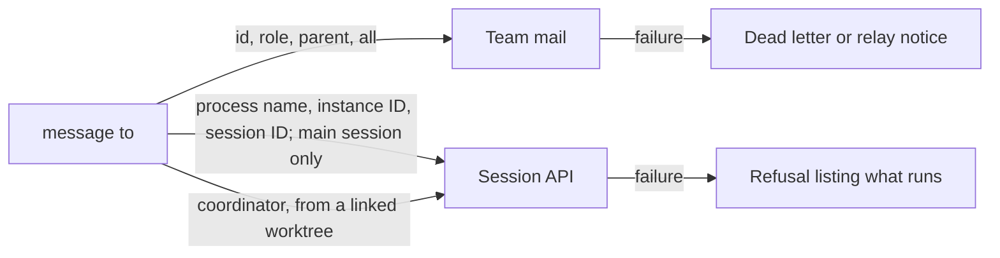

| To                                           | `to`                                                                     | Carried by                    | Failure the caller sees                                                                  |
| -------------------------------------------- | ------------------------------------------------------------------------ | ----------------------------- | ---------------------------------------------------------------------------------------- |
| A subagent, its parent, a sibling            | id, role, `parent`, `all`                                                | Team mail                     | Dead letter or relay notice                                                              |
| Another Octocode process (main session only) | exact process name (`octocode-main-c0ea9f3e`), instance ID or session ID | [Session API](session-api.md) | A refusal listing what runs; [what the sender gets](session-api.md#what-the-sender-gets) |
| The main checkout, from a linked worktree    | `coordinator`                                                            | Session API                   | [None or several](#finishing-a-worktree): told, nothing sent                             |

A session's own name is in the `environment` section of its prompt, after the cached prefix; `coordinate list` shows other sessions with name, busy state and folder and marks this repository's coordinator. `/new`, `/resume` and `/fork` start a new conversation with a new name and instance ID, so a message to the old name fails with what is running. A process message does not wait for the receiver's run; the answer arrives as a message from its name, so two sessions cannot wait on each other. Its text arrives [marked as external](session-api.md#what-the-session-sees), and whether it arrives is [the receiver's permission mode](permissions.md#external-messages). `forward`, `replyTo` and `interrupt` reach teammates only, and a subagent has no process route: a restricted child must not ask an unrestricted session to act. An outside agent stays `agent` type `external` ([lifecycle](#external-agent-lifecycle)).

### Finishing a worktree

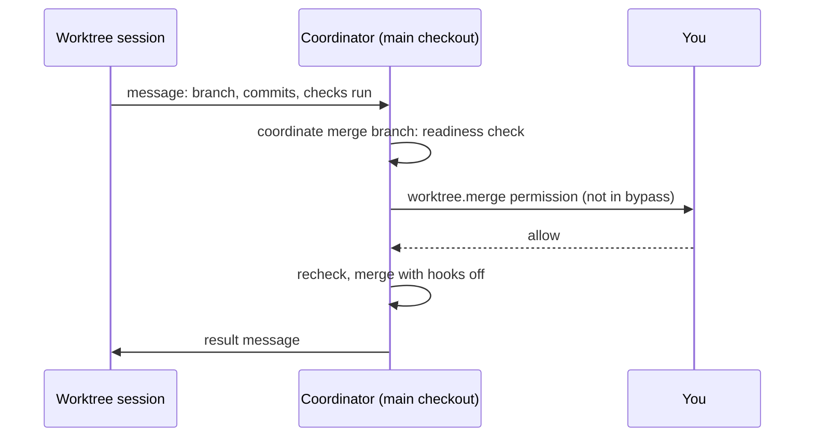

The coordinator is the one session whose working directory is in the repository's main checkout (`git worktree list`). If there is none or several, nothing is sent and the tool says so, naming them; the model tells you and leaves the worktree as is, and with several your choice goes in `to` by name. The worktree session never merges into the main checkout itself; `coordinate` `merge` refuses outside it. `coordinate` `merge` takes only a linked worktree's branch; you can also type `/worktree merge <branch>` in the main checkout (it shares its merge with `/agents merge`).

| Readiness check refuses with the reason and next step                  |                                                                                          |
| ---------------------------------------------------------------------- | ---------------------------------------------------------------------------------------- |
| Uncommitted work in that worktree                                      | an agent still working there                                                             |
| An ongoing backlog item a session there holds on that worktree's board | a merge in progress                                                                      |
| A path another agent holds                                             | a conflict (predicted with `git merge-tree`, then tried for real and aborted on failure) |

In every mode but `bypass` the merge asks you ([`worktree.merge`](permissions.md#worktree-merges)); in `bypass` a ready merge runs unasked and is announced. After the answer it rechecks uncommitted work and working agents, merges with hooks off, and leaves the worktree and branch for their owner (`/worktree remove`).

### Team mail

Live native agents in the same repository, in any of its [worktrees](#worktrees), can address another coordinator or its workers by exact ID; unique role names also resolve repository-wide (prefer exact IDs across trees). `to: "all"` broadcasts only within the sender's tree; interruption is limited to the sender's child or your session tree. Every subagent (isolated too) is on its coordinator's team, lists teammates with `coordinate list` and messages them and its coordinator; the team grants no authority. A finished worker's own coordinator owns its revival.

| Topic          | Behavior                                                                                                                                                                                                                                                                                                                                                                                                                                                                                                                                                                                                                                                                                                                                                                                                                                                                                                                   |
| -------------- | -------------------------------------------------------------------------------------------------------------------------------------------------------------------------------------------------------------------------------------------------------------------------------------------------------------------------------------------------------------------------------------------------------------------------------------------------------------------------------------------------------------------------------------------------------------------------------------------------------------------------------------------------------------------------------------------------------------------------------------------------------------------------------------------------------------------------------------------------------------------------------------------------------------------------- |
| Queueing       | Messages stay queued until they reach the recipient's model context. Delivery waits for acknowledgement of the previous batch and targets 32 KiB per batch; messages are never split (an oversized one travels alone), excess mail waits. Interrupts and requests that wake an idle recipient can pass the backlog. The team checks its database once a second and again when a step that ran tools ends                                                                                                                                                                                                                                                                                                                                                                                                                                                                                                                   |
| Questions      | A reply completes the original question only when sent to the asker. A stalled recipient (process runs but unseen for over a minute) is still reached by ID, as `parent` or by `all`, never by role. A question closes when its asker leaves, unless the asker is a subagent whose parent is present and may resume it with the answer. A subagent's report answers the questions its parent sent that it read: they close as answered, not as dead letters                                                                                                                                                                                                                                                                                                                                                                                                                                                                |
| Dead letters   | The feed and profiler name only recipients that dropped a message and whether each read it; a failed relay request is the parent's errand and not listed. A subagent sending to `parent` after its coordinator left is told to finish with its report. A dead letter is kept until its sender has been told, or one day after the sender left                                                                                                                                                                                                                                                                                                                                                                                                                                                                                                                                                                              |
| Forwarding     | `message` with `forward: <N>` delivers stored message N to more recipients without copying its body: they see the original sender, id and fence, the forwarder, and the forwarder's note (at most 1,000 characters) in a separate fence; a reply goes to the original sender. A parent message forwarded by a peer reads as that peer's untrusted data, not the parent's steering                                                                                                                                                                                                                                                                                                                                                                                                                                                                                                                                          |
| References     | An `agent` task, and an external `prompt`'s `refs`, may cite `msg#<N>` (a stored team message) and `report:<agent-id>` (the latest report of a subagent this session started). The host expands each when it builds the task, inside the fence of the agent that produced it, with its producer, time and a short SHA-256, and refuses the call naming each unresolved reference. A message is readable by its sender, its recipients (forwarded too) and the session that started either; anyone else, or an id past the 24-hour retention, gets the same "no message" answer. `report:<id>` selects the latest result's hash-bound report snapshot, or its saved transcript preview for a short report; a newer run retires the earlier selection. Report artifacts must be regular single-link files directly in that child's scratch folder; symbolic or hard links, other locations and digest mismatches are refused |
| Handoff limits | At most 16 distinct references and 32,768 characters including provenance and fences; report excerpts hold at most 4,096 characters plus a pointer to the full evidence; referenced messages above 8,192 characters are rejected, not shortened; over-budget handoffs fail before dispatch. External peers and lean children get complete bounded report text (asked for a focused summary when an excerpt is needed) because local artifact access is not guaranteed                                                                                                                                                                                                                                                                                                                                                                                                                                                      |
| Relay          | A child's message to an agent it cannot reach becomes a relay request its parent's process settles without the parent's model: a live target in the session gets it in its inbox; a lingering finished target is resumed with it (after the usual spawn approval) only when the message asks a question (`replyRequired`) or answers one that target asked; anything else is a dead letter naming `report:<id>`. A target whose resume is pending waits for it to rejoin, and each target is resumed by relay at most three times in ten minutes, so finished agents cannot keep resuming each other                                                                                                                                                                                                                                                                                                                       |
| Trust          | Senders are identified by team id in the local agent database; a process with write access to that database can insert rows under any id, so references and relays trust it as much as the processes that share it                                                                                                                                                                                                                                                                                                                                                                                                                                                                                                                                                                                                                                                                                                         |

## Compaction and recovery

`archive` owns saved memory and lifecycle retrieval; [Memory and Archive](memory.md) covers scopes, ids and paging. Compaction uses a built-in policy: settings cannot replace its summary, budget or cut point; `/compact [instructions]` requests it manually. Context sizes use one estimate of three characters per token (safe side for code, paths, JSON), including declared tools; provider limits can still reject a request.

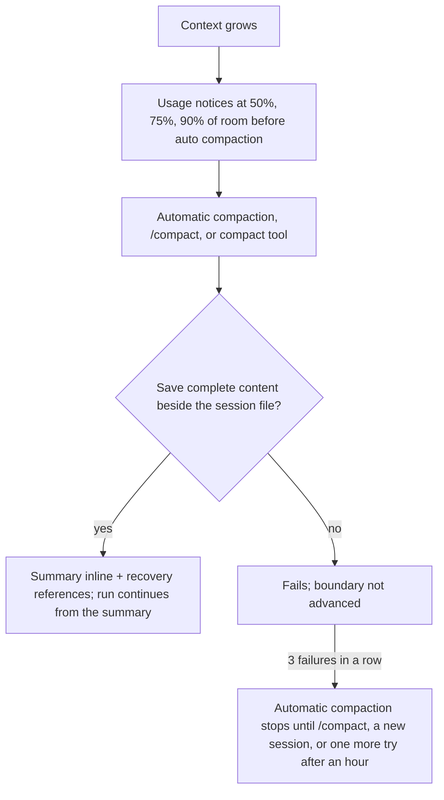

| Topic                | Behavior                                                                                                                                                                                                                                                                                                                                                                                                                                                                                                                                                                                                                                                                                                                                                                                                                                                                                                                                                                                                                              |
| -------------------- | ------------------------------------------------------------------------------------------------------------------------------------------------------------------------------------------------------------------------------------------------------------------------------------------------------------------------------------------------------------------------------------------------------------------------------------------------------------------------------------------------------------------------------------------------------------------------------------------------------------------------------------------------------------------------------------------------------------------------------------------------------------------------------------------------------------------------------------------------------------------------------------------------------------------------------------------------------------------------------------------------------------------------------------- |
| Detailed copies      | Expire `OCTOCODE_CLEANUP_DAYS` after the committed compaction time (default 30; `0` disables cleanup), only after a complete summary and trustworthy timestamp are stored. Reads and resume do not extend it; unknown legacy timestamps preserve copies. Summaries and original transcripts remain                                                                                                                                                                                                                                                                                                                                                                                                                                                                                                                                                                                                                                                                                                                                    |
| `compact` tool       | Optional `focus` (up to 16,000 characters, as for `/compact`). It only queues: compaction aborts the session first, so it runs when the run settles and a hidden message continues the task from the summary. A user stop drops the request, and so does a compaction that ran after it. Refused while context is under half the room before automatic compaction, within two turns of the previous compaction, and after the thrash breaker trips (three compactions in a row each within three turns of the previous stop automatic compaction; manual `/compact` resets; the tool counts as automatic). Subagents do not get it. The usage notice names it from the 75% notice on                                                                                                                                                                                                                                                                                                                                                  |
| Usage notices        | When a turn ends with context past 50%, 75% or 90% of the room before automatic compaction (window less reserve), one hidden message such as `[Context] 140k of 184k usable tokens used (76%); about 44k left before automatic compaction summarizes older turns. The window is 200k.` is added, once per band per compaction cycle (also across resume); the system prompt never changes for it                                                                                                                                                                                                                                                                                                                                                                                                                                                                                                                                                                                                                                      |
| Result budget        | One assistant message's tool results share 100,000 characters for every tool alike (two requested pages). One result keeps 20 KB by default (`bash`, other MCP tools, `web`); a call can ask for up to 50,000 (`responseChars`, `maxChars`), and no text part keeps more than 60,000 whole. Spent in tool-call order, not completion order, so the same calls keep and lose the same text and the cached prefix stays stable. The first part that does not fit keeps head and tail with a note, and it and every later part go to one JSON-lines file in the session's `output/` folder whose path the note names; later results show a short pointer. Images are not counted; a result with its own spill note is charged for what it shows; the budget restarts each turn. Only the stored message and the model's context are bounded: `tool_execution_end` events carry the full result. Archive reads reject files over 32 MiB                                                                                                   |
| Checkpoint           | Checked with retained messages, the system prompt and tool declarations. Oversized checkpoints, long user-message collections and a read/modified-files list over 3,000 characters are saved beside the session file and replaced by recovery references; an oversized checkpoint keeps its goal, TL;DR, newest user messages and Recovery section inline, whichever fit. A summary updating an earlier one is asked to stay under half the inline budget. A user message over 6,000 characters (less on a small window) is saved whole and replaced by its reference in place. A subagent's messages may each take up to half the section; its task, the oldest message, is evicted last. When messages do not fit beside the summary in the inline budget (80% of the reserve), the whole collection is saved behind one reference, keeping the newest that fit whole so the latest request survives word for word. The saved-results list also names each summarized subagent run's transcript and archive folder while they exist |
| While compacting     | Other input is queued but an extension command runs at once; one that cannot start returns to the editor with `Command did not run; restored to editor: <reason>`                                                                                                                                                                                                                                                                                                                                                                                                                                                                                                                                                                                                                                                                                                                                                                                                                                                                     |
| Moving or backing up | Keep checkpoint files with the session: they and `.bak` copies go when the session is removed, but files a saved-results list names live in `output/`, `bash/` and subagent scratch folders, which the session-start sweep removes after `OCTOCODE_CLEANUP_DAYS` without a write, so an old summary can name a file that is gone                                                                                                                                                                                                                                                                                                                                                                                                                                                                                                                                                                                                                                                                                                      |
| `--no-session`       | No session file: long tool results, user messages and oversized checkpoints stay inline, cut to budget with a marker saying how many characters were omitted (head and tail stay); output past a tool's cap is still saved to `output/`. Only a session file that cannot be written fails compaction                                                                                                                                                                                                                                                                                                                                                                                                                                                                                                                                                                                                                                                                                                                                  |
| Failures             | If complete content cannot be saved, or retained context and reference cannot fit, compaction fails without advancing its boundary. Three failures in a row stop automatic compaction until a successful `/compact`, a new session or, an hour after the last failure, one more attempt; reported once per trip and on each unrecoverable overflow. A user cancel does not count. A summary the model already wrote is kept for the next attempt over the same messages                                                                                                                                                                                                                                                                                                                                                                                                                                                                                                                                                               |

### Transcript write failures

| Situation                                                                                                  | Behavior                                                                                                                                                                                                                                                                                                                                                                                                                                                                                                               |
| ---------------------------------------------------------------------------------------------------------- | ---------------------------------------------------------------------------------------------------------------------------------------------------------------------------------------------------------------------------------------------------------------------------------------------------------------------------------------------------------------------------------------------------------------------------------------------------------------------------------------------------------------------- |
| An append fails                                                                                            | The live session restores its previous branch and blocks writes until one can succeed; nothing is cut from the file automatically; a full disk or I/O error is not final (freeing the disk resumes). A partial record at the end is sealed with a newline under the session lock (a malformed line the loader skips); a record that fully reached the file before its flush failed is kept, not rewritten                                                                                                              |
| Lock held past 3 s                                                                                         | Nothing is written: a tool result or assistant message stays in memory and goes first at the next write (or at replacement or quit); any other entry fails for its caller to retry                                                                                                                                                                                                                                                                                                                                     |
| Full disk, I/O error                                                                                       | A tool result or assistant message is lost and the run fails; the next request tells the model no result was recorded and the call may have run; a resume names the unanswered calls                                                                                                                                                                                                                                                                                                                                   |
| Torn tail not provably this process's (crash, power loss, another writer), shrunk file, unplaceable record | Stays refused. The error names `octocode --fork <file>`, which copies the complete records into a new session and leaves the original byte-identical; `--fork <id>` reads the transcript file when it exists, the database copy only otherwise (stale exactly when a mirror rebuild failed). An interactive session opened with a torn tail offers the fork in a dialog. A session whose very first write fails keeps the transcript in memory and creates the file at the next write, unless that left a partial file |
| Database mirror                                                                                            | A missed commit repairs itself at the next append; after a failed whole-file rebuild appends wait 5 s, then up to 5 min, before another try, while an open tries at once and every append still reaches the transcript                                                                                                                                                                                                                                                                                                 |
| Older format                                                                                               | Opening rewrites the file in the current format (only parsable lines survive) after copying the original to the next free `.bak` name. Otherwise loading never writes: a final record lacking only its newline loads as is and the next append adds the newline. A session whose parent links loop still loads, with the entry closing the loop as root. A fork is written whole to a temporary file and renamed, so a failed copy leaves no partial session                                                           |

## Configuration

The native runtime uses the [shared configuration locations](configuration.md) and [environment variables](environment-variables.md). Every tool, MCP server, harness, plugin, hook, skill, extension, prompt, theme, provider, provider source and setting is switched through `/configuration`, `octocode configuration` and the run flags `--enable`, `--disable`, `--set` ([Changing configuration](configuration.md#changing-configuration)). `/status` lists loaded skills and MCP connection states; [MCP](mcp.md) covers `/mcp` and server configuration. Profile files are in [Profile front matter](#profile-front-matter).

## Migration from the Pi extension

Octocode's agentic features began as an extension for Pi and are now built in. What you may still meet: code extensions are not supported ([runtime ownership](#runtime-ownership)); removed tool names are in [Removed tools](#removed-tools); role handoff preserves your independent `APPEND_SYSTEM.md`.

## Validation and limitations

The native runtime supports one active session per process. Permissions are application policy, not an OS sandbox. Provider authentication, browser interaction and external-agent integrations need their own configured checks; an offline test pass does not establish them. Contributors: [DEVELOPMENT.md](https://github.com/bgauryy/octocodecode/blob/main/DEVELOPMENT.md) lists the test commands.

## The octocode research CLI

`@octocodeai/octocodecode` depends on the `octocode` research CLI. A checkout uses the linked build; a release uses the npm version. If the CLI is missing or unbuilt, neither the shim nor `/octocode` runs it; it is resolved once per process at the first agent shell, so a CLI missing then stays unavailable until you build the sibling `octocode` package and restart.

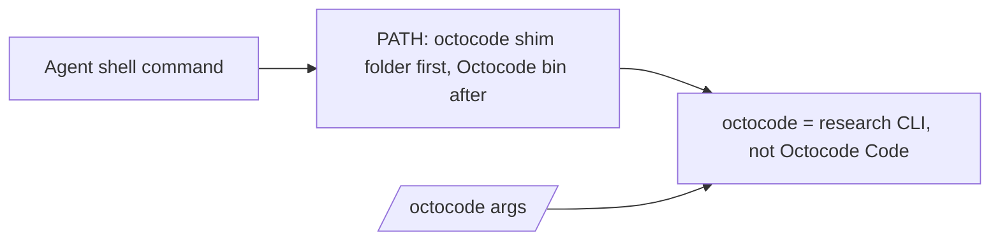

In agent shells `octocode` is that CLI whatever your `PATH` holds, shadowing Octocode Code's own command there (`octocode --version` shows which runs). A small script named `octocode` (`octocode.cmd` on Windows) runs the CLI with this process's Node from a folder under the agent directory (`octocode-cli/<hash>/`) that holds nothing else; sessions with the same runtime share it and files are replaced atomically only when they change. Every shell command (`bash`, background jobs, `!`) and every subagent gets that folder first on `PATH`, then Octocode's `bin` (`fd`, `rg`). Agents learn only that the CLI is there (the `bash` host line lists `octocode`); the CLI documents itself with `octocode --help`.

| Topic                             | Behavior                                                                                                                                                                                                                                                                                     |
| --------------------------------- | -------------------------------------------------------------------------------------------------------------------------------------------------------------------------------------------------------------------------------------------------------------------------------------------- |
| `/octocode <args>`                | Main session only. A pure proxy: runs the CLI with the arguments exactly as typed, in the session's directory with the agent shells' environment; no aliases, refusals or per-command modes. Quoted JSON stays one argument. Completions come from the CLI's own help, read once per process |
| Not a CLI command                 | A first word that is not an option and not in `octocode --help` (and `octocode <word> --help` fails) is not meant for it: the whole line goes to the agent as a prompt. So `/octocode login` reaches the agent; the sign-in is `/octocode auth login`                                        |
| Terminal UI                       | The CLI gets the real terminal: the UI stops, stdin and stdout are inherited so prompts, colors and the GitHub device flow work, then Octocode waits for a key, resumes the UI and reports the exit status. Ctrl+C belongs to the CLI; an abort or Octocode exiting kills it                 |
| RPC, web workspace, piped session | stdin closed; the result is the first 20 KB of combined output (longer ends `[output cut at 20 KB]`); Esc, an abort or Octocode exiting stops it and the result says cancelled; a command needing input gets none and reports its own error                                                  |

## GitHub authentication in the terminal

| Command                 | Does                                                                                                        |
| ----------------------- | ----------------------------------------------------------------------------------------------------------- |
| `/octocode auth login`  | The CLI's device login                                                                                      |
| `/octocode auth status` | Verifies the active credentials                                                                             |
| `/octocode auth logout` | Removes the stored login; environment tokens and GitHub CLI credentials can still take precedence or remain |

Once per run a session with a UI checks in the background whether GitHub is signed in: it runs `octocode auth status` (with `--json` when the help lists it), 10-second limit, cancelled at session end. Only the CLI's documented answers count: exit code 4 or `authenticated: false`. Then one notice says "GitHub is not connected for code search: run /octocode auth login"; a signed-in user, a missing CLI or a failed or timed-out check sees nothing.

Provider API credentials are separate: `/providers` sets, updates and removes them (`/logout` opens the removal picker), `/model` selects the active model and `/modelsettings` manages shortcuts, the catalog and agent routing ([commands](commands.md#model-and-provider)).
