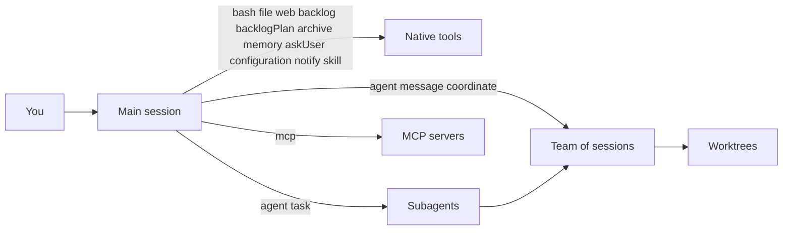

# Native Octocode features

A map of Octocode's own features. Each line links to the one page that explains it; nothing is explained twice.

The native runtime loads automatically. Octocode has no extensions: features add no CLI flags (`--extension`, `-e` and `--no-extensions` are unknown; `--plan` is built in), and a leftover `extensions` settings key is ignored with a warning. MCP is core and has no switch. Extend the agent with [plugins](plugins.md) and [hooks](hooks.md). Permission checks, reservations and your command hooks run in that order on every tool call. Child sessions have fewer capabilities than the main one; `/help` lists the commands of the current mode.

## Feature map

| Feature | You use | Explained in |
| --- | --- | --- |
| Shell, background jobs, long calls | `bash`, `/jobs` | [tools: bash](tools.md#bash) |
| Guarded file changes, checkpoints, patches | `file`, `/rewind` | [tools: file](tools.md#file) |
| Reading before editing | `file` | [tools: reading before editing](tools.md#reading-before-editing) |
| Web search and fetch | `web` | [tools: web](tools.md#web) |
| Every tool, selection, exposure, removed names | `--tools`, `/settings` | [tools](tools.md) |
| Planning mode | `/plan`, `--plan` | [tools: planning mode](tools.md#planning-mode), [permissions](permissions.md#plan-mode) |
| Questions and forms for a person | `askUser`, `render` | [tools: askUser](tools.md#askuser), [render](tools.md#render) |
| Waiting, schedules, event wakes | `notify`, `/loop` | [tools: notify](tools.md#notify) |
| Settings from the model | `configuration` | [tools: configuration](tools.md#configuration) |
| Debugging, resuming other tools' sessions | core skills | [tools: skill](tools.md#debugging-and-resuming-other-tools-sessions) |
| Subagents, profiles, model routing, chains | `agent` `task`, `/agents` | [subagents](subagents.md) |
| Parents, children, nesting | `agent` | [subagents: parents and children](subagents.md#parents-children-and-nesting) |
| Path reservations, deadlocks | `coordinate` | [subagents: path reservations](subagents.md#path-reservations) |
| Team mail, relays, callbacks, reports | `agent` `message`, `/messages` | [subagents: communication](subagents.md#communication-and-results) |
| Worktrees, realms, places, landing | `--worktree`, `/worktree`, `/realm`, `coordinate` `merge` | [subagents: worktrees](subagents.md#worktrees) |
| External agents and runners (Claude Code, Codex, Gemini, ...) | `agent` `external`, `runner` | [subagents: external runners](subagents.md#external-runners) |
| Claude Code and other CLIs as the session model | `/model` | [subagents: Claude Code as the model](subagents.md#claude-code-as-the-sessions-model) |
| Browser control | `mcp__browser__*`, `browser` profile | [browser and desktop](browser-and-desktop.md#browser) |
| Native desktop apps | `desktop` profile | [browser and desktop](browser-and-desktop.md#desktop-control) |
| Footer, panels, turn line | terminal | [monitoring: live status](monitoring.md#live-status) |
| Where a turn's time goes | `octocode profile` | [monitoring](monitoring.md#where-a-turns-time-goes) |
| Process list, orphans | `/processes` | [monitoring](monitoring.md#process-names-list-and-orphans) |
| Machine monitor, alerts | `/monitor`, `MonitorAlert` hook | [monitoring](monitoring.md#machine-monitor) |
| Backlog items, `done` check, grooming | `backlog`, `backlogPlan`, `/backlog` | [backlog and archive](backlog-and-archive.md) |
| History and profile data | `archive` | [backlog and archive: archive](backlog-and-archive.md#archive) |
| Memory | `memory`, `/memory` | [memory](memory.md) |
| Compaction, clearing old tool results | `/compact`, `compact` | [how it works](how-it-works.md#context-window-and-compaction), [clearing](how-it-works.md#clearing-old-tool-results) |
| Security review | `/security` | [configuration](permissions.md#security-review) |
| Permissions, questions to approve | `/permissions` | [permissions](permissions.md) |
| Command hooks | `/harness hooks` | [hooks](hooks.md) |
| Commands | `/help` | [commands](commands.md) |
| MCP servers | `/mcp` | [MCP](mcp.md) |
| Web workspace | `/web` | [web workspace](web-workspace.md) |
| Local session API | `/api` | [session API](session-api.md) |
| Editor control | `octocode --mode acp` | [ACP](acp.md) |
| Shell mode completion | `!` lines | [configuration: shell completion](configuration.md#shell-completion) |
| tmux forks | `/fork pane` | [tmux](tmux.md#open-a-fork-in-a-pane-or-window) |

Configuration locations and switches: [configuration](configuration.md). The native runtime supports one active session per process; permissions are application policy, not an OS sandbox.
