# Native Octocode features

Octocode's own tools, subagents, team, worktrees, live status and recovery. Commands, settings, permissions, MCP, memory, caching and the web workspace have their own pages, linked where they matter.

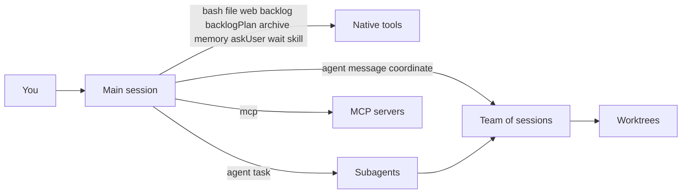

## Runtime ownership

The native runtime loads automatically. Octocode has no extensions: features add no CLI flags (`--extension`, `-e` and `--no-extensions` are unknown; `--plan` is built in), and a leftover `extensions` settings key is ignored with a warning. MCP is core and has no switch. Extend the agent with [plugins](plugins.md) and [hooks](hooks.md). Permission checks, reservations and your command hooks run in that order on every tool call. Child sessions have fewer capabilities than the main one; `/help` lists the commands of the current mode.

| Feature                                      | You use                                                  | Page                                                   |
| -------------------------------------------- | -------------------------------------------------------- | ------------------------------------------------------ |
| Guarded file changes, checkpoints            | `file`, `/rewind`                                        | [below](#file-mutation-guarantees)                     |
| Shell, background jobs                       | `bash`, `/jobs`                                          | [below](#shell)                                        |
| Debugging, profiling                         | the `octocode-debugging` core skill                      | [below](#debugging-and-resuming-other-tools-sessions)  |
| Resuming Claude Code, Codex, Cursor sessions | the `resume-external-harness` core skill                 | [below](#resuming-other-tools-sessions)                |
| Backlog items, grooming                      | the `octocode-backlog` core skill                        | [core skills](skills.md#core-skills)                   |
| Code research                                | Octocode MCP (default server), `/mcp`                    | [MCP](mcp.md)                                          |
| Subagents, external agents, profiles         | `agent` types `task`, `external`; `/agents`              | [below](#subagents)                                    |
| Team messages, reservations                  | `agent` types `message`, `coordinate`                    | [below](#communication-and-results)                    |
| Worktrees and landing                        | `--worktree`, `/worktree`, `coordinate` `merge`          | [below](#worktrees)                                    |
| Process list, orphans                        | `/processes`                                             | [below](#process-names-list-and-orphans)               |
| Monitor rules and their alerts               | `/monitor`, the `MonitorAlert` hook                      | [below](#monitor-room-and-hooks)                       |
| Web retrieval, browser                       | `web`, `mcp__browser__*`                                 | [below](#browser-and-web-access)                       |
| Questions, permissions                       | `askUser`, `/permissions`                                | [permissions](permissions.md)                          |
| Command hooks                                | `/harness hooks`                                         | [hooks](hooks.md)                                      |
| Backlog, memory, history                     | `backlog`, `backlogPlan`, `memory`, `archive`, `/memory` | [web workspace](web-workspace.md), [memory](memory.md) |
| Compaction, recovery                         | `/compact`, `compact`                                    | [below](#compaction-and-recovery)                      |
| Local session API                            | `/api`                                                   | [session API](session-api.md)                          |
| Editor control                               | `octocode --mode acp`                                    | [ACP](acp.md)                                          |

## Find and run commands

[Commands](commands.md) lists every built-in and native command, its arguments and its one name (no aliases; `/clear` and `/reset` both run `/new`). Switches (`/configuration`, `octocode configuration`, `--enable`, `--disable`, `--set`) are in [Changing configuration](configuration.md#changing-configuration). `/trust` is in [permissions](permissions.md#project-trust).

`/links`, semantic `/copy` modes, `/debug terminal` and `/diff --editor` are terminal presentation actions: they make no model request and are not agent tools or MCP tools. Both terminal display modes use them. RPC and ACP retain their own command inventories. See [terminal references and editor workflows](tui.md#references-and-copying).

### Session workflow commands

`/compact`, `/btw`, `/context`, `/diff`, `/plan`, `/resume`, `/purge` and `/optimize` are in [commands](commands.md#session). Behavior they share:

| Command        | Limits and guarantees                                                                                                                                                                                                                                                                                                                                             |
| -------------- | ----------------------------------------------------------------------------------------------------------------------------------------------------------------------------------------------------------------------------------------------------------------------------------------------------------------------------------------------------------------- |
| `/btw`         | Question of 1–8,000 characters; keeps the last 20 exchanges (trimmed to fit the model); runs while the main turn continues; text never enters history, compaction, archives or exports (only usage receipts persist); cleared on session replacement, tree navigation, reload and disposal; rejected while compaction runs; terminal only                         |
| `/context`     | No model request; sizes are estimates of the committed projection. Warns when one MCP server's instructions, or the project's context files together, take over 1% of the window; nothing is cut                                                                                                                                                                  |
| `/diff [path]` | No model request; bounded Git output with external diff, textconv and filters off; each output and each untracked file capped at 128,000 bytes with visible truncation; paths outside the repository rejected; untracked symlink content never read. `/diff --editor <before> <after>` instead passes the two explicitly selected files to the configured editor. |

Long assistant replies remain fully visible while streaming. After completion, replies longer than 120 rendered rows show their beginning and end with an expansion hint. Use the output expansion shortcut to read the middle; folding does not remove stored content, and copying the last assistant message copies its full text.

### Opening a fork in a tmux pane or window

`/fork pane [down]` and `/fork window` need Octocode inside tmux and a conversation with at least one message; otherwise they say why and start nothing. The new pane runs `octocode --fork <session file> --session-dir <dir>` in the same directory; this session keeps running. tmux starts it from its own environment, so only `OCTOCODE_CODING_AGENT_DIR`, `OCTOCODE_CODING_AGENT_SESSION_DIR` and `OCTOCODE_HOME` are copied. Plain `/fork` opens the message selector. More in [tmux](tmux.md#open-a-fork-in-a-pane-or-window).

### Native planning constraint

Planning is a constraint over `manual`, `workspace` and `full` alike ([permissions](permissions.md#plan-mode)). `/permissions plan [off]`, `/plan` and `octocode --plan` control one state; the RPC `plan` operation exposes the same controls. Model text cannot leave planning.

```mermaid
stateDiagram-v2
  [*] --> Normal
  Normal --> Planning: /plan, /permissions plan, --plan
  Planning --> Normal: /plan --off, /plan --approve rev
  note right of Planning: host stops turn, shell, jobs, children, external prompts and hooks first; a failed stop keeps the old state
```

| Planning        | Behavior                                                                                                                                                                                                                                                                                                                                |
| --------------- | --------------------------------------------------------------------------------------------------------------------------------------------------------------------------------------------------------------------------------------------------------------------------------------------------------------------------------------- |
| Allowed         | Octocode local research, `web`, `archive`, `memory` reads (`search`, `get`, `list`), `askUser`, `skill`, `mcp` `list`/`tools`/`restart` (not `stop`), foreground shell commands made only of read-only programs (`ls`, `cat`, `rg`, `git log`, `git diff`, `git status`...) that the quick scan and the bash parse both judge read-only |
| Blocked         | A heredoc, `$((…))`, `[[ ]]`, a reader given `$X` or a glob before `--`; redirects, `git branch -D`, installs, builds, test runners, interpreters, background jobs; file changes; debugger and browser operations; delegation and messages; unknown or external MCP tools even when annotated read-only                                 |
| Hooks, children | Executable compatibility hooks pause; children and external agents are stopped on entry and cannot be launched                                                                                                                                                                                                                          |
| Revisions       | Stored on the session branch; resume and tree navigation restore them; after compaction the current revision (clipped to 8,000 characters) returns as a hidden follow-up; approval checks the current revision                                                                                                                          |

This is a host execution policy, not an OS sandbox.

### Questions to a person

`askUser`, permission prompts (native, external-agent, subagent) and a subagent's relayed questions are one typed question (`text`, `choice`, `multi`, `confirm`, `approval`) that a reply answers by option id. `askUser` takes at most four questions of two to four options.

| Frontend     | Behavior                                                                                                                                                                                                                                                                                                                       |
| ------------ | ------------------------------------------------------------------------------------------------------------------------------------------------------------------------------------------------------------------------------------------------------------------------------------------------------------------------------ |
| Terminal     | tabbed ask dialog for an `askUser` batch; a permission prompt is a card                                                                                                                                                                                                                                                        |
| RPC          | with `--rpc-ask`, one `ask` request carries the batch; a permission prompt adds `header`, which a subagent's parent reads to answer prompts its own mode allows. Without the flag, questions arrive as `select`, `confirm`, `input`, and a permission `select` still carries `approval`, `permission`, `ask` for older clients |
| Web          | the session list shows approvals and questions from the `ask` event; answered with `replies`                                                                                                                                                                                                                                   |
| ACP          | elicitation form; approval is a permission request                                                                                                                                                                                                                                                                             |
| Print, no UI | refused                                                                                                                                                                                                                                                                                                                        |

A subagent always runs with `--rpc-ask`; its parent relays each question and checks the replies against what it showed.

Every `askUser` option carries a reason (why to pick it: its evidence or trade-off); the question is refused without one, and the card shows each reason under its option, the recommended one first.

An `askUser` call may set `timeout` (seconds) for a routine go-on question, such as "continue to the next backlog item?". Without it a question waits until answered, as always. With it, every question must be a choice or multi question with a `(Recommended)` option, or the call is refused. When the time runs out unanswered the recommended option (all recommended options of a multi question) is taken, and the result marks those answers `(auto: no answer in Ns)`, repeats the reason, and says a timed-out default is not approval: spending money, destructive or irreversible steps and permissions stay blocked. The card shows `auto: <option> in 18s`, and in the terminal any key, click or wheel stops the countdown for that dialog. On the web card, the first click, key or input stops it too. Permission and approval prompts never time out.

| Frontend | Countdown                                                                             |
| -------- | ------------------------------------------------------------------------------------- |
| Terminal | the card line above; interaction stops it                                             |
| Web      | the same line, counted from the card's appearance; the first interaction stops it     |
| RPC      | the question carries `timeoutSeconds`; the host dismisses the dialog when it runs out |
| ACP      | the elicitation form's description names the default and the seconds                  |

## Web workspace and memory

[Web workspace](web-workspace.md) covers `/web` (the user-level web daemon's page for every session, with the session's own server as the fallback when the daemon cannot start), the Activity view, the backlog board, the Docs view and the Profiler; [memory](memory.md) covers notes and `/memory`. People read profile data with `octocode profile`; coordinators and subagents read it with `archive`, `op: "list", source: "profile"`. The tool is read-only and works without opening the web. Add `agentId` for requests and `request` for one request's layers; follow its cursor for more results. Lifecycle events and error searches remain coordinator-only.

### Where a turn's time goes

Every agent records timings in its own transcript, so the profiler can name the slow phase instead of only the total. Recording uses timestamps only (nothing per token) and has no setting.

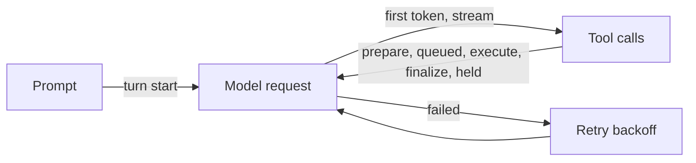

| Recorded on    | Phase       | What it covers                                                                                                                                                                                |
| -------------- | ----------- | --------------------------------------------------------------------------------------------------------------------------------------------------------------------------------------------- |
| Model response | first token | From the request until its first content arrived: connection, provider queueing and prompt processing                                                                                         |
| Model response | stream      | The rest of the response                                                                                                                                                                      |
| Model response | longest gap | The longest wait between two events of the response (transcript only). A long gap after the first token is the provider pausing mid-response, shown live as "no model event for N s"          |
| Tool result    | prepare     | Argument checks, PreToolUse hooks and the permission decision, including a wait for your answer                                                                                               |
| Tool result    | queued      | Waiting for the batch schedule: a call that changes state runs alone, so it waits for earlier calls and later calls wait for it                                                               |
| Tool result    | execute     | The tool itself (the duration shown before)                                                                                                                                                   |
| Tool result    | finalize    | PostToolUse hooks and result processing                                                                                                                                                       |
| Tool result    | held        | Until the result went back to the model; the results of one message go back together, so a fast call waits for the slowest                                                                    |
| Timeline only  | turn start  | From a prompt to its first model request (prompt hooks, context assembly, memory recall, compaction), drawn when it takes 250 ms or more                                                      |
| Timeline only  | retry       | From a failed request to the retry that followed it                                                                                                                                           |
| Session entry  | stall       | A window in which the agent's event loop was blocked for 200 ms or more, named after the request, tool call, turn end or compaction that closed it; a compaction after the run is watched too |
| Compaction     | summary     | How long writing the checkpoint held the turn, drawn as a span ending at the compaction, labeled with how it was written and whether an early summary was used                                |

A tool call started early (while the model was still streaming) is marked so; its preparation did not delay the batch. `octocode profile --timeline` lists the phases beside each event, `--trace` exports them on a `phases` thread of each agent, and the web Profiler shows them in an event's details. `--insights` adds these checks:

| Check               | Reported when                                                                                                                          |
| ------------------- | -------------------------------------------------------------------------------------------------------------------------------------- |
| `slow-phase`        | A tool call spent 5 s or more outside its execution in one phase; your permission wait is left out, since `permission-wait` reports it |
| `slow-first-token`  | A model took 30 s or more to send its first token                                                                                      |
| `slow-turn-start`   | A prompt took 10 s or more to reach its first model request                                                                            |
| `retry-wait`        | An agent spent 10 s or more in total between failed requests and their retries                                                         |
| `main-thread-stall` | The event loop was blocked 200 ms or more; 1 s or more is medium                                                                       |

## Tool selection and migration

Each tool below is active unless the Default column says otherwise. `defaultTools` and `--tools` replace or modify the selection; `/configuration enable|disable tool:<name>` or per-run `--enable`/`--disable` switch one ([configuration](configuration.md#changing-configuration)). Role profiles, plan mode and permissions can narrow it further. There is no `/tools` command.

| Tool          | Default                                                                          | Notes                                                                                                                                                                                                                                                                                                                                                                                                                                                                                                                                                                                                                                                                                                                                                                                                                          |
| ------------- | -------------------------------------------------------------------------------- | ------------------------------------------------------------------------------------------------------------------------------------------------------------------------------------------------------------------------------------------------------------------------------------------------------------------------------------------------------------------------------------------------------------------------------------------------------------------------------------------------------------------------------------------------------------------------------------------------------------------------------------------------------------------------------------------------------------------------------------------------------------------------------------------------------------------------------ |
| `bash`        | Active                                                                           | Shell and jobs; [Shell](#shell)                                                                                                                                                                                                                                                                                                                                                                                                                                                                                                                                                                                                                                                                                                                                                                                                |
| `file`        | Active                                                                           | Guarded edits; [File mutation guarantees](#file-mutation-guarantees)                                                                                                                                                                                                                                                                                                                                                                                                                                                                                                                                                                                                                                                                                                                                                           |
| `web`         | Active                                                                           | Public search and fetch, with answers cached for up to 15 minutes (a page honors `Cache-Control` and revalidates with `ETag`/`Last-Modified`); [Browser and web access](#browser-and-web-access)                                                                                                                                                                                                                                                                                                                                                                                                                                                                                                                                                                                                                               |
| `backlog`     | Active; a subagent has it only when its task names an item (`agent` task `item`) | Works one item: `get`, `claim`, `note`, `done`, `close`. `done` is refused, with what to release named, while this session still runs children for the item or items derived from it, runs bash jobs or timers started for it, reserves its paths or keeps worktrees made for it (`close` as obsolete, duplicate or wont_do is not blocked; [the check](hook-events.md#the-built-in-done-check)). Turning it off also drops the delegation rules that plan on items and the start-up digest                                                                                                                                                                                                                                                                                                                                    |
| `backlogPlan` | Active in the main session; a subagent does not declare it                       | Plans and triages items: `add` and `edit` take `items`, one typed entry per item; `list` filters by fields of its own (`underEpic`, `anyTag`, `touchingPaths`). `list` and `get` change nothing. Claims follow the session: when a main session ends (quit, `/new`, resume or fork; not a reload) it returns its own ongoing items to todo, except those a subagent works on, with a note naming it, and resuming that session restores each item nobody touched since. A session that was killed leaves its claims; the next fresh main session's start-up digest returns to todo, with a note naming the holder, each such item that no subagent works on and that sat untouched for over 24 hours. A claim whose holder ended stays marked `stale: holder ended` until then. Turning it off drops the same delegation rules |
| `archive`     | Active                                                                           | Session history, compaction summaries, lifecycle events and profile data; [memory](memory.md#the-archive-tool)                                                                                                                                                                                                                                                                                                                                                                                                                                                                                                                                                                                                                                                                                                                 |
| `memory`      | Active; read-only in subagents                                                   | Saved notes: search, get, list, set, delete; [memory](memory.md#the-memory-tool)                                                                                                                                                                                                                                                                                                                                                                                                                                                                                                                                                                                                                                                                                                                                               |
| `compact`     | Active in the main session; none for subagents                                   | [Compaction](#compaction-and-recovery)                                                                                                                                                                                                                                                                                                                                                                                                                                                                                                                                                                                                                                                                                                                                                                                         |
| `askUser`     | Active                                                                           | [Questions](#questions-to-a-person)                                                                                                                                                                                                                                                                                                                                                                                                                                                                                                                                                                                                                                                                                                                                                                                            |
| `agent`       | Active                                                                           | [Agent operations](#agent-operations)                                                                                                                                                                                                                                                                                                                                                                                                                                                                                                                                                                                                                                                                                                                                                                                          |
| `wait`        | Active; also in subagents except lean ones; kept while `agent` is active         | [Wait](#wait)                                                                                                                                                                                                                                                                                                                                                                                                                                                                                                                                                                                                                                                                                                                                                                                                                  |
| `models`      | Active in the main session; none for subagents                                   | Inspection, not an `agent` type: the session model and every connected model, one compact line each with price, context, abilities, thinking levels, known knowledge cutoff and credential mark. A filter or `routes: true` adds subagent purposes and profiles; `check: true` tries model listing, then small model requests if needed (may cost)                                                                                                                                                                                                                                                                                                                                                                                                                                                                             |
| `skill`       | Active; hidden when no skill is invocable                                        | [skills](skills.md)                                                                                                                                                                                                                                                                                                                                                                                                                                                                                                                                                                                                                                                                                                                                                                                                            |
| `mcp`         | Active when the built-in MCP host registers it                                   | [MCP](mcp.md#let-the-model-manage-servers)                                                                                                                                                                                                                                                                                                                                                                                                                                                                                                                                                                                                                                                                                                                                                                                     |

Tool descriptions own each tool's arguments. Rules that span tools:

| Rule                | Behavior                                                                                                                                                                                                                                                                                                                                                                                                                                                                                                                                                                                                                          |
| ------------------- | --------------------------------------------------------------------------------------------------------------------------------------------------------------------------------------------------------------------------------------------------------------------------------------------------------------------------------------------------------------------------------------------------------------------------------------------------------------------------------------------------------------------------------------------------------------------------------------------------------------------------------- |
| Companion           | While `agent` is active, `wait` is registered and active whatever `--tools`, `--disable tool:wait` or `defaultTools` say, because delegation waits with it instead of polling. Only `--exclude-tools wait` or a tool policy removes it; to run without `wait`, leave out `agent` too. A lean child has no `wait`. Only native and base tools get companions                                                                                                                                                                                                                                                                       |
| Operator exclusions | `--exclude-tools` and `--no-mcp` also bind every subagent of the run, over what a profile may not remove: a child of `--exclude-tools file` has no `file`. `--tools` stays the session's own allowlist; a child's selection comes from its profile                                                                                                                                                                                                                                                                                                                                                                                |
| `reason`            | Every native tool and the built-in `mcp` tool declares a required `reason` first, but a call never fails for a missing one: it is filled from a nested `reason`, else from the call's arguments (`file src/a.ts`), else the tool name, and marked derived so permission cards never show it empty. Octocode never adds or removes `reason` on an MCP tool's input                                                                                                                                                                                                                                                                 |
| Repeated calls      | The same tool, arguments and result (an error counts by call alone) in a row: a note on the 3rd, a stronger note asking the model to report it is blocked on the 5th and every 3rd after, and on the 8th the next identical call is refused and the run ends (a notice, a subagent's last error, or stderr and exit 1 when headless; `/permissions log` records the refusal). `reason` text is ignored; blocked, invalid and unknown calls count; a different call or new prompt resets. Exempt: `agent`, `askUser`, `backlog`, `backlogPlan`, `coordinate`, nested calls, waiting commands (`sleep`, `wait`, `watch`, `tail -f`) |
| Result budget       | One assistant message's tool results share a text budget; see [compaction](#compaction-and-recovery)                                                                                                                                                                                                                                                                                                                                                                                                                                                                                                                              |

### Wait

`wait` (`op` `set`, `on`, `off`, `list`) wakes the session that set it with its note. Time waits use `set`; waits for something outside the session use `on`, named after DOM `addEventListener` and `removeEventListener`.

| Call                    | Fires                                                                                                                                                |
| ----------------------- | ---------------------------------------------------------------------------------------------------------------------------------------------------- |
| `set` `after`           | once after N seconds                                                                                                                                 |
| `set` `every`           | every N seconds (at least 30), up to `maxRuns` (default 20) or a `deadline`                                                                          |
| `set` `cron` (+ `tz`)   | on a calendar schedule of five cron fields (see [Scheduled tasks](#scheduled-tasks)), up to `maxRuns` (default 20) or a `deadline` (default 7 days)  |
| `on` `event` + `filter` | once when the event happens; stops at its deadline (default an hour) and says so                                                                     |
| `on` ... `once: false`  | each time the event turns true again, up to `maxRuns` wakes (default 20) or the deadline; a condition that stays true wakes once                     |
| `off`                   | `id` from `set` or `on` stops that wait; `all: true` stops every one                                                                                 |
| `list`                  | the active waits (`all: true` adds ended ones), then what wakes you without a wait: running children (their report) and background jobs (their exit) |

### Scheduled tasks

`set` with `cron` repeats the note on a wall-clock schedule: `0 9 * * 1-5` is weekdays at 09:00 in the session's local time, or in `tz` (an IANA name such as `Europe/Paris`). It is the same wait as any other: it counts toward the ten active waits, shows in the footer count and the agents panel (`cron 0 9 * * 1-5 · run 1 of 20`), and `off` and `list` handle it. `/loop <interval> <prompt>` (for example `/loop 10m run the tests`) sets one from the command line and `/cron` lists the session's scheduled tasks or deletes one (`/cron delete <id>`).

| Rule          | Detail                                                                                                                                                                                 |
| ------------- | -------------------------------------------------------------------------------------------------------------------------------------------------------------------------------------- |
| Fields        | Minute, hour, day of month, month, day of week, with numbers, `*`, `,`, `-` and `/` only; no names, no seconds, no `L`, `W` or `?`. Day of month and day of week both set means either |
| Closest runs  | Two runs are at least 5 minutes apart; a faster schedule is refused (use `every` for a short fixed interval)                                                                           |
| Clock changes | A time the clock skips runs once just after the gap; a repeated time runs once                                                                                                         |
| Jitter        | Each job runs late by a fixed amount, up to half its period and at most 30 minutes, so many sessions do not fire together; none at a 5-minute period                                   |
| Delivery      | The note arrives as a prompt after the session is idle, never in the middle of a turn. A run still queued when the next one is due is not queued twice                                 |
| Expiry        | A schedule ends after `maxRuns` (default 20) or its `deadline` (default 7 days, at most 30); the last run says it is the last                                                          |
| Missed runs   | Waits belong to one session and end with it. When the session resumes, a run missed while it was away fires once, unless it is more than one period late: then it is skipped           |
| Subagents     | A subagent cannot set a cron wait                                                                                                                                                      |

Unattended runs spend money, so setting one is guarded. A session with a screen asks once, naming the schedule and its limits; a session without one (print, JSON, RPC) refuses unless the global `timer.cron.enabled` is `true`. The global `timer.cron.maxUsdPerSession` (default `2`) caps what the session may spend, in US dollars, since its first scheduled task was set: past it, the next due run does not happen and the task ends `failed`. Project settings cannot change either.

The events `on` accepts are a closed list. Any other name is refused with the choices, and an event that already wakes the session (a child's report, a job's exit, mail) is refused as unnecessary.

| `event`         | `filter`                                                                                                                                                                                                                  | Holds when                                                                                                                                                                                                           |
| --------------- | ------------------------------------------------------------------------------------------------------------------------------------------------------------------------------------------------------------------------- | -------------------------------------------------------------------------------------------------------------------------------------------------------------------------------------------------------------------- |
| `item.state`    | `ref` (several comma-joined: any), `state`                                                                                                                                                                                | the backlog item is `todo`, `ongoing`, `done`, `closed` or `ready` (`dependsOn` all done)                                                                                                                            |
| `item.changed`  | `ref` (comma-joined), `epic` or `path`; optional `change` (comma-joined: `created`, `claimed`, `released`, `reassigned`, `done`, `closed`, `reopened`, `paths_changed`, `blocked`, `unblocked`, `note`, `step`, `edited`) | another writer changed a matching item since the wait started; the wake names each change (a change this session wrote never counts)                                                                                 |
| `peer.landed`   | `ref`; optional `path`, `agent`                                                                                                                                                                                           | the peer's item is `done` or `closed`, was released, its reservation on `path` was released (`path` must be reserved when the wait starts), or the peer (`agent`, else the item's holder) ended; the wake says which |
| `path.unlocked` | `path`                                                                                                                                                                                                                    | no other agent's reservation covers the path                                                                                                                                                                         |
| `agent.ended`   | `agent`                                                                                                                                                                                                                   | the named agent ended                                                                                                                                                                                                |
| `check.result`  | `command`                                                                                                                                                                                                                 | the shell command exits 0                                                                                                                                                                                            |

A file or a port is a `command`: `test -e path` waits for a file, `nc -z localhost 3000` for a listening port. `check` (beside any event) adds a question a small model judges once the event holds.

The event catalog also names what wakes a session without asking (`agent.report`, `agent.message`, `job.exit`, `item.ready`, `monitor.alert`, `hook.feedback`, `wake.retry`, `peer.notice`), each with its payload, dedupe key and one-line row label.

| Behavior    | Detail                                                                                                                                                                                                                                                                                                                                                                                                                                                           |
| ----------- | ---------------------------------------------------------------------------------------------------------------------------------------------------------------------------------------------------------------------------------------------------------------------------------------------------------------------------------------------------------------------------------------------------------------------------------------------------------------- |
| Persistence | Waits belong to one session and survive restart and resume; a missed wake comes once; two processes never fire one twice; at most 10 active per session; `off` takes the id `set` or `on` returned (`all: true` stops all); erasing a session removes its waits                                                                                                                                                                                                  |
| Wake        | A follow-up message that starts a turn; the footer counts active waits; a headless run waits for the next wake before it ends                                                                                                                                                                                                                                                                                                                                    |
| Polling     | Events poke a check; a safety-net poll (30 s; 60 s for `item.state`, `item.changed`, `peer.landed` and `agent.ended`; 15 s for `check.result`; or `every` with a 5 s minimum on `on`) catches misses; a check that finds nothing writes nothing                                                                                                                                                                                                                  |
| `check`     | A question beside one event: after the event holds and its evidence (up to 6,000 characters) changed, at least 30 s after the last call, the `small`-route model returns `met`, `not_met` or `unsure`; only `met` wakes. Caps: $0.01 per judgment, 5 judgments or $0.05 per wait, $0.25 per session; hitting one ends the wait `failed` with `check budget`. Off until `timer.check.enabled` (global settings only) is `true` or you answer a first-use question |
| Permissions | A `check.result` command is gated as the `bash` call it is when set, and against plan mode and read-only roles each time it runs                                                                                                                                                                                                                                                                                                                                 |

Stopping or switching sessions cancels running checks and removes their watchers; persisted waits remain available when that session resumes. Turning a wait off also cancels its running check. Late results cannot wake a stopped session. Command checks keep a bounded output tail while running: the last 2,000 characters, with a marker when earlier output was omitted.

### The `done` check and the state-change line

The `backlog` tool's `done` runs Octocode's own check first, in the process that writes, then the [`TaskCompleted`](hook-events.md) hooks. It refuses `done`, and names what to release, while this session still has any of these for the item:

| Held                                                                                                                    | Release it by                                                |
| ----------------------------------------------------------------------------------------------------------------------- | ------------------------------------------------------------ |
| A running child started on the item, or on an item derived from it (a sub-item, or one that came from it, at any depth) | waiting for its report, or `coordinate` action `stop`        |
| A background bash job started for the item (`item` on the call)                                                         | letting it end, or stopping it                               |
| A timer whose note names the item (a wait on the item's own state is not counted: the item ending wakes it)             | `wait` op `off`                                              |
| A reservation covering the item's paths                                                                                 | `coordinate` action `unlock`                                 |
| An isolated worktree made for the item                                                                                  | `coordinate` action `merge`, or the user's `/agents discard` |

`close` as `obsolete`, `duplicate` or `wont_do` is never blocked: it ends an item whose work is dropped. Each process checks only its own resources: a child marking its own item done is not held by its parent's children, jobs or reservations, and the paths its parent reserved for it do not count (the parent releases them when the run ends). Changes from the web board, `/backlog` or another process are not checked.

Every state change (claim, release, done, close, reopen, a state edit), from the tool, the web board or `/backlog`, adds one dim line to the transcript and the web activity, such as `Backlog B12 done · Fix search · web board` (the writer is named when it was not this session). The line is a display-only session entry: it never reaches the model's context and starts no turn. New items, notes, steps and path edits add none.

### MCP and native tools

Native tools are not MCP servers: ACP client MCP configuration exposes server tools to the session, not native tools to remote callers. Octocode MCP is the default server; [MCP](mcp.md) shows how to enable or disable it and the other servers, [MCP reference](mcp-reference.md) covers exposure, presentation (`mcpPresentation`) and assignment. By default (`mcpExposure: "usage"`) an MCP tool, `web`, `archive`, `models`, `backlogPlan`, `memory` and `wait` are deferred unless sessions often use them (the promotion snapshot): the model gets the tool's whole description and its field names (an MCP tool also those of its objects and lists), the full schema arrives when the tool is used (a rejected call returns it, the `mcp` tool reads a deferred tool's text, with `server: "native"` for a native tool, and supporting models get the full declaration added after the first call or read), and a tool whose use drops below the promotion rate is deferred again. Where the model can add a tool after the cached prompt (Anthropic and OpenAI models that support it), the bundled server's GitHub, package-registry and security tools and the native `web`, `archive` and `models` are on demand instead: the prompt lists each by name and trigger, and its first call or a read with the `mcp` tool declares it from the next request on, without touching the cached prompt; elsewhere they stay deferred. Where the model cannot change tools mid-conversation, a server that connects after the first request, or a tool the model turns on then, is callable at once and declared at the next compaction, so its arrival does not rewrite the cached prompt. Every other native tool is always declared in full. Server descriptions, schemas and instructions are never rewritten. See and pin each tool's state on the Tools panel of the web Settings page (a session's page shows what that session declared), on the terminal's `/mcp` → server → **Tools** page, or in configuration ([tool exposure](configuration.md#tool-exposure), [exposure](mcp-reference.md#exposure-and-results)). The `mcp` tool lets the model, and each subagent for its own session, list, restart, stop or add servers. MCP arguments are validated as sent and reach the server unchanged; ones the schema does not allow fail locally without a call.

### Removed tools

These names are not registered; drop them from `--tools`, `defaultTools` and hook matchers:

| Removed                                      | Use instead                                                                               |
| -------------------------------------------- | ----------------------------------------------------------------------------------------- |
| `read`, `ls`, `find`, `grep`                 | Octocode MCP local tools, or `bash` when the server is off                                |
| `edit`, `write`                              | `file`                                                                                    |
| `powershell`                                 | `bash` with `type: "powershell"`                                                          |
| `externalAgent`, `coordinate`, `sendMessage` | `agent` types `external`, `coordinate`, `message`                                         |
| `agentModels`                                | `models`                                                                                  |
| `debug`                                      | the `octocode-debugging` skill                                                            |
| `browser`                                    | the browser MCP server ([below](#browser-and-web-access))                                 |
| `ollama`                                     | an Ollama endpoint in `models.json` ([models](models.md#configure-a-compatible-endpoint)) |

Old sessions and exports still show calls of removed names. Sessions started without native features have `bash` as their only built-in tool.

### Reading before editing

`file` refuses to overwrite an existing file the model has not read completely, and a file changed since its read must be read again.

Follow a reader's returned continuation to collect the remaining pages. Pages count toward the same complete read while the file stays unchanged. A changed file or expired continuation needs a fresh read.

| Read                                               | Counts as a complete read                                                                                                                                                                                                                                                                                              |
| -------------------------------------------------- | ---------------------------------------------------------------------------------------------------------------------------------------------------------------------------------------------------------------------------------------------------------------------------------------------------------------------- |
| Octocode MCP local source read                     | A successful, untransformed, numbered read (separate line windows included) while the file stays unchanged during retrieval. Filtered, minified, byte-window, failed or truncated results do not count; fetch the original ranges first                                                                                |
| `bash` (when the Octocode server is off or failed) | Exactly one literal command that prints the file: `cat FILE...`, `head [-n N] FILE`, `tail -n +N FILE`, `sed -n 'A,Bp' FILE`. A pipe, redirect, list, substitution, glob, variable, background job or failed call counts for nothing; a cut result is a partial read (an edit may follow, a full write needs the rest) |

A complete read appends the whole-source SHA-256; an edit may anchor on a line with `edits: [{ line, sourceSha256, oldText, newText }]`, and stale or partial identity is refused. After an edit or write of a completely read file, the result line ends with the new `sourceSha256`, so the next anchored edit needs no new read. The digest from the read also stays valid across the agent's own later edits: the line moves with lines added or removed above it, and a line those edits replaced, or any change made outside the agent, needs a new read. The guard remembers reads for the live session only: read again after resume or compaction. Relative and absolute paths count alike. Image decoding is not part of source reads; attach the image or use an image-capable MCP tool.

### Debugging and resuming other tools' sessions

Stopped-state inspection and profiling are a skill, not a tool: the `octocode-debugging` core skill teaches batch lldb, gdb and pdb runs, a Node inspector script and profile summaries through `bash`, under the shell permission gate. Ask: "debug why this crashes with lldb".

#### Resuming other tools' sessions

The `resume-external-harness` core skill finds sessions Claude Code (`~/.claude/projects/`), Codex (`~/.codex/sessions/`) and Cursor (`~/.cursor/` and its app data) recorded for the repository, its folders and git worktrees. It lists them with last activity, run length and location, prints one as a digest (compaction summary, files edited, last turns, native resume command) and reports each worktree's changes, unmerged commits, sessions and a suggested prune, repair or remove command. It only reads (Cursor's SQLite files open immutable) and runs no git command that changes anything. Ask: "continue my last Codex session for this repo".

### Shell

`bash({ type, command })` runs Bash (default) or PowerShell (Windows), foreground or as a background job.

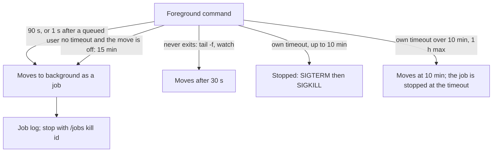

| Setting                                                                 | Detail                                                                                                                                                                            |
| ----------------------------------------------------------------------- | --------------------------------------------------------------------------------------------------------------------------------------------------------------------------------- |
| `bashBackgroundAfterSeconds` / `OCTOCODE_BASH_BACKGROUND_AFTER_SECONDS` | The 90-second move; `0` turns it off                                                                                                                                              |
| Queued user message                                                     | Moves a running foreground command after its first second so the agent can answer; hidden notices and quiet team mail (`wake: false`, broadcasts, replies) wait for the next step |
| `sleep` start, user abort                                               | Stopped, not moved                                                                                                                                                                |
| Headless run                                                            | Stops its jobs when the run ends                                                                                                                                                  |
| Bash command prefix setting                                             | Applies only to Bash                                                                                                                                                              |
| Result                                                                  | Starts with a header `[exit 0 · 4.2s · 312 lines · 18 KB]`; a non-zero exit is still an error result; `!<command>` (or RPC `bash`) gives the model the same result                |
| `verify: true`                                                          | Records a verification receipt tied to the current edits; a later edit makes it stale; a zero exit proves only that the command succeeded                                         |

The tool description ends with a ten-line CLI guide. Its first line names the host: OS and architecture, which of `git`, `rg`, `fd`, `jq`, `ast-grep`, `yq`, `gh`, `python3`, `lsof` are on the shell's PATH (Octocode's own `bin` included) and whether `gh` is logged in (read from `GH_TOKEN`, `GITHUB_TOKEN` or gh's `hosts.yml`, never over the network); the second gives platform flag notes. The probe only stats files and runs when the tool registers, so the description stays stable for the session and its prompt cache.

### Shell mode completion

In the terminal, a line starting with `!` is completed like a shell prompt. Tab asks your own shell (zsh, bash, fish or PowerShell, started once per session in a trusted folder) and shows its matches with descriptions; with no shell answer it offers program names, git branches and paths. Ghost text suggests the rest of the command from the agent's last reply, then your `!` history, then, after a pause, one call to the cheapest connected model. Right or End accepts it. Settings, trust and costs: [shell completion](configuration.md#shell-completion).

| Source              | Runs when                                                                       | What it completes                                                          |
| ------------------- | ------------------------------------------------------------------------------- | -------------------------------------------------------------------------- |
| Your shell          | Tab, trusted folder                                                             | Everything your shell completes, including plugins from your startup files |
| PATH                | Tab on the command name                                                         | Programs on `PATH`                                                         |
| git refs            | Tab after `git checkout`, `switch`, `merge`, `rebase` and other branch commands | Local branches, read from `.git` without running git                       |
| carapace            | Tab, trusted folder, `carapace` on `PATH`, nothing else matched                 | carapace's completers                                                      |
| Last reply, history | Typing                                                                          | Ghost text; nothing is sent anywhere                                       |
| Small model         | Typing paused and nothing else matched                                          | Ghost text; one small call per prefix, recorded in usage                   |

### Agent operations

`agent({ type, ...fields, reason })` takes flat fields. A call with another type's field, or the old `input` envelope, is refused before dispatch (recorded old sessions still render). Only `paths` is shared (by `task` and `coordinate`).

| Type         | Does                                                                                                                                                                                                                                                                                                                                                                                                                     |
| ------------ | ------------------------------------------------------------------------------------------------------------------------------------------------------------------------------------------------------------------------------------------------------------------------------------------------------------------------------------------------------------------------------------------------------------------------ |
| `task`       | Launch a native child: `goal`, `task`, `skills`, `paths`, profile, model, `headless`, `background`, `isolate`, `resume`, `mcp`, `tasks`, `resultSchema`, `hooks` (`off`, `decisions`, `all`: [your hooks in the child](hooks.md#hooks-in-subagents)), `cache` (`short`, `long`: [its history cache tier](prompt-caching.md#subagent-cache-tier)); `runner` while a [runner](#external-runners) is installed and runnable |
| `external`   | `externalAction` `list`, `connect`, `prompt`, `cancel`, `disconnect` to reach ACP or other Octocode hosts; present only when the global `externalAgents` setting is `true` (opt-in) and a selected ACP agent is on `PATH` or another Octocode runs                                                                                                                                                                       |
| `coordinate` | `action` `list`, `join`, `leave`, `lock`, `unlock`, `stop`, `merge`, `grant`, `changes`: membership, reservations, isolated results, [worktree landing](#finishing-a-worktree), a child's [request budget](#subagent-request-budget)                                                                                                                                                                                     |
| `message`    | Reach a teammate, another Octocode process or the coordinator: [who to address](#communication-and-results)                                                                                                                                                                                                                                                                                                              |

Child sessions expose only the coordination and message modes, with their usual restrictions. While a runner is installed and runnable, a child also gets a `task` type that starts runner tasks only, in the foreground ([external runners](#external-runners)).

## Subagents

A subagent is a child Octocode session you or the main agent start for one task. Example: "have the reviewer check my diff in the background".

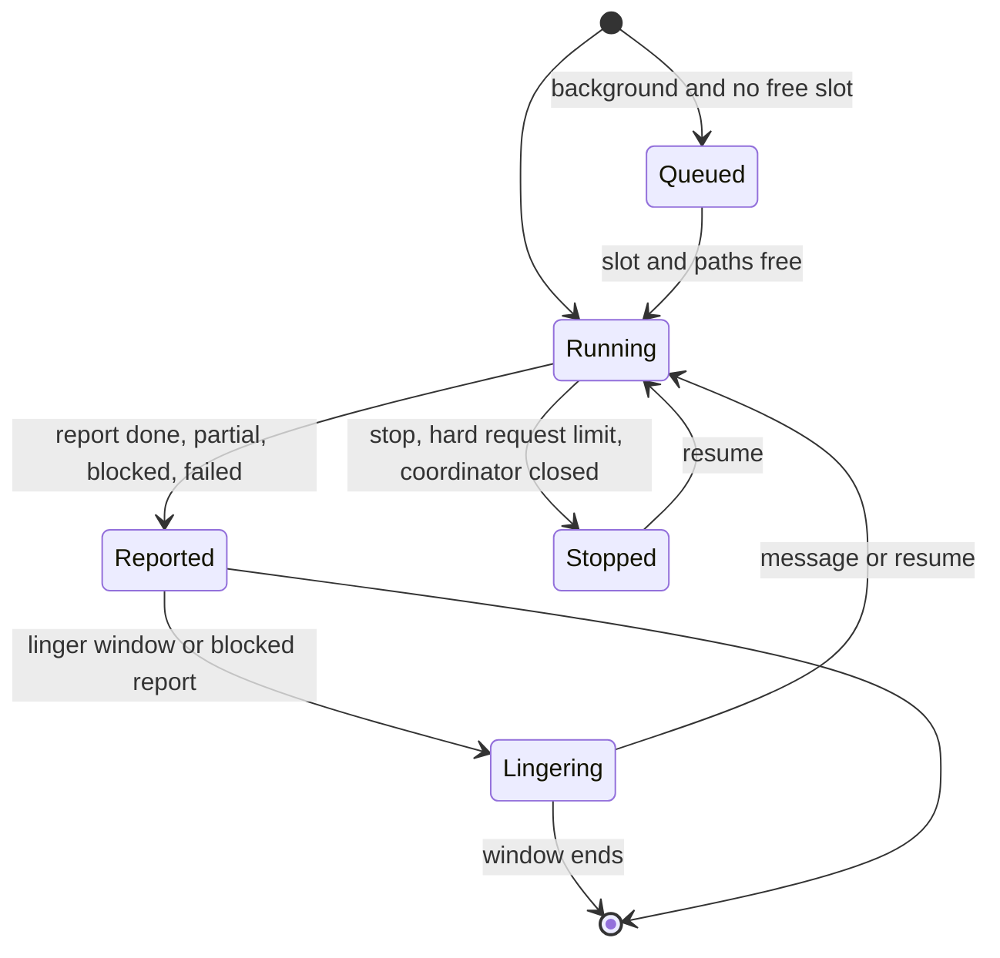

### Starting children

| Topic            | Behavior                                                                                                                                                                                                                                                                                                                                                                                                                                                                                                                                                                                                                                                                                                                                                                                                                                                                                                                  |
| ---------------- | ------------------------------------------------------------------------------------------------------------------------------------------------------------------------------------------------------------------------------------------------------------------------------------------------------------------------------------------------------------------------------------------------------------------------------------------------------------------------------------------------------------------------------------------------------------------------------------------------------------------------------------------------------------------------------------------------------------------------------------------------------------------------------------------------------------------------------------------------------------------------------------------------------------------------- |
| Skills           | A child inherits the parent's accepted skill inventory. The task's `skills` array narrows it (`[]` for none); a model-only name or a `disable-model-invocation` skill is refused, unknown or ambiguous names fail before launch (use qualified names). The child adopts captured paths and invocation policy (not file contents) and does not rediscover skills; a retargeted discovery symlink makes it refuse the inventory, and a deleted or moved skill is left out with a warning. [Skill inheritance](skills.md#child-skill-inheritance)                                                                                                                                                                                                                                                                                                                                                                            |
| MCP              | The task's `mcp` array narrows the child's servers to those it names plus those its profile and the research floor require; every tool of a named server is active unless the profile names one exact `+mcp__<server>__<tool>`. An unknown or disabled name refuses the task; `resume` or a lean profile with `mcp` is refused ([MCP reference](mcp-reference.md#assign-servers-to-agents))                                                                                                                                                                                                                                                                                                                                                                                                                                                                                                                               |
| Specialist floor | Every specialist keeps `file`, `agent`, `wait`, `archive`, `memory` and Octocode local research. Restrictive allowlists gain them by server `roles`, not tool name. Profiles that remove them or set `mcp: false` are rejected; a global MCP opt-out still applies. Researcher and reviewer use `file` only for requested reports and scratch artifacts                                                                                                                                                                                                                                                                                                                                                                                                                                                                                                                                                                   |
| Server state     | A child starts with servers its parent added with `mcp` this session (never written to `mcp.json`) and loads configured servers itself. A server the parent ended with `mcp` `stop` is hidden from the child unless its own selection names it (`tools: mcp__<server>__*`; default-active does not count). `/configuration disable mcp:<name>` is saved, so children see it. A harness switch reaches running children: before each request a child compares saved `harness:` switches with what it last saw and, on a change, reloads MCP as its parent did                                                                                                                                                                                                                                                                                                                                                              |
| Concurrency      | Slots follow the machine (at most 6; `OCTOCODE_MAX_SUBAGENTS` overrides; [environment variables](environment-variables.md)). A `background: true` task with no free slot returns its id as queued and starts first come first served; it can be stopped like a running one and has no worktree or team seat until it starts. A foreground task waits. Background children sharing profile, model and skills share a prompt prefix: all start at once, but where the model's prices make a cache read cheaper than writing the prefix, only the first sends its task; the others send theirs once its first reply starts, or as soon as that child exits or stops without one (no time limit, and a waiting sibling is never judged stalled: the first child's own watchdog bounds the wait; not at all once that prefix was warm within its cache lifetime). Models without cache prices, or with caching off, never wait |
| Batches          | `tasks` is an array of task objects started in one call; other task fields beside it are defaults an entry overrides. Each entry is validated and started on its own (own approval, slot, reservations); a failed entry leaves the others running. The result has one `#n ok\|error: <goal>` section per entry and `details.batch`                                                                                                                                                                                                                                                                                                                                                                                                                                                                                                                                                                                        |
| Limits           | `subagents.maxChildren` (children started; a resume is not new) and `subagents.maxCost` (US dollars, own and children's, running children included) refuse a new task past either, with the total; nothing running is stopped. Both off by default ([settings](settings.md)) Without a limit nothing is refused: when a finished run takes the children's recorded cost past a new whole multiple of the session's own cost, its report ends with one line saying so                                                                                                                                                                                                                                                                                                                                                                                                                                                      |
| Nesting          | A child has no `task` type. An `octocode` it starts from its shell is a top-level session; `OCTOCODE_AGENT_NESTING` counts tasks across that boundary and a session two deep refuses another                                                                                                                                                                                                                                                                                                                                                                                                                                                                                                                                                                                                                                                                                                                              |
| Permissions      | A subagent cannot ask anyone, so it runs with what its parent decided at spawn. In `full` it inherits the mode. In `manual` or `workspace` the spawn dialog names what the profile's tools reach and the permissions the profile declares; approving (once or for the session) grants those classes for the whole run, deliberately looser than the parent's mode: the dialog is the consent. Classes that always ask (destructive shell, changes outside the workspace, browser control unless declared, browser cookies) never pass down; a mode change that makes an action ask stops running children and clears grants ([permissions](permissions.md#modes))                                                                                                                                                                                                                                                         |
| Identity         | A child's commands inherit `OCTOCODE_SUBAGENT`, `OCTOCODE_AGENT_ID`, `OCTOCODE_PARENT_ID`, `OCTOCODE_AGENT_ROLE`, `OCTOCODE_TEAM_WORKSPACE` and related variables, and `OCTOCODE_PARENT_PID`. A separate Octocode started from such a command clears them and runs top-level (own team name, default prompt); `OCTOCODE_PERMISSION` is kept so it is never looser than the inherited mode; it does not keep a `readOnly` profile's guard, which is not a sandbox. [Shell tool session environment](environment-variables.md#shell-tool-session-environment) is unaffected                                                                                                                                                                                                                                                                                                                                                 |

### Chain agents

A background child can wait for other work and start by itself when that work ends well. The child is queued: it holds no slot, no path reservation and no backlog item claim until it starts, so the work it waits for is never blocked by it.

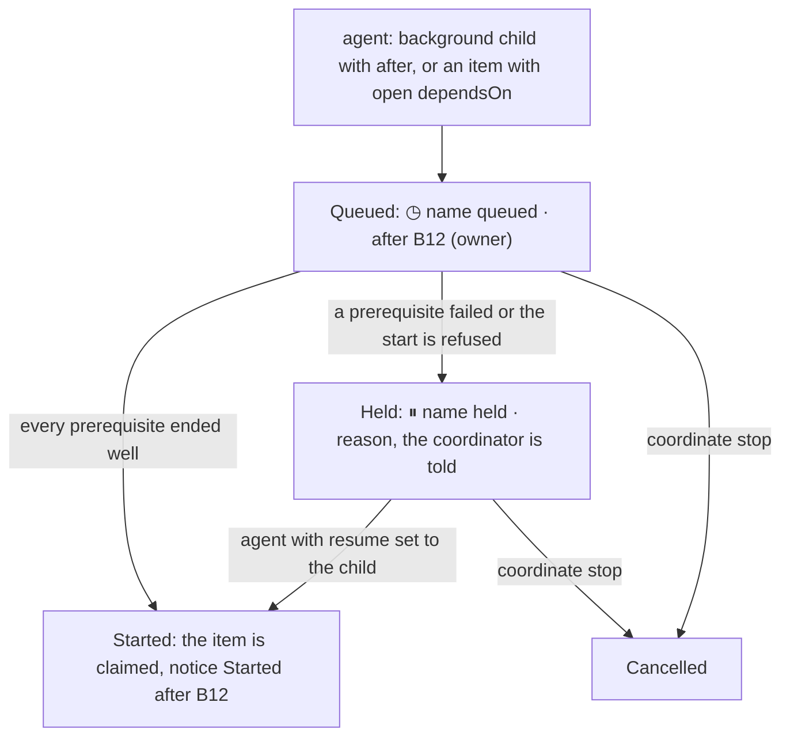

What a child waits for comes from two places, which join:

| Option                   | Where                                 | Meaning                                                                                                                                    |
| ------------------------ | ------------------------------------- | ------------------------------------------------------------------------------------------------------------------------------------------ |
| `after`                  | `agent` call, with `background: true` | Up to 8 entries: a backlog item (`B12`) waits until the item is done; `agent:<name>` waits until that child of this session reported done. |
| `dependsOn`              | The child's backlog `item`            | The item's open prerequisites count as `after` entries.                                                                                    |
| `resume`                 | `agent` call naming a held child      | Starts it now, ignoring what it waited for.                                                                                                |
| `coordinate` `stop`      | Names a queued or held child          | Cancels it.                                                                                                                                |
| `subagents.queuedStarts` | [Setting](settings.md), on by default | Off: a call that would queue is refused instead.                                                                                           |

| Where you see it                  | What it shows                                                                                                                                                      |
| --------------------------------- | ------------------------------------------------------------------------------------------------------------------------------------------------------------------ |
| The `agent` row in the transcript | "Queued · starts after B12", then "Started after B12"; a held child says why.                                                                                      |
| The agents panel                  | One row per child: `◷ name queued · after B12 (owner)` or `⏸ name held · reason`.                                                                                  |
| The footer                        | `N queued` beside the agent count while any child waits (queued and held).                                                                                         |
| `coordinate` `list`               | A "Queued children" block with what each waits for.                                                                                                                |
| The backlog board                 | The item's card shows `queued: <name>`, and its flow draws the dependency as pending, from the board's next refresh; the shared `/web` board does not show it yet. |
| Notices to the coordinator        | One when a child starts (with what it waited for) and one when it is held.                                                                                         |
| Hooks                             | `AgentQueued`, and the chain fields of `AgentOn` and `AgentOff` ([hooks](hooks.md)).                                                                               |

A started child's task receives what its prerequisites handed over: an agent's report and an item's completion summary. A child fails to queue when a prerequisite does not exist, was closed unfinished, is not this session's child, or would create a cycle; a session keeps at most 12 children waiting. The permission policy is checked again when the child starts: a refusal holds it. Without `after` and without an open `dependsOn`, nothing changes.

### Path reservations

A task's `paths` (files, or `dir/` for a tree) are reserved for the child from before it starts until its run ends, so the parent needs no `coordinate` lock. All are reserved or none, under the child's id with its goal as the reason, and they block other agents and the parent like any reservation.

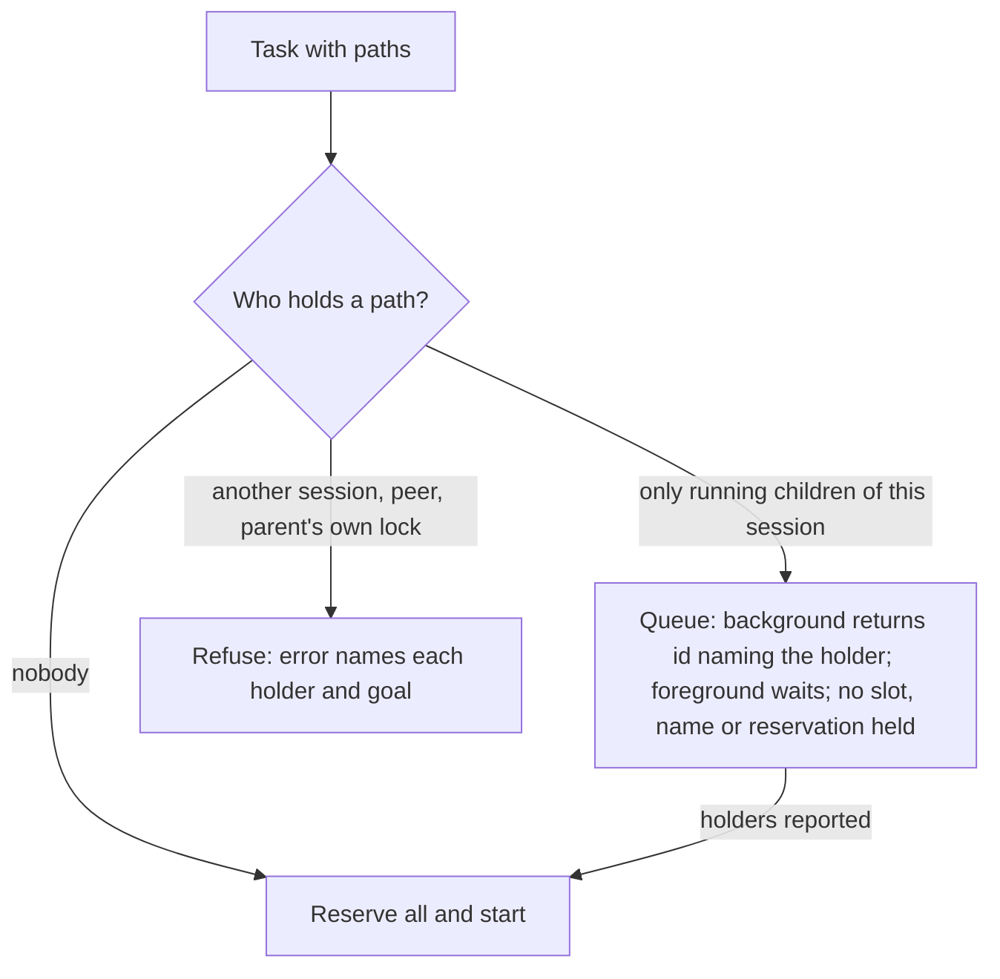

| Case                                          | Behavior                                                                                                                                                                                          |
| --------------------------------------------- | ------------------------------------------------------------------------------------------------------------------------------------------------------------------------------------------------- |
| Repeated path, path inside another named tree | Folded, not refused                                                                                                                                                                               |
| Before the child joins                        | The parent holds its team row, so siblings started together cannot overlap; a dying parent takes the reservations with it                                                                         |
| End                                           | With the run however it ended; a child still closing at `/new` or `/resume` keeps them until its run ends                                                                                         |
| Lingering child                               | Holds nothing while no process runs; a follow-up takes them again; if another agent took a path meanwhile it still runs, the resume receipt names the holder and the file guard refuses that edit |
| `isolate` or read-only profile                | `paths` does nothing (the result says so); `/agents merge` checks reservations at landing                                                                                                         |
| Team database unwritable                      | The child starts without them and says why                                                                                                                                                        |

### Reports and structured results

| Topic           | Behavior                                                                                                                                                                                                                                                                                                                                                                                                                                                                                                                                                                                                                                                                                                                                                                                                                                                                                                                                                                                                                                                                                                                                                                                                                                                                                                                                                                                                                                                                                                                   |
| --------------- | -------------------------------------------------------------------------------------------------------------------------------------------------------------------------------------------------------------------------------------------------------------------------------------------------------------------------------------------------------------------------------------------------------------------------------------------------------------------------------------------------------------------------------------------------------------------------------------------------------------------------------------------------------------------------------------------------------------------------------------------------------------------------------------------------------------------------------------------------------------------------------------------------------------------------------------------------------------------------------------------------------------------------------------------------------------------------------------------------------------------------------------------------------------------------------------------------------------------------------------------------------------------------------------------------------------------------------------------------------------------------------------------------------------------------------------------------------------------------------------------------------------------------- |
| Outcome         | The first word: `done`, `partial`, `blocked`, `failed`, optionally after one `Report:`, `Status:` or `Outcome:` label. Any other opening names no outcome, and so does a prose first word (`Done with the audit, but blocked by X`) when its line names another outcome word: an Octocode child is then asked once, in one more request, for the word that fits its report, and an answer that names none either is recorded as `partial`. The answer adds nothing to the report. A connected runner's single turn is not asked, so its outcome can stay unknown, which is not a failure. The latest completed report decides the displayed outcome; a failed follow-up is a failure that keeps earlier results as partial evidence                                                                                                                                                                                                                                                                                                                                                                                                                                                                                                                                                                                                                                                                                                                                                                                        |
| Fences          | Foreground and background report bodies carry untrusted-content fences in model context; the terminal removes the wrapper                                                                                                                                                                                                                                                                                                                                                                                                                                                                                                                                                                                                                                                                                                                                                                                                                                                                                                                                                                                                                                                                                                                                                                                                                                                                                                                                                                                                  |
| `resultSchema`  | A bounded JSON Schema object (`type`, `properties`, `required`, boolean `additionalProperties`, `items`, `enum`, `const`, `description`, numeric and length bounds); remote references, patterns, custom keywords and executable definitions are rejected before the child is claimed. The child ends its report with `Structured result:` and one fenced `json` block; the host validates the complete final answer. `details.structured` carries version 1, the schema SHA-256, `valid`/`invalid`/`unavailable` and data only when valid. A schema-enabled foreground task succeeds only on `done` plus `valid`; a background launch returns at once and its report carries the verdict. Cancellation and failed final replies leave it unavailable                                                                                                                                                                                                                                                                                                                                                                                                                                                                                                                                                                                                                                                                                                                                                                      |
| Delivery        | Children started in one step (one reply's calls, a `tasks` array included) report together only when they finish together: a finished child's report goes at once, unless a sibling of its step already finished and is still assembling its report (its process exiting, its worktree being finished); then it waits for that report, unless that sibling stalls or its run is over, and both arrive as one wake. A sibling that is still working never holds a report; a retried delivery waits under the same rule. Each report is judged by its own step: a report that need not wait goes without the held reports of another step. Reports that arrive while the parent works are read together in one request after its turn. Reports keep recovery copies until the transcript records them. A rejected asynchronous delivery retries after 1, 2, 4 s, then 30 s, 1 and 2 min with the same report ID; when exhausted you are told once, the report is resent after each settled turn, and shutdown saves it for the next start. While the parent is mid-turn, a report wanting action leaves a short hidden notice (agent, outcome, saved report path; never the child's words) read at its next step; the full report follows when the turn ends. A subagent's own background `bash` job never starts a child turn; the parent's report gains one line per job that ended after the answer. A saved report that is not JSON or has invalid schema metadata is renamed `<name>.json.invalid` and never read again |
| Startup failure | A child that exits before its first model turn reports `failed (startup)` with the exit reason, the first stderr error line and the saved `stderr.txt` path. A module-load error (`ERR_*`, `SyntaxError`, `Cannot find module`) restarts it after 1.5 s, then with doubling waits while they fit `OCTOCODE_SUBAGENT_STARTUP_RETRY_SECONDS` (0–600; default 30 for a child running from source, one retry for a bundled one). A startup-failed, crashed or stopped foreground child stays resumable (a resume naming a different profile is refused); a stop is never retried. Every failed report names the model and what chose it (`Ran on <provider/id> (profile researcher: small).`); on a refused credential or model (401/403, expired key, unknown model) the advice is to pass `model` with this session's model or fix the provider with `/providers`                                                                                                                                                                                                                                                                                                                                                                                                                                                                                                                                                                                                                                                            |
| Child notices   | Warnings and errors a child shows reach the parent: the report lists the first 5 distinct (up to 4,000 characters, repeats as `warning (×3)`); `notices.txt` keeps the first 1,000 distinct (up to 1,000,000 characters)                                                                                                                                                                                                                                                                                                                                                                                                                                                                                                                                                                                                                                                                                                                                                                                                                                                                                                                                                                                                                                                                                                                                                                                                                                                                                                   |
| `blocked`       | A background child that reports `blocked` stays resumable for at least 10 minutes even with `OCTOCODE_SUBAGENT_LINGER_SECONDS` at 0; a longer positive setting wins; then the saved context is released. Isolated runs are not resumable                                                                                                                                                                                                                                                                                                                                                                                                                                                                                                                                                                                                                                                                                                                                                                                                                                                                                                                                                                                                                                                                                                                                                                                                                                                                                   |
| Lingering       | Finished non-isolated background workers stay addressable for `OCTOCODE_SUBAGENT_LINGER_SECONDS` (default off) or the profile's `linger` seconds (`0` off; `browser` is 900). A message revives the conversation with fresh authorization and capacity checks; restart recovery needs the same parent session, workspace, profile and surviving transcript. The parked record never holds MCP server configs the model added (they may carry credentials); a revived run takes the session's current ones. Pending mail does not relaunch work                                                                                                                                                                                                                                                                                                                                                                                                                                                                                                                                                                                                                                                                                                                                                                                                                                                                                                                                                                             |

Waiting-only updates do not pad an earlier report while a child has a pending background job, wait or requested reply. Only matching completions or replies settle those waits; repeating waits remain pending until they end or are turned off. A shell command moved automatically to the background counts as pending work too.

### Transcripts, resume and stats

A child's conversation is saved in its scratch folder `<workspace>/.octocode/code/temp/agents/<id>/session/` (long report beside it as `report.md`); every report footer names its transcript, and `/agents history` lists every subagent the session records (profile, goal, latest status and outcome, transcript, report).

`agent` `task` with `resume: <id>` restarts the child on its transcript with the task as a follow-up, under its recorded profile and, while still configured, its recorded model (a `model` in the call wins), after the usual slot and spawn approval. Only ids recorded in the current session are accepted; an unknown id is refused with the list, and so are a running child, an `isolate` child and one whose transcript is gone. A fork of a session whose background children were running gets a hidden note naming them: they stopped with the original session, which receives their reports, and the fork can `resume` them. Scratch folders are swept at session start once nothing wrote to them for `OCTOCODE_CLEANUP_DAYS` (default 30; `0` keeps them), never while the Octocode that started the child runs.

`/agents stats` summarizes this session's runs per role (`general` when none) from the transcript, so it survives reload: runs, outcome counts, the share that led with an outcome word (an outcome given only when asked does not count), tokens (input, output, cache reads and writes), cost (`n/a` without pricing), asks, startup failures and compactions; average initial context and p50/p95/max requests per run appear only for runs that recorded them.

### Profiles

Bundled profiles are `browser`, `implementer`, `lean`, `researcher`, `reviewer`. Your own override them by name; a project file that replaces an earlier one is named in a warning at start. A `readOnly: true` profile (bundled `reviewer`, `researcher`, `browser`) keeps `file` for its own reports and scratch evidence, gets the investigate-and-report policy, and its other changes are refused in every mode ([read-only roles](permissions.md#read-only-roles)). [Agent instructions](prompts.md) separates system policy, role text and task context.

A `lean: true` profile (bundled `lean`) is for small models: its child runs the profile's `tools` (default `bash,agent,file`; a list leaving out `bash` or `agent` gets them anyway), has no `wait` unless its list names it, no `archive`, `memory`, `skill`, `mcp`, local research, extensions, MCP servers or automatic memory notes, and a short report-contract section replaces the native policy. Its tool list must be explicit (`+`/`-` entries are refused). A profile's `skills:` are inlined in its cached role section when the task names none; skills a task names, and a lean profile's, ride in the task ([prompt caching](prompt-caching.md#subagent-prefixes)).

#### Profile front matter

A profile is Markdown: YAML front matter, then the role's instructions. It loads from the global `agents/` folder or the trusted project's `.octocode/agents/` at the repository root ([configuration locations](configuration.md#where-each-configuration-belongs)); a later source replaces an earlier profile of the same name. An invalid value skips that file with a diagnostic; unknown keys are ignored.

| Key            | Value                                        | Effect                                                                                                                                                                                                                                                                                                                                                                                        |
| -------------- | -------------------------------------------- | --------------------------------------------------------------------------------------------------------------------------------------------------------------------------------------------------------------------------------------------------------------------------------------------------------------------------------------------------------------------------------------------- |
| `name`         | text                                         | Defaults to the file name without `.md`                                                                                                                                                                                                                                                                                                                                                       |
| `description`  | text                                         | What the parent reads to pick the profile; start with "Use when…"                                                                                                                                                                                                                                                                                                                             |
| `model`        | text                                         | The child's model; [the subagent model](#the-subagent-model)                                                                                                                                                                                                                                                                                                                                  |
| `tools`        | comma-separated                              | A plain list is an allowlist to which `bash`, `file`, `agent`, `wait`, `archive`, `memory`, `skill`, `mcp` and local research are added (only the local reader and search when the list names Octocode server tools); `+name`/`-name` adjust the default set                                                                                                                                  |
| `excludeTools` | comma-separated                              | Naming `file`, `agent`, `wait`, `archive`, `memory`, `mcp` or a local research tool is refused                                                                                                                                                                                                                                                                                                |
| `mcpDefer`     | list                                         | MCP tool roles, e.g. `readOnly` (Octocode's GitHub and registry tools; the local read and search tools stay declared), whose tools the child lists by name instead of declaring in full; they stay callable and load through the `mcp` tool. Each server says which tools have a role in its `roles` setting                                                                                  |
| `catalog`      | list                                         | Bundled skills the child's prompt lists (names); the rest stay loadable by name and the prompt counts them, and the user's own workspace and global skills are always listed. Absent: all are listed. Bundled `implementer`, `researcher` and `reviewer` set it; a child started without a profile lists the research, debugging, engineering, test-plan, clean-code and documentation skills |
| `skills`       | string or list                               | Skills inlined in the role prompt when the task names none                                                                                                                                                                                                                                                                                                                                    |
| `permissions`  | list                                         | Classes the spawn prompt asks you to allow, e.g. `[browser.control]`; undeclarable names are ignored and reported                                                                                                                                                                                                                                                                             |
| `readOnly`     | `true`                                       | Investigate-and-report role                                                                                                                                                                                                                                                                                                                                                                   |
| `lean`         | `true`                                       | Lean child for small models                                                                                                                                                                                                                                                                                                                                                                   |
| `headless`     | `true` / `false`                             | Browser mode (legacy `visibleBrowser` is its inverse)                                                                                                                                                                                                                                                                                                                                         |
| `maxRequests`  | integer ≥ 0                                  | Soft request limit; `0` turns the budget off. `0` or above 160 makes [long history caching](prompt-caching.md#subagent-cache-tier) its default                                                                                                                                                                                                                                                |
| `linger`       | seconds ≥ 0                                  | How long a finished background run stays reachable for a follow-up; above 0 its background runs default to [long history caching](prompt-caching.md#subagent-cache-tier)                                                                                                                                                                                                                      |
| `hooks`        | `false` / `off`, `decisions`, `true` / `all` | Which of your hooks the child runs: none, only the deny or ask of `PreToolUse` and `PermissionRequest` hooks, or all. Unset: none, unless the task's `hooks` field turns them on; `false` forbids them whatever the task asks ([hooks in subagents](hooks.md#hooks-in-subagents))                                                                                                             |

Switches take YAML booleans only (a quoted `"false"` fails the profile); `hooks` also takes the mode names. `mcp: false` is refused because every specialist needs local research.

### Where a task can run

Every route starts from a credential. A provider you turn off in `/providers` drops out of every route below.

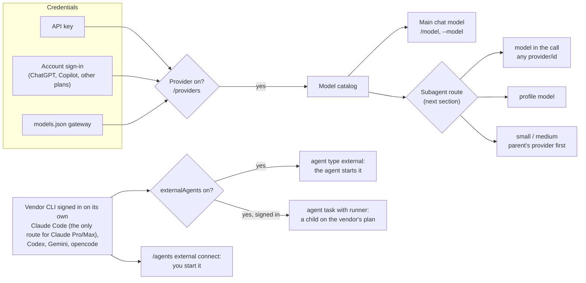

| Route                                                 | Who starts it                                     | What it needs                                                    | What it costs                                                                                                                                      |
| ----------------------------------------------------- | ------------------------------------------------- | ---------------------------------------------------------------- | -------------------------------------------------------------------------------------------------------------------------------------------------- |
| Subagent on a provider model                          | The agent (`agent` task)                          | The provider on, with a working credential                       | API price per token, or your plan's usage limits with a plan sign-in; Claude Pro/Max runs only through the Claude Code external agent              |
| Subagent on a named model                             | The agent, or you by asking for that model        | As above; `models` lists what can run a task                     | As above; free models cost nothing                                                                                                                 |
| Runner task (Claude Code, Codex, Gemini, opencode)    | The agent, with `agent` task `runner`             | `externalAgents: true`, the CLI and its ACP adapter, signed in   | The vendor account's billing; known plans show subscription usage, and other routes retain any reported dollar cost. Unknown billing stays unknown |
| External agent (Claude Code, Codex, Gemini, opencode) | The agent, with `agent` type `external`           | `externalAgents: true`, the vendor's CLI on `PATH` and signed in | The vendor account's own billing or plan                                                                                                           |
| External agent from the terminal                      | You, with `/agents external connect` and `prompt` | The vendor's CLI on `PATH` and signed in                         | The vendor account's own billing or plan                                                                                                           |

A listed provider or external agent is not proof that it works. A connected opencode peer, for example, starts on its own default model, which may need funds. Check with `/modelsettings` → Credential check, or connect and send one short prompt.

### The subagent model

Name `provider/model` to select a route independently of the coordinator. An explicit bare model ID prefers the coordinator’s provider when it offers that ID; otherwise, multiple matching providers require a qualified choice. A model-specific access refusal does not disable other models on that provider.

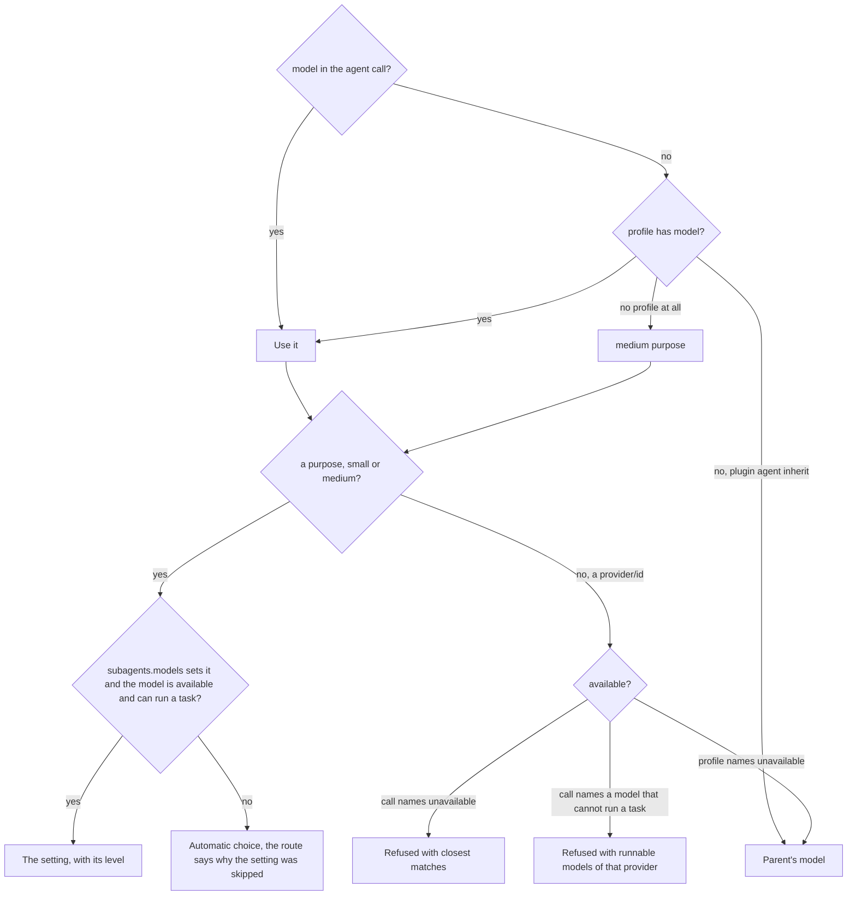

| Value                    | Meaning                                                                                                                                                    |
| ------------------------ | ---------------------------------------------------------------------------------------------------------------------------------------------------------- |
| `provider/id` or bare id | A name `/modelsettings` lists; a bare id several providers list resolves to the parent's provider first. A model that cannot run a task (below) is refused |
| `small`                  | The model set in `subagents.models.small`, else the cheapest capable model the session can use                                                             |
| `medium`                 | The model set in `subagents.models.medium`, else the dearest capable model priced between 15% and 80% of the parent's                                      |
| any of these `:level`    | `off`, `minimal`, `low`, `medium`, `high`, `xhigh`, `max`, e.g. `small:high`                                                                               |

`small` and `medium` first take a capable model your plan pays for (a coding plan, a subscription sign-in): it costs nothing more per request, so it qualifies whatever its list price, and its list price still places it in a tier. Without one they prefer the parent's provider and lab. A background child is never routed automatically to a plan whose vendor forbids unattended use (Qwen, Xiaomi and Z.ai coding plans); name the model to run it there anyway. A candidate must support tool calls, have a context window of at least 100,000 tokens, take images when the parent does, not be deprecated and be its family's current generation; with none, or an unknown parent price, the child runs on the parent's model. The thinking level is the call's suffix, else the profile's (kept on whichever model is picked, and on the parent's model after a fallback), else `OCTOCODE_SUBAGENT_THINKING`, else `medium`; a child never takes the parent's level or `defaultThinkingLevel`; a level the model lacks is clamped to the nearest one it supports, and the route says so (`low thinking (model argument: p/m:off; asked off; this model does not support off)`). The `models` tool lists the thinking levels of a reasoning model that supports others than `off`, `minimal`, `low`, `medium` and `high` (` · thinking low/medium/high`).

What the `models` tool returns:

| Call                                            | Result                                                                                                                                                                                          |
| ----------------------------------------------- | ----------------------------------------------------------------------------------------------------------------------------------------------------------------------------------------------- |
| No filter                                       | This session's model, one row per provider (credential source, last result, how many models can run a task, cheapest and most capable one with price), the `small`, `medium` and profile routes |
| `provider: openai`                              | That provider's models that can run a task, then its other models under "Cannot run a task" with the reason                                                                                     |
| `query` or `ability` keeping 40 or fewer models | The matching models, listed as above                                                                                                                                                            |
| `query` or `ability` keeping more               | The provider rows with how many models each has matching, so a long list never opens the call                                                                                                   |
| `scope: catalog`                                | Also the models of providers that are not connected, marked not runnable                                                                                                                        |

A model cannot run a task when it has no tool calls, is deprecated, or has a context window under 100,000 tokens. A model whose abilities are not known is allowed. Naming such a model in a call, for example `model: openai/gpt-4`, starts no child: the refusal says why and names runnable models of that provider. The credential source uses the same words as `/providers` (saved credential, environment variable name, `models.json`). The coordinator's prompt lists each provider with its number of runnable models, such as `openai` (41), and the routing notice repeats the counts when a provider or model change alters them (a newer models.dev index alone sends no notice; the next session states its counts); `/modelsettings` always shows the full listing.

| Bundled profile           | Model           |
| ------------------------- | --------------- |
| `researcher`              | `small:medium`  |
| `browser`, `lean`         | `small:low`     |
| `implementer`, `reviewer` | `medium:medium` |

To make every child that names a purpose cheaper, set the global `subagents.models` setting; to change one role, set `model: small:low` in a same-named profile under `.octocode/agents/` or pass `model` on the call.

```json
{ "subagents": { "models": { "small": "openai/gpt-5-mini:low", "medium": "anthropic/claude-sonnet-5" } } }
```

Each value is a `provider/model` with an optional `:level`. It applies to every profile or call that names `small` or `medium` (bundled profiles do) and to a task with no profile; a call's own `model` still wins, and a profile's own `:level` (`small:high`) outranks the setting's. The setting is read from the global settings file only. It is used only when the model is available, can run a task and its provider has not just refused its credential; otherwise the automatic choice applies and the route says why (`automatic; subagents.models.small p/m unavailable`). The `models` tool, `/modelsettings`, the coordinator's routing line and the routing notice show a configured route as `(setting subagents.models.small)`, and each child's `Runs on` line names the setting that chose it.

You see each child's route: start results and every report end with `Runs on` / `Ran on provider/id, <level> thinking (what chose it)`, and `coordinate list` and the agents panel show `provider/id:level`.

A purpose or profile model skips a provider whose credential was refused, except the parent's own, until that credential changes (sign-in, sign-out, import or a new API key) or a run or check on it succeeds; a refusal of a credential saved in the auth file is remembered across restarts, keyed by a digest of that credential. For 15 minutes it skips a provider that reported a usage limit or ran out of funds (one only out of funds keeps its free models, and stays in the coordinator's provider list while it has one) and a model that refused a run with a client error before spending a token (4xx other than 408 or 429); the parent's model is never skipped and the failed report names it as the model to retry with. A child whose model a purpose chose also starts with up to two fallback models on other providers (`retry.fallbackModels`), so a refused credential or limit moves it to the next one instead of ending its turn. Siblings started in one call were routed together, so they fail alike. `/modelsettings` and the `models` tool list what `small` and `medium` resolve to, the default thinking level, each profile's route and the last credential result per provider (`check: true` or `/modelsettings check` first sends one 64-token request per provider, 20 s each). The coordinator's delegation section states this once per session, read at the first prompt after start, resume or reload and then kept so the cached prompt does not change; when the facts change (provider enabled, disabled or signed in, model switch, a provider refusing or accepting its credential again) the agent gets one hidden `octocode-routing` notice after the current turn that says which of these caused it. Agents of other vendors over ACP come from `agent` type `external` `list` ([ACP](acp.md#connect-from-octocode-to-another-agent)).

### Subagent check-in

A running subagent that exchanged no message with its parent for `monitor.checkInSeconds` (default 300, `0` off; [settings](settings.md)) is asked whether it needs something. The child's own harness sends the ping at the end of a step that ran tools, so it adds no model request, costs the parent no turn and cannot reach a finished, lingering or idle child. A message either way restarts the interval; messages with other agents do not. It is not a deadline.

The check-in runs between a child's steps, so it cannot see a child stuck inside one (a hung tool or model stream). For that, the parent is told once when a working child has made no progress for `monitor.idleAgentMinutes` (default 5, `0` off; checked once a minute), and woken if idle within its wake limit; the child's next progress re-arms it. A child waiting on the user, on its own working children or idle between turns is not reported.

| Child      | What happens                                                                                           |
| ---------- | ------------------------------------------------------------------------------------------------------ |
| Background | May answer with `message` to `parent`; a new message wakes an idle parent, paced                       |
| Foreground | Its parent reads messages only with its report, so the ping tells it to finish with a `blocked` report |

A child's message requesting a reply is answered by its parent agent: the terminal panel marks the child `◇` with `↳ asks parent` under it, then the question. These messages do not count as `needs you`; that label is reserved for pending user dialogs, including questions and permissions. If the parent needs your decision, it uses `askUser` with `forward` set to the message number. The dialog shows the child's name and question verbatim above the parent's first question.

`coordinate list` shows each running child's last progress (a model or tool event; none for 10 minutes outside declared waiting work marks it `stalled`) and every question still waiting on the parent with number, age and first line. While a child waits for a relayed dialog, `coordinate list` and `/agents` show `waiting for approval`.

### Subagent request budget

The parent counts a child's model requests: one per assistant reply (compaction summaries are not replies). The count covers the child's whole transcript, including earlier branches and failed replies, so resume, message revival, reopened sessions and parent forks count the same history; a new child starts fresh.

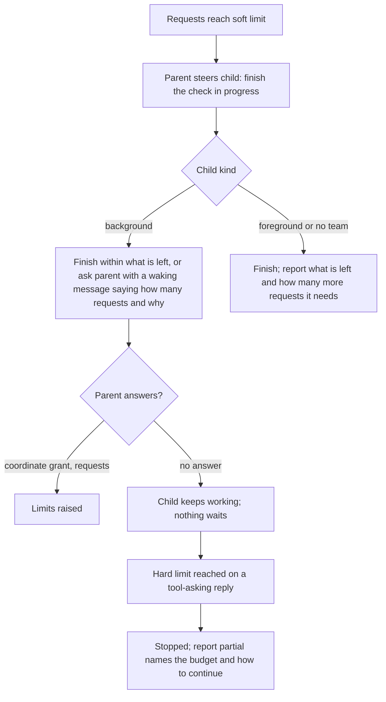

| Item                             | Value                                                                                                                                                                                                                                                                                                                           |
| -------------------------------- | ------------------------------------------------------------------------------------------------------------------------------------------------------------------------------------------------------------------------------------------------------------------------------------------------------------------------------- |
| Soft limit                       | profile `maxRequests` (`0` off), else `OCTOCODE_SUBAGENT_MAX_REQUESTS` (`0` off), else 160                                                                                                                                                                                                                                      |
| Hard limit                       | 1.5 × soft, rounded up, plus grants (240 by default). The child gets one last request without tools and is told to write its report from what it has; then the run ends and the report is `partial`. A provider that cannot turn tools off keeps them for that request: a reply that still asks for tools stops the run at once |
| Bounds                           | Saved assistant replies, not provider attempts, tokens or cost                                                                                                                                                                                                                                                                  |
| Resume at or past the soft limit | A whole new allowance: soft = saved count + soft, stop = saved count + hard; the child is told its usage and where it stops. A peer's message relayed by the parent's process decided nothing, so it stays within the old limits and at the hard limit returns `partial` without launching                                      |
| Recorded                         | Each run records requests and cache reads/writes apart from summary and warming spend; `/agents stats` aggregates per profile. A `coordinate` `grant` result names the requests the child has used and their cost so far, and the line saying a finished run stays reachable names what that run used                           |

### Isolated worktrees

`isolate: true` runs the child in its own git worktree; `resume` is refused for it. Isolated worktrees of every checkout of a repository share one folder under the Octocode home's `worktrees/`, so a session in any worktree prunes another's crashed run after saving its changes to a ref. Creating one never runs repository hooks such as `post-checkout`.

| Topic        | Behavior                                                                                                                                                                                                                                                                                                                                                                                                                                                                                                                                                                                                                               |
| ------------ | -------------------------------------------------------------------------------------------------------------------------------------------------------------------------------------------------------------------------------------------------------------------------------------------------------------------------------------------------------------------------------------------------------------------------------------------------------------------------------------------------------------------------------------------------------------------------------------------------------------------------------------- |
| Snapshot     | `workingCopy: true` with `isolate: true` starts from tracked and non-ignored untracked files, keeping the parent index and branch; the default starts at HEAD. Snapshots and saved refs exclude private data in `.octocode/code/`; a tracked or staged workspace marker or session file blocks automatic checkout and export                                                                                                                                                                                                                                                                                                           |
| Export       | Baseline-only changes are removed; if the worker delta cannot apply cleanly to the original HEAD the worktree is kept for review. Fixed diff options and a private patch file mean your Git diff and apply settings do not change it and there is no size limit. A repository the child creates inside its worktree (`git init`, a clone, an initialised submodule) is not saved as a gitlink: the worktree is kept and the message names the paths. Ignored files are never exported                                                                                                                                                  |
| Containment  | In every mode, including `full`, a `file` change or parsed shell write into the parent's main tree is refused: also repository changes naming no file (`git -C <main> reset --hard`, `git --work-tree=<main> checkout`, `tar -C <main>`), commands moving a ref shared with main (`git update-ref`, `git branch -f`, `git branch -D`, `git tag -f`, `git fetch . a:b`, `git stash drop`, `git gc`), a write after a `cd` the parser cannot follow (use `cd ./dir` or an absolute path), and a write it cannot place. A new branch or tag and the child's own detached `HEAD` stay allowed. Not a sandbox: `node script.js` is not seen |
| Landing      | The parent runs `coordinate` `merge` (follows the permission mode; a reserved file refuses it); you run `/agents merge [id]` (can override a reservation; needs a clean parent tree). Both check reservations, remove the ref and note the merge on the backlog item; a plain `git merge` does neither                                                                                                                                                                                                                                                                                                                                 |
| Discarding   | `/agents discard <id>` asks for confirmation, naming the ref and the files it changes, then deletes the ref without merging it; nothing is deleted when no one can be asked. The merge prompt for `coordinate` `merge` names the ref and its changed files too                                                                                                                                                                                                                                                                                                                                                                         |
| Unsaved work | The next start commits it to `refs/octocode/<id>`; if the child held a backlog item the ref is linked on it as an `output` with a not-merged note (`Linked <ref> on B<n>.`); `/agents merge <id>` adds a merged note to every item linking the ref                                                                                                                                                                                                                                                                                                                                                                                     |

### Subagent lifecycle

When the coordinator closes, its subagents close too.

| Exit                                                                         | What happens to children                                                                                                                                                                                                                        |
| ---------------------------------------------------------------------------- | ----------------------------------------------------------------------------------------------------------------------------------------------------------------------------------------------------------------------------------------------- |
| `/quit`, SIGTERM, SIGHUP, SIGINT, `/new`, `/resume`, fork                    | Each child stops gracefully: abort, close stdin, SIGTERM its process group, SIGKILL after the grace, so it can report and save an isolated worktree. Each child leads its own process group, so Ctrl+C and SIGHUP never reach it directly       |
| Crash, dead-terminal emergency exit, `process.exit` before the stop finished | Every registered group is SIGKILLed synchronously from the exit hook, taking bash jobs, MCP servers and browser too                                                                                                                             |
| `kill -9` of the coordinator                                                 | Each child notices within about a second (stdin EOF or parent check) and exits after at most 10 s even if shutdown hangs                                                                                                                        |
| A child crashes (`kill -9`, out of memory)                                   | Its bash commands, which each run in a process group of their own, are stopped by the coordinator once the child exits, before its run ends: the child lists each one as it starts it, and only a group still provably the child's is signalled |
| Restart                                                                      | The resumed session is told once, without a turn, which children it recorded as running ended with it without a report; `resume` continues one                                                                                                  |

Long and unattended runs keep going through what would otherwise end them:

| Situation                             | Behavior                                                                                                                                                                                                                                                          |
| ------------------------------------- | ----------------------------------------------------------------------------------------------------------------------------------------------------------------------------------------------------------------------------------------------------------------- |
| Provider failure in a headless parent | A print or JSON run whose turn ends in a retryable provider error while children run holds, says so on stderr and retries when the next report arrives; it ends when no child is left and that attempt failed, naming the session id and `octocode --resume <id>` |
| Provider failure on a wake            | In the terminal or RPC, a turn started by a report or message that ends in a retryable error retries after 1, 2, 5, 10 and 30 minutes with a status line; new input cancels the waits; a notice says when they run out                                            |
| Machine sleep                         | A gap between watchdog ticks moves the child's deadlines by the gap                                                                                                                                                                                               |

### External-agent lifecycle

At most eight external-agent connections can be open or starting at once. An ACP prompt timeout reports uncertain execution and retains the peer's active request; another prompt is refused until it settles; explicit cancellation closes the owned connection. The [ACP guide](acp.md#connect-from-octocode-to-another-agent) explains timeout recovery, retained evidence and process ownership.

### External runners

A subscription its vendor reserves for its own CLI (Claude Pro and Max) runs as an external runner: the vendor's CLI does the turns over ACP, signed in through its own login, while Octocode owns the task like any child. Example: "have Claude Code review the parser in its own worktree".

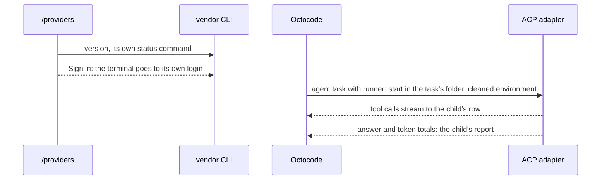

| Topic       | Behaviour                                                                                                                                                                                                                                                                                                                                                                       |
| ----------- | ------------------------------------------------------------------------------------------------------------------------------------------------------------------------------------------------------------------------------------------------------------------------------------------------------------------------------------------------------------------------------- |
| Runners     | `claude-code` (`claude` and `claude-agent-acp`), `codex` (`codex` and `codex-acp`), `opencode` (`opencode acp`), `gemini` (`gemini --acp`)                                                                                                                                                                                                                                      |
| Connect     | `/providers` → External agents: one row per runner with the CLI and adapter found, the version against the one checked, and the sign-in from the CLI's own status command (`claude auth status`, `codex login status`, `opencode auth list`; Gemini by opening an ACP session). Only the method and the signed-in state are kept                                                |
| Cache       | Discovery starts nothing. Opening a runner’s page or starting its task checks that runner. Valid positive checks are reused until the CLI, adapter or sign-in files change; failed or unknown checks retry at use, and Check again forces a check                                                                                                                               |
| Sign in     | Hands the terminal to the vendor's own login (`claude auth login`, `codex login`, `opencode auth login`, `gemini`). Octocode reads nothing back and stores no credential                                                                                                                                                                                                        |
| Enable      | Off until selected in `/providers` → External agents. **Enable this CLI for agent tasks** saves the global selection; `/reload` applies it. **Pause all external agent tasks** preserves that selection. An existing explicit `externalAgents: true` without a selection retains all installed runners. See [configuration](configuration.md#headless-and-external-agent-runs). |
| Task        | `runner` with `goal` and `task`, optionally `model` (the runner's own model option), `background`, `isolate`, `item`, `paths`, `resultSchema`. `skills`, `mcp`, `profile`, `resume` and `headless` are refused. The child gets a name, a worktree when isolated, the report contract and a normal report                                                                        |
| Isolation   | Octocode passes no MCP server, skill or hook of its own; a team task gets only its mailbox server. Claude Code starts without its settings files, its MCP servers and slash commands. Gemini CLI admits only the mailbox server when one is given. Codex CLI and OpenCode load their own configured MCP servers and skills: their ACP adapters have no switch for that          |
| Environment | The adapter starts without provider API keys, any `ANTHROPIC_` variable, `CODEX_API_KEY` or Octocode's own variables, so a key cannot bill in place of the plan. `CLAUDE_CONFIG_DIR` and `CODEX_HOME` pass. Exported `CLAUDE_CODE_OAUTH_TOKEN` reaches only Claude; `GEMINI_CLI_CUSTOM_HEADERS` reaches only Gemini                                                             |
| Billing     | A Claude Code signed in with an API key runs with `--hide-claude-auth`, so it never falls back to the subscription. Plan-billed runs record tokens and no cost (`billing: plan` on the report); a metered run records the cost the runner reports                                                                                                                               |
| Stop        | A stop cancels the turn and ends the adapter's process tree; a runner silent for 15 minutes is stopped. One that answers `auth_required` is reported signed out, invalidates its cached check and is checked again on the next use or `/providers`                                                                                                                              |
| Subagents   | A child's `task` type takes runner tasks only and waits for the report; the runner's process belongs to that child, and the spawn approval reaches you through the parent                                                                                                                                                                                                       |
| `models`    | Lists selected installed runnable CLIs with their known sign-in and billing state; provider and query filters include matching external routes                                                                                                                                                                                                                                  |

When Claude Code is installed and signed in but its ACP adapter is missing, runner tasks use its headless CLI. Octocode sends the task through streaming JSON input and keeps that channel open until the result arrives. From spawn to close it reads the CLI's descendants about every 400 ms, keyed by process id and start time, and cleanup stops the process group and every descendant seen. ACP adapters are tracked the same way. On POSIX, a helper that detaches (`setsid`) and leaves the tree (its parent exits) before a reading sees it, or that the CLI forks only after the root has exited, is not owned: that needs ownership from the CLI or an OS container, because process-tree cleanup alone cannot guarantee its lifetime.

### Claude Code as the session's model

With Claude Code connected as a runner on its plan, `/model` also lists `claude-code/opus`, `claude-code/sonnet` and `claude-code/haiku`. Choosing one makes Claude Code the model behind your Octocode session: Claude Code runs each turn with its own harness and login, and every tool it calls is an Octocode tool. Example: pick `claude-code/sonnet`, then ask "find why the parser test fails"; Claude Code reads and runs commands through Octocode's `bash` and `file`, and the calls show in your transcript as usual.

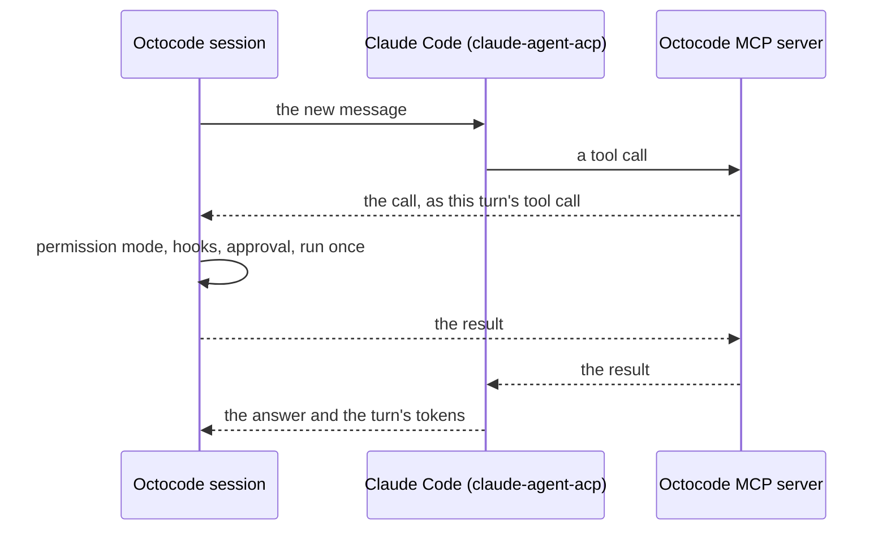

| Topic       | Behaviour                                                                                                                                                                                                                                 |
| ----------- | ----------------------------------------------------------------------------------------------------------------------------------------------------------------------------------------------------------------------------------------- |
| Offered     | While `externalAgents` is on, Claude Code is selected, and it is installed with `claude-agent-acp` and signed in with its plan at its last check. A Claude Code on an API key offers none: use the `anthropic` provider                   |
| Session     | One Claude Code process and session per Octocode session, reused every turn and resumed after a restart, a stop or a model change. Claude Code keeps and compacts its own context; Octocode sends it only what it has not seen            |
| Tools       | Claude Code's own tools, settings, hooks and MCP servers are off. Octocode lists the session's tools over a loopback MCP server that admits only a token made for that session; the loop runs each call once, as for any other model      |
| Prompt      | Claude Code's own system prompt, plus one short Octocode instruction and the project's `AGENTS.md` files. Octocode's routing facts and its routing notice are not sent; a model you switch to next gets the notice                        |
| Environment | The same cleaned environment as a runner, plus your installed `claude` as the binary the adapter runs, the model alias and MCP tool search off                                                                                            |
| Billing     | Your plan: the footer shows the model's kind as `CLI` and its total as `Σ (sub)` while every reply was billed by a plan. Claude Code makes every model call with its own login; Octocode never reads, stores or sends the Claude token    |
| Stop        | Esc cancels Claude Code's turn and ends its process tree; the next message resumes the session                                                                                                                                            |
| Not covered | Images in your messages (a placeholder is sent), thinking levels (Claude Code chooses its own effort), usage per model call (a turn reports its totals). A summary or other side request runs once in a Claude Code session without tools |

## Browser and web access

`web({ query })` or `web({ url })` (kept enabled in the main agent) does public search and retrieval. Search providers share a 30-second deadline across the fallback chain; failures name the providers tried and cancellation stops the chain. A single unambiguous `site:` restriction is checked against result URLs and out-of-scope results trigger fallback; ambiguous Boolean queries remain provider interpreted. Fetch warnings come from transport metadata, so page text that resembles an error stays ordinary content.

Browsing uses the built-in `browser` MCP server (`mcp__browser__*`, powered by `@octocodeai/octocode-chrome-devtools`); the native `browser` tool was retired. Its own instructions and the bundled `octocode-chrome-devtools` skill say how to use it; launch and exposure are in the [MCP reference](mcp-reference.md#configuration-and-precedence).

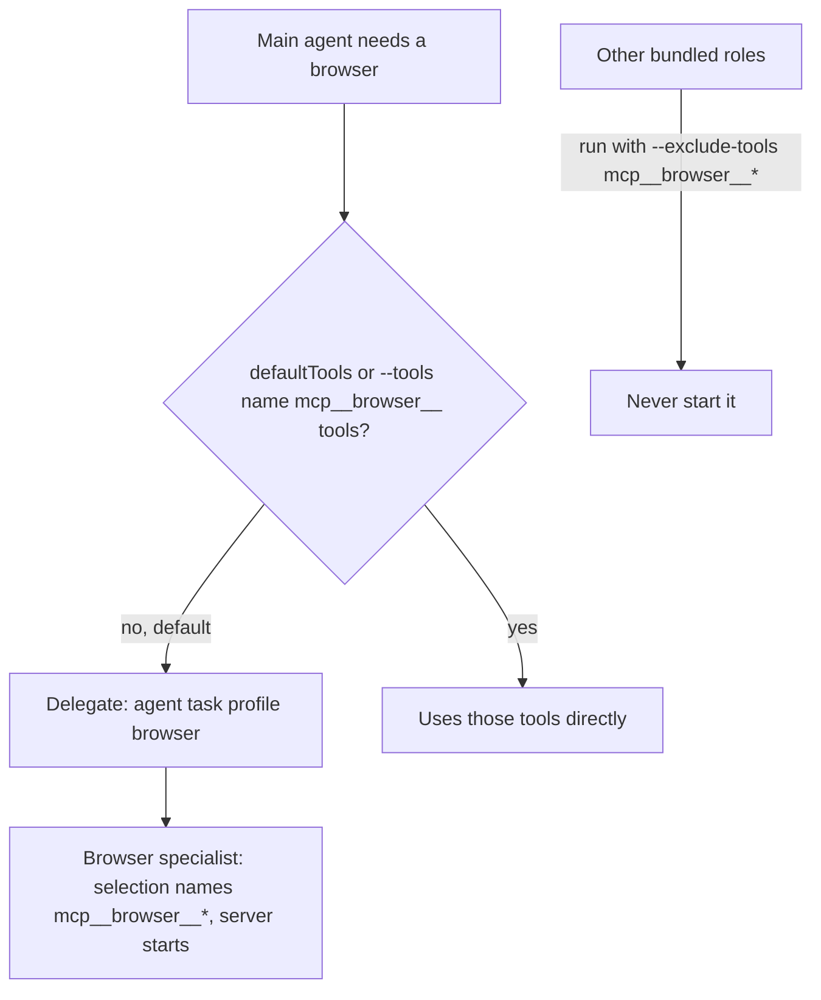

| Topic                   | Behavior                                                                                                                                                                                                                                                                                                                                                                                                                                                                                                                                                                                   |
| ----------------------- | ------------------------------------------------------------------------------------------------------------------------------------------------------------------------------------------------------------------------------------------------------------------------------------------------------------------------------------------------------------------------------------------------------------------------------------------------------------------------------------------------------------------------------------------------------------------------------------------ |
| Default                 | The server is `defaultActive: false`, so only an agent whose selection names `mcp__browser__*` starts it (by default the `browser` specialist); your own MCP servers and the research server start as usual for every child                                                                                                                                                                                                                                                                                                                                                                |
| Opt the main session in | Name tools in `defaultTools` (or `--tools` for one run): `+mcp__browser__open`, `+mcp__browser__run`, `+mcp__browser__snapshot`, `+mcp__browser__screenshot`, `+mcp__browser__check`, `+mcp__browser__cleanup`; the rest of the catalog stays undeclared and the main agent is told to use these instead of delegating                                                                                                                                                                                                                                                                     |
| Other ways              | A profile `tools:` entry naming `mcp__browser__*`, or `{ "mcpServers": { "browser": { "defaultActive": true } } }`, gives an agent direct access; a `browser` server defined in full in `mcp.json` replaces the preset (`defaultActive` included); children that do not name it are still excluded. A `defaultTools` entry `browser` has no effect (reported in settings warnings) and `--tools +browser` selects nothing. `-web` omits retrieval                                                                                                                                          |
| Permissions             | A private/local or unresolved page address asks `net.private`. `script` and `api-replay` ask `browser.control`. The `cookies` tool, all raw CDP commands (also inside plans/steps), custom scripts and page-defined WebMCP invocations ask `browser.cookies`: opaque browser programs can access cookies. No profile grants it; one answer can cover the session. Typed DOM actions, extraction, snapshots and protocol/schema discovery keep their normal permissions. Page requests pass the private-address filtering proxy; `dev-check` requires a browser `open` started on its port. |
| Chrome                  | `open` takes `headless`. A visible Chrome on an explicit `port` keeps its profile under the workspace's browser state between opens, so a login persists (logins saved earlier under `browser-profile` in the Octocode home are not reused: sign in again). A headless Chrome a browser subagent leaves running stays for follow-ups and stops when the top session shuts down; a visible one stays open. Calls reach the server in the order made, and a command without a port uses the browser `open` last made ready in the workspace                                                  |

Custom corpus scripts (`corpus-query --script`) and caller-supplied `--scraping-skill-dir` helper directories run local Node programs. They require browser-control and cookie-access approval, and read-only roles refuse them. Ordinary corpus regex searches without a selected helper directory keep their existing permissions.

Start the specialist with `background: true` and give it the task, URL, required evidence and `headless` choice:

```json
{
	"type": "task",
	"profile": "browser",
	"headless": false,
	"goal": "Check the signed-in dashboard",
	"task": "Open https://example.com/dashboard and report what is visible.",
	"reason": "Check the dashboard as the signed-in user"
}
```

`headless` defaults to `true`; `false` selects visible Chrome with its persistent login profile. Both modes share role instructions, so the mode belongs in the task and the cached role text stays identical. The profile sets `linger: 900`: after a successful report it stays reachable for 15 minutes and `message` to its id resumes the same conversation (page map and decisions included). A resumed run is a new process but Chrome outlives it: when follow-ups may come, the specialist leaves the browser running and reports its port, and `open` on that port reuses the browser and tabs; Octocode records the private-address filter port beside the browser state and restores the filter (approvals of private hosts start empty). Tell the specialist to close the browser when done. Foreground runs need an explicit `task` resume; an isolated run resumes in a worktree recreated from its saved ref, while that ref exists. Replace the former `webHeadless` and `webLive` profiles with `profile: "browser"` and `headless`.

The specialist's page-awareness loop:

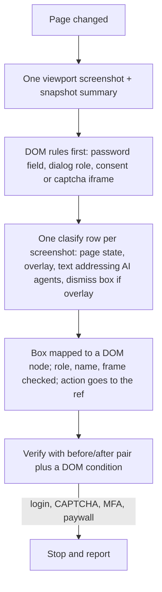

It reuses saved captures, skips classification when URL, title and DOM digest are unchanged, and keeps a page map in its scratch folder. A box is never clicked.

## Security review

A hook, MCP server or skill that Octocode did not ship stays off until you check its report and approve its exact content. Octocode's own skills and MCP server always load, and a session never waits for a decision. Changing an approved item's content switches it off again, and it shows as `changed`.

| Where                        | What you can do                                                                  |
| ---------------------------- | -------------------------------------------------------------------------------- |
| `/security`                  | list items, read a report, approve or deny; `/security check` lists what waits   |
| `octocode security`          | the same verbs outside a session; `approve --all` never approves a Critical item |
| `/harness`, web harness list | each reviewed row starts with its state: `not checked`, `approved` or `denied`   |

The agent never approves: the decision verbs refuse inside a session's shell, and no tool, permission mode or `--trust` records one. The agent sees withheld MCP servers by name in its MCP status. Settings, the first-run import of existing global items and the report layout are in [Security review](configuration.md#security-review).

## File mutation guarantees

`file` edits, writes and deletes check the current content under a cross-process filesystem lock (symlink aliases resolved) and replace files atomically (temporary file and rename).

| Guarantee    | Detail                                                                                                                                                                                                                                                                                                                                                                                                               |
| ------------ | -------------------------------------------------------------------------------------------------------------------------------------------------------------------------------------------------------------------------------------------------------------------------------------------------------------------------------------------------------------------------------------------------------------------- |
| Read first   | Overwriting an existing file needs a complete read; a file changed on disk since needs a new read; a new path needs none                                                                                                                                                                                                                                                                                             |
| Edits        | Each `oldText` is re-validated and applies when it still matches exactly once: exact LF-normalized match, then a whitespace/punctuation fallback; after an outside change the exact anchor must stay unique                                                                                                                                                                                                          |
| Checkpoints  | Journals reject malformed paths and digests when loaded; if another writer takes a path during `/rewind`, the displaced copy is preserved and `/rewind` names its recovery path                                                                                                                                                                                                                                      |
| Batches      | Each outcome is reported; earlier successes are not rolled back                                                                                                                                                                                                                                                                                                                                                      |
| Not excluded | Atomic replacement prevents torn files but not unrelated editors, shell commands or processes that ignore the lock                                                                                                                                                                                                                                                                                                   |
| Reservations | Enforced for `file` and for `bash` write targets the parser can name. While another agent holds any reservation, shell commands whose writes no parse can name (PowerShell outside the read-only list, inline interpreter code, unreadable code) are refused, and a `node -e` that only lacks Node's permission flags runs with them added ([reservations and the shell](permissions.md#reservations-and-the-shell)) |
| Lapse        | A reservation lapses 90 s after its owner's last heartbeat and is not fenced: an owner stalled longer that resumes can overwrite a peer that took the file                                                                                                                                                                                                                                                           |

File edit and write previews bound the search for a minimal line diff. A large rewrite can show a wider replacement hunk with its shared leading and trailing lines retained. Long lines keep line colouring when detailed word emphasis would delay rendering.

### Canonical patch mode

`file` takes either native `queries` or a Codex `patch` string, never both (a patch call may include `reasoning`); no second file tool exists.

| Topic       | Behavior                                                                                                                                                                                                                                             |
| ----------- | ---------------------------------------------------------------------------------------------------------------------------------------------------------------------------------------------------------------------------------------------------- |
| Operations  | Add, Delete, Update, Move, context chunks and EOF markers                                                                                                                                                                                            |
| Preparation | Every operation is prepared before the first mutation; an invalid later operation, duplicate source path or failed guard prevents the whole commit                                                                                                   |
| Execution   | Cancellation or the first failure stops later operations; earlier changes stay recorded for `/rewind`; a move writes its destination before removing its source, with guards and checkpoints for both. Native query batches continue after a failure |
| Matching    | Update matching and line endings follow the Codex transformer; read coverage, stale-content checks, permissions and reservations still apply; a patch update does not turn a partial read into whole-file coverage                                   |
| Unsupported | Path forms Octocode would normalize differently, remote environment routing ([hook patch compatibility](hooks.md#codex-file-patch-preview))                                                                                                          |

## Live status

| Element          | What it shows                                                                                                                                                                                                                                                                                                                                                                                                                                                                                                                                                                                                                                                                                                                                                                                                                                                                                                                                                                                                                                                                                                                                                                                                                                                                                                                                                                                                                                                                                                                                                                                                                                                                                                                                                                                                                                                                                                                                                                                                                                                                                                                                                                                                                                                                                                                                                                                                                                                                                                                                                                                                                                                                     |
| ---------------- | --------------------------------------------------------------------------------------------------------------------------------------------------------------------------------------------------------------------------------------------------------------------------------------------------------------------------------------------------------------------------------------------------------------------------------------------------------------------------------------------------------------------------------------------------------------------------------------------------------------------------------------------------------------------------------------------------------------------------------------------------------------------------------------------------------------------------------------------------------------------------------------------------------------------------------------------------------------------------------------------------------------------------------------------------------------------------------------------------------------------------------------------------------------------------------------------------------------------------------------------------------------------------------------------------------------------------------------------------------------------------------------------------------------------------------------------------------------------------------------------------------------------------------------------------------------------------------------------------------------------------------------------------------------------------------------------------------------------------------------------------------------------------------------------------------------------------------------------------------------------------------------------------------------------------------------------------------------------------------------------------------------------------------------------------------------------------------------------------------------------------------------------------------------------------------------------------------------------------------------------------------------------------------------------------------------------------------------------------------------------------------------------------------------------------------------------------------------------------------------------------------------------------------------------------------------------------------------------------------------------------------------------------------------------------------- |
| Working line     | Above the input (in the editor border when embedded): `⠙ Running Bash (12s · esc to interrupt)`. The time is the whole run's elapsed time (through tool waits, retries and automatic compaction) right after the action, so a narrow terminal clips the action first, then the interrupt hint. The action names what the agent does, not the command: a tool row title (`Running Bash`, `Running localSearch +2`), `Running 3 tools: Bash · File`, `Running subagent <goal>`, else `Thinking: <gist>`, `Writing`, `Preparing tool calls`, `Waiting for you: <question>`, `Waiting for model`. A permission-flagged call keeps its warning and target (`⚠ Running Bash: rm -rf build`); permission class ids never appear. Teammates see a separate stored line with the permission action and no clock                                                                                                                                                                                                                                                                                                                                                                                                                                                                                                                                                                                                                                                                                                                                                                                                                                                                                                                                                                                                                                                                                                                                                                                                                                                                                                                                                                                                                                                                                                                                                                                                                                                                                                                                                                                                                                                                            |
| Reason line      | One italic line under a tool's title, `↳ list the folder`, in the theme's `toolReason` color (`muted` if absent), collapsed or expanded and while running: the call's `reason` as written (filled as in [tool selection](#tool-selection-and-migration)). Nothing for a missing or one-word reason; long ones are cut to the width; a `File` row with one change shows that change's own `reason`; extension tools never show it. Exports show it, permission prompts show native calls' reasons, ACP clients get it in the tool call title (`bash: Run the focused tests`), the web view under the tool's name                                                                                                                                                                                                                                                                                                                                                                                                                                                                                                                                                                                                                                                                                                                                                                                                                                                                                                                                                                                                                                                                                                                                                                                                                                                                                                                                                                                                                                                                                                                                                                                                                                                                                                                                                                                                                                                                                                                                                                                                                                                                   |
| Purpose block    | Below a tool's result: every goal and reasoning the result's own data states per query row, for any tool and server, never from the call's arguments. A goal every row shares is one `◎ <goal>` line then `· #<row> <reasoning>` lines (row number only with two or more rows); otherwise `#<row> <goal> — <reasoning>`. Text the `↳` line shows is not repeated. `toolReason` color, escapes and line breaks stripped, lines cut to the width, at most six lines then `… +N more`; same in exports and the web view; the stored result is never changed                                                                                                                                                                                                                                                                                                                                                                                                                                                                                                                                                                                                                                                                                                                                                                                                                                                                                                                                                                                                                                                                                                                                                                                                                                                                                                                                                                                                                                                                                                                                                                                                                                                                                                                                                                                                                                                                                                                                                                                                                                                                                                                          |
| Turn line        | When the job ends, one dim line: `✻ Worked 52s · waited 3m10s · 7 tools · 3 agents · ≈$4.12 · cache 61%`. A job lasts from its first run until nothing is left: no run, background agent, queued child, bash or external job, pending wake (a report, a held wake, a wake retry) or timer. Runs a wake or you start inside it are part of it; `waited` is the time no run was active. Until then a waiting line above the editor says what the job waits on, and the terminal's tab progress and program status stay working. If you still hold ongoing items, the line ends with `· N items still open` in warning color. Within a run, a retry, continue, compaction resume and queued steer belong to it; an aborted run ends the job when nothing else is pending. It sums wall time, top-level tool calls (not a subagent's own), subagents whose result arrived, cost (main replies, those subagents, compaction, branch summaries and other recorded requests, formatted like the footer) and the share of prompt tokens read from cache. Zero or unknown parts are left out; a run under 3 s with no tool writes nothing. It is not sent to the model and is redrawn on resume; subagents and headless runs do not write it                                                                                                                                                                                                                                                                                                                                                                                                                                                                                                                                                                                                                                                                                                                                                                                                                                                                                                                                                                                                                                                                                                                                                                                                                                                                                                                                                                                                                                               |
| Reasoning labels | A finished block `▾ Reasoning · 4s` (first streamed token to the next block; none after a resume or under 1 s); hidden `▸ Reasoning · 4s (ctrl+t)` with the bound key, plus `or click` only in fullscreen mode. An interrupted turn says `Interrupted` once; the tool row shows `aborted`                                                                                                                                                                                                                                                                                                                                                                                                                                                                                                                                                                                                                                                                                                                                                                                                                                                                                                                                                                                                                                                                                                                                                                                                                                                                                                                                                                                                                                                                                                                                                                                                                                                                                                                                                                                                                                                                                                                                                                                                                                                                                                                                                                                                                                                                                                                                                                                         |
| Footer           | Two lines. Line 1 has three zones: environment on the left (folder ⎇ branch, the permission mode with its shortcut, `plan r2` while a plan is open), health in the center (`ctx ▰▰▰▱▱▱▱▱ 34% of 271k · 723k tok (↑578k ↓145k) · 96% cached`) and totals on the right (running work, queued messages, what full mode ran, a running hook or pending retry, then `Σ`). Line 2 has `model:effort` with the provider kind, session name and compactions on the left, and on the right steps, backlog, the GitHub token mark, the last run's speed (between runs), timer judging spend, other statuses and command hints. Zones are separated by space, parts by a dim `·`. As the row narrows, parts give way in one order: the hints, the hook clock and full-mode count, the routine team count, the token breakdown, the window and bar, the tokens, the cached share, then the folder shortens. The permission mode, `ctx NN%` and `Σ` stay; above 80% the context keeps its bar and percent in red. A warning or error status that does not fit whole moves to up to two rows below, then `+N alerts · /status`                                                                                                                                                                                                                                                                                                                                                                                                                                                                                                                                                                                                                                                                                                                                                                                                                                                                                                                                                                                                                                                                                                                                                                                                                                                                                                                                                                                                                                                                                                                                                                  |
| Footer totals    | Run tokens come from completed messages and streaming usage when the provider reports it, never estimated from text. Tokens are new prompt tokens (uncached input and cache writes) plus output, including subagent usage (`↑72k ↓35k`); cache reads show only as the cached share (`94% cached`), because every request re-reads the conversation. The agents panel counts tokens the same way. `coordinate list` shows each agent since it joined, with its cache reads (`↑72k +1.1M cached ↓35k`). The footer's one cost is `Σ ≈$X`: this session's replies and recorded requests, every subagent result or report already received, and what live agents under it spent until their result arrives, each counted once. `/status` shows this session's own figures. Between runs the footer shows the last run's output speed when it streamed for at least 1 s                                                                                                                                                                                                                                                                                                                                                                                                                                                                                                                                                                                                                                                                                                                                                                                                                                                                                                                                                                                                                                                                                                                                                                                                                                                                                                                                                                                                                                                                                                                                                                                                                                                                                                                                                                                                                |
| Agents panel     | A grid rooted at this session (🦑, the main agent), one row per agent: tree, state mark and name · role with its thinking level (`implementer:high`; the role alone while the level is unknown, as for a reserved row or an external runner) · elapsed and cost · goal, each column starting at the same cell on every row and the columns joined by a dim `·`. Unanswered messages (`✉ n`) and a `worktree` word close the goal and are never cut; tokens with the cache share (`166k tok 94% cached`) join from 160 columns. The action follows the goal (`› action`) when it fits whole, else it goes on an indented `↳` line. As the terminal narrows the elapsed time leaves, then the role is cut, then the cost leaves; below 60 columns each agent shows its goal on a second line. Words appear only on `↳` lines, for what a mark says twice: `waits for your approval`, `waits for your answer`, `asks parent`, `blocked: …`, `partial: …`, a finished run's headline, `left`. An agent's latest message follows as a block of at most 3 lines and 100 columns: a dim head (`✉ #850 ↩#848 → peer · awaiting reply · 12s ago`), then the body in quotes, ending in `…` when longer. Up to 2 peer sessions in this checkout follow under a dim `peers` label. Clicking an agent's line opens its detail line: model, tokens, cache share, tool calls, worktree badge (`worktree ⎇ branch`) and locks. The root row carries no cost: the footer's `Σ` is the one total. A waiting mark pulses for 4 s, then holds still. It also lists other running work, one typed row each: a `bash` job (id, reason or command, elapsed), a `timer` (id, what it waits for, time left, warning tone) and a background subagent the team does not list yet. The footer's first line counts them (`🐙 2 agents · 1 bash · 1 timer`; empty when idle). What timer judging spent shows as its own status on the footer's second line, `timer judging ≈$0.01`, in the same format as the cost. Rows repaint when work starts or ends; while any runs, marks spin at a background pace (5 frames a second, slower than the reply's own spinner, so a long-running team repaints the terminal less) and times count in seconds. Under reduced motion marks are still and cells show whole minutes (`<1m`, `3m`, `in 9m`), repainted on the oldest row's minute boundary. The panel takes at most a third of the terminal and never more than 16 rows; past that, message bodies, `↳` action lines, peer rows and the other `↳` lines leave in turn (an agent that waits on someone keeps its reason longest), then the last agents collapse into `+N more · ◇ 1 ⠋ 2`, counted by their marks |
| Team name        | After joining the team the footer shows `🦑 <name>`, the name peers and messages use. The session file records it, so continue, resume and reload rejoin under it unless another running agent holds it (then a fresh name is taken and recorded); a new or forked session gets a name on its first team action                                                                                                                                                                                                                                                                                                                                                                                                                                                                                                                                                                                                                                                                                                                                                                                                                                                                                                                                                                                                                                                                                                                                                                                                                                                                                                                                                                                                                                                                                                                                                                                                                                                                                                                                                                                                                                                                                                                                                                                                                                                                                                                                                                                                                                                                                                                                                                   |
| Team errors      | `team off` (unusable, e.g. newer schema) or `team retrying` (locked) in the footer; the error is said once in the message list (a lock only after two failed one-second refreshes) and one line says when it is reachable again                                                                                                                                                                                                                                                                                                                                                                                                                                                                                                                                                                                                                                                                                                                                                                                                                                                                                                                                                                                                                                                                                                                                                                                                                                                                                                                                                                                                                                                                                                                                                                                                                                                                                                                                                                                                                                                                                                                                                                                                                                                                                                                                                                                                                                                                                                                                                                                                                                                   |

## Process names, list and orphans

Every Octocode process names itself `octocode-<role>-<id>`, so `ps`, `pgrep -f octocode` and `/processes` tell them apart.

| Process      | Name                                                                                                             |
| ------------ | ---------------------------------------------------------------------------------------------------------------- |
| Main session | `octocode-main-<last 8 characters of its session id>` (renamed on `/new`, `/resume`, a fork or a session switch) |
| RPC host     | `octocode-rpc-<id>`                                                                                              |
| ACP broker   | `octocode-acp-<pid>`                                                                                             |
| Subagent     | `octocode-<role>-<agent id>`                                                                                     |

A title is at most 64 characters of letters, digits, `.`, `_`, `-`.

`/processes` lists Octocode processes on this machine with name, API instance ID (`off` when its API is off or it is a subagent), pid, parent pid, RSS, age and, for a subagent, whether its parent is alive, plus the MCP stdio servers, bash jobs and anything below them it owns (it reads `ps`, so not on Windows). `/jobs` is one session's bash jobs, `/agents` its team, `/status` its summary.

Each process records a sample every 5 minutes (`OCTOCODE_PROCESS_SAMPLE_MINUTES`; `0` for none besides the first and last): memory (`rss`, `heapUsed`), pid and start time, title, session or agent id, owner, and each owned child's pid, start time, parent and RSS. Neither the first sample nor the last one delays the session: the first is taken while it starts, and shutdown writes a last sample marked ended at once from the latest listing; samples older than 7 days are deleted by the next sample, at most hourly per process. Samples are the only source of what another session owned, so a child that started after its owner's last listing is not known as an orphan.

Sampling skips intervals while a process listing is still running and starts no further listings after shutdown. Positive intervals are bounded to Node's timer range of 1–2,147,483,647 milliseconds.

| Finding        | Rule                                                                                                                                                                                                                                                   |
| -------------- | ------------------------------------------------------------------------------------------------------------------------------------------------------------------------------------------------------------------------------------------------------ |
| Orphan         | A child alive with its recorded start time whose owner is gone (dead, or its pid now has another start time; a graceful shutdown gets 15 s first), or that was reparented away to init while its owner lives; a subagent whose parent Octocode is gone |
| Growing memory | Over at least four samples spanning 15 minutes or more: never drops more than 5% between samples and rises at least 64 MB and 25%                                                                                                                      |

`/processes stop` asks for confirmation (interactive only), re-reads records and the process table, and ends only processes still orphans of a recorded owner with the recorded start time: SIGTERM, then SIGKILL after the grace. A pid without a recorded start time, a changed start time, init and this process are never signalled.

## Machine monitor

Once a minute one Octocode process per machine samples load, free memory, swap, GPU use and the busiest processes, and keeps the samples for 24 hours. It is whichever process holds the sampler lease; when it exits or dies, another one takes over. Every session checks each new sample against its thresholds, so the commands that read the machine run once.

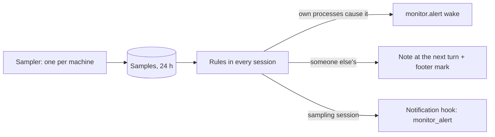

A threshold alerts after it holds for several samples in a row, then stays quiet for a cooldown. The session whose processes weigh most is woken with the reading and the busiest processes; other sessions get a note at their next turn, and the footer shows tripped readings until they clear. A background `bash` job that is silent and idle for too long wakes the session that started it, once per silence.

The same rules also cover a session's own work: context bands before compaction, a subagent check-in, an idle agent (a child its parent is told about, or a main session that tells itself and marks the footer), idle items, and the early compaction summary (a warning to the user, never to the model, when it was billed for nothing or the compaction still waited on it). Each rule tells the owner of the cause once per state change, as a `monitor.alert` wake (listed with its rule on the woken turn's row) or as a note that starts no turn. Thresholds, defaults and the rule table: [configuration](configuration.md#machine-monitor).

### Monitor room and hooks

`/monitor` lists every monitor rule of this session: its state (`ok` or `tripped`), the last reading against its threshold, how many times it tripped, how many alerts reached the session, when the last one did and what it was about. It counts only this session's alerts, and a rule that never tripped shows `-`. In a terminal it opens a page; open a rule for its figures and press Escape to leave. Without a screen (print, JSON, RPC) it prints the table as text, and `/monitor text` prints the table anywhere.

The `MonitorAlert` hook runs your command once for each alert, with the rule id as its matcher; the machine rules run it only in the process that holds the sampler lease, so one machine alert is one run ([hooks](hooks.md#monitor-alerts-in-the-octocode-profile)).

## Worktrees

Each Git worktree has its own workspace ID, backlog and notes. Agents in the same repository share a team and can read notes saved with project scope. The default transcript directory belongs to the workspace; `/resume all` searches the others. If the original worktree is gone, `octocode --fork <full-session-id>` starts a new conversation from its database copy.

[Commands](commands.md#agents-and-work) lists `octocode --worktree <name>` and `/worktree` (`list`, `new`, `open`, `switch`, `merge`, `remove`). Behavior behind them:

| Topic               | Behavior                                                                                                                                                                                                                                                                                                                                                                                                                                                                                                                                                                                                                                                                                                                                      |
| ------------------- | --------------------------------------------------------------------------------------------------------------------------------------------------------------------------------------------------------------------------------------------------------------------------------------------------------------------------------------------------------------------------------------------------------------------------------------------------------------------------------------------------------------------------------------------------------------------------------------------------------------------------------------------------------------------------------------------------------------------------------------------- |
| Create              | `--worktree <name>` and `/worktree new` make `<main checkout>/.octocode/worktrees/<name>` on branch `worktree-<name>`; an existing subtree grant can cover the destination                                                                                                                                                                                                                                                                                                                                                                                                                                                                                                                                                                    |
| Remove              | Only under `.octocode/worktrees/`; refused while it has changed or untracked files, commits on no other branch, live agents, tmux panes or kept-reachable finished agents, or sessions run in it that still hold undelivered subagent reports or parked agent windows (a worktree keeps its own session data). `--force` overrides, first copying those reports to the same sessions in the main checkout (parked windows are discarded); never the session's own worktree; deletes the worktree's trust record; the branch only with `git branch -d` (an unmerged one is kept and the message says so)                                                                                                                                       |
| Switch              | Starts a fresh session whose folder is the target root (settings, trust, team and footer follow); refused while a turn runs; `main` always means the main checkout                                                                                                                                                                                                                                                                                                                                                                                                                                                                                                                                                                            |
| `.worktreeinclude`  | Gitignore-syntax file at the root of the checkout you start from; matching untracked files (typically `.env`) are copied on creation. Private files under `.octocode/code/` are excluded; existing files are never overwritten; symlinks and paths leaving either checkout are skipped; files in `node_modules`, `vendor`, `dist`, `build`, `target`, `.next`, `.nuxt`, `.turbo`, `.cache`, `.venv`, `venv`, `__pycache__`, `.gradle` (any depth) are skipped unless a pattern names the folder; at most 2,000 files and 100 MB; `/worktree new` names what was skipped; a reused worktree copies nothing; an isolated subagent's worktree keeps only copies Git ignores (its result never commits them) and its start warning names the rest |
| Hooks, dependencies | Repository git hooks run as `git worktree add` would; dependencies are not installed. Child sessions have no `/worktree`                                                                                                                                                                                                                                                                                                                                                                                                                                                                                                                                                                                                                      |
| Footer              | `worktree <name>` in a linked worktree; `+N agents in M worktrees` when live members work outside this checkout; empty otherwise; follows the team's one-second refresh, not git                                                                                                                                                                                                                                                                                                                                                                                                                                                                                                                                                              |

Agents in any worktree of a repository are one team:

| Topic            | Behavior                                                                                                                                                                                                                                                                                                                                                                                                                                                                                                             |
| ---------------- | -------------------------------------------------------------------------------------------------------------------------------------------------------------------------------------------------------------------------------------------------------------------------------------------------------------------------------------------------------------------------------------------------------------------------------------------------------------------------------------------------------------------- |
| Roster           | They appear in each other's `coordinate list`. A main session messages any by ID; a subagent reaches only its own tree and its parent relays beyond. A member in another worktree shows `· worktree <folder>` (`(gone)` once removed) and its locks `holds <paths> (in worktree <folder>)`; each member's second line starts with its pid and, for a main session in tmux, its pane (`pid 4242 · tmux pane %12 · joined …`), so `tmux select-pane -t %12` reaches it. Stale members and ended processes are left out |
| Per worktree     | Reservations, the edit log (`changes`), lock advice and scratch folders, so the same relative path in two sibling worktrees never conflicts                                                                                                                                                                                                                                                                                                                                                                          |
| Nested worktrees | A worktree under `.octocode/worktrees/` lies inside the main checkout, so reservations compare as the same files: main's `.octocode/worktrees/x/src/a.ts` is x's `src/a.ts`, and a main reservation of `.octocode/worktrees/x` (or above) covers all of x, and the reverse                                                                                                                                                                                                                                           |
| Isolated child   | Events and messages go against its own workspace ID, but its checkout and reservations use the parent checkout so concurrent edits are checked against the files that will receive the merge; the web roster shows its worktree folder                                                                                                                                                                                                                                                                               |

### Realms

`/realm` shows every place work happens in the repository, from one command. It only reads: running agents and sessions are never stopped or moved by it. In a terminal it opens a picker (Enter opens a realm, Escape closes); without a UI (print mode, JSON mode, RPC) it prints the same list as text.

| Realm                           | What it is                                                                     | Name in `/realm <name>` |
| ------------------------------- | ------------------------------------------------------------------------------ | ----------------------- |
| This repository's main checkout | The main worktree                                                              | `main`                  |
| Worktree                        | One made by `/worktree new` or `--worktree`                                    | the worktree name       |
| Isolated agent worktree         | The private worktree of a subagent started with `isolate: true`, while it runs | the agent's id          |
| Linked worktree                 | Any other worktree of the repository, such as one made with `git worktree add` | its folder name         |

Each row starts with a status badge (`✓ ready`, `⚠ needs action` for a folder git cannot read, `✗ broken` for a folder that is gone), then the branch, the number of changed files, the agents working there, the live sessions started there and the last activity. A realm whose folder was removed shows `(gone)` with `git worktree prune`; agents that still name it stay listed under it. Live agents and sessions in no realm (older team rows that recorded no folder, a session started outside every listed worktree) appear under a last heading.

An agent belongs to the realm that holds its working folder, the innermost one when worktrees nest. A realm's page lists its agents (model, status, time in the team, tokens and cost), its saved sessions (live ones marked), its branch and its last activity.

| Command                | Does                                                                                                                                                                                                                      |
| ---------------------- | ------------------------------------------------------------------------------------------------------------------------------------------------------------------------------------------------------------------------- |
| `/realm`               | The list of realms                                                                                                                                                                                                        |
| `/realm <name>`        | One realm's page; a unique name prefix is enough                                                                                                                                                                          |
| `/realm <name> switch` | Same as `/worktree switch`: a fresh session in that folder, the old one stays saved; refused while a turn runs. Only `main` and worktrees made by `/worktree new` can be entered; the reply says why another realm cannot |
| `/realm <name> resume` | The session picker limited to sessions started in that realm (without a UI, their ids to open with `/resume all <id>`). A session another process has open asks first                                                     |

## Communication and results

One verb reaches every agent: `agent` type `message`, `to` a name. Each message says who it is from, and an answer goes to that name; the caller does not choose the transport.

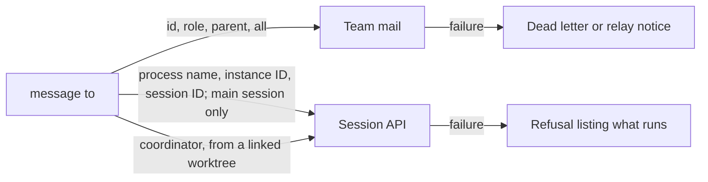

| To                                           | `to`                                                                     | Carried by                    | Failure the caller sees                                                                  |
| -------------------------------------------- | ------------------------------------------------------------------------ | ----------------------------- | ---------------------------------------------------------------------------------------- |
| A subagent, its parent, a sibling            | id, role, `parent`, `all`                                                | Team mail                     | Dead letter or relay notice                                                              |
| Another Octocode process (main session only) | exact process name (`octocode-main-c0ea9f3e`), instance ID or session ID | [Session API](session-api.md) | A refusal listing what runs; [what the sender gets](session-api.md#what-the-sender-gets) |
| The main checkout, from a linked worktree    | `coordinator`                                                            | Session API                   | [None or several](#finishing-a-worktree): told, nothing sent                             |

A session's own name is in the `environment` section of its prompt, after the cached prefix; `coordinate list` shows other sessions with name, busy state and folder and marks this repository's coordinator. `/new`, `/resume` and `/fork` start a new conversation with a new name and instance ID, so a message to the old name fails with what is running. A process message does not wait for the receiver's run; the answer arrives as a message from its name, so two sessions cannot wait on each other. Its text arrives [marked as external](session-api.md#what-the-session-sees), and whether it arrives is [the receiver's permission mode](permissions.md#external-messages). `forward`, `replyTo` and `interrupt` reach teammates only, and a subagent has no process route: a restricted child must not ask an unrestricted session to act. An outside agent stays `agent` type `external` ([lifecycle](#external-agent-lifecycle)).

### Handing a file to a teammate

An isolated worktree's files are not readable from a sibling's worktree, and a coordinator cannot write into one. `sendMessage` with `attach` (a path in the sender's own worktree) carries the file's text in the message, framed as `<attachment path=… bytes=… sha256=…>`. The recipient writes it with its file tool and checks that the SHA-256 of what it wrote equals the one in the frame.

| Refused, nothing sent                                                                              | Why                              |
| -------------------------------------------------------------------------------------------------- | -------------------------------- |
| Missing file, directory, binary or non-UTF-8 file                                                  | Only text travels                |
| Over 64 KB                                                                                         | The text rides in the message    |
| Outside the sender's worktree (after `..` and symlinks), or inside `.git` or `.octocode`           | Only the sender's own files      |
| `.env*`, `.npmrc`, `.netrc`, SSH keys, `*.pem`, `*.key`, or text that looks like it holds a secret | Credentials never go in messages |

`attach` goes with a new message, not with `forward`. A recipient that has ended is refused as for any message.

### Finishing a worktree

Octocode merges into the same checkout one at a time, including requests from separate sessions. Waiting for a merge is cancellable and stops after 30 seconds if the checkout remains busy; an active merge finishes or rolls back before the next begins. Other checkouts can merge independently. This coordination covers Octocode merge commands; avoid running a manual Git merge in that checkout at the same time.

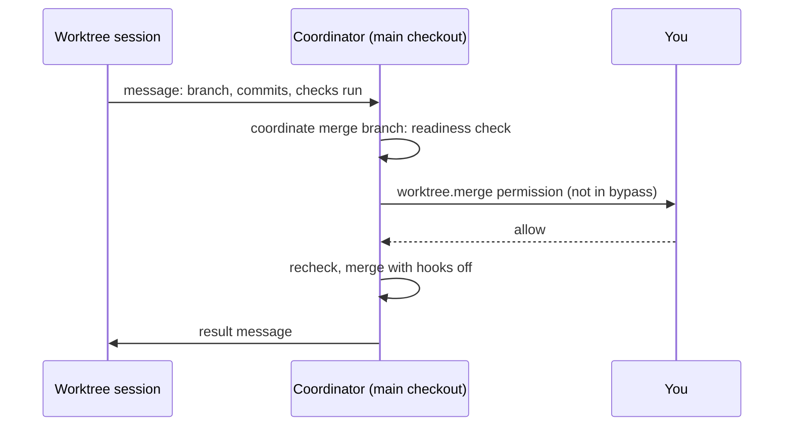

The coordinator is the one session whose working directory is in the repository's main checkout (`git worktree list`). If there is none or several, nothing is sent and the tool says so, naming them; the model tells you and leaves the worktree as is, and with several your choice goes in `to` by name. The worktree session never merges into the main checkout itself; `coordinate` `merge` refuses outside it. `coordinate` `merge` takes only a linked worktree's branch; you can also type `/worktree merge <branch>` in the main checkout (it shares its merge with `/agents merge`).

| Readiness check refuses with the reason and next step                  |                                                                                          |
| ---------------------------------------------------------------------- | ---------------------------------------------------------------------------------------- |
| Uncommitted work in that worktree                                      | an agent still working there                                                             |
| An ongoing backlog item a session there holds on that worktree's board | a merge in progress                                                                      |
| A path another agent holds                                             | a conflict (predicted with `git merge-tree`, then tried for real and aborted on failure) |

In every mode but `bypass` the merge asks you ([`worktree.merge`](permissions.md#worktree-merges)); in `bypass` a ready merge runs unasked and is announced. After the answer it rechecks uncommitted work and working agents, merges with hooks off, and leaves the worktree and branch for their owner (`/worktree remove`).

### Team mail

Live native agents in the same repository, in any of its [worktrees](#worktrees), can address another coordinator or its workers by exact ID; unique role names also resolve repository-wide (prefer exact IDs across trees). `to: "all"` broadcasts only within the sender's tree; interruption is limited to the sender's child or your session tree. Every subagent (isolated too) is on its coordinator's team, lists teammates with `coordinate list` and messages them and its coordinator; the team grants no authority. A finished worker's own coordinator owns its revival.

| Topic          | Behavior                                                                                                                                                                                                                                                                                                                                                                                                                                                                                                                                                                                                                                                                                                                                                                                                                                                                                                                   |
| -------------- | -------------------------------------------------------------------------------------------------------------------------------------------------------------------------------------------------------------------------------------------------------------------------------------------------------------------------------------------------------------------------------------------------------------------------------------------------------------------------------------------------------------------------------------------------------------------------------------------------------------------------------------------------------------------------------------------------------------------------------------------------------------------------------------------------------------------------------------------------------------------------------------------------------------------------- |
| Queueing       | Messages stay queued until they reach the recipient's model context. Delivery waits for acknowledgement of the previous batch and targets 32 KiB per batch; messages are never split (an oversized one travels alone), excess mail waits. Interrupts and requests that wake an idle recipient can pass the backlog. The team checks its database once a second and again when a step that ran tools ends                                                                                                                                                                                                                                                                                                                                                                                                                                                                                                                   |
| Questions      | A reply completes the original question only when sent to the asker. A stalled recipient (process runs but unseen for over a minute) is still reached by ID, as `parent` or by `all`, never by role. A question closes when its asker leaves, unless the asker is a subagent whose parent is present and may resume it with the answer. A subagent's report answers the questions its parent sent that it read: they close as answered, not as dead letters                                                                                                                                                                                                                                                                                                                                                                                                                                                                |
| Dead letters   | The feed and profiler name only recipients that dropped a message and whether each read it; a failed relay request is the parent's errand and not listed. A subagent sending to `parent` after its coordinator left is told to finish with its report. A dead letter is kept until its sender has been told, or one day after the sender left                                                                                                                                                                                                                                                                                                                                                                                                                                                                                                                                                                              |
| Forwarding     | `message` with `forward: <N>` delivers stored message N to more recipients without copying its body: they see the original sender, id and fence, the forwarder, and the forwarder's note (at most 1,000 characters) in a separate fence; a reply goes to the original sender. A parent message forwarded by a peer reads as that peer's untrusted data, not the parent's steering                                                                                                                                                                                                                                                                                                                                                                                                                                                                                                                                          |
| References     | An `agent` task, and an external `prompt`'s `refs`, may cite `msg#<N>` (a stored team message) and `report:<agent-id>` (the latest report of a subagent this session started). The host expands each when it builds the task, inside the fence of the agent that produced it, with its producer, time and a short SHA-256, and refuses the call naming each unresolved reference. A message is readable by its sender, its recipients (forwarded too) and the session that started either; anyone else, or an id past the 24-hour retention, gets the same "no message" answer. `report:<id>` selects the latest result's hash-bound report snapshot, or its saved transcript preview for a short report; a newer run retires the earlier selection. Report artifacts must be regular single-link files directly in that child's scratch folder; symbolic or hard links, other locations and digest mismatches are refused |
| Handoff limits | At most 16 distinct references and 32,768 characters including provenance and fences; report excerpts hold at most 4,096 characters plus a pointer to the full evidence; referenced messages above 8,192 characters are rejected, not shortened; over-budget handoffs fail before dispatch. External peers and lean children get complete bounded report text (asked for a focused summary when an excerpt is needed) because local artifact access is not guaranteed                                                                                                                                                                                                                                                                                                                                                                                                                                                      |
| Relay          | A child's message to an agent it cannot reach becomes a relay request its parent's process settles without the parent's model: a live target in the session gets it in its inbox; a lingering finished target is resumed with it (after the usual spawn approval) only when the message asks a question (`replyRequired`) or answers one that target asked; anything else is a dead letter naming `report:<id>`. A target whose resume is pending waits for it to rejoin, and each target is resumed by relay at most three times in ten minutes, so finished agents cannot keep resuming each other                                                                                                                                                                                                                                                                                                                       |
| Trust          | Senders are identified by team id in the local agent database; a process with write access to that database can insert rows under any id, so references and relays trust it as much as the processes that share it                                                                                                                                                                                                                                                                                                                                                                                                                                                                                                                                                                                                                                                                                                         |

### Reading all team mail

`/messages` opens a full-screen page of every message in the repository's team, newest first, thirty at a time; the `older…` row loads thirty more. Each row reads `sender(role) [marks] → recipient(role) [marks]`, then the kind (`request` when the sender asked for an answer, `reply to #N`, `FYI`), the time and the delivery state at the edge. An agent that has left the team shows `left` after its role. The marks say where an agent works: `main` for your checkout or `worktree <name>` for a linked or isolated one, its branch, and its tmux pane. They are read when the page opens, from live agents first and then from the last row an agent left behind, so an old message still names a finished agent's worktree.

Internal notices (check-ins, lease and dead-letter notices, mail from a local API client) are hidden; the page's first note says which state it is in, and the toggle key shows or hides them. `/messages internal` opens with them shown. Without a UI the command prints the first page as plain lines.

| Key       | Does                                                                                                                               |
| --------- | ---------------------------------------------------------------------------------------------------------------------------------- |
| Enter     | Opens the message: both ends with marks, delivery state per recipient, the whole text, and the sender's thinking, output and tools |
| `i`       | Shows or hides internal notices                                                                                                    |
| PgUp/PgDn | Scrolls a long message                                                                                                             |
| Esc       | Goes back from a message to the list; on the list, closes the page                                                                 |

The sender's thinking and output are read from its saved transcript, so they appear only when that transcript is still on disk; the page says when it is not. Messages in the transcript use the same header, naming the real recipient in place of "you". The web workspace's Messages tab shows the same route marks, with a Messages / Internal / All switch, a **Show thinking** toggle that expands a message's text and the sender's thinking, and a load-older control.

## Compaction and recovery

`memory` owns saved notes, and `archive` owns history and lifecycle retrieval; [Memory and Archive](memory.md) covers scopes, ids and paging. Compaction uses a built-in policy: settings cannot replace its summary, budget or cut point; `/compact [instructions]` requests it manually. Context sizes use one estimate of three characters per token (safe side for code, paths, JSON), including declared tools; provider limits can still reject a request.

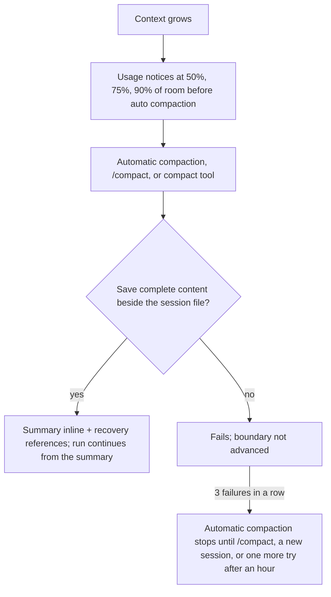

| Topic                | Behavior                                                                                                                                                                                                                                                                                                                                                                                                                                                                                                                                                                                                                                                                                                                                                                                                                                                                                                                                                                                                                              |
| -------------------- | ------------------------------------------------------------------------------------------------------------------------------------------------------------------------------------------------------------------------------------------------------------------------------------------------------------------------------------------------------------------------------------------------------------------------------------------------------------------------------------------------------------------------------------------------------------------------------------------------------------------------------------------------------------------------------------------------------------------------------------------------------------------------------------------------------------------------------------------------------------------------------------------------------------------------------------------------------------------------------------------------------------------------------------- |
| Detailed copies      | Expire `OCTOCODE_CLEANUP_DAYS` after the committed compaction time (default 30; `0` disables cleanup), only after a complete summary and trustworthy timestamp are stored. Reads and resume do not extend it; unknown legacy timestamps preserve copies. Summaries and original transcripts remain                                                                                                                                                                                                                                                                                                                                                                                                                                                                                                                                                                                                                                                                                                                                    |
| `compact` tool       | Optional `focus` (up to 16,000 characters, as for `/compact`). It only queues: compaction aborts the session first, so it runs when the run settles and a hidden message continues the task from the summary. A user stop drops the request, and so does a compaction that ran after it. Refused while context is under half the room before automatic compaction, within two turns of the previous compaction, and after the thrash breaker trips (three compactions in a row each within three turns of the previous stop automatic compaction; manual `/compact` resets; the tool counts as automatic). Subagents do not get it. The usage notice names it from the 75% notice on                                                                                                                                                                                                                                                                                                                                                  |
| Usage notices        | When a turn ends with context past 50%, 75% or 90% of the room before automatic compaction (window less reserve), one hidden message such as `[Context] 140k of 184k usable tokens used (76%); about 44k left before automatic compaction summarizes older turns. The window is 200k.` is added, once per band per compaction cycle (also across resume); the system prompt never changes for it                                                                                                                                                                                                                                                                                                                                                                                                                                                                                                                                                                                                                                      |
| Result budget        | One assistant message's tool results share 100,000 characters for every tool alike (two requested pages). One result keeps 20 KB by default (`bash`, other MCP tools, `web`); a call can ask for up to 50,000 (`responseChars`, `maxChars`; `bash` `maxOutputTokens` only lowers its result, never raises it), and no text part keeps more than 60,000 whole. Spent in tool-call order, not completion order, so the same calls keep and lose the same text and the cached prefix stays stable. The first part that does not fit keeps head and tail with a note, and it and every later part go to one JSON-lines file in the session's `output/` folder whose path the note names; later results show a short pointer. Images are not counted; a result with its own spill note is charged for what it shows; the budget restarts each turn. Only the stored message and the model's context are bounded: `tool_execution_end` events carry the full result. Archive reads reject files over 32 MiB                                 |
| Checkpoint           | Checked with retained messages, the system prompt and tool declarations. Oversized checkpoints, long user-message collections and a read/modified-files list over 3,000 characters are saved beside the session file and replaced by recovery references; an oversized checkpoint keeps its goal, TL;DR, newest user messages and Recovery section inline, whichever fit. A summary updating an earlier one is asked to stay under half the inline budget. A user message over 6,000 characters (less on a small window) is saved whole and replaced by its reference in place. A subagent's messages may each take up to half the section; its task, the oldest message, is evicted last. When messages do not fit beside the summary in the inline budget (80% of the reserve), the whole collection is saved behind one reference, keeping the newest that fit whole so the latest request survives word for word. The saved-results list also names each summarized subagent run's transcript and archive folder while they exist |
| While compacting     | Other input is queued but an extension command runs at once; one that cannot start returns to the editor with `Command did not run; restored to editor: <reason>`                                                                                                                                                                                                                                                                                                                                                                                                                                                                                                                                                                                                                                                                                                                                                                                                                                                                     |
| Moving or backing up | Keep checkpoint files with the session: they and `.bak` copies go when the session is removed, but files a saved-results list names live in `output/`, `bash/` and subagent scratch folders, which the session-start sweep removes after `OCTOCODE_CLEANUP_DAYS` without a write. A file in `output/` or `bash/` that the session's latest summary names (in its text, or in the list file a long saved-results list moves to) is kept past that age and goes with the session; a file only an earlier summary named can be gone                                                                                                                                                                                                                                                                                                                                                                                                                                                                                                      |
| `--no-session`       | No session file: long tool results, user messages and oversized checkpoints stay inline, cut to budget with a marker saying how many characters were omitted (head and tail stay); output past a tool's cap is still saved to `output/`. Only a session file that cannot be written fails compaction                                                                                                                                                                                                                                                                                                                                                                                                                                                                                                                                                                                                                                                                                                                                  |
| Summary too large    | When the messages to summarize do not fit the summarizer's window, the older half (by estimated size) is summarized on its own and that summary is updated with the rest, at the cost of one more request. A half that still does not fit drops its own oldest messages, and the summary says earlier history was left out                                                                                                                                                                                                                                                                                                                                                                                                                                                                                                                                                                                                                                                                                                            |
| Failures             | If complete content cannot be saved, or retained context and reference cannot fit, compaction fails without advancing its boundary. Three failures in a row stop automatic compaction until a successful `/compact`, a new session or, an hour after the last failure, one more attempt; reported once per trip and on each unrecoverable overflow. A user cancel does not count. A summary the model already wrote is kept for the next attempt over the same messages                                                                                                                                                                                                                                                                                                                                                                                                                                                                                                                                                               |

### Clearing old tool results

Before every request, old results of `web`, MCP tools and `bash` commands that only print are replaced by a short placeholder that names a file holding their whole text: the command's own output file when Octocode saved one, otherwise a copy saved at that moment. The newest five results always stay. A result that cannot be saved stays, so nothing is lost; read the named file or run the call again to see it. `file` and `agent` results and writing `bash` commands are never cleared. A `bash` command only prints when every command in it reads (as plan mode judges it) or is a `sed` or `awk` that writes and runs nothing (no `-i`, `w`, `e`, redirect, pipe or `system()` in its script), also after `cd`, in a pipeline or after `;` or `&&`; nothing in the line may be redirected to a file. A `sed` or `awk` behind `xargs` or another wrapper does not count.

Clearing happens only when the old results total at least 20,000 tokens and one of these holds:

| Occasion                             | Why clearing then costs nothing extra or pays                                                                                        |
| ------------------------------------ | ------------------------------------------------------------------------------------------------------------------------------------ |
| The cache is rewritten anyway        | The cache was last used longer ago than its lifetime, the model changed, or a tool or instruction update rewrites the leading prompt |
| Re-sending costs more than a rewrite | `T_old × R × N > S_after × W`, with the inputs below                                                                                 |

| Input     | Meaning                                                                                                                                                                                                                                                                            |
| --------- | ---------------------------------------------------------------------------------------------------------------------------------------------------------------------------------------------------------------------------------------------------------------------------------- |
| `T_old`   | Tokens of the results that would be cleared                                                                                                                                                                                                                                        |
| `S_after` | Tokens from the first cleared result to the end of the context, after clearing: the part the next request writes to the cache again                                                                                                                                                |
| `R`, `W`  | The model's price for one cached token read and for one token written at the session's cache lifetime (the input price where writes cost no premium). Unpriced models use 0.1 and 1.25 (5-minute) or 2 (longer) times the input price                                              |
| `N`       | Requests expected to re-send the old results: as many as the context has seen since it started or was last compacted, but no more than fit before the context fills its window at its average growth per request since then (counted from the size of the first of those requests) |

While the cache is warm, clearing may start at a later old result than the oldest: a later start clears fewer results but rewrites less of the cache, so a large message that stays (a long brief or report) does not stop the results after it from being cleared. Of the starts that free at least 20,000 tokens and pay, the one that saves most is taken. When the cache is rewritten anyway, all old results are cleared.

The decision is stored with the session, so every later request, a resume and a fork show the same placeholders and the cached prompt stays the same between requests. A model whose cache lifetime is unknown clears only when the cache is rewritten anyway.

### Transcript write failures

| Situation                                                           | Behavior                                                                                                                                                                                                                                                                                                                                                                                                                                                                                                                                                                                                                                                       |
| ------------------------------------------------------------------- | -------------------------------------------------------------------------------------------------------------------------------------------------------------------------------------------------------------------------------------------------------------------------------------------------------------------------------------------------------------------------------------------------------------------------------------------------------------------------------------------------------------------------------------------------------------------------------------------------------------------------------------------------------------- |
| An append fails                                                     | The live session restores its previous branch and blocks writes until one can succeed; nothing is cut from the file automatically; a full disk or I/O error is not final (freeing the disk resumes). A record that fully reached the file before its flush failed is kept, not rewritten; a partial one is sealed by the next write, as in the next row                                                                                                                                                                                                                                                                                                        |
| Lock held past 3 s                                                  | Nothing is written: a tool result or assistant message stays in memory and goes first at the next write (or at replacement or quit); any other entry fails for its caller to retry. The holder is recorded beside the lock (pid, host, start time): a lock whose holder is verifiably gone (killed, crashed: no process with its pid, or a later process that reused it) is taken at once instead of after 10 s, while a live or unknown holder is waited for. A database mirror read waits at most 250 ms and leaves the repair to a later append or open                                                                                                     |
| Full disk, I/O error                                                | A tool result or assistant message is lost and the run fails; the next request tells the model no result was recorded and the call may have run; a resume names the unanswered calls with their whole arguments, the last request in full, and, for an unanswered `agent` call, each subagent it started and how that run ended                                                                                                                                                                                                                                                                                                                                |
| Last record cut off (a crash, a kill, a power loss before the sync) | Loading skips it. The next write ends it with a newline under the session lock, so its bytes stay in the file as one line every reader skips, and writes right after it a `custom` record (`octocode-session-recovery`) naming its offset and length; the session goes on after it. An interactive session opened with such a tail says so once. Only bytes after the last newline that are not JSON count; a final line that is JSON but not a record, or a file with no whole line, stays refused                                                                                                                                                            |
| Shrunk file, unplaceable record                                     | Stays refused. The error names `octocode --fork <file>`, which copies the complete records into a new session and leaves the original byte-identical; `--fork <id>` reads the transcript file when it exists, the database copy only otherwise (stale exactly when a mirror rebuild failed). A malformed line another process left is refused unless the recovery record after it names it. A session whose very first write fails keeps the transcript in memory and creates the file at the next write, unless that left a partial file                                                                                                                      |
| Database mirror                                                     | Written after the transcript by a background database thread, so a busy database never holds the transcript lock or the screen; appends made together go as one write. A missed commit repairs itself at the next append; after a failed whole-file rebuild appends wait 5 s, then up to 5 min, before another try, while an open tries at once and every append still reaches the transcript. If the thread stops, its unconfirmed writes are rebuilt from the transcript; if it cannot start, the mirror is written on the main thread with a 100 ms wait. Quitting waits up to 1.5 s for queued mirror writes; one still queued is rebuilt at the next open |
| Older format                                                        | Opening rewrites the file in the current format (only parsable lines survive) after copying the original to the next free `.bak` name. Otherwise loading never writes: a final record lacking only its newline loads as is and the next append adds the newline. A session whose parent links loop still loads, with the entry closing the loop as root. A fork is written whole to a temporary file and renamed, so a failed copy leaves no partial session                                                                                                                                                                                                   |

## Configuration

The native runtime uses the [shared configuration locations](configuration.md) and [environment variables](environment-variables.md). Every tool, MCP server, harness, plugin, hook, skill, extension, prompt, theme, provider, provider source and setting is switched through `/configuration`, `octocode configuration` and the run flags `--enable`, `--disable`, `--set` ([Changing configuration](configuration.md#changing-configuration)). `/status` lists loaded skills and MCP connection states; [MCP](mcp.md) covers `/mcp` and server configuration. Profile files are in [Profile front matter](#profile-front-matter).

## Migration from the Pi extension

Octocode's agentic features began as an extension for Pi and are now built in. What you may still meet: code extensions are not supported ([runtime ownership](#runtime-ownership)); removed tool names are in [Removed tools](#removed-tools); role handoff preserves your independent `APPEND_SYSTEM.md`.

## Validation and limitations

The native runtime supports one active session per process. Permissions are application policy, not an OS sandbox. Provider authentication, browser interaction and external-agent integrations need their own configured checks; an offline test pass does not establish them. Contributors: [DEVELOPMENT.md](https://github.com/bgauryy/octocodecode/blob/main/DEVELOPMENT.md) lists the test commands.

## The octocode research CLI

`@octocodeai/octocode-agent` depends on the `octocode` research CLI. A checkout uses the linked build; a release uses the npm version. If the CLI is missing or unbuilt, neither the `octocode-cli` shim nor `/octocode` runs it; it is resolved once per process at the first agent shell, so a CLI missing then stays unavailable until you build the sibling `octocode` package and restart.

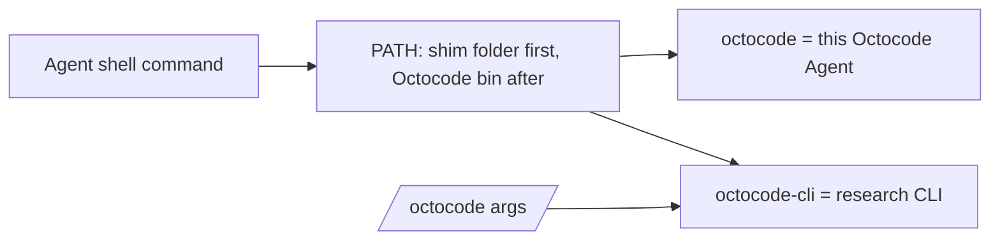

In agent shells `octocode` is the Octocode Agent that started the session (same runtime and entry, from a release bundle or a source checkout) and `octocode-cli` is the research CLI, whatever your `PATH` holds (`octocode --version` and `octocode-cli --version` show which runs). Small scripts named `octocode` and `octocode-cli` (each with a `.cmd` on Windows) live in a folder under the agent directory (`octocode-cli/<hash>/`) that holds nothing else: `octocode` starts this process's Node on the agent's entry, `octocode-cli` runs the CLI; sessions with the same runtime and entry share the folder and files are replaced atomically only when they change. A missing research CLI leaves only `octocode`. Every shell command (`bash`, background jobs, `!`) and every subagent gets that folder first on `PATH`, then Octocode's `bin` (`fd`, `rg`). Agents learn only that `octocode-cli` is there (the `bash` host line lists it); the CLI documents itself with `octocode-cli --help`.

| Topic                             | Behavior                                                                                                                                                                                                                                                                                     |
| --------------------------------- | -------------------------------------------------------------------------------------------------------------------------------------------------------------------------------------------------------------------------------------------------------------------------------------------- |
| `/octocode <args>`                | Main session only. A pure proxy: runs the CLI with the arguments exactly as typed, in the session's directory with the agent shells' environment; no aliases, refusals or per-command modes. Quoted JSON stays one argument. Completions come from the CLI's own help, read once per process |
| Not a CLI command                 | A first word that is not an option and not in `octocode-cli --help` (and `octocode-cli <word> --help` fails) is not meant for it: the whole line goes to the agent as a prompt. So `/octocode login` reaches the agent; the sign-in is `/octocode auth login`                                |
| Terminal UI                       | The CLI gets the real terminal: the UI stops, stdin and stdout are inherited so prompts, colors and the GitHub device flow work, then Octocode waits for a key, resumes the UI and reports the exit status. Ctrl+C belongs to the CLI; an abort or Octocode exiting kills it                 |
| RPC, web workspace, piped session | stdin closed; the result is the first 20 KB of combined output (longer ends `[output cut at 20 KB]`); Esc, an abort or Octocode exiting stops it and the result says cancelled; a command needing input gets none and reports its own error                                                  |

## GitHub authentication in the terminal

| Command                 | Does                                                                                                        |
| ----------------------- | ----------------------------------------------------------------------------------------------------------- |
| `/octocode auth login`  | The CLI's device login                                                                                      |
| `/octocode auth status` | Verifies the active credentials                                                                             |
| `/octocode auth logout` | Removes the stored login; environment tokens and GitHub CLI credentials can still take precedence or remain |

Once per run a session with a UI checks in the background whether GitHub is signed in: it runs `octocode auth status --json` (asked again without `--json` when an older CLI rejects the option), 10-second limit per run, cancelled at session end. Only the CLI's documented answers count: exit code 4 or `authenticated: false`. Then one notice says "GitHub is not connected for code search: run /octocode auth login"; a signed-in user, a missing CLI or a failed or timed-out check sees nothing.

Provider API credentials are separate: `/providers` sets, updates and removes them (`/logout` opens the removal picker), `/model` selects the active model and `/modelsettings` manages shortcuts, the catalog and agent routing ([commands](commands.md#model-and-provider)).
