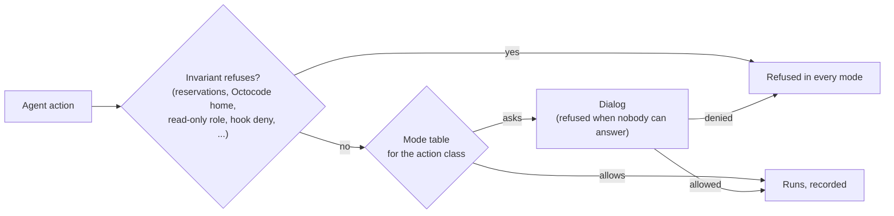
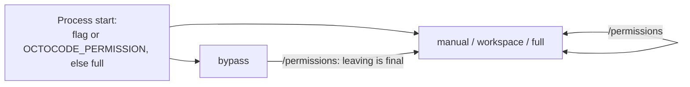
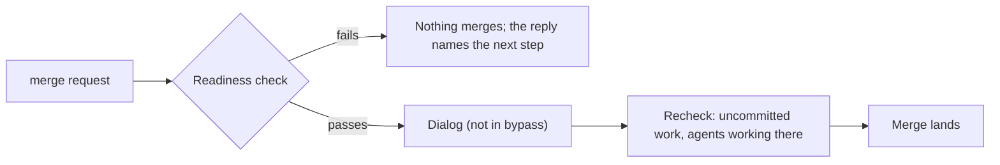
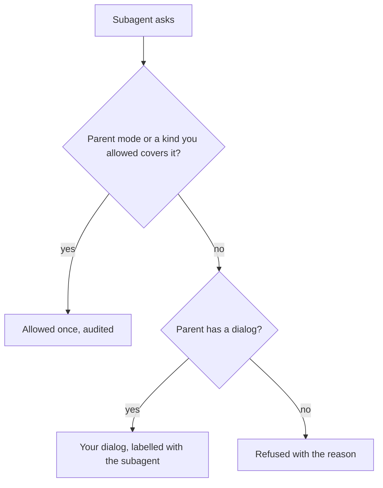
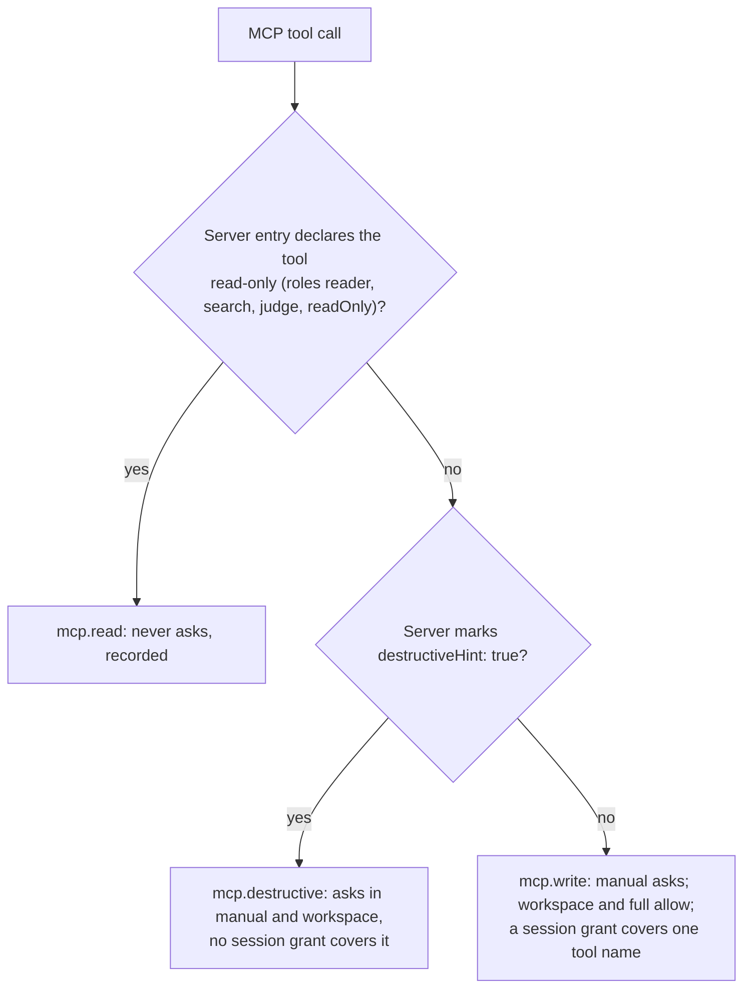
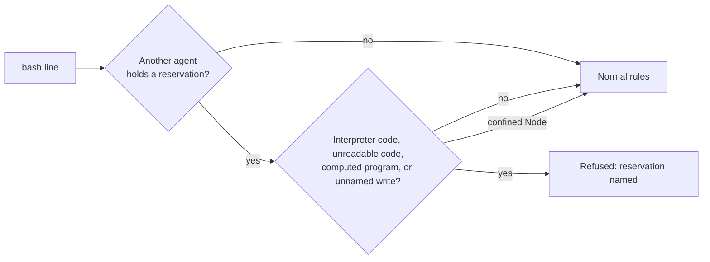
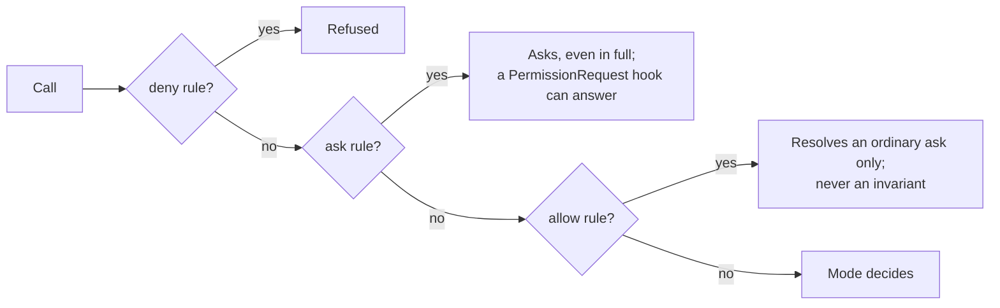

# Permissions

Octocode decides, for every action an agent takes, whether to allow it, ask you, or refuse. This is a guard against mistakes, not an operating-system sandbox: modes never change the process's filesystem or network privileges. The optional [shell sandbox](configuration.md#shell-sandbox) (`sandbox.mode`, off by default) adds one around the agent's shell commands.



Later checks, in order: read-only and isolated-tree refusals, the state-folder refusal, shell and file classification, provenance, Claude-compatible rules, hook asks, network and browser checks, session grants, the dialog. `/permissions log` shows every recorded decision.

## Modes

| Mode             | Meaning                                                                                       | How to start it                                                       |
| ---------------- | --------------------------------------------------------------------------------------------- | --------------------------------------------------------------------- |
| `manual`         | Asks for almost everything                                                                    | `OCTOCODE_PERMISSION=manual` or `--permission-mode manual`            |
| `workspace`      | Allows work inside the repository, asks for the rest                                          | `OCTOCODE_PERMISSION=workspace` or `--permission-mode workspace`      |
| `full` (default) | No routine asks; a few classes still ask, and so do reads of another tool's credential store  | default; `/permissions full`                                          |
| `bypass`         | Allows every class and ask reason, including those `full` asks about; invariants still refuse | `--dangerously-skip-permissions` or `OCTOCODE_PERMISSION=bypass` only |

An invalid `OCTOCODE_PERMISSION` starts in `manual`. In a session: `/permissions manual|workspace|full`; `/permissions` shows the state; `/permissions grants` lists session grants, `/permissions grants clear` removes them, `/permissions grants clear messages` removes only external-message grants; `/permissions log` shows decisions; `/permissions plan` and `/permissions plan off` enter and leave [plan mode](#plan-mode).

| Action class                                                                                                                                                                                                                                                                                           | `manual` | `workspace` | `full` |
| ------------------------------------------------------------------------------------------------------------------------------------------------------------------------------------------------------------------------------------------------------------------------------------------------------ | -------- | ----------- | ------ |
| Reads outside the workspace (`read.outside`), file changes in the repository (`file.workspace`), shell commands (`shell`), web requests (`web`), browser actions (`browser`), MCP tool calls (`mcp.write`), starting a subagent (`agent.spawn`)                                                        | asks     | allows      | allows |
| File changes outside the workspace (`file.outside`), destructive shell commands (`shell.destructive`), taking control of the browser (`browser.control`), private or local addresses (`net.private`), uploads from outside the workspace (`upload.outside`), destructive MCP tools (`mcp.destructive`) | asks     | asks        | allows |
| A message from another process (`message.external`, [below](#external-messages))                                                                                                                                                                                                                       | asks     | asks        | allows |
| Browser cookie access (`browser.cookies`), desktop control (`desktop.control`, and `desktop.sensitive` for its clipboard, kill, recording and replay tools; [below](#desktop-control)), landing commits on the default branch of the main checkout (`worktree.merge`, [below](#worktree-merges))       | asks     | asks        | asks   |

Raw browser CDP commands, including `cdp` steps inside a `run` plan, ask for `browser.cookies`: they can execute arbitrary browser code or access cookies. This includes apparently harmless CDP reads; the permission gate does not inspect programs to guess their effects. Dismissing the dialog stops the whole call before any plan step runs. Ordinary typed DOM actions, extraction, snapshots and protocol/schema discovery keep their existing permissions. One cookie-access approval can cover the session; profiles cannot grant it.

Also asking in every mode, `full` included, and refused where nobody can be asked: source-policy asks, an agent's save of a global or pinned memory, and a read of another coding agent's credential store ([below](#credential-files)). Hook asks, provenance hits, credential-file reads and the peer-session git ask ask only in `manual` and `workspace`; in `full` they run and are recorded.

### Start mode, `bypass` and mode changes



- `/new`, `/resume`, `/fork` and `/reload` keep the stricter of the current and start mode. With nothing exported, the mode you chose stays; with `OCTOCODE_PERMISSION` or `--permission-mode` set, a wider choice goes back to it and a notice says so. Session grants clear on every start. A subagent starts once, in its parent's mode at that moment.
- `/permissions` and the editor shortcut never switch into `bypass`, and a session that leaves it cannot return. Use it only where nothing outside the run is at stake (a disposable container). Under `bypass` a worktree merge still needs its [readiness check](#worktree-merges), is announced in the transcript and terminal, and its audit entry says `via: bypass`, as does every call only `bypass` allows. The startup line, the mode summary and `/status` say so, and `sessionApiTurnPermission` does not hold it.
- A change that makes something ask where it was allowed clears session grants and stops every running subagent (stop reports name the reason). Interactive sessions first name the running subagents and ask; declining keeps the mode. Without a UI the change applies at once. Widening never asks.

### Always refused or asked, whatever the mode

| Rule                     | Behavior                                                                                  |
| ------------------------ | ----------------------------------------------------------------------------------------- |
| Cloud metadata addresses | `169.254.169.254`, `fd00:ec2::254`, `168.63.129.16` (or a name resolving to one): refused |
| Credential store reads   | Ask in `manual`/`workspace`; run and recorded in `full`. Writes refused in every mode     |
| Other agents' stores     | Reads ask in every mode, `full` included; once per store with the session answer          |
| Browser cookies          | Ask in every mode; dialog offers "Allow all browser cookie access for this session"       |
| Destructive shell        | Asks outside `full`; always takes a restore point. Applies to `!` commands you type       |
| Octocode state folder    | Known writes into the Octocode home are refused                                           |
| MEMORY.md files          | `file` and known shell writes refuse the global and workspace files; `memory` writes them |
| Reservations             | Another agent's reserved paths are refused ([below](#reservations-and-the-shell))         |
| Provider keys            | `bash` starts without them; `bash.inheritProviderKeys` (global settings) keeps them       |

- Credential store: Octocode's and Pi's `auth.json`, `mcp-auth.json`, OS keychain print commands and `octocode auth print-api-key`/`print-bearer-token`, read through `bash`, `powershell` or an MCP tool naming the file. A computed path is not seen.
- Other agents' stores: Claude Code, Codex, OpenCode and the Copilot CLI ([below](#credential-files)).
- Destructive shell: wiping `/`, home or a system folder, `git reset --hard`, `git clean -f`, `git checkout .`, `git restore .`, forced `git push`, `rm -r` at or above the checkout root, changes under `~/.ssh`.
- Tool output reaches the model unredacted; add a `tool_result` [hook](hooks.md) to redact.
- `workspace` mode does not defend against code an agent hides (`python -c`, `node -e`, computed options, programs a git line names): use `manual` to review every command. Plan mode and peer reservations refuse these.
- A `notify` command (`on` `check.result`) runs unattended, so setting it is decided as the `bash` call it is. Claude rules see two operations, `notify` and `Bash`: a deny or ask on either applies, an allow needs both.

### Project trust

A session starts only in a folder you trusted; the layers here apply after trust and never decide it. Octocode asks once per folder; `/trust` and `octocode trust` list, add and remove decisions; trusting a folder trusts its future contents. `octocode trust add`/`remove` refuse from a session's shell. See [Trust](configuration.md#trust) for `--trust`, worktrees and subagents.

## External messages

A message another process sends a session through the [session API](session-api.md) (also `agent` type `message` to a process name, and the API's `agents.tell`, `turn.abort`, `external.call`) is class `message.external`. `external.call list`, `status`, `messages.list` and the event stream only read and stay open (each call is recorded).

| Mode                                                                                  | A message                                                |
| ------------------------------------------------------------------------------------- | -------------------------------------------------------- |
| `full`                                                                                | Taken without a dialog; the turn runs in `full`, audited |
| `workspace`, `manual`, `full` with `sessionApiTurnPermission: "workspace"`, plan mode | Dialog showing sender, text and that it is external      |
| No UI                                                                                 | Refused                                                  |

`sessionApiTurnPermission` (`session` by default) set to `workspace` holds API-started turns, and messages that steer a running turn, to `workspace`: a `full` session then asks, and the turn's tools run under `workspace` until it settles. `sessionApi: false` and `/api off` stop the API.

Dialog choices: **Allow once**; **Allow messages from `<process>` for this session**; **Allow all external messages for this session**; **Deny**; **Deny messages from `<process>` for this session** (each later ask from it is refused silently until the session ends or `/permissions grants clear messages`; `full` still takes the message). Per-process choices appear only when the caller is confirmed: the receiver calls the named instance back on its registered socket with a nonce and the ticket the caller sent, and a pid copied from the registry is not enough. An unconfirmed caller gets only the other choices. Grants are keyed by the confirmed instance, last for the session, and do not pass to subagents.

Accepting a message widens nothing: tools in its turn follow the mode, and a message can never answer a dialog or approve a merge. The sender name is a claim: any program running as your user can name itself anything over the owner-only socket, and a same-user program that rewrites a session's files can pass as that session ([who can reach a session](session-api.md#who-can-reach-a-session)). In `full`, a permission request from an outbound external ACP agent gets its advertised `allow_once` without a prompt, audited as `agent.spawn`; elsewhere you choose, and with no one to ask it is cancelled. An always-allow option is never chosen for it.

## Worktree merges

`worktree.merge` is the `coordinate` tool's `merge` of a linked worktree's branch into the main checkout ([workflow](native-features.md#finishing-a-worktree)), or [the same landing through `bash`](#landing-through-the-shell). It asks in every mode but `bypass`, and is refused where nobody can be asked.



| Readiness check                                              | Next step on failure                                 |
| ------------------------------------------------------------ | ---------------------------------------------------- |
| No uncommitted or untracked work in the worktree             | Commit it                                            |
| No team agent still working there                            | Wait until it is idle                                |
| No ongoing backlog item on the worktree's own board          | Finish the item                                      |
| No file the branch changes is reserved by another agent      | Wait for the reservation                             |
| `git merge-tree` predicts no conflict with the main checkout | Merge the main branch into the worktree branch first |

`/worktree merge` runs the same check; typing `/worktree merge <branch>` is consent and asks nothing, while a request in chat still gets one confirmation. Merging an isolated child's saved result (`coordinate merge` with `id`, `/agents merge`) waits until the child stops working. The dialog offers **Allow all worktree merges for this session**.

### Landing through the shell

`git merge`, `pull`, `rebase`, `cherry-pick`, `revert` and `am` through `bash` ask the same way, in every mode, when they act on the main checkout while it is on the default branch (`origin/HEAD`, else `main` or `master`). The dialog names the command and branch; its session answer is the same grant as the tool's (`/permissions grants`, `/permissions grants clear`). With no one to ask the call is refused and nothing changes. A Claude `Bash` allow rule does not answer it; a `PermissionRequest` hook can.

| Case                                                                                                                     | Asks?                                   |
| ------------------------------------------------------------------------------------------------------------------------ | --------------------------------------- |
| Feature branch in the main checkout; linked worktree updating its own branch                                             | No                                      |
| Linked worktree naming the main checkout (`git -C <main>`, `cd <main> &&`, `--work-tree`)                                | Yes                                     |
| Moving the default branch: `branch -f`, `update-ref`, `checkout -B`, `switch -C`, `push . src:main`, `reset` to a commit | Yes (same forms on other refs: no)      |
| `--abort`, `--continue`, `--quit`, `--skip`, `pull --dry-run`, `commit`, `push` to a remote                              | No                                      |
| `merge --no-commit`, `merge --squash`, `cherry-pick -n`                                                                  | Yes                                     |
| `!git merge x` you type                                                                                                  | No (consent); a hook deny still refuses |

The command is read through wrappers (`env`, `timeout`, `sudo`), `git -c`, lists, `if`/`for` bodies, substitutions, `sh -c`, `eval`, heredoc and `echo … | sh` scripts, and `find -exec`. A destructive line that also lands stays `shell.destructive` (with its restore point) and offers no session answer. Hooks run first, so a `PreToolUse` deny refuses before any dialog. The guard fails open when the command, checkout or default branch cannot be determined, and does not see an interpreter running `git merge`, a git alias, `cd ..`/`cd "$X"` or a `powershell` command. Server-side branch protection is the strongest backstop.

## Credential files

A shell or research-tool call that names a file holding API keys or tokens asks in `manual` and `workspace`, because what it prints enters the model context. In `full` it runs and is recorded. The check reads the paths a call spells; a path built at run time (`cat $X`, a glob) is not seen.

A read of another coding agent's credential store asks in `full` too. This is a deliberate exception to "`full` asks nothing": those tokens are that program's own sign-in, and Octocode never needs to read them. In `full` the dialog offers **Allow reads of &lt;store&gt; for this session**, so each store asks once per session; `/permissions grants clear` forgets the answer. In `manual` and `workspace` every read asks, as for Octocode's own store. Only `bypass` reads them without asking.

| Covered                                                                                           | Notes                                                                                                                                                                              |
| ------------------------------------------------------------------------------------------------- | ---------------------------------------------------------------------------------------------------------------------------------------------------------------------------------- |
| `auth.json` of the agent directory, the Octocode home and, when Pi's folders are a fallback, Pi's | Also the folders that hold one, and `mcp-auth.json`                                                                                                                                |
| `models.json`                                                                                     | Only when it holds a literal `apiKey`; a `$NAME` or `!command` reference holds no secret                                                                                           |
| Other tools' files under the home folder                                                          | `~/.aws/credentials`, `~/.config/gh/hosts.yml`, gcloud and Azure token files, `~/.docker/config.json`, `~/.kube/config`, `~/.netrc`, `~/.npmrc`, `~/.pypirc`, `~/.git-credentials` |
| Keychain read commands                                                                            | `security find-generic-password`, `secret-tool lookup` and similar                                                                                                                 |
| Octocode's print commands                                                                         | `octocode auth print-api-key`, `octocode auth print-bearer-token`                                                                                                                  |

| Another coding agent's store (asks in every mode) | Covered                                                                                                |
| ------------------------------------------------- | ------------------------------------------------------------------------------------------------------ |
| Claude Code                                       | `~/.claude/.credentials.json` (or under `CLAUDE_CONFIG_DIR`) and its folder                            |
| Codex                                             | `$CODEX_HOME/auth.json` (default `~/.codex/auth.json`) and its folder                                  |
| OpenCode                                          | `~/.local/share/opencode/auth.json` (or under `XDG_DATA_HOME`), its folder, and `opencode auth export` |
| Copilot CLI                                       | the `~/.copilot` folder and `~/.copilot/config.json`                                                   |
| Gemini CLI                                        | the `~/.gemini` folder and `~/.gemini/oauth_creds.json`                                                |

At startup, a loose-permission or in-git-work-tree warning also covers each `auth.json` the session loads and a `models.json` with a literal key. Shell commands start without the provider keys of built-in providers and without the variables a custom provider's `apiKey` names in `models.json`; `bash.inheritProviderKeys` keeps them.

### Shell sandbox read denials

While the shell sandbox is on (`sandbox.mode`), a sandboxed command cannot read these, in any permission mode and for read-only subagents too:

| Denied                                      | Where it comes from                                                       |
| ------------------------------------------- | ------------------------------------------------------------------------- |
| `auth.json`                                 | the agent directory (`OCTOCODE_CODING_AGENT_DIR`, else the Octocode home) |
| `.ssh`, `.aws`, `.gnupg` and their contents | your home folder (`HOME`)                                                 |

The read fails inside the command and the result names the refused path. A command that really needs one (for example `git push` over SSH) runs outside the sandbox only through the usual `shell.unsandboxed` approval: the agent retries it with `sandbox: false` and you are asked. With the sandbox off, or in `bypass` mode with `sandbox.mode` at `auto`, this list does not apply.

## Subagent permission asks

A subagent starts in its parent's mode with the kinds you allowed for the parent's session. When it still needs approval, the ask goes to its parent:



| Case                                                                                     | Result                                                                                       |
| ---------------------------------------------------------------------------------------- | -------------------------------------------------------------------------------------------- |
| The parent's mode or a kind you allowed ("Allow all shell commands") covers every action | allowed without a dialog; external messages, worktree merges and cookies never pass this way |
| No dialog (print mode, `--no-dialogs`)                                                   | refused: nobody can confirm; the subagent reports what it needs                              |
| Its earlier ask still open                                                               | refused until that one is answered                                                           |
| More than 10 asks in a minute                                                            | the rest of that minute is refused                                                           |
| You leave an ask unanswered for 10 minutes                                               | refused; the parent agent is told what waits, so it can ask you                              |

An external agent (ACP) asks the same way: in `full` and `bypass` it proceeds once and is logged; with nobody to ask it is told you refused.

The parent agent never approves for you: a subagent's message is information, not consent. It answers questions you already settled and asks you otherwise.

## Subagents and shared git state

A subagent in the shared working tree (not `isolate: true`) is refused shell commands that change git state other agents share, in every mode, before hooks. The refusal tells it to leave git to its parent and report changed files. An isolated subagent works in its own worktree and keeps these commands.

The main session is asked, not refused, before `git stash`, `git restore` or `git checkout -- <path>` (or `.`) while another live session works in the same checkout, because they can discard that session's uncommitted work. It asks in `manual` and `workspace`; in `full` it runs and is recorded, and where nobody can be asked it is refused. Without a peer session these commands follow the usual mode rules.

| Refused                                                                                                                                                                                                                                           | Allowed                                                                                                                |
| ------------------------------------------------------------------------------------------------------------------------------------------------------------------------------------------------------------------------------------------------- | ---------------------------------------------------------------------------------------------------------------------- |
| `add`, `rm`, `stash` (except `list`, `show`, `create`), `commit`, `reset`, `restore`, `checkout -- <path>` or `.`, `switch`/`checkout` that moves HEAD or rewrites files, `merge`, `rebase`, `pull`, `cherry-pick`, `revert`, `am`, `mv`, `clean` | Dry runs (`-n`, `--dry-run`) of `add`, `rm`, `commit`, `mv`, `clean`, `pull`; a new branch at HEAD (`git switch -c x`) |

The check reads past wrappers, `VAR=value`, chains, `eval` and `bash -c`/heredoc/`echo | sh` scripts; quoting and variable tricks can get past it.

## Desktop control

The `desktop` MCP server (Cua Driver, [MCP reference](mcp-reference.md#built-in-mcp-host)) clicks, types and reads the screen of your real desktop, where every open app and signed-in session is within reach. In your own session every call to it asks `desktop.control`, in `manual`, `workspace` and `full`; only `bypass` allows it. No session grant covers it, so each call asks again, unless its server entry declares the tool read-only (`roles`): that call stays an `mcp.read`.

The bundled `desktop` profile declares `desktop.control`. Starting it asks in every mode but `bypass`, `full` included, and every spawn asks again: no session grant or remembered profile answers it. Approving is the consent for that child's whole run, because a subagent cannot ask anyone; its desktop calls then run without a prompt each. The bundled `desktop` profile is `readOnly` and has no shell: its child cannot change the repository with its own tools, while its desktop calls are decided by `desktop.control` alone. That guard does not limit the apps it drives, which can change files or run commands (a terminal or an editor, say), so your approval of a start is the control: give a task that names one app. A launch or a call targeting a terminal, code editor, password manager or Keychain app (Terminal, iTerm2, VS Code, Cursor, Xcode, JetBrains IDEs, 1Password and similar; matched by name, bundle id or the process a call targets) is refused in every mode, `bypass` included. A process Octocode cannot identify is not refused. A task can also list the only apps its child may control (`apps`, for example `["Calculator"]`): the start dialog names them, and a call that targets any other app is refused in every mode, naming the app and the list. The match ignores case and `.app`, a bundle id matches by its last segment, and a process that cannot be identified is not refused. The list narrows the child and never lifts the denylist above; only `OCTOCODE_DESKTOP_ALLOW_APPS` does.control`alone. On-screen text is untrusted, like a page. Some tools ask on every call even inside an approved child, because they ask `desktop.sensitive`, a class no start approval or session grant answers (the child's ask reaches you through its parent): `clipboard_read`, `clipboard_write`, `kill_app`, `replay_trajectory`, `escalate_session`, `start_recording`, `browser_download`and`browser_set_input_files`. The typed browser tools of the`desktop` server carry the browser checks as well: a call that is also one of those asks once, naming every class ([native features](native-features.md#desktop-control)).

## MCP tools



The role alone decides a read: a call's arguments belong to the server and are not read, so an argument that turns a declared read into a write still counts as a read unless the server's own consent gate or `destructiveHint` says otherwise. Plan mode and read-only roles use the same rule. Annotations other than `destructiveHint: true` are discarded, so server hints cannot waive an approval or mark output trusted.

### Provenance

A tripwire for prompt injection: text from an untrusted source that reappears in a consequential call asks (in `manual` and `workspace`; `full` records it).

| Source                                                                                      | Treated as                                                                                                                                                                           |
| ------------------------------------------------------------------------------------------- | ------------------------------------------------------------------------------------------------------------------------------------------------------------------------------------ |
| Every MCP result, network program output (`curl`, `wget`, `ssh`…), a subagent's report      | Untrusted                                                                                                                                                                            |
| Tools a trusted entry declares `reader` or `search`: text from workspace paths              | Trusted; a path outside the workspace makes it private (a later web request or network command repeating it is a hit); a cursor page takes its origin from the page that returned it |
| A shell read of a file outside the workspace (`cat ~/.ssh/config`)                          | Private                                                                                                                                                                              |
| Team mail from another agent, and the text of each attachment it references                 | Untrusted; a `fromAttachment` write of that attachment into a consequential path is a hit even unread; a message you typed is trusted                                                |
| A subagent whose harness reports it read nothing untrusted (signed with the child's secret) | Clean; its report is trusted                                                                                                                                                         |
| `gh`, `git clone`/`fetch`, package managers, `docker pull`, `python -c`, `node -e` output   | Not untrusted (a known limit of a text tripwire, not a safety claim)                                                                                                                 |

Consequential: every MCP call's arguments, an `agent` call (a `message` as a `task`), a subagent's task, and text written into an instruction file a later session loads (`AGENTS.override.md`, `AGENTS.md`, `AGENTS.MD`, `CLAUDE.md`). Echoes of supplied arguments, an existing workspace path, the working folder, a model id, or what the task itself said are no hit. Output a background `bash` job delivers is indexed like a foreground result (only the tail the report carries). A provenance ask from one subagent offers **Allow text from `<agent>` for this session**, revoked with other grants.

### Hook-initiated MCP calls

A hook that calls an MCP tool (`mcp_tool`, see [hooks](hooks.md)) passes the same permission step as a model call (classification, provenance, hook asks, read-only role refusals) after the cloud-metadata invariant. A refusal fails the hook with the reason. PreToolUse hooks and extension `tool_call` handlers do not run for the hook's own call (they would rerun the hook). A tool hidden by `toolExposure` or no longer offered is refused. In `manual` and `workspace` you may be asked while the hook's timeout runs. Not gated, to avoid waiting on themselves: a `PermissionRequest` hook, and a hook call made while another is being decided (refused).

## Read-only roles

A subagent whose profile sets `readOnly: true` (bundled `reviewer`, `researcher`, `browser`, `desktop`) is refused changes in every mode, `full` included, before any dialog.

| Tool                    | The role may                                                                                                                                                                                                                                                                                                                                                    |
| ----------------------- | --------------------------------------------------------------------------------------------------------------------------------------------------------------------------------------------------------------------------------------------------------------------------------------------------------------------------------------------------------------- |
| `file`, `edit`, `write` | Change only its scratch folder, `.octocode/agent/temp/`, `.octocode/agent/<topic>/tmp/` and Markdown under `.octocode/`, except files a later session loads (`skills/`, `agents/`, `prompts/`, `hooks.json`, `settings.json`, `mcp.json`, `SYSTEM.md`, `AGENTS.md`, `CLAUDE.md`) and `.octocode/agent/` outside `temp/`                                                 |
| `bash`                  | Run commands that write nothing outside those places; refused when a write is seen or cannot be placed (`sqlite3` open for writing, awk with its own output or `system()`), or when a variable may swap the program run (`PATH=/tmp/x cat f`, `export X=1`, `[[ -v 'a[$(cmd)]' ]]`, as in the reservation table below)                                          |
| `git`                   | Read only: `status`, `log`, `diff`, `show`, `blame`, `grep`, `ls-files`, `ls-tree`, `rev-parse`, `rev-list`, `describe`, `shortlog`, `cat-file`, `show-ref`, `format-patch --stdout`; `branch`, `tag`, `remote`, `stash`, `worktree`, `notes` only to list. No `-c`, `--git-dir`, `--work-tree`, program-setting variables, or words that may expand to options |
| `octocode`              | Nothing: any run is refused (plan mode too)                                                                                                                                                                                                                                                                                                                     |
| MCP tools               | Only tools their server declares read-only, plus the browser's                                                                                                                                                                                                                                                                                                  |

It is a policy, not a sandbox: a program that writes by itself (`node script.js`) is not seen. Roles themselves: [native features](native-features.md#configuration).

## Reservations and the shell

Team reservations ([native features](native-features.md#file-mutation-guarantees)) bind `file` and every `bash` write target Octocode can name. A command whose targets it cannot name is not checked, so inspect files after concurrent shell work.

| Named (checked)                                                                                                                                                     | Not named (unchecked)                                                         |
| ------------------------------------------------------------------------------------------------------------------------------------------------------------------- | ----------------------------------------------------------------------------- |
| Redirects, `tee`, `rm`, `mv`, `cp`, `sed -i`, a sed `w` file, `git format-patch -o`, `git archive -o`, a path spelled through a variable the line sets to a literal | `> $FILE` with `FILE` unset in the line, a script, `sed -f`, `git checkout .` |

While another agent holds any reservation, `bash` also refuses commands whose writes cannot be named. The refusal names the reservation and the fix.



| Refused while a reservation is held                                          | Examples                                                           | Fix                                                |
| ---------------------------------------------------------------------------- | ------------------------------------------------------------------ | -------------------------------------------------- |
| Inline interpreter code                                                      | `python -c`, `node -e`, `perl -e`, `ruby -e`                       | Confined Node (below), or wait                     |
| Code the parse cannot read                                                   | `bash -c "$X"`, `eval $X`, `source <(…)`                           | Spell the command out                              |
| Computed program name, unreadable wrapper                                    | `$PY -c …`, `timeout $T make`                                      | Spell the program                                  |
| `xargs`/`parallel` whose input could pick the written file                   | `ls \| xargs tee a.ts`                                             | Name program and files                             |
| Arithmetic on a value the line does not show                                 | `echo $((x))`, `let`, `declare -i`                                 | Use literals                                       |
| A variable the shell or programs read, or one already exported, set anywhere | `PATH=/tmp/x; cat f`, `export X=1`, `unset PATH`, `NODE_OPTIONS=…` | Use a name of your own (`D=/tmp/out`), or a number |
| A `-v` test of a subscript the line does not spell out                       | `[[ -v 'a[$(cmd)]' ]]`, `[ -v a[$i] ]`                             | Test a plain name (`-v a[0]`)                      |
| Reader with a writing option and a computed word                             | `sort $X in`, `rg "$PAT" src`                                      | Start with a literal, or `--` first                |
| Git line that names a program                                                | `--upload-pack`, `rebase -x`, `GIT_SSH_COMMAND`                    | Harmless values (`color.*`) run                    |
| PowerShell                                                                   | Unless read-only                                                   | —                                                  |

The line is read as the shell reads it: groups, functions, `if`/`while`/`for`/`case` bodies, subshells, substitutions, `bash -c`/`sh -c`/`eval`/`trap` (four levels), `find -exec`, code piped or redirected into an interpreter, through wrappers (`sudo`, `ionice`, `flock`, `uv run`, `npx`…). Not detected: `su -c`, other runtimes (`bun -e`, `php -r`, `lua -e`), an interpreter started by another program (`ssh`, `make`, a saved script). Outside reservations, `workspace` mode asks for none of these.

### Confined Node

Node runs under a reservation in one exact form: `node --permission --no-experimental-sqlite [--allow-fs-read=<literal>]… -e '…'` (or `-p`, `--eval`, `--print`, or `-` with a quoted heredoc), with nothing expanded outside single quotes and no `PATH`, `NODE_OPTIONS`, `export` or other `--allow-*` set. Node's permission model then refuses writes and child processes: a seat belt against accidents, not a boundary against malicious code. A `node` missing only the flags is rewritten with them (`--allow-fs-read=*`), rechecked, and run if it passes; the result says so and a write fails with `ERR_ACCESS_DENIED`. Any other fault is refused with the fault named.

## Claude permission rules

Octocode always applies a partial Claude permission-rule adapter, independent of hooks (`disableAllHooks` does not disable it; child sessions inherit it). It reads `permissions.deny`, `ask` and `allow`, never writes them, and does not import another host's trust decisions.

| Scope         | File                                                                    | Activation                                                  |
| ------------- | ----------------------------------------------------------------------- | ----------------------------------------------------------- |
| User          | `$CLAUDE_CONFIG_DIR/settings.json`, otherwise `~/.claude/settings.json` | Always                                                      |
| Project       | `<repository root>/.claude/settings.json`                               | Deny and ask always apply; allow needs native project trust |
| Project local | `<repository root>/.claude/settings.local.json`                         | Same                                                        |

```json
{ "permissions": { "deny": ["Bash"], "ask": ["WebFetch"] } }
```



| Topic        | Behavior                                                                                                                                 |
| ------------ | ---------------------------------------------------------------------------------------------------------------------------------------- |
| Keys read    | `deny`, `ask`, `allow`, `defaultMode`, `additionalDirectories`; others give diagnostics                                                  |
| Trust        | Allow rules, `acceptEdits`, `additionalDirectories` load only from user settings or a trusted project; restrictions load from any source |
| Path rules   | `Read(…)`/`Edit(…)`: deny and ask ignore letter case, allow does not                                                                     |
| Hiding tools | A tool-wide deny hides the tool; partial restrictions apply per operation                                                                |
| Headless     | An unanswered ask is refused                                                                                                             |
| Not covered  | MCP research tools (match their MCP names), managed settings, Codex rules                                                                |

### Bash rules and shell file targets

Rules match each command in lists, pipelines, subshells and redirects; `Bash` and `Bash(*)` are equivalent. Syntax the parser does not model (`for`, `if`, heredocs, `export`, computed program names) is refused only under a restriction (scoped `Bash` deny/ask, or a `Read`/`Edit` deny); under allow-only rules the mode decides. Wrappers (`timeout`, `time`, `nice`, `nohup`, `stdbuf`, `command`, `xargs`) expose the inner command to deny and ask in tested forms; an exec wrapper or effectful `find` cannot be bypassed by a wildcard allow.

Redirects, `tee` and the operands of `cat`, `head`, `tail`, `wc` are checked before the process starts, with or without a Bash rule.

| Rule                           | On shell targets                                   |
| ------------------------------ | -------------------------------------------------- |
| Path-scoped `Read`/`Edit` deny | Blocks the target, symlinks included               |
| Bare or `(*)` `Read`/`Edit`    | Does not apply                                     |
| Path-scoped file allow         | Covers the target, not the command                 |
| Broad `Bash` allow             | Covers ordinary targets; matching denies still win |
| Scoped Bash allow              | Still needs target approval or a file allow        |

Every agent `bash` call is also checked against the writes Octocode finds (`cp`, `mv`, `rm`, `touch`, `dd of=`, `curl -o`, `tar`, `sed -i`, `git -C`, `find -delete`/`-exec`, `bash -c` scripts…). A write outside the repository, or to a file a later session runs or loads (hooks, `.git`, instruction files), asks as `file.outside` in `manual` and `workspace`. Unresolvable targets are refused under a scoped restriction; otherwise `manual` and `workspace` ask and `full` proceeds. The `file` tools refuse a file that is not valid UTF-8: replace it whole with `write`. This is a policy adapter, not a filesystem sandbox.

## Plan mode

`/plan` (or `/permissions plan`) adds a constraint over the current mode, `full` included: executable hooks pause, and shell execution, mutation tools and delegation are blocked; `/permissions plan off` leaves it. Plan state follows the session branch. Allowed operations, approval, transport support and the trusted-extension boundary: [native planning](native-features.md#native-planning-constraint).
