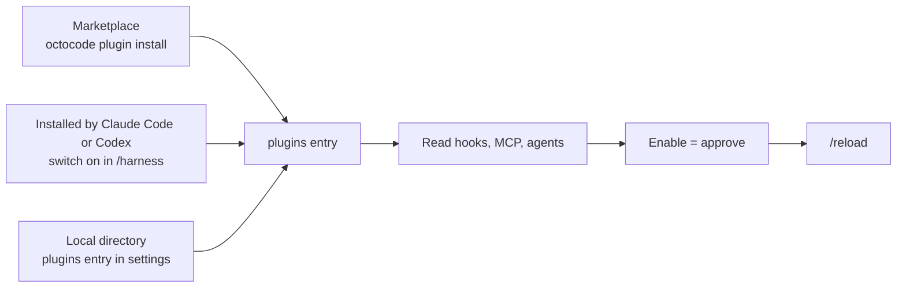
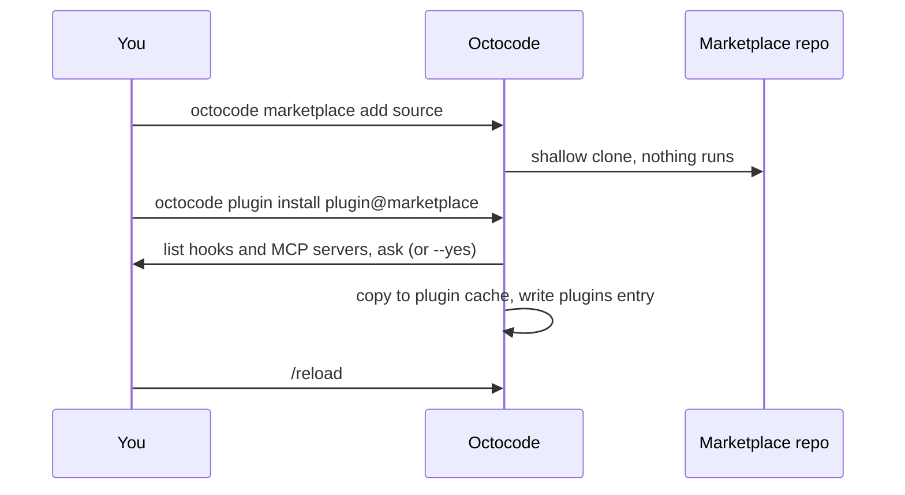
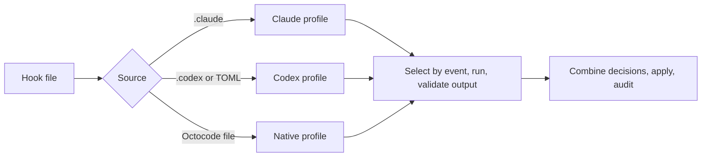

# Plugins

A plugin is a container with one identity that can carry skills, prompt commands, agents, hooks and MCP servers. Each component needs its own loader; what loads is listed below. Hooks and plugins run with your operating-system permissions and are not sandboxed. Project files load only after `/trust`.

## Choose a mechanism

| You want to                                                              | Use                                         |
| ------------------------------------------------------------------------ | ------------------------------------------- |
| Run a script when a tool is called, a prompt is sent or a session starts | [Command hook](hooks.md#add-a-command-hook) |
| Reuse a Claude Code or Codex plugin (skills, hooks, MCP servers)         | [Plugin](#add-a-plugin)                     |
| Share skills, prompts and themes through npm or git                      | [Package](packages.md)                      |
| Give the model task instructions only                                    | [Skill](skills.md)                          |

Octocode has no extensions: features register through an internal API, and `--extension` is an unknown flag ([native features](native-features.md#runtime-ownership)).

## Format support

**Yes**: loads and works as documented. **Partial**: loads with the limits in its section. **No**: not read.

| Format                                                               | Support | Notes                                                          |
| -------------------------------------------------------------------- | ------- | -------------------------------------------------------------- |
| Native hooks (`<Octocode home>/hooks.json`, `.octocode/hooks.json`)  | Yes     | [Hooks](hooks.md)                                              |
| Claude hooks (`settings.json`, `settings.local.json`)                | Partial | Claude profile; [hook events](hook-events.md)                  |
| Codex hooks (`hooks.json`, `[hooks]` in `config.toml`)               | Partial | Codex profile; `[features] hooks = false` turns them off       |
| Claude plugin (`.claude-plugin/plugin.json`)                         | Partial | Skills, prompt commands, agents, hooks, MCP servers            |
| Codex plugin (`.codex-plugin/plugin.json`)                           | Partial | Skills, hooks, MCP servers                                     |
| Portable root `plugin.json` (optional `extensions.com.openai`)       | Partial | Read with `"protocol": "codex"`; same components as Codex      |
| Plugins installed by Claude Code or Codex                            | Partial | Listed in `/harness`; switching one on adds it                 |
| Claude-compatible marketplace                                        | Partial | [Marketplaces](#marketplaces)                                  |
| Octocode package (`package.json` with an `octocode` key)             | Yes     | [Packages](packages.md)                                        |
| Agent Skills (`SKILL.md`)                                            | Yes     | Also read from Claude and Codex skill folders                  |
| Claude Mods modules; plugin LSP servers, output styles, dependencies | No      | Not loaded; a hook file with `modules` is reported and skipped |
| Hook handler `type: "agent"`                                         | No      | Reported as unsupported                                        |

## Add a plugin



For a marketplace plugin use `octocode plugin install` ([Marketplaces](#marketplaces)). Plugins that Claude Code or Codex already installed appear in `/harness` as "installed in Claude Code" or "installed in Codex"; switching one on adds a `plugins` entry with the protocol of the manifest it ships. For any other plugin:

1. Add an entry with an absolute `path` and a `protocol` to `plugins` in `~/.octocode/octocodecode/settings.json`, or in `.octocode/settings.json` for a trusted project:

   ```json
   {
   	"plugins": [{ "path": "/absolute/path/to/review-kit", "protocol": "claude" }]
   }
   ```

   Use `"protocol": "codex"` for `.codex-plugin/plugin.json` or a portable root `plugin.json`. Name the protocol explicitly when a directory holds both manifests. A Claude directory selected explicitly may omit its manifest (the directory name is the plugin name); a present invalid manifest never falls back. Relative roots are rejected, malformed entries are diagnosed and skipped.

2. Read the plugin's hook and MCP declarations (`/harness` lists them). Adding or enabling a plugin approves its hooks, MCP servers and agents. Approval covers declarations, not the scripts or programs they run. Project plugins follow folder trust.
3. Run `/reload`. Skills (`/skill:<plugin>:<skill>`) and prompt commands (`/<plugin>:<command>`) work at once; hooks and MCP servers load as declared.

Set `"enabled": false` and reload to remove a plugin's skills, commands, agents, hooks and MCP servers; its data directory is kept. `--no-skills` also disables plugin skills.

Readers check real-path containment, including symlinks. Skill discovery rejects directory cycles and links that escape the declared skill tree, including hidden and ignored descendants (stricter than ordinary skill scanning). Claude skills add to the default directory, explicit commands replace theirs, Claude hooks merge with the default file; a nonempty explicit Codex hook declaration replaces the default, an empty array falls back to `hooks/hooks.json`. Root `plugin.json`: inline `extensions.com.openai` replaces the Codex overlay, otherwise the overlay supplies OpenAI settings. Legacy Codex manifests with a blank name use the directory name; whitespace, separators and control characters in a name stay invalid.

### Components

| Component                                | Claude plugin                                                         | Codex or portable plugin                                                                      |
| ---------------------------------------- | --------------------------------------------------------------------- | --------------------------------------------------------------------------------------------- |
| Skills                                   | Yes, `plugin-name:skill-name`                                         | Yes, also `$plugin-name:skill-name` ([mentions](skills.md#select-skills-with-codex-mentions)) |
| Commands                                 | Partial: instruction-only Markdown ([below](#claude-prompt-commands)) | No                                                                                            |
| Agents                                   | Yes, `plugin-name:agent-name` ([below](#plugin-agents))               | No                                                                                            |
| Hooks                                    | Partial: `command`, `http`, `prompt`, `mcp_tool`                      | Partial: `command`, `mcp_tool`                                                                |
| MCP servers                              | Partial: stdio and streamable HTTP ([below](#plugin-mcp-servers))     | Partial: same                                                                                 |
| LSP servers, output styles, dependencies | No                                                                    | No                                                                                            |

A plugin that declares or ships an unsupported component (Claude `.lsp.json`, `output-styles/`, `monitors`, `userConfig`, `bin/`; Codex `commands`, `.app.json`) loads without it and reports a warning; `/harness` names each one.

### Hook environment and data

Plugin command hooks receive `CLAUDE_PLUGIN_ROOT` and `CLAUDE_PLUGIN_DATA`; Codex hook commands also receive `PLUGIN_ROOT` and `PLUGIN_DATA`; HTTP header interpolation uses the same identity. Skills and commands use the same data path: `<Octocode home>/plugins/data/<identity hash>/`, outside the plugin directory. It is created when an approved command hook runs or an approved stdio MCP server starts; expansion and header interpolation only resolve the path. Moving the plugin root changes its identity, approval and data location.

## Claude prompt commands

Instruction-only commands load from `commands/*.md`, declared files or directories, or manifest command maps, and expand through the prompt-template runtime as `/<plugin>:<command>`. `--no-prompt-templates` disables them separately from skills.

- Descriptions, argument hints and Claude placeholders work. `$0` and `$ARGUMENTS[0]` select the first argument; `$ARGUMENTS` keeps the original string; Markdown `arguments` names map to positions. A missing indexed value stays literal, a missing named value becomes empty, and arguments are appended when no placeholder uses them. Native prompt templates keep one-based numbering.
- `${CLAUDE_PLUGIN_ROOT}` resolves after argument insertion; session invocations also substitute `${CLAUDE_SESSION_ID}` and `${CLAUDE_PROJECT_DIR}`.
- A command that sets a model, grants tools, uses unsupported frontmatter or expands shell output is diagnosed and skipped. Duplicate names are diagnosed; command symlinks must stay inside the plugin.

## Plugin MCP servers

Plugins supply stdio and streamable HTTP servers to the MCP host; the supported fields are `type`, `command`, `args`, `env`, `cwd`, `url` and `headers`, and Claude HTTP entries need an explicit type. Other transports, bundles, remote bundle URLs and other fields produce diagnostics. Vendor OAuth policy, dynamic header helpers, user configuration, environment overlays, SSE and WebSocket are not imported; Octocode's own MCP authentication and transport rules apply.

- **Discovery.** Claude reads `.mcp.json`, then declared `mcpServers` paths or inline maps in order (later names replace earlier). Codex explicit paths or inline maps replace the default `.mcp.json`. Files must stay inside the plugin, symlinks included.
- **Names.** Servers register as `plugin:<plugin-name>:<server-key>`; their tools follow Claude's namespace, for example `mcp__plugin_review-kit_check__policy` ([Claude naming](https://code.claude.com/docs/en/mcp#plugin-provided-mcp-servers)). Use the scoped server name in an `mcp_tool` hook. Codex naming, portable overlays and policy semantics are unverified.
- **Placeholders.** Plugin-root, plugin-data and project-root placeholders resolve before registration, and stdio start exports them.
- **Lifecycle.** Project declarations register only after project trust. Disabling the plugin and reloading removes them. Registration does not prove a connection succeeded, and an existing server configuration can override a plugin registration.

## Plugin agents

A Claude plugin's agents become subagent profiles the `agent` tool can start, named `<plugin>:<agent>`. Adding or enabling the plugin approves them; an agent's prompt is an instruction, and a changed file is a new profile identity for the spawn permission prompt.

- **Source.** The manifest `agents` key (a path or array of `.md` files; no directories) replaces the default scan; without it every `.md` under `agents/` is read recursively. A disabled plugin contributes none; a project plugin contributes only in a trusted folder.
- **Names.** `<agent>` is the frontmatter `name`, else the file name without `.md`. In the default scan, subfolders are part of the name (`agents/review/security.md` in `my-plugin` is `my-plugin:review:security`; `name: audit` makes it `my-plugin:review:audit`). A manifest-listed file carries no subfolders. A frontmatter `name` with spaces, a colon or over 256 characters is replaced by the file name; a file or folder name with spaces is skipped and reported. (Claude Code [plugin components](https://code.claude.com/docs/en/plugins/components#agents) and [sub-agents](https://code.claude.com/docs/en/sub-agents).)
- **Precedence.** A plugin agent never replaces a bundled, user or project profile of the same name; a startup notice says so.
- **Carried over.** `description`; `model` (`inherit` is the coordinator's model, else a preference); `maxTurns` as `maxRequests`; `skills`; `readOnly`; `permissions:` (the spawn still asks the user); `tools` and `disallowedTools`, translated: `Bash` selects `bash`, `WebFetch` and `WebSearch` select `web`, `mcp__` entries are kept, and read, search and edit names need no entry. A `tools` list without a file-writing tool (`Edit`, `Write`, `MultiEdit`, `NotebookEdit`), or one that denies them, makes the profile read-only.
- **Ignored and reported:** `hooks` (ship hooks in `hooks/hooks.json`), `mcpServers`, `permissionMode`, `initialPrompt`, `effort`, `background`, `memory`, `omitClaudeMd`, `isolation`, `color`, `autoCompactWindow`, `experimental`, tool entries with a specifier (`Bash(git *)`) or without an Octocode equivalent, and every Octocode-only field (`lean`, `headless`, `linger`, `excludeTools`, `hooks: true`). Interactive sessions get a startup notice naming file and fields; the agent's row in `/harness config` shows source `plugin <name>`.
- **Unparseable frontmatter.** Claude Code loads the agent under its file name with fields ignored; Octocode skips it and reports the failure, and the `agent` tool names the reason.

## Marketplaces



A marketplace is a folder or git repository with `.claude-plugin/marketplace.json` (`name` and a `plugins` array; each entry needs `name` and `source`).

```
octocode marketplace add <path | owner/repo[@ref] | git-url[#ref]>
octocode marketplace list | update [name] | remove <name>
octocode plugin install <plugin@marketplace> [--yes]
octocode plugin update [plugin@marketplace] [--yes]
octocode plugin remove <plugin@marketplace>
octocode plugin list
```

`/harness install|update|remove <plugin@marketplace> [--yes]` do the same in a session (then `/reload`). `octocode install|remove|update|list` manage [packages](packages.md).

| Topic    | Rule                                                                                                                                                                                                                                                                                                                                       |
| -------- | ------------------------------------------------------------------------------------------------------------------------------------------------------------------------------------------------------------------------------------------------------------------------------------------------------------------------------------------ |
| Sources  | Relative path (`./plugins/x`, or a bare name under `metadata.pluginRoot`), `github` (`repo`, `ref`, `sha`), `url` (`url`, `ref`, `sha`), `git-subdir` (`url`, `path`, `ref`, `sha`). `npm`, `archive` and `command` are refused (`command` would run at install). Inline component fields (`hooks`, `mcpServers`, `commands`) are ignored. |
| Registry | `marketplaces` in the user `settings.json` only; a project file cannot register one. Names are unique and may not start with `claude-`, `anthropic-` or `claudeai-` or be another reserved Claude name. A local folder with `marketplace.json` is read in place; a local git repository is cloned.                                         |
| Fetching | Shallow clone (`--depth 1 --no-recurse-submodules`), `GIT_TERMINAL_PROMPT=0`, `GIT_LFS_SKIP_SMUDGE=1`, only https, ssh, git and file transports, no repository hooks, 120 s timeout. URLs with credentials are refused; use SSH or a credential helper. Nothing from the repository runs on add, install or update.                        |
| Install  | The tree is copied (no `.git`) to `plugins/cache/<marketplace>/<plugin>/<sha>/` under the Octocode home, and a `plugins[]` entry gets `source: {marketplace, plugin, sha}`. A symlink leaving the plugin directory stops the install. Without its own `plugin.json`, the entry's `name` names the plugin.                                  |
| Approval | A plugin with hooks or MCP servers is listed and needs approval: a terminal prompt, or `--yes` (without it the command exits 1). An update asks again only when the hook or MCP declarations change (not the scripts). Project plugins follow folder trust.                                                                                |
| Remove   | `plugin remove` deletes the entry, its cache and `plugins/data/<id>`; `marketplace remove` first removes the marketplace's plugins. The data folder is keyed by marketplace and plugin, so an update keeps it.                                                                                                                             |

## Inspect and switch

`/harness` lists every plugin, hook, skill and MCP server grouped by host (Claude Code, Codex, Octocode, packages); `/harness list [plugins|hooks|skills|mcp|<text>]` prints a section, `/harness hooks [events]` inspects hooks, `/harness config` shows loaded configuration and sources. Switch items with `/configuration enable|disable <id>... [--local]` ([changing configuration](configuration.md#changing-configuration)); then `/reload` (MCP switches apply at once). IDs and rules:

- Plugins and hooks are stored in the `toggles` setting by ID: `plugin:<path>`, `hooks:<host>`, `hooks:<host>:<file>`, `hook:<id>`. The most specific switch wins, so one hook can stay on while its host is off. Claude and Codex files are never edited. Skills (`skill:<path>`) and extensions use the settings patterns `octocode configuration` writes; MCP servers (`mcp:<name>`) are written to `mcp.json`. Skills supplied only by a plugin are switched through the plugin. Skills from Claude, Codex and Cursor folders are rows only while their harness is on; Pi's global skills are read-only.
- A project switch (`--local`) only reaches items inside the repository: a committed `.octocode/settings.json` cannot switch off your own hooks or plugins, and `/harness` lists the project keys it ignored.
- Switching on never skips project trust, and `disableAllHooks` still turns every hook off. Switching off a gate hook (one that denies when it fails) needs a second Space or `--force`.
- Editing a hook changes its `hook:` ID; the old switch shows under "Stale switches" and `/configuration enable <id>` removes it.
- Plugins from Claude Code (`~/.claude/plugins/installed_plugins.json`, state from `enabledPlugins`) or Codex (`[plugins."name@marketplace"]` in `config.toml`, files under `plugins/cache/`) are listed by name, read-only, and are neither loaded nor counted in the startup Plugins row until you switch one on. `CLAUDE_CONFIG_DIR`, `CLAUDE_CODE_PLUGIN_CACHE_DIR` and `CODEX_HOME` select the locations.
- Each plugin row shows its manifest format, how many skills load, its command sources, whether hooks and MCP servers load or failed (`hooks 1 of 3 on (hooks:codex off)` names what a host or hook switch turned off), the MCP servers its `mcp_tool` hooks call that neither the plugin nor the registry provides (a bare key matching the plugin's own server shows as `echo (did you mean plugin:<name>:echo?)`), and the components Octocode does not load.

## Troubleshoot

- **A hook does not run.** In `/harness hooks` check that the file is listed, the project is trusted, `disableAllHooks` is unset, the profile supports the event and handler type, and the matcher matches ([hooks](hooks.md#troubleshoot)).
- **A plugin's hooks or MCP servers are missing.** `/harness` shows whether each loads or failed; then `/reload`.
- **A component is ignored.** `/harness` and startup diagnostics name components Octocode does not load.

## Design and limits



Each format is a separate profile over one runtime. A file's source picks its profile (`.claude` Claude, `.codex` and Codex TOML Codex, Octocode files native), and a handler is never deduplicated across profiles. An unsupported capability is reported, never treated as success. An input rewrite is translated to native input, validated against the tool schema, then rechecked against reservations and permissions: no rewritten call runs under an approval given for the original. Rejected alternatives: a permissive parser (silently changed execution fields are correctness bugs) and one host's hooks alone.

Not implemented, and no equivalence with the hosts is claimed:

- **Claude Mods** (isolated module environment, `register(on, options)`, middleware around real operations, terminal and web rendering).
- Advanced command execution, remaining MCP capabilities, LSP components, dependencies, and the `command`, `archive` and `npm` marketplace sources.
- Vendor accounts, cloud administration and managed policy. Identical model-generated decisions from prompt hooks cannot be promised across models.
