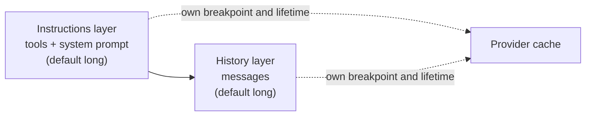

# Prompt caching

Octocode keeps reusable instructions cached longer than the growing history when the API has separate cache boundaries. What the request contains and what changes it: [Context management](../../../docs/CONTEXT.md). Cache hits need a matching eligible prefix and the provider's minimum length; a byte-identical prefix only enables reuse, the provider's cached-token usage fields are the only proof of a hit.



## Providers

Enter a key with `/providers`, or set the variable below; never put keys in prompts.

| Provider  | Provider ID               | API-key variable    | Instruction / history policy                                                                                                                                                                                                                                                                                                                                                                                                            |
| --------- | ------------------------- | ------------------- | --------------------------------------------------------------------------------------------------------------------------------------------------------------------------------------------------------------------------------------------------------------------------------------------------------------------------------------------------------------------------------------------------------------------------------------- |
| OpenAI    | `openai`                  | `OPENAI_API_KEY`    | 12h / implicit 30m on models declaring explicit prompt-cache support                                                                                                                                                                                                                                                                                                                                                                    |
| Anthropic | `anthropic`               | `ANTHROPIC_API_KEY` | 1h / 1h by default (history 5m with `cacheRetention: short`) where long retention is supported                                                                                                                                                                                                                                                                                                                                          |
| Grok      | `xai`                     | `XAI_API_KEY`       | Automatic provider-managed caching; no configurable TTL assumed. Chat Completions uses `x-grok-conv-id` for session affinity, Responses its cache key                                                                                                                                                                                                                                                                                   |
| OpenCode  | `opencode`, `opencode-go` | `OPENCODE_API_KEY`  | Claude: 1h instructions and 5m history, with Anthropic lifetimes declared for warming; other Anthropic-protocol models: 5m markers without `ttl`; Responses: `prompt_cache_key` and session headers, no TTL fields; Chat Completions and Google: session-routed implicit caching (Chat Completions sends `prompt_cache_key` only under the rule for OpenAI-compatible hosts below). Every request carries a stable `x-opencode-session` |

OpenCode dispatches each model through its catalog API (Anthropic Messages, OpenAI Responses, Chat Completions or Google); the bundled catalog supplies the definitions, so nothing needs copying into `models.json`. An OpenAI-compatible endpoint alone does not establish support for 12h fields: custom models declare capabilities in `models.json`, and only supported ones should be enabled. Resuming keeps the routing identity; a different model or changed prefix can still miss.

Amazon Bedrock Claude sends one-hour cache points for long retention only on models AWS lists with the 1h TTL (Claude 5.x, Opus 4.5 and later, Sonnet 4.5 and later, Haiku 4.5); Sonnet 4, Opus 4, Opus 4.1 and Claude 3.x get five-minute points without `ttl`, which they would reject. Application inference profiles are matched by `name`. An explicit `compat.supportsLongCacheRetention` overrides the model rule: `false` for a region or profile that rejects `ttl`, `true` for a profile whose model accepts it but whose name is not recognized. Changing a direct provider's endpoint clears its direct-only cache capabilities; declare verified `compat` capabilities for a proxy. Unknown models stay selectable with conservative request fields.

Official references: [OpenAI](https://developers.openai.com/api/docs/guides/prompt-caching), [Anthropic](https://platform.claude.com/docs/en/build-with-claude/prompt-caching), [Grok](https://docs.x.ai/developers/advanced-api-usage/prompt-caching/best-practices), [OpenCode models](https://opencode.ai/v2/docs/console/models/), [OpenCode Go](https://opencode.ai/v2/docs/console/go/), [Azure](https://learn.microsoft.com/azure/foundry/openai/how-to/prompt-caching).

## Retention per layer

The two layers are _instructions_ (tools plus the leading system prompt) and _history_ (the messages). Both default to long. What each choice becomes on the wire:

| Provider                                 | Instructions                                                                                              | History                           | Notes                                                                                                                                                                                                                                                                                                                                                                                                                                                                                                                               |
| ---------------------------------------- | --------------------------------------------------------------------------------------------------------- | --------------------------------- | ----------------------------------------------------------------------------------------------------------------------------------------------------------------------------------------------------------------------------------------------------------------------------------------------------------------------------------------------------------------------------------------------------------------------------------------------------------------------------------------------------------------------------------- |
| Anthropic, OpenRouter Claude             | `ttl: "1h"` (2× write) for `long`, 5m (1.25×) for `short`                                                 | 5m, or 1h for `long`              | 1h is Anthropic's maximum; it pays off once a session idles longer than 5 minutes                                                                                                                                                                                                                                                                                                                                                                                                                                                   |
| Bedrock Claude                           | `ttl: "1h"` for `long` on models AWS lists with the 1h TTL; 5m (no `ttl`) for `short` and on other models | same                              | Sonnet 4, Opus 4, Opus 4.1 and Claude 3.x accept only 5m, and a `ttl` can fail there with a ValidationException                                                                                                                                                                                                                                                                                                                                                                                                                     |
| Bedrock Nova                             | No `ttl` (5m only) on the system prompt, for `long` and `short`                                           | 5m cache points on messages       | Nova 2 Lite, Pro, Lite and Micro take cache points on `system` and `messages` only, never `tools`, at most four. AWS caches at most 20K tokens of a Nova prompt, so a point is sent only where the estimated tokens before it (tools, system, messages: the Converse order) are under 20K; a main session whose tools alone exceed 20K sends Nova no points. Nova Premier and other Nova models keep implicit caching. [AWS models](https://docs.aws.amazon.com/bedrock/latest/userguide/prompt-caching.html#prompt-caching-models) |
| OpenAI GPT-5.6 and later (explicit mode) | 12h (2.5× write) for `long`, 30m for `short`                                                              | implicit 30m; `long` requests 12h | No 1h tier exists. `none` for both layers sends explicit mode with no breakpoint: no caching at all, not even the automatic cache                                                                                                                                                                                                                                                                                                                                                                                                   |
| Google Gemini                            | Implicit                                                                                                  | same                              | No cache field is sent; explicit caches cannot hold request-time tools. Through OpenCode, hits need the session header and come in blocks of about 4k tokens, so shorter prompts read nothing                                                                                                                                                                                                                                                                                                                                       |
| Other OpenAI-compatible endpoints        | Provider-managed                                                                                          | same                              | The routing key goes out with `long` where the endpoint supports it                                                                                                                                                                                                                                                                                                                                                                                                                                                                 |

`/status` reports this mapping for the active model under Cache Warming, including "no caching at all" for explicit OpenAI `none`, the 24h tier on older OpenAI models and "provider-managed". It states what Octocode sends.

Costs: Anthropic 1h writes cost 2× base input and 5m writes 1.25×; OpenAI explicit writes cost 2.5× (12h) or 1.25× (30m), with a 1,024-token minimum; a model whose catalog has no cache-write rate pays no write premium. Usage keeps aggregate `cacheWrite` with optional `cacheWrite1h` and `cacheWrite12h`; each token is counted once and model pricing tiers are kept. These are catalog estimates: subscription allowances, credits, regional premiums, time-based storage charges and served OpenAI service tiers are not fully represented ([model selection](models.md#select-a-model)). Measure savings with your own workload.

## Configure retention

```text
/configuration set instructionCacheRetention long
/configuration set cacheRetention long
```

Or set the same fields in global or trusted project `settings.json`. They also work on a provider, model definition or `modelOverrides` entry in `models.json`:

```json
{
	"providers": {
		"anthropic": { "apiKey": "$ANTHROPIC_API_KEY", "cacheRetention": "long" },
		"openai": { "apiKey": "$OPENAI_API_KEY", "instructionCacheRetention": "long", "cacheRetention": "short" }
	}
}
```

- **Priority**, highest wins:


- At each level `cacheRetention` controls both layers unless that level also sets `instructionCacheRetention`; an instruction-only value changes only instructions. History `none` disables optional writes for both layers. Invalid values are rejected without echoing them.
- Anthropic Messages, Bedrock Converse and Anthropic-format chat completions require 1h entries before 5m ones, so short instructions over long history send the history at 5m (`/status` says so). OpenAI Responses sends it as configured (a 12h history breakpoint after 30m instructions).
- On OpenAI explicit-cache models (GPT-5.6 and later) `long` history requests 12h and `short` leaves the implicit 30m; the instruction option sets the explicit instruction breakpoint. Older OpenAI models keep the legacy `24h` preference. ChatGPT subscription credentials omit these API-only fields.
- `/status` shows the requested preferences, their sources, effective durations and fallbacks.
- A provider configured in Octocode takes precedence over the same provider in Pi; entries are not merged across files, and an explicit configuration home disables the fallback.

Defaults: new sessions and `--print` runs use long instructions and long history, the longest tier each provider and model accepts. The lifetime counts from the start of the request that wrote or read the entry, so long replies shorten it.

A subagent that does not linger (profile `linger` and `OCTOCODE_SUBAGENT_LINGER_SECONDS` are 0) and is not resumed starts with long instructions and short history, since its median gap between requests is seconds; set `cacheRetention` yourself (settings, provider or model entry, or `OCTOCODE_CACHE_RETENTION`) and it follows. A lingering or resumed child keeps long history. A subagent does not inherit the parent's resolved pair: before it starts, Octocode resolves the pair for the model the child runs on (parent settings, that model's provider and `models.json` entries, parent environment) and passes `OCTOCODE_CACHE_RETENTION` and `OCTOCODE_INSTRUCTION_CACHE_RETENTION`, which outrank the child's own settings.

Environment choices (`OCTOCODE_CACHE_RETENTION` alone applies to both layers):

| Run                                                     | `OCTOCODE_INSTRUCTION_CACHE_RETENTION` | `OCTOCODE_CACHE_RETENTION` |
| ------------------------------------------------------- | -------------------------------------- | -------------------------- |
| Turns follow each other without pauses (cheaper writes) | `long`                                 | `short`                    |
| Brief, continuously active run                          | `short`                                | `short`                    |
| Anthropic with pauses over five minutes                 | `long`                                 | `long`                     |

Library callers pass `{ cacheRetention, instructionCacheRetention, sessionId }` to `streamSimple` or `completeSimple`; the options are forwarded through simple requests and the agent proxy. `cacheRetention: "none"` overrides the instruction preference in every adapter that places breakpoints, unless the request sets `keepInstructionCache: true`, which keeps the instruction markers (Anthropic, Bedrock, Anthropic-format chat completions; compaction's cache-sharing summary sets it when the history entry has expired but the long instruction entry has not, and sends no markers when both have). Providers with automatic caching may still cache on their own.

## Wire behavior

- **OpenAI Responses**: direct HTTP with the shared retry policy; the leading system instructions become an explicit content block, history stays implicit.
- **Anthropic, Bedrock Converse, OpenRouter Anthropic-format**: instruction retention on the initial tools/system breakpoint, history retention on the final eligible history block. Anthropic Messages also marks the previous request's tail (the last eligible block before the final assistant turn) when a slot is free, so a long assistant turn does not push the last write past Anthropic's 20-block lookback; OAuth requests leave the added identity block unmarked, keeping that slot. Bedrock Converse adds the same point when one of its four is free.
- **OpenRouter Alibaba and DeepSeek models** that its documentation says need explicit breakpoints (`qwen/qwen3-max`, `qwen/qwen-plus`, `qwen/qwen3.6-plus`, `qwen/qwen3-coder-plus`, `qwen/qwen3-coder-flash`, `deepseek/deepseek-v3.2`) use the same format with a fixed 5-minute lifetime.
- **OpenAI-compatible chat completions** decide `prompt_cache_key` from the model's `cache.key` capability: `api.openai.com` is `cached` (sent unless caching is `none`), any other host is `long` (sent only when retention is `long`) when the model's compat sets `supportsLongCacheRetention: true`, and `never` otherwise; they send `prompt_cache_retention: "24h"` only to `api.openai.com` or a model whose compat sets `supportsLongCacheRetention: true`.
- **Azure Responses** sends `prompt_cache_retention: "24h"` for `long` history only to models Microsoft lists for extended retention; `compat.supportsLongCacheRetention` overrides the list (`true` for a deployment-named model running a listed model, `false` to send none). It ignores the instruction preference except on GPT-6 Astra, whose leading instructions get 30m explicit breakpoints sent as `{"mode": "explicit"}` (inheriting the request TTL) unless instructions or history are `none`. Azure GPT-5.6 and later models get neither `prompt_cache_retention` (deprecated there) nor `prompt_cache_options`.
- **Google and Mistral** ignore the instruction preference.
- After Anthropic rejects preferred strict tools for a model, endpoint and tool set, later requests in the process send the downgraded tools directly.

### Tool list and prefix order

Stable base instructions, initial project context and tool definitions keep one order for the life of a prefix. The declared tool list is rewritten whenever the active tool set changes (an MCP tool added, removed or redefined, any tool switched on or off). Built-in and extension tools keep their given order; the MCP tools declared at the first request follow, sorted by namespace then name, except that servers whose entry gives tools roles sort first. Connection timing does not decide the order, so sibling sessions and subagents of one profile build the same tool array.

A tool change keeps the prefix only on a model whose compat sets `supportsMidConvoSystemMessages` together with a tool-change or tool-addition flag. On Anthropic Messages the flag is `supportsMidConvoToolChanges`, set for the direct `anthropic` provider only (OpenCode Zen and GitHub Copilot forward mid-conversation system messages but reject tool changes); changes then go out as mid-conversation blocks. Responses and Chat Completions models need `supportsAdditionalTools`, `supportsToolSearch` or `supportsMidConvoToolAdditions`, and additions-only modes do not cover a removal. Everywhere else the change rewrites the top-level tool list once and the cache rebuilds; a tool added or redefined later goes to the end of the list, so that session's order can differ from a fresh one's. The first prompt waits for selected MCP servers ([connections](mcp-reference.md#connections-and-caching)), so such changes are rare.

### System updates

On models that accept mid-conversation system messages, later system-prompt changes are incremental conversation updates. Adapters without them (Bedrock, Google, models without `supportsMidConvoSystemMessages`) keep the leading prompt byte-identical and send each update as a marked user message just before the next assistant turn. The Mistral adapter avoids a user turn directly after a tool result (whether the hosted API accepts that order is unverified) while changed tools go out at once.

An update whose first delivery point follows a tool result (after a result, between a call and its result, or between parallel results; typically an MCP server connecting, changing or dropping during a tool loop) is folded into the leading system prompt together with every earlier update, so its text keeps system authority, reaches the model with the tool list it describes, and no older update follows a newer one. This rewrites the cacheable prefix once for that request (reuse is not measured); later requests keep it. An update elsewhere travels as a marked user message; one that changes nothing is held and merged into the next user message. Covered by offline serialization tests, not checked against the live Mistral API. Child identity belongs to the child task. Changed project context, skills or tools still change the prefix; nothing is reordered to manufacture a hit.

### Subagent prefixes

An isolated subagent (`isolate: true`) runs in its own git worktree, but its system prompt keeps the main checkout's working directory and `AGENTS.md` paths, so every isolated child of one profile builds a byte-identical leading prompt. The child's task names its real worktree; tools, permissions and file access use the real directory.

Siblings in one parent session and prefix group share an opaque `OCTOCODE_PROMPT_CACHE_KEY`. OpenAI Responses, Codex, Azure Responses, Mistral and supported Chat Completions endpoints use it as `prompt_cache_key`; each child's session headers, WebSocket pool, transcript and cancellation stay separate. The key is replaced when a child is launched, kept for its message-based continuation, and never contains task text or paths. Provider routing, minimum cache length, expiry and an exact prefix match still decide hits. Disabling caching omits the key.

A fork (`/fork`, a branch to a new session) has its own session id but its parent's history, so its requests use the id of the first session in its fork chain as `prompt_cache_key`; an explicit key or a subagent's shared key wins. Unrelated sessions keep separate keys.

Each run's `cache` details record request counts, cumulative prompt/read/write tokens and the latest reply's buckets and provider miss reason. Live tool rows show the latest request's reads and writes, expanded finished rows the conversation rate, and `/agents stats` the token-weighted read rate and write volume per profile. Summary, warming and nested-tool usage count in total spend but not in the conversation rate. After compaction the changed history needs a new write; unchanged leading instructions can still be reused. Zero reads on a first or below-minimum prompt do not establish a failure. Every child compaction sends the user a start notice and a finished, failed or cancelled notice (with recorded context sizes when available); main-session compactions use the shared lifecycle events and terminal status indicator.

### Second instruction block

The leading system prompt can go out as two instruction blocks, each with its own breakpoint and the instruction retention. Block 1 holds the base-tier sections; block 2 starts at the first present non-base section and holds it and everything after ([sections and tiers](../../../docs/CONTEXT.md#what-the-model-sees)). The policy stays in block 2 because its profile list and a project-defined role can be project specific. MCP connection state lives in the last section, `mcp_status`, so a server that connects, fails or drops patches only that section. A drop or failed reconnect leaves the server's tool declarations in place: a call while the server is down fails at once with an error naming its state and the `mcp` restart. Tools are withdrawn only when the server is stopped, disabled or removed, or a reconnected server no longer offers them (which rewrites the tool list on transports without native tool changes). Sessions and subagents with the same tool set and MCP servers but different project, directory or date send an identical block 1, which the provider may read at its cache-read rate once an earlier request has written it; a request started before the prefix is written cannot reuse it. The two blocks concatenate to exactly the single-block prompt.

In the default `declared` MCP mode the MCP part of the prefix is fixed for the session: each tool's declaration and each server's `mcps` block stay as first sent, and are described again only at a loadout rebuild (session start, model change, tree navigation) or a catalog change. A catalog change is a `tools/list_changed` notification, or a reconnect returning a different catalog, that changes a tool's description or schema (the declaration is re-registered, rewriting the tool list once), the server's instructions (one appended patch to `mcps`), or a deferred tool's first sentence (patches the block). A reconnect with the same catalog, a dropped connection and a state change keep the prefix. Compact overrides (`octocode mcp compact`) reach the prefix only in `compact` mode, where the server's generated file is the block, renewed on the same changes. The `environment` section is checked at every prompt; a new day patches only it.

Octocode sends the boundary as the `instructionCacheBoundary` request option; adapters use it only where a breakpoint is free:

| Adapter                      | Behavior                                                                                                                 |
| ---------------------------- | ------------------------------------------------------------------------------------------------------------------------ |
| Anthropic                    | Block 2 takes the slot of the tools-only marker (block 1's marker already covers the tools), so four breakpoints suffice |
| Bedrock                      | A second system cache point                                                                                              |
| OpenRouter, Anthropic-format | Splits only when a slot remains                                                                                          |
| OpenAI explicit mode         | Marks both blocks within its four-write limit                                                                            |
| Others                       | Ignore it                                                                                                                |

A forced prompt (an extension's `before_agent_start`) has no sections and is never split. `OCTOCODE_INSTRUCTION_CACHE_SPLIT=off` sends one block; a request that already carries `instructionCacheBoundary` keeps its value. MCP connections also cache validated server instructions and tool metadata in memory, separate from provider caching: [MCP catalog caching](mcp.md#catalog-caching).

## Provider-reported miss reasons

`OCTOCODE_CACHE_DIAGNOSTICS=on` (also `1` or `true`) asks the Anthropic API why a request could not reuse the previous prefix. Each request carries `diagnostics.previous_message_id` (the previous Anthropic reply's id, `null` on the first), and the API reports the earliest divergence (`model_changed`, `system_changed`, `tools_changed` or `messages_changed`) with the approximate input tokens that would have been read. The reply records it as a `cache_miss` diagnostic, and a counted miss in the transcript and `/status` reads `History cache miss: provider reports tools changed` instead of an inferred cause. `previous_message_not_found`, `unavailable` and a pending comparison record nothing.

The field goes only to `api.anthropic.com` with the `anthropic` provider (a gateway may reject an unknown field). It is off by default and verified against the SDK types and the [documented format](https://platform.claude.com/docs/en/build-with-claude/cache-diagnostics), not a live account. Fingerprints are kept briefly, so compare closely spaced requests. A miss after an idle gap longer than the cache lifetime reports no divergence: the entry had expired.

## Warming and measurements

`cacheWarming` is `off`, `streaming` (during an active run) or `idle` (default; also while waiting for the user). An idle refresh is sent only when its expected saving reaches $0.05: the chance of a real request before the history expires, times the miss cost, less the refresh cost (a read of the cached prompt). The chance is 15% by default and 50% while the user is visibly at the terminal (terminal focus, or a key in the last two minutes); both are estimates. A miss is priced at the tier the request wrote its history at. With layered lifetimes (long instructions over short history) a refresh happens before the history entry expires and a miss is priced as the history alone: an upper-bound estimate of the system prompt and tools, which stay readable from their longer entry, is subtracted (over-estimating errs toward not refreshing). With a single lifetime a miss is the whole cached prompt. On a marker model without a long tier (Bedrock Sonnet 4, Opus 4, Opus 4.1, Claude 3.x), long history goes out at 5m and warming and compaction plan with 5m.

An idle run may refresh until the later of thirty minutes and one cache lifetime after it started, so a one-hour entry gets one idle refresh when the gate says it pays. Active subagents and headless runs keep the same economic and cancellation checks and never refresh after becoming idle. Unknown lifetimes, short instructions before long history, incompatible thinking settings, changed request context, refresh failures and zero cache reads stop refreshes. No paid startup probe is sent. Estimates use the last request's reported cached portion plus the uncached tail's cost; Bedrock reasoning refreshes are disabled because the thinking budget can expand a nominal one-token request. Cache-off omits generated affinity data, though a provider can still cache implicitly.

A refresh that finishes after cancellation or a session switch records its usage in its originating session; failed compaction attempts and fallback requests are recorded individually. Missing provider usage cannot be reconstructed.

`/status` shows conversation cache hits separately from recorded refresh requests and costs. RPC `get_session_stats` exposes `cache` groups `conversation`, `warming`, `compaction`, `branchSummary`, `tools` and `other`, each with usage entries, prompt tokens, cache reads and writes, token-weighted `hitRate` (null without input usage) and calculated cost. Tool usage may aggregate child calls; inspect a child's session for its own rate. Inferred cache re-billing is labelled an estimate.

With `showCacheMissNotices` the transcript names the cache area each counted miss re-billed and its likely cause. A miss counts when more than 1,024 prompt tokens of the previous request on the branch were not read back (the first request after a compaction or branch summary is not compared); a notice appears at 20,000 tokens or $0.10. `History cache miss` means a cached prefix (normally the instructions) was read and the history re-billed; `Full cache miss` means nothing was read. Causes: `after model switch`, `after instruction or tool update`, or `after Nm idle` when the gap outlasted the history lifetime (5 minutes when unknown). While `cacheWarming` is not `idle`, an idle miss also names that setting and what one refresh would have cost. Compaction and branch-summary cost notices add how many tokens the summary read from cache: a shared-prefix summary reads it; a standalone one reads little or nothing ([pipeline](../../../docs/CONTEXT.md#the-compaction-pipeline)).
