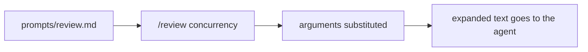

# Prompt templates

A prompt template is a Markdown file that becomes a reusable `/` command. Use one to repeat the same prompt, with arguments, without adding executable behavior (for that, see [skills](skills.md) and [plugins](plugins.md)).



## Create a template

Save `~/.octocode/octocodecode/prompts/review.md`:

```markdown
---
description: Review staged git changes
argument-hint: "[focus]"
---

Review the staged changes. Focus on ${1:-correctness, security, and error handling}.
```

| Part                       | Effect                                                                                                                            |
| -------------------------- | --------------------------------------------------------------------------------------------------------------------------------- |
| File name                  | The command name: `review.md` is `/review`                                                                                        |
| `description`              | Shown in command completion; without it the first non-empty line is used                                                          |
| `argument-hint` (optional) | `<angle brackets>` for required and `[square brackets]` for optional arguments                                                    |
| Name collision             | If a built-in command owns the name, use `/prompt:review`; further collisions get numeric suffixes. `/help` shows the name to use |

Run `/reload` after adding or changing a template in an open session.

## Use a template

```text
/review
/review concurrency
/review "API compatibility"
```

Octocode expands the template before the text reaches the agent. Arguments follow shell-like quoting, so the last line passes one argument containing a space.

| Syntax               | Result                                 |
| -------------------- | -------------------------------------- |
| `$1`, `$2`, …        | One positional argument                |
| `$@` or `$ARGUMENTS` | All arguments joined with spaces       |
| `${1:-default}`      | First argument, or a default value     |
| `${@:-default}`      | All arguments, or a default value      |
| `${@:N}`             | Arguments starting at position `N`     |
| `${@:N:L}`           | `L` arguments starting at position `N` |

## Where templates load from

| Location                                                              | Scope         | Notes                                                                           |
| --------------------------------------------------------------------- | ------------- | ------------------------------------------------------------------------------- |
| `~/.octocode/octocodecode/prompts/`                                   | Every project | Direct `.md` children only                                                      |
| `.octocode/prompts/`                                                  | This project  | Loads only in a trusted folder; review a project's templates before trusting it |
| `prompts` setting, `--prompt-template` paths, [packages](packages.md) | As configured | Can select nested Markdown files and globs                                      |

`/settings enable|disable prompt:<name>` switches one template; `--no-prompt-templates` disables discovery for a run. Locations and precedence: [configuration](configuration.md#where-each-configuration-belongs).
