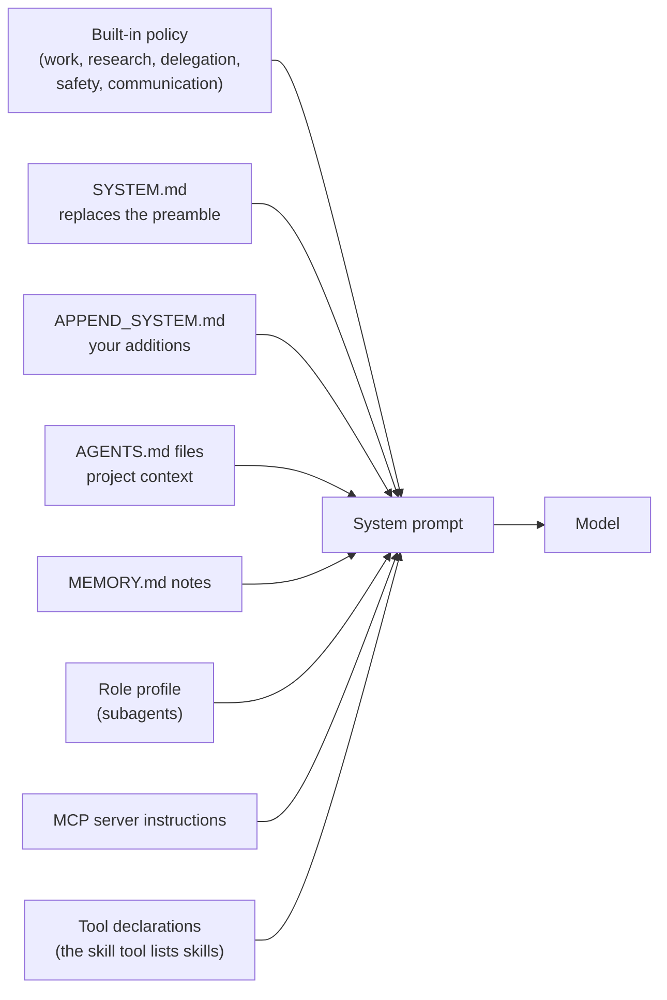

# Agent prompts

What tells Octocode's agents how to work, and how you add to it.



Which file wins and how to steer each source: [instructions](instructions.md). Order, cache tiers and what each section holds: [Context management](../../../docs/CONTEXT.md#what-the-model-sees).

## What you can change

| You want to                           | Do this                                                                                                                                                                                                                                                     | Turn off or undo                       |
| ------------------------------------- | ----------------------------------------------------------------------------------------------------------------------------------------------------------------------------------------------------------------------------------------------------------- | -------------------------------------- |
| Give every session extra instructions | Create `APPEND_SYSTEM.md` in the agent directory, or in the trusted project's `.octocode/` (the project file wins; Pi's `.pi/` copies rank below both), or pass `--append-system-prompt` (repeatable; replaces the discovered file)                                                                                                                                          | Delete the file                        |
| Replace the base prompt               | Create `SYSTEM.md` the same way, or pass `--system-prompt`. It replaces the preamble, the documentation pointer and the default rule lines (conciseness, bash search); tools, rules, MCP blocks, project context, skills, the policy and `environment` stay | Delete the file or flag                |
| Give a project standing instructions  | Put them in `AGENTS.md` (or `AGENTS.override.md`) in the repository: [which files load, in what order](../../../docs/CONTEXT.md#project-context). A folder with neither has its `CLAUDE.md` read instead, under the same rules; `AGENTS.override.md` hides the `AGENTS.md` beside it                              | `--no-context-files`                   |
| Add or change a subagent role         | A profile is a Markdown file with YAML front matter in the global `agents/` folder or the trusted project's `.octocode/agents/`; same name replaces the bundled one ([profiles](tools.md#configuration))                                          | Delete the profile                     |
| Load a skill's instructions on demand | [Skills](skills.md)                                                                                                                                                                                                                                         | `/settings disable skill:<name>`       |
| Save notes the agent recalls later    | [Memory](memory.md)                                                                                                                                                                                                                                         | `/settings set memory.recall off` |

Example `.octocode/APPEND_SYSTEM.md`:

```markdown
Answer in British English. Run `yarn test` before reporting a change done.
```

Profile lookup order: bundled profiles, the Octocode home's `agents/`, then trusted project profiles; plugin profiles (`<plugin>:<agent>`) load first, so any other profile of that name replaces one. A later profile with the same name replaces an earlier one, and a project file that does so is named in a warning at session start. Bundled roles are package assets, so customize them through a profile of the same name rather than by editing the install. A subagent role never uses `--append-system-prompt`: the parent hands the role text only to that child, which adds it beside any `APPEND_SYSTEM.md`.

## What the built-in policy says

Each row is a prompt section ([`sections/index.md`](../src/octocode/native/prompts/sections/index.md)); the text is the Markdown file named in its Chunks column under `policy/`.

| Section         | Rule                                                                                                                                                                                                                       |
| --------------- | -------------------------------------------------------------------------------------------------------------------------------------------------------------------------------------------------------------------------- |
| `work`          | Edit only when asked; set a goal and an outcome check; trace a bug to its owner and test it against a rival; cite evidence and separate observations from inferences; scale effort to the stakes; after edits, review the diff and run only the checks they affect; report failures, skips and blockers |
| `research`      | Answer from context when it suffices, else fetch only the missing fact; route source reads and searches through the research server when one is connected, else bash lookups and `gh` or `web`                              |
| `delegation`    | Main session only: bounded tasks with ownership and observable checks; match the profile to the work; the parent owns integration, merging and talking to the user                                                         |
| `subagent`      | Every writable child: stay in scope, get the coordinator's approval before destructive, paid or public actions, leave commit and push to the coordinator, report with an outcome word                                      |
| `safety`        | Follow the user's authorization, prefer reversible steps, ask before deleting what the request did not name, spending money or acting where others see it; never bypass a permission refusal by switching tools           |
| `communication` | Lead with the answer; size the reply to the question; speak mid-work only for a blocker, a decision, a changed plan or a verified result; state assumptions; disclose deletions, costly runs and disproven claims           |
| `children`      | Main session with the `agent` tool: merge one ref at a time and check it before marking its item done; the report rules live in the `octocode-subagents` skill once a child starts                                                                  |

The policy follows the selected tools: a session without web or agent tools gets no advice to call them. A `lean: true` profile gets a short subagent section instead. Tool mechanics (polling, model choice, `headless`, path locks, message fields) live only in each tool's description. A subagent's report outcome is one of `done`, `partial`, `blocked`, `failed`.

## Updates and caching

Unchanged inputs give unchanged prompt text; changes reach the model as section updates ([how](../../../docs/CONTEXT.md#how-a-change-reaches-the-model)). Different roles, tool sets or project context can change the provider's cached prefix: [prompt caching](prompt-caching.md). See the exact prompt each built-in agent gets in [agent context](how-it-works.md#measuring-what-a-request-holds). Contributors change the bundled prose in its Markdown files, never in code, and then run `yarn workspace @octocodeai/octocode-agent run generate:prompts` to write each built-in agent's resulting prompt for review.
