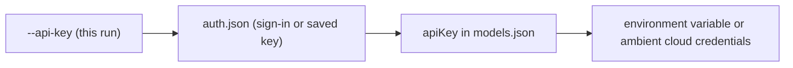

# Providers

## Connect what you have

`/providers` is where you sign in: `/providers <provider>` opens one provider, and **+ Add a provider** lists every sign-in (type `chatgpt`, `copilot` or `subscription` to search). `/login` was renamed `/providers`; typing it points there.

| You have                                    | Do this                                                                                                                                                                                               | Models appear as                   |
| ------------------------------------------- | ----------------------------------------------------------------------------------------------------------------------------------------------------------------------------------------------------- | ---------------------------------- |
| ChatGPT Plus/Pro (Codex)                    | `/providers openai` → **Sign in — OpenAI (ChatGPT subscription)**. The older `openai-codex` (legacy) sign-in still works                                                                              | `openai/…`                         |
| Claude Pro/Max (Claude Code)                | `/providers anthropic` → **Sign in with your Claude subscription** (needs Claude Code installed; [details](#use-your-claude-subscription))                                                            | `anthropic/…`                      |
| GitHub Copilot                              | `/providers github-copilot` (device sign-in), or turn on the `COPILOT_GITHUB_TOKEN` [source](#sources)                                                                                                | `github-copilot/…`                 |
| Grok, Kimi Code or Meta subscription        | `/providers xai`, `/providers kimi-coding` or `/providers meta` → sign in                                                                                                                             | `xai/…`, `kimi-coding/…`, `meta/…` |
| OpenCode Zen or Go                          | `/providers opencode` or `/providers opencode-go` → **Add API key**: the OpenCode Console opens; subscribe to Go there, copy the key, paste it ([details](#use-opencode-and-choose-a-model))          | `opencode/…`, `opencode-go/…`      |
| An API key (Anthropic, OpenAI, OpenRouter…) | `/providers <provider>` → **Add API key** (keychain when available; OpenAI and OpenCode open their key page first), or export the provider's variable ([below](#use-an-api-key-from-the-environment)) | `<provider>/…`                     |
| A gateway, proxy or self-hosted endpoint    | Add `baseUrl`, `api` and `apiKey` in `models.json` ([compatible endpoint](models.md#configure-a-compatible-endpoint), [redirect a built-in provider](models.md#configure-a-compatible-endpoint))      | `<your id>/…`                      |
| A local GGUF model                          | `/llama` ([local models](models.md#connect-local-models)); Ollama, LM Studio and vLLM go in `models.json`                                                                                             | `llama.cpp/…` or your id           |
| Pi already set up                           | Nothing: Pi's sign-ins and `models.json` load beside Octocode's ([Use Pi configuration](#use-pi-configuration))                                                                                       | the Pi provider ids                |

Then switch freely: `/model` picks this chat's model (`/model openai/` limits it to one provider, `Ctrl+S` saves the default), `Ctrl+P` and `Shift+Ctrl+P` cycle models, `octocode --model <provider>/<id>` starts on one, and `e` on a provider in `/providers` hides or restores it. To check a credential without starting a chat, run `octocode auth check --provider <provider>` or `/modelsettings check`.

## How sign-in works

Most hosted providers support one or both of these authentication methods:

- Sign in through a browser or device flow backed by OAuth.
- Provide an API key.

Use `/providers` to manage providers and sources, and `/providers <provider>` to open one provider's page. Amazon Bedrock and Google Vertex AI can also use ambient cloud credentials.

GitHub Copilot model access uses `/providers github-copilot`. The separate `/octocode auth login` (and `/octocode auth status|logout`) manages GitHub code-search credentials; signing in there does not configure Copilot inference.

Which credential a request uses (first match wins):



Sign in with ChatGPT retains account/client registrations and offers a saved account or a new account on the next login. Saved account selection reuses its issued client ID and available ID-token hint, then verifies the returned account. Logout revokes saved renewable sessions and removes their local tokens; nonsecret registrations remain for reuse. If remote revocation cannot be confirmed, local tokens are still removed and the error explains how to disconnect the app in account settings. Model availability comes from the selected account's vendor list; see [model discovery](models.md#discover-vendor-models).

For instruction and conversation retention, see [Prompt caching](prompt-caching.md).

## The /providers page

`/providers` separates managing providers from signing in. Its sections, in order:

- **Signed in**: each provider that has credentials, with the credential kind (**account**, **subscription** or **key**) and source (a label or variable name, never a value), its model count and whether it is enabled. “Configured” means credentials are present; it does not verify that the provider will accept a request; **Test credential** on the provider's page does. A key that the provider recognizes as a subscription token (a Claude token starting `sk-ant-oat`) is listed as **subscription**, whether it is stored, read from a keychain or command reference, or set in the environment; the key is inspected for this and never shown or kept.
- **Disabled**: providers you turned off, hidden from `/model`.
- **Sign in**: one row, **+ Add a provider**, opens the sign-in flow: pick a provider (those with a subscription or account sign-in are listed first), then its browser/device sign-in, **Add API key** or **Replace API key**. Only supported methods appear. Successful sign-in opens the model picker; Esc keeps the current model and Ctrl+S explicitly changes the default.
- **Sources**: where providers, models and credentials come from: Octocode (always on), Pi, and the `COPILOT_GITHUB_TOKEN` variable. See [Sources](#sources).
- **Detected**: other coding tools found on this machine (Claude Code, Codex CLI, Grok CLI and others), each with the action Octocode offers for the same account.
- **Custom models**: the Octocode and Pi `models.json` files with their paths and the providers each defines; a missing file is marked `not found`.

Keys: Enter opens a row, `e` enables or disables the selected provider or source, Esc closes (on a provider's page, Esc goes back to the list).

A provider's page shows its status (account, subscription or API key), credential source, enabled state, model count and defining `models.json`, then the actions: choose a model, sign in (again), add or replace an API key, **Test credential** (one small request to this provider; the result is shown with any error text redacted), **Sign out** or **Remove saved credential**, edit definition (the file path), and **Disable provider** / **Enable provider**. Removal and Pi import ask first: the first row of the question is always **Cancel**. A session API-key override is labeled separately and can be cleared without removing saved credentials; saving a key while that override is active reports that the override still takes priority.

On a remote or headless machine, an OAuth callback may not reach the local process. When prompted, paste the final redirect URL or authorization code back into Octocode.

Choose **Sign out** or **Remove saved credential** on the provider’s page, or run `/logout [provider]` (the argument prefills the search) and select a provider, then confirm removal. A saved credential whose provider is no longer defined (its `models.json` entry was removed) is listed as **provider not defined**; remove it the same way. This does not unset environment variables, remove authentication from `models.json`, or revoke the credential at the provider.

Secret input and pasted authorization codes are hidden. When macOS Keychain or Linux Secret Service is available, API-key entry offers it first: only a command reference is written to `auth.json`. A failed keychain write aborts without silently saving plaintext. You can explicitly choose local-file storage; new files use mode `0600` and new directories `0700`. Existing administrator-managed modes and ACLs are preserved. Startup warns when its credential file has group/world permissions or is inside a Git worktree; injected SDK model runtimes retain responsibility for their own credential storage. OAuth tokens and file-stored API keys remain plaintext; keep `auth.json` private and out of Git. Removal also attempts to delete an owned keychain entry.

## Enable or disable a provider

Press `e` on a provider in `/providers`, or choose **Disable provider** on its page, to hide its models everywhere: the `/model` picker, model cycling, subagent routing, the `models` tool and `/modelsettings`. The provider moves to **Disabled**, and **Enable provider** brings it back. Disabling saves the provider id in the global [`disabledProviders`](settings.md) setting and never touches saved credentials. A session already running on the provider keeps working and shows a warning naming how to switch; project settings cannot disable providers. The running agent learns about availability changes through its routing notice; no other notification is sent.

## Sources

| Source                                          | Gives                           | Default | Switch |
| ----------------------------------------------- | ------------------------------- | ------- | ------ |
| Octocode (`auth.json`, keychain, `models.json`) | credentials, models             | on      | no     |
| Pi (`auth.json` read only, `models.json`)       | credentials, models             | on      | yes    |
| `COPILOT_GITHUB_TOKEN`                          | credential for `github-copilot` | off     | yes    |

Open a source (or press `e` on it) to turn it on or off. The choice is saved in the global `providerSources` setting (only changes from the defaults; project settings cannot set it) and takes effect at once: turning Pi off hides Pi-only providers and models from `/model` and `/providers`, turning it on restores them. Files are never changed.

The web Settings page (opened with `/web`) shows the same sources and each provider's origin (Octocode or Pi, `auth.json` or `models.json`; never a value) and has the same switches for the Pi source and for each provider. The terminal and the page write the same settings; a running session applies a provider switch (a provider or the Pi source) saved on the page or in another terminal within a second or two, without `/reload`. Other settings still need `/reload`.

### Detected tools

Claude Code, Codex CLI, Grok CLI, Gemini CLI, Cursor, opencode, crush, Copilot CLI, Qwen Code and Aider are recognized by their known install and config paths. Octocode never reads their tokens or databases. Each row offers either Octocode's own sign-in for the same account (Codex CLI → sign in with OpenAI, which runs Sign in with ChatGPT) or API-key entry for the vendor (Gemini CLI → add an API key for Google). Claude Code offers both: sign in with your Claude subscription (through `claude setup-token`, when `claude` is on `PATH`; see [Use your Claude subscription](#use-your-claude-subscription)) or an Anthropic API key. Choosing the row opens that flow.

## Find custom providers

The **Custom models** section of `/providers` lists the Octocode `models.json` and the Pi `models.json` files that are read, with their paths and the providers each defines; choose one to see its path in plain text you can open or copy. A provider defined in one of them lists its file as **Edit definition** and in the **Definition** line of its page. Edits apply when models refresh (opening `/model`) or after a restart. See [Models](models.md).

## Use Pi configuration

Pi is a source: open **Pi** under **Sources** in `/providers` (or run `/providers pi`) to see its saved sign-ins and the providers its `models.json` defines. **Import a sign-in into Octocode** lists providers found in Pi’s `models.json` and saved sign-ins from `auth.json`. Model definitions follow the existing [Pi fallback precedence](configuration.md#pi-configuration-fallback); models retain their real provider IDs and use those providers’ APIs, authentication and pricing. Pi is a setup source, not a network model service. While Pi is off, `/providers pi` only says so.

Saved Pi sign-ins are copied only after you select a provider and confirm import. Existing Octocode credentials can be replaced; Pi files are never modified. API keys can be imported into the system keychain. File imports preserve environment references; keychain imports resolve the key once and reject missing values. Command-based Pi keys are not executed or imported by this flow; configure those providers directly. Explicit home overrides and custom SDK directories disable discovery. After import, the model picker shows only that provider. Providers defined only in Pi’s model file remain usable through the normal fallback loader.

## Use OpenCode and choose a model

Run `/providers opencode` for OpenCode Console (Zen), or `/providers opencode-go` for Go. Choose **Add API key** (or **Replace API key**) and paste your key when prompted. After saving it, Octocode opens the model picker with that provider as the search term; your current model stays selected until you choose another. Press Esc to keep it.

To choose later, run `/model opencode/` or `/model opencode-go/`; the trailing slash restricts the picker to that exact provider. You can also select an exact model with `/model <provider>/<model-id>`. Both providers support `OPENCODE_API_KEY` for environment-based authentication. A saved key takes precedence over that variable.

The [OpenCode Console model list](https://opencode.ai/v2/docs/console/models/) and [Go documentation](https://opencode.ai/v2/docs/console/go/) describe availability and account requirements. A model appearing in the local catalog does not guarantee that your account can use it.

## Use an API key from the environment

Environment variables are useful in CI and anywhere Octocode should not store the key. Set the variable before starting Octocode:

```bash
export ANTHROPIC_API_KEY=sk-ant-...
octocode
```

The provider library's [environment variable table](https://github.com/bgauryy/octocodecode/blob/main/packages/ai/docs/auth.md#environment-variables) lists the variable each built-in provider reads and their precedence; `octocode --help` also lists provider key variables. Providers that need additional configuration or support ambient credentials are covered under [Provider Specific Config](#provider-specific-config). TypeSafe keys serve [classifier models](models.md#classifier-and-image-models).

Anthropic also recognizes `ANTHROPIC_OAUTH_TOKEN` as an API credential and `ANTHROPIC_AUTH_TOKEN` as bearer authentication.

Private Copilot, Meta and fixed subscription-client contracts, and account or region entitlements, have not been validated live: a provider being listed does not prove a given account can use it.

## Use your Claude subscription

Octocode has no claude.ai sign-in of its own: Anthropic's [terms](https://code.claude.com/docs/en/legal-and-compliance) do not permit third-party apps to offer Claude.ai login. Claude Code's `claude setup-token` runs Anthropic's own browser sign-in and prints a long-lived subscription token (`sk-ant-oat…`), and Octocode uses that token.

1. Install [Claude Code](https://code.claude.com/docs/en/setup) so `claude` is on `PATH`.
2. Run `/providers anthropic` → **Sign in with your Claude subscription — browser, through Claude Code**. Octocode hands the terminal to `claude setup-token`; finish the sign-in in your browser.
3. When the command exits, Octocode saves the token it printed like a key (you choose the OS keychain or `auth.json`). Then pick a model, for example `/model anthropic/claude-opus-5-5`.

`claude setup-token` saves the token nowhere and offers no way to hand it to another program, so on macOS and Linux Octocode runs it under the system `script` command, which records the terminal session to a file in a temporary folder only you can read. Octocode reads the token from that file, rejoining it where the terminal wrapped it, and deletes the folder before it continues. On Windows, without `script`, or when the token cannot be read, the key dialog asks you to paste the token instead.

Without the menu, run `claude setup-token` yourself and either paste the token through **Add API key** or export `ANTHROPIC_OAUTH_TOKEN`. Requests made with the token draw on your Claude plan's usage limits ([Anthropic: Agent SDK and third-party apps on your plan](https://support.claude.com/en/articles/15036540-use-the-claude-agent-sdk-with-your-claude-plan)); Octocode warns once per run while one is in use (`warnings.anthropicExtraUsage` turns it off). Anthropic may restrict plan credentials outside its own apps; for usage it fully supports, Max, Ultra and Team plans include [monthly API credits](https://support.claude.com/en/articles/17154008) for an API key from the linked Console organization.

To run on the Claude subscription only, turn off every other provider in `/providers` (`e` on each; subagent routes then stay on Anthropic models too), or start a separate home that loads nothing else: `OCTOCODE_HOME=~/.octocode/claude-only ANTHROPIC_OAUTH_TOKEN=sk-ant-oat… octocode --model anthropic/claude-opus-5-5` (an explicit home also skips Pi's configuration).

To let Claude Code itself do a task instead, connect it as an [external agent](acp.md) through `claude-agent-acp`.

## Load an API key from a command

To use a secret manager without writing the resolved key to disk, set a provider's `key` in `auth.json` to a command prefixed with `!`:

```json
{
	"anthropic": {
		"type": "api_key",
		"key": "!security find-generic-password -ws 'anthropic'"
	}
}
```

Octocode runs the command when the key is first needed and caches its standard output for the process lifetime. Empty output, a timeout, or a nonzero exit leaves the key unresolved until Octocode restarts.

## Provider Specific Config

The providers below have additional setup, need additional settings, or can use credentials supplied by their platform.

A stored API-key credential can include an `env` object. Its values take priority over the process environment for that provider:

```json
{
	"cloudflare-workers-ai": {
		"type": "api_key",
		"key": "...",
		"env": {
			"CLOUDFLARE_ACCOUNT_ID": "account-id"
		}
	}
}
```

### Anthropic workload identity

With no key or token set, Anthropic uses workload identity federation when `ANTHROPIC_FEDERATION_RULE_ID`, `ANTHROPIC_ORGANIZATION_ID` and `ANTHROPIC_IDENTITY_TOKEN_FILE` are set: the Anthropic SDK exchanges the identity token for a short-lived access token and refreshes it itself (re-reading the identity token file, so keep that file fresh for long sessions). `ANTHROPIC_SERVICE_ACCOUNT_ID` and `ANTHROPIC_WORKSPACE_ID` are passed through when set.

### OpenRouter

Authenticate with `/providers openrouter` or `OPENROUTER_API_KEY`.

With a key, Octocode lists only the OpenRouter chat models that key may use, with the key's context size, max output, and prices. These come from OpenRouter's `/models/user` endpoint and reflect guardrails and provider restrictions set in OpenRouter. Image and classifier models are not filtered.

Octocode refreshes the list in the background at startup in interactive mode, when `/model` opens, after provider sign-in, and on `octocode update --models`. The last list is saved and used offline and in `octocode -p` and RPC mode. After switching keys outside `/providers`, the previous key's list stays until the next refresh.

Regional endpoints filter models to their region. To use one, set the base URL in [`models.json`](models.md#configure-a-compatible-endpoint):

```json
{
	"providers": {
		"openrouter": { "baseUrl": "https://us.openrouter.ai/api/v1" }
	}
}
```

If the base URL rejects the key at `/models/user` or does not have that endpoint, for example a proxy configured as the OpenRouter base URL, Octocode lists every OpenRouter model.

### Azure OpenAI

The provider ID is `azure` (formerly `azure-openai-responses`). Use it as the key in `auth.json`, `models.json`, and `settings.json`, and in model references such as `--model azure/gpt-5.4`.

The `azure` provider serves OpenAI models through the Responses API and Microsoft Foundry models through Chat Completions, such as `azure/deepseek-v4-pro`.

Set an API key plus either a base URL or resource name:

```bash
export AZURE_OPENAI_API_KEY=...
export AZURE_OPENAI_BASE_URL=https://your-resource.ai.azure.com
# Or:
export AZURE_OPENAI_RESOURCE_NAME=your-resource
```

Resource root URLs under `ai.azure.com`, `cognitiveservices.azure.com`, and `openai.azure.com` are normalized to the OpenAI API path.

Octocode sends the model ID as the deployment name. If a deployment has a different name, map it with `AZURE_OPENAI_DEPLOYMENT_NAME_MAP`:

```bash
export AZURE_OPENAI_DEPLOYMENT_NAME_MAP=gpt-5.4=my-gpt-deployment,deepseek-v4-pro=my-deepseek
```

`AZURE_OPENAI_API_VERSION` overrides the API version for OpenAI models (default `v1`).

Azure login also offers an Entra bearer token. Set `AZURE_OPENAI_AD_TOKEN` or select that option in `/providers`; acquire the token through Azure Identity or Azure CLI. Stored API keys take precedence. This token is short-lived and must be renewed externally; Octocode does not refresh a manually supplied Entra token. SDK users can supply `azureADTokenProvider` to the Azure Responses adapter for automatic credential acquisition. Bearer auth suppresses the SDK's ambient API-key default.

To use a Foundry model that Octocode does not include, add it under `azure` in [`models.json`](models.md#configure-a-compatible-endpoint) with `api: "openai-completions"`. Custom models require a `baseUrl`; `AZURE_OPENAI_BASE_URL` and `AZURE_OPENAI_RESOURCE_NAME` take priority over it when set:

```json
{
	"providers": {
		"azure": {
			"baseUrl": "https://your-resource.services.ai.azure.com",
			"models": [{ "id": "your-deployment", "api": "openai-completions" }]
		}
	}
}
```

### Amazon Bedrock

Bedrock can use a bearer token or an ambient AWS credential source:

```bash
# Named profile
export AWS_PROFILE=your-profile

# IAM keys
export AWS_ACCESS_KEY_ID=AKIA...
export AWS_SECRET_ACCESS_KEY=...
# Required for temporary credentials
export AWS_SESSION_TOKEN=...

# Bedrock bearer token
export AWS_BEARER_TOKEN_BEDROCK=...

# Region, when not supplied by the profile or AWS SDK configuration
export AWS_REGION=us-west-2
# AWS_DEFAULT_REGION is also supported
```

Octocode also supports ECS task credentials and IRSA through the standard `AWS_CONTAINER_CREDENTIALS_*` and `AWS_WEB_IDENTITY_TOKEN_FILE` variables.

### Cloudflare AI Gateway

The gateway requires a token, account ID, and gateway ID:

```bash
export CLOUDFLARE_API_KEY=...
export CLOUDFLARE_ACCOUNT_ID=...
export CLOUDFLARE_GATEWAY_ID=...
```

The account and gateway IDs can come from the process environment or the credential's `env` object in `auth.json`.

`CLOUDFLARE_API_KEY` authenticates Octocode to the gateway. Upstream access can use Cloudflare unified billing, credentials stored in the gateway, or an `Authorization` header configured for the provider in `models.json`.

### Cloudflare Workers AI

Workers AI requires a token and account ID:

```bash
export CLOUDFLARE_API_KEY=...
export CLOUDFLARE_ACCOUNT_ID=...
```

The account ID can also be stored in the credential's `env` object.

### Google Vertex AI

Use a Google Cloud API key:

```bash
export GOOGLE_CLOUD_API_KEY=...
```

To use Application Default Credentials, configure a project and location:

```bash
export GOOGLE_CLOUD_PROJECT=your-project
# GCLOUD_PROJECT is also supported
export GOOGLE_CLOUD_LOCATION=us-central1
```

Then authenticate:

```bash
gcloud auth application-default login
```

To use a service-account key file instead, set `GOOGLE_APPLICATION_CREDENTIALS` along with the project and location.
