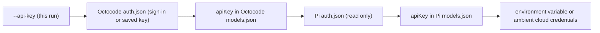

# Providers

## Connect what you have

`/providers` is where you sign in: `/providers <provider>` opens one provider, and **+ Provider** lists every sign-in (type `chatgpt`, `copilot` or `subscription` to search). `/login` was renamed `/providers`; typing it points there.

| You have                                            | Do this                                                                                                                                                                                                 | Models appear as                   |
| --------------------------------------------------- | ------------------------------------------------------------------------------------------------------------------------------------------------------------------------------------------------------- | ---------------------------------- |
| ChatGPT Plus/Pro (Codex)                            | `/providers openai` → **Sign in — OpenAI (ChatGPT subscription)**                                                                                                                                       | `openai/…`                         |
| Claude Pro/Max                                      | Only through Claude Code: connect it as an external agent in `/providers` (**External agents**). A subscription token pasted as a key is refused ([details](#use-your-claude-subscription))             | Claude Code tasks                  |
| Google AI Pro/Ultra                                 | Only through Gemini CLI as an external agent; for direct use add a Gemini API key with `/providers google`                                                                                              | Gemini CLI tasks, `google/…`       |
| A Claude API key (Claude Console)                   | `/providers anthropic` → **Add API key**, or export `ANTHROPIC_API_KEY`                                                                                                                                 | `anthropic/…`                      |
| GitHub Copilot                                      | `/providers github-copilot` (device sign-in), or turn on the `COPILOT_GITHUB_TOKEN` [source](#sources)                                                                                                  | `github-copilot/…`                 |
| Grok, Kimi Code or Meta subscription                | `/providers xai`, `/providers kimi-coding` or `/providers meta` → sign in                                                                                                                               | `xai/…`, `kimi-coding/…`, `meta/…` |
| OpenCode Zen or Go                                  | `/providers opencode` or `/providers opencode-go` → **Add API key**: the OpenCode Console opens; subscribe to Go there, copy the key, paste it ([details](#use-opencode-and-choose-a-model))            | `opencode/…`, `opencode-go/…`      |
| An API key (Anthropic, OpenAI, OpenRouter…)         | `/providers <provider>` → **Add API key** (keychain when available; OpenAI and OpenCode open their key page first), or export the provider's variable ([below](#use-an-api-key-from-the-environment))   | `<provider>/…`                     |
| A gateway, proxy or self-hosted endpoint            | Add `baseUrl`, `api` and `apiKey` in `models.json` ([compatible endpoint](models.md#configure-a-compatible-endpoint); the **Custom OpenAI-compatible host** template adds one without editing the file) | `<your id>/…`                      |
| A local server (llama.cpp, Ollama, LM Studio, vLLM) | `/providers` → **+ From template** ([local models](models.md#connect-local-models)), or `models.json`                                                                                                   | `llama.cpp/…` or your id           |
| Pi already set up                                   | Nothing: Pi's keys, the Pi sign-ins Octocode supports and Pi's `models.json` load beside Octocode's; a Pi Claude Pro/Max sign-in does not ([Use Pi configuration](#use-pi-configuration))               | the Pi provider ids                |

Then switch freely: `/model` picks this chat's model (`/model openai/` limits it to one provider, `Ctrl+S` saves the default), `Ctrl+P` and `Shift+Ctrl+P` cycle models, `octocode --model <provider>/<id>` starts on one, and `e` on a provider in `/providers` hides or restores it. To check a credential without starting a chat, run `octocode auth check --provider <provider>` or `/modelsettings check`.

`auth check` uses the same Octocode and enabled Pi credential sources as a session. Checks have a 15-second deadline. `--no-refresh` reads credentials, including keychain references, without refreshing OAuth or writing credential files; an expired saved token can still be reported as configured. Add `--credentials` only when you intend to print the resolved secret. The credential-print commands also respect source switches. `auth print-bearer-token --min-expiry 30m` requests at least that much remaining validity; units are `ms`, `s`, `m` and `h`, in either case.

`auth check` prints the status, then the **source** it resolved (`stored credential`, the name of an environment variable, or an ambient source such as an AWS profile) and `verified: false`: no provider request is made, so a credential is never reported as accepted. The JSON form has the same `source` and `verified` fields. When a stored credential hides an environment variable that is also set, a `warning:` line names the variable. When the source is an API-key variable that other providers read too (`MOONSHOT_API_KEY`, `CLOUDFLARE_API_KEY`, `OPENCODE_API_KEY`, `QWEN_TOKEN_PLAN_API_KEY`), the source line says which providers share it, so a sibling that looks ready is explained. A credential kept in the keychain that cannot be read (locked or removed) reports `not_ready` with reason `keychain_unreadable`; it never falls back to the environment or a default host, and requests fail with the same reason.

`ready` from `auth check` establishes local credential readiness, not provider reachability, model access, quota or billing. **Test** on a provider page sends one small model request and can consume provider usage. Login's free endpoint check is narrower: HTTP 401 refuses the key; HTTP 403 saves it with a permission warning because access to model listings and model requests can differ. Custom gateway definitions do not inherit upstream key checks.

In `/model`, **Enter** switches this chat to the highlighted model and **Ctrl+S** also saves it as the startup default. See [saved defaults and connection limits](models.md#save-a-startup-default).

### Choose the models the agent may use

Open `/providers`, pick a provider and choose **Choose models**. Tick the models you want to offer. The same controls are in web Settings. Open `/models` to see selections across providers, including custom providers from Octocode and Pi `models.json`. The coordinator uses the same enabled inventory. It can start a task on any enabled chat model with credentials the child can access, using its exact `provider/id`.

To make a provider the startup choice, select **Set as default provider for new chats** on its page. To set its preferred model, highlight that model in `/model`, open its details with **Alt+I** and press **Ctrl+P**. These preferences take effect in new chats. [Model selection and startup defaults](models.md#save-a-startup-default)

### Check Amazon Bedrock model access

Open `/providers amazon-bedrock` to choose an AWS profile, ambient IAM credentials, or a Bedrock bearer key. Select **Check account access for a model** to query one model without sending a prompt. The CLI can check matching models together:

```sh
octocode --provider amazon-bedrock --list-models glm --check-model-access
```

When you choose a Bedrock Runtime model in the terminal, Octocode checks its foundation-model entitlement. For a global or geographic profile, it also checks the exact profile ID in the selected region. **Entitled** means AWS reported the agreement, entitlement, authorization and regional availability, and confirmed the profile is active when one was specified. Invocation also requires IAM permission. An active cross-region profile can reach a model that does not offer direct inference in the source region. Mantle checks the exact ID on its own Models API and reports **listed on Mantle**. [Inference profiles](https://docs.aws.amazon.com/bedrock/latest/APIReference/API_GetInferenceProfile.html) · [Foundation model availability](https://docs.aws.amazon.com/bedrock/latest/APIReference/API_GetFoundationModelAvailability.html) · [Mantle model operations](https://docs.aws.amazon.com/bedrock/latest/userguide/logging-cloudtrail-mantle.html)

A missing profile or an explicit account denial stops the selection. Choose another model or recheck it in `/providers` after changing access. A key queries AWS directly. A profile or IAM login uses the AWS CLI. In offline mode, when the CLI is missing, when the lookup lacks permission, or when the check takes over 2.5 seconds in the picker, Octocode shows **unverified** and lets the next request establish access. **Test** on the provider page sends a small inference request and can consume quota.

On Bedrock, Kimi K3 and K3.1 accept off, low, medium, high, xhigh and max. GLM 5.3 always reasons and starts at low when reasoning is switched off. Kimi K3.1 requests up to 16,384 output tokens by default. An explicit request can raise that to the 131,072-token ceiling. Use the `/openai/v1` runtime endpoint with a bearer key for Chat Completions. AWS recommends its OpenAI-compatible API for Kimi and documents limitations of Converse for multi-turn reasoning. [Kimi model card](https://docs.aws.amazon.com/bedrock/latest/userguide/model-card-moonshot-ai-kimi-k3-1-highspeed.html) · [GLM model card](https://docs.aws.amazon.com/bedrock/latest/userguide/model-card-zai-glm-5-3.html) · [Account availability](https://docs.aws.amazon.com/bedrock/latest/APIReference/API_GetFoundationModelAvailability.html)

## Subscriptions and billing

A subscription pays for requests by plan; everything else is billed per token. `/providers`, the footer (`(sub)`) and the `models` tool show the same answer. A plan's cost is shown as an estimate.

Without a saved or explicit model choice, startup prefers an available subscription model before a model billed per token, including subscription providers without a catalog default. Restrictions on unattended use still apply.

| Provider                                                                  | Billed by   | Used                                                                                                                                                                                                                                                                     |
| ------------------------------------------------------------------------- | ----------- | ------------------------------------------------------------------------------------------------------------------------------------------------------------------------------------------------------------------------------------------------------------------------ |
| ChatGPT sign-in (`openai`), GitHub Copilot, Kimi Code, OpenCode Go        | Plan        | Directly, by the main session and subagents                                                                                                                                                                                                                              |
| Qwen Token Plan, Xiaomi Token Plan, Z.AI and Z.AI Coding CN (all regions) | Plan        | Directly, interactive use only: when no model is named, print mode, ACP server mode and background agents skip them for the next available model; a model you name (`--model`, your saved default, the ACP model list) still runs, with a one-line notice                |
| Claude Pro/Max, and Codex CLI, OpenCode or Gemini CLI on their own logins | CLI account | As external agents: the vendor's own tool does the work (`/providers` → **External agents**); its sign-in determines billing. Known plans show `(sub)`; an unclassified sign-in shows **billing unknown**. Claude Code can also be the session's model (`claude-code/*`) |
| OpenCode Zen, API keys                                                    | Per token   | Directly                                                                                                                                                                                                                                                                 |

Provider sections in `/model`, model shortcuts, the footer, `/providers` and the `models` tool name the provider's kind. Credential actions use the provider's method name: AWS profiles and bearer tokens, for example, appear as **AWS credentials or bearer token**, and Vertex as **Google Cloud credentials**. The first rule that applies decides the kind.

| Kind           | Meaning                                                                                           | Billing                    |
| -------------- | ------------------------------------------------------------------------------------------------- | -------------------------- |
| `CLI`          | Requests run through the vendor's own installed CLI, on its own login (also every External agent) | The vendor's plan or key   |
| `subscription` | A subscription sign-in (ChatGPT, GitHub Copilot) or a plan key (Kimi Code, OpenCode Go, Z.AI, …)  | Plan; cost is an estimate  |
| `account`      | Another stored sign-in that is not a plan                                                         | Per token, on that account |
| `local`        | Every model of the provider is served from this machine (`localhost`, `127.0.0.1`, `::1`)         | None from a vendor         |
| `API key`      | A key or token from the credential store, keychain, `models.json` or the environment              | Per token                  |

When a subscription is connected, subagent routing (`small`, `medium`, `large`) prefers a capable plan-billed model over a per-token one.

GitHub Copilot identifies as the VS Code Copilot client unless `OCTOCODE_COPILOT_CLIENT_ID` names a GitHub OAuth app you registered for Octocode ([environment variables](environment-variables.md)); GitHub officially supports only OpenCode as a third-party Copilot client.

## Octocode's harness or an external agent

A plan or key runs in one of two places:

- **Octocode's harness**: Octocode sends each model request itself, with its own tools, prompt, permissions, hooks, memory and subagents. Every provider in `/providers` (and in `models.json`) runs here.
- **An external agent**: the vendor's own CLI runs the task in its own harness (its loop, tools and sign-in) as a separate process. Octocode starts the task, passes the goal, shows the CLI's tool calls and receives its report, but does not control that harness. External agents appear in `/providers` under **External agents**, and **+ External agent CLI** adds one.

A plan whose vendor reserves it for its own apps can only be used as an external agent.

| Plan or key                                     | Octocode's harness                                      | External agent                   | Vendor's rule                                                                                                                                                                                                                                                                                                                                                       |
| ----------------------------------------------- | ------------------------------------------------------- | -------------------------------- | ------------------------------------------------------------------------------------------------------------------------------------------------------------------------------------------------------------------------------------------------------------------------------------------------------------------------------------------------------------------- |
| Claude Pro/Max                                  | No: a subscription token is refused                     | Claude Code                      | Plan sign-in is for Claude Code and Anthropic's own apps; developers use API keys ([terms](https://code.claude.com/docs/en/legal-and-compliance))                                                                                                                                                                                                                   |
| Claude API key                                  | `anthropic`                                             | Claude Code signed in with a key | Billed to the key                                                                                                                                                                                                                                                                                                                                                   |
| ChatGPT Plus/Pro                                | `openai` → **Sign in with ChatGPT**                     | Codex CLI                        | Plan usage is offered to open-source and local apps through Sign in with ChatGPT ([OpenAI](https://developers.openai.com/siwc/token-sharing-open-source))                                                                                                                                                                                                           |
| GitHub Copilot                                  | `github-copilot`                                        | none                             | GitHub supports Copilot plans in OpenCode ([changelog](https://github.blog/changelog/2026-01-16-github-copilot-now-supports-opencode/)); other apps authorize through their own GitHub OAuth app ([Copilot SDK](https://docs.github.com/en/copilot/how-tos/copilot-sdk/authenticate-copilot-sdk/authenticate-copilot-sdk)), which `OCTOCODE_COPILOT_CLIENT_ID` sets |
| OpenCode Zen or Go key                          | `opencode`, `opencode-go`                               | OpenCode                         | Console and Go keys work in other coding agents that identify themselves ([Go](https://opencode.ai/docs/go/))                                                                                                                                                                                                                                                       |
| Google AI Pro/Ultra (Gemini CLI sign-in)        | No                                                      | Gemini CLI                       | Using Gemini CLI's sign-in from another tool violates Google's terms ([Gemini CLI terms](https://geminicli.com/docs/resources/tos-privacy))                                                                                                                                                                                                                         |
| Gemini API key or Vertex AI                     | `google`, `google-vertex`                               | Gemini CLI signed in with a key  | Billed to the key                                                                                                                                                                                                                                                                                                                                                   |
| Kimi Code key, Grok, Z.AI, Qwen or Xiaomi plans | Their providers ([billing](#subscriptions-and-billing)) | none                             | Each vendor's plan terms apply; Kimi, for example, documents the coding agents it supports ([Kimi](https://www.kimi.com/en/help/kimi-code/third-party-agents))                                                                                                                                                                                                      |

The coordinator can mix both: `agent` tasks run on any enabled provider's model (`small`, `medium` and `large` pick one, or a task names a model) and, with external agents enabled, in any selected CLI (`runner`). Octocode gives an external agent none of its MCP servers, skills or hooks; it reads team messages by fetching them from the team mailbox server Octocode gives that task. Claude Code also runs without its own settings, MCP servers and slash commands, and Gemini CLI starts with extensions disabled and admits only an explicitly attached mailbox server. Without a mailbox its allowlist admits no configured server. Headless Codex uses `--ignore-user-config` and keeps the vendor sign-in. The Codex ACP adapter and OpenCode can still load vendor configuration. See [external runners](native-features.md#external-runners).

## How sign-in works

Most hosted providers support one or both of these authentication methods:

- Sign in through a browser or device flow backed by OAuth.
- Provide an API key.

Use `/providers` to manage providers and sources, and `/providers <provider>` to open one provider's page. Amazon Bedrock and Google Vertex AI can also use ambient cloud credentials.

GitHub Copilot model access uses `/providers github-copilot`. The separate `/octocode auth login` (and `/octocode auth status|logout`) manages GitHub code-search credentials; signing in there does not configure Copilot inference.

Which credential a request uses (first match wins):



Octocode's own files win over Pi's: a provider with an `apiKey` in Octocode's `models.json` never uses a Pi `auth.json` entry, even when that `apiKey` names an unset variable. The Pi steps also cover the Octocode Pi extension's `~/.octocode/agent/` and `~/.octocode/` folders, which come before Pi's, and are skipped while the [Pi source](#sources) is off. A Pi `models.json` provider counts only when Octocode's `models.json` does not define that provider.

Sign in with ChatGPT retains account/client registrations and offers a saved account or a new account on the next login. Saved account selection reuses its issued client ID and available ID-token hint, then verifies the returned account. Logout revokes saved renewable sessions and removes their local tokens; nonsecret registrations remain for reuse. If remote revocation cannot be confirmed, local tokens are still removed and the error explains how to disconnect the app in account settings. Model availability comes from the selected account's vendor list; see [model discovery](models.md#discover-vendor-models).

For instruction and conversation retention, see [Prompt caching](prompt-caching.md).

## The /providers page

`/providers` separates managing providers from signing in. Its sections, in order:

- **Ready**: providers with credentials and available models, showing access method and credential source (a label or variable name, never a value). Enter opens the provider's model chooser; its page has the other actions. **Test** on the provider's page sends a small request to check access. Subscription plan keys are labeled **subscription**, including keys read from a keychain, command reference or environment; their values are never shown. With none yet, the section says to choose **+ Provider**.
- **Needs attention** (shown only when there is something): missing provider definitions, unavailable credentials, paused plans and providers with no available models. A saved credential alone never means signed in or verified. The cursor starts on the first of these.
- **Add**: **+ Provider** opens supported subscription, account or API-key setup methods; **+ From template** adds another API-key host, a gateway or a local server to `models.json`; **+ External agent CLI** adds a vendor CLI that runs tasks in its own harness. A pasted key is checked before saving: Claude subscription tokens are refused, and a key whose prefix belongs to another provider asks first, naming that provider. Successful sign-in opens `/model`; Enter switches this chat and Ctrl+S also saves the startup default.
- **Available**: every catalog provider you have not set up yet. Enter opens its page to add a key or sign in.
- **Off**: providers you turned off, hidden from `/model`.
- **External agents**: vendor CLIs that run tasks in their own harness, with their own sign-in and tools ([harness or external agent](#octocodes-harness-or-an-external-agent)). Open a CLI, sign in if needed, choose **Enable this CLI for agent tasks**, then `/reload`. Installed CLIs are off until selected; signing in alone changes no task or model defaults.
- **Test**: **Test all** ([below](#test-and-test-all)).
- **Advanced**: first the `models.json` files Octocode reads (Octocode's and Pi's, global and project, each with its path and the providers it defines; a project file also lists the global providers it replaces). A project file of a folder you have not trusted is shown as not read; run `octocode trust add <folder>` and start a new session to use it ([project models.json](configuration.md#project-modelsjson)). Then **Sources and custom models**: Octocode, Pi and environment sources, detected tools and their setup actions, and model definition files with paths and provider IDs. Missing files are marked `not found`. See [Sources](#sources).

An interactive start with no usable model opens this page by itself, titled `AI providers · no usable model yet — add a provider to start`, with the cursor on **+ Provider**. Typing `/` there closes it and starts a command in the editor, so `/status` or `/help` typed at start runs. Print and JSON runs exit with command-line guidance instead, and RPC reports no model.

`/models` opens a page with every enabled provider as a heading and its models beneath: Enter turns a model on or off (off models leave `/model`, `Ctrl+P` and subagent routing) and `d` makes it the default for new chats. `/model` stays the quick picker.

Keys: Enter opens a row, `e` enables or disables the selected provider, external CLI or source, Esc goes back, and PgUp/PgDn scroll long details. Narrow screens wrap the selected row's details and complete facts, including plan terms.

A provider's page shows its status, credential source, enabled state, model count, base URL and defining `models.json`, then the actions: choose a model, sign in (again), add or replace an API key, **Test** (one small request to this provider; the result is shown with any error text redacted), **Sign out** or **Remove saved credential**, **Show definition file** (the path and reload instructions), **Move key to keychain** for a literal `apiKey` in Octocode's `models.json` (the file then keeps only a reference; refused while another `models.json` reads the same keychain entry), for a custom provider in Octocode's `models.json` **Edit host**, **Edit context window and maximum output** of a model and **Remove this custom provider**, and **Disable provider** / **Enable provider**. Removal and Pi import ask first: the first row of the question is always **Cancel**. A session API-key override is labeled separately and can be cleared without removing saved credentials; saving a key while that override is active reports that the override still takes priority.

Open a CLI directly with `/providers codex` or `/providers runner:opencode`. An exact provider name opens its provider page first; the `runner:` prefix selects the CLI when names overlap. **Pause all external agent tasks** keeps your CLI selection for later. See [external-runner configuration](configuration.md#headless-and-external-agent-runs).

On a remote or headless machine, an OAuth callback may not reach the local process. When prompted, paste the final redirect URL or authorization code back into Octocode.

Choose **Sign out** or **Remove saved credential** on the provider’s page, or run `/logout [provider]` (the argument prefills the search) and select a provider, then confirm removal. A saved credential whose provider is no longer defined (its `models.json` entry was removed) is listed as **provider not defined**; remove it the same way. This does not unset environment variables, remove authentication from `models.json`, or revoke the credential at the provider.

Secret input and pasted authorization codes are hidden. When macOS Keychain, Windows Credential Manager or Linux Secret Service is available, API-key entry and account sign-ins offer it first: only a command reference is written to `auth.json` (an account sign-in is stored as one keychain entry and refreshed there; one too large for the keychain's write channel (macOS or Windows) stays in `auth.json`). A failed keychain write during initial sign-in normally aborts. During an OAuth refresh, the provider may already have replaced the old refresh token. If the keychain refuses the new record, Octocode saves the refreshed credential in owner-only `auth.json` and reports the fallback on stderr and in the problem log. You can explicitly choose local-file storage; new files use mode `0600` and new directories `0700`. Existing administrator-managed modes and ACLs are preserved. Startup warns when its credential file has group/world permissions or is inside a Git worktree; injected SDK model runtimes retain responsibility for their own credential storage. Sign-ins and API keys you store in the local file are plaintext; keep `auth.json` private and out of Git. Removal also attempts to delete an owned keychain entry.

### Status and credential source

Each provider row and page shows one status, then where the credential comes from.

| Status     | Meaning                                                                                                                                      |
| ---------- | -------------------------------------------------------------------------------------------------------------------------------------------- |
| Connected  | A usable credential is set. This is local evidence, not proof the provider accepts it; use **Test**.                                         |
| Expired    | An account sign-in is past its expiry and has no refresh token that can renew it (or the provider refused the refresh token). Sign in again. |
| Signed out | The account was signed out; only its registration remains.                                                                                   |
| Not set    | No usable credential.                                                                                                                        |

| Source                       | Where it is                                              |
| ---------------------------- | -------------------------------------------------------- |
| `auth.json`                  | Octocode's credential file                               |
| `keychain`                   | The OS keychain, referenced from `auth.json`             |
| `models.json`                | A key or secret command in a `models.json` file          |
| An environment variable name | The variable that supplies the key                       |
| Pi file                      | A Pi `auth.json` read as a fallback, shown with its path |

### Key check on save

Before an API key is saved, in `/providers` or on the configuration page, Octocode sends the provider one small request (its model list) with a 10-second limit, without following redirects. Neither the key nor the provider's reply appears in any message.

| Provider answer                 | Result                                                                                                                       |
| ------------------------------- | ---------------------------------------------------------------------------------------------------------------------------- |
| Accepts the key                 | Saved.                                                                                                                       |
| Rejects it (HTTP 401)           | Not saved; the message names the provider.                                                                                   |
| Denies the check (HTTP 403)     | Saved, with a note: the check endpoint can deny a valid key.                                                                 |
| Unreachable, times out or fails | `/providers` asks whether to save the key unverified. The configuration page refuses until you confirm saving it unverified. |

Providers without a key check, and custom providers, save the key as entered.

### When a request's credential is refused

A request that fails on a refused or missing credential names its provider and model (`<provider>/<model>: …`) and ends with a `Fix:` line:

| Provider                                             | `Fix:` says                                                                                                             |
| ---------------------------------------------------- | ----------------------------------------------------------------------------------------------------------------------- |
| One that runs through its vendor's CLI (Claude Code) | run `claude auth login`                                                                                                 |
| Amazon Bedrock signed in through an AWS profile      | run `aws sso login --profile <name>` (or `aws sso login`), switch model with `/model`, or `/providers → Amazon Bedrock` |
| Any other                                            | `/providers → <Provider>`                                                                                               |

In a print, JSON or RPC run the line is written for a shell: run `octocode` and open `/providers → <Provider>`, and pick another model with `--model`. With [`retry.fallbackModels`](configuration.md#when-a-model-keeps-failing) set, the turn first continues on the next listed model of another provider.

A failure that is retried names its provider and model on each retry line and in the final retry error, and a request that never reached its endpoint adds the endpoint's host: `Retrying in 2s (attempt 1 of 3): local-gateway/fake-model at 127.0.0.1:9: fetch failed`.

## Enable or disable a provider

Press `e` on a provider in `/providers`, or choose **Disable provider** on its page, to hide its models everywhere: the `/model` picker, model cycling, subagent routing, the `models` tool and `/modelsettings`. The provider moves to **Off**, and **Enable provider** brings it back. Disabling saves the provider id in the global [`disabledProviders`](settings.md) setting and never touches saved credentials. A session already running on the provider keeps working and shows a warning naming how to switch; project settings cannot disable providers. The running agent learns about availability changes through its routing notice; no other notification is sent.

### Test and Test all

**Test** on a connected provider's page (and the web provider row) sends one small request through the same path a run uses, then reads the host's own model list, which is free, and compares it with the model ids configured for that provider. Ids the host does not serve are named with the nearest served ids; for example a gateway that no longer serves `moonshotai.kimi-k3.1` shows the `zai.glm-4.x` ids it does serve. Providers with no list route (Bedrock-style catalogs, documentation-only hosts) skip the comparison. **Test all** (the Test row of `/providers`, and the button on the web page) does the same for every connected provider, a few at a time, and checks each installed external agent with its own status command instead of a model request. Nothing is tested until you press a button; each result is one line with the provider's error text, with keys redacted. A provider whose models are all hidden is skipped.

### Choose models

**Choose models** on a provider's page (and the same button on the web provider page) shows a checkbox list of that provider's models, with search; `Enter` toggles, the save key saves. Unticked models are hidden from `/model`, `Ctrl+P` cycling and subagent routing. A subagent purpose or profile never picks a hidden model; when a profile names one, the routing notice says it is hidden and which model runs instead. A session that already runs on a hidden model keeps working and shows a notice at its next turn. A provider with no saved choice shows every model, including models it adds later. The choice is saved per provider in the global [`hiddenModels`](settings.md) setting (provider id to hidden model ids); it is separate from the `/modelsettings` shortcut list (`enabledModels`), which only orders what `Ctrl+P` cycles through, and from **Disable provider**, which hides the whole provider. Project settings cannot hide models.

## Sources

| Source                                          | Gives                           | Default | Switch |
| ----------------------------------------------- | ------------------------------- | ------- | ------ |
| Octocode (`auth.json`, keychain, `models.json`) | credentials, models             | on      | no     |
| Pi (`auth.json` read only, `models.json`)       | credentials, models             | on      | yes    |
| `COPILOT_GITHUB_TOKEN`                          | credential for `github-copilot` | off     | yes    |

Open a source (or press `e` on it) to turn it on or off. The choice is saved in the global `providerSources` setting (only changes from the defaults; project settings cannot set it) and takes effect at once: turning Pi off hides Pi-only providers and models from `/model` and `/providers`, turning it on restores them. Files are never changed.

The web Settings page (opened with `/web`) shows the same sources and each provider's origin (Octocode or Pi, `auth.json` or `models.json`; never a value) and has the same switches for the Pi source and for each provider. The terminal and the page write the same settings; a running session applies a provider switch (a provider or the Pi source) saved on the page or in another terminal within a second or two, without `/reload`. Other settings still need `/reload`.

In `/providers`, **+ Provider** creates a custom connection and **+ From template** starts with a supported host configuration. Open a connected provider and choose **Set as default provider for new chats**. In `/model`, highlight a model, open its details with **Alt+I** and press **Ctrl+P** to make it the provider's preferred model. Provider and model preferences are independent, and an explicit startup model takes precedence until you choose a startup provider again.

### Detected tools

Claude Code, Codex CLI, Grok CLI, Gemini CLI, Cursor, opencode, crush, Copilot CLI, Qwen Code and Aider are recognized by their known install and config paths. Octocode never reads their tokens or databases. Each row offers either Octocode's own sign-in for the same account (Codex CLI → sign in with OpenAI, which runs Sign in with ChatGPT) or API-key entry for the vendor (Gemini CLI → add an API key for Google). Claude Code → add an Anthropic API key; to use a Claude subscription, connect Claude Code as an external agent instead ([Use your Claude subscription](#use-your-claude-subscription)). Choosing the row opens that flow.

## Find custom providers

The **Custom models** section of `/providers` lists the Octocode `models.json` and the Pi `models.json` files that are read, with their paths and the providers each defines; choose one to see its path in plain text you can open or copy. A provider defined in one of them lists its file as **Edit definition** and in the **Definition** line of its page. Edits apply when models refresh (opening `/model`) or after a restart. See [Models](models.md).

## Use Pi configuration

Pi is a source: choose **Advanced** → **Sources and custom models** → **Pi** in `/providers` (or run `/providers pi`) to see its saved sign-ins and the providers its `models.json` defines. **Import a sign-in into Octocode** lists providers found in Pi’s `models.json` and saved sign-ins from `auth.json`. Model definitions follow the existing [Pi fallback precedence](configuration.md#pi-configuration-fallback); models retain their real provider IDs and use those providers’ APIs, authentication and pricing. Pi is a setup source, not a network model service. While Pi is off, `/providers pi` only says so.

Octocode reads Pi's `auth.json` without changing it, and skips what it cannot use:

| In a Pi `auth.json`                                                                     | What happens                                                                                                                |
| --------------------------------------------------------------------------------------- | --------------------------------------------------------------------------------------------------------------------------- |
| A file that is not valid JSON                                                           | The whole file is skipped; a startup warning names it                                                                       |
| An entry Octocode does not recognize                                                    | That entry is skipped; a startup warning names the file and the provider. The other entries are used                        |
| A key held in a secret command (`!cmd`)                                                 | Not run and not used; the same provider's entry in a later Pi file is used                                                  |
| An account sign-in for a provider whose Octocode version has none (Pi's Claude Pro/Max) | Not used, so the provider's environment variable still applies. The provider's page in `/providers` says so; add an API key |

Saved Pi sign-ins are copied only after you select a provider and confirm import. Existing Octocode credentials can be replaced; Pi files are never modified. API keys can be imported into the system keychain. File imports preserve environment references; keychain imports resolve the key once and reject missing values. If an inherited credential uses a command to read a key or keychain record, configure it directly in Octocode. Inherited model definitions that use a command for an API key or request header are also skipped. Other providers in the same file remain available. Explicit home overrides and custom SDK directories disable discovery. After import, the model picker shows only that provider. Providers defined only in Pi’s model file remain usable through the normal fallback loader.

## Use OpenCode and choose a model

Run `/providers opencode` for OpenCode Console (Zen), or `/providers opencode-go` for Go. Choose **Add API key** (or **Replace API key**) and paste your key when prompted. After saving it, Octocode opens the model picker with that provider as the search term; your current model stays selected until you choose another. Press Esc to keep it.

To choose later, run `/model opencode/` or `/model opencode-go/`; the trailing slash restricts the picker to that exact provider. You can also select an exact model with `/model <provider>/<model-id>`. Both providers support `OPENCODE_API_KEY` for environment-based authentication. A saved key takes precedence over that variable.

The [OpenCode Console model list](https://opencode.ai/v2/docs/console/models/) and [Go documentation](https://opencode.ai/v2/docs/console/go/) describe availability and account requirements. A model appearing in the local catalog does not guarantee that your account can use it.

OpenCode serves its free models (`big-pickle` and the `*-free` models) only to the OpenCode app; other clients get `FreeUsageLimitError`. Octocode therefore does not list them under `opencode/`. To use them, install the `opencode` CLI and enable it under `/providers` → **External agents**: tasks with `runner: opencode` then run in OpenCode on its own access.

| You want        | Use                                   |
| --------------- | ------------------------------------- |
| Paid Zen models | An OpenCode Console key on `opencode` |
| Go plan models  | A Go key on `opencode-go`             |
| Free models     | The OpenCode CLI as an external agent |

**Test** on a provider page always sends one small request, so it reports refusals that a model listing would not show.

## Use an API key from the environment

Environment variables are useful in CI and anywhere Octocode should not store the key. Set the variable before starting Octocode:

```bash
export ANTHROPIC_API_KEY=sk-ant-...
octocode
```

The provider library's [environment variable table](https://github.com/bgauryy/octocodecode/blob/main/packages/ai/docs/auth.md#environment-variables) lists the variable each built-in provider reads and their precedence; `octocode --help` also lists provider key variables. Providers that need additional configuration or support ambient credentials are covered under [Provider Specific Config](#provider-specific-config). TypeSafe keys serve [classifier models](models.md#classifier-and-image-models).

Anthropic also recognizes `ANTHROPIC_AUTH_TOKEN` as bearer authentication. `ANTHROPIC_API_KEY` wins over `ANTHROPIC_OAUTH_TOKEN`, which can only hold a Claude subscription token: a request with one is refused before anything is sent ([Use your Claude subscription](#use-your-claude-subscription)).

Private Copilot, Meta and fixed subscription-client contracts, and account or region entitlements, have not been validated live: a provider being listed does not prove a given account can use it.

## Use your Claude subscription

Anthropic allows a Claude Pro or Max plan only in Claude Code ([terms](https://code.claude.com/docs/en/legal-and-compliance)), so Octocode has no direct Claude subscription route. Claude Code itself carries your plan:

1. Install [Claude Code](https://code.claude.com/docs/en/setup) and its ACP adapter (`npm install -g @agentclientprotocol/claude-agent-acp`), and sign in with `claude`, Anthropic's own login.
2. Connect it in `/providers` → **External agents**, choose **Enable this CLI for agent tasks**, then `/reload`.

Then use it either way; Claude Code bills both to your plan:

| Route                                    | What happens                                                                                                                                  | How                                                                                                                                                |
| ---------------------------------------- | --------------------------------------------------------------------------------------------------------------------------------------------- | -------------------------------------------------------------------------------------------------------------------------------------------------- |
| As an external agent                     | Claude Code runs a whole task with its own tools; Octocode owns the task like any child                                                       | Ask for a task in Claude Code, or `/agents external` ([external agents](acp.md))                                                                   |
| As Octocode's model, through Claude Code | Claude Code answers each turn of your Octocode session, and every tool it calls is an Octocode tool, under your permission mode and approvals | Pick `claude-code/opus`, `claude-code/sonnet` or `claude-code/haiku` in `/model` ([details](native-features.md#claude-code-as-the-sessions-model)) |

As Octocode's model, Claude Code makes every model call with its own login and Octocode never reads, stores or sends your Claude token. Anthropic's terms let you sign in to the unmodified Claude Code with your own plan, and its help center says Agent SDK and `claude -p` usage draws from plan limits ([Agent SDK with your plan](https://support.claude.com/en/articles/15036540)); the same terms ask developers building on the Agent SDK to use API keys. Driving Claude Code with Octocode's tools is therefore at your own risk; an external agent task is the conservative route.

For direct requests from Octocode, use a Claude API key from the [Claude Console](https://platform.claude.com/settings/keys): `/providers anthropic` → **Add API key**, or `ANTHROPIC_API_KEY`. Max, Ultra and Team plans include [monthly API credits](https://support.claude.com/en/articles/17154008) for a key from the linked Console organization.

A subscription token (`sk-ant-oat…`, the token `claude setup-token` prints) is not an API key, and Octocode never sends one:

| Where the token is                                                      | What happens                                                                                                                                                                                                                                                                                                               |
| ----------------------------------------------------------------------- | -------------------------------------------------------------------------------------------------------------------------------------------------------------------------------------------------------------------------------------------------------------------------------------------------------------------------- |
| Pasted in **Add API key** (any provider)                                | Refused; nothing is saved                                                                                                                                                                                                                                                                                                  |
| Saved by an earlier Octocode version, or set in `ANTHROPIC_OAUTH_TOKEN` | Counts as no credential: no Anthropic model is offered in `/model`, to agent tasks or as the starting model, and `/providers` lists the saved token as refused. A request that names an Anthropic model fails before anything is sent; a notice says so once per run (`warnings.anthropicExtraUsage` turns the notice off) |

Both say: "This is a Claude subscription token. Anthropic allows it only in Claude Code. Connect Claude Code as an external agent in /providers (External agents)." Remove a saved token with **Remove saved credential** on the Anthropic page in `/providers`, then add an API key or connect Claude Code.

## Load an API key from a command

To use a secret manager without writing the resolved key to disk, set a provider's `key` in `auth.json` to a command prefixed with `!`:

```json
{
	"anthropic": {
		"type": "api_key",
		"key": "!security find-generic-password -ws 'anthropic'"
	}
}
```

Octocode runs the command when the key is first needed and caches its standard output for the process lifetime. Empty output, a timeout, or a nonzero exit leaves the key unresolved until Octocode restarts.

## Provider Specific Config

The providers below have additional setup, need additional settings, or can use credentials supplied by their platform.

A stored API-key credential can include an `env` object. Its values take priority over the process environment for that provider:

```json
{
	"cloudflare-workers-ai": {
		"type": "api_key",
		"key": "...",
		"env": {
			"CLOUDFLARE_ACCOUNT_ID": "account-id"
		}
	}
}
```

### Anthropic workload identity

With no key or token set, Anthropic uses workload identity federation when `ANTHROPIC_FEDERATION_RULE_ID`, `ANTHROPIC_ORGANIZATION_ID` and `ANTHROPIC_IDENTITY_TOKEN_FILE` are set: the Anthropic SDK exchanges the identity token for a short-lived access token and refreshes it itself (re-reading the identity token file, so keep that file fresh for long sessions). `ANTHROPIC_SERVICE_ACCOUNT_ID` and `ANTHROPIC_WORKSPACE_ID` are passed through when set.

### OpenRouter

Authenticate with `/providers openrouter` or `OPENROUTER_API_KEY`.

With a key, Octocode lists only the OpenRouter chat models that key may use, with the key's context size, max output, and prices. These come from OpenRouter's `/models/user` endpoint and reflect guardrails and provider restrictions set in OpenRouter. Image and classifier models are not filtered.

Octocode refreshes the list in the background at startup in interactive mode, when `/model` opens, after provider sign-in, and on `octocode update --models`. The last list is saved and used offline and in `octocode -p` and RPC mode. After switching keys outside `/providers`, the previous key's list stays until the next refresh.

Regional endpoints filter models to their region. To use one, set the base URL in [`models.json`](models.md#configure-a-compatible-endpoint):

```json
{
	"providers": {
		"openrouter": { "baseUrl": "https://us.openrouter.ai/api/v1" }
	}
}
```

If the base URL rejects the key at `/models/user` or does not have that endpoint, for example a proxy configured as the OpenRouter base URL, Octocode lists every OpenRouter model.

### Azure OpenAI

The provider ID is `azure` (formerly `azure-openai-responses`). Use it as the key in `auth.json`, `models.json`, and `settings.json`, and in model references such as `--model azure/gpt-5.4`.

The `azure` provider serves OpenAI models through the Responses API and Microsoft Foundry models through Chat Completions, such as `azure/deepseek-v4-pro`.

Set an API key plus either a base URL or resource name:

```bash
export AZURE_OPENAI_API_KEY=...
export AZURE_OPENAI_BASE_URL=https://your-resource.ai.azure.com
# Or:
export AZURE_OPENAI_RESOURCE_NAME=your-resource
```

Resource root URLs under `ai.azure.com`, `cognitiveservices.azure.com`, and `openai.azure.com` are normalized to the OpenAI API path.

Octocode sends the model ID as the deployment name. If a deployment has a different name, map it with `AZURE_OPENAI_DEPLOYMENT_NAME_MAP`:

```bash
export AZURE_OPENAI_DEPLOYMENT_NAME_MAP=gpt-5.4=my-gpt-deployment,deepseek-v4-pro=my-deepseek
```

`AZURE_OPENAI_API_VERSION` overrides the API version for OpenAI models (default `v1`).

Azure login asks for an optional **resource URL** (`https://<resource>.openai.azure.com/openai/v1`, https or localhost) after the key or token; it is saved with the credential and beats `AZURE_OPENAI_BASE_URL` and `AZURE_OPENAI_RESOURCE_NAME`. GitHub Copilot (an enterprise host) and Google Gemini (a proxy) ask for the same optional host with the same validation; an empty answer keeps the official host. Azure login also offers an Entra bearer token. Set `AZURE_OPENAI_AD_TOKEN` or select that option in `/providers`; acquire the token through Azure Identity or Azure CLI. Stored API keys take precedence. A token chosen in `/providers` goes to the system keychain when you pick it (only a reference is written to `auth.json`), is trimmed of surrounding whitespace, and is saved with the optional resource URL as one credential. This token is short-lived and must be renewed externally; Octocode does not refresh a manually supplied Entra token. SDK users can supply `azureADTokenProvider` to the Azure Responses adapter for automatic credential acquisition. Bearer auth suppresses the SDK's ambient API-key default.

To use a Foundry model that Octocode does not include, add it under `azure` in [`models.json`](models.md#configure-a-compatible-endpoint) with `api: "openai-completions"`. Custom models require a `baseUrl`; `AZURE_OPENAI_BASE_URL` and `AZURE_OPENAI_RESOURCE_NAME` take priority over it when set:

```json
{
	"providers": {
		"azure": {
			"baseUrl": "https://your-resource.services.ai.azure.com",
			"models": [{ "id": "your-deployment", "api": "openai-completions" }]
		}
	}
}
```

### Amazon Bedrock

Bedrock can use a bearer token or an ambient AWS credential source:

```bash
# Named profile
export AWS_PROFILE=your-profile

# IAM keys
export AWS_ACCESS_KEY_ID=AKIA...
export AWS_SECRET_ACCESS_KEY=...
# Required for temporary credentials
export AWS_SESSION_TOKEN=...

# Bedrock bearer token
export AWS_BEARER_TOKEN_BEDROCK=...

# Region, when not supplied by the profile or AWS SDK configuration
export AWS_REGION=us-west-2
# AWS_DEFAULT_REGION is also supported
```

Octocode also supports ECS task credentials and IRSA through the standard `AWS_CONTAINER_CREDENTIALS_*` and `AWS_WEB_IDENTITY_TOKEN_FILE` variables.

A stored AWS profile (saved in `/providers`) outranks `AWS_BEARER_TOKEN_BEDROCK` in the environment, as a stored key outranks its environment variable everywhere else.

The `/providers` sign-in for Bedrock offers a bearer token, an AWS profile or the credential chain, then an optional **custom endpoint host** and **region**. They are saved with the key as one credential: in the system keychain (macOS Keychain, Windows Credential Manager, Linux Secret Service) with only a reference in `auth.json`, or in `auth.json` (owner-only) after you choose that explicitly. Signing out removes key, host and region together. The host must be https (http only for localhost), and its name picks the API:

| Host                | API                                                                                                                                                                                          |
| ------------------- | -------------------------------------------------------------------------------------------------------------------------------------------------------------------------------------------- |
| `bedrock-runtime.*` | Converse stream                                                                                                                                                                              |
| `bedrock-mantle.*`  | OpenAI-compatible Chat Completions per model: `/openai/v1` for `openai.*` models, `/v1` for the others; Anthropic Messages under `/anthropic` for `anthropic.*` models. Needs a bearer token |
| anything else       | Octocode asks which API the host serves                                                                                                                                                      |

See [Amazon Bedrock endpoints](https://docs.aws.amazon.com/bedrock/latest/userguide/endpoints.html). A provider's page shows the effective base URL and where it comes from. For a host that is not Bedrock, add the **Custom OpenAI-compatible host** template instead. Other official providers whose API takes a base URL (OpenAI, Anthropic) ask for the same optional host at sign-in.

#### Kimi K3.1 throughput

An implicit Kimi K3.1 request reserves 8,192 output tokens. An explicit `maxTokens` still wins, clamped to the model's output limit.

Each assistant response carries one `requestTrace.throughput` record with the wire output limit, estimated uncached input and admission cost, cumulative gate wait, actual input/output/cache usage, model, Bedrock Region, adaptive capacity and the last upstream response’s request ID. It contains measurements, not prompt or response text. Kimi's estimated admission cost is uncached input plus `maxTokens`; its final-TPM reservation is uncached input plus 10 times `maxTokens`. Actual reconciliation uses input plus cache writes plus 10 times output, excluding cache reads.

Kimi requests from every Octocode process share token and request limits by provider, model and Region. Each send, including a transport retry, counts against the preceding 60 seconds. A 429 reduces capacity before the retry can send. The defaults start below the published Service Quota and do not assume an account-specific increase:

| Environment override       | Default | Meaning                                                                                                                |
| -------------------------- | ------- | ---------------------------------------------------------------------------------------------------------------------- |
| `OCTOCODE_BEDROCK_KIMI_TPM` | 500000  | Final tokens per minute: half of AWS's published 1,000,000 global/cross-region quota, leaving other account use headroom |
| `OCTOCODE_BEDROCK_KIMI_RPM` | 60      | Local request safety cap; AWS publishes no separate Kimi K3.1 RPM quota                                                  |

Both overrides must be positive integers. Set them from your account's effective Service Quotas and the capacity you want Octocode to use; Octocode does not query Service Quotas automatically. A request larger than a whole window may start in an empty window, but nothing else joins that window.

A 429 halves the key's capacity, down to 10%. Five consecutive successful admitted requests restore 10 percentage points, up to the configured capacity; an ordinary provider failure restarts that success streak. Deferrable work also has a smaller share of each window and is shed instead of waiting when its headroom is full.

| Priority    | Window share | Admission after throttling                                      |
| ----------- | ------------ | --------------------------------------------------------------- |
| Foreground  | 100%         | Always eligible; waits for the next window                      |
| Subagent    | 85%          | Waits while recovered capacity is at least 25%; otherwise shed   |
| Compaction  | 70%          | Resumes at 80% capacity                                          |
| Background  | 50%          | Cache warming and small side calls resume only at full capacity  |

`models.json` is for custom providers only. An entry whose id is an official provider (for example `amazon-bedrock`) loads only when it holds nothing but per-model tuning in `modelOverrides`, such as `compat.supportsLongCacheRetention: false` on a Bedrock model or a negotiated `cost` ([fields it may set](models-configuration.md#providers)). Any other field refuses the whole entry, its `modelOverrides` included, with a message naming the file, id and fields, and the rest of the file still loads: rename the entry (for example `bedrock-mantle`) for a custom endpoint, or set the host and key here in `/providers`. Pi's `models.json` entries with an official id are skipped with a warning; Pi's files are never modified.

### Cloudflare AI Gateway

The gateway requires a token, account ID, and gateway ID:

```bash
export CLOUDFLARE_API_KEY=...
export CLOUDFLARE_ACCOUNT_ID=...
export CLOUDFLARE_GATEWAY_ID=...
```

The account and gateway IDs can come from the process environment or the credential's `env` object in `auth.json`.

`CLOUDFLARE_API_KEY` authenticates Octocode to the gateway. Upstream access can use Cloudflare unified billing, credentials stored in the gateway, or an `Authorization` header configured for the provider in `models.json`.

### Cloudflare Workers AI

Workers AI requires a token and account ID:

```bash
export CLOUDFLARE_API_KEY=...
export CLOUDFLARE_ACCOUNT_ID=...
```

The account ID can also be stored in the credential's `env` object.

### Google Vertex AI

Use a Google Cloud API key:

```bash
export GOOGLE_CLOUD_API_KEY=...
```

To use Application Default Credentials, configure a project and location. The Application Default Credentials file is looked for on every check, so a `gcloud auth application-default login` made while Octocode runs is noticed without a restart:

```bash
export GOOGLE_CLOUD_PROJECT=your-project
# GCLOUD_PROJECT is also supported
export GOOGLE_CLOUD_LOCATION=us-central1
```

Then authenticate:

```bash
gcloud auth application-default login
```

To use a service-account key file instead, set `GOOGLE_APPLICATION_CREDENTIALS` along with the project and location.
