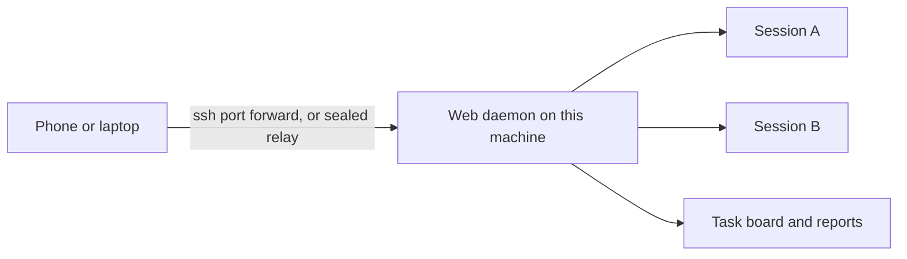

# Remote access

`/remote` lets another device reach this machine's Octocode: every session the [web daemon](web-workspace.md#web-daemon) knows (sessions blocked on an approval or a question first), their live view, the task board and saved reports. From the remote page you can answer an approval or question a run is blocked on.

`/remote` starts the web daemon when none is running, the same one `/web` opens. When the daemon cannot start, `/remote` says why and publishes nothing.

A control link lets another device send commands and answer approvals, so `/remote` asks before it publishes one, and `/remote view` asks before it publishes a read-only link. Where nobody can answer (print mode, RPC with `--no-dialogs`, a subagent), both refuse and publish nothing: a script publishes with `octocode remote link` or `octocode remote link view`.

## Commands

| Command                                                 | Effect                                                                                                                               |
| ------------------------------------------------------- | ------------------------------------------------------------------------------------------------------------------------------------ |
| `/remote`                                               | Publish a control link: the full page, including commands and answers to dialogs.                                                    |
| `/remote view`                                          | Publish a view-only link: it follows every session and sends nothing.                                                                |
| `/remote status`                                        | Links published since the daemon started (by fingerprint) and, with a relay, its connection.                                         |
| `/remote stop`                                          | Stop publishing. Every link, view and control, stops working at once.                                                                |
| `octocode remote list [--json]`                         | Sessions the daemon reaches (`busy`, `needsYou`) and the published links. Needs a running daemon; never starts one.                  |
| `octocode remote link [view] [--relay <url>] [--no-qr]` | Publish a link and print it in full. Always `ssh` unless `--relay <url>` is given; ignores `remote.transport` and `remote.relayUrl`. |
| `octocode remote stop`                                  | Stop publishing.                                                                                                                     |

A link is printed once, when published, with what it allows and (in a terminal) a QR code. The secret sits after `#`, which browsers never send to a server. Listings show only an 8-character fingerprint, the access, the transport and the issue time.

## Settings

| Setting            | Values                   | Default | Meaning                                                                                                              |
| ------------------ | ------------------------ | ------- | -------------------------------------------------------------------------------------------------------------------- |
| `remote.transport` | `ssh`, `relay`           | `ssh`   | How the other device reaches the daemon                                                                              |
| `remote.relayUrl`  | `ws://` or `wss://` URL  | unset   | The relay the daemon dials for `relay` links; a path prefix is kept (`wss://host/octo`), a query string is dropped   |
| `remote.autoStart` | `off`, `view`, `control` | `off`   | Publish and print a link of that access at session start. A project file can only set `off`; the global value stands |

Full list: [settings](settings.md#schema-and-other-settings).

## Transports

| Transport       | How it works                                                                                                                                                                                                                                                                                                          | Fits                            |
| --------------- | --------------------------------------------------------------------------------------------------------------------------------------------------------------------------------------------------------------------------------------------------------------------------------------------------------------------- | ------------------------------- |
| `ssh` (default) | Nothing new runs. The daemon keeps listening on loopback; first run a port forward on the other device, for example `ssh -N -L 41234:127.0.0.1:41234 user@host`. The local port must equal the daemon's port, because the daemon accepts only its own `127.0.0.1:<port>` as `Host`.                                   | A laptop or any device with SSH |
| `relay`         | The daemon dials `remote.relayUrl` with one outbound WebSocket per access level and sends end-to-end sealed frames. The link is the relay's page address with the key after `#`; the relay's room name is a hash of the key, so it forwards bytes it can neither read nor reuse. A device never holds a daemon token. | Devices with no SSH path        |

The relay server and the page that speaks the relay protocol are not shipped yet: `relay` links can be issued and are tested against a fixture, but there is no public page to open them with.

A relay is trusted to be up, not with content. Whoever serves the relay's page can read the key after `#` and gains the control the link grants, so trust them, and expose a relay only behind TLS or a private network. Use `wss://` for any device but this one: browsers expose WebCrypto only in a secure context, so a page from a `ws://` relay (`http://`) cannot open a frame.

## Access levels and tokens

| Link or token             | Reaches                                                                                                                        |
| ------------------------- | ------------------------------------------------------------------------------------------------------------------------------ |
| Control link              | What the terminal user sees: send prompts, steer, stop runs, answer dialogs. Admin routes (drain, publish, stop) answer `403`. |
| View link                 | The same pages and live stream, read-only: every write answers `403`; the page shows no composer or answer buttons.            |
| Launch token (local only) | The local browser and CLI: the full page and every admin route. Never put in a link.                                           |

A view link is machine-wide: it reads every attached session of every repository (full transcripts), the board, reports and the configuration summary (provider kinds and variable names, never secret values). Share it like your screen.

`/remote stop` replaces the control and view tokens, closes relay rooms and tabs opened through a link, and forgets the links; the local browser keeps working. An idle daemon exits ten minutes after its last tab, attached session or relay device (`OCTOCODE_WEB_DAEMON_IDLE_MINUTES` changes this); a link nobody joined does not count as use.

## Relay wire format, version 1

For people building a relay page. Everything uses WebCrypto (`SHA-256`, `HKDF`, `AES-GCM`).

| Item         | Definition                                                                                                                                                                                                                                                   |
| ------------ | ------------------------------------------------------------------------------------------------------------------------------------------------------------------------------------------------------------------------------------------------------------ |
| Link key `K` | 32 random bytes in the fragment as `#k=<base64url, 43 characters>`.                                                                                                                                                                                          |
| Room         | First 32 hex characters of `SHA-256("octocode-remote-room" \|\| K)`. Daemon: `<relay>/v1/rooms/<room>/host`; page: `<relay>/v1/rooms/<room>/peer`.                                                                                                           |
| Relay frames | Daemon side, JSON text: `peer.open`, `peer.close` (with `peer`) and `peer.message` (`peer`, `data`). A page's socket carries only `data`, one text message per frame.                                                                                        |
| Handshake    | Daemon sends `{"v":1,"t":"hello","nonce":…}`; the page answers once with `{"v":1,"t":"join","nonce":…}` within 10 seconds (16 random bytes as 22 base64url characters each). Any other `v`, a second `join` or a sealed frame before `join` closes the peer. |
| Messages     | `{"v":1,"t":"msg","s":<seq>,"d":"<base64 of ciphertext \|\| 16-byte tag>"}`.                                                                                                                                                                                 |
| Keys         | For each direction `d2p` and `p2d`: `HKDF-SHA256(ikm=K, salt=daemonNonce \|\| pageNonce, info="octocode-remote v1\|<room>\|<dir>", 32 bytes)`.                                                                                                               |
| Sealing      | AES-256-GCM; IV = four zero bytes then `s` as 64-bit big-endian; additional data = `"octocode-remote v1\|<room>\|<dir>\|<s>"`. Each direction counts from `s = 0`; only the next number is accepted.                                                         |
| Plaintext    | Page to daemon: `request` (`id`, `method` GET or POST, `path`, optional `body`), `stream.open`, `stream.close`. Daemon to page: `hello` (`access` `control` or `view`, `build`), `response`, `stream.message`, `stream.end`.                                 |
| Paths        | An origin-form target: `/` then at most 2048 RFC 3986 characters or percent-encoded octets. Anything else answers `400`.                                                                                                                                     |
| Limits       | 16 peers per room; 16 requests and 8 streams in flight per peer; 256 KiB request body; a frame's `d` up to 16 Mi characters; `502` after 15 seconds or an 8 MiB response; streams share the daemon's 64 tabs (`1013` when full).                             |

A new version changes `v` and the info and additional-data prefix; older daemons refuse it.
