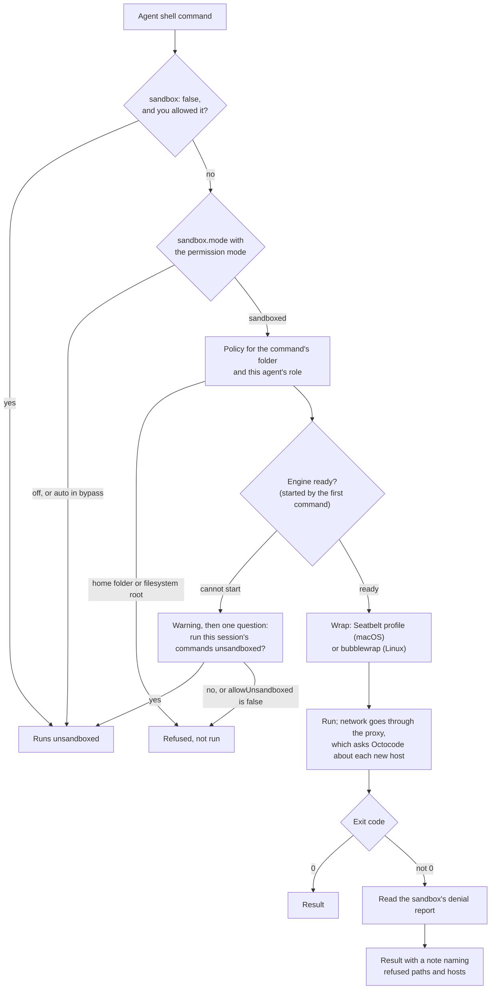

# Sandbox

Permission modes decide what Octocode asks before an action; they do not limit what a program can do once it runs. The sandbox does: with it on, every shell command the agent starts runs inside an operating-system sandbox that lets it write only the workspace and the temporary folders, keeps it away from your credential folders, and sends its network traffic through a proxy that asks you about each new host. It is off by default. Turn it on with `sandbox.mode` in your global settings; it works on macOS and Linux. Octocode builds it on its maintained fork of the open-source [`@anthropic-ai/sandbox-runtime`](https://github.com/anthropics/sandbox-runtime) library.

## What runs inside it

| What runs                                                     | Sandboxed when                                                            | Notes                                                                                                                     |
| ------------------------------------------------------------- | ------------------------------------------------------------------------- | ------------------------------------------------------------------------------------------------------------------------- |
| `bash` tool commands, foreground and background jobs          | `sandbox.mode` is `"on"`, or `"auto"` in any permission mode but `bypass` | `sandbox: false` on a call asks to run that one command outside ([below](#when-a-command-is-refused))                     |
| Shell commands a timer checks (`check.result` with `command`) | the same as `bash` commands                                               | They start the same way a foreground `bash` command does                                                                  |
| A subagent's shell commands                                   | the same as `bash` commands; each child reads the same global setting     | The policy follows the child's role: read-only and isolated children write less ([policy](#the-policy))                   |
| Command hooks                                                 | the hook entry sets `"sandbox": true`, whatever `sandbox.mode` says       | Not started where the sandbox cannot start, nor for a PowerShell hook; the hook counts as failed and `failClosed` decides |
| Stdio MCP servers                                             | the server entry sets `"sandbox": true`, whatever `sandbox.mode` says     | Not started where the sandbox cannot start                                                                                |

Opted-in hooks and MCP servers get the same policy as a `bash` command started in their folder and never run unsandboxed. Before a session starts, nothing can answer a network question, so an opted-in server started then reaches loopback only.

Never inside the sandbox:

| What runs                                                                   | Why                                                                                              |
| --------------------------------------------------------------------------- | ------------------------------------------------------------------------------------------------ |
| Your own `!` commands, and the RPC `bash` command                           | They are yours, not the agent's                                                                  |
| Octocode itself and its built-in tools (`file` writes, reads, web requests) | They run in the Octocode process; [permissions](permissions.md) decide them                      |
| Hooks and stdio MCP servers without `"sandbox": true`                       | They run with your rights, as [hooks](hooks.md) and [MCP servers](mcp-reference.md) describe     |
| External agents (Claude Code, Codex, Gemini, Cursor, OpenCode)              | Each runs under its own CLI's controls ([external runners](subagents.md#external-runners)) |
| The subagent processes themselves                                           | Only the commands they run are sandboxed                                                         |

## How it works



The policy is worked out again for every command, so a `/permissions` change applies to the next command. The engine loads on the first sandboxed command; a session that never sandboxes a command never loads it.

| Platform | Mechanism                                                               | Filesystem                                                                                                                                                                                    | Network                                                                                                                                                                                                    | Needs                                                                                                                                                                                                                                                     |
| -------- | ----------------------------------------------------------------------- | --------------------------------------------------------------------------------------------------------------------------------------------------------------------------------------------- | ---------------------------------------------------------------------------------------------------------------------------------------------------------------------------------------------------------- | --------------------------------------------------------------------------------------------------------------------------------------------------------------------------------------------------------------------------------------------------------- |
| macOS    | A Seatbelt profile written for each command, run with `sandbox-exec`    | The profile allows writes only where the policy does and denies the credential reads                                                                                                          | The profile allows the proxy and loopback (`localhost`), so a test server and its client work; a program that ignores the proxy settings cannot connect anywhere else                                      | Nothing: Seatbelt ships with macOS                                                                                                                                                                                                                        |
| Linux    | A bubblewrap (`bwrap`) container for each command; WSL2 counts as Linux | Writable only where the policy allows. Protected paths given as patterns become the paths that exist when the command starts (nested repositories three folders deep, outside `node_modules`) | A network namespace of its own: traffic leaves only through the proxy. `localhost` is the container's own, so a server the same command starts is reachable and one already running on your machine is not | `bwrap`, `socat` and ripgrep (`rg`, Octocode's own copy or one on `PATH`), and unprivileged user namespaces. Octocode makes one trial `bwrap` run before the first command. The seccomp filter (x64 and arm64) and the JVM proxy agent ship with Octocode |
| Windows  | None: Octocode sandboxes commands on macOS and Linux only               | —                                                                                                                                                                                             | —                                                                                                                                                                                                          | Leave `sandbox.mode` at `"off"`. Otherwise the first command warns and asks once whether the session runs unsandboxed, and PowerShell commands are refused                                                                                                |

On Linux, a repository a command creates is not protected during that command, and a read-only subagent can change Markdown files that already exist under `.octocode/agent/` but cannot add new ones. The Linux backend is tested less than macOS: its tests that run real bubblewrap commands run only on a Linux host with bubblewrap installed. Each sandboxed command takes a few tens of milliseconds longer to start.

## The policy

### Settings and fields

| Setting or field                     | Default | Effect                                                                                                                                                              |
| ------------------------------------ | ------- | ------------------------------------------------------------------------------------------------------------------------------------------------------------------- |
| `sandbox.mode`                       | `"off"` | `"off"`: agent commands run with your rights. `"auto"`: sandboxed in `manual`, `workspace` and `full`, not in `bypass`. `"on"`: sandboxed in every mode             |
| `sandbox.allowUnsandboxed`           | `true`  | Whether the agent may ask to run a command outside the sandbox. `false` refuses `sandbox: false`, and refuses commands without asking when the sandbox cannot start |
| `bash` tool `sandbox: false`         | —       | Runs one command outside the sandbox after you allow it                                                                                                             |
| Hook or MCP server `"sandbox": true` | `false` | Runs that hook or stdio server inside the sandbox                                                                                                                   |

Both settings are read from the global `settings.json` only (in the [agent directory](configuration.md#agent-directory)); a project file cannot change them. A change applies after `/reload` or in the next session.

### Writes

| Who runs the command  | Can write                                                                                                                                                                                                |
| --------------------- | -------------------------------------------------------------------------------------------------------------------------------------------------------------------------------------------------------- |
| A session or subagent | The workspace: the repository root, or the working folder outside a repository. In a linked git worktree, also the repository's shared git folder, except its hooks and config                           |
| A read-only subagent  | Its scratch folder, `.octocode/agent/tmp/`, `.octocode/agent/temp/`, a topic's `tmp/` folder, and Markdown files under `.octocode/agent/` other than Octocode's state and `MEMORY.md`                    |
| An isolated subagent  | Its own worktree and, in the main repository's git folder, only what a commit on its branch needs (new objects, its worktree's git folder, its branch's ref and log). The main working tree stays closed |

Every sandboxed command can also write the system temporary folder (its `TMPDIR` stays yours), `/tmp`, a subagent's scratch folder and Octocode's host lock folder (`~/.octocode/locks`), which test runs use to take turns. Nothing else is writable: your home folder, `~/.zshrc` and Octocode's own settings and credentials included.

Inside a writable folder, paths that run or load in a later session stay write-protected, whether or not they exist yet:

- git hooks and git config, in the repository and in repositories nested in it;
- at the workspace root: the `.pi`, `.claude`, `.codex` and `.agents` folders, `AGENTS.md`, `AGENTS.override.md`, `CLAUDE.md`, `.gitmodules`, `.npmrc`, `.mcp.json`, `.husky`, `.github/workflows`, `.vscode/tasks.json`, `.envrc`, `.pre-commit-config.yaml` and lefthook configuration;
- what Octocode loads from `.octocode/`: skills, agents, prompts, themes, plugins, hooks, `settings.json`, `mcp.json`, `lsp-servers.json` and system prompt files;
- Octocode's state in `.octocode/agent/` (sessions, session data, backlog exports, `MEMORY.md`), and the same list inside each checkout under `.octocode/agent/worktrees/`.

### Reads

A sandboxed command reads everything you can, except:

| Denied                                                  | Where                                                                                                       |
| ------------------------------------------------------- | ----------------------------------------------------------------------------------------------------------- |
| `auth.json` (logins) and `mcp-auth.json` (MCP sign-ins) | the agent directory, the Octocode home and Pi's folders while they are a fallback                           |
| `models.json` holding a literal `apiKey`                | the same folders; one with only `$NAME` or `!command` references stays readable                             |
| `web/`, `api/` and `child-credentials/`                 | the Octocode home: the web daemon's and each session's tokens, each instance's API token, subagent handoffs |
| `.ssh`, `.aws`, `.gnupg` and their contents             | your home folder                                                                                            |

With a session token a command could drive a session over loopback, answer its permission questions or turn its sandbox off, so those folders are closed too.

Each is denied as written and with symlinks resolved. On macOS a read there fails with `Operation not permitted`; on Linux a denied folder looks empty and a denied file is missing. Separately, shell commands start without provider API keys and Amazon Bedrock's bearer token (`AWS_BEARER_TOKEN_BEDROCK`) and `OPENAI_CUSTOM_HEADERS` (which can carry a gateway's `Authorization` header) in their environment unless `bash.inheritProviderKeys` keeps them ([permissions](permissions.md#shell-sandbox-read-denials)).

### Network

Every connection beyond loopback goes through the sandbox's proxy, which asks Octocode about any host not yet allowed:

| Context                                                 | A host not yet allowed                                                                                                                |
| ------------------------------------------------------- | ------------------------------------------------------------------------------------------------------------------------------------- |
| `manual`, `workspace`                                   | Asks "Let a shell command connect to this host?" (a private address asks as a private-network action). Allow once, or for the session |
| `full`; `bypass` with `"on"`                            | Allowed without asking and recorded in `/permissions log`                                                                             |
| A read-only subagent                                    | Refused without asking                                                                                                                |
| A subagent that cannot ask (in `manual` or `workspace`) | Refused                                                                                                                               |
| A cloud metadata address, in any mode                   | Refused                                                                                                                               |

Allow once lets that connection through, and lets the commands running at that moment reach the host again; the next command asks again. Allowing for the session covers that host only: hosts are allowed one at a time, and `/permissions grants` lists them. Loopback is always reached directly, without the proxy (on Linux, the container's own loopback).

A name is classed when you answer, and the proxy holds it to that answer when it connects. A host allowed as public that later resolves to a private address is refused (DNS rebinding). A host allowed as a private-network action may reach the private addresses it resolved to then, and those addresses at that port directly, for as long as the answer lasts.

## When a command is refused

A refused write or read fails inside the command with the operating system's error: `Operation not permitted` (`EPERM`) on macOS, `Read-only file system` (`EROFS`) for a write on Linux. A refused host gets the proxy's refusal. When a foreground command fails, Octocode adds a note to its result:

```text
The sandbox refused:
  deny(1) file-write-create /Users/you/notes.txt
Writes outside the workspace or to protected paths, and hosts nobody allowed, fail this way. If the command needs one, run it again with sandbox: false (asks the user).
```

When the output shows a permission error but the sandbox's report has not arrived within about a second, the note says so instead:

```text
The command may have been refused by the sandbox: its output shows a permission error, and the sandbox reported no path or host in time. …
```

A note lists at most 20 refusals, then `… and N more`. The sandbox keeps only its latest reports, so when reports from while the command ran were dropped, the note says how many and that refusals may be missing. A command that succeeds, or that fails without a permission error and without a report, gets no note. Background jobs get no note; read the job's log.

**The way out.** When a command really needs something the sandbox refuses (for example `git push` over SSH, which reads `~/.ssh`), the agent can call `bash` again with `sandbox: false`. Octocode asks "Run this command outside the sandbox?" in every permission mode except `bypass`; allowing all shell commands never covers it, and the session answer covers only that exact command in that folder. With `sandbox.allowUnsandboxed` set to `false` the call is refused without asking and every agent command stays sandboxed.

## Troubleshooting

| Symptom                                                                                       | Cause and fix                                                                                                                                                                                                                                                                                                                                                                        |
| --------------------------------------------------------------------------------------------- | ------------------------------------------------------------------------------------------------------------------------------------------------------------------------------------------------------------------------------------------------------------------------------------------------------------------------------------------------------------------------------------ |
| `The command sandbox cannot start: … install the bubblewrap and socat packages …` (Linux)     | A program is missing. Install what the message names, for example `sudo apt install bubblewrap socat ripgrep`, then `/reload`                                                                                                                                                                                                                                                        |
| `bubblewrap cannot create a sandbox here (…); unprivileged user namespaces are off …` (Linux) | The kernel or a container refuses bubblewrap. Allow user namespaces for `bwrap` (on Ubuntu 23.10 and later, an AppArmor profile or the `kernel.apparmor_restrict_unprivileged_userns` setting), or run Octocode outside the container                                                                                                                                                |
| A question "Run this session's shell commands in the weaker sandbox?"                         | The sandbox started, but the library warned that it is weaker than it should be (for example Linux without its seccomp filter, where a command can reach any Unix socket, Docker's among them); the warning above it says why. Yes runs this session's agent commands in it; no refuses them. With `sandbox.allowUnsandboxed: false`, or where nothing can ask, commands are refused |
| A question "Run this session's shell commands without the sandbox?"                           | The sandbox could not start; the warning above it says why. Yes runs this session's agent commands unsandboxed; no refuses them. With `sandbox.allowUnsandboxed: false` there is no question and commands are refused                                                                                                                                                                |
| `The command sandbox needs a project folder to allow writes in …`                             | The session started in your home folder or above it, which would make all of it writable. Start Octocode in a project folder                                                                                                                                                                                                                                                         |
| A very long `TMPDIR`                                                                          | Nothing to do. The proxy's socket path would be too long for the system, so Octocode puts the socket in a short private folder (`/tmp/octocode-sb-…`) and commands keep your `TMPDIR`. The folder is removed when Octocode exits; one left by a killed process is removed on the next start                                                                                          |
| On macOS, the result says the command "may have been refused" but names no path               | The refusal report comes from the macOS system log, which the sandbox engine does not always match to the command that caused it, so the report can be late or missing. The refusal itself is still enforced: the command could not write or connect. The error text in the output names what failed                                                                                 |
| A command cannot reach a server running on your machine (Linux)                               | The container's `localhost` is its own. Start the server and its client in the same command, or run that command with `sandbox: false`                                                                                                                                                                                                                                               |
| A tool cannot reach the internet even though you allowed the host                             | It ignores the proxy settings (`HTTP_PROXY`, `HTTPS_PROXY`) the sandbox sets, so it connects directly and is refused. Configure the tool to use the proxy, or run it with `sandbox: false`                                                                                                                                                                                           |

## Verify it yourself

On macOS or Linux, in a project folder:

1. Turn the sandbox on: `/settings set sandbox.mode on`, then `/reload`. (Or put `{ "sandbox": { "mode": "on" } }` in your global `settings.json` and start a new session.)
2. Ask the agent to run each command below with its `bash` tool. In `manual` or `workspace` mode Octocode asks about the first one before running it; allow it, so the sandbox decides rather than the permission check.

| Ask the agent to run                              | Expected                                                                                                                                                     |
| ------------------------------------------------- | ------------------------------------------------------------------------------------------------------------------------------------------------------------ |
| `touch ~/octocode-sandbox-check`                  | Fails with `Operation not permitted` (Linux: `Read-only file system`); the note names the path or says the command may have been refused. No file is created |
| `touch sandbox-check.txt && rm sandbox-check.txt` | Succeeds: the workspace is writable                                                                                                                          |
| `ls ~/.ssh` (if you have one)                     | macOS: fails with `Operation not permitted`. Linux: the folder looks empty                                                                                   |

Then type `!touch ~/octocode-sandbox-check && rm ~/octocode-sandbox-check` yourself: it succeeds, because your own `!` commands are never sandboxed. If the agent offers to retry the first command with `sandbox: false`, answer no. To turn the sandbox off again: `/settings set sandbox.mode off`, then `/reload`.
