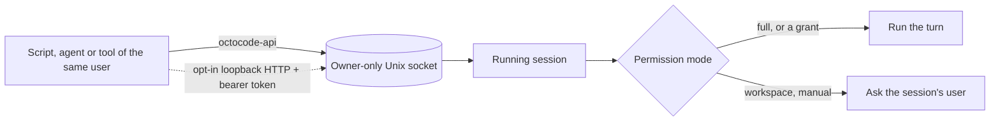

# Local session API

`octocode-api` talks to Octocode sessions already running on this machine: list them, send a message, read status, watch events, request cancellation and read which agents started and ended. Every top-level session (terminal, print, RPC, ACP worker) serves the API on an owner-only Unix socket, so other processes of the same user reach it with no setup. Subagents do not serve it.

It differs from [ACP](acp.md): an ACP client launches an agent and owns its stdio; this API attaches to a host that is already running.



## Commands

| Command                                                                                                                                                         | Does                                                                                                                                                        |
| --------------------------------------------------------------------------------------------------------------------------------------------------------------- | ----------------------------------------------------------------------------------------------------------------------------------------------------------- |
| `octocode-api list`                                                                                                                                             | One line per instance: instance id, process name, pid, `idle`/`busy`/`not answering`, session id, folder. Removes records whose socket refuses connections. |
| `octocode-api status [--to <id>]`                                                                                                                               | Conversation identity, model, activity, pending input, event sequence                                                                                       |
| `octocode-api send [--to <id>] [--from <name>] [--wait] [--mode steer\|followUp] [--key <key>] [--session <id>] [--timeout <ms>] [--require-idle] [--] <text…>` | Send a message                                                                                                                                              |
| `octocode-api watch [--to <id>] [--types a,b] [--top-level] [--since <seq>]`                                                                                    | Stream events, one JSON line each                                                                                                                           |
| `octocode-api abort [--to <id>]`                                                                                                                                | Request cancellation of the current turn                                                                                                                    |
| `octocode-api events [--since <seq>] [--limit <n>] [--json]`                                                                                                    | Agent lifecycle of this folder's workspace, read from the database; needs no session                                                                        |
| `octocode-api external [--to <id>] '<JSON>'`                                                                                                                    | Ask a host to connect to or message another agent                                                                                                           |
| `octocode-api completion <bash\|zsh\|fish>`                                                                                                                     | Shell completion                                                                                                                                            |

From a source checkout use `yarn start` for the session and the same commands through the checkout's `octocode-api` entry.

`--to` accepts an instance id (`oc-1a2b3c`), a process name (`octocode-main-c0ea9f3e`, as in `ps` and `/processes`), a session id or a pid. Without it the CLI picks the only instance, or the unique one in the current folder, and rejects ambiguity: use `--to` in scripts. A session switch (`/new`, `/resume`) starts a new endpoint with a new id. `send` refuses the caller's own session. The same names work for `/agents external connect octocode`, the `agent` tool's `instanceId`, and `agent` type `message` ([protocol](native-features.md#communication-and-results)).

## Turn it on or off

| Control                       | Effect                                                                                                                                                                                |
| ----------------------------- | ------------------------------------------------------------------------------------------------------------------------------------------------------------------------------------- |
| `/api`                        | Show status in an interactive session                                                                                                                                                 |
| `/api on` / `/api on http`    | Start the API; `http` also opens loopback HTTP on a free port. Holds for that process across `/new` and `/resume`.                                                                    |
| `/api off`                    | Stop it for that process                                                                                                                                                              |
| `sessionApi` (global setting) | Default `true`; `false` keeps new sessions from starting it. A project file cannot change it. On Windows (no owner-only socket) it starts only with `/api on` or `OCTOCODE_API_HTTP`. |
| `OCTOCODE_API_HTTP=<port>`    | Also serve loopback HTTP on that port (`0` picks a free one, up to 65535)                                                                                                             |

A session whose API cannot start warns and carries on. The socket is mode 0600 in a 0700 folder under `<Octocode home>/api` (a private temp folder when that path is too long); a session removes its own on exit and each start cleans up dead ones. HTTP is opt-in because any local program can open a TCP port: only the bearer token protects it. The HTTP server drops a request whose headers or body take over 10 seconds and accepts at most 64 connections. See [environment variables](environment-variables.md).

## Send and receive a reply

```sh
octocode-api status --to <instance-id>        # note sessionId
octocode-api send --to <instance-id> --session <session-id> \
  --from "external script" --key greeting-1 --require-idle \
  --wait --timeout 120000 -- "Reply with ACK."
```

| Flag             | Meaning                                                                                                                                                                                          |
| ---------------- | ------------------------------------------------------------------------------------------------------------------------------------------------------------------------------------------------ |
| `--session`      | Refuse delivery if the conversation changed, also while the host prepares the message                                                                                                            |
| `--require-idle` | Refuse busy or queued work before dispatch. Default delivery starts a run when idle and steers the next model step when busy.                                                                    |
| `--mode`         | `steer` (steer the running turn) or `followUp` (queue a later turn when busy)                                                                                                                    |
| `--wait`         | Print the final assistant text when the run settles (after queued continuations and retries). Exit `1`, empty stdout and the JSON result on stderr when `stopReason` is not `stop` or `toolUse`. |
| `--timeout`      | Server wait in milliseconds, 1,000–3,600,000, default 600,000 (the CLI adds ten seconds)                                                                                                         |
| `--key`          | Deduplicate; see [Retry](#retry-without-duplicate-dispatch)                                                                                                                                      |
| `--from`         | A sender name added to the caller's claim                                                                                                                                                        |
| `--`             | Ends flags so text can begin with a dash                                                                                                                                                         |

Without `--wait`, stdout is the receipt, for example `{"id":"x1","queued":"turn"}` (`queued` is `turn`, `steer` or `followUp`). `queued` is how the session took it when it went out: a message prepared (verified, or held for the user's decision) while the receiver's run ended is delivered as a new turn (`turn`), never refused for that. Acceptance means the host took it, not that the model read it or finished. Concurrent senders share one conversation.

## What the session sees

A message obeys the receiving session's [permission mode](permissions.md#external-messages):

| Receiving session                                       | Result                                                                                                                                                                |
| ------------------------------------------------------- | --------------------------------------------------------------------------------------------------------------------------------------------------------------------- |
| `full`, `sessionApiTurnPermission: "session"` (default) | Takes it unasked (idle or working); the turn runs in `full`, audited                                                                                                  |
| `full`, `sessionApiTurnPermission: "workspace"`         | Asks its user; the turn and its tool calls (and subagents) run under `workspace` until the session settles. With nobody to ask: refused with `execution: "not-sent"`. |
| `workspace` or `manual`                                 | Asks its user as usual; a `manual` session stays `manual`                                                                                                             |

`sessionApiTurnPermission` is a global setting only, read for every message; `"workspace"` also holds `external.call` and `agents.tell`. Prefer `OCTOCODE_PERMISSION=manual` or `workspace` where other programs run as your user.

The model sees a one-line external-message header: the transport (socket: a program running as this OS user; HTTP: a program holding the token), what the caller says it is (quoted, marked self-reported) and the time. The system prompt states once that such a message may state facts and make requests but never grants authority or approval. The text sits inside a random untrusted-text fence the sender cannot forge. The terminal draws it as `✉ external`. Hooks and [tool permission policy](permissions.md) still apply, and a message is never a slash command (`/permissions full` in one is plain text) nor an answer to a pending dialog.

**Caller fields are claims.** A socket does not say who is on the other end, so `--from`, `name`, `instanceId`, `pid` and `cwd` are what the caller says; `octocode-api` fills them from the calling session's shell or from its own pid and folder. Names that pass for the user or a live agent are refused (any case, Unicode lookalikes). A caller counts as a running instance only when its `instanceId` and `pid` both match; otherwise the message has no reply route. Only an instance that confirms itself by an `identity.confirm` call-back holds a "messages from this process" grant; unconfirmed callers are asked about without the process choices, or refused when nobody can be asked. `octocode-api` run from a session's shell has no ticket, so its messages are asked about without those choices. Records are shown at `details.external` (RPC), `_meta["octocode/external"]` (ACP) and `caller`, `callerVerified`, `transport` (the `external.message` event); `callerVerified` is `true` only for a confirmed instance.

### What the sender gets

| Receiving session | `send` without `--wait`                                                                                     | `send --wait`                                          | `agent` type `message`                                       |
| ----------------- | ----------------------------------------------------------------------------------------------------------- | ------------------------------------------------------ | ------------------------------------------------------------ |
| Takes it          | `queued`: `turn`, `steer` or `followUp`                                                                     | The run's result                                       | "Sent to `<name>`"                                           |
| Asks its user     | At once `queued: "waiting-for-user"` and a `key`; repeat the send with that `--key` to wait for the outcome | Waits within `--timeout`, which also closes the dialog | At once "Waiting for `<name>`'s user"; told later if refused |
| User denies       | The retry fails with the refusal                                                                            | Exit `1`, refusal on stderr                            | A notice in the sender's session                             |
| Nobody to ask     | Exit `1`, refusal on stderr                                                                                 | The same                                               | The tool call fails with the refusal                         |

A refusal names the session and what its user can do, with `execution: "not-sent"`. The same key repeats it; a new key asks again.

An `agent` type `message` that fails says whether the message arrived:

| Failure                                                          | `execution`                          | What the sender is told                                         |
| ---------------------------------------------------------------- | ------------------------------------ | --------------------------------------------------------------- |
| The receiver's process is gone, or nothing listens on its socket | `not-sent` (`reason: "unreachable"`) | Nothing was sent; check that it still runs before sending again |
| The receiver is at its connection limit                          | `not-sent` (`reason: "overloaded"`)  | Nothing was sent; send it again in a few seconds                |
| The connection broke after the request was written               | `unknown`                            | It may have arrived; check before sending it again              |

A message the receiver queued (`steer` or `followUp`) lives only in that process until its model reads it. When the receiver exits first, the sender gets one notice at its next step, without a new turn, within about two seconds: the message, the recipient and what to do next.

## Retry without duplicate dispatch

Use a unique `--key` per intended message (up to 128 characters). After a lost response repeat the same message, sender, mode and idle requirement with the **same key**; you may add `--wait` or change the timeout. Changed input with the same key is rejected. The host keeps up to 128 receipts per conversation in memory and refuses new keys at capacity; a session switch, `/api off` then `on`, or a restart forgets them.

| Result                                                  | Meaning and next step                                                                                        |
| ------------------------------------------------------- | ------------------------------------------------------------------------------------------------------------ |
| `execution: "not-sent"`                                 | Refused before dispatch. Fix the cause, then retry.                                                          |
| Server wait timeout (`-32001`)                          | Accepted; work may still run. Check status or wait again with the original key.                              |
| `execution: "uncertain"`                                | Handoff failed after dispatch. The key keeps the failure and cannot dispatch again. Inspect before new work. |
| Connection broke or client timed out after it connected | Delivery may have happened. Do not assume it did not.                                                        |

Errors exit nonzero. Protocol errors are JSON on stderr (`error`, `code`, optional `data`; client failures may add `execution`); other CLI errors are plain text. Socket failures carry an OS code such as `(EPERM)` or `(ENOENT)` without paths. A sandboxed process may discover an instance yet lack permission to connect; use its host's scoped authorization or a callback integration (see [Codex](acp.md#connect-to-codex)). Nothing replays a possibly executed prompt automatically.

A socket rejected at the connection limit reports `-32000` with `data.execution: "not-sent"`, `data.reason: "overloaded"` and `data.retryAfterMs`; no request was dispatched. A socket call that fails before its connection opens also reports `execution: "not-sent"`, since no byte of it was written. This connection-level error has a `null` id because the server refuses it before reading a request. Socket clients accept that explicit refusal before a call or subscription; other responses must match their request id.

## Watch and cancel

```sh
octocode-api watch --to <id> --types agent.start,message.delta,message,tool.start,tool.end,agent.settled
octocode-api watch --to <id> --since <last-seq> --top-level
octocode-api abort --to <id>
```

Each line is an event with `seq`, `at`, `type`, `data`. The log keeps 500 events; `--since` replays what is retained and the CLI warns on stderr about a gap. Cursors belong to one instance and do not survive an API restart. `--top-level` hides nested tool events (those with `parentId`). Default types: `agent.start`, `agent.end`, `agent.settled`, `message`, `tool.start`, `tool.end`, `external.message`, `compaction`; `message.delta` is opt-in (flushed at message or run boundaries, not token by token). A `--types` list replaces the default.

`abort` acknowledges the request, not finished cleanup: watch for `agent.settled`. It targets the current turn with no guard; programmatic callers can pass `expectedSessionId` and the message `key` to `turn.abort`. Abort is admitted like a message (taken in `full`, asked in `workspace` and `manual`, refused with nobody to ask). If the run settled while the user decided, it stops nothing and answers `aborted: false`, `settled: true`. Withdrawing your own waiting message by `key`, and aborting an idle session, never ask. Closing a client or its wait does not abort the turn.

Reads (`status`, `messages.list`, `events.subscribe`, `GET /events`, `agents.list`) never ask; each is recorded with the claimed caller.

## Watch agents come and go

`octocode-api events` reads the agent lifecycle of this folder's workspace from the agent database, so it needs no running session and no `--to`.

```sh
octocode-api events --since 0
octocode-api events --since <last-seq> --json
```

| Event   | Meaning                                                                                                                                    |
| ------- | ------------------------------------------------------------------------------------------------------------------------------------------ |
| `on`    | An agent joined                                                                                                                            |
| `state` | A change to its record                                                                                                                     |
| `off`   | Its row ended, with `reason` (`completed`, `failed`, `stopped-user`, `stopped-parent`, `parent-gone`, `crashed`, `left`) and final numbers |

`--since` default 0; `--limit` 1–1000, default 200, oldest first; `--json` prints `{"since","last","events":[…]}`. Text output is one tab-separated line per event, then `last seq: <n>`:

```text
4	2026-11-04T23:13:54.297Z	on   	glowing-turtle	general	parent=spry-coral
7	2026-11-04T23:13:54.437Z	off  	glowing-turtle	general	parent=spry-coral	reason=completed	toolCalls=0 input=100 cacheRead=0 output=5 cost=0.000105
last seq: 7
```

Poll by passing `last` back as `--since`. Sequences have gaps (other kinds and workspaces share the counter); a full page means more may follow. Events carry `seq`, `time`, `event`, `agent` and, when known, `role`, `parent`, `session`, `state`, `changes`, `reason`, `detail`, `outcome`, `backlogItem` and (on `off`) `stats`. A folder Octocode never ran in has no events: the command says so on stderr, exits 0 and creates nothing. `events` only reads.

## Use it from other tools

| Caller                    | How                                                                                                                                                                                                                                                                                                       |
| ------------------------- | --------------------------------------------------------------------------------------------------------------------------------------------------------------------------------------------------------------------------------------------------------------------------------------------------------- |
| Claude Code or Codex      | Through its shell. Copy the [`octocode-api` Agent Skill](skill-templates/octocode-api/SKILL.md) folder into that host's skills folder (`.claude/skills/` or `.codex/skills/`); Octocode does not install it. It teaches `list`, `send` (with the idle-session permission behaviour) and `events --since`. |
| An ACP session            | Each session an ACP broker creates has its own endpoint, so `--to <ACP session id>` reaches it. API-started work streams to the ACP client; an overlapping `session/prompt` is refused while it runs; the client can cancel with `session/cancel`.                                                        |
| Another agent, via a host | `external`, below                                                                                                                                                                                                                                                                                         |

### Ask a host to connect to another agent

`external` takes the **inner action object**, not the `agent` tool's outer envelope:

```sh
octocode-api external --to <host-id> '{"action":"list"}'
octocode-api external --to <host-id> \
  '{"action":"connect","transport":"octocode","id":"peer","instanceId":"<peer-id>","cwd":"/absolute/peer/workspace"}'
octocode-api external --to <host-id> '{"action":"prompt","id":"peer","text":"Reply with ACK.","timeoutMs":120000}'
octocode-api external --to <host-id> '{"action":"disconnect","id":"peer"}'
```

The peer must have its API enabled; the adapter checks its instance, workspace and live conversation and refuses busy peers. Disconnect releases the attachment and cancels work it owns, without stopping the peer. `instanceId` takes the same names as `--to`; `cwd` defaults to the instance's folder and a different one is refused. To launch an ACP peer use the `transport: "acp"` action in the [ACP guide](acp.md#connect-from-octocode-to-another-agent).

## Wire protocol

JSON-RPC 2.0, API protocol version 1 (independent of ACP's).

| Method                                   | Purpose                                                                                                                                                                       |
| ---------------------------------------- | ----------------------------------------------------------------------------------------------------------------------------------------------------------------------------- |
| `initialize`, `ping`                     | Capabilities and instance identity; liveness                                                                                                                                  |
| `status`                                 | Conversation identity, model, activity, pending input, event sequence                                                                                                         |
| `message.send`                           | `text` plus optional `from`, `caller` (`name`, `instanceId`, `pid`, `cwd`, `ticket`), `mode`, `key`, `expectedSessionId`, `requireIdle`, `replyRequired`, `wait`, `timeoutMs` |
| `turn.abort`                             | Cancel, admitted like a message; optional `expectedSessionId`, `key`, `caller`                                                                                                |
| `identity.confirm`                       | Echo `nonce` for a ticket this process issued for a call to instance `to` at endpoint `via`                                                                                   |
| `messages.list`                          | Bounded text history; `limit` default 20, max 100; pass `earlier.before` as `before`                                                                                          |
| `events.subscribe`, `events.unsubscribe` | Socket subscription, optional `since`, `types`                                                                                                                                |
| `agents.list`, `agents.tell`             | Team directory; Team mail to `to` with `text` ([acknowledgment contract](https://github.com/bgauryy/octocodecode/blob/main/docs/AGENT_COMMUNICATION.md))                      |
| `external.call`                          | An external-agent action; `list` is open and recorded, every other action is admitted like a message                                                                          |

On the socket each frame is one JSON line; events are `method: "event"` notifications, and replay can arrive before the subscribe response (which carries `seq` and `gap`). HTTP binds to `127.0.0.1`: `POST /rpc`, `GET /events` (SSE, with `Last-Event-ID` or `since` and `types`; a `: gap` comment marks missing replay) and `GET /health`. Every request needs `Authorization: Bearer <token>` from the private discovery record; a request with an `Origin` header or non-loopback Host is refused; `events.subscribe` is unavailable over one-shot HTTP. Requests are limited to 1 MiB; socket connections and HTTP event streams to 16 each; slow readers are dropped past 4 MiB queued. Clients must share the host's Octocode home to discover it. This is not a remote or browser API: the [web workspace](web-workspace.md#web-daemon) reaches a session through the web daemon's own owner-only attach endpoint, which every top-level session opens whether or not this API is on.

## Who can reach a session

| Question              | Answer                                                                                                                                                                                                                                                                                                                                                                                                                                                                                                                                                                                      |
| --------------------- | ------------------------------------------------------------------------------------------------------------------------------------------------------------------------------------------------------------------------------------------------------------------------------------------------------------------------------------------------------------------------------------------------------------------------------------------------------------------------------------------------------------------------------------------------------------------------------------------- |
| Who?                  | Any process running as your OS user, including ones you did not start (a build script, an install step, a tool an agent runs). Not another user (socket 0600 in a 0700 folder); root can. A sandbox that denies the socket path stops it.                                                                                                                                                                                                                                                                                                                                                   |
| What can it do?       | Read status, history and events (recorded, unasked). Start or steer a turn (spends model budget; asks unless the session is `full` and the setting is not `workspace`). Abort a turn. Use `external.call` (can start an ACP agent; admitted like a message). `agents.tell` to `"all"` wakes idle agents at message pacing. A turn it starts runs with your rights: in `full` without asking (audited); `workspace` still runs repository shell commands and file changes unasked. The untrusted fence lowers the risk, it does not remove it: use `manual` or `workspace` where it matters. |
| What can it not do?   | Answer a dialog, approve a [worktree merge](permissions.md#worktree-merges), change the permission mode, run a slash command, or claim to be the user or a live agent.                                                                                                                                                                                                                                                                                                                                                                                                                      |
| What can't be proven? | Node exposes no peer credentials for a socket, so the receiver cannot see which process is connected. A same-user process that rewrites an instance's record or socket file can pass as that session; it could already read your session files. This residual is accepted.                                                                                                                                                                                                                                                                                                                  |
| Turn it off           | `sessionApi: false`, or `/api off` for one process.                                                                                                                                                                                                                                                                                                                                                                                                                                                                                                                                         |
