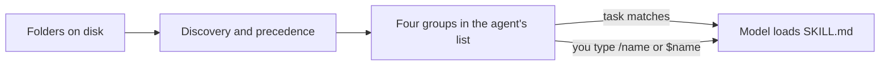
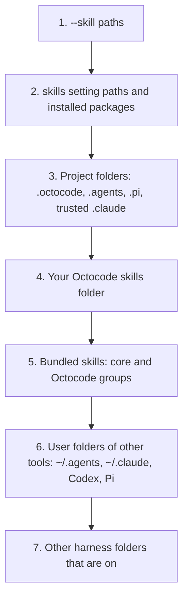
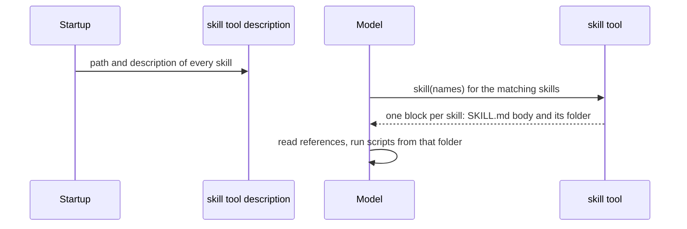

# Skills

A skill is a folder of instructions (plus optional scripts, references and assets) that Octocode loads only when a task needs it. It is not a [plugin](plugins.md) or a [hook](hooks.md). Octocode lists each skill by name and description; the full text is read when the model picks the skill or you name it.



## Create a skill

1. Make a folder named for the skill, for example `pdf-tools/`, in a skills location (see [find and control skills](#find-and-control-skills)).
2. Add `SKILL.md`: frontmatter, then the instructions.
3. Optionally add `scripts/`, `references/` and `assets/`, and name them in the text by paths relative to the folder.
4. Run `/reload`, then `/help pdf-tools` to see it.

```markdown
---
name: pdf-tools
description: Extract text and tables from PDF files. Use when reading, converting, or inspecting PDFs.
---

# PDF tools

Read `references/formats.md` before converting a document. Run scripts relative to this skill directory.
```

The description decides when the model loads the skill: say what it does and when it applies ("Helps with PDFs" is too vague). A folder with `SKILL.md` is the portable form; a loose `deploy.md` also works and is named `deploy` (in a Claude folder it needs a `description`, and `README.md` never counts).

Project skills can tell the model to run scripts or edit files: review unfamiliar ones before you trust a project.

### Frontmatter

| Field                      | Meaning                                                                                                                                                 |
| -------------------------- | ------------------------------------------------------------------------------------------------------------------------------------------------------- |
| `name`                     | Command and display name: lowercase letters, digits and single hyphens, up to 64 characters                                                             |
| `description`              | Routing text shown to the model, up to 1,024 characters; required                                                                                       |
| `disable-model-invocation` | `true` hides the skill from the model's list; you can still invoke it                                                                                   |
| `user-invocable`           | `false` removes `/name` and `$name` for you; the model can still load it                                                                                |
| `license`, `compatibility` | Informational only                                                                                                                                      |
| `allowed-tools`            | Informational; grants no permission                                                                                                                     |
| `metadata`                 | Key-value data; `excluded-hosts: octocode-agent` (space-separated list) silently skips the skill in Octocode; the earlier id `octocode-code` also works |
| `metadata.triggers`        | List of extra words the prompt editor highlights as pointing to this skill, besides the parts of its name; other types are ignored with a warning       |

A skill without a description, or with malformed frontmatter, is not loaded. A name that differs from its folder still loads, but other Agent Skills tools may reject it. Under `.claude/skills` and in Claude plugins a missing description falls back to the first body line, and `yes`/`no`, `on`/`off`, `1`/`0` count as booleans. Claude-only fields (`context`, `model`, `hooks`, scoped permissions, dynamic shell expansion) are ignored: loading the text does not activate them.

## Find and control skills

### Where skills load from

| Harness     | Folders                                                                              | Default   |
| ----------- | ------------------------------------------------------------------------------------ | --------- |
| Octocode    | `.octocode/skills/`, `~/.octocode/octocodecode/skills/`, the bundled skills          | always on |
| `.agents`   | `.agents/skills/` (working directory up to the repository root), `~/.agents/skills/` | on        |
| Pi          | `.pi/skills/`, `~/.pi/agent/skills/`, `~/.pi/skills/`                                | on        |
| Claude Code | `.claude/skills/` (trusted project), `~/.claude/skills/` (not its `synced/` subtree) | off       |
| Codex       | `$CODEX_HOME/skills/` (default `~/.codex/skills/`)                                   | off       |
| Cursor      | `.cursor/skills/`, `~/.cursor/skills/`                                               | off       |

Folders are searched recursively for `SKILL.md`. In a subdirectory of a repository the root's `.octocode/skills/` also loads. `CLAUDE_CONFIG_DIR` and `CODEX_HOME` move the Claude and Codex user folders (a missing Codex home does not fall back to another). `OCTOCODE_HOME` moves the Octocode folder. Switch a harness on with `/settings enable harness:<name>` ([configuration](configuration.md#changing-configuration)). Other sources: `--skill <path>` (repeatable), the `skills` setting, and [packages](packages.md).

### The four groups

The agent's list tags every skill with its group, in this order, and leaves out an empty group. No group is cut or shortened.

| Group     | Tag                  | What it is                                                                      | Comes from                                                                                 |
| --------- | -------------------- | ------------------------------------------------------------------------------- | ------------------------------------------------------------------------------------------ |
| Core      | `<core_skills>`      | Part of how Octocode works (see [core skills](#core-skills))                    | Built into Octocode, always present                                                        |
| Octocode  | `<octocode_skills>`  | The public Octocode collection, such as `octocode-research` or `octocode-roast` | The installed `octocode` research CLI (or beside a standalone executable); updates with it |
| Workspace | `<workspace_skills>` | The project's own skills                                                        | `.octocode/skills/`, `.agents/skills/`, `.pi/skills/`, plus Claude or Cursor when on       |
| Global    | `<global_skills>`    | Everything else                                                                 | Your user folders, other tools' user folders, packages, the `skills` setting, `--skill`    |

### Precedence

When two skills share a name, the first found wins and the other is skipped; startup shows one collapsed conflicts line (ctrl+o expands it). A skill you chose on purpose beats the bundle; a copy another tool installed does not.



In step 3 an `.octocode/` copy beats a `.pi/` copy. In steps 6 and 7 the order is `.agents`, Pi, Claude Code, Codex, Cursor, and startup prints how many duplicates were skipped. To keep your own version of a bundled skill, put it in your Octocode folder or the project, or list its path in `skills`. `npx octocode skill install` writes copies into `~/.agents/skills/`, `~/.claude/skills/` and `~/.pi/agent/skills/`; those yield to the bundle. `OCTOCODE_EXTRA_SKILLS=0` turns off other tools' folders (steps 6 and 7 outside the Octocode and Pi folders); `--no-skills` turns off all discovery, including the bundle, but still loads `--skill` paths.

### Add a skill folder

In `/harness`, open **Skills** and choose **+ Add skill from a folder**. Enter the folder (relative paths resolve against the session folder). Octocode scans every skill in it with the [security review](configuration.md#security-review) and shows each rating, worst first, before anything is written; Enter then adds the folder to your user `skills` setting, Esc steps back and writes nothing. Run `/reload` to load it. The skills stay off until you approve them in `/security`.

### Switch skills on and off

| Command                                            | Effect                                                      |
| -------------------------------------------------- | ----------------------------------------------------------- |
| `/harness`                                         | Pick list; Skills is one section                            |
| `/harness list skills`                             | Print skill rows (state, source, file) with their ids       |
| `/settings disable skill:<name> [--local]`    | Exclude a skill in user (or trusted project) settings       |
| `/settings enable skill:<name> [--local]`     | Include it again                                            |
| `/settings disable harness:pi`                | Switch off every Pi skill (Pi's own list is read-only here) |
| `--disable skill:<name>` / `--enable skill:<name>` | The same, for one run                                       |

A switch applies after `/reload`. It changes Octocode settings only. Rows exist only for harnesses that are on. Two skills of one name get the id `skill:<path>` (see `/settings list skill`), except when one is a core skill: the copy that loads keeps `skill:<name>`, so `disable skill:<name>` switches it, and a switched-on copy that does not load is listed as `shadowed` under its path id. A core skill beats the Octocode collection's copy of the same name. Core skills switch globally only; Octocode-collection skills can also switch with `--local`. A session-only skill (`--skill`) has no row.

The `skills` setting takes patterns and also filters auto-discovered skills: `"skills": ["!octocode-roast"]` drops one, `["!octocode-*"]` the collection, and a trusted project can bring one back with `["+octocode-roast/SKILL.md"]`.

## Core skills

Core skills ship inside Octocode and load in every root session whatever `OCTOCODE_EXTRA_SKILLS` says. Subagents receive them through their coordinator, except the coordinator-only ones (marked *), whose work needs tools subagents lack.

Two skills load themselves on first use, once per session, when the model has not loaded them yet: `octocode-subagents` with the result of the first subagent start, and `octocode-backlog` with the result of the first backlog item added or edited.

| Skill                           | Use it to                                                                                                                                                                                                                                    |
| ------------------------------- | -------------------------------------------------------------------------------------------------------------------------------------------------------------------------------------------------------------------------------------------- |
| `octocode-backlog` *            | File, split and close backlog items with a checkable goal and evidence; groom the board like a sprint review, closing done, obsolete or duplicate items on evidence                                                                          |
| `octocode-code-review`          | Review a diff, commit, branch, uncommitted edits, a subagent's worktree before merge, or a finished implementation against its request; evidenced findings and a Ready, Changes required or Verification incomplete verdict                  |
| `octocode-context-optimization` | Rewrite skill descriptions concisely, keeping every point ([optimized descriptions](#optimized-descriptions))                                                                                                                                |
| `octocode-critical-thinking`    | Stress-test a consequential decision, plan or claim with the mental models that apply (tail risks, inversion, second-order effects, Bayesian updating, Goodhart's Law), scaled to the stakes; ends with conclusion, key risks and confidence |
| `octocode-debugging`            | Debug and profile programs through `bash`: lldb, gdb, pdb, a Node inspector script, crash and hang stacks, CPU and heap profiles                                                                                                             |
| `octocode-security-review`      | Explain a `/security` report to the user in plain words (findings, what approval grants, what changed, what the scan did not cover) without approving, denying or calling anything safe                                                      |
| `octocode-subagents` *          | Decide whether to delegate, pick the child kind and model, plan waves of children, brief, integrate, recover, relay and merge; run multi-step workflows; design, debug and evaluate agent systems                                            |
| `octocode-memory` *             | Decide whether a fact belongs in memory, a session note, AGENTS.md, a backlog item or nowhere, and word it as a rule                                                                                                                         |
| `octocode-output`               | Shape a reply by its data: tables for comparisons and numbers, trees, diagrams, status marks, findings and recommendations                                                                                                                   |
| `resume-external-harness`       | Find, read and resume Claude Code, Codex and Cursor sessions of this repository ([details](native-features.md#resuming-other-tools-sessions))                                                                                                |

## Invoke a skill

The model loads a matching skill by itself. To force it:

| You type                                  | Result                                                                                                                         |
| ----------------------------------------- | ------------------------------------------------------------------------------------------------------------------------------ |
| `/pdf-tools extract report.pdf`           | Loads the skill; the text after it is your request. `/skill:pdf-tools` also works                                              |
| `review with /pdf-tools and /code-review` | `/name` or `/skill:name` inside a sentence loads each skill once; paths like `/tmp/x` never match, and unknown names stay text |
| `use $pdf-tools on this report`           | Includes the skill's full instructions (native and Codex skills); a plugin skill is `$plugin:skill`                            |
| `Use [$pdf-tools](/abs/path/SKILL.md)`    | Picks one discovered file when a name is ambiguous                                                                             |

`/name` works when no built-in command, extension command, prompt template or other skill has that name; otherwise use `/skill:name`. `/help <search>` finds a skill and inserts its command. The `enableSkillCommands` setting only controls editor autocomplete; typed commands still work. Claude skills take arguments through `$ARGUMENTS`, `$0`, named placeholders and variables such as `${CLAUDE_SKILL_DIR}`, and load only as the leading command; other skills get the arguments appended as your request.

### Select skills with Codex mentions

`$name` must match exactly one eligible skill. Dollar mentions in code blocks still count; `$HOME`, `$PATH` and similar environment names do not. Disabled, untrusted and `user-invocable: false` skills cannot be selected; a skill hidden from the model's list can. A link path must be an already discovered skill file and never grants access to other files. A missing file reports a diagnostic and the other skills still load.

A Codex skill may carry `agents/openai.yaml`; `policy.allow_implicit_invocation: false` keeps it out of the model's list while `/skill:name` still works (`disable-model-invocation: true` always wins). A nonempty `policy.products` list excludes the skill, since Octocode has no Codex product identity. A malformed sidecar falls back to `SKILL.md` defaults with a diagnostic; icons, default prompts and declared dependencies are validated but not activated.

## Understand how skills load



- The `skill` tool is the one place skills are explained. Its description says what a skill is (a folder with `SKILL.md`, and optional `scripts/`, `references/` and `assets/`, resolved against that folder), that every skill whose description matches the work is loaded before the work starts, and that a skill's `.octocode/<path>` output means `<workspace>/.octocode/agent/<path>`. It then lists every enabled skill as `path: description`, grouped as core, Octocode, workspace and global. The system prompt carries none of this, and every agent, subagents included, declares the same list.
- A call takes several skills: `names`, each a listed name or listed path. It returns one block per skill: `SKILL.md` without frontmatter, plus the folder. An entry that is not listed (unknown, or `disable-model-invocation`) is refused with close matches and does not stop the others. The terminal shows `Skill(a, b)` and, collapsed, one line (`2 skills · 120 lines · 1 not loaded`); expanded, each skill's name, description, file and line count, and each refusal. The web view shows the same.
- When the list exceeds 1% of the model's context window in characters (8,000 on 200,000 tokens), startup warns `Skill listing over budget`; the list is unchanged. Shorten descriptions with [`octocode context`](#optimized-descriptions) or switch skills off.
- A profile can drop the tool with `excludeTools: skill`. The tool is left out while no skill allows model invocation. A task's `skills` still name which skills a child loads first.
- Compaction may summarize a loaded skill; its name stays in the summary so the model can load it again.
- The Octocode MCP server may read inside every loaded skill folder. Folders you add (`research.allowedPaths` in global settings, `ALLOWED_PATHS` in the environment or `~/.octocode/.env`) extend that; `ALLOWED_PATHS` in the server entry's `env` replaces it ([MCP](mcp-reference.md)).

### Optimized descriptions

A stored rewrite of a description replaces the original in the agent's list. Each rewrite is tied to a hash of the source description, so editing a skill returns it to its own wording until it is rewritten again. Sessions record loaded skills at startup, `/reload` and setting changes, and tell you once which have no rewrite. New rewrites reach agents at the next session start or `/reload`.

| Command                                                              | Action                                                                  |
| -------------------------------------------------------------------- | ----------------------------------------------------------------------- |
| `octocode context list [--json]`                                     | Each recorded skill, `optimized` or `source`, with sizes                |
| `octocode context check --overrides <file>`                          | Validate rewrites: known skill, one paragraph, at most 1,024 characters |
| `octocode context apply --overrides <file> [--optimized-by <model>]` | Store each rewrite, in the project's record first                       |

The overrides file is `{ "skills": { "<name>": "<description>" } }`. Ask the agent to optimize skill descriptions, or run `/skill:octocode-context-optimization`. Records live in the agent directory (`context-optimization/skills.json`, shared; project skills under `context-optimization/projects/<repo>-<hash>/`), never in the repository; a session reads the project's record first.

### Child skill inheritance

A subagent inherits its coordinator's skill list and loads no others. The task's `skills` array narrows it (`[]` for none); a model-only skill or one with `disable-model-invocation` is refused, and unknown or ambiguous names fail before launch (use qualified names). A profile's `skills:` frontmatter applies when the task names none: that text goes into the child's cached role prompt, so no load turn is needed. Inheritance supplies instructions and reference folders only; it adds no tools or permissions. A resumed child keeps its original list, and a skill deleted or moved since is left out with a warning ([subagents](native-features.md)).

## Validate and share a skill

1. Run Octocode where the skill is discoverable and check the startup diagnostics and `/harness list skills`. Run `/reload` after edits.
2. Test a realistic request that does not name the skill, in a fresh session and a disposable project:

```bash
octocode --mode json --print --no-session --no-skills \
  --skill /absolute/path/to/release-notes/SKILL.md \
  "Prepare a release note for version 2.4: it fixes duplicate invoice emails."
```

3. In the JSON events, look for a completed read of `SKILL.md` and of any references, and an answer that follows them. A missing `--skill` path prints a warning and loads nothing.
4. Also try an unrelated request to confirm the skill stays unloaded.

Share skills as a [package](packages.md) through npm or git. For examples, see the [Anthropic skills collection](https://github.com/anthropics/skills).
