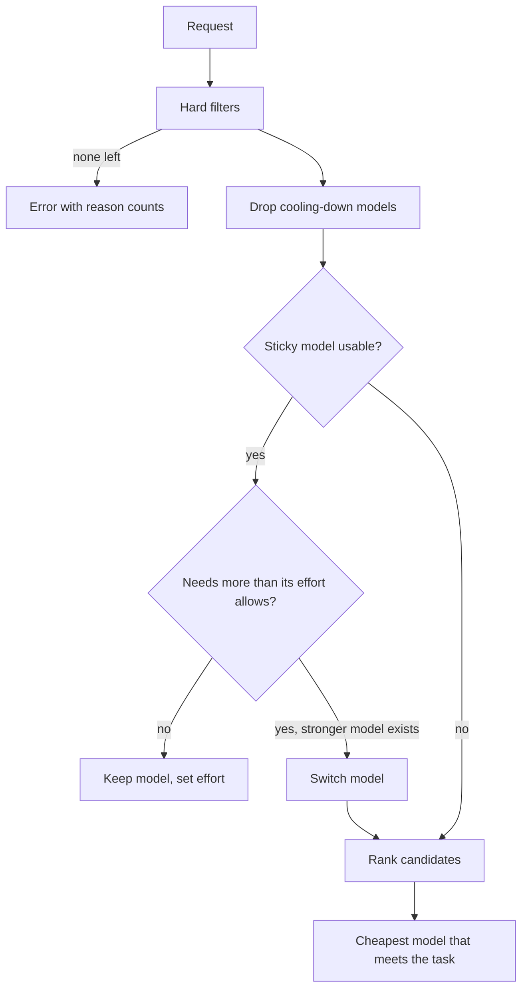

# Smart routing

`octocode/auto-code` is a virtual model. Each request is routed to one physical model and one thinking level, using only data already in the session: no extra model call, no prompt content stored.

## How a request is routed



### Hard filters

A model is never chosen when any of these holds. Filters never relax.

| Filter                                                                 | Rejection reason                                       |
| ---------------------------------------------------------------------- | ------------------------------------------------------ |
| Not in `allow` (when set) / matches `deny`                             | `not-allowed` / `denied`                               |
| Provider has no credentials, is disabled, or its plan is paused        | `no-credentials`, `provider-disabled`, `plan-disabled` |
| Hidden, deprecated, or recently refused for this account               | `hidden`, `deprecated`, `access-rejected`              |
| A new image is pending and the model takes text only                   | `modality`                                             |
| Prompt plus output reserve does not fit the context window             | `context`                                              |
| Plan restricted to the vendor's client, or unattended use is forbidden | `plan-external-only`, `plan-unattended`                |
| `planOnly` set and the model is per-token                              | `plan-only`                                            |
| The session used a plan and escalation is not allowed                  | `plan-to-metered`                                      |

A model with an unknown context window is used only when no model with a known window remains.

### Billing

Providers without declared plan facts count as per-token. A plan model costs nothing per request and ranks first. After the session has used a plan model, per-token models stay excluded unless `allowPlanToMeteredEscalation` is set in global settings, so a plan outage never turns into a silent bill; the router retries the plan model instead. Project and per-run settings cannot enable this escalation.

### Task difficulty and effort

Difficulty (0–3) comes from the latest user message (length, keywords, trivial replies) and the tool loop (errors, length, repeated failures). It sets the required capability tier and a starting effort. The thinking level selected for the virtual model is the effort ceiling; the router never exceeds it.

Effort rises before the model changes. A model below the required tier, or one whose response was truncated, first gets higher effort. Only when its supported effort is used up does the router move to a stronger model.

### Stickiness

The previous model stays while it passes the filters, to keep prompt caches warm. Inside a tool loop effort does not drop. A model changes only because of a failure, a lost eligibility, or exhausted effort.

### Failures

| Failure                                                  | Response                                                     |
| -------------------------------------------------------- | ------------------------------------------------------------ |
| Transient (overload, rate limit, network, unknown error) | Model sits out `cooldownRequests` requests; fail over        |
| Access or credential error                               | Sits out four times as long                                  |
| Context overflow                                         | Larger safety margin; models without room are filtered       |
| Truncated (`length`)                                     | Raise effort, then switch model                              |
| Cancelled                                                | Not held against the model; a cancelled signal stops routing |

Cooldowns count routed requests, not time, so routing replays deterministically. If every candidate is cooling down, cooldowns are ignored rather than failing.

## Options

Normal sessions read `allow`, `deny`, `tiers`, `planOnly`, `allowPlanToMeteredEscalation`, `cooldownRequests` and `outputReserveTokens` from `runtime.smartRouting` in settings. CLI print, JSON and ACP modes set `unattended` automatically. `statistics` and `onDecision` are programmatic host hooks.

| Option                         | Default                              | Meaning                                                                                                                      |
| ------------------------------ | ------------------------------------ | ---------------------------------------------------------------------------------------------------------------------------- |
| `provider`, `id`, `name`       | `octocode`, `auto-code`, `Auto Code` | Catalog entry                                                                                                                |
| `thinkingLevels`               | off … high                           | Levels offered                                                                                                               |
| `allow`, `deny`                | none                                 | `provider/id` patterns with `*`; deny wins                                                                                   |
| `tiers`                        | derived                              | Tier 1–3 per pattern; first match wins                                                                                       |
| `planOnly`                     | false                                | Exclude per-token models                                                                                                     |
| `allowPlanToMeteredEscalation` | false                                | Permit plan → per-token                                                                                                      |
| `unattended`                   | false                                | Skip plans that forbid unattended use                                                                                        |
| `statistics`                   | none                                 | `(model) => { successRate, samples, medianLatencyMs, costPerRequestUsd }`; success below 0.8 over 5+ samples demotes a model |
| `cooldownRequests`             | 4                                    | Failure cooldown                                                                                                             |
| `outputReserveTokens`          | 8192                                 | Window kept free for the answer                                                                                              |
| `onDecision`                   | none                                 | Receives each explanation                                                                                                    |

Without `tiers`, a model's tier is derived from metadata: reasoning, a window of at least 200k tokens, and an output price of at least $10 per million tokens each add a point (0 → tier 1, 1–2 → tier 2, 3 → tier 3). A model without a window is tier 2.

## Diagnostics

Each route stores `RouteExplanation` in the router state on the session branch: outcome, selected model and effort, difficulty signals (labels only), required and selected tier, billing, estimated tokens, candidate count, rejected models by reason (at most five per reason), the failure that triggered a retry, and notes. State is bounded: 16 cooldowns and one explanation.

## Registration

Normal CLI and SDK session services register `octocode/auto-code` automatically; selecting the virtual model is the opt-in. Automatic startup fallback never chooses a virtual router by itself, so an empty physical catalog still reports that no model is available.

Custom hosts can register it directly:

```ts
const unregister = registerSmartRouter(modelRuntime, options);
```

Call it during session setup; candidate facts are collected fresh for each request, so later provider registrations are seen. `ModelRuntime` satisfies the host interface. The returned function removes the model.
