# Subagents and teams

A subagent is a child Octocode session the main agent (the *coordinator*) starts for one bounded task. It has its own process and saved session, works from a brief, and ends with a report. Children of one coordinator form a *team*: they see each other, message each other and reserve files so they do not collide. You can also hand a task to an installed vendor CLI such as Claude Code or Codex.

This page is the one home for subagents, teams, worktrees, team mail and external runners. Field reference of the `agent` tool: [tools](tools.md#agent); terms are in the [glossary](GLOSSARY.md). Related pages: [tools](tools.md), [how it works](how-it-works.md), [monitoring](monitoring.md), [instructions](instructions.md), [backlog and archive](backlog-and-archive.md).

Example: "have the reviewer check my diff in the background". The coordinator calls `agent` with `type: "task"`, `profile: "reviewer"` and `background: true`, keeps talking to you, and the report arrives later as a message.

A child starts a fresh session holding only its task. `context: "fork"` instead starts it from a copy of the conversation the model of the calling session sees on its active branch, frozen when the call is made (a queued child starts from that moment too). Other branches, display-only and hidden records and tool calls without a result never enter the copy; the copied turns count nothing toward the child's spend. The child still gets its own prompt, tools, permissions, identity and session, and a later `resume` continues that session, not the parent's. Fork starts a native child only: `resume` and `runner` refuse it.

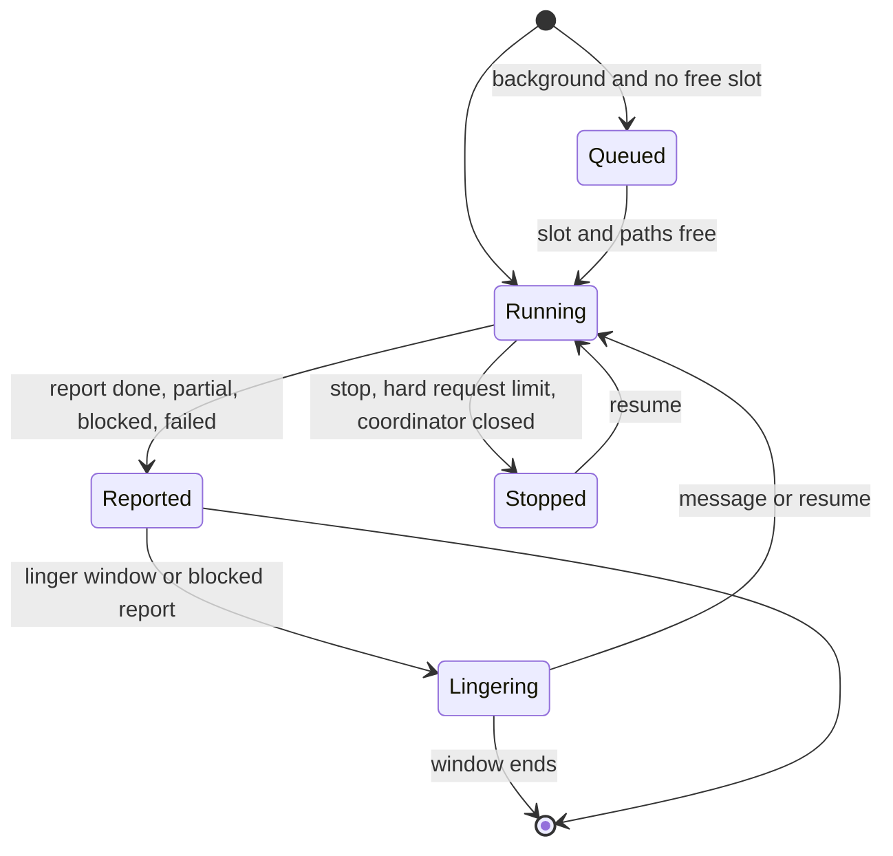

## The `agent` tool

One tool, four types. Fields are flat: `agent({ type, ...fields, reason })`. A field that belongs to another type is refused (`native/tools/agent/tool.ts`). `reason` is required on every call. Only `paths` and `item` are shared between types (`SHARED_FIELDS`, `tool.ts`).

| Type | Use it to | Notes |
| --- | --- | --- |
| `task` | Delegate a self-contained task to a fresh session | Foreground returns the report; `background: true` returns an id and the report arrives later. At most `OCTOCODE_MAX_SUBAGENTS` run at once (default: the lowest of 6, CPU count and GiB of memory); more queue |
| `message` | Send steering, questions or evidence to a teammate, the coordinator (`parent`) or another Octocode process; resume a finished non-isolated child | `messages` sends several in order. Fields: `to`, `message`, `item`, `attach`, `forward`, `replyRequired`, `replyTo`, `wake`, `callback`, `interrupt` |
| `coordinate` | List teammates, reserve files, stop or land children | `action`: `list`, `join`, `leave`, `lock`, `unlock`, `stop`, `merge`, `discard`, `grant`, `changes`. A session that starts no children gets only `list`, `lock`, `unlock`, `changes` |
| `external` | Reach an installed ACP agent or a running Octocode | Present only when the global `externalAgents` setting is on and something is reachable. Replies are untrusted; one prompt at a time per connection; never auto-retry. See [external agents](external-agents.md) |

A child session has only `message` and `coordinate`, with a leaf's restrictions: no `task` of its own and no `interrupt`. The one exception is a `task` that starts runner tasks only (see [Runners](#external-runners)). An `octocode` started from a child's shell is a top-level session, and a session one level deep refuses another task (`OCTOCODE_AGENT_NESTING`).

Fields of each type: [tools: agent](tools.md#agent).

## Parents, children and nesting

Every session of a repository joins one team, keyed by the git common directory. A team row records the agent's `parentId`: the session that started it. `to: "parent"` resolves through that field, a child's report goes to it, and a child's commands carry `OCTOCODE_PARENT_ID` and `OCTOCODE_PARENT_PID`.

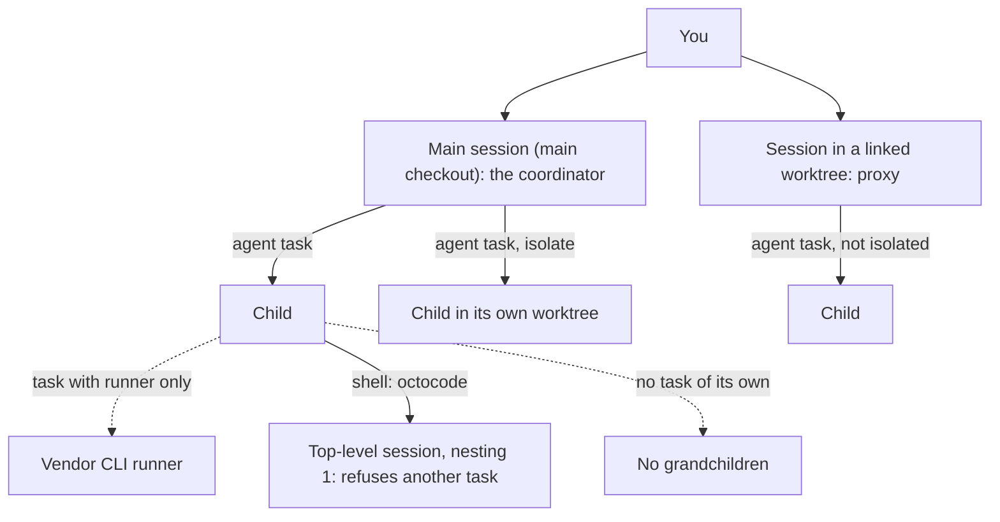

| Who | May start | May not |
| --- | --- | --- |
| Main session in the main checkout | Children, isolated children, runner tasks, worktrees | |
| Session in a linked worktree (a proxy of the orchestrator that created the worktree) | Non-isolated children in its tree | `/worktree new`, `--worktree`, `isolate: true`, `git worktree add` ([roles and realms](#roles-and-realms)) |
| A child | A `task` only when a runner is installed, and that starts runner tasks only, in the foreground | Native children of its own, `interrupt` |
| An `octocode` started by a child's shell | Nothing: it is a top-level session with its own team name, but `OCTOCODE_AGENT_NESTING` still counts the chain and one level deep refuses another task | |

Children of one coordinator are teammates: they list each other with `coordinate list` and message each other, but a child reaches only its own tree and its parent relays beyond. When the coordinator closes, its children stop gracefully ([shutdown](#shutdown-crashes-and-unattended-runs)).

## Starting children

| Topic            | Behavior                                                                                                                                                                                                                                                                                                                                                                                                                                                                                                                                                                                                                                                                                                                                                                                                                                                                                                                                                                                                                 |
| ---------------- | ------------------------------------------------------------------------------------------------------------------------------------------------------------------------------------------------------------------------------------------------------------------------------------------------------------------------------------------------------------------------------------------------------------------------------------------------------------------------------------------------------------------------------------------------------------------------------------------------------------------------------------------------------------------------------------------------------------------------------------------------------------------------------------------------------------------------------------------------------------------------------------------------------------------------------------------------------------------------------------------------------------------------ |
| Skills           | A child inherits the parent's accepted skill inventory. The task's `skills` array narrows it (`[]` for none); a model-only name or a `disable-model-invocation` skill is refused, unknown or ambiguous names fail before launch (use qualified names). The child adopts captured paths and invocation policy (not file contents) and does not rediscover skills; a retargeted discovery symlink makes it refuse the inventory, and a deleted or moved skill is left out with a warning. [Skill inheritance](skills.md#child-skill-inheritance)                                                                                                                                                                                                                                                                                                                                                                                                                                                                           |
| MCP              | A child runs only the servers its profile and the research floor name, plus those the task's `mcp` array names; the session's other servers (configured or added) stay with the main session. Every tool of a named server is active unless the profile names one exact `+mcp__<server>__<tool>`. An unknown or disabled name refuses the task, and so does a lean profile with `mcp`; a `resume` names its servers again ([MCP reference](mcp-reference.md#assign-servers-to-agents))                                                                                                                                                                                                                                                                                                                                                                                                                                                                                                                                   |
| Specialist floor | Every specialist keeps `file`, `agent`, `notify`, `archive`, `memory` and Octocode local research. Restrictive allowlists gain them by server `roles`, not tool name. Profiles that remove them or set `mcp: false` are rejected; a global MCP opt-out still applies. Researcher and reviewer use `file` only for requested reports and scratch artifacts                                                                                                                                                                                                                                                                                                                                                                                                                                                                                                                                                                                                                                                                |
| Server state     | A child starts with servers its parent added with `mcp` this session (never written to `mcp.json`) and loads configured servers itself. A server the parent ended with `mcp` `stop` is hidden from the child unless its own selection names it (`tools: mcp__<server>__*`; default-active does not count). `/settings disable mcp:<name>` is saved, so children see it. A harness switch reaches running children: before each request a child compares saved `harness:` switches with what it last saw and, on a change, reloads MCP as its parent did                                                                                                                                                                                                                                                                                                                                                                                                                                                                  |
| Concurrency      | Slots follow the machine (at most 6; `OCTOCODE_MAX_SUBAGENTS` overrides; [environment variables](environment-variables.md)). A `background: true` task with no free slot returns its id as queued and starts first come first served; it can be stopped like a running one and has no worktree or team seat until it starts. A foreground task waits for a slot, and past 15 s of running it [continues in the background](tools.md#long-calls-become-jobs). Background children sharing profile, model and skills share a prompt prefix: all start at once, but where the model's prices make a cache read cheaper than writing the prefix, only the first sends its task; the others send theirs once its first reply starts, or as soon as that child exits or stops without one (no time limit, and a waiting sibling is never judged stalled: the first child's own watchdog bounds the wait; not at all once that prefix was warm within its cache lifetime). Models without cache prices, or with caching off, never wait |
| Batches          | `tasks` is an array of task objects started in one call; other task fields beside it are defaults an entry overrides. Each entry is validated and started on its own (own approval, slot, reservations); a failed entry leaves the others running. The result has one `#n ok\|error: <goal>` section per entry and `details.batch`                                                                                                                                                                                                                                                                                                                                                                                                                                                                                                                                                                                                                                                                                       |
| Limits           | `subagents.maxChildren` (children started; a resume is not new) and `subagents.maxCost` (US dollars, own and children's, running children included) refuse a new task past either, with the total; nothing running is stopped. Both off by default ([settings](settings.md)) Without a limit nothing is refused: when a finished run takes the children's recorded cost past a new whole multiple of the session's own cost, its report ends with one line saying so                                                                                                                                                                                                                                                                                                                                                                                                                                                                                                                                                     |
| Nesting          | A child has no `task` type. An `octocode` it starts from its shell is a top-level session; `OCTOCODE_AGENT_NESTING` counts tasks across that boundary and a session one deep (a child, or a session its shell started) refuses another task                                                                                                                                                                                                                                                                                                                                                                                                                                                                                                                                                                                                                                                                                                                                                                              |
| Permissions      | A subagent cannot ask anyone, so it runs with what its parent decided at spawn. In `full` it inherits the mode. In `manual` or `workspace` the spawn dialog names what the profile's tools reach and the permissions the profile declares; approving (once or for the session) grants those classes for the whole run, deliberately looser than the parent's mode: the dialog is the consent. Classes that always ask (destructive shell, changes outside the workspace, browser control unless declared, browser cookies) never pass down; a mode change that makes an action ask stops running children and clears grants ([permissions](permissions.md#modes))                                                                                                                                                                                                                                                                                                                                                        |
| Identity         | A child's commands inherit `OCTOCODE_SUBAGENT`, `OCTOCODE_AGENT_ID`, `OCTOCODE_PARENT_ID`, `OCTOCODE_AGENT_ROLE`, `OCTOCODE_TEAM_WORKSPACE` and related variables, and `OCTOCODE_PARENT_PID`. A separate Octocode started from such a command clears them and runs top-level (own team name, default prompt); `OCTOCODE_PERMISSION` is kept so it is never looser than the inherited mode; it does not keep a `readOnly` profile's guard, which is not a sandbox. [Shell tool session environment](environment-variables.md#shell-tool-session-environment) is unaffected                                                                                                                                                                                                                                                                                                                                                                                                                                                |

## Profiles

Bundled profiles are in `src/octocode/native/agents/`:

| Profile | Use when | Model | Notable flags |
| --- | --- | --- | --- |
| `researcher` | A fact, root cause or dependency behavior is uncertain; returns the answer, evidence and gaps | `small:medium` | `readOnly` |
| `reviewer` | A change needs review; returns findings with failing scenarios | `medium:medium` | `readOnly` |
| `implementer` | A scoped change is ready to build; edits and verifies it | `medium:medium` | |
| `lean` | A small task bash, files and the web can finish; for small models | `small:low` | `lean`, tools `bash,file,web,agent` |
| `browser` | Long, parallel or visual web-page work | `small:low` | `readOnly`, `headless: true`, `linger: 900` |
| `desktop` | A native app or OS window; the user approves each start | `small:low` | `readOnly`, `linger: 900`, `permissions: [desktop.control, browser.control]` |

Bundled profiles are `browser`, `desktop`, `implementer`, `lean`, `researcher`, `reviewer`. Your own override them by name; a project file that replaces an earlier one is named in a warning at start. A `readOnly: true` profile (bundled `reviewer`, `researcher`, `browser`, `desktop`) keeps `file` for its own reports and scratch evidence, gets the investigate-and-report policy, and its other changes are refused in every mode ([read-only roles](permissions.md#read-only-roles)). [Agent instructions](prompts.md) separates system policy, role text and task context.

A `lean: true` profile (bundled `lean`) is for small models: its child runs the profile's `tools` (default `bash,agent,file`; the bundled `lean` role names `bash,file,web,agent`; a list leaving out `bash` or `agent` gets them anyway; its `agent` messages its parent and teammates and starts no agents or runner tasks), has no `notify` unless its list names it, no `archive`, `memory`, `skill`, `mcp`, local research, extensions, MCP servers or automatic memory notes, and a short report-contract section replaces the native policy. Its tool list must be explicit (`+`/`-` entries are refused). A profile's `skills:` are inlined in its cached role section when the task names none; skills a task names, and a lean profile's, ride in the task ([prompt caching](prompt-caching.md#subagent-prefixes)).

### Profile front matter

A profile is Markdown: YAML front matter, then the role's instructions. It loads from the global `agents/` folder or the trusted project's `.octocode/agents/` at the repository root ([configuration locations](configuration.md#where-each-configuration-belongs)); a later source replaces an earlier profile of the same name. An invalid value skips that file with a diagnostic; unknown keys are ignored.

| Key            | Value                                        | Effect                                                                                                                                                                                                                                                                                                                                                            |
| -------------- | -------------------------------------------- | ----------------------------------------------------------------------------------------------------------------------------------------------------------------------------------------------------------------------------------------------------------------------------------------------------------------------------------------------------------------- |
| `name`         | text                                         | Defaults to the file name without `.md`                                                                                                                                                                                                                                                                                                                           |
| `description`  | text                                         | What the parent reads to pick the profile; start with "Use when…"                                                                                                                                                                                                                                                                                                 |
| `model`        | text                                         | The child's model; [the subagent model](#the-subagent-model)                                                                                                                                                                                                                                                                                                      |
| `tools`        | comma-separated                              | A plain list is an allowlist to which `bash`, `file`, `agent`, `notify`, `archive`, `memory`, `skill`, `mcp` and local research are added (only the local reader and search when the list names Octocode server tools); `+name`/`-name` adjust the default set                                                                                                    |
| `excludeTools` | comma-separated                              | Naming `file`, `agent`, `notify`, `archive`, `memory`, `mcp` or a local research tool is refused                                                                                                                                                                                                                                                                  |
| `mcpDefer`     | list                                         | MCP tool roles, e.g. `readOnly` (Octocode's GitHub and registry tools; the local read and search tools stay declared), whose tools the child lists by name instead of declaring in full; they stay callable and load through the `mcp` tool. Each server says which tools have a role in its `roles` setting. A child started without a profile defers `readOnly` |
| `catalog` | string or list | Skills the child's `skill` tool lists (`catalog: []` for none); the rest stay loadable by name |
| `skills`       | string or list                               | Skills inlined in the role prompt when the task names none                                                                                                                                                                                                                                                                                                        |
| `permissions`  | list                                         | Classes the spawn prompt asks you to allow, e.g. `[browser.control]`; undeclarable names are ignored and reported                                                                                                                                                                                                                                                 |
| `readOnly`     | `true`                                       | Investigate-and-report role                                                                                                                                                                                                                                                                                                                                       |
| `lean`         | `true`                                       | Lean child for small models                                                                                                                                                                                                                                                                                                                                       |
| `headless`     | `true` / `false`                             | Browser mode (legacy `visibleBrowser` is its inverse)                                                                                                                                                                                                                                                                                                             |
| `maxRequests`  | integer ≥ 0                                  | Soft request limit; `0` turns the budget off. `0` or above 160 makes [long history caching](prompt-caching.md#subagent-cache-tier) its default                                                                                                                                                                                                                    |
| `linger`       | seconds ≥ 0                                  | How long a finished background run stays reachable for a follow-up; above 0 its background runs default to [long history caching](prompt-caching.md#subagent-cache-tier)                                                                                                                                                                                          |
| `hooks`        | `false` / `off`, `decisions`, `true` / `all` | Which of your hooks the child runs: none, only the deny or ask of `PreToolUse` and `PermissionRequest` hooks, or all. Unset: none, unless the task's `hooks` field turns them on; `false` forbids them whatever the task asks ([hooks in subagents](hooks.md#hooks-in-subagents))                                                                                 |

Switches take YAML booleans only (a quoted `"false"` fails the profile); `hooks` also takes the mode names. `mcp: false` is refused because every specialist needs local research.

## Where a task can run

Every route starts from a credential. A provider you turn off in `/providers` drops out of every route below.

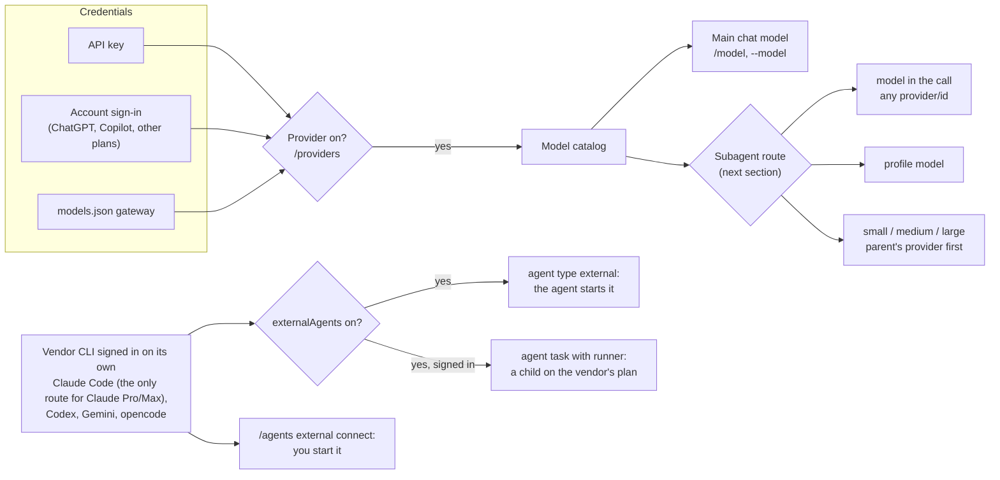

| Route                                                      | Who starts it                                     | What it needs                                                                    | What it costs                                                                                                                                      |
| ---------------------------------------------------------- | ------------------------------------------------- | -------------------------------------------------------------------------------- | -------------------------------------------------------------------------------------------------------------------------------------------------- |
| Subagent on a provider model                               | The agent (`agent` task)                          | The provider on, with a working credential                                       | API price per token, or your plan's usage limits with a plan sign-in; Claude Pro/Max runs only through the Claude Code external agent              |
| Subagent on a named model                                  | The agent, or you by asking for that model        | As above; `models` lists what can run a task                                     | As above; free models cost nothing                                                                                                                 |
| Runner task (Claude Code, Codex, Gemini, opencode, Cursor) | The agent, with `agent` task `runner`             | `externalAgents: true`, the CLI and its ACP adapter or headless route, signed in | The vendor account's billing; known plans show subscription usage, and other routes retain any reported dollar cost. Unknown billing stays unknown |
| External agent (Claude Code, Codex, Gemini, opencode)      | The agent, with `agent` type `external`           | `externalAgents: true`, the vendor's CLI on `PATH` and signed in                 | The vendor account's own billing or plan                                                                                                           |
| External agent from the terminal                           | You, with `/agents external connect` and `prompt` | The vendor's CLI on `PATH` and signed in                                         | The vendor account's own billing or plan                                                                                                           |

A listed provider or external agent is not proof that it works. A connected opencode peer, for example, starts on its own default model, which may need funds. Check with `/modelsettings` → Credential check, or connect and send one short prompt.

## The subagent model

Name `provider/model` to select a route independently of the coordinator. An explicit bare model ID prefers the coordinator’s provider when it offers that ID; otherwise, multiple matching providers require a qualified choice. A model-specific access refusal does not disable other models on that provider.

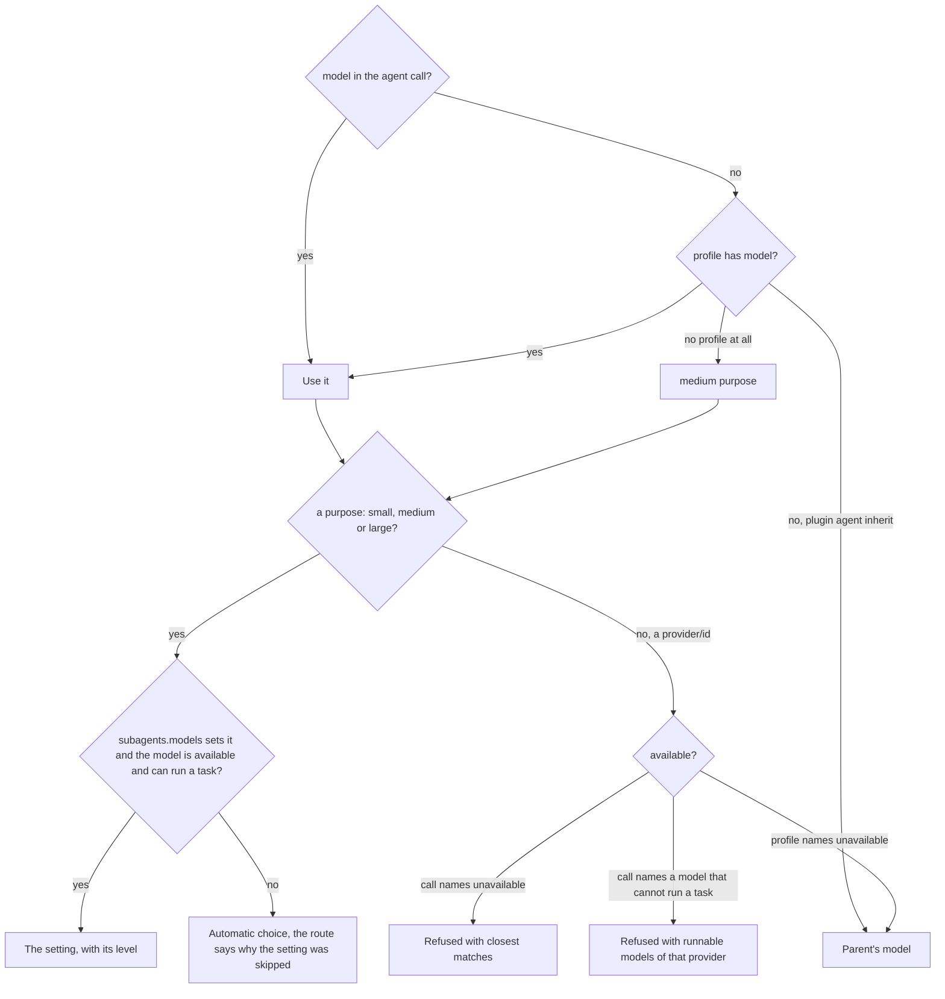

| Value                    | Meaning                                                                                                                                                    |
| ------------------------ | ---------------------------------------------------------------------------------------------------------------------------------------------------------- |
| `provider/id` or bare id | A name `/modelsettings` lists; a bare id several providers list resolves to the parent's provider first. A model that cannot run a task (below) is refused |
| `small`                  | The model set in `subagents.models.small`, else the cheapest capable model the session can use                                                             |
| `medium`                 | The model set in `subagents.models.medium`, else the dearest capable model priced between 15% and 80% of the parent's                                      |
| any of these `:level`    | `off`, `minimal`, `low`, `medium`, `high`, `xhigh`, `max`, e.g. `small:high`                                                                               |

`small` and `medium` first take a capable model your plan pays for (a coding plan, a subscription sign-in): it costs nothing more per request, so it qualifies whatever its list price, and its list price still places it in a tier. Without one they prefer the parent's provider and lab. A background child is never routed automatically to a plan whose vendor forbids unattended use (Qwen, Xiaomi and Z.ai coding plans); name the model to run it there anyway. A candidate must support tool calls, have a context window of at least 100,000 tokens, take images when the parent does, not be deprecated and be its family's current generation; with none, or an unknown parent price, the child runs on the parent's model. The thinking level is the call's suffix, else the profile's (kept on whichever model is picked, and on the parent's model after a fallback), else `OCTOCODE_SUBAGENT_THINKING`, else `medium`; a child never takes the parent's level or `defaultThinkingLevel`; a level the model lacks is clamped to the nearest one it supports, and the route says so (`low thinking (model argument: p/m:off; asked off; this model does not support off)`). The `models` tool lists the thinking levels of a reasoning model that supports others than `off`, `minimal`, `low`, `medium` and `high` (` · thinking low/medium/high`).

What the `models` tool returns:

| Call                                            | Result                                                                                                                                                                                          |
| ----------------------------------------------- | ----------------------------------------------------------------------------------------------------------------------------------------------------------------------------------------------- |
| No filter                                       | This session's model, one row per provider (credential source, last result, how many models can run a task, cheapest and most capable one with price), the `small`, `medium` and profile routes |
| `provider: openai`                              | That provider's models that can run a task, then its other models under "Cannot run a task" with the reason                                                                                     |
| `query` or `ability` keeping 40 or fewer models | The matching models, listed as above                                                                                                                                                            |
| `query` or `ability` keeping more               | The provider rows with how many models each has matching, so a long list never opens the call                                                                                                   |
| `scope: catalog`                                | Also the models of providers that are not connected, marked not runnable                                                                                                                        |

Every answer also states, per provider: its plan quota windows with when each resets (`5h 92% (resets 14:20)`; a per-minute rate window only when nearly used up), its health (cooling down after a rate limit, a refused credential, deprecated models), and this session's spend on it, money apart from what a plan paid for; then the session's whole spend and, when models.dev updates do not apply in full, why ([catalog updates](models.md#catalog-updates-from-modelsdev)). When the session's provider passes 90% of a plan window, the agent gets one hidden notice for that window naming its reset and the connected providers that are not limited.

The coordinator can dispatch any enabled chat model with child-accessible credentials by its exact `provider/id`. This includes custom Octocode and Pi models. Automatic routing prefers models with tool support, a current release and at least 100,000 tokens of context when those facts are known. You can choose a smaller model explicitly. The model inventory reports its context, maximum output, estimated size and known abilities. The credential source uses the same words as `/providers` (saved credential, environment variable name, `models.json`). The coordinator's prompt lists each provider with its number of runnable models, such as `openai` (41), and the routing notice repeats the counts when a provider or model change alters them (a newer models.dev index alone sends no notice; the next session states its counts); `/modelsettings` always shows the full listing.

| Bundled profile           | Model           |
| ------------------------- | --------------- |
| `researcher`              | `small:medium`  |
| `browser`, `lean`         | `small:low`     |
| `implementer`, `reviewer` | `medium:medium` |

To make every child that names a purpose cheaper, set the global `subagents.models` setting; to change one role, set `model: small:low` in a same-named profile under `.octocode/agents/` or pass `model` on the call.

```json
{ "subagents": { "models": { "small": "openai/gpt-5-mini:low", "medium": "anthropic/claude-sonnet-5" } } }
```

`small` and `medium` are cheaper than this session's model, ranked by price; `large` is this session's own model, or the strongest connected model when the session has none. When this session's model has no price (a custom or local model), `small` and `medium` rest on a size-class guess instead: the id family (`haiku`, `mini`, `flash`, `nano` are small; `opus`, `pro` large), then the output limit and context window. A route chosen that way says `size guess, price unknown`.

Each value is a `provider/model` with an optional `:level`. It applies to every profile or call that names `small`, `medium` or `large` (bundled profiles use the first two) and to a task with no profile; a call's own `model` still wins, and a profile's own `:level` (`small:high`) outranks the setting's. The setting is read from the global settings file only. It is used only when the model is available, can run a task and its provider has not just refused its credential; otherwise the automatic choice applies and the route says why (`automatic; subagents.models.small p/m unavailable`). The `models` tool, `/modelsettings`, the coordinator's routing line and the routing notice show a configured route as `(setting subagents.models.small)`, and each child's `Runs on` line names the setting that chose it.

You see each child's route: start results and every report end with `Runs on` / `Ran on provider/id, <level> thinking (what chose it)`, and `coordinate list` and the agents panel show `provider/id:level`.

A purpose or profile model skips a provider whose credential was refused, except the parent's own, until that credential changes (sign-in, sign-out, import or a new API key) or a run or check on it succeeds; a refusal of a credential saved in the auth file is remembered across restarts, keyed by a digest of that credential. For 15 minutes it skips a provider that reported a usage limit or ran out of funds (one only out of funds keeps its free models, and stays in the coordinator's provider list while it has one) and a model that refused a run with a client error before spending a token (4xx other than 408 or 429); the parent's model is never skipped and the failed report names it as the model to retry with. A child whose model a purpose chose also starts with up to two fallback models on other providers (`retry.fallbackModels`), so a refused credential or limit moves it to the next one instead of ending its turn. The child records such a switch in its session as an `octocode-fallback` entry and a usage limit it could not get past as an `octocode-usage-limit` entry with the reset time; the parent's `Ran on` line, advice and provider health name the model that actually ran, and the advice says when the child's limit resets. Siblings started in one call were routed together, so they fail alike. `/modelsettings` and the `models` tool list what `small` and `medium` resolve to, the default thinking level, each profile's route and the last credential result per provider (`check: true` or `/modelsettings check` first sends one 64-token request per provider, 20 s each). The coordinator's delegation section states this once per session, read at the first prompt after start, resume or reload and then kept so the cached prompt does not change; when the facts change (provider enabled, disabled or signed in, model switch, a provider refusing or accepting its credential again) the agent gets one hidden `octocode-routing` notice after the current turn that says which of these caused it. Agents of other vendors over ACP come from `agent` type `external` `list` ([ACP](acp.md#connect-from-octocode-to-another-agent)).

## Foreground and background

- **Foreground** (default): the call waits and returns the report. After 15 s of running it continues in the background as a job (`TOOL_FOREGROUND_MS`, `jobs/registry.ts`). A foreground child's parent reads messages only with the report, so a check-in tells it to finish with a `blocked` report if it needs something.
- **Background** (`background: true`): the call returns an id at once; the report arrives as a message and wakes an idle coordinator. With no free slot the child is *queued* (first come first served): it holds no slot, worktree, team seat or reservation until it starts, and `coordinate stop` cancels it.
- **Chaining**: see [chain agents](#chain-agents). **Lingering**: see [lingering children](#lingering-children).

### Lingering children

| Topic | Behavior |
| --- | --- |
| `blocked`       | A background child that reports `blocked` stays resumable for at least 10 minutes even with `OCTOCODE_SUBAGENT_LINGER_SECONDS` at 0; a longer positive setting wins; then the saved context is released. Isolated runs are not resumable                                                                                                                                                                                                                                                                                                                                                                                                                                                                                                                                                                                                                                                                                                                                                                                                                                                                                                                                                                                                                                                                                                                                                                                                                                                                                   |
| Lingering       | Finished non-isolated background workers stay addressable for `OCTOCODE_SUBAGENT_LINGER_SECONDS` (default off) or the profile's `linger` seconds (`0` off; `browser` and `desktop` are 900). A message revives the conversation with fresh authorization and capacity checks; past that window, a message from the parent or the user to a finished non-isolated child with a saved conversation resumes it like `task` with `resume` (same permission prompt, slot limit and item rules), in the background, with the message as delivered mail, and the reply says it resumed; an isolated child or a vendor runner's child keeps refusing, naming what to do instead; restart recovery needs the same parent session, workspace, profile and surviving transcript. The parked record never holds MCP server configs the model added (they may carry credentials); a revived run takes the session's current ones. Pending mail does not relaunch work                                                                                                                                                                                                                                                                                                                                                                                                                                                                                                                                                                                  |

Waiting-only updates do not pad an earlier report while a child has a pending background job, wait or requested reply. Only matching completions or replies settle those waits; repeating waits remain pending until they end or are turned off. A shell command moved automatically to the background counts as pending work too.

## Chain agents

A background child can wait for other work and start by itself when that work ends well. The child is queued: it holds no slot, no path reservation and no backlog item claim until it starts, so the work it waits for is never blocked by it.

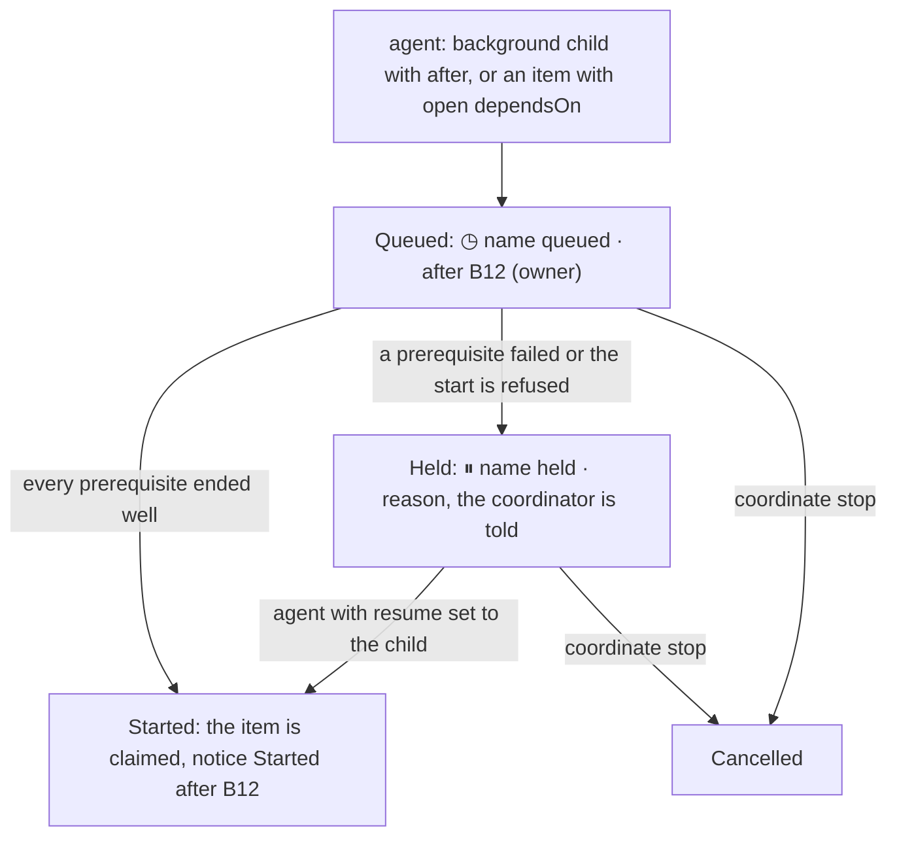

What a child waits for comes from two places, which join:

| Option                   | Where                                 | Meaning                                                                                                                                                                                                                                                                                                                           |
| ------------------------ | ------------------------------------- | --------------------------------------------------------------------------------------------------------------------------------------------------------------------------------------------------------------------------------------------------------------------------------------------------------------------------------- |
| `after`                  | `agent` call, with `background: true` | Up to 8 entries: a backlog item (`B12`) waits until the item is done; `agent:<name>` waits until that child of this session reported done. `job:bash-<n>` waits until that background job of this session exits 0; `lock:full-run` waits until no full test run or check holds the host's lock. A job that fails holds the child. |
| `dependsOn`              | The child's backlog `item`            | The item's open prerequisites count as `after` entries.                                                                                                                                                                                                                                                                           |
| `resume`                 | `agent` call naming a held child      | Starts it now, ignoring what it waited for.                                                                                                                                                                                                                                                                                       |
| `coordinate` `stop`      | Names a queued or held child          | Cancels it.                                                                                                                                                                                                                                                                                                                       |
| `subagents.queuedStarts` | [Setting](settings.md), on by default | Off: a call that would queue is refused instead.                                                                                                                                                                                                                                                                                  |

| Where you see it                  | What it shows                                                                                                                                                      |
| --------------------------------- | ------------------------------------------------------------------------------------------------------------------------------------------------------------------ |
| The `agent` row in the transcript | "Queued · starts after B12", then "Started after B12"; a held child says why.                                                                                      |
| The agents panel                  | One row per child: `◷ name queued · after B12 (owner)` or `⏸ name held · reason`.                                                                                  |
| The footer                        | `N queued` beside the agent count while any child waits (queued and held).                                                                                         |
| `coordinate` `list`               | A "Queued children" block with what each waits for.                                                                                                                |
| The backlog board                 | The item's card shows `queued: <name>`, and its flow draws the dependency as pending, from the board's next refresh; the shared `/web` board does not show it yet. |
| Notices to the coordinator        | One when a child starts (with what it waited for) and one when it is held.                                                                                         |
| Hooks                             | `AgentQueued`, and the chain fields of `AgentOn` and `AgentOff` ([hooks](hooks.md)).                                                                               |

A started child's task receives what its prerequisites handed over: an agent's report and an item's completion summary. A child fails to queue when a prerequisite does not exist, was closed unfinished, is not this session's child, or would create a cycle; a session keeps at most 12 children waiting. The permission policy is checked again when the child starts: a refusal holds it. Without `after` and without an open `dependsOn`, nothing changes.

## Path reservations

A task's `paths` (files, or `dir/` for a tree) are reserved for the child from before it starts until its run ends, so the parent needs no `coordinate` lock. All are reserved or none, under the child's id with its goal as the reason, and they block other agents and the parent like any reservation.

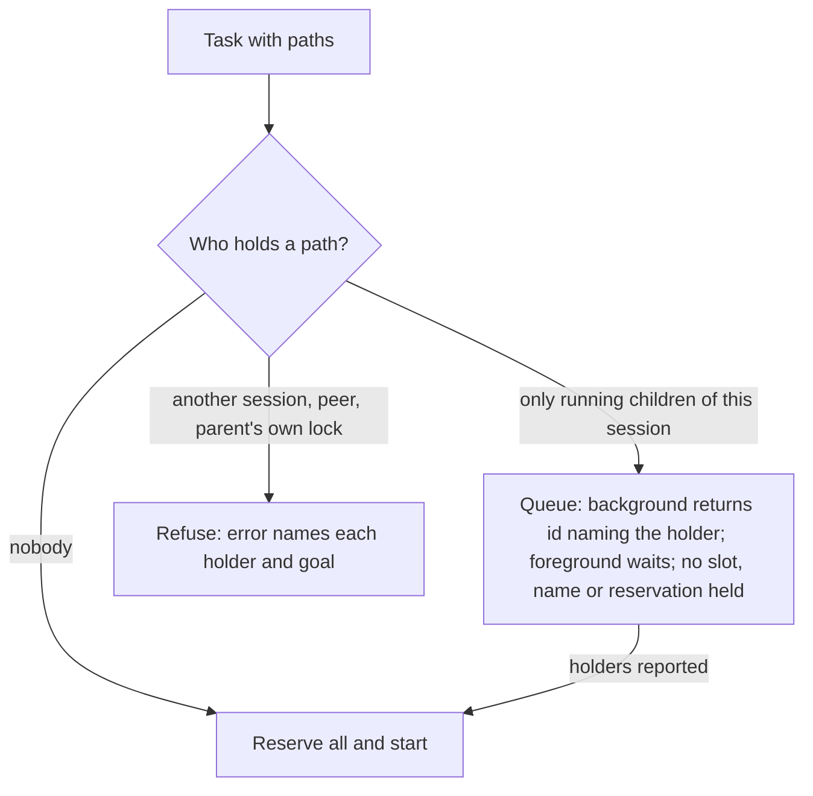

| Case                                          | Behavior                                                                                                                                                                                          |
| --------------------------------------------- | ------------------------------------------------------------------------------------------------------------------------------------------------------------------------------------------------- |
| Repeated path, path inside another named tree | Folded, not refused                                                                                                                                                                               |
| Before the child joins                        | The parent holds its team row, so siblings started together cannot overlap; a dying parent takes the reservations with it                                                                         |
| End                                           | With the run however it ended; a child still closing at `/new` or `/resume` keeps them until its run ends                                                                                         |
| Lingering child                               | Holds nothing while no process runs; a follow-up takes them again; if another agent took a path meanwhile it still runs, the resume receipt names the holder and the file guard refuses that edit |
| `isolate` or read-only profile                | `paths` does nothing (the result says so); `/agents merge` checks reservations at landing                                                                                                         |
| Team database unwritable                      | The child starts without them and says why                                                                                                                                                        |

### Locking by hand and peer leases

A reservation blocks other agents' edits and `bash` writes to the named paths until released or the run ends. Scripts and other editors ignore them.

- Agents lock by hand with `coordinate` `lock` (`paths`, `reason`) and release with `unlock` (no `paths` releases all). `coordinate` `list` shows held paths; `changes` shows recent file changes (`withinMinutes`, default 60; `limit`, default 20).
- Reservations, the edit log and scratch folders are per worktree, though agents of every worktree are one team.
- Peer leases: Octocode also reads the path leases that other vendors' agents write to the shared agents-communication database and refuses a write a live lease covers. This is advisory and read-only; a missing or unreadable database means no lease (`team/peer-leases.ts`).
- `subagents.peerOverlapWake` (default `true`) wakes the holder of an ongoing item or reservation when another agent claims an overlapping one.

### Lock lifecycle

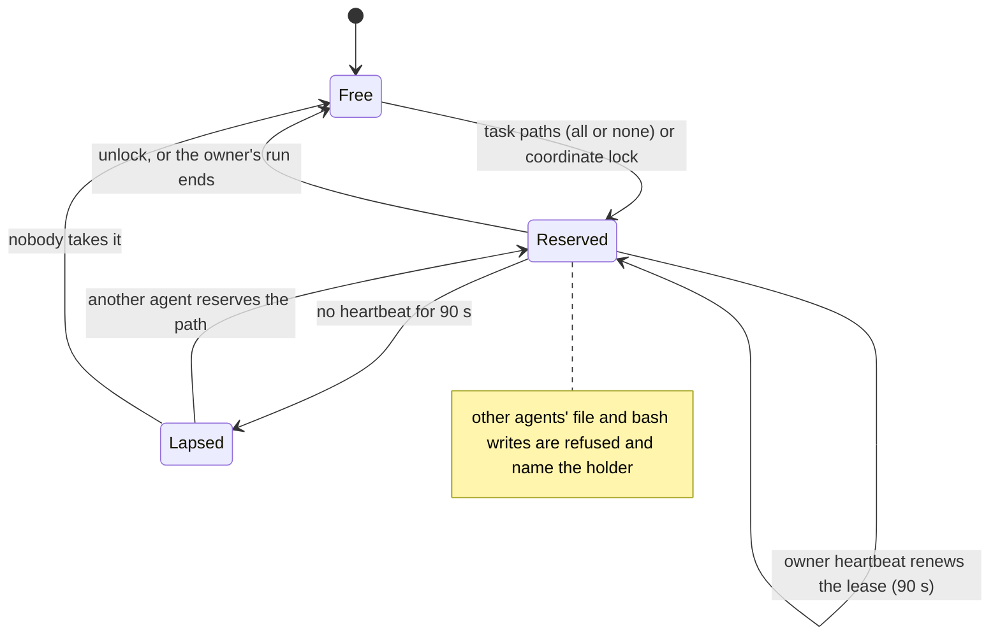

A lapsed reservation is not fenced: an owner stalled longer that resumes can overwrite a peer that took the file. Octocode records every file an agent changes as a lease of the same table and expiry, so another live session that changed the same file is named in the `file` result (the change is never refused for it).

### Shell writes and reservations

| What | Behavior |
| --- | --- |
| Reservations | Arithmetic such as `$((n+1))` does not trip the shell gate, and `tmp/` or `temp/` folders under the global store are scratch, not reserved paths. Enforced for `file`, for `bash` write targets the parser can name, and for any other tool that declares the files it writes (an extension's `write` and `edit` included). While another agent holds any reservation, shell commands whose writes no parse can name (PowerShell outside the read-only list, inline interpreter code, unreadable code) are refused, and a `node -e` that only lacks Node's permission flags runs with them added ([reservations and the shell](permissions.md#reservations-and-the-shell)) |
| Concurrent edits | Changing a file records that this session edits it (a lease of the same table and expiry as a reservation, released with the session or when it lapses). Another live session that changed the same file is named in the `file` result in one line, with its session id and declared paths; the change is never refused for it. A main session with no live session of the shared message store bound to it is told so once at start |
| Lapse | A reservation lapses 90 s after its owner's last heartbeat and is not fenced: an owner stalled longer that resumes can overwrite a peer that took the file |

### Avoiding deadlocks

The coordination guideline every agent reads says: lock all of a step's paths at once; never hold a lock while waiting on an agent that waits for you; on a mutual wait, release yours and message the peer; give every hold a deadline. A task's `paths` already follow the first rule (all or none), and a queued child holds nothing while it waits. To wait for another agent's lock use `notify` `path.unlocked` rather than polling.

## Isolated worktrees

`isolate: true` runs the child in its own git worktree; `resume` is refused for it. Isolated worktrees of every checkout of a repository share one folder under the Octocode home's `worktrees/`, so a session in any worktree prunes another's crashed run after saving its changes to a ref. Creating one never runs repository hooks such as `post-checkout`.

| Topic        | Behavior                                                                                                                                                                                                                                                                                                                                                                                                                                                                                                                                                                                                                                                                                                                                                                                         |
| ------------ | ------------------------------------------------------------------------------------------------------------------------------------------------------------------------------------------------------------------------------------------------------------------------------------------------------------------------------------------------------------------------------------------------------------------------------------------------------------------------------------------------------------------------------------------------------------------------------------------------------------------------------------------------------------------------------------------------------------------------------------------------------------------------------------------------ |
| Snapshot     | `workingCopy: true` with `isolate: true` starts from tracked and non-ignored untracked files, keeping the parent index and branch; the default starts at HEAD. Snapshots and saved refs exclude private data in `.octocode/agent/`; a tracked or staged workspace marker or session file blocks automatic checkout and export                                                                                                                                                                                                                                                                                                                                                                                                                                                                    |
| Export       | Baseline-only changes are removed; if the worker delta cannot apply cleanly to the original HEAD the worktree is kept for review. Fixed diff options and a private patch file mean your Git diff and apply settings do not change it and there is no size limit. A repository the child creates inside its worktree (`git init`, a clone, an initialised submodule) is not saved as a gitlink: the worktree is kept and the message names the paths. A symbolic link the child adds or changes that points outside its worktree (an absolute target, or `..` past its root) refuses the save the same way, naming each link and its target, since merged it would replace a folder of the main tree with a link. Ignored files are never exported into the ref (see Outputs)                     |
| Outputs      | Git-ignored files the child wrote under `.octocode/` (a findings or plan file, say) are copied to the same paths in the checkout before the worktree is removed, whether the child ends normally or a later session prunes it. `.octocode/agent/`, `.octocode/agent/tmp/`, any `node_modules` folder, links and special files are skipped. A file the checkout already holds identically is left; one it holds differently and newer is not overwritten: the child's version is saved beside it as `<file>.<agent id>`. The report names every copied path and every conflict. The copy is bounded to 1 MiB per file, 8 MiB and 100 files in all; past that nothing more is copied, the worktree is kept and the report names the files left in it                                               |
| Dependencies | Each `node_modules` folder Git ignores in the checkout, at any depth, is made in the new worktree as a real folder holding one link per installed package, so the child runs builds, type checks and tests without an install. A link into the checkout itself (a workspace package, a launcher) points at the worktree's own copy, so checks run the child's edits; package-manager state files are copied and tool caches start empty, so both are written in the worktree. A folder the worktree would not ignore is left out and the start warning names it. Writes through a package link reach the checkout and are refused like any other write there; ignored generated files other than `node_modules` (model data, a package's built types) come from [`.worktreeinclude`](#worktrees) |
| Containment  | In every mode, including `full`, a `file` change or parsed shell write into the parent's main tree is refused: also repository changes naming no file (`git -C <main> reset --hard`, `git --work-tree=<main> checkout`, `tar -C <main>`), commands moving a ref shared with main (`git update-ref`, `git branch -f`, `git branch -D`, `git tag -f`, `git fetch . a:b`, `git stash drop`, `git gc`), a write after a `cd` the parser cannot follow (use `cd ./dir` or an absolute path), and a write it cannot place. A new branch or tag and the child's own detached `HEAD` stay allowed. Not a sandbox: `node script.js` is not seen                                                                                                                                                           |
| Landing      | The parent runs `coordinate` `merge` (follows the permission mode; a reserved file refuses it); you run `/agents merge [id]` (can override a reservation; needs a clean parent tree). Both check reservations, remove the ref and note the merge on the backlog item; a plain `git merge` does neither                                                                                                                                                                                                                                                                                                                                                                                                                                                                                           |
| Discarding   | `/agents discard <id>` asks for confirmation, naming the ref and the files it changes, then deletes the ref without merging it; nothing is deleted when no one can be asked. The merge prompt for `coordinate` `merge` names the ref and its changed files too                                                                                                                                                                                                                                                                                                                                                                                                                                                                                                                                   |
| Unsaved work | The next start commits it to `refs/octocode/<id>`; if the child held a backlog item the ref is linked on it as an `output` with a not-merged note (`Linked <ref> on B<n>.`); `/agents merge <id>` adds a merged note to every item linking the ref                                                                                                                                                                                                                                                                                                                                                                                                                                                                                                                                               |

Other limits: git filters never run when saving, so a changed file with a filter attribute (LFS) keeps the worktree for review; submodules are not initialised; an isolated child cannot linger; it is not a sandbox. Merges into one checkout run one at a time ([finishing a worktree](#finishing-a-worktree)).

## Reports and structured results

A child ends with a report whose first word is the outcome:

| Outcome | Meaning |
| --- | --- |
| `done` | Acceptance checks met |
| `partial` | Ended early but usable |
| `blocked` | Needs a decision or access; SBAR with evidence |
| `failed` | Could not proceed |

| Topic           | Behavior                                                                                                                                                                                                                                                                                                                                                                                                                                                                                                                                                                                                                                                                                                                                                                                                                                                                                                                                                                                                                                                                                                                                                                                                                                                                                                                                                                                                                                                                                                                   |
| --------------- | -------------------------------------------------------------------------------------------------------------------------------------------------------------------------------------------------------------------------------------------------------------------------------------------------------------------------------------------------------------------------------------------------------------------------------------------------------------------------------------------------------------------------------------------------------------------------------------------------------------------------------------------------------------------------------------------------------------------------------------------------------------------------------------------------------------------------------------------------------------------------------------------------------------------------------------------------------------------------------------------------------------------------------------------------------------------------------------------------------------------------------------------------------------------------------------------------------------------------------------------------------------------------------------------------------------------------------------------------------------------------------------------------------------------------------------------------------------------------------------------------------------------------- |
| Outcome         | The first word: `done`, `partial`, `blocked`, `failed`, optionally after one `Report:`, `Status:` or `Outcome:` label. Any other opening names no outcome, and so does a prose first word (`Done with the audit, but blocked by X`) when its line names another outcome word: an Octocode child is then asked once, in one more request, for the word that fits its report, and an answer that names none either is recorded as `partial`. The answer adds nothing to the report. A connected runner's single turn is not asked, so its outcome can stay unknown, which is not a failure. The latest completed report decides the displayed outcome; a failed follow-up is a failure that keeps earlier results as partial evidence                                                                                                                                                                                                                                                                                                                                                                                                                                                                                                                                                                                                                                                                                                                                                                                        |
| Fences          | Foreground and background report bodies carry untrusted-content fences in model context; the terminal removes the wrapper                                                                                                                                                                                                                                                                                                                                                                                                                                                                                                                                                                                                                                                                                                                                                                                                                                                                                                                                                                                                                                                                                                                                                                                                                                                                                                                                                                                                  |
| Preview         | The parent's context gets the first 4 KB (200 lines) of a report, sent again with every later request; a longer report is saved whole in the child's scratch folder and the preview ends with `Full report: <path>`. The outcome and a structured result are read from the whole text                                                                                                                                                                                                                                                                                                                                                                                                                                                                                                                                                                                                                                                                                                                                                                                                                                                                                                                                                                                                                                                                                                                                                                                                                                      |
| `resultSchema`  | A bounded JSON Schema object (`type`, `properties`, `required`, boolean `additionalProperties`, `items`, `enum`, `const`, `description`, numeric and length bounds); remote references, patterns, custom keywords and executable definitions are rejected before the child is claimed. The child ends its report with `Structured result:` and one fenced `json` block; the host validates the complete final answer. `details.structured` carries version 1, the schema SHA-256, `valid`/`invalid`/`unavailable` and data only when valid. A schema-enabled foreground task that ends within 15 s succeeds only on `done` plus `valid`; a background launch, or a foreground task past 15 s, returns at once and its report carries the verdict. Cancellation and failed final replies leave it unavailable                                                                                                                                                                                                                                                                                                                                                                                                                                                                                                                                                                                                                                                                                                               |
| Delivery        | Children started in one step (one reply's calls, a `tasks` array included) report together only when they finish together: a finished child's report goes at once, unless a sibling of its step already finished and is still assembling its report (its process exiting, its worktree being finished); then it waits for that report, unless that sibling stalls or its run is over, and both arrive as one wake. A sibling that is still working never holds a report; a retried delivery waits under the same rule. Each report is judged by its own step: a report that need not wait goes without the held reports of another step. Reports that arrive while the parent works are read together in one request after its turn. Reports keep recovery copies until the transcript records them. A rejected asynchronous delivery retries after 1, 2, 4 s, then 30 s, 1 and 2 min with the same report ID; when exhausted you are told once, the report is resent after each settled turn, and shutdown saves it for the next start. While the parent is mid-turn, a report wanting action leaves a short hidden notice (agent, outcome, saved report path; never the child's words) read at its next step; the full report follows when the turn ends. A subagent's own background `bash` job never starts a child turn; the parent's report gains one line per job that ended after the answer. A saved report that is not JSON or has invalid schema metadata is renamed `<name>.json.invalid` and never read again |
| Startup failure | A child that exits before its first model turn reports `failed (startup)` with the exit reason, the first stderr error line and the saved `stderr.txt` path. A module-load error (`ERR_*`, `SyntaxError`, `Cannot find module`) restarts it after 1.5 s, then with doubling waits while they fit `OCTOCODE_SUBAGENT_STARTUP_RETRY_SECONDS` (0–600; default 30 for a child running from source, one retry for a bundled one). A startup-failed, crashed or stopped foreground child stays resumable (a resume naming a different profile is refused); a stop is never retried. Every failed report names the model and what chose it (`Ran on <provider/id> (profile researcher: small).`); on a refused credential or model (401/403, expired key, unknown model) the advice is to pass `model` with this session's model or fix the provider with `/providers`                                                                                                                                                                                                                                                                                                                                                                                                                                                                                                                                                                                                                                                            |
| Child notices   | Warnings and errors a child shows reach the parent: the report lists the first 5 distinct (up to 4,000 characters, repeats as `warning (×3)`); `notices.txt` keeps the first 1,000 distinct (up to 1,000,000 characters)                                                                                                                                                                                                                                                                                                                                                                                                                                                                                                                                                                                                                                                                                                                                                                                                                                                                                                                                                                                                                                                                                                                                                                                                                                                                                                   |

## Transcripts, resume and stats

A child's conversation is saved in its scratch folder `<workspace>/.octocode/agent/temp/agents/<id>/session/` (long report beside it as `report.md`); every report footer names its transcript, and `/agents history` lists every subagent the session records (profile, goal, latest status and outcome, transcript, report).

`agent` `task` with `resume: <id>` restarts the child on its transcript with the task as a follow-up, under its recorded profile and, while still configured, its recorded model (a `model` in the call wins), after the usual slot and spawn approval. Only ids recorded in the current session are accepted; an unknown id is refused with the list, and so are a running child, an `isolate` child and one whose transcript is gone. A fork of a session whose background children were running gets a hidden note naming them: they stopped with the original session, which receives their reports, and the fork can `resume` them. Scratch folders are swept at session start once nothing wrote to them for `OCTOCODE_CLEANUP_DAYS` (default 30; `0` keeps them), never while the Octocode that started the child runs.

`/agents stats` summarizes this session's runs per role (`general` when none) from the transcript, so it survives reload: runs, outcome counts, the share that led with an outcome word (an outcome given only when asked does not count), tokens (input, output, cache reads and writes), cost (`n/a` without pricing), asks, startup failures and compactions; average initial context and p50/p95/max requests per run appear only for runs that recorded them.

## Subagent check-in

A running subagent that exchanged no message with its parent for `monitor.checkInSeconds` (default 300, `0` off; [settings](settings.md)) is asked whether it needs something. The child's own harness sends the ping at the end of a step that ran tools, so it adds no model request, costs the parent no turn and cannot reach a finished, lingering or idle child. A message either way restarts the interval; messages with other agents do not. It is not a deadline.

The check-in runs between a child's steps, so it cannot see a child stuck inside one (a hung tool or model stream). For that, the parent is told once when a working child has made no progress for `monitor.idleAgentMinutes` (default 5, `0` off; checked once a minute), and woken if idle within its wake limit; the child's next progress re-arms it. A child waiting on the user, on its own working children or idle between turns is not reported.

| Child      | What happens                                                                                           |
| ---------- | ------------------------------------------------------------------------------------------------------ |
| Background | May answer with `message` to `parent`; a new message wakes an idle parent, paced                       |
| Foreground | Its parent reads messages only with its report, so the ping tells it to finish with a `blocked` report |

A child's message requesting a reply is answered by its parent agent: the terminal panel marks the child `◐` with `↳ asks parent` under it, then the question. These messages do not count as `needs you`; that label is reserved for pending user dialogs, including questions and permissions. If the parent needs your decision, it uses `askUser` with `forward` set to the message number. The dialog shows the child's name and question verbatim above the parent's first question.

`coordinate list` shows each running child's last progress (a model or tool event; none for 10 minutes outside declared waiting work marks it `stalled`) and every question still waiting on the parent with number, age and first line. While a child waits for a relayed dialog, `coordinate list` and `/agents` show `waiting for approval`.

## Work graph, ready list and stalls

The coordinator's view of running work is derived from the records it already has: items, steps, agents, background jobs, reservations, the full-run lock and waits ([entities](../../../docs/ENTITIES.md#work-graph)). `octocode backlog graph` prints it as a tree; `--json` gives nodes and edges; `--item <id>` narrows it to one item. `/jobs` shows the same running work in the terminal.

| Signal     | When                                                                                         | What the coordinator hears                                                                                     |
| ---------- | -------------------------------------------------------------------------------------------- | -------------------------------------------------------------------------------------------------------------- |
| Ready list | an item is done                                                                              | the items it unblocked, then the rest of the board's ready items, ordered by priority, what each unblocks, age |
| Stall      | a subagent's item had no note, step, claim, file change or running job for it for 20 minutes | one wake naming the item and the subagent; the second stall of that item asks for a re-plan; a third is silent |
| Idle item  | the coordinator holds an ongoing item nothing works on                                       | one wake per item                                                                                              |

All three are computed in code: none costs a model call. A stall measures the item's progress, so it also catches a subagent that keeps working without moving its item; a silent subagent is reported by `idle-agent` ([attention rules](monitoring.md#attention-rules)).

## Subagent request budget

The parent counts a child's model requests: one per assistant reply (compaction summaries are not replies). The count covers the child's whole transcript, including earlier branches and failed replies, so resume, message revival, reopened sessions and parent forks count the same history; a new child starts fresh.

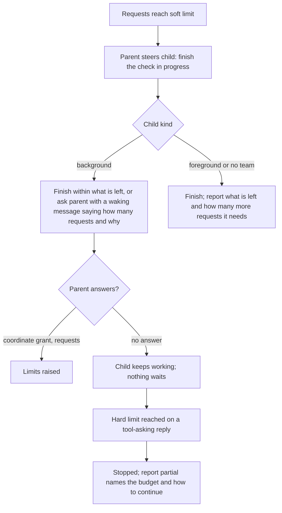

| Item                             | Value                                                                                                                                                                                                                                                                                                                           |
| -------------------------------- | ------------------------------------------------------------------------------------------------------------------------------------------------------------------------------------------------------------------------------------------------------------------------------------------------------------------------------- |
| Soft limit                       | the task's `maxRequests` (at most the profile's limit; a resume keeps it), else profile `maxRequests` (`0` off), else `limits.subagent.maxRequests` for the child's model ([limits](configuration.md#limits)), else `OCTOCODE_SUBAGENT_MAX_REQUESTS` (`0` off), else 160                                                        |
| Hard limit                       | 1.5 × soft, rounded up, plus grants (240 by default). The child gets one last request without tools and is told to write its report from what it has; then the run ends and the report is `partial`. A provider that cannot turn tools off keeps them for that request: a reply that still asks for tools stops the run at once |
| Bounds                           | Saved assistant replies, not provider attempts, tokens or cost                                                                                                                                                                                                                                                                  |
| Resume at or past the soft limit | A whole new allowance: soft = saved count + soft, stop = saved count + hard; the child is told its usage and where it stops. A peer's message relayed by the parent's process decided nothing, so it stays within the old limits and at the hard limit returns `partial` without launching                                      |
| Recorded                         | Each run records requests and cache reads/writes apart from summary and warming spend; `/agents stats` aggregates per profile. A `coordinate` `grant` result names the requests the child has used and their cost so far, and the line saying a finished run stays reachable names what that run used                           |

## Handing an item to a running child

Work that belongs with what a running child already holds can go to that child instead of a new one: `agent` type `message` with `to` (the child) and `item`.

| Topic        | Behavior                                                                                                                                                                                                                                                                       |
| ------------ | ------------------------------------------------------------------------------------------------------------------------------------------------------------------------------------------------------------------------------------------------------------------------------ |
| Who          | Only the session that started the child, and only while the child runs                                                                                                                                                                                                         |
| Checks       | The item must be one a delegation could take (not an epic, not done or closed, no open prerequisite, not held by another live session). An item another running or still-reachable child works on is refused, as is the child's own item                                       |
| Effect       | An unclaimed item is claimed for your session. The child reads the item's ref, title and goal before your message, and may update the item (notes, steps, completion) besides the one it was started for. The grant ends with the child's run; a send that fails takes it back |
| Reply        | Names the claim, the child's context fill and the paths the item shares with the child's own item. It warns when the child's context is at 70% or more of its model's window: a fresh child may do better                                                                      |
| Context fill | `coordinate list` shows each running child's context after its requests (`context 45% (90k of 200k)`), from its latest model reply                                                                                                                                             |

## Backlog items linked to children

Pass `item` on a task to tie the child to a [backlog](backlog-and-archive.md) item. The item is claimed for your session when unclaimed, its title can serve as the goal, and the child updates only that item (notes, steps, completion) unless you hand it another with a message. A child's `dependsOn` prerequisites become `after` entries. The team record keeps the item with the run, `coordinate list` shows it, and a worktree child's saved ref is linked on it. A stall (no note, step, claim, file change or job for 20 minutes) wakes the coordinator once per item.

## Notifications when children end

Nothing needs polling. A background child's report arrives as a message and wakes an idle coordinator; a failed or `blocked` one is told too. A coordinator that wants a trigger on something else uses `notify` (it is a companion tool whenever `agent` is active) or a message `callback` with `on: "agent.ended"` or `"done"`. When a queued child starts, or is held, the coordinator gets one notice. A peer that ends is reported to an agent that corresponded with it as `<agent> ended: <reason>`; a coordinator gets reports, not that line. When the coordinator closes, its children stop gracefully so they can report and save an isolated worktree. See [monitoring](monitoring.md) for check-ins, idle and stalled alerts.

## Lifecycle of a delegated task

```mermaid
sequenceDiagram
  participant U as User
  participant C as Coordinator
  participant G as Guards (slot, spawn permission, paths)
  participant S as Subagent process
  participant T as Team database
  U->>C: Ask for the work
  C->>G: agent task (profile, model, paths, item, background)
  alt refused or no slot
    G-->>C: Refusal naming the cause, or queued id
  else accepted
    G->>T: Reserve paths, register child and item
    G->>S: Start session with the brief
    C-->>U: Background: id returned, coordinator keeps working
    S->>T: Edits under reservations
    S-->>C: message to parent (question, replyRequired)
    C-->>S: reply, or coordinate grant for more requests
    S->>S: Soft request limit, wrap up
    S-->>C: Report: done, partial, blocked or failed
    S->>T: Release paths, leave team
    C-->>U: Summary; isolated work waits as refs/octocode/id
    opt isolate
      C->>C: coordinate merge or discard
    end
    opt lingering
      C-->>S: message or resume revives the saved conversation
    end
  end
```

## Shutdown, crashes and unattended runs

When the coordinator closes, its subagents close too.

| Exit                                                                         | What happens to children                                                                                                                                                                                                                        |
| ---------------------------------------------------------------------------- | ----------------------------------------------------------------------------------------------------------------------------------------------------------------------------------------------------------------------------------------------- |
| `/quit`, SIGTERM, SIGHUP, SIGINT, `/new`, `/resume`, fork                    | Each child stops gracefully: abort, close stdin, SIGTERM its process group, SIGKILL after the grace, so it can report and save an isolated worktree. Each child leads its own process group, so Ctrl+C and SIGHUP never reach it directly       |
| Crash, dead-terminal emergency exit, `process.exit` before the stop finished | Every registered group is SIGKILLed synchronously from the exit hook, taking bash jobs, MCP servers and browser too                                                                                                                             |
| `kill -9` of the coordinator                                                 | Each child notices within about a second (stdin EOF or parent check) and exits after at most 10 s even if shutdown hangs                                                                                                                        |
| A child crashes (`kill -9`, out of memory)                                   | Its bash commands, which each run in a process group of their own, are stopped by the coordinator once the child exits, before its run ends: the child lists each one as it starts it, and only a group still provably the child's is signalled |
| Restart                                                                      | The resumed session is told once, without a turn, which children it recorded as running ended with it without a report; `resume` continues one                                                                                                  |

Long and unattended runs keep going through what would otherwise end them:

| Situation                             | Behavior                                                                                                                                                                                                                                                          |
| ------------------------------------- | ----------------------------------------------------------------------------------------------------------------------------------------------------------------------------------------------------------------------------------------------------------------- |
| Provider failure in a headless parent | A print or JSON run whose turn ends in a retryable provider error while children run holds, says so on stderr and retries when the next report arrives; it ends when no child is left and that attempt failed, naming the session id and `octocode --resume <id>` |
| Provider failure on a wake            | In the terminal or RPC, a turn started by a report or message that ends in a retryable error retries after 1, 2, 5, 10 and 30 minutes with a status line; new input cancels the waits; a notice says when they run out                                            |
| Machine sleep                         | A gap between watchdog ticks moves the child's deadlines by the gap                                                                                                                                                                                               |

## External-agent lifecycle

At most eight external-agent connections can be open or starting at once. An ACP prompt timeout reports uncertain execution and retains the peer's active request; another prompt is refused until it settles; explicit cancellation closes the owned connection. The [ACP guide](acp.md#connect-from-octocode-to-another-agent) explains timeout recovery, retained evidence and process ownership.

## External runners

A subscription its vendor reserves for its own CLI (Claude Pro and Max) runs as an external runner: the vendor's CLI does the turns over ACP, signed in through its own login, while Octocode owns the task like any child. Example: "have Claude Code review the parser in its own worktree".

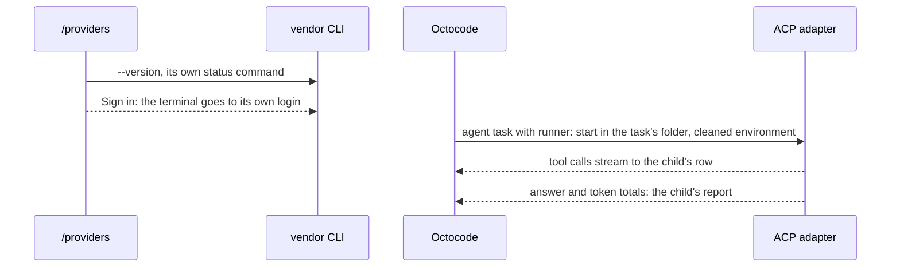

| Topic       | Behaviour                                                                                                                                                                                                                                                                                                                                                                                                                                                                                                                                                                                                                                                                                                                                                                                                                                                         |
| ----------- | ----------------------------------------------------------------------------------------------------------------------------------------------------------------------------------------------------------------------------------------------------------------------------------------------------------------------------------------------------------------------------------------------------------------------------------------------------------------------------------------------------------------------------------------------------------------------------------------------------------------------------------------------------------------------------------------------------------------------------------------------------------------------------------------------------------------------------------------------------------------- |
| Runners     | `claude-code` (`claude` and `claude-agent-acp`), `codex` (`codex` and `codex-acp`), `opencode` (`opencode acp`), `gemini` (`gemini --acp`), `agy` (`agy acp`), `cursor` (`cursor-agent`, headless only)                                                                                                                                                                                                                                                                                                                                                                                                                                                                                                                                                                                                                                                           |
| Connect     | `/providers` → External agents: one row per runner with the CLI and adapter found, the version against the one checked, and the sign-in from the CLI's own status command (`claude auth status`, `codex login status`, `opencode auth list`, `cursor-agent status`; Gemini by opening an ACP session). Only the method and the signed-in state are kept                                                                                                                                                                                                                                                                                                                                                                                                                                                                                                           |
| Cache       | Discovery starts nothing. Opening a runner’s page or starting its task checks that runner. Valid positive checks are reused until the CLI, adapter or sign-in files change; failed or unknown checks retry at use, and Check again forces a check                                                                                                                                                                                                                                                                                                                                                                                                                                                                                                                                                                                                                 |
| Sign in     | Hands the terminal to the vendor's own login (`claude auth login`, `codex login`, `opencode auth login`, `gemini`). Octocode reads nothing back and stores no credential                                                                                                                                                                                                                                                                                                                                                                                                                                                                                                                                                                                                                                                                                          |
| Enable      | Off until selected in `/providers` → External agents. **Enable this CLI for agent tasks** saves the global selection; `/reload` applies it. **Pause all external agent tasks** preserves that selection. An existing explicit `externalAgents: true` without a selection retains all installed runners. See [configuration](configuration.md#headless-and-external-agent-runs).                                                                                                                                                                                                                                                                                                                                                                                                                                                                                   |
| Task        | `runner` with `goal` and `task`, optionally `model` (the runner's own model option), `background`, `isolate`, `item`, `paths`, `resultSchema`. `skills`, `mcp`, `profile`, `headless` and `maxRequests` are refused. `resume` with a runner child's id continues that CLI's own session (see below). The child gets a name, a worktree when isolated, the report contract and a normal report                                                                                                                                                                                                                                                                                                                                                                                                                                                                     |
| Isolation   | The work runs in a child session, so window trees and screenshots stay out of the main context. The child has no shell and is `readOnly`, which limits its own file and command tools only: the apps it drives are not limited by that guard and can change files, so approve a start only for apps you would let it use. Every specialist still carries the shared tools (`file`, `agent`, `notify`, `archive`, `memory`, local research), so a child with only desktop tools is not possible Octocode refuses in every mode to launch or drive a terminal, code editor, password manager or Keychain app (by name, bundle id or the process a call targets), and the clipboard, `kill_app`, recording, replay and session-escalation tools ask you on every call even inside an approved child (they ask `desktop.sensitive`, which no start approval answers). |
| Environment | The adapter starts without provider API keys, any `ANTHROPIC_` variable, `CODEX_API_KEY` or Octocode's own variables, so a key cannot bill in place of the plan. `CLAUDE_CONFIG_DIR` and `CODEX_HOME` pass. Exported `CLAUDE_CODE_OAUTH_TOKEN` reaches only Claude; `GEMINI_CLI_CUSTOM_HEADERS` reaches only Gemini                                                                                                                                                                                                                                                                                                                                                                                                                                                                                                                                               |
| Billing     | A Claude Code signed in with an API key runs with `--hide-claude-auth`, so it never falls back to the subscription. Plan-billed runs record tokens and no cost (`billing: plan` on the report); a run billed per token records the cost the runner reports                                                                                                                                                                                                                                                                                                                                                                                                                                                                                                                                                                                                        |
| Stop        | A stop cancels the turn and ends the adapter's process tree; a runner silent for 15 minutes is stopped. One that answers `auth_required` is reported signed out, invalidates its cached check and is checked again on the next use or `/providers`                                                                                                                                                                                                                                                                                                                                                                                                                                                                                                                                                                                                                |
| Subagents   | A child's `task` type takes runner tasks only and waits for the report; the runner's process belongs to that child, and the spawn approval reaches you through the parent                                                                                                                                                                                                                                                                                                                                                                                                                                                                                                                                                                                                                                                                                         |
| Team mail | Runner children get a cooperative team inbox (`list`, `inbox`, `ack`, `send`) but no native wake, resume or interrupt: mail waits until the runner reads its inbox |
| `models`    | Lists selected installed runnable CLIs with their known sign-in and billing state; provider and query filters include matching external routes                                                                                                                                                                                                                                                                                                                                                                                                                                                                                                                                                                                                                                                                                                                    |

When a runner's ACP adapter is missing but its CLI is installed and signed in, a task runs through the CLI's own headless mode, using one route per runner. Cursor has no adapter route: it runs only this way.

| Runner        | Command                                       | Task input     | Edits allowed in an isolated worktree | In the session's folder                               |
| ------------- | --------------------------------------------- | -------------- | ------------------------------------- | ----------------------------------------------------- |
| `claude-code` | `claude -p --output-format stream-json`       | streaming JSON | `--permission-mode acceptEdits`       | `--permission-mode manual` (nothing accepted)         |
| `codex`       | `codex exec --json`                           | stdin          | `--sandbox workspace-write`           | `--sandbox read-only`                                 |
| `gemini`      | `gemini -p --output-format stream-json`       | stdin          | `--approval-mode auto_edit`           | `--approval-mode default` (edits and commands denied) |
| `cursor`      | `cursor-agent -p --output-format stream-json` | last argument  | agent mode, command sandbox on        | `--mode ask` (Cursor's read-only mode)                |
| `opencode`    | `opencode run --format json`                  | stdin          | not allowed                           | not allowed                                           |

Every route starts the CLI in the task's folder with the cleaned environment, never passes an unrestricted mode (no `--yolo`, `--force`, `bypassPermissions`, `danger-full-access` or `--dangerously-skip-permissions`), and is pinned to the CLI version its flags and output were checked against; an older CLI still runs and its row says so. Claude Code's headless runs state their mode: `--bare` (which never reads the subscription login and is documented to become the default for `-p`) is left off by `CLAUDE_CODE_SIMPLE=0`. Cursor's print mode writes files in its workspace even without `--force`, so Octocode's approval cannot gate it: a task that may write runs only in its own worktree, a write task in the session's folder is refused before the CLI starts (start it with `isolate`), and a read-only child's task runs in `--mode ask`. OpenCode has no way to restrict what it may do from the command line, so its route parses output but runs no task; use its ACP adapter.

A headless runner task resumes its own CLI session: `resume` with the child's id continues it in Claude Code (`--resume`), Codex (`exec resume`; its sessions are kept on disk for this) and Cursor (`--resume`), and the child must name no other runner. Gemini CLI resumes only by list position, not by id, so a Gemini task refuses resume, and so does a task whose CLI reported no session id, or one that ran through an ACP adapter; start a new task with the context instead.

Octocode keeps the input channel open until the result arrives where the CLI needs it. From spawn to close it reads the CLI's descendants about every 400 ms, keyed by process id and start time, and cleanup stops the process group and every descendant seen. ACP adapters are tracked the same way. On POSIX, a helper that detaches (`setsid`) and leaves the tree (its parent exits) before a reading sees it, or that the CLI forks only after the root has exited, is not owned: that needs ownership from the CLI or an OS container, because process-tree cleanup alone cannot guarantee its lifetime.

## Claude Code as the session's model

With Claude Code connected as a runner on its plan, `/model` also lists `claude-code/opus`, `claude-code/sonnet` and `claude-code/haiku`. Choosing one makes Claude Code the model behind your Octocode session: Claude Code runs each turn with its own harness and login, and every tool it calls is an Octocode tool. Example: pick `claude-code/sonnet`, then ask "find why the parser test fails"; Claude Code reads and runs commands through Octocode's `bash` and `file`, and the calls show in your transcript as usual.

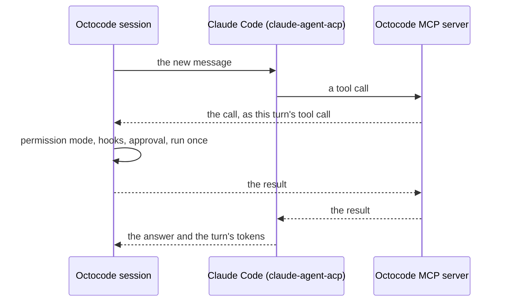

| Topic       | Behaviour                                                                                                                                                                                                                                                                   |
| ----------- | --------------------------------------------------------------------------------------------------------------------------------------------------------------------------------------------------------------------------------------------------------------------------- |
| Offered     | While `externalAgents` is on, Claude Code is selected, and it is installed with `claude-agent-acp` and signed in with its plan at its last check. A Claude Code on an API key offers none: use the `anthropic` provider                                                     |
| Session     | One Claude Code process and session per Octocode session, reused every turn and resumed after a restart, a stop or a model change. Claude Code keeps and compacts its own context; Octocode sends it only what it has not seen                                              |
| Tools       | Claude Code's own tools, settings, hooks and MCP servers are off. Octocode lists the session's tools over a loopback MCP server that admits only a token made for that session; the loop runs each call once, as for any other model                                        |
| Prompt      | Claude Code's own system prompt, plus one short Octocode instruction and the project's `AGENTS.md` files. Octocode's routing facts and its routing notice are not sent; a model you switch to next gets the notice                                                          |
| Environment | The same cleaned environment as a runner, plus your installed `claude` as the binary the adapter runs, the model alias and MCP tool search off                                                                                                                              |
| Billing     | Your plan: the footer shows the model's kind as `CLI` and its total as `Σ (sub)` while every reply was billed by a plan, else the plan's share as `~$X plan`. Claude Code makes every model call with its own login; Octocode never reads, stores or sends the Claude token |
| Stop        | Esc cancels Claude Code's turn and ends its process tree; the next message resumes the session                                                                                                                                                                              |
| Not covered | Images in your messages (a placeholder is sent), thinking levels (Claude Code chooses its own effort), usage per model call (a turn reports its totals). A summary or other side request runs once in a Claude Code session without tools                                   |

## Other CLIs and your own agents as the session's model

The other built-in runners, then the agents you declare in `externalModels` ([configuration](configuration.md#external-clis-as-models)), are offered in `/model` the same way. Each model's name carries its source: `default · Codex CLI (built-in CLI)`, `fast · My agent (settings.json)`, `fast · My agent (project settings.json)`.

| Topic         | Behaviour                                                                                                                                                                                                                  |
| ------------- | -------------------------------------------------------------------------------------------------------------------------------------------------------------------------------------------------------------------------- |
| Built-ins     | `codex-cli/default` (`codex-acp`), `gemini-cli/default` (`gemini --acp`), `opencode-cli/default` (`opencode acp`), `agy-cli/default` (`agy acp`), each while `externalAgents` is on and that CLI is selected and installed |
| Models        | `default` leaves the choice to the CLI's own configuration; an entry's other model ids are selected through ACP, or passed as `{model}` to a `cli` entry                                                                   |
| ACP agents    | One agent session per Octocode session, as for Claude Code: Octocode's tools over MCP, each call run once through the permission mode. Octocode's instruction leads the first prompt of a new session                      |
| Own tools     | An agent's permission request for anything but an Octocode tool is refused. What it runs without asking follows its own settings                                                                                           |
| `cli` entries | One process per request: Octocode's instruction and the conversation on stdin, its output as the reply. No Octocode tools                                                                                                  |
| Sign-in       | The CLI's own login; Octocode passes the cleaned runner environment plus the variables an entry names, never a provider key. A signed-out agent ends the turn with what to run                                             |
| Unavailable   | A missing executable, a signed-out built-in or a project entry not yet approved is listed in `/providers` with the reason, and none of its models is offered; nothing starts                                               |
| Stop          | Esc cancels the turn (ACP `session/cancel`) and ends the process tree                                                                                                                                                      |

## Worktrees

Each Git worktree has its own workspace ID, backlog and notes. Agents in the same repository share a team and can read notes saved with project scope. The default transcript directory belongs to the workspace; `/resume all` searches the others. If the original worktree is gone, `octocode --fork <full-session-id>` starts a new conversation from its database copy.

[Commands](commands.md#agents-and-work) lists `octocode --worktree <name>` and `/worktree` (`list`, `new`, `open`, `switch`, `merge`, `remove`). Behavior behind them:

| Topic               | Behavior                                                                                                                                                                                                                                                                                                                                                                                                                                                                                                                                                                                                                                                                                                                                       |
| ------------------- | ---------------------------------------------------------------------------------------------------------------------------------------------------------------------------------------------------------------------------------------------------------------------------------------------------------------------------------------------------------------------------------------------------------------------------------------------------------------------------------------------------------------------------------------------------------------------------------------------------------------------------------------------------------------------------------------------------------------------------------------------- |
| Create              | `--worktree <name>` and `/worktree new` make `<main checkout>/.octocode/agent/worktrees/<name>` on branch `worktree-<name>`; an existing subtree grant can cover the destination                                                                                                                                                                                                                                                                                                                                                                                                                                                                                                                                                               |
| Remove              | Only under `.octocode/agent/worktrees/`; refused while it has changed or untracked files, commits on no other branch, live agents, tmux panes or kept-reachable finished agents, or sessions run in it that still hold undelivered subagent reports or parked agent windows (a worktree keeps its own session data). `--force` overrides, first copying those reports to the same sessions in the main checkout (parked windows are discarded); never the session's own worktree; deletes the worktree's trust record; the branch only with `git branch -d` (an unmerged one is kept and the message says so)                                                                                                                                  |
| Switch              | Starts a fresh session whose folder is the target root (settings, trust, team and footer follow); refused while a turn runs; `main` always means the main checkout                                                                                                                                                                                                                                                                                                                                                                                                                                                                                                                                                                             |
| `.worktreeinclude`  | Gitignore-syntax file at the root of the checkout you start from; matching untracked files (typically `.env`) are copied on creation. Private files under `.octocode/agent/` are excluded; existing files are never overwritten; symlinks and paths leaving either checkout are skipped; files in `node_modules`, `vendor`, `dist`, `build`, `target`, `.next`, `.nuxt`, `.turbo`, `.cache`, `.venv`, `venv`, `__pycache__`, `.gradle` (any depth) are skipped unless a pattern names the folder; at most 2,000 files and 100 MB; `/worktree new` names what was skipped; a reused worktree copies nothing; an isolated subagent's worktree keeps only copies Git ignores (its result never commits them) and its start warning names the rest |
| Hooks, dependencies | Repository git hooks run as `git worktree add` would; dependencies are not installed. Child sessions have no `/worktree`                                                                                                                                                                                                                                                                                                                                                                                                                                                                                                                                                                                                                       |
| Footer              | `worktree <name>` in a linked worktree; `+N agents in M worktrees` when live members work outside this checkout; empty otherwise; follows the team's one-second refresh, not git                                                                                                                                                                                                                                                                                                                                                                                                                                                                                                                                                               |

Agents in any worktree of a repository are one team:

| Topic            | Behavior                                                                                                                                                                                                                                                                                                                                                                                                                                                                                                             |
| ---------------- | -------------------------------------------------------------------------------------------------------------------------------------------------------------------------------------------------------------------------------------------------------------------------------------------------------------------------------------------------------------------------------------------------------------------------------------------------------------------------------------------------------------------- |
| Roster           | They appear in each other's `coordinate list`. A main session messages any by ID; a subagent reaches only its own tree and its parent relays beyond. A member in another worktree shows `· worktree <folder>` (`(gone)` once removed) and its locks `holds <paths> (in worktree <folder>)`; each member's second line starts with its pid and, for a main session in tmux, its pane (`pid 4242 · tmux pane %12 · joined …`), so `tmux select-pane -t %12` reaches it. Stale members and ended processes are left out |
| Per worktree     | Reservations, the edit log (`changes`), lock advice and scratch folders, so the same relative path in two sibling worktrees never conflicts                                                                                                                                                                                                                                                                                                                                                                          |
| Nested worktrees | A worktree under `.octocode/agent/worktrees/` lies inside the main checkout, so reservations compare as the same files: main's `.octocode/agent/worktrees/x/src/a.ts` is x's `src/a.ts`, and a main reservation of `.octocode/agent/worktrees/x` (or above) covers all of x, and the reverse                                                                                                                                                                                                                         |
| Isolated child   | Events and messages go against its own workspace ID, but its checkout and reservations use the parent checkout so concurrent edits are checked against the files that will receive the merge; the web roster shows its worktree folder                                                                                                                                                                                                                                                                               |

### Roles and realms

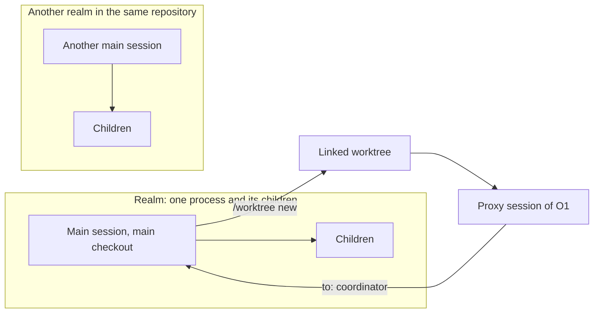

A realm is one Octocode process with its children. Each session in a repository's main checkout is the main orchestrator of its own realm; several can run in one repository. A session in a linked worktree is a proxy of the orchestrator that created its worktree (`/worktree new` records it; for any other worktree it is the oldest live main-checkout session). A proxy keeps its own backlog view and permissions and may start non-isolated subagents in its tree, but it may not create worktrees: `/worktree new`, `--worktree`, `isolate: true` and `git worktree add` are refused with a reason naming its orchestrator. `to: "coordinator"` reaches that orchestrator, and a backlog item finishing in a proxy sends the orchestrator a short notice. A subagent cannot start subagents or worktrees.

`/realm` shows this process's realm as text, in a terminal and without a UI alike. It only reads: nothing is stopped or moved.

| Line                        | Shows                                                                                                                                                                                                                            |
| --------------------------- | -------------------------------------------------------------------------------------------------------------------------------------------------------------------------------------------------------------------------------- |
| `Session`                   | This session's id, role, state, model and branch; before it joins the team, a note that it joins when it reserves files, messages or starts a subagent                                                                           |
| `Place`                     | The main checkout or the linked worktree the session works in                                                                                                                                                                    |
| `Orchestrator`              | In a linked worktree only: the session that created it (or the main-checkout session), which this session is a proxy of                                                                                                          |
| `Children`                  | Each live subagent under this session, nested ones too: id, profile, state, the backlog item it serves, its place (`in-tree`, `worktree <name>` or `isolated worktree <id>`), who it is under, time in the team, tokens and cost |
| `Isolated results to merge` | Saved refs of isolated children not merged yet; `/agents merge <id>` or `/agents discard <id>` act on them (a proxy leaves that to its orchestrator)                                                                             |

Sample:

```text
This Octocode process and its children:
Session: calm-prawn · main · idle · opus-5-5 · branch main
Place: main checkout /work/repo
Children (2):
  busy-eel · implementer · working · item B12 · in-tree · under calm-prawn · 12m · 34k tokens · ≈$0.40
  iso-owl · reviewer · working · isolated worktree iso-owl · under calm-prawn · 12m · 34k tokens · ≈$0.40
Isolated results to merge (1 ref): old-fox — /agents merge <id> or /agents discard <id>
```

### Places

`/realm places` shows every place work happens in the repository. It stays under `/realm` rather than `/worktree list` because it joins saved sessions and the session picker, which the worktree feature does not depend on. It only reads: running agents and sessions are never stopped or moved by it. In a terminal it opens a picker (Enter opens a place, Escape closes); without a UI (print mode, JSON mode, RPC) it prints the same list as text.

| Place                           | What it is                                                                     | Name in `/realm places <name>` |
| ------------------------------- | ------------------------------------------------------------------------------ | ------------------------------ |
| This repository's main checkout | The main worktree                                                              | `main`                         |
| Worktree                        | One made by `/worktree new` or `--worktree`                                    | the worktree name              |
| Isolated agent worktree         | The private worktree of a subagent started with `isolate: true`, while it runs | the agent's id                 |
| Linked worktree                 | Any other worktree of the repository, such as one made with `git worktree add` | its folder name                |

Each row starts with a status badge (`✓ ready`, `⚠ needs action` for a folder git cannot read, `✗ broken` for a folder that is gone), then the branch, the number of changed files, the agents working there, the live sessions started there and the last activity. A place whose folder was removed shows `(gone)` with `git worktree prune`; agents that still name it stay listed under it. Live agents and sessions in no place (older team rows that recorded no folder, a session started outside every listed worktree) appear under a last heading.

An agent belongs to the place that holds its working folder, the innermost one when worktrees nest. A place's page lists its agents (model, status, time in the team, tokens and cost), its saved sessions (live ones marked, with what another live session is doing: `live (needs you)`, `live (working)`, `live (failed)`, `live (idle)`), its branch and its last activity.

| Command                       | Does                                                                                                                                                                                                                      |
| ----------------------------- | ------------------------------------------------------------------------------------------------------------------------------------------------------------------------------------------------------------------------- |
| `/realm places`               | The list of places                                                                                                                                                                                                        |
| `/realm places <name>`        | One place's page; a unique name prefix is enough                                                                                                                                                                          |
| `/realm places <name> switch` | Same as `/worktree switch`: a fresh session in that folder, the old one stays saved; refused while a turn runs. Only `main` and worktrees made by `/worktree new` can be entered; the reply says why another place cannot |
| `/realm places <name> resume` | The session picker limited to sessions started in that place (without a UI, their ids to open with `/resume all <id>`). A session another process has open asks first                                                     |

## Communication and results

One verb reaches every agent: `agent` type `message`, `to` a name. Each message says who it is from, and an answer goes to that name; the caller does not choose the transport. A receipt for a message to another Octocode process names the receiver as `agent (process name)`. `message` and `coordinate` (`coordinate list` below) are the model's tool actions and have no shell command; you see the same roster with `/agents`, and from a shell with `octocode-api list`.

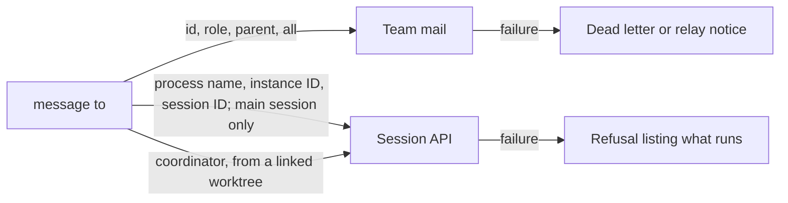

| To                                           | `to`                                                                           | Carried by                    | Failure the caller sees                                                                  |
| -------------------------------------------- | ------------------------------------------------------------------------------ | ----------------------------- | ---------------------------------------------------------------------------------------- |
| A subagent, its parent, a sibling            | id, role, `parent`, `all`                                                      | Team mail                     | Dead letter or relay notice                                                              |
| Another Octocode process (main session only) | exact process name (`octocode-agent-main-c0ea9f3e`), instance ID or session ID | [Session API](session-api.md) | A refusal listing what runs; [what the sender gets](session-api.md#what-the-sender-gets) |
| The main checkout, from a linked worktree    | `coordinator`                                                                  | Session API                   | [None or several](#finishing-a-worktree): told, nothing sent                             |

### Life of a message

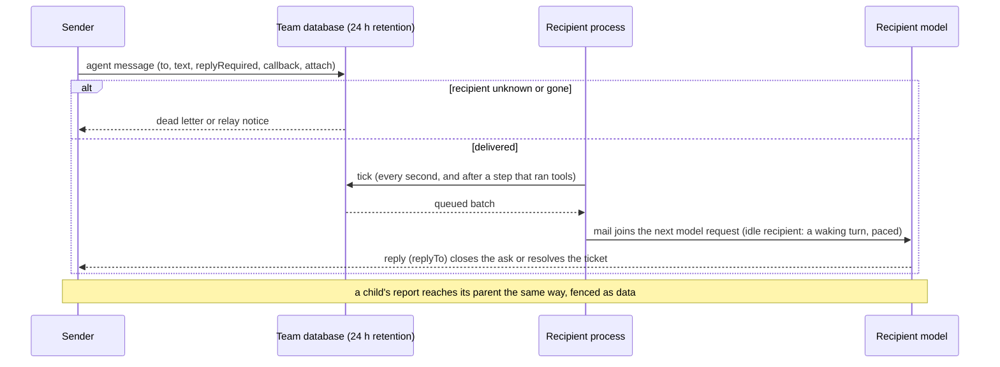

Who reads what: the model of the recipient reads the message text fenced as data (peer text steers nothing and grants no permission); you read agent mail and reports in full in the transcript, in `/messages` and in the web Messages tab. Replies, forwards, tickets and relays are below.

A session's own name is in the `environment` section of its prompt, after the cached prefix; `coordinate list` shows other sessions with name, busy state and folder and marks this repository's coordinator. Under each worktree it also names other vendors' agent CLIs working there (Claude Code, Codex, Cursor agent, Gemini CLI, opencode, Aider), found in the process table by their working folder, with their pid. These get no `message`, so agents keep off their files, read their work, or ask you to relay. `/new`, `/resume` and `/fork` start a new conversation with a new name and instance ID, so a message to the old name fails with what is running. A process message does not wait for the receiver's run; the answer arrives as a message from its name, so two sessions cannot wait on each other. Its text arrives [marked as external](session-api.md#what-the-session-sees), and whether it arrives is [the receiver's permission mode](permissions.md#external-messages). `forward`, `replyTo` and `interrupt` reach teammates only, and a subagent has no process route: a restricted child must not ask an unrestricted session to act. An outside agent stays `agent` type `external` ([lifecycle](#external-agent-lifecycle)).

### Handing a file to a teammate

An isolated worktree's files are not readable from a sibling's worktree, and a coordinator cannot write into one. `sendMessage` with `attach` (a path in the sender's own worktree) saves the file's bytes in the sender's session output folder under their SHA-256, and the message carries only a reference ahead of its text: `<attachment path=… bytes=… sha256=… saved=…/>`. The recipient writes the file with a `file` `write` query that gives `fromAttachment: "<sha256>"` instead of `content`, so no model copies the text.

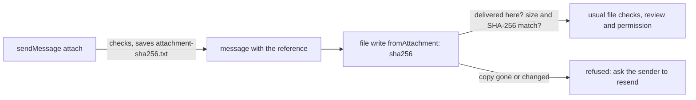

The file tool accepts only a hash that team mail delivered to that session. It reads the saved copy without following a link, checks its size, its SHA-256 and the same text rules the sender applied, then writes through the usual guard, review and permission asks. A copy that is gone (the sender's session output was cleaned up) or changed is refused with a request to ask the sender to resend it, and nothing is written.

| Refused, nothing sent                                                                              | Why                                  |
| -------------------------------------------------------------------------------------------------- | ------------------------------------ |
| Missing file, directory, binary or non-UTF-8 file                                                  | Only text travels                    |
| Over 64 KB                                                                                         | The most one reference writes        |
| Outside the sender's worktree (after `..` and symlinks), or inside `.git` or `.octocode`           | Only the sender's own files          |
| `.env*`, `.npmrc`, `.netrc`, SSH keys, `*.pem`, `*.key`, or text that looks like it holds a secret | Credentials never go in messages     |
| The copy could not be saved                                                                        | The recipient would have nothing     |
| `to` another Octocode process                                                                      | Only teammates' file tools read mail |

`attach` goes with a new message, not with `forward`. A recipient that has ended is refused as for any message. A `fromAttachment` query is a `write` without `content`.

### Finishing a worktree

Octocode merges into the same checkout one at a time, including requests from separate sessions. Waiting for a merge is cancellable and stops after 30 seconds if the checkout remains busy; an active merge finishes or rolls back before the next begins. Other checkouts can merge independently. This coordination covers Octocode merge commands; avoid running a manual Git merge in that checkout at the same time.

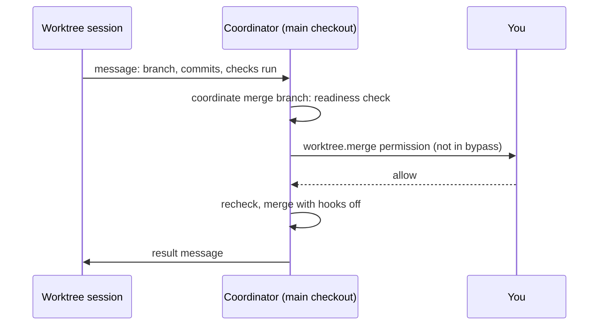

The coordinator is the one session whose working directory is in the repository's main checkout (`git worktree list`). If there is none or several, nothing is sent and the tool says so, naming them; the model tells you and leaves the worktree as is, and with several your choice goes in `to` by name. The worktree session never merges into the main checkout itself; `coordinate` `merge` refuses outside it. `coordinate` `merge` takes only a linked worktree's branch; you can also type `/worktree merge <branch>` in the main checkout (it shares its merge with `/agents merge`).

| Readiness check refuses with the reason and next step                  |                                                                                          |
| ---------------------------------------------------------------------- | ---------------------------------------------------------------------------------------- |
| Uncommitted work in that worktree                                      | an agent still working there                                                             |
| An ongoing backlog item a session there holds on that worktree's board | a merge in progress                                                                      |
| A path another agent holds                                             | a conflict (predicted with `git merge-tree`, then tried for real and aborted on failure) |

In every mode but `bypass` the merge asks you ([`worktree.merge`](permissions.md#worktree-merges)); in `bypass` a ready merge runs unasked and is announced. After the answer it rechecks uncommitted work and working agents, merges with hooks off, and leaves the worktree and branch for their owner (`/worktree remove`).

### Team mail

Live native agents in the same repository, in any of its [worktrees](#worktrees), can address another coordinator or its workers by exact ID; unique role names also resolve repository-wide (prefer exact IDs across trees). `to: "all"` broadcasts only within the sender's tree; interruption is limited to the sender's child or your session tree. Every subagent (isolated too) is on its coordinator's team, lists teammates with `coordinate list` and messages them and its coordinator; the team grants no authority. A finished worker's own coordinator owns its revival.

| Topic            | Behavior                                                                                                                                                                                                                                                                                                                                                                                                                                                                                                                                                                                                                                                                                                                                                                                                                                                                                                                                                                                                                                                                                                                                                                                                                                                                                                                                                                                                                                                                                             |
| ---------------- | ---------------------------------------------------------------------------------------------------------------------------------------------------------------------------------------------------------------------------------------------------------------------------------------------------------------------------------------------------------------------------------------------------------------------------------------------------------------------------------------------------------------------------------------------------------------------------------------------------------------------------------------------------------------------------------------------------------------------------------------------------------------------------------------------------------------------------------------------------------------------------------------------------------------------------------------------------------------------------------------------------------------------------------------------------------------------------------------------------------------------------------------------------------------------------------------------------------------------------------------------------------------------------------------------------------------------------------------------------------------------------------------------------------------------------------------------------------------------------------------------------- |
| Queueing         | Messages stay queued until they reach the recipient's model context. Delivery waits for acknowledgement of the previous batch and targets 32 KiB per batch; messages are never split (an oversized one travels alone), excess mail waits. Interrupts and requests that wake an idle recipient can pass the backlog. The team checks its database once a second and again when a step that ran tools ends                                                                                                                                                                                                                                                                                                                                                                                                                                                                                                                                                                                                                                                                                                                                                                                                                                                                                                                                                                                                                                                                                             |
| Questions        | A reply completes the original question only when sent to the asker. A stalled recipient (process runs but unseen for over a minute) is still reached by ID, as `parent` or by `all`, never by role. A question closes when its asker leaves, unless the asker is a subagent whose parent is present and may resume it with the answer. A subagent's report answers the questions its parent sent that it read: they close as answered, not as dead letters                                                                                                                                                                                                                                                                                                                                                                                                                                                                                                                                                                                                                                                                                                                                                                                                                                                                                                                                                                                                                                          |
| Dead letters     | The feed and profiler name only recipients that dropped a message and whether each read it; a failed relay request is the parent's errand and not listed. A subagent sending to `parent` after its coordinator left is told to finish with its report. A dead letter is kept until its sender has been told, or one day after the sender left                                                                                                                                                                                                                                                                                                                                                                                                                                                                                                                                                                                                                                                                                                                                                                                                                                                                                                                                                                                                                                                                                                                                                        |
| Forwarding       | `message` with `forward: <N>` delivers stored message N to more recipients without copying its body: they see the original sender, id and fence, the forwarder, and the forwarder's note (at most 1,000 characters) in a separate fence; a reply goes to the original sender. A parent message forwarded by a peer reads as that peer's untrusted data, not the parent's steering                                                                                                                                                                                                                                                                                                                                                                                                                                                                                                                                                                                                                                                                                                                                                                                                                                                                                                                                                                                                                                                                                                                    |
| References       | An `agent` task, and an external `prompt`'s `refs`, may cite `msg#<N>` (a stored team message) and `report:<agent-id>` (the latest report of a subagent this session started). The host expands each when it builds the task, inside the fence of the agent that produced it, with its producer, time and a short SHA-256, and refuses the call naming each unresolved reference. A message is readable by its sender, its recipients (forwarded too) and the session that started either; anyone else, or an id past the 24-hour retention, gets the same "no message" answer. `report:<id>` selects the latest result's hash-bound report snapshot, or its saved transcript preview for a short report; a newer run retires the earlier selection. Report artifacts must be regular single-link files directly in that child's scratch folder; symbolic or hard links, other locations and digest mismatches are refused                                                                                                                                                                                                                                                                                                                                                                                                                                                                                                                                                                           |
| Handoff limits   | At most 16 distinct references and 32,768 characters including provenance and fences; report excerpts hold at most 4,096 characters plus a pointer to the full evidence; referenced messages above 8,192 characters are rejected, not shortened; over-budget handoffs fail before dispatch. External peers and lean children get complete bounded report text (asked for a focused summary when an excerpt is needed) because local artifact access is not guaranteed                                                                                                                                                                                                                                                                                                                                                                                                                                                                                                                                                                                                                                                                                                                                                                                                                                                                                                                                                                                                                                |
| Relay            | A child's message to an agent it cannot reach becomes a relay request its parent's process settles without the parent's model: a live target in the session gets it in its inbox; a lingering finished target is resumed with it (after the usual spawn approval) only when the message asks a question (`replyRequired`) or answers one that target asked; anything else is a dead letter naming `report:<id>`. A target whose resume is pending waits for it to rejoin, and each target is resumed by relay at most three times in ten minutes, so finished agents cannot keep resuming each other                                                                                                                                                                                                                                                                                                                                                                                                                                                                                                                                                                                                                                                                                                                                                                                                                                                                                                 |
| Callback tickets | A layer beside messages, not a replacement: `message` (FYI, steer, interrupt) is unchanged. A ticket is a request one agent made of another that a reply or an event resolves at most once; it is stored in the agent database, so it survives a compaction or a resume, and its result is one `ticket.resolved` event (or `ticket.rejected` on timeout, loop or a leaving target) at the resolver's own source and trust: data, never an approval. A request nests at most 3 deep and may not revisit an agent already in its chain; an agent holds at most 8 pending tickets and a target at most 8; a repeat of an identical request within a minute returns the open ticket. `agent` `message` takes `callback` (`on`: `reply`, `done`, `job.exit`, `agent.ended`; `filter`, `note`, `timeoutMinutes`) beside `replyRequired`, which is sugar for `callback` `on: reply` and keeps the open-ask records. A fan-out beyond 4 recipients, a loop, a depth over 3 and a full pending limit refuse the send with the reason before anything is sent (the sugar never blocks a send). A reply (`replyTo`) resolves the asker's ticket once. A ticket outlives its asker's session, so a resume keeps it until its deadline; one asked of a leaving agent is rejected as `left`. Results are delivered to the asker's session as `ticket.resolved` or `ticket.rejected` events, through its session event loop; a reply result is quiet because the reply message already woke the asker |
| Trust            | Senders are identified by team id in the local agent database; a process with write access to that database can insert rows under any id, so references and relays trust it as much as the processes that share it                                                                                                                                                                                                                                                                                                                                                                                                                                                                                                                                                                                                                                                                                                                                                                                                                                                                                                                                                                                                                                                                                                                                                                                                                                                                                   |

### Sending, pacing and attachments

Send `replyRequired: true` for a question; a reply names `replyTo`. Mail to a busy teammate arrives with its next model request; `replyRequired` or an answer to an open question wakes an idle one, and agent-started turns are paced to one per 30 s and six per 10 minutes. `wake: false` leaves it for the recipient's next prompt. `interrupt: true` stops the recipient's current step and works only on your own child or your session tree. `attach` sends a text file (at most 64 KB) from your worktree by reference; the recipient writes it with `file` `write` and `fromAttachment`. `forward` re-sends stored message N. `callback` adds a ticket resolved by a reply or an event (`reply`, `done`, `job.exit`, `agent.ended`).

### What the user sees and what the model reads

A custom message carries `display`: `true` draws it in the transcript and sends it to the model, `false` sends it to the model only, and `"only"` draws it and never sends it (a notice for the user, such as a disabled provider or a merge-readiness hint). Older sessions hold booleans and load unchanged. The transcript shows agent mail and child reports in full: a message too long for the model's copy is drawn from its saved file, and a long child report from its saved `report.md` version, while the model's own copy stays bounded (a report's head, a message's spill pointer). An incoming message stays in the recipient's context so it can reply.

### Reading all team mail

`/messages` opens a full-screen page of every message in the repository's team, newest first, thirty at a time; the `older…` row loads thirty more. Each row reads `sender(role) [marks] → recipient(role) [marks]`, then the kind (`request` when the sender asked for an answer, `reply to #N`, `FYI`), the time and the delivery state at the edge. An agent that has left the team shows `left` after its role. The marks say where an agent works: `main` for your checkout or `worktree <name>` for a linked or isolated one, its branch, and its tmux pane. They are read when the page opens, from live agents first and then from the last row an agent left behind, so an old message still names a finished agent's worktree.

Internal notices (check-ins, lease and dead-letter notices, mail from a local API client) are hidden; the page's first note says which state it is in, and the toggle key shows or hides them. `/messages internal` opens with them shown. Without a UI the command prints the first page as plain lines.

| Key       | Does                                                                                                                               |
| --------- | ---------------------------------------------------------------------------------------------------------------------------------- |
| Enter     | Opens the message: both ends with marks, delivery state per recipient, the whole text, and the sender's thinking, output and tools |
| `i`       | Shows or hides internal notices                                                                                                    |
| PgUp/PgDn | Scrolls a long message                                                                                                             |
| Esc       | Goes back from a message to the list; on the list, closes the page                                                                 |

The sender's thinking and output are read from its saved transcript, so they appear only when that transcript is still on disk; the page says when it is not. Messages in the transcript use the same header, naming the real recipient in place of "you". The web workspace's Messages tab shows the same route marks, with a Messages / Internal / All switch, a **Show thinking** toggle that expands a message's text and the sender's thinking, and a load-older control.
