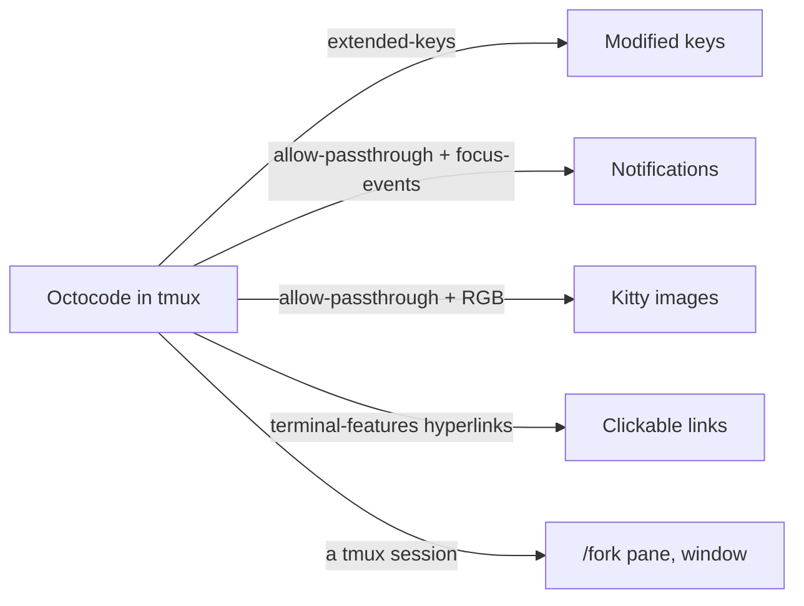

# Running Octocode inside tmux

Octocode detects tmux from the `TMUX` variable and adapts keys, mouse, links, notifications, images and redraws. It only reads tmux options (`extended-keys`, `allow-passthrough`, the client's terminal name and features, attached clients) and never changes them. Checks that ask tmux need the `tmux` command on `PATH`.

## Recommended tmux settings

Add to `~/.tmux.conf`, then `tmux source-file ~/.tmux.conf`:

```tmux
set -g extended-keys on                    # Shift+Enter and other modified keys reach Octocode
set -g allow-passthrough on                # notifications and Kitty images reach the outer terminal (`all`: also from hidden windows)
set -g focus-events on                     # notifications know when you are away; images return after attach
set -as terminal-features ',*:hyperlinks'  # clickable links (tmux 3.4+)
set -as terminal-features ',*:RGB'         # 24-bit colour, needed for images
```

Octocode warns at startup when `extended-keys` is off. tmux 3.3+ defaults `allow-passthrough` to `off`.

## What you get



| Feature          | Inside tmux                                                                                                                                                                                                                                                                             | Needs                            |
| ---------------- | --------------------------------------------------------------------------------------------------------------------------------------------------------------------------------------------------------------------------------------------------------------------------------------- | -------------------------------- |
| Modified keys    | Shift+Enter and others arrive. Startup warns when `tmux show -gv extended-keys` is neither `on` nor `always`.                                                                                                                                                                           | `extended-keys on`               |
| Multi-line paste | Lines are kept; control keys tmux re-encodes inside a paste become the control byte again.                                                                                                                                                                                              | nothing                          |
| Mouse            | In fullscreen mode clicks, wheel, selection and drags work; bare pointer movement is not tracked, so tmux is not flooded.                                                                                                                                                               | nothing                          |
| Copy             | A copy in a remote session (SSH, mosh) goes through `tmux load-buffer -w`, so it reaches your terminal's clipboard whatever `set-clipboard` is set to. With an older tmux, Octocode sends OSC 52 itself: through passthrough when the pane allows it, else it needs `set-clipboard on`. | tmux 3.2 or later                |
| Links            | Clickable when tmux lists `hyperlinks` in `#{client_termfeatures}`; otherwise printed as `text (url)`. `OCTOCODE_HYPERLINKS=1\|0` overrides.                                                                                                                                            | `hyperlinks` terminal feature    |
| Notifications    | See [Notifications](#notifications).                                                                                                                                                                                                                                                    | passthrough, focus events        |
| Images           | See [Images](#images).                                                                                                                                                                                                                                                                  | passthrough, `RGB`, focus events |
| Long redraws     | A resize or redraw of a long history no longer shows a half-drawn screen.                                                                                                                                                                                                               | nothing                          |
| Fork into a pane | See [Open a fork in a pane or window](#open-a-fork-in-a-pane-or-window).                                                                                                                                                                                                                | a tmux session                   |

## Notifications

Octocode notifies when an answer is ready, a run fails, or a question or permission dialog opens.

| Aspect      | Behaviour                                                                                                                                                                                                                 |
| ----------- | ------------------------------------------------------------------------------------------------------------------------------------------------------------------------------------------------------------------------- |
| When        | Only while you are away. With `focus-events on` that means the pane lost focus; without it, a run of 30 seconds or more with no keypress. `OCTOCODE_NOTIFY=always` always notifies, `off` never does.                     |
| Method      | From the terminal attached to tmux: Kitty OSC 99, iTerm2 OSC 9, Ghostty and WezTerm OSC 777; any other gets a bell. `OCTOCODE_NOTIFY_METHOD` (`osc9`, `osc777`, `osc99`, `bel`) overrides.                                |
| Passthrough | The notice travels in tmux passthrough, only when the pane allows it (`on` or `all`). With it off only the bell is sent. A bell also follows every notice, so a dropped notice still flags the pane.                      |
| Late attach | A session started detached looks the terminal up when a notice is due, so it finds the client that attaches later. It remembers the first answer; set `OCTOCODE_NOTIFY_METHOD` if you attach from another terminal later. |

Variables: [environment variables](environment-variables.md).

## Open a fork in a pane or window

After the conversation has at least one message:

| Command           | Effect                                     |
| ----------------- | ------------------------------------------ |
| `/fork pane`      | Split right and run a fork of this session |
| `/fork pane down` | Split downward                             |
| `/fork window`    | Open a new tmux window                     |

The current session keeps running. Outside tmux the command reports an error and starts nothing. When typing, the first Enter may only accept the autocomplete suggestion; press Enter again. Launch details: [native features](tmux.md#open-a-fork-in-a-pane-or-window).

## Images

Octocode draws Kitty images inside tmux as Unicode placeholder cells, which tmux redraws like text; the data goes through passthrough. Automatic detection turns this on only when all hold:

1. the attached terminal is Kitty or Ghostty;
2. the pane allows passthrough (`on` or `all`, or tmux older than 3.3);
3. 24-bit colour reaches the terminal (`RGB` in `#{client_termfeatures}`, or `COLORTERM=truecolor`).

Otherwise images show a text fallback. Force with `OCTOCODE_IMAGE_PROTOCOL=kitty` (or `"terminal.images": "kitty"`); turn off with `none` (or `false`). See [terminal images](configuration.md#terminal-images).

Limits:

- A terminal that attaches later has not received earlier images. With `focus-events on`, Octocode resends them (and redraws on a size change). Without focus events, a same-size attach shows blank cells until you resize.
- An image over about 1 MB needs several passthrough envelopes and can go blank if another pane uploads at the same moment; it returns on the next redraw.
- Not supported in tmux: iTerm2 inline images, SIXEL, images in WezTerm and Warp (text fallback instead).
- Bracketed paste is enabled once at startup; tmux clearing it later is not undone.

## Troubleshooting

| Symptom                             | Check                                                                                                                                                                                      |
| ----------------------------------- | ------------------------------------------------------------------------------------------------------------------------------------------------------------------------------------------ |
| Startup warns about `extended-keys` | `tmux show -gv extended-keys` prints `on` or `always`.                                                                                                                                     |
| No notification, only a bell        | `tmux show -Apv allow-passthrough` in the pane prints `on` or `all` (`-A` includes the global value). With `on`, only the visible window forwards notices; `all` notifies from any window. |
| Links print as `text (url)`         | `tmux display -p '#{client_termfeatures}'` lists `hyperlinks`.                                                                                                                             |
| Images show as text                 | `tmux display -p '#{client_termtype}'` names Kitty or Ghostty and the features list `RGB`.                                                                                                 |
| `/fork pane` says it needs tmux     | Octocode did not start inside tmux, or `TMUX` was removed from its environment.                                                                                                            |

## Interactive programs and the agent

The agent's `bash` tool has no terminal: stdin is closed and the process is detached. Commands that wait for input (`sudo` or `ssh` passwords, `git rebase -i`, REPLs, installers that ask) get end-of-file or hang until timeout, so the agent uses non-interactive forms (`--yes`, `GIT_EDITOR=true`, key-based `ssh`) or asks you to run the step. `/fork pane` starts a new Octocode session; it does not send keys to other programs. An agent can still drive a program in a private tmux server through `bash` (`tmux -L <name> send-keys`, `capture-pane`): wait for expected text rather than sleeping, and kill the server afterwards.
