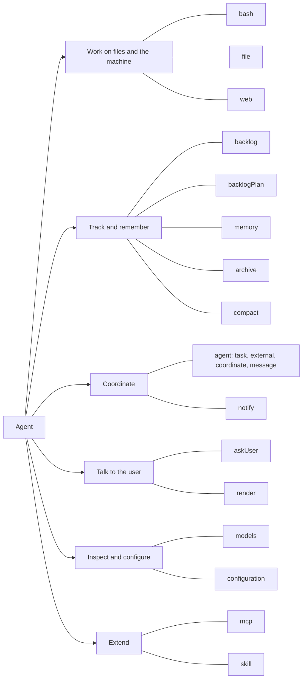
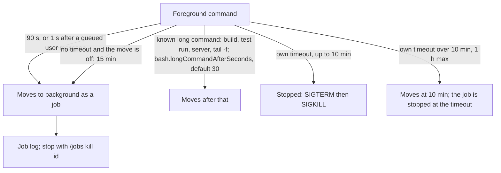
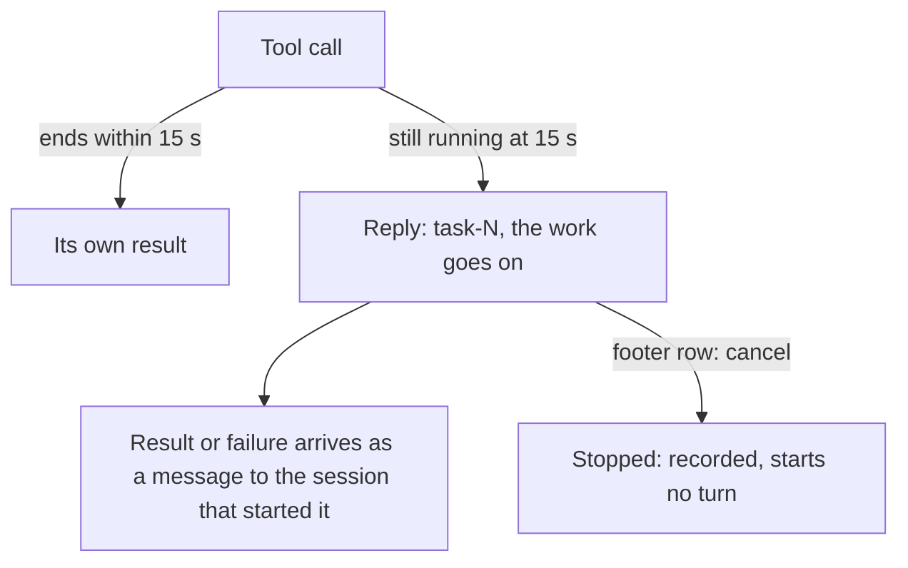

# Native tools

The agent's own tools: what each does, its key fields, when the model reaches for it and what gates it. Field names come from each tool's schema in `src/octocode/native/tools/` (and the modules those files import). MCP server tools (`mcp__<server>__<tool>`) are not native; see [MCP](mcp.md).

Every native tool also takes a `reason`: one sentence on why the call is made. Calls never fail for a missing one. It is shown in permission dialogs and kept as a job's or child's purpose. For `archive` it states why history is needed, not the code.



## Overview

| Tool            | Category        | Does                                                                      | Exposure                          |
| --------------- | --------------- | ------------------------------------------------------------------------- | --------------------------------- |
| `bash`          | Work            | Runs shell commands; long ones become background jobs                     | always declared                   |
| `file`          | Work            | Edits, writes and deletes files; applies Codex patches                    | always declared                   |
| `web`           | Work            | Searches the web or fetches one public URL                                | always declared                   |
| `backlog`       | Track           | Reads, claims, notes and finishes the item being worked                   | always declared (child: when handed an item) |
| `backlogPlan`   | Track           | Adds, edits, lists and counts items                                       | deferred; not declared in a child |
| `memory`        | Remember        | Saves and recalls short notes                                             | deferred; on demand in a child    |
| `archive`       | Remember        | Reads earlier sessions, compaction summaries and diagnostics              | deferred, on demand               |
| `compact`       | Remember        | Queues a context summary                                                  | main session only                 |
| `agent`         | Coordinate      | Starts children, reaches outside agents, messages and reserves files      | always declared                   |
| `notify`        | Coordinate      | Wakes the session at a time or when an event holds                        | deferred                          |
| `askUser`       | User            | Asks the user questions                                                   | always declared                   |
| `render`        | User            | Shows a status or table; asks a confirm or form                           | main session only                 |
| `models`        | Inspect         | Lists enabled models, quota, health, spend and routes                     | deferred, on demand               |
| `configuration` | Inspect         | Reads or changes settings, tools, MCP servers and skills                  | deferred, on demand; no child     |
| `mcp`           | Extend          | Inspects MCP and deferred native tools; manages servers                   | built in                          |
| `skill`         | Extend          | Loads skills                                                              | declared when skills are enabled  |

"Exposure" is how the tool reaches the model. With the default `mcpExposure: "usage"`, `web` and the work tools are always declared in full. The deferred tools (`archive`, `models`, `backlogPlan`, `configuration`, `memory`, `notify`) show a thin declaration first; the full schema arrives when the tool is used. On a transport that can add tools after the cached prompt, `archive`, `models` and `configuration` are on demand instead: the prompt names them and the first call declares them. See [deferred and on-demand tools](#deferred-and-on-demand-tools).

Names that are no longer tools (`read`, `edit`, `write` and others) are listed under [removed tools](#removed-tools).

## Tool selection and exposure

Each tool in the [overview](#overview) is active unless it says otherwise. `defaultTools` and `--tools` replace or modify the selection; `/settings enable|disable tool:<name>` or per-run `--enable`/`--disable` switch one ([configuration](configuration.md#changing-configuration)). Role profiles, plan mode and permissions can narrow it further. There is no `/tools` command.

### Rules that span tools

Tool descriptions own each tool's arguments. Rules that span tools:

| Rule                | Behavior                                                                                                                                                                                                                                                                                                                                                                                                                                                                                                                                                                                                                                                                                                                                                                                   |
| ------------------- | ------------------------------------------------------------------------------------------------------------------------------------------------------------------------------------------------------------------------------------------------------------------------------------------------------------------------------------------------------------------------------------------------------------------------------------------------------------------------------------------------------------------------------------------------------------------------------------------------------------------------------------------------------------------------------------------------------------------------------------------------------------------------------------------ |
| Companion           | While `agent` is active, `notify` is registered and active whatever `--tools`, `--disable tool:notify` or `defaultTools` say, because delegation asks it for notices instead of polling. Only `--exclude-tools notify` or a tool policy removes it; to run without `notify`, leave out `agent` too. A lean child has no `notify`. Only native and base tools get companions                                                                                                                                                                                                                                                                                                                                                                                                                |
| Operator exclusions | `--exclude-tools` and `--no-mcp` also bind every subagent of the run, over what a profile may not remove: a child of `--exclude-tools file` has no `file`. `--tools` stays the session's own allowlist; a child's selection comes from its profile                                                                                                                                                                                                                                                                                                                                                                                                                                                                                                                                         |
| `reason`            | Every native tool and the built-in `mcp` tool declares a required `reason` first, but a call never fails for a missing one: it is filled from a nested `reason`, else from the call's arguments (`file src/a.ts`), else the tool name, and marked derived so permission cards never show it empty. Octocode never adds or removes `reason` on an MCP tool's input                                                                                                                                                                                                                                                                                                                                                                                                                          |
| Repeated text       | A reply that streams the same short sentence at least 16 times consecutively across at least 512 characters ends the run. A new prompt starts a fresh comparison.                                                                                                                                                                                                                                                                                                                                                                                                                                                                                                                                                                                                                          |
| Repeated calls      | The same tool, arguments and result (an error counts by call alone) in a row: a note on the 3rd, a stronger note asking the model to report it is blocked on the 5th and every 3rd after, and on the 8th the next identical call is refused and the run ends (a notice, a subagent's last error, or stderr and exit 1 when headless; `/permissions log` records the refusal). Changes to spend alone in a `models` listing do not reset the count. `reason` text is ignored; blocked, invalid and unknown calls count; a different counted call or new prompt resets. An exempt call resets a successful streak but does not erase a failing one. Exempt: `agent`, `askUser`, `backlog`, `backlogPlan`, `coordinate`, nested calls, waiting commands (`sleep`, `wait`, `watch`, `tail -f`) |
| Result budget       | One assistant message's tool results share a text budget; see [compaction](how-it-works.md#context-window-and-compaction)                                                                                                                                                                                                                                                                                                                                                                                                                                                                                                                                                                                                                                                                                       |

### Deferred and on-demand tools

Native tools are not MCP servers: ACP client MCP configuration exposes server tools to the session, not native tools to remote callers. Octocode MCP is the default server; [MCP](mcp.md) shows how to enable or disable it and the other servers, [MCP reference](mcp-reference.md) covers exposure, presentation (`mcpPresentation`) and assignment. By default (`mcpExposure: "usage"`) an MCP tool, `web`, `archive`, `models`, `backlogPlan`, `memory` and `notify` are deferred, however often sessions use them: the model gets the tool's whole description, its field names and types (an MCP tool also those of its objects and lists), the few values a field allows, list bounds and required fields; the full schema arrives when the tool is used (a rejected call returns it, the `mcp` tool reads a deferred tool's text, with `server: "native"` for a native tool, and supporting models get the full declaration added after the first call or read).

Where the model can add a tool after the cached prompt (Anthropic and OpenAI models that support it), some tools are on demand instead: every FreeLlama tool, the native `archive`, `models` and `configuration` (and `memory` in a subagent). The prompt lists each by name and a one-sentence trigger, and its first call or a read with the `mcp` tool declares it from the next request on, without touching the cached prompt; elsewhere they stay deferred.

Use across sessions (the promotion snapshot, computed once a day) only declares an on-demand tool deferred from the start, within `mcpPromotedBytes` per role (default 8192 bytes); it never declares a full schema, so a new install gets the same tool list as a warm one.

Where the model cannot change tools mid-conversation, a server that connects after the first request, or a tool the model turns on then, is callable at once and declared at the next compaction, so its arrival does not rewrite the cached prompt. Every other native tool is always declared in full. Server descriptions, schemas and instructions are never rewritten.

See and pin each tool's state on the Tools panel of the web Settings page (a session's page shows what that session declared), on the terminal's `/mcp` → server → **Tools** page, or in configuration ([tool exposure](configuration.md#tool-exposure), [exposure](mcp-reference.md#exposure-and-results)).

### Removed tools

These names are not registered; drop them from `--tools`, `defaultTools` and hook matchers:

| Removed                                      | Use instead                                                                               |
| -------------------------------------------- | ----------------------------------------------------------------------------------------- |
| `read`, `ls`, `find`, `grep`                 | Octocode MCP local tools, or `bash` when the server is off                                |
| `edit`, `write`                              | `file`                                                                                    |
| `powershell`                                 | `bash` with `type: "powershell"`                                                          |
| `externalAgent`, `coordinate`, `sendMessage` | `agent` types `external`, `coordinate`, `message`                                         |
| `agentModels`                                | `models`                                                                                  |
| `debug`                                      | the `octocode-debugging` skill                                                            |
| `browser`                                    | the browser MCP server ([below](browser-and-desktop.md#browser))                                 |
| `ollama`                                     | an Ollama endpoint in `models.json` ([models](models.md#configure-a-compatible-endpoint)) |

Old sessions and exports still show calls of removed names. Sessions started without native features have `bash` as their only built-in tool.

## How calls are gated

Every call passes [permissions](permissions.md) first. The class a tool falls in decides what each mode does.

| Class                | Tools                                                 | Asks in `manual` / `workspace` / `full`                    |
| -------------------- | ----------------------------------------------------- | ---------------------------------------------------------- |
| `shell`              | `bash`                                                | asks / allows / allows (destructive commands ask outside `full`) |
| `file.workspace`     | `file` inside the repository                          | asks / allows / allows                                     |
| `file.outside`       | `file` outside the workspace                          | asks / asks / allows                                       |
| `web`, `net.private` | `web` fetch (search is not gated)                     | `web`: asks / allows / allows; `net.private`: asks / asks / allows |
| `mcp.*`              | MCP tools                                             | see [MCP tools](permissions.md#mcp-tools)                  |
| `agent.spawn`        | `agent` type `task`                                   | asks / allows / allows                                     |

The table is the mode table in [permissions](permissions.md#modes). Invariants refuse in every mode: cloud metadata addresses, Octocode's state folder, another agent's reserved paths, read-only roles. `backlog`, `compact`, `render`, `askUser`, `skill`, `models` and `archive` change nothing outside Octocode's own state and have no class of their own.

## Planning mode

Planning is a constraint over `manual`, `workspace` and `full` alike ([permissions](permissions.md#plan-mode)). `/permissions plan [off]`, `/plan` and `octocode --plan` control one state; the RPC `plan` operation exposes the same controls. Model text cannot leave planning.

```mermaid
stateDiagram-v2
  [*] --> Normal
  Normal --> Planning: /plan, /permissions plan, --plan
  Planning --> Normal: /plan --off, /plan --approve rev
  note right of Planning: host stops turn, shell, jobs, children, external prompts and hooks first; a failed stop keeps the old state
```



| Planning        | Behavior                                                                                                                                                                                                                                                                                                                                |
| --------------- | --------------------------------------------------------------------------------------------------------------------------------------------------------------------------------------------------------------------------------------------------------------------------------------------------------------------------------------- |
| Allowed         | Octocode local research, `web`, `archive`, `memory` reads (`search`, `get`, `list`), `askUser`, `skill`, `mcp` `list`/`tools`/`restart` (not `stop`), foreground shell commands made only of read-only programs (`ls`, `cat`, `rg`, `git log`, `git diff`, `git status`...) that the quick scan and the bash parse both judge read-only |
| Blocked         | A heredoc, `$((…))`, `[[ ]]`, a reader given `$X` or a glob before `--`; redirects, `git branch -D`, installs, builds, test runners, interpreters, background jobs; file changes; debugger and browser operations; delegation and messages; unknown or external MCP tools even when annotated read-only                                 |
| Hooks, children | Executable compatibility hooks pause; children and external agents are stopped on entry and cannot be launched                                                                                                                                                                                                                          |
| Revisions       | Stored on the session branch; resume and tree navigation restore them; after compaction the current revision (clipped to 8,000 characters) returns as a hidden follow-up; approval checks the current revision                                                                                                                          |

This is a host execution policy, not an OS sandbox.

## bash

Runs a command in the configured shell. Builds, tests, git and platform CLIs go here.

| Field             | Meaning                                                                                           |
| ----------------- | ------------------------------------------------------------------------------------------------- |
| `command`         | The command (required), in the selected syntax                                                    |
| `type`            | `bash` or `powershell`; default the configured shell. Only selects the shell                      |
| `timeout`         | Seconds before the command stops (max 3600). A foreground call with it waits at most 600 s, then backgrounds. Unset: never stopped |
| `maxOutputTokens` | Result budget; the full output is saved to a file                                                 |
| `background`      | `true`: return at once with a job id, `pid` and log path                                          |
| `fresh`           | Background: start anew although an identical job runs (otherwise the call joins it)               |
| `wake`            | Background: `false` notes a success quietly; a failure still wakes the model                      |
| `item`            | Background: the ongoing backlog item (`B<n>`) the job serves; defaults to the session's only ongoing item |
| `verify`          | Records a verification receipt for the current edits; later edits make it stale                   |
| `sandbox`         | `false`: run outside the [shell sandbox](sandbox.md) after it refused; asks the user              |

**When the agent uses it:** to build, test, run git, inspect the machine, or start a server. It reads saved output by line ranges instead of rerunning a command. It edits source with `file`, not `sed -i`.

**Gates:** the `shell` class. The shell sandbox, when on, wraps commands; `sandbox: false` is refused when `sandbox.allowUnsandboxed` is false. Writes into reserved paths, Octocode's state folder and `MEMORY.md` files are refused. Provider keys are not passed to the shell unless `bash.inheritProviderKeys` is set. Writing a file by shell makes older `verify` receipts stale.

```json
{ "command": "yarn run check", "background": true, "item": "B12", "reason": "Run the full check" }
```

### Foreground, background and jobs

A foreground command moves to the background as a job after `bashBackgroundAfterSeconds` (default 90), or after `bash.longCommandAfterSeconds` (default 30) for builds, tests and servers. A message waiting for the model can also end a wait; the result then arrives later as a message. `/jobs` lists jobs and `/jobs kill <id>` stops one.

Recognised out of the box: test runners (`vitest`, `jest`, `pytest`, `cargo test`, `go test`), `yarn`/`npm`/`pnpm` `test`, `check`, `build`, `dev`, `serve` and `start`, `tsc -b`, and commands that follow a stream (`tail -f`).

| Setting                        | Default | Effect                                                                                                                                                   |
| ------------------------------ | ------- | -------------------------------------------------------------------------------------------------------------------------------------------------------- |
| `bash.longCommandAfterSeconds` | `30`    | Seconds a recognised long command runs in the foreground before it moves; used only when shorter than `bashBackgroundAfterSeconds`                       |
| `bash.longCommandPatterns`     | `[]`    | Regular expressions for more long commands, added to the built-in ones. A pattern matches where a command starts (the line, or after `;`, `&`, `         | `, `(`, `VAR=value`) and must end at a space or the end of a part; an invalid pattern is ignored |
| `bash.deliberateMaxSeconds`    | `600`   | The longest a call that names its own `timeout` holds the turn before its command moves to the background; the command is still stopped at its `timeout` |

```json
{ "bash": { "longCommandPatterns": ["bazel\\s+(?:test|build)", "make\\s+(?:test|check)"] } }
```

A command the shell runs under another name (a wrapper script) is not recognised and keeps the `bashBackgroundAfterSeconds` threshold. Hints for GNU tools missing on macOS (`timeout`, `sed -i`) are shown only on macOS.



| Setting                                                                 | Detail                                                                                                                                                                                                                      |
| ----------------------------------------------------------------------- | --------------------------------------------------------------------------------------------------------------------------------------------------------------------------------------------------------------------------- |
| `bashBackgroundAfterSeconds` / `OCTOCODE_BASH_BACKGROUND_AFTER_SECONDS` | The 90-second move; `0` turns it off                                                                                                                                                                                        |
| Queued user message                                                     | Moves a running foreground command after its first second so the agent can answer; hidden notices and quiet team mail (`wake: false`, broadcasts, replies) wait for the next step                                           |
| `sleep` start, user abort                                               | Stopped, not moved                                                                                                                                                                                                          |
| Headless run                                                            | Stops its jobs when the run ends                                                                                                                                                                                            |
| Bash command prefix setting                                             | Applies only to Bash                                                                                                                                                                                                        |
| Result                                                                  | Starts with a header `[exit 0 · 4.2s]` (`312 lines · 18 KB` follow only when the output was cut or saved to a file); a non-zero exit is still an error result; `!<command>` (or RPC `bash`) gives the model the same result |
| `wake: false` (background)                                              | A success is recorded as a header-only note (exit, time, log path) and starts no turn; a failure or a stop wakes as usual. Default: every exit sends its output tail and wakes                                              |
| `verify: true`                                                          | Records a verification receipt tied to the current edits; a later edit makes it stale; a zero exit proves only that the command succeeded                                                                                   |

A background `bash` job started without `item` links to this session's only ongoing item; with none or several it stays unlinked. A background start whose workspace, folder and command (spaces outside quotes aside) match a job that is still running, in this session or another on the host, starts nothing: it replies `joined bash-N (running 3m, log …)` and the session hears of the job's end like a job of its own. A finished job is never joined, nor is a foreground call or a start with `verify`; `fresh: true` always starts a new run. Jobs are recorded as rows of the database (`jobs`) that `/jobs` and the work graph read; only the private owner record of a job ever signals its process, so a row never lets another session stop it. The commands a call runs carry `OCTOCODE_AGENT_NAME` (also the session's lease id in the team's path-lease table), `OCTOCODE_ITEM` and, in the background, `OCTOCODE_JOB_ID`: the full-run lock records them, and a run that waits for it is told who holds it. `/jobs` names the item each job serves and the lock it holds.

The tool description ends with a ten-line CLI guide. Its first line names the host: OS and architecture, which of `git`, `rg`, `fd`, `jq`, `ast-grep`, `yq`, `gh`, `python3`, `lsof` are on the shell's PATH (Octocode's own `bin` included) and whether `gh` is logged in (read from `GH_TOKEN`, `GITHUB_TOKEN` or gh's `hosts.yml`, never over the network); the second gives platform flag notes. The probe only stats files and runs when the tool registers, so the description stays stable for the session and its prompt cache.

### Long calls become jobs

No tool call holds the turn for long. A call gets 15 seconds (`bash` has its own thresholds: `bashBackgroundAfterSeconds`, default 90, or `bash.longCommandAfterSeconds`, default 30, for builds, tests and servers). When it ends within that time it returns its normal result; when it does not, it returns at once with a job id (`task-1`, `task-2`, …) while the work keeps running, and the result arrives later as a message.



| Call                                                                  | Past 15 s                                                                                                                       |
| --------------------------------------------------------------------- | ------------------------------------------------------------------------------------------------------------------------------- |
| MCP tools (`mcp__<server>__<tool>`), `web`, `models`, `externalAgent` | `task-N`; the message carries the tool's answer or its error                                                                    |
| `agent` task in the foreground (a vendor runner's too)                | The child's id; it is now a background child, so its report arrives as for `background: true`, and `/agents kill <id>` stops it |
| `bash`                                                                | Its own move to a [background job](#foreground-background-and-jobs) (`bash-N`)                                                                           |

- The result goes only to the session that started the call. A subagent's own calls always wait, since nothing would read a report after its answer.
- Esc ends a call that still waits. After the hand-over the job is stopped from its footer row (the cancel button) or `/agents kill`; a stop is recorded without starting a turn, and so is the end of the session.
- A call without a session to report to (a command run outside one) waits for its work.
- The 15 seconds are fixed; no setting changes them. Do not poll a `task-N`: its end is the notice.

A few tools stay exclusive on purpose: `file` (a read after an edit in the same message must see the edit), `bash` commands that change files, and `backlog` writes (two writes would race on one store).

## file

Creates, edits and deletes files. There is no read operation: reads go through `bash` or the Octocode MCP read tools.

| Field     | Meaning                                                                                  |
| --------- | ---------------------------------------------------------------------------------------- |
| `queries` | List of changes. Each has `type`, `path`, optional `reason`, and the operands for its type |
| `patch`   | One Codex `apply_patch` text, instead of `queries`                                       |

A change has `type` `edit`, `write` or `delete`:

| Type     | Operands                                                                                                                 |
| -------- | ------------------------------------------------------------------------------------------------------------------------ |
| `edit`   | `edits`: list of `{ oldText, newText }`, matched against the original; optional `replaceAll`, `line` and `sourceSha256` |
| `write`  | `content` (the whole file), or `fromAttachment` (a SHA-256 from received team mail)                                      |
| `delete` | none; `/rewind` restores it                                                                                              |

A call may also be one change itself (`{ type, path, edits }`); it is wrapped into `queries`. `oldText` must be unique unless `replaceAll` is set. `line` plus `sourceSha256` anchors an edit to a line of a file the agent read completely; stale or partial identity is refused. The result ends with the new `sourceSha256`.

**When the agent uses it:** every source edit. A batch of changes is one call.

**Gates:** `file.workspace` and `file.outside`. In `manual` the review dialog is the ask: each change can be accepted, rejected with a note, or accepted for the session. A file that changed on disk after it was read is refused. Reserved paths, protected files and Octocode's state folder are refused. Output-cut placeholders (such as `... N lines elided`) are refused in new text. `file` runs alone in its message so a later read sees the edit. Checkpoints back `/rewind`. See [mutation guarantees](#file-mutation-guarantees).

```json
{
  "queries": [
    { "type": "edit", "path": "src/a.ts", "edits": [{ "oldText": "let x = 1", "newText": "let x = 2" }] }
  ],
  "reason": "Change the default"
}
```

### Reading before editing

`file` refuses to overwrite an existing file the model has not read completely, and a file changed since its read must be read again.

Follow a reader's returned continuation to collect the remaining pages. Pages count toward the same complete read while the file stays unchanged. A changed file or expired continuation needs a fresh read.

A second whole read of a file that has not changed since the model's last whole read of it, while that result is still in the context, gets a one-line note instead of the text: it points at the earlier result and asks for the lines or the symbol needed. Repeating the read prints the file. A changed file (another SHA-256 for a reader, another size or modification time for `bash`), an earlier result cleared or compacted away, a range, a cut result or a command that prints anything besides the one file always gets the text. A reader call with the same arguments and the same text gets the read dedupe's note instead.

| Read                                               | Counts as a complete read                                                                                                                                                                                                                                                                                              |
| -------------------------------------------------- | ---------------------------------------------------------------------------------------------------------------------------------------------------------------------------------------------------------------------------------------------------------------------------------------------------------------------- |
| Octocode MCP local source read                     | A successful, untransformed, numbered read (separate line windows included) while the file stays unchanged during retrieval. Filtered, minified, byte-window, failed or truncated results do not count; fetch the original ranges first                                                                                |
| `bash` (when the Octocode server is off or failed) | Exactly one literal command that prints the file: `cat FILE...`, `head [-n N] FILE`, `tail -n +N FILE`, `sed -n 'A,Bp' FILE`. A pipe, redirect, list, substitution, glob, variable, background job or failed call counts for nothing; a cut result is a partial read (an edit may follow, a full write needs the rest) |

A complete read appends the whole-source SHA-256; an edit may anchor on a line with `edits: [{ line, sourceSha256, oldText, newText }]`, and stale or partial identity is refused. After an edit or write of a completely read file, the result line ends with the new `sourceSha256`, so the next anchored edit needs no new read. The digest from the read also stays valid across the agent's own later edits: the line moves with lines added or removed above it, and a line those edits replaced, or any change made outside the agent, needs a new read. The guard remembers reads for the live session only: read again after resume or compaction. Relative and absolute paths count alike. Image decoding is not part of source reads; attach the image or use an image-capable MCP tool.

### File mutation guarantees

`file` edits, writes and deletes check the current content under a cross-process filesystem lock (symlink aliases resolved) and replace files atomically (temporary file and rename).

| Guarantee        | Detail                                                                                                                                                                                                                                                                                                                                                                                                                                                                                                                                                                                                                                                                     |
| ---------------- | -------------------------------------------------------------------------------------------------------------------------------------------------------------------------------------------------------------------------------------------------------------------------------------------------------------------------------------------------------------------------------------------------------------------------------------------------------------------------------------------------------------------------------------------------------------------------------------------------------------------------------------------------------------------------- |
| Read first       | Overwriting an existing file needs a complete read; a file changed on disk since needs a new read; a new path needs none. A file the agent wrote through `bash` still needs a read: a shell write does not count as one. A patch keeps a file's byte-order mark                                                                                                                                                                                                                                                                                                                                                                                                            |
| Edits            | Each `oldText` is re-validated and applies when it still matches exactly once: exact LF-normalized match, then a whitespace/punctuation fallback; after an outside change the exact anchor must stay unique                                                                                                                                                                                                                                                                                                                                                                                                                                                                |
| Checkpoints      | Journals reject malformed paths and digests when loaded; if another writer takes a path during `/rewind`, the displaced copy is preserved and `/rewind` names its recovery path                                                                                                                                                                                                                                                                                                                                                                                                                                                                                            |
| Batches          | Each outcome is reported; earlier successes are not rolled back                                                                                                                                                                                                                                                                                                                                                                                                                                                                                                                                                                                                            |
| Approval         | A change you approved is refused if its path resolves somewhere else by the time it is written (a folder on the way became a link): `File target identity changed after approval; no changes applied`                                                                                                                                                                                                                                                                                                                                                                                                                                                                      |
| Not excluded     | Atomic replacement prevents torn files but not unrelated editors, shell commands or processes that ignore the lock                                                                                                                                                                                                                                                                                                                                                                                                                                                                                                                                                         |

Reservations, concurrent-edit notices and shell write checks: [path reservations](subagents.md#path-reservations).

File edit and write previews bound the search for a minimal line diff. A large rewrite can show a wider replacement hunk with its shared leading and trailing lines retained. Long lines keep line colouring when detailed word emphasis would delay rendering.

#### Canonical patch mode

`file` takes either native `queries` or a Codex `patch` string, never both (a patch call may include `reasoning`); no second file tool exists.

| Topic       | Behavior                                                                                                                                                                                                                                             |
| ----------- | ---------------------------------------------------------------------------------------------------------------------------------------------------------------------------------------------------------------------------------------------------- |
| Operations  | Add, Delete, Update, Move, context chunks and EOF markers                                                                                                                                                                                            |
| Preparation | Every operation is prepared before the first mutation; an invalid later operation, duplicate source path or failed guard prevents the whole commit                                                                                                   |
| Execution   | Cancellation or the first failure stops later operations; earlier changes stay recorded for `/rewind`; a move writes its destination before removing its source, with guards and checkpoints for both. Native query batches continue after a failure |
| Matching    | Update matching and line endings follow the Codex transformer; read coverage, stale-content checks, permissions and reservations still apply; a patch update does not turn a partial read into whole-file coverage                                   |
| Unsupported | Path forms Octocode would normalize differently, remote environment routing ([hook patch compatibility](hooks.md#codex-file-patch-preview))                                                                                                          |

## web

Searches the web or fetches one public HTTP(S) page. Text, formatted JSON, PNG/JPEG/GIF/WebP images and SVG come back; JavaScript stays off.

| Field        | Meaning                                                                      |
| ------------ | ---------------------------------------------------------------------------- |
| `query`      | Search text                                                                  |
| `url`        | Page to read. Give exactly one of `url` or `query`                           |
| `maxResults` | Search results (default 8, max 20)                                           |
| `maxChars`   | Fetch preview size (1,000 to the cap); longer text is saved to a file to read by line range |

`web({ query })` or `web({ url })` (declared for every agent, the `lean` role included) does public search and retrieval. Search providers share a 30-second deadline across the fallback chain; failures name the providers tried and cancellation stops the chain. A single unambiguous `site:` restriction is checked against result URLs and out-of-scope results trigger fallback; ambiguous Boolean queries remain provider interpreted. Fetch warnings come from transport metadata, so page text that resembles an error stays ordinary content.

Answers are cached for up to 15 minutes (a page honors `Cache-Control` and revalidates with `ETag`/`Last-Modified`). Browsing is a different route: see [browser and desktop](browser-and-desktop.md).

**When the agent uses it:** for current facts and documentation outside the repository. GitHub and package source go to the Octocode MCP tools first.

**Gates:** a fetch is the `web` class, allowed per host for the session. A private or local address is `net.private` and asks in `workspace` too. Cloud metadata addresses are refused in every mode. Page text is untrusted: control and bidi characters become visible escapes. A cross-host redirect returns the next URL instead of following it.

```json
{ "url": "https://nodejs.org/api/fs.html", "maxChars": 12000, "reason": "Check fs.cp options" }
```

## mcp

The built-in tool for MCP and deferred native tools. It does not call server tools; those are declared as `mcp__<server>__<tool>`.

| Field    | Meaning                                                                                     |
| -------- | ------------------------------------------------------------------------------------------- |
| `intent` | `list` (servers, status, errors), `tools` (tools of a server, or one tool's full schema), `resources`, `read`, `restart`, `stop` |
| `server` | Required for server operations. Omit for `list`. `native` inspects a native tool            |
| `tool`   | `tools`: the tool name to get its schema                                                    |
| `uri`    | `read`: resource URI                                                                        |

**When the agent uses it:** to read a deferred tool's schema before calling it, to see why a server is down, or to restart one. A subagent manages its own session's servers.

**Gates:** MCP tool calls follow the [MCP rules](permissions.md#mcp-tools). See [MCP](mcp.md) and the [MCP reference](mcp-reference.md).

```json
{ "intent": "tools", "server": "native", "tool": "backlogPlan", "reason": "Read the schema" }
```

### How arguments reach a server

The `mcp` tool lets the model, and each subagent for its own session, inspect tool schemas, read server resources, and list, restart or stop servers. MCP arguments are validated as sent and reach the server unchanged, except a top-level text `reason` (the field native tools require) that the server's schema neither declares nor accepts: it is dropped before validation. Arguments the schema does not allow fail locally without a call.

## backlog

Works the item the session holds. States are `backlog` (proposed), `todo` (accepted), `ongoing` (claimed), `done` and `closed`. Others' live claims take notes only unless delegated. Items are never deleted.

| Field        | Meaning                                                                                      |
| ------------ | -------------------------------------------------------------------------------------------- |
| `op`         | `get`, `claim`, `note`, `step`, `done`, `close`                                              |
| `id`         | `B12`; `get` takes several; `step` takes `T12`                                               |
| `note`       | `note`: progress; `step`: evidence                                                           |
| `why`, `goal`| `claim`: when the item has none yet                                                          |
| `completion` | `done`: `{ summary, verification }` (both required), optional `files`, `lesson`, `replaces`, `operationKey`, `receipt` |
| `close`      | `close`: `{ kind, text }`; `kind` is `obsolete`, `duplicate` or `wont_do`; `of` names the original for a duplicate |
| `version`    | Refused if the item changed since it was read                                                |
| `items`      | Batch: per-entry op fields                                                                   |

**When the agent uses it:** work spanning turns, children or sessions needs an item: claim it in its own call, record state changes, finish with `done`. A subagent notes progress only on its assigned item.

Turning the tool off also drops the delegation rules that plan on items and the start-up digest.

**Gates:** `done` first runs Octocode's own check (it refuses while this session still holds a reservation, a running child, an isolated worktree or a job for the item) and then the `TaskCompleted` [hooks](hook-events.md). Writes run one at a time; `get` runs beside other reads. State changes add a dim line to the transcript. See [the `done` check](backlog-and-archive.md#the-done-check-and-the-state-change-line).

```json
{ "op": "done", "id": "B12", "completion": { "summary": "Added tools.md", "verification": "passed: yarn run check" }, "reason": "Finish" }
```

## backlogPlan

Planning and triage. `backlog` does the work; this tool adds, edits and finds items.

| Field   | Meaning                                                                                       |
| ------- | --------------------------------------------------------------------------------------------- |
| `op`    | `add` (propose), `edit` (change fields), `list` (follow `Next`), `stat` (counts by state, priority, type) |
| `items` | `add`/`edit`: one entry per item; a refused entry does not stop the rest                      |

An entry takes `title`, `goal` (checkable Definition of Done; `add` needs it), `why` (`add` needs it), `type` (`epic`, `feature`, `bug`, `research`), `parentId`, `dependsOn`, `paths`, `evidence`, `plan`, `priority` (`p0` to `p3`), `tags`, `from`, `links`, `state` (`backlog`, `todo`, `ongoing`) and `note`. `edit` adds `id` and `version`. `list` and `stat` filter by `states`, `query`, `ids`, `inTitle`, `ofType`, `underEpic`, `dependingOn`, `touchingPaths`, `priorityAtLeast`, `anyTag`, `derivedFrom`, `blocked`, `since`, `sort`, `limit` and `offset`.

**When the agent uses it:** to file follow-ups and failures, to groom, or to find items. It does not finish an item (`backlog` `done`) or close one (`backlog` `close`). A subagent does not declare it unless it is a read-only role that lists items; children report follow-ups and the coordinator files them.

**Gates:** the store's checks on every entry. Writes run alone.

```json
{ "op": "add", "items": [{ "title": "Fix search", "goal": "Search returns exact hits", "why": "Users miss results" }], "reason": "File the bug" }
```

## memory

Short notes the model keeps: this session only, or for later sessions. See [memory](memory.md).

| Field      | Meaning                                                                                           |
| ---------- | ------------------------------------------------------------------------------------------------- |
| `op`       | `search`, `get`, `list`, `set`, `delete`. A subagent has only the first three                     |
| `scope`    | `session`, `workspace`, `project`, `global`; `search` and `list` also take `all`. `set` defaults to `workspace` |
| `id`       | `get`, `delete`, and `set` to update                                                              |
| `query`    | `search`: case-insensitive regex (up to 200 characters)                                           |
| `keywords` | `search`: topic words, ranked; `set`: retrieval terms                                             |
| `title`    | `set`: one-line rule and why. A new note needs it                                                 |
| `body`     | `set`: short text, possibly injected every session                                                |
| `kind`     | `set`: `preference`, `fact` (default), `decision`, `gotcha`, `procedure`, `reference`             |
| `pinned`   | `set`: always injected; keep pins few                                                             |
| `sources`  | `set`: up to 8 anchors                                                                            |
| `limit`, `cursor` | Paging (1–50, default 10)                                                                  |
| `items`    | `set`/`delete`: batch entries                                                                     |

**When the agent uses it:** to recall preferences and decisions before guessing, and to save a lasting rule. A session-scope note survives compaction.

**Gates:** a near-duplicate in the same scope is refused; update it. Global or pinned changes ask the user first. Secrets are refused. Reads run together; writes run one at a time. In a subagent memory is read-only: it reports what is worth remembering.

```json
{ "op": "search", "keywords": "release process", "reason": "Recall the release steps" }
```

## archive

Reads earlier sessions, compaction summaries and diagnostics. Memories have their own tool.

| Field       | Meaning                                                                                  |
| ----------- | ---------------------------------------------------------------------------------------- |
| `op`        | `list` (newest), `search`, `get` (full record by `id`)                                   |
| `source`    | `all` (default), `sessions`, `compactions`, `agents`, `events`, `profile`, `terminal`    |
| `id`        | Reference from `list` or `search`; a hit's anchor is a `get` id                          |
| `keywords`, `query` | Rank by topic; case-insensitive regex (for errors: tool name or text)         |
| `sessionId` | A session id; `current` for history; `profile` defaults to the current session           |
| `agentId`, `request` | `profile`: list an agent's requests, then select one request's layers           |
| `eventType`, `until` | `events`: a transition, through an ISO time                                     |
| `limit`, `cursor` | 1–50 (default 10), the returned cursor                                             |

`file` (with `line`), `since` and `errors: true` (tool errors grouped by tool, model and day) are history filters. A subagent's schema has no `errors` and no event fields, and has `file`, `line` and `since`.

Profile data is also read by people with `octocode profile`. `agentId` lists a request list; `agentId` with `request` shows one request's tool and system token estimates and its cache reads and writes; request rows also show later compactions and the share of recorded MCP results with a local validation error. `source: "terminal"` returns the same diagnostics as `/debug terminal` (frames, output queue, stalls, wheel and pointer tracking, CPU, GC, event-loop delay), so the agent can check a laggy interface itself; its counters start at the first read. Lifecycle events and error searches stay coordinator-only. See [where a turn's time goes](monitoring.md#where-a-turns-time-goes).

**When the agent uses it:** to recover what an earlier session decided, to read a compaction summary, or to profile context size, cache use and latency. Only the coordinator reads `events` and errors.

**Gates:** read-only. Relative file paths start in the session's archive folder; absolute paths must be readable history.

```json
{ "op": "search", "source": "compactions", "keywords": "migration", "reason": "Find the earlier plan" }
```

## compact

Queues a context summary that runs when the current reply ends. The task resumes from the summary, so the agent ends its reply right after the call.

| Field   | Meaning                                                                    |
| ------- | -------------------------------------------------------------------------- |
| `focus` | What the summary should keep: next step, open questions, files in work     |

**When the agent uses it:** at a task or item boundary once a context notice says automatic compaction is near, or when the user asks.

**Gates:** refused when the context is under 90% of the room before automatic compaction (below that only the user's `/compact` compacts), when it compacted in the last two turns, when it refilled right after each of the last compactions, when the size is unknown, or when `focus` is over 16,000 characters. A second call while one is queued says so. Not available in a subagent. See [compaction and recovery](how-it-works.md#context-window-and-compaction).

```json
{ "focus": "Next: run the e2e suite. Files: src/a.ts", "reason": "Context is near the limit" }
```

## agent

One tool, four types. Set `type` and put that type's fields at the top level beside it. A field of another type, or an old `input` envelope, is refused before dispatch. Only `paths` and `item` are shared.

| `type`       | Does                                                                                  | Present when                                        |
| ------------ | ------------------------------------------------------------------------------------- | --------------------------------------------------- |
| `task`       | Delegates a self-contained task to a fresh session                                    | main session; a child gets a runner-only form       |
| `external`   | Connects installed ACP agents or running Octocode; one prompt at a time per connection | the `externalAgents` setting is `true` and something can be reached |
| `coordinate` | Lists teammates; reserves files against others' edits and bash writes                 | always                                              |
| `message`    | Steers, asks or reports to teammates; resumes a finished non-isolated child           | always                                              |

### type task

| Field                         | Meaning                                                                                     |
| ----------------------------- | ------------------------------------------------------------------------------------------- |
| `task`                        | The brief (required, also on resume): goal, proof of done, files, facts it cannot find      |
| `goal`                        | Panel verb phrase; required for a new child unless `item` names one                         |
| `item`                        | Item the child updates; claimed here if unclaimed                                           |
| `paths`                       | Reserved till the report                                                                    |
| `background`                  | Return the id now; the report arrives later                                                 |
| `after`                       | With `background`: start after each `B<n>`, `agent:<name>`, `job:bash-<n>` ends and `lock:full-run` is free |
| `resume`                      | Continue a finished or stopped child                                                        |
| `profile`, `model`, `skills`, `mcp` | Profile (default general-purpose); `provider/id`, `id` or `small`/`medium`/`large` with optional `:off` … `:max`; skills (omit: the profile's; empty: none); MCP servers beyond the profile's |
| `maxRequests`                 | Soft request limit, at most the profile's; stops at 1.5×                                    |
| `resultSchema`                | JSON Schema for a structured verdict                                                        |
| `hooks`                       | `off` (default), `decisions` or `all`: your [hooks in the child](hooks.md#hooks-in-subagents) |
| `cache`                       | History cache tier: `short` or `long`                                                       |
| `context`                     | `fork` copies your chat (costly)                                                            |
| `isolate`, `workingCopy`      | Private worktree, landed with `coordinate` `merge`; `workingCopy` copies the working tree   |
| `headless`                    | Browser profile: `false` shows the window                                                   |
| `apps`                        | Desktop profile: the only apps it may control (declared only when the desktop specialist exists) |
| `runner`                      | A vendor CLI; declared only when `runners` names an installed one                           |
| `tasks`                       | Several tasks in one call; top-level fields are defaults                                    |

At most the configured number of children run at once; more queue. See [subagents](subagents.md).

### type external

| Field                 | Meaning                                                                                  |
| --------------------- | ---------------------------------------------------------------------------------------- |
| `externalAction`      | `list` (also running instances and installed ACP agents), `connect`, `prompt`, `cancel`, `disconnect` |
| `connection`          | `prompt`, `cancel`, `disconnect`: the connection id                                       |
| `transport`           | `connect`: `acp` or `octocode`                                                            |
| `vendor`, `command`, `args` | `connect acp`: the agent's real vendor, its executable and arguments               |
| `instanceId`          | `connect octocode`: instance id or process name from `list`                               |
| `cwd`, `sessionId`, `externalModel` | `connect`: workspace; `acp` only: session to resume, model option          |
| `promptText`, `refs`  | `prompt`: the whole message (the peer sees nothing else); `msg#N` or `report:<agent-id>` appended before approval |
| `timeoutMs`           | `connect acp` and `prompt`: 1000 to 600000                                               |

Replies are untrusted. An error may follow execution unless it says not-sent: inspect partial results and never auto-retry. See [external agents](external-agents.md).

### type coordinate

| Field          | Meaning                                                                                      |
| -------------- | -------------------------------------------------------------------------------------------- |
| `action`       | `list`, `lock`, `unlock`, `changes`; a session that starts children also has `join`, `leave`, `stop`, `merge`, `discard`, `grant` |
| `paths`        | `lock`/`unlock`: files or `dir/` (unlock with none releases all); `changes`: only under these |
| `reason`       | `lock`: what you will change                                                                 |
| `id`           | `stop`, `merge`, `discard`, `grant`: the child id                                            |
| `branch`       | `merge`: a linked worktree's branch                                                          |
| `requests`     | `grant`: requests to add (positive)                                                          |
| `goal`         | `join`: your goal                                                                            |
| `withinMinutes`, `limit` | `changes`: minutes back (default 60), max files (default 20)                       |

Reservations block conflicting edits and bash writes to reserved paths; scripts and other editors ignore them. `merge` and `discard` ask the user. See [reservations and the shell](permissions.md#reservations-and-the-shell) and [worktree merges](permissions.md#worktree-merges).

### type message

| Field           | Meaning                                                                                     |
| --------------- | ------------------------------------------------------------------------------------------- |
| `to`            | An agent id, a role, `parent` or `all`                                                      |
| `message`       | The text                                                                                    |
| `messages`      | Several messages in one call, sent in order; other fields are defaults an entry overrides   |
| `replyRequired` | `true` asks for an answer and wakes the recipient; otherwise FYI                            |
| `replyTo`       | Message number answered; wakes the asker and closes its ask                                 |
| `callback`      | A ticket resolved or rejected back to you: `on` (`reply`, `done`, `job.exit`, `agent.ended`), optional `filter` (`ref`, `state`, `job`, `agent`), `note`, `timeoutMinutes` |
| `item`          | Backlog item for the running child `to` (claimed if unclaimed)                              |
| `attach`        | A worktree text file up to 64 KB, sent by reference                                         |
| `forward`       | A message number forwarded as is                                                            |
| `wake`          | Default wakes an idle named agent; `false` is read next turn. Not with `to: all`            |
| `interrupt`     | `true` stops the recipient's current step; default is its next step (starters only)         |

**When the agent uses it:** to delegate work that does not need this conversation, to reserve files before editing next to a teammate, to report to a coordinator. See [communication and results](subagents.md#communication-and-results).

**Gates:** `agent.spawn` for `task`; `coordinate` `merge` and `discard` ask the user; messages from outside agents are covered by [external messages](permissions.md#external-messages). A child cannot start Octocode children, and read-only roles stay read-only ([subagent asks](permissions.md#subagent-permission-asks)).

```json
{ "type": "task", "goal": "Write tools.md", "task": "Write the doc; verify every field in source.", "item": "B280", "background": true, "reason": "Parallel doc work" }
```

## notify

Asks to be woken at a time or when an event holds. The session keeps working; the notice arrives as a message with the `note`. Up to ten requests are active at once.

| Field        | Meaning                                                                                       |
| ------------ | --------------------------------------------------------------------------------------------- |
| `op`         | `set` (time), `on` (event), `off`, `list`                                                     |
| `note`       | What to do on the notice                                                                      |
| `after`      | `set`: once after N seconds                                                                   |
| `every`      | `set`: repeat every N seconds (at least 30); `on`: check interval (at least 5)                |
| `cron`, `tz` | `set`: five-field local cron (replaces `after`/`every`); IANA zone                            |
| `event`      | `on`: `agent.ended`, `item.state`, `item.changed`, `peer.landed`, `path.unlocked`, `machine.load`, `check.result` |
| `filter`     | `on`: `ref`, `state`, `path`, `agent`, `epic`, `change`, `command`, `perCoreBelow`, `perCoreAbove`, `for`; each event takes its own |
| `check`      | `on`: a small model judges the condition (paid on every check)                                |
| `once`       | `on`: first notice only; `false` keeps listening                                              |
| `maxRuns`    | Stop after N notices (default 20)                                                             |
| `deadline`   | Seconds to expiry (`on`: 3600)                                                                |
| `id`, `all`  | `off`: one id, or `all: true` for every one; `list`: `all` adds ended ones                    |
| `items`      | Batch entries                                                                                 |

`filter.command` polls a shell command for free and notifies at exit 0. `list` also names what notifies without asking: running children (their report) and background jobs (their exit).

**When the agent uses it:** to wait for a condition or a time without blocking a turn, instead of `sleep` in a loop. A subagent cannot set a cron wait.

**Gates:** a `filter.command` runs unattended, so it is decided as the `bash` call it is. Behavior: below.

```json
{ "op": "on", "event": "check.result", "filter": { "command": "test -f out/done" }, "note": "Build finished", "reason": "Wait for the build" }
```

### How times and events behave

`notify` (`op` `set`, `on`, `off`, `list`) asks to be notified when a time comes or an event holds, and the session keeps working meanwhile: the notice arrives as a message with the note. Times use `set`; something outside the session uses `on`, named after DOM `addEventListener` and `removeEventListener`.

| Call                    | Fires                                                                                                                                                      |
| ----------------------- | ---------------------------------------------------------------------------------------------------------------------------------------------------------- |
| `set` `after`           | once after N seconds                                                                                                                                       |
| `set` `every`           | every N seconds (at least 30), up to `maxRuns` (default 20) or a `deadline`                                                                                |
| `set` `cron` (+ `tz`)   | on a calendar schedule of five cron fields (see [Scheduled tasks](#scheduled-tasks)), up to `maxRuns` (default 20) or a `deadline` (default 7 days)        |
| `on` `event` + `filter` | once when the event happens; stops at its deadline (default an hour) and says so                                                                           |
| `on` ... `once: false`  | each time the event turns true again, up to `maxRuns` wakes (default 20) or the deadline; a condition that stays true wakes once                           |
| `off`                   | `id` from `set` or `on` stops that wait; `all: true` stops every one                                                                                       |
| `list`                  | the active requests (`all: true` adds ended ones), then what notifies you without asking: running children (their report) and background jobs (their exit) |

### Scheduled tasks

`set` with `cron` repeats the note on a wall-clock schedule: `0 9 * * 1-5` is weekdays at 09:00 in the session's local time, or in `tz` (an IANA name such as `Europe/Paris`). It is the same request as any other: it counts toward the ten active requests, shows in the footer count and the agents panel (`cron 0 9 * * 1-5 · run 1 of 20`), and `off` and `list` handle it. `/loop <interval> <prompt>` (for example `/loop 10m run the tests`) sets one from the command line: the interval is a number and `m`, `h` or `d`, rounded to an even step at least 5 minutes apart (`1m` runs every 5m, `7m` every 6m), and the reply says when it rounded. `/cron` lists the session's scheduled tasks or deletes one (`/cron delete <id>`).

| Rule          | Detail                                                                                                                                                                                 |
| ------------- | -------------------------------------------------------------------------------------------------------------------------------------------------------------------------------------- |
| Fields        | Minute, hour, day of month, month, day of week, with numbers, `*`, `,`, `-` and `/` only; no names, no seconds, no `L`, `W` or `?`. Day of month and day of week both set means either |
| Closest runs  | Two runs are at least 5 minutes apart; a faster schedule is refused (use `every` for a short fixed interval)                                                                           |
| Clock changes | A time the clock skips runs once just after the gap; a repeated time runs once                                                                                                         |
| Jitter        | Each job runs late by a fixed amount, up to half its period and at most 30 minutes, so many sessions do not fire together; none at a 5-minute period                                   |
| Delivery      | The note arrives as a prompt after the session is idle, never in the middle of a turn. A run still queued when the next one is due is not queued twice                                 |
| Expiry        | A schedule ends after `maxRuns` (default 20) or its `deadline` (default 7 days, at most 30); the last run says it is the last                                                          |
| Missed runs   | Requests belong to one session and end with it. When the session resumes, a run missed while it was away fires once, unless it is more than one period late: then it is skipped        |
| Subagents     | A subagent cannot set a cron wait                                                                                                                                                      |

Unattended runs spend money, so a schedule the agent sets is guarded. A session with a screen asks once, naming the schedule and its limits; a session without one (print, JSON, RPC) refuses unless the global `timer.cron.enabled` is `true`. `/loop` asks nothing: you typed it, and its reply names the schedule, when it ends and the spending cap, which applies to it too. The global `timer.cron.maxUsdPerSession` (default `2`) caps what the session may spend, in US dollars, since its first scheduled task was set: past it, the next due run does not happen and the task ends `failed`. Project settings cannot change either.

The events `on` accepts are a closed list. Any other name is refused with the choices, and an event that already wakes the session (a child's report, a job's exit, mail) is refused as unnecessary.

| `event`         | `filter`                                                                                                                                                                                                                  | Holds when                                                                                                                                                                                                           |
| --------------- | ------------------------------------------------------------------------------------------------------------------------------------------------------------------------------------------------------------------------- | -------------------------------------------------------------------------------------------------------------------------------------------------------------------------------------------------------------------- |
| `item.state`    | `ref` (several comma-joined: any), `state`                                                                                                                                                                                | the backlog item is `todo`, `ongoing`, `done`, `closed` or `ready` (`dependsOn` all done)                                                                                                                            |
| `item.changed`  | `ref` (comma-joined), `epic` or `path`; optional `change` (comma-joined: `created`, `claimed`, `released`, `reassigned`, `done`, `closed`, `reopened`, `paths_changed`, `blocked`, `unblocked`, `note`, `step`, `edited`) | another writer changed a matching item since the wait started; the wake names each change (a change this session wrote never counts)                                                                                 |
| `peer.landed`   | `ref`; optional `path`, `agent`                                                                                                                                                                                           | the peer's item is `done` or `closed`, was released, its reservation on `path` was released (`path` must be reserved when the wait starts), or the peer (`agent`, else the item's holder) ended; the wake says which |
| `path.unlocked` | `path`                                                                                                                                                                                                                    | no other agent's reservation covers the path; the path `full-run` means nobody holds the host's full-run lock, and the wake names the holder it waited on                                                            |
| `agent.ended`   | `agent`                                                                                                                                                                                                                   | the named agent ended                                                                                                                                                                                                |
| `machine.load` | `perCoreBelow` or `perCoreAbove`, optional `for` | the stored load per core is below or above the limit for `for` samples ([machine monitor](monitoring.md#machine-monitor)) |
| `check.result`  | `command`                                                                                                                                                                                                                 | the shell command exits 0                                                                                                                                                                                            |

A file or a port is a `command`: `test -e path` notifies when a file exists, `nc -z localhost 3000` for a listening port. `check` (beside any event) adds a question a small model judges once the event holds.

The event catalog also names what wakes a session without asking (`agent.report`, `agent.message`, `job.exit`, `item.ready`, `monitor.alert`, `hook.feedback`, `wake.retry`, `peer.notice`), each with its payload, dedupe key and one-line row label.

| Behavior    | Detail                                                                                                                                                                                                                                                                                                                                                                                                                                                           |
| ----------- | ---------------------------------------------------------------------------------------------------------------------------------------------------------------------------------------------------------------------------------------------------------------------------------------------------------------------------------------------------------------------------------------------------------------------------------------------------------------- |
| Persistence | Requests belong to one session and survive restart and resume; a missed wake comes once; two processes never fire one twice; at most 10 active per session; `off` takes the id `set` or `on` returned (`all: true` stops all); erasing a session removes its requests                                                                                                                                                                                            |
| Wake        | A follow-up message that starts a turn; the footer counts active requests; a headless run waits for the next wake before it ends                                                                                                                                                                                                                                                                                                                                 |
| Polling     | Events poke a check; a safety-net poll (30 s; 60 s for `item.state`, `item.changed`, `peer.landed` and `agent.ended`; 15 s for `check.result`; or `every` with a 5 s minimum on `on`) catches misses; a check that finds nothing writes nothing                                                                                                                                                                                                                  |
| `check`     | A question beside one event: after the event holds and its evidence (up to 6,000 characters) changed, at least 30 s after the last call, the `small`-route model returns `met`, `not_met` or `unsure`; only `met` wakes. Caps: $0.01 per judgment, 5 judgments or $0.05 per wait, $0.25 per session; hitting one ends the wait `failed` with `check budget`. Off until `timer.check.enabled` (global settings only) is `true` or you answer a first-use question |
| Permissions | A `check.result` command is gated as the `bash` call it is when set, and against plan mode and read-only roles each time it runs                                                                                                                                                                                                                                                                                                                                 |

Stopping or switching sessions cancels running checks and removes their watchers; persisted requests remain available when that session resumes. Turning a request off also cancels its running check. Late results cannot wake a stopped session. Command checks keep a bounded output tail while running: the last 2,000 characters, with a marker when earlier output was omitted.

## askUser

Asks the user what only they can answer, including a child's question.

| Field       | Meaning                                                                                      |
| ----------- | -------------------------------------------------------------------------------------------- |
| `questions` | Up to 4. Each has `question` (one sentence), optional `header` (tab label), `type` and `options` |
| `type`      | `text`, `choice` or `multi` (pick several)                                                   |
| `options`   | 2 to 4 of `{ label, description }`; `description` (trade-off or evidence) is required; the first label ends ` (Recommended)`. The UI adds a write-in row |
| `timeout`   | Seconds; only routine questions may time out to the recommendation                           |
| `forward`   | A child's message number: its question leads yours                                           |

**When the agent uses it:** for decisions, approvals and facts it cannot find. If nobody can answer (headless), the call is cancelled and says no approval was given; the agent continues within existing authorization and reports what stays blocked. A decline is not approval.

**Gates:** none of its own. An answer never replaces a tool's [permission](permissions.md) check.

```json
{ "questions": [{ "question": "Which database?", "options": [{ "label": "SQLite (Recommended)", "description": "No server; fits local use" }, { "label": "Postgres", "description": "Shared access; needs a server" }] }], "reason": "Choose storage" }
```

### Questions to a person

`askUser`, permission prompts (native, external-agent, subagent) and a subagent's relayed questions are one typed question (`text`, `choice`, `multi`, `confirm`, `approval`) that a reply answers by option id. `askUser` takes at most four questions of two to four options.

| Frontend     | Behavior                                                                                                                                                                                                                                                                                                                       |
| ------------ | ------------------------------------------------------------------------------------------------------------------------------------------------------------------------------------------------------------------------------------------------------------------------------------------------------------------------------ |
| Terminal     | tabbed ask dialog for an `askUser` batch; a permission prompt is a card                                                                                                                                                                                                                                                        |
| RPC          | with `--rpc-ask`, one `ask` request carries the batch; a permission prompt adds `header`, which a subagent's parent reads to answer prompts its own mode allows. Without the flag, questions arrive as `select`, `confirm`, `input`, and a permission `select` still carries `approval`, `permission`, `ask` for older clients |
| Web          | the session list shows approvals and questions from the `ask` event; answered with `replies`                                                                                                                                                                                                                                   |
| ACP          | elicitation form; approval is a permission request                                                                                                                                                                                                                                                                             |
| Print, no UI | refused                                                                                                                                                                                                                                                                                                                        |

A subagent always runs with `--rpc-ask`; its parent relays each question and checks the replies against what it showed.

The web workspace and RPC clients answer a whole batch or a multi-select with one reply per question; the reply is checked against the questions, and a reply that does not fit is refused.

### Optional reasons and timeouts

Every `askUser` option carries a reason (why to pick it: its evidence or trade-off); the question is refused without one, and the card shows each reason under its option, the recommended one first.

An `askUser` call may set `timeout` (seconds) for a routine go-on question, such as "continue to the next backlog item?". Without it a question waits until answered, as always. With it, every question must be a choice or multi question with a `(Recommended)` option, or the call is refused. When the time runs out unanswered the recommended option (all recommended options of a multi question) is taken, and the result marks those answers `(auto: no answer in Ns)`, repeats the reason, and says a timed-out default is not approval: spending money, destructive or irreversible steps and permissions stay blocked. The card shows `auto: <option> in 18s`, and in the terminal any key, click or wheel stops the countdown for that dialog. On the web card, the first click, key or input stops it too. Permission and approval prompts never time out.

| Frontend | Countdown                                                                             |
| -------- | ------------------------------------------------------------------------------------- |
| Terminal | the card line above; interaction stops it                                             |
| Web      | the same line, counted from the card's appearance; the first interaction stops it     |
| RPC      | the question carries `timeoutSeconds`; the host dismisses the dialog when it runs out |
| ACP      | the elicitation form's description names the default and the seconds                  |

## render

Draws a status or table in the transcript, or asks a confirm or form through the same dialog as `askUser`. Main session only.

| Field        | Meaning                                                                                 |
| ------------ | --------------------------------------------------------------------------------------- |
| `type`       | `status`, `table`, `confirm`, `form`                                                    |
| `title`      | Heading (required)                                                                      |
| `body`       | Text                                                                                    |
| `rows`       | `table`: rows of strings; the first row is the header                                   |
| `fields`     | `form`: `{ id, label, options? }`                                                       |
| `permission` | `true` waits for the user's accept                                                      |

A `table` takes at most 50 rows and 8 columns; a `form` asks up to six `fields`, each free text or a choice when `options` lists 2-8.

**When the agent uses it:** to present a result the user should scan, or to confirm before a step.

**Gates:** it changes nothing and has no permission check. `permission: true` adds an accept step but never skips a tool's own check. A `confirm`, or any call with `permission: true`, that is not answered `Yes` ends with a note not to proceed. Without a screen (print or headless) the call fails.

```json
{ "type": "table", "title": "Results", "rows": [["Suite", "Status"], ["unit", "pass"]], "reason": "Show results" }
```

## skill

Loads skills so the model can follow them.

| Field   | Meaning                                                                                    |
| ------- | ------------------------------------------------------------------------------------------ |
| `names` | Skill names or paths from the listing in the tool description; several per call             |

**When the agent uses it:** before starting, it loads the best match. A skill's `SKILL.md` may link `scripts/`, `references/` and `assets/`. Files it writes go under `<workspace>/.octocode/agent/`. The tool is hidden when no skill is enabled. A call that loads nothing fails and names every refusal. See [skills](skills.md).

**Gates:** read-only.

```json
{ "names": ["octocode-local-research"], "reason": "Trace callers" }
```

### Debugging and resuming other tools' sessions

Stopped-state inspection and profiling are a skill, not a tool: the `octocode-debugging` core skill teaches batch lldb, gdb and pdb runs, a Node inspector script and profile summaries through `bash`, under the shell permission gate. Ask: "debug why this crashes with lldb".

#### Resuming other tools' sessions

The `resume-external-harness` core skill finds sessions Claude Code (`~/.claude/projects/`), Codex (`~/.codex/sessions/`), Cursor (`~/.cursor/` and its app data), the Antigravity CLI `agy` (`~/.gemini/antigravity-cli/`, resumed with `agy --conversation <id>`) and Octocode itself (`.octocode/agent/sessions/`, resumed with `octocode --resume <id>`) recorded for the repository, its folders and git worktrees. It lists them with last activity, run length and location, prints one as a digest (compaction summary, files edited, last turns, native resume command) and reports each worktree's changes, unmerged commits, sessions and a suggested prune, repair or remove command. It only reads (Cursor's and Antigravity's SQLite files open immutable) and runs no git command that changes anything. Ask: "continue my last Codex session for this repo".

## configuration

Reads or changes settings, enabled tools, MCP servers and skills.

| Field   | Meaning                                                                    |
| ------- | -------------------------------------------------------------------------- |
| `op`    | `list`, `get`, `set`, `unset`, `enable`, `disable`, `add`, `remove`        |
| `id`    | A settings key, or `kind:name`; `list`: a filter                           |
| `value` | The new value for `set` and `add`                                          |
| `scope` | `global` or `workspace`                                                    |

**When the agent uses it:** when you ask it to change a setting, switch a server or skill on or off.

**Gates:** every change asks you, showing the key, scope, file and old and new value. Security-relevant keys (permissions, sandbox, hooks, MCP servers, plugins, harnesses, research paths, provider-key inheritance, retention and similar) carry a highlighted warning. The workspace scope works only in a trusted folder. Subagents do not get the tool: a child that needs a change tells its parent. This holds in every permission mode, `bypass` included; a session with no dialog (headless, print) refuses the change and tells the model to ask you to run `/settings`. A decline changes nothing and each decision is recorded in `/permissions log`. See [configuration](configuration.md#changing-configuration).

```json
{ "op": "set", "id": "bashBackgroundAfterSeconds", "value": 60, "scope": "workspace", "reason": "Move long commands sooner" }
```

## models

Lists enabled models with size, context and output limits, cost and abilities, plus provider quota, health and spend. Use `routes` for task choices before a delegation.

| Field      | Meaning                                                                                    |
| ---------- | ------------------------------------------------------------------------------------------ |
| `routes`   | `true` adds routes                                                                         |
| `provider` | A provider, or an external vendor/runner id                                                |
| `size`     | `small`, `medium`, `large`                                                                 |
| `ability`  | One model ability                                                                          |
| `query`    | Text in `provider/id` or a route                                                           |
| `scope`    | `connected` (default) or `catalog` (also unconnected)                                      |
| `check`    | `true` tests credentials (may cost)                                                        |
| `offset`   | Continue a large inventory at this zero-based row                                          |

**When the agent uses it:** to pick a model for a subagent, or to see quota and spend. See [models](models.md) and [smart routing](smart-routing.md).

**Gates:** read-only, except `check: true`, which calls providers. It runs beside other reads and its result can arrive as a job message.

```json
{ "routes": true, "size": "small", "reason": "Pick a cheap reviewer" }
```

## Related

- [Subagents](subagents.md), [monitoring](monitoring.md), [backlog and archive](backlog-and-archive.md), [browser and desktop](browser-and-desktop.md): the other pages behind a tool.
- [Permissions](permissions.md): modes, invariants, grants.
- [MCP](mcp.md) and the [MCP reference](mcp-reference.md): server tools and exposure.
- [Memory](memory.md) and [skills](skills.md).
