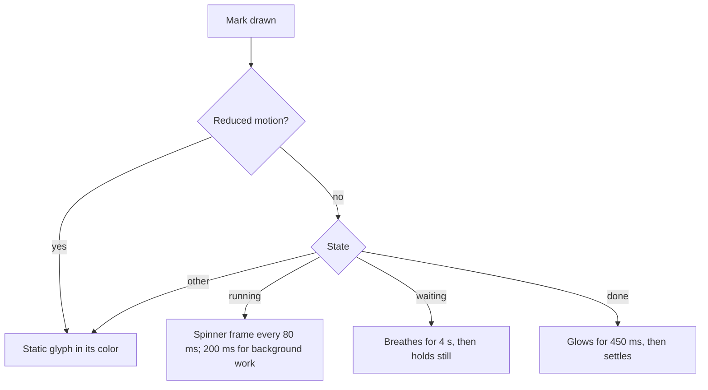

# Terminal UI design rules

Every terminal surface (transcript, footer, pickers, dialogs, panels) draws from one shared set of colors, marks, spacing and cut rules, so the same state looks the same everywhere. Read this page to know what each mark and color means, or to build a theme or extension that fits in. [Themes](themes.md) covers how to change colors; [Terminal UI](tui.md) covers how to use the screen.

## Colors carry roles, not components

A theme assigns colors to roles. A surface picks the role that matches its meaning and never a fixed color.

| Role                                            | Use it for                                                               | Applies to                                            |
| ----------------------------------------------- | ------------------------------------------------------------------------ | ----------------------------------------------------- |
| `accent`                                        | Selection, the cursor, the user-message bar, running work, panel titles  | Pickers, the prompt echo, titles of full-width views  |
| `text`                                          | Default body text                                                        | Everything not listed here                            |
| `muted`                                         | Secondary text: messages about an empty list, labels, `off` badges       | Lists, details, hints' verbs                          |
| `dim`                                           | Weakest text: separators, key names, fold hints, pending marks, ellipses | Footer separators, hint lines, collapsed-row hints    |
| `success`, `warning`, `error`                   | A state that finished well, needs attention, or failed                   | State marks, badges, footer alerts                    |
| `border`, `borderAccent`, `borderMuted`         | Rules and frames: normal, highlighted, subtle                            | Full-width views, code fences, dividers               |
| `toolPendingBg`, `toolSuccessBg`, `toolErrorBg` | The band behind a tool row, by outcome                                   | Tool rows (a theme without these paints no band)      |
| `toolTitle`, `toolOutput`, `toolReason`         | A tool's title, its result text, the line saying why it was called       | Tool rows; `toolReason` inherits `muted` when omitted |
| `userMessageBg`/`Text`, `customMessage*`        | Messages you typed and messages injected by hooks                        | Transcript messages                                   |
| `thinkingText`, `thinkingOff` … `thinkingMax`   | Thinking blocks; the editor border for each thinking level               | Transcript, prompt                                    |
| `selectedBg`, `searchMatch*`, `scrollbar*`      | The selected row, transcript search hits, the fullscreen scrollbar       | Fullscreen mode, pickers                              |
| `md*`, `toolDiff*`, `syntax*`                   | Markdown, diffs and code colors                                          | Rendered replies, diffs, code blocks                  |
| `bashMode`                                      | The prompt border while you type a `!` shell line                        | Prompt                                                |

The complete list of roles, their required or optional status and each fallback is in `themes.md` and the published theme schema.

A state never rests on color alone: every state has a glyph, and badges and warnings also carry a word.

### State colors

Six states cover tools, agents, questions and runs. Each has one mark and one color role.

| State     | Mark | Color role | Meaning                                         |
| --------- | ---- | ---------- | ----------------------------------------------- |
| `pending` | `○`  | `dim`      | Queued, not started                             |
| `running` | `⠋`  | `accent`   | In progress; the mark animates (`◌` when still) |
| `waiting` | `◇`  | `warning`  | Needs you; the mark breathes                    |
| `done`    | `✓`  | `success`  | Finished; the mark glows briefly                |
| `failed`  | `✗`  | `error`    | Ended with an error                             |
| `stopped` | `◼`  | `warning`  | Interrupted or cancelled                        |

Motion applies in this order:



A still screen writes nothing: marks that no longer move stop requesting repaints. Elapsed-time counters tick once per second even in reduced motion.

### Motion gating

Decoration (spinners, shimmer, glow) is still, and a running mark is the static `◌`, when any of these holds: `terminal.reduceMotion` is `true`; it is `"auto"` and stdout is not a terminal, `CI` is set (anything but empty, `0` or `false`), or `OCTOCODE_REDUCE_MOTION`, `REDUCE_MOTION` or `NO_MOTION` is `1` or `true`. An explicit `false` keeps motion on. Piped output therefore never collects spinner frames.

### Contrast

Every theme meets WCAG contrast against the backgrounds its text can land on (black, `#1e1e1e` and `#0d1117` for dark themes; white and `#f6f8fa` for light themes; and every message and selection band): text roles (`text`, `muted`, `dim`, state colors, `md*`, `syntax*`, tool and message text) reach 4.5:1, and border and glyph roles (`border`, `borderAccent`, `borderMuted`, code-fence, quote and rule colors, thinking levels, `bashMode`, the scrollbar thumb) reach 3:1. The scrollbar track is a quiet fill and only has to stay visible. A theme test checks every built-in theme; check a custom theme's `dim`, `borderMuted` and `thinkingOff` first, which most often fall short.

### The state light

Every transcript tool row (bash, file, MCP, Agent cards and background reports), the footer's agent and work rows, and the `+N more` counts draw one dot, `⏺`, in place of the state glyphs above. The moving braille spinner stays on the main working line (the reasoning label and working verb) and the terminal title only.

| State     | Light color | Motion                                                       |
| --------- | ----------- | ------------------------------------------------------------ |
| `running` | `success`   | Lit: breathes toward the light color, at a calm repaint pace |
| `waiting` | `warning`   | Pulses for 4 s, then steady                                  |
| `done`    | `success`   | Glows briefly, then steady                                   |
| `failed`  | `error`     | Steady                                                       |
| `stopped` | `error`     | Steady                                                       |
| `pending` | `dim`       | Unlit                                                        |

Reduced motion draws every light steady in its color. The `+N more` row counts hidden agents with the same lights.

### Page badges

Management pages (such as `/mcp`) summarize an item with one badge of glyph, word and tone, and a legend that names only the states on screen, once each.

| Badge            | Tone      |
| ---------------- | --------- |
| `✓ ready`        | `success` |
| `⚠ needs action` | `warning` |
| `✗ broken`       | `error`   |
| `○ off`          | `muted`   |

## Glyphs

A mark has one meaning. Reuse the mark that already means what you need; do not add a second glyph for the same idea.

| Glyph     | Meaning                                            | Applies when                                              |
| --------- | -------------------------------------------------- | --------------------------------------------------------- |
| `●`       | Presence: a live session or connected server       | Never as a state                                          |
| `✉`       | A message between agents                           | Team panel                                                |
| `⚠`       | A warning                                          | Notices and badges                                        |
| `✻`       | The end-of-job summary line                        | Once, when the whole job ends                             |
| `▸` / `▾` | Collapsed / expanded block                         | Foldable blocks such as reasoning                         |
| `›`       | The selected row's cursor, followed by a space     | Every list; unselected rows get two spaces                |
| `⎿`       | Gutter that leads a result under its call          | First line of a result only; wrapped lines align under it |
| `↳`       | The reason a call was made, or a child under a row | Tool rows, session and team panels                        |
| `▸`       | Leads a note a card adds about an action           | Question cards. It is not a fold marker                   |
| `→`       | From one value to another (`A → B`)                | Changes of state, a question and its answer               |
| `▎`       | The bar before a message you typed                 | User messages                                             |
| `▰` / `▱` | Filled / empty cell of an 8-cell gauge             | Context use in the footer                                 |

The context gauge is green below 50 %, yellow from 50 % to 80 %, red above 80 %, judged on the rounded percent shown. Any use fills at least one cell.

Two text separators are fixed:

- Items on one line are separated by `·` (`key verb · key verb`), drawn in `dim`.
- A cut line ends in `…`, never `...`.

Spinners use braille frames by default; terminals that draw braille too narrow use quarter-circle frames.

## Spacing

| Rule                                                                                                                                   | Applies to                   |
| -------------------------------------------------------------------------------------------------------------------------------------- | ---------------------------- |
| One blank row above each tool row                                                                                                      | Transcript                   |
| Tool rows have one column of padding on each side                                                                                      | Tool rows                    |
| The cursor takes two columns (`› ` or two spaces) so rows stay aligned                                                                 | Lists and pickers            |
| Key-hint lines indent one column                                                                                                       | Selectors, dialogs, pages    |
| The line shown for an empty list indents two columns                                                                                   | Lists, session picker        |
| A full-width view sits between two `border` rules: bold `accent` title, body, then one blank row and a dim footer line when it has one | Manager views such as `/mcp` |

Very narrow terminals reduce panel padding so text and click targets stay aligned.

## Tool rows

Every tool row, a user `!` command included, has the same shape:

```text
 ✓ File(edit src/render/tool.ts) · 1 edit · 1.2s
   ↳ Fix header.
   ⎿  +1 -1
      -const text = clip(summary, 120);
      +const text = clip(summary, 160);
```

| Part        | Rule                                                                                                                                |
| ----------- | ----------------------------------------------------------------------------------------------------------------------------------- |
| Mark        | One state glyph from the glyph table. Nothing inside the result repeats it, except a list where each item has its own state         |
| Title       | A word: `Bash`, `File`, `Agent`, `Skill`. An MCP tool shows its own name and puts its server in the meta. No emoji                  |
| `(key arg)` | The one argument that names the call, in `muted`. A file path in it is a link                                                       |
| Meta        | Dim, after `·`, in this order: qualifiers (`background`, server, `you`), size, waits, then the time last                            |
| Time        | Shown once, in the header, from 1s on for a finished row. The outcome never repeats it                                              |
| `↳` reason  | Two columns in. Parts are joined by `·`                                                                                             |
| `⎿` outcome | Leads the first result row only; the body hangs five columns in. Words colored by state: `exit 0 · 31 lines`, `Done · 4 tool calls` |
| Failure     | A renderer that fails still draws the mark, the title and the `⎿` gutter, then the plain output                                     |

When a header is wider than the row, the mark, title and time stay, the meta is dropped whole (never cut) so the key argument shows uncut, and a key argument too long even then is cut with `…`, keeping the meta only while the argument still gets two thirds of the room.

A one-row `⎿` outcome follows the same rule: its first word stays, and the parts after it (`general-0001`, `14 tool calls`, the expand hint) drop whole from the end, never cut mid-word. The HTML export draws a failed renderer's row as the terminal does and records the error among the problems `/status` and bug reports list.

The band has no vertical padding. No blank row goes between a header and its `⎿` row, or between a `[label]` and a one-line body. A message block (`[compaction]`, `[skill]`, a feature message) is one row when it fits, and its expand hint joins that row. When the hint does not fit, it moves whole to a row of its own.

## Links

File paths are OSC 8 links in terminals that support them: the key argument of a file row, diff file heads, `saved:` and `log:` lines, and the saved-output path of a `!` command. The link points to `file://<host>/<absolute path>`. A line number stays in the label only. Elsewhere the text is unchanged, and links never change a row's width.

## Truncation

A line is cut by visible width: ANSI colors and wide characters are counted correctly, and the cut never splits a character.

| Rule                                                                                                                                                                                                                                                                                                                         | Applies to                      |
| ---------------------------------------------------------------------------------------------------------------------------------------------------------------------------------------------------------------------------------------------------------------------------------------------------------------------------- | ------------------------------- |
| A cut line ends in `…`, and the result fits the width exactly (or is padded to it when asked)                                                                                                                                                                                                                                | Every single-row element        |
| Key hints never wrap. When they do not fit, the least important go first; the last one left is cut with `…`                                                                                                                                                                                                                  | Selector, dialog and page hints |
| Footer parts shorten lowest priority first: a path loses its middle, then shrinks to its last segment, then the part is dropped. When room returns, parts grow back by priority. A part cut to fit, and the whole line when it still overflows, end in a `dim` `…`; the model name, branch and alert rows end in a plain `…` | Footer                          |
| Alerts (warning and error statuses) are dropped whole rather than cut mid-word, and appear in rows of their own                                                                                                                                                                                                              | Footer                          |
| A detail line 1 drops moves to free room on line 2; `… /status` appears when a detail is still shortened or dropped                                                                                                                                                                                                          | Footer                          |
| A collapsed tool result shows 5 lines, then one fold hint: `… +12 lines (ctrl+o to expand)`                                                                                                                                                                                                                                  | Tool rows                       |
| When the preview keeps the last lines, the hint reads `… +12 earlier lines (...)`                                                                                                                                                                                                                                            | Tool rows such as shell output  |
| The fold hint adds `or click` while mouse clicks are active, and names only the count when no key is bound                                                                                                                                                                                                                   | Tool rows                       |
| One empty-state line per list: muted message, then the one key that recovers (`No sessions match "x" · esc clears`)                                                                                                                                                                                                          | Lists                           |
| A scrolling list keeps the selection in view and labels the rows shown, counting items: `1–20/48`                                                                                                                                                                                                                            | Lists                           |

## Lists, dialogs and pages

Every picker, dialog and page is the same list underneath, so the same keys and marks work everywhere.

### Lists

| Concern  | Rule                                                                                                                              |
| -------- | --------------------------------------------------------------------------------------------------------------------------------- |
| Cursor   | `› ` in `accent` on the selected row, its label bold; two spaces on the others                                                    |
| Movement | Up and Down stop at the first and last row; Home and End jump there                                                               |
| Pages    | PgUp and PgDn move the cursor by the rows in view                                                                                 |
| Height   | The list takes what the terminal leaves under its title and hints, up to a page-specific maximum                                  |
| Position | One muted line under the rows, only while the list scrolls: `1–12/30`                                                             |
| Search   | One line above the rows: `⌕ query`. Typing filters; Esc first clears the query, a second Esc cancels                              |
| Empty    | One muted line: `No providers`, or `No providers match "x" · esc clears` while searching                                          |
| Mouse    | The wheel moves the cursor one row; a click selects; a click on the row already selected confirms it in a picker, never on a page |
| Hints    | One line, never wrapped: Enter's verb first, Esc's last                                                                           |

Pickers with a search line take every printable key as search text, so they offer no single-letter actions; short lists (the thinking levels) have no search line.

| Picker               | What differs                                                                                                                                                                                                                                                                                       |
| -------------------- | -------------------------------------------------------------------------------------------------------------------------------------------------------------------------------------------------------------------------------------------------------------------------------------------------- |
| Model (`/model`)     | `alt+i` opens the details; while they are open, PgUp and PgDn scroll them. The switch choice after it is a short list: Esc goes back to the models                                                                                                                                                 |
| Model shortcuts      | Enter toggles the selected model; Esc clears the search, then closes                                                                                                                                                                                                                               |
| Sessions (`/resume`) | The search takes `re:<regex>` and `"exact phrase"`. `ctrl+d` asks before it deletes. Esc closes the preview, then drops the marks, then clears the search, then closes. The header names the scope and sort as one muted fact; the mouse is ignored while the preview or a delete question is open |
| Tree (`/tree`)       | Left and Right page like PgUp and PgDn; the search matches every typed word; the active filter shows beside the position                                                                                                                                                                           |
| Queue (`/queue`)     | No search line, so letter keys act on the selected message: `e` edit, `d` remove, `s` switch kind, `K`/`J` move, `q` close                                                                                                                                                                         |

### Dialogs

A dialog is a title, an optional body and its answers, numbered `1.` to `9.`: a number key moves the cursor to that answer and Enter confirms it.

- Answers name what they do (`Remove`, `Trust`, `Reload`). In a confirmation the safe answer (`Cancel`, `No`, `Not now`) comes first and is selected, so a bare Enter changes nothing.
- A click selects an answer and a second click on it confirms, except in a confirmation or a destructive dialog: there only the keyboard confirms.
- Esc cancels.

### Pages

A page (`/trust`, `/security`, `/memory`, `/mcp` lists, provider details) shows a title, optional facts, sections of rows with a badge, and one hint line.

- Section headings sit above their first row; a section with no rows shows its empty line.
- Page keys move the cursor, so the selected row is always in view and Enter acts on what you see. When the facts are longer than the screen and every row fits, PgUp and PgDn scroll the facts instead, labelled `1–12/20 facts`.
- A row's own keys (`e edit`) appear in the hints only while it is selected.
- Esc reads `back` on a page opened from another page and `close` at the root.

## Key hints

- Show keys as you configured them; the interrupt key reads `esc`, not `escape`.
- A hint is `key verb`: the key in `dim`, the verb in `muted`. Use `interrupt` on the working line of the agent run and `cancel` for a dialog or an operation that ends with no output (retry wait, compaction, shell command).
- A page footer says what Enter does with one of ten verbs: `open`, `run`, `select`, `toggle`, `inspect`, `edit`, `confirm`, `review`, `submit` or `close`.
