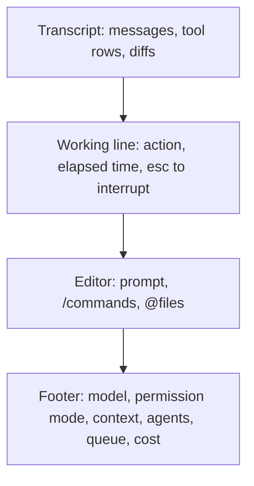

# Terminal UI

`octocode` opens the terminal UI. Keys: [keybindings](keybindings.md). Commands: [commands](commands.md). Colours: [themes](themes.md). Inside tmux also read [tmux](tmux.md).

## Layout modes

| Mode                   | What it does                                                                | Choose it                                            |
| ---------------------- | --------------------------------------------------------------------------- | ---------------------------------------------------- |
| `fullscreen` (default) | Own screen. The transcript scrolls inside Octocode and the mouse works.     | `--tui-mode fullscreen` or `"tuiMode": "fullscreen"` |
| `regular`              | Writes into your terminal's normal scrollback; the terminal owns the mouse. | `--tui-mode regular` or `"tuiMode": "regular"`       |

In regular mode, rows that scrolled into the terminal's scrollback stay as the terminal holds them: a status that changes there is not rewritten, and `ctrl+o` expands or collapses only the output that starts in view. A resize or a theme change repaints everything.

Fullscreen-only settings (see [settings](settings.md)):

| Setting                        | Values                      | Default      | Effect                                                                                          |
| ------------------------------ | --------------------------- | ------------ | ----------------------------------------------------------------------------------------------- |
| `fullscreenExitOutput`         | `transcript`, `resume-hint` | `transcript` | What stays in the terminal after you exit                                                       |
| `fullscreenScrollbar`          | `auto`, `always`, `hidden`  | `auto`       | Scrollbar visibility                                                                            |
| `fullscreenCopyOnSelect`       | boolean                     | `true`       | Selecting text copies it                                                                        |
| `fullscreenWheelScrollLines`   | `auto`, or 1 to 100         | `auto`       | Lines per wheel event                                                                           |
| `fullscreenFrameQueueLimitKiB` | `0`, or 64 to 65536         | `512`        | Queued output before frames are dropped ([pacing](configuration.md#terminal-output-and-pacing)) |

With `fullscreenWheelScrollLines` at `auto`, slow wheel scrolling moves one line per event and a fast flick moves several, more the longer it lasts; frames sum every wheel event that arrives before they paint. A number fixes the lines per event.

Scroll, jump between prompts and search the transcript with the [fullscreen keys](keybindings.md#fullscreen).

Typing or dismissing completion cancels its pending lookup, so a stalled lookup cannot block later completions. Shell completion limits retained output and stops stalled helper processes. Model command suggestions release canceled requests and discard results from an earlier session context.

Scrolling away from the end keeps your reading position while output arrives. The jump-to-latest row reports how many rendered rows are below the viewport; it is not a count of unread messages. Search covers the loaded transcript. On a resumed long session, load earlier entries to search their rendered text. `/links all` searches assistant text in the current session context without rendering hidden history; compacted-away text requires the archive.

## References and copying

`/links [query]` opens a searchable reference picker for the last answer. `/links message [query]` first chooses an answer, newest first; `/links all [query]` searches the session. Enter chooses a reference and then an action; Escape cancels. Full destinations remain available to inspect or copy even when the picker clips a long label.

| Action                           | Result                                                                                                            |
| -------------------------------- | ----------------------------------------------------------------------------------------------------------------- |
| Open                             | Web URLs use the platform handler; local files use the configured editor; backlog links retain their item handler |
| Inspect destination              | Show the full destination in the transcript                                                                       |
| Copy destination / Markdown link | Preserve the complete target                                                                                      |
| Copy location / path             | Preserve the absolute file path and available line and column                                                     |
| Reveal parent folder             | Ask the platform file handler to show its parent directory                                                        |

References retain their session directory, including worktree paths. `src/a.ts:12:3` keeps line 12 and column 3. In fullscreen, activation routes through Octocode; in regular mode, the terminal's native link handler controls clicks, so use `/links` for exact editor handoff. No mouse, OSC 8, VS Code or GUI is required for the picker or copy commands. If a clipboard writer fails, Octocode reports it and the source remains in the transcript. Remote OSC 52 clipboard delivery cannot be acknowledged by the application.

`/copy` keeps the original full-answer copy. Add `message` for plain text, `markdown` for source, `references` for text with full destinations, `code` for literal fenced code (choose a block when several exist), or `location` for a file location. These copies use source content, so line wrapping, folding, borders and code labels do not enter the copied value. Mouse selection copying remains available.

## Editor and VS Code workflows

File opening and `/diff --editor "before file" "after file"` reuse `externalEditor`, then `VISUAL`, then `EDITOR`, then the platform default. Code, Code Insiders, Codium and Cursor receive separate `--reuse-window --goto` arguments for file positions. Vim, Neovim, Nano and Emacs receive their own location syntax; unknown editors receive the path. Diff handoff supports Code-family editors, Vim/Neovim, Meld and Beyond Compare. Unsupported editors can use the existing `/diff [path]` terminal view. The compared files remain on disk; no temporary snapshots expire while a GUI is open.

For VS Code, set `externalEditor` to `code --wait` to edit long prompts with Ctrl+G and return after closing the editor tab. On Windows, use the editor executable if a command-shell wrapper cannot launch. In SSH, WSL or containers, configure an editor in that environment: Octocode does not infer a remote URI from a local path. You can always copy the location for another application.

VS Code also offers **Terminal: Open Detected Link**, **Open Accessible View**, and accessible terminal navigation. Native detection depends on the current buffer; `/links` reads message source in either display mode. If VS Code intercepts a shortcut, inspect its terminal keybinding routing and use the narrow [Shift+Enter recipe](keybindings.md#shiftenter-and-new-lines), or rebind the Octocode action. Avoid routing every IDE shortcut to the shell. Terminal-tab progress uses the existing progress integration when supported by the host. Ordinary terminals keep the same working line and cancellation controls.

## Highlighting and activity

Known fence languages get syntax colors; unknown languages and oversized blocks use readable code text. Large growing blocks reuse completed highlighted lines between bounded full passes; new text remains visible in the code-block color, and completion runs the exact final highlighter. Repeated scrolling reuses rendered blocks. `NO_COLOR` and `TERM=dumb` retain plain output, and reduced motion stops decorative animation without stopping elapsed time.

The working line distinguishes model activity, tools and user prompts. After 30 seconds without a model event during a model wait, it also reports that quiet interval. Tools and user prompts have their own activity; a new model wait starts a fresh interval. This is separate from total run time and does not declare a failure or trigger a retry. Escape remains the interrupt action.

## Screen parts

| Part         | Shows                                                                                                                                                        |
| ------------ | ------------------------------------------------------------------------------------------------------------------------------------------------------------ |
| Working line | `⠙ Running Bash (12s · esc to interrupt)`: the action and the run's elapsed time. On a narrow terminal the interrupt hint goes first, then the action.       |
| Tool row     | The tool title, a `↳` line saying why the call was made, and the result. `Ctrl+O` expands or collapses tool output; `Ctrl+T` hides or shows thinking blocks. |
| Run summary  | One dim line after a run, such as `✻ Worked 52s · 7 tools · 3 agents · ≈$4.12 · cache 61%`.                                                                  |
| Footer       | State that lasts: model and thinking level, permission mode, context use, running agents and jobs, queued messages, cost, and `/web · backlogs & activity`.  |
| Messages     | One-off lines such as `Tool output: expanded`. Not saved in the session, not sent to the model; back-to-back info lines share one row.                       |

`/help` opens a searchable command picker (it inserts the command; it does not run it). `/effort` sets reasoning effort; `/context size` sets the session context budget. More on status lines: [native features](native-features.md#live-status).

## Links, images, notifications

| Feature       | Behaviour                                                                                                                      | Control                                                                                                                      |
| ------------- | ------------------------------------------------------------------------------------------------------------------------------ | ---------------------------------------------------------------------------------------------------------------------------- |
| Hyperlinks    | Links are clickable in terminals with OSC 8. In fullscreen a backlog id such as `B90` is a link; a click runs `/web item B90`. | `terminal.hyperlinks` (`true`, `false`, `auto`), `OCTOCODE_HYPERLINKS=1\|0\|auto`                                            |
| Images        | Inline when the terminal supports them.                                                                                        | `terminal.showImages`, `terminal.images`, `OCTOCODE_IMAGE_PROTOCOL`; see [terminal images](configuration.md#terminal-images) |
| Notifications | Desktop notice when an answer is ready, a run fails or Octocode asks you something.                                            | `OCTOCODE_NOTIFY=off\|unfocused\|always`, `OCTOCODE_NOTIFY_METHOD`; see [tmux](tmux.md#notifications)                        |
| Motion        | Spinners and shimmer freeze; elapsed times keep ticking.                                                                       | `terminal.reduceMotion`, `OCTOCODE_REDUCE_MOTION=1`                                                                          |
| Mermaid       | Mermaid blocks in replies draw as Unicode diagrams.                                                                            | `markdown.mermaid` (`off`, `final`, `streaming`)                                                                             |

All variables: [environment variables](environment-variables.md).

## When the screen misbehaves

Run `/debug terminal` to see the selected mode, colors, links, images, keyboard protocol, explicit overrides, motion, clipboard limitations and output queue. It enables aggregate rendering counters until exit; run it again after reproducing the problem. A zero counter can mean that no sample has been collected. It does not read the conversation or probe the clipboard. `/debug` retains the redacted diagnostics-file workflow.

| Symptom                                                         | Try                                                                                                                   |
| --------------------------------------------------------------- | --------------------------------------------------------------------------------------------------------------------- |
| Alt keys read as Escape, or long pastes arrive split (slow SSH) | Raise `OCTOCODE_TUI_ESC_TIMEOUT` or `OCTOCODE_TUI_PASTE_TIMEOUT` (milliseconds)                                       |
| Leftover rows after content shrinks                             | `terminal.clearOnShrink: true`                                                                                        |
| A component fails to draw                                       | The chat shows `Display failed: <Component> could not render: <error>` once per failure; the rest keeps working       |
| You need the raw terminal output                                | `OCTOCODE_TUI_WRITE_LOG` copies everything written; `OCTOCODE_TUI_DEBUG=1`, `OCTOCODE_TUI_DEBUG_REDRAW=1` log renders |

Other front ends: [web workspace](web-workspace.md), [remote](remote.md), [RPC](rpc.md), [ACP](acp.md), [local session API](session-api.md).
