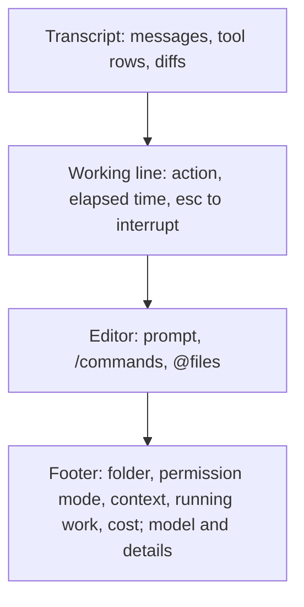

# Terminal UI

`octocode` opens the terminal UI. Keys: [keybindings](keybindings.md). Commands: [commands](commands.md). Colours: [themes](themes.md). Inside tmux also read [tmux](tmux.md).

## Layout modes

| Mode                   | What it does                                                                | Choose it                                            |
| ---------------------- | --------------------------------------------------------------------------- | ---------------------------------------------------- |
| `fullscreen` (default) | Own screen. The transcript scrolls inside Octocode and the mouse works.     | `--tui-mode fullscreen` or `"tuiMode": "fullscreen"` |
| `regular`              | Writes into your terminal's normal scrollback; the terminal owns the mouse. | `--tui-mode regular` or `"tuiMode": "regular"`       |

In regular mode, rows that scrolled into the terminal's scrollback stay as the terminal holds them: a status that changes there is not rewritten, and `ctrl+o` expands or collapses only the output that starts in view. Clicking an expanded tool result that has scrolled partly off the screen collapses it without clearing scrollback: only the screen is repainted, so the expanded output you scrolled past stays in the terminal's scrollback above the collapsed row until the next resize or theme change repaints everything. A resize or a theme change repaints everything.

A long regular-mode session keeps only its latest transcript rows in memory. Once the transcript passes about 600 rows (messages, tool results and notices), the oldest finished ones that scrolled off the screen leave it at the start of the next turn, behind one row saying how many left. They stay in the terminal's scrollback, so nothing on screen changes; the next resize or theme change redraws only the rows still loaded. Press `alt+pageUp` (`app.session.loadEarlier`) to rebuild the transcript from the session, as a resume draws it.

Fullscreen-only settings (see [settings](settings.md)):

| Setting                        | Values                      | Default      | Effect                                                                                          |
| ------------------------------ | --------------------------- | ------------ | ----------------------------------------------------------------------------------------------- |
| `fullscreenExitOutput`         | `transcript`, `resume-hint` | `transcript` | What stays in the terminal after you exit                                                       |
| `fullscreenScrollbar`          | `auto`, `always`, `hidden`  | `auto`       | Scrollbar visibility                                                                            |
| `fullscreenCopyOnSelect`       | boolean                     | `true`       | Selecting text copies it                                                                        |
| `fullscreenWheelScrollLines`   | `auto`, or 1 to 100         | `auto`       | Lines per wheel event                                                                           |
| `fullscreenFrameQueueLimitKiB` | `0`, or 64 to 65536         | `512`        | Queued output before frames are dropped ([pacing](configuration.md#terminal-output-and-pacing)) |

With `fullscreenWheelScrollLines` at `auto`, a single wheel notch moves three lines (as in vim), steady scrolling moves at least as fast as separate notches, and a fast spin or flick moves more, more the longer it lasts. Frames sum every wheel event that arrives before they paint, up to 24 lines a frame, at the display's 60 Hz. A number fixes the lines per event. Alt+wheel scrolls five times as far. While you scroll, spinners and shimmer hold still. The scrollbar shows while you scroll and highlights under the pointer; bare pointer movement is reported only while it shows.

Dragging copies what you see as text: a line the terminal width wrapped comes back as one line, and the left padding the copied rows share is dropped, so indentation inside code stays. The confirmation says how much was copied (`Copied 3 lines · 1,204 chars`). To use your terminal's own selection instead, hold Shift while dragging (most terminals), or press `alt+m` to hand the mouse to the terminal and press it again to take it back; the first copy of a screen names both. These notices show at the top right of the screen for a few seconds; a transcript row they would cut is blank while they show. A drag held on or past the top or bottom edge of the transcript keeps scrolling it, faster the further past the edge the pointer is and the longer you hold, up to 24 lines a step.

Scroll, jump between prompts and search the transcript with the [fullscreen keys](keybindings.md#fullscreen). `/find` opens transcript search too, for terminals where `ctrl+shift+f` arrives as `ctrl+f`.

## Typing, pasting and sending

| Situation                                                                       | What happens                                                                                                                                                                                                                                                                                                                                                                                                                                                                                                                                                                              |
| ------------------------------------------------------------------------------- | ----------------------------------------------------------------------------------------------------------------------------------------------------------------------------------------------------------------------------------------------------------------------------------------------------------------------------------------------------------------------------------------------------------------------------------------------------------------------------------------------------------------------------------------------------------------------------------------- |
| Enter before startup finishes                                                   | The prompt stays in the editor, marked as queued, and is sent once startup is ready. Esc cancels it; editing or clearing it means you are still writing, so nothing is sent.                                                                                                                                                                                                                                                                                                                                                                                                              |
| A large paste (over 10 lines or 1,000 characters)                               | The editor shows a `[paste #1 +40 lines]` marker; the model receives the full text.                                                                                                                                                                                                                                                                                                                                                                                                                                                                                                       |
| A prompt the app refuses (an unknown command, a `!` command while another runs) | It comes back with its paste markers, cursor and undo steps.                                                                                                                                                                                                                                                                                                                                                                                                                                                                                                                              |
| Prompt history (Up)                                                             | Up recalls the previous prompt in an empty editor or from the start of the first line. In a draft the first Up moves the cursor to that start and the next one recalls, so a refused `/version` left in the editor takes two presses; Down past the newest prompt brings the draft back. A prompt comes back with the cursor at its end; Up and Down keep browsing until you move the cursor. Built-in commands you ran are recalled too. A prompt with pastes comes back with its markers, and sends the same full text again. A long prompt from a resumed session shows as one marker. |
| A slash command's argument typed in full (`/backlog tui`)                       | One Enter runs it, even while the completion list is open.                                                                                                                                                                                                                                                                                                                                                                                                                                                                                                                                |
| `ctrl+c` on the prompt                                                          | While a turn, a `!` command or a compaction runs, the first press stops it as Esc does and keeps your draft; otherwise it clears the editor. Either way the prompt shows `ctrl+c again to exit` for 1 s, and a second press within that second exits.                                                                                                                                                                                                                                                                                                                                     |
| Text that starts with `//`                                                      | Not a command. The first Enter keeps it and asks; Enter again sends it as a message.                                                                                                                                                                                                                                                                                                                                                                                                                                                                                                      |
| A paste the terminal sends without bracketed paste mode                         | The editor takes the characters of one terminal read together: the same text, undo steps and completion as typing them, in one step.                                                                                                                                                                                                                                                                                                                                                                                                                                                      |

Typing or dismissing completion cancels its pending lookup, so a stalled lookup cannot block later completions. Shell completion limits retained output and stops stalled helper processes. Model command suggestions release canceled requests and discard results from an earlier session context.

Scrolling away from the end keeps your reading position while output arrives. The jump-to-latest row reports how many rendered rows are below the viewport; it is not a count of unread messages. It starts with `New output` when rows arrived below while you were scrolled up. Search covers the loaded transcript as drawn: a word the terminal width breaks across two rows still matches, but text inside a collapsed block is not searched until you expand it, and a search without matches says so when the transcript has one. On a resumed long session, load earlier entries to search their rendered text. `/links all` searches assistant text in the current session context without rendering hidden history; compacted-away text requires the archive.

System notifications appear as separate messages in the transcript. Expand a wake event to see its topic, source, destination and recorded data. Older sessions show the summary they recorded.

## References and copying

`/links [query]` opens a searchable reference picker for the last answer. `/links message [query]` first chooses an answer, newest first; `/links all [query]` searches the session. Enter chooses a reference and then an action; Escape cancels. Full destinations remain available to inspect or copy even when the picker clips a long label.

| Action                           | Result                                                                                                        |
| -------------------------------- | ------------------------------------------------------------------------------------------------------------- |
| Open                             | Web URLs use the platform handler; local files use `referenceOpener`; backlog links retain their item handler |
| Inspect destination              | Show the full destination in the transcript                                                                   |
| Copy destination / Markdown link | Preserve the complete target                                                                                  |
| Copy location / path             | Preserve the absolute file path and available line and column                                                 |
| Reveal parent folder             | Ask the platform file handler to show its parent directory                                                    |

References retain their session directory, including worktree paths. `src/a.ts:12:3` keeps line 12 and column 3. In fullscreen, activation routes through Octocode; in regular mode, the terminal's native link handler controls clicks, so use `/links` for exact editor handoff. No mouse, OSC 8, VS Code or GUI is required for the picker or copy commands. If a clipboard writer fails, Octocode reports it and the source remains in the transcript. Remote OSC 52 clipboard delivery cannot be acknowledged by the application.

`/copy` keeps the original full-answer copy. Add `message` for plain text, `markdown` for source, `references` for text with full destinations, `code` for literal fenced code (choose a block when several exist), or `location` for a file location. These copies use source content, so line wrapping, folding, borders and code labels do not enter the copied value. In fullscreen, hold the left mouse button and use the wheel to extend a selection beyond the visible rows. Releasing the button copies the selected text when `fullscreenCopyOnSelect` is enabled.

## Editor and VS Code workflows

File references and `/diff --editor "before file" "after file"` use `referenceOpener` ([configuration](configuration.md)); Ctrl+G uses the prompt editor (`externalEditor`, then `VISUAL`, then `EDITOR`, then the platform default).

```mermaid
flowchart TD
    R[referenceOpener] -->|auto| I{Inside an IDE terminal?}
    I -->|yes, CLI found| C["IDE CLI: --reuse-window --goto file:line:col"]
    I -->|no| P{GUI CLI on PATH, with a display?}
    P -->|yes| G["code, cursor, code-insiders, codium, zed or subl"]
    P -->|none found, with a display| S["system default app (open, xdg-open)"]
    P -->|over SSH or no display| E[prompt editor]
    R -->|editor| E
    R -->|a command| X[that command]
```

| Editor                                | File position                                               | `/diff --editor`                        | Terminal                                   |
| ------------------------------------- | ----------------------------------------------------------- | --------------------------------------- | ------------------------------------------ |
| Code, Code Insiders, VSCodium, Cursor | `--reuse-window --goto path:line:col` in the current window | `--reuse-window --diff before after`    | Kept: the editor starts beside the session |
| Zed, Sublime Text                     | `path:line:col`                                             | Prompt editor's diff                    | Kept                                       |
| Vim, Neovim                           | `+call cursor(line,col) path`                               | `-d before after` (prompt editor)       | Handed to the editor until it exits        |
| Nano, Emacs                           | `+line,col` / `+line:col`                                   | None                                    | Handed to the editor until it exits        |
| Other                                 | The path                                                    | Meld and Beyond Compare (prompt editor) | Handed to the editor until it exits        |

Inside an IDE terminal, Octocode finds the IDE's own CLI from the terminal's environment, so `code` does not need to be on PATH; in a remote window it uses the remote CLI, which opens the file in your local window. A configured `--wait` is dropped when opening a reference, because Octocode does not wait for a GUI editor. On Windows, Octocode starts the editor's `.exe` that a `.cmd` launcher names, never through a command shell; if it cannot find one, set `referenceOpener` to the `.exe`. Paths are always absolute and passed as separate arguments, never through a shell. Unsupported diff editors can use the `/diff [path]` terminal view. The compared files remain on disk; no temporary snapshots expire while a GUI is open.

For Ctrl+G, a Code-family editor, Zed or Sublime Text gets `--wait` when the command lacks it, so Octocode resumes after you close the tab. In SSH, WSL or containers without an IDE terminal, configure an editor in that environment: Octocode does not infer a remote URI from a local path. You can always copy the location for another application.

VS Code also offers **Terminal: Open Detected Link**, **Open Accessible View**, and accessible terminal navigation. Native detection depends on the current buffer; `/links` reads message source in either display mode. If VS Code intercepts a shortcut, inspect its terminal keybinding routing and use the narrow [Shift+Enter recipe](keybindings.md#shiftenter-and-new-lines), or rebind the Octocode action. Avoid routing every IDE shortcut to the shell. Terminal-tab progress uses the existing progress integration when supported by the host. Ordinary terminals keep the same working line and cancellation controls.

## Highlighting and activity

Known fence languages get syntax colors; unknown languages and oversized blocks use readable code text. Large growing blocks reuse completed highlighted lines between bounded full passes; new text remains visible in the code-block color, and completion runs the exact final highlighter. Repeated scrolling reuses rendered blocks. `NO_COLOR` and `TERM=dumb` retain plain output, and reduced motion stops decorative animation without stopping elapsed time.

The working line distinguishes model activity, tools and user prompts. After 30 seconds without a model event during a model wait, it also reports that quiet interval. Tools and user prompts have their own activity; a new model wait starts a fresh interval. This is separate from total run time and does not declare a failure or trigger a retry. Escape remains the interrupt action.

## Screen parts

Marks, colors, spacing and cut rules are listed in [Terminal UI design rules](tui-design.md).

| Part         | Shows                                                                                                                                                                                                                                                                                                                                                                                                                                                                                                                                      |
| ------------ | ------------------------------------------------------------------------------------------------------------------------------------------------------------------------------------------------------------------------------------------------------------------------------------------------------------------------------------------------------------------------------------------------------------------------------------------------------------------------------------------------------------------------------------------ |
| Working line | `⠙ Running Bash (12s · esc to interrupt)`: the action and the run's elapsed time. On a narrow terminal the interrupt hint goes first, then the action. A `!` command you typed shows its own line under its row, `⠙ Running… 12s · esc cancel`, with the time from 1 s on.                                                                                                                                                                                                                                                                 |
| Tool row     | The tool title, a `↳` line saying why the call was made, and the result. `Ctrl+O` expands or collapses tool output; `Ctrl+T` hides or shows thinking blocks.                                                                                                                                                                                                                                                                                                                                                                               |
| Waiting line | `⠹ Waiting on 4 agents · 1 bash (4m02s)`: no run is active, but background agents, jobs, a report about to wake the session or a timer keep the job going. The mark is the working spinner while that work runs (a full `⏺` in reduced motion), and `◇` when only a timer is left. It also reads `Resuming: report from …` or `◇ Waiting for timer #4 · in 12m`.                                                                                                                                                                           |
| Run summary  | One dim line when the whole job ends (nothing runs, no wake or timer is pending), such as `✻ Worked 4m02s · waited 10m49s · 42 tools · 4 agents · ≈$2.09 · cache 96%`; ongoing items you still hold add `· 2 items still open` in warning color.                                                                                                                                                                                                                                                                                           |
| Footer       | Two lines of state that lasts. Line 1: folder ⎇ branch, permission mode and an open plan (left); context use, tokens and cached share (center); running agents and jobs, queued messages, a plan window near its cap and the total `Σ` (right). Line 2: the session's [activity light](tui-design.md#activity-light) (with its word, such as `needs you`, unless idle), `model:effort`, the provider kind, session name and compactions (left); steps, backlog with `/web`, GitHub token, the last run's speed and other statuses (right). |
| Messages     | One-off lines such as `Tool output: expanded`. Not saved in the session, not sent to the model; back-to-back info lines share one row.                                                                                                                                                                                                                                                                                                                                                                                                     |

`/help` opens a searchable command picker (it inserts the command; it does not run it). `/effort` sets reasoning effort; `/context size` sets the session context budget. More on status lines: [native features](native-features.md#live-status).

The footer shows one total, `Σ`: this session and every agent under it, live or finished, each counted once. Money billed per token is kept apart from what a plan paid for, which is only an estimate at list price: `Σ ≈$1.24`, `Σ ~$3.10 plan` or `Σ ≈$1.24 · ~$3.10 plan`, and `Σ (sub)` when a plan paid for everything and nothing had a price. A running subagent counts on the side its own billing puts it. When the session model's provider reports a plan window at 70 % or more, its fullest window shows beside `Σ`: `quota 5h 82% · resets 14:20`, yellow, red from 90 %. The context gauge (`ctx ▰▰▰▱▱▱▱▱ 42% of 200k`) is the tokens in use over the model's context window, the same figure `/context` shows; it follows `/context <size>` at once, and any use fills one bar cell and reads `<1%`. It turns yellow from half of the window and red once use reaches 80% of the auto-compact point, so it warns before compaction. Tokens are new prompt tokens plus output; cache reads show only as the cached share (`96% cached`, the whole session's rate). As the terminal narrows, a long folder path loses its middle first (`/…/app/src`), the command hints leave, then the routine counters, the agent's name, the token breakdown, the context bar, the tokens and the cached share; the folder shortens to its name. The permission mode, the context percentage and `Σ` stay; in red the context keeps its bar and percent. A detail with no room on line 1 moves to free room on line 2; when details still do not fit, `… /status` ends line 2. A warning or error that does not fit whole gets up to two rows of its own below the footer, then `+N alerts · /status`. `/status` puts every current footer status and its full text into the transcript, alongside session, token, cache and cost details. Every amount is an estimate at the model's list prices, so `/status`, `/usage` and the footer write money one way: `≈$1.24`, `≈$<0.01` under a cent, `(sub)` or `~$X plan` for what a plan paid; only the `/status` per-turn lines keep four decimals (`≈$0.0037`) so cheap turns still compare. Error and warning labels remain readable without color.

Session loading shows progress before the full list is ready. Rename and delete show their pending state and accept one submission at a time. Closing the picker keeps a late completion from reopening it. A search with no matches offers a way to clear the query.

`/queue` shows queued messages and their delivery order. Edit and close hints follow your configured selection keys; letter shortcuts remain available. Empty queues offer only the close action. Shared panels reduce their padding in very narrow terminals so text and click targets stay aligned.

Tool cards show supplied goals and reasons, including individual queries in a batched call. Query labels keep their association with returned results, and result metadata is distinguished from the call's metadata. Goals have stronger emphasis than explanatory reasons. Compact cards offer an expansion hint for longer metadata; `Ctrl+O` expands the full fields. Argument values remain available, with repeated purpose fields shown in their dedicated rows. Long expanded cards use transcript scrolling. Full HTML exports retain the complete metadata.

Transcript rows follow one shape: a state mark, a one-word title, the key argument and dim meta with the time last, then the outcome under `⎿`. A `!` command reads `✓ ! ls packages · you · 1.4s` and keeps its last 20 output lines while collapsed. A compaction reads `[compaction] 123k tokens → 6-token summary`. The full rules are in [Terminal UI design rules](tui-design.md#tool-rows).

## Links, images, notifications

| Feature       | Behaviour                                                                                                                      | Control                                                                                                                      |
| ------------- | ------------------------------------------------------------------------------------------------------------------------------ | ---------------------------------------------------------------------------------------------------------------------------- |
| Hyperlinks    | Links are clickable in terminals with OSC 8. In fullscreen a backlog id such as `B90` is a link; a click runs `/web item B90`. | `terminal.hyperlinks` (`true`, `false`, `auto`), `OCTOCODE_HYPERLINKS=1\|0\|auto`                                            |
| Images        | Inline when the terminal supports them.                                                                                        | `terminal.showImages`, `terminal.images`, `OCTOCODE_IMAGE_PROTOCOL`; see [terminal images](configuration.md#terminal-images) |
| Notifications | Desktop notice when an answer is ready, a run fails or Octocode asks you something.                                            | `OCTOCODE_NOTIFY=off\|unfocused\|always`, `OCTOCODE_NOTIFY_METHOD`; see [tmux](tmux.md#notifications)                        |
| Motion        | Spinners and shimmer freeze; elapsed times keep ticking.                                                                       | `terminal.reduceMotion`, `OCTOCODE_REDUCE_MOTION=1`                                                                          |
| Mermaid       | Mermaid blocks in replies draw as Unicode diagrams; the agent is told so and writes them only while this is on.                | `markdown.mermaid` (`off`, `final`, `streaming`)                                                                             |

All variables: [environment variables](environment-variables.md).

## When the screen misbehaves

Run `/debug terminal` to see the selected mode, colors, links, images, keyboard protocol, explicit overrides, motion, clipboard limitations, output queue, the latency fence (supported, behind, last round trip, floor, held frames) and terminal stalls. It enables aggregate rendering counters until exit; run it again after reproducing the problem. A zero counter can mean that no sample has been collected. It does not read the conversation or probe the clipboard. `/debug` retains the redacted diagnostics-file workflow.

| Symptom                                                         | Try                                                                                                                   |
| --------------------------------------------------------------- | --------------------------------------------------------------------------------------------------------------------- |
| Alt keys read as Escape, or long pastes arrive split (slow SSH) | Raise `OCTOCODE_TUI_ESC_TIMEOUT` or `OCTOCODE_TUI_PASTE_TIMEOUT` (milliseconds)                                       |
| Leftover rows after content shrinks                             | `terminal.clearOnShrink: true`                                                                                        |
| Scrollback starts at "earlier rows not redrawn" after a resize  | A redraw writes the last `terminal.replayRows` rows (default 5000); `0` writes every row                              |
| A component fails to draw                                       | The chat shows `Display failed: <Component> could not render: <error>` once per failure; the rest keeps working       |
| You need the raw terminal output                                | `OCTOCODE_TUI_WRITE_LOG` copies everything written; `OCTOCODE_TUI_DEBUG=1`, `OCTOCODE_TUI_DEBUG_REDRAW=1` log renders |

### VS Code terminal

VS Code draws its terminal with a WebGL renderer, or a DOM renderer when WebGL fails. The DOM renderer is [much slower](https://code.visualstudio.com/docs/terminal/appearance#_gpu-acceleration), which shows as lag when Octocode repaints.

| Check or setting                              | Effect                                                                                                                                                                                                                                                                            |
| --------------------------------------------- | --------------------------------------------------------------------------------------------------------------------------------------------------------------------------------------------------------------------------------------------------------------------------------- |
| VS Code `terminal.integrated.gpuAcceleration` | Keep the default `auto`. `"off"` forces the slow DOM renderer; use it only to work around GPU glyph bugs such as a coloured triangle or black block.                                                                                                                              |
| Octocode `terminal.reduceMotion`              | `true` freezes spinners and shimmer, so there is less to repaint. `"auto"` (default) follows `OCTOCODE_REDUCE_MOTION`.                                                                                                                                                            |
| Octocode `terminal.latencyFence`              | `"auto"` (default, on) probes display lag with `DSR 5n` and holds streaming frames while the terminal is behind. Set `false`, or `OCTOCODE_LATENCY_FENCE=0`, if a terminal misbehaves with the probe; `OCTOCODE_LATENCY_FENCE=1` forces it on. `/debug terminal` shows its state. |
| Octocode `tuiMode`                            | `"fullscreen"` (default) or `"regular"`; try `regular` if fullscreen repaints lag.                                                                                                                                                                                                |

Values and defaults: [settings](settings.md).

Some VS Code bugs make a healthy session look frozen:

| Symptom                                                                     | VS Code issue                                                                                              | What to do                                                                                                                                                                                                                                                                               |
| --------------------------------------------------------------------------- | ---------------------------------------------------------------------------------------------------------- | ---------------------------------------------------------------------------------------------------------------------------------------------------------------------------------------------------------------------------------------------------------------------------------------- |
| After a window reload the terminal stops updating and takes no keys         | [#335982](https://github.com/microsoft/vscode/issues/335982) (open): the reload leaves the terminal paused | Close the tab and run `octocode --continue`. To avoid it, set `terminal.integrated.enablePersistentSessions` to `false`: a reload then closes terminals instead of reconnecting them ([persistent sessions](https://code.visualstudio.com/docs/terminal/advanced#_persistent-sessions)). |
| VS Code's memory grows during long, busy terminal sessions until it crashes | [#234393](https://github.com/microsoft/vscode/issues/234393): fixed in VS Code 1.138                       | Update VS Code to 1.138 or later.                                                                                                                                                                                                                                                        |
| Windows: busy sessions in split terminals freeze the desktop                | [#333977](https://github.com/microsoft/vscode/issues/333977) (open)                                        | Run each session in its own terminal tab instead of a split. The report saw it with both renderers (`gpuAcceleration` `"off"` leaked handles too); its other workaround was VS Code 1.134.                                                                                               |

To tell a terminal that stopped reading from a busy Octocode, run `/debug terminal` and read the `Terminal stalls` row:

- `none` means queued output never waited 5 seconds. If the screen still looks stuck, Octocode itself is busy (see the event-loop delay and CPU rows) or the keys are not arriving.
- A count means the terminal stopped reading output for 5 seconds or more. The row gives when the latest stall began, how long it lasted (or `ongoing`), the largest output queue, the frame bytes dropped and the bytes kept (mode changes and transcript rows, which are never dropped).

While the terminal is not reading, Octocode keeps running: it drops frames, holds title and progress updates, and repaints once the terminal reads again. A `/bug` report includes the stalls.

Octocode adapts to any terminal on its own:

- When the terminal falls behind drawing (measured from its replies, above the normal delay of an SSH or mosh link), spinners and shimmer pause and streaming text repaints once per reply; keystrokes always repaint at once. A terminal that does not answer is paced as before. Inside tmux, Zellij or mosh the multiplexer answers, so pacing follows the multiplexer rather than the terminal around it.
- While the terminal window is not focused, spinners and shimmer slow to a step about every half second; elapsed counters keep ticking, so running work still shows it moves. Reduced motion still stops them. A focus report or any keystroke restores full speed.

The tab title starts with `◈` (🦑 with emoji marks on) and Octocode's state, then the agent's team name, the session's name (else its first prompt) and folder: `◈⠋ nifty-eel Running - fix login · repo · 2 agents`. While background subagents run, the title ends with their number. The state is the footer's activity light, refined while the agent's own run goes on; a `!` command you run does not change it, as it does not change the light.

| Title           | When                                                                                    |
| --------------- | --------------------------------------------------------------------------------------- |
| `◈⠋ Thinking`   | the model is answering; the loader turns                                                |
| `◈⠋ Running`    | a tool of the agent's run executes; the loader turns                                    |
| `◈⏳ Waiting`   | the run ended and background subagents, jobs, a wake, compaction or a retry still go on |
| `◈⚠️ Needs you` | a question or approval waits for you                                                    |
| `◈🟢 Done`      | the job ended well; stays until you come back (focus the terminal or press a key)       |
| `◈🔴 Error`     | the job failed, or stopped with items still open; stays until you come back             |
| `◈ Idle`        | nothing runs, a pending timer included                                                  |

When Octocode exits, the title keeps only the name and folder. VS Code shows the process name on tabs by default; set `terminal.integrated.tabs.title` to `${sequence}` to see this title.

Octocode marks who is working the same way everywhere: 🦑 is the main agent (your session), 🐙 a subagent it started.

| Where                         | Main agent                 | Subagents                                                                                   |
| ----------------------------- | -------------------------- | ------------------------------------------------------------------------------------------- |
| Agents panel under the editor | its top row: `🦑 name`     | each row: `├ ⠋ name` (the tree says it is a subagent, so no 🐙); peer sessions: `🦑 name ⠋` |
| Footer                        | `🦑 name`                  | the running count: `🐙 2 agents`                                                            |
| Transcript                    |                            | `🐙 Agent(goal)` rows and background reports                                                |
| `/processes`                  | main, RPC and ACP sessions | every subagent process                                                                      |

| Symptom of a frozen session                                                                                                                                                                                                                          | Recovery                                                                                                                                 |
| ---------------------------------------------------------------------------------------------------------------------------------------------------------------------------------------------------------------------------------------------------- | ---------------------------------------------------------------------------------------------------------------------------------------- |
| No response to keys, Ctrl+C does nothing, 0% CPU, after VS Code stopped reading the terminal (window reload, detached terminal). Older Octocode versions wait on such a terminal forever; current ones keep running and repaint when it reads again. | Close the terminal tab or end the process, then run `octocode --continue` in the same folder to resume the conversation ([CLI](cli.md)). |

Other front ends: [web workspace](web-workspace.md), [remote](remote.md), [RPC](rpc.md), [ACP](acp.md), [local session API](session-api.md).
